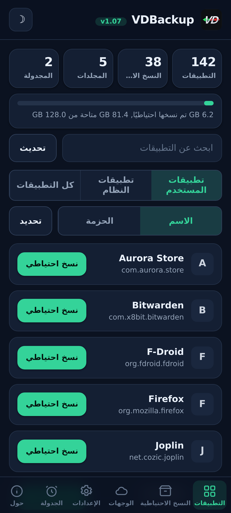
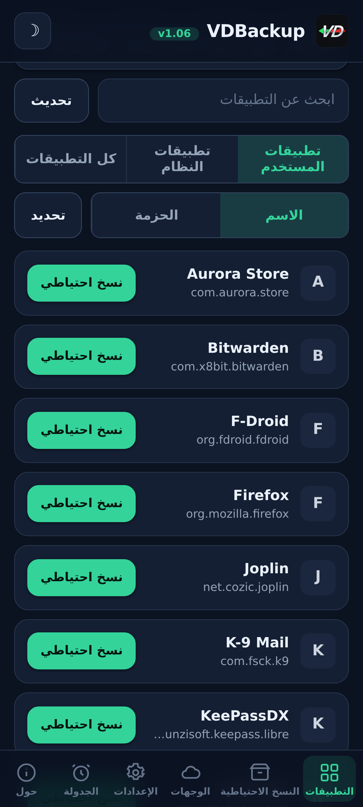
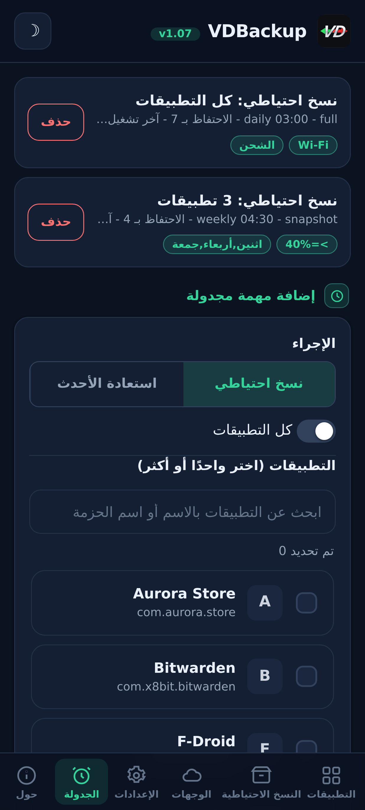
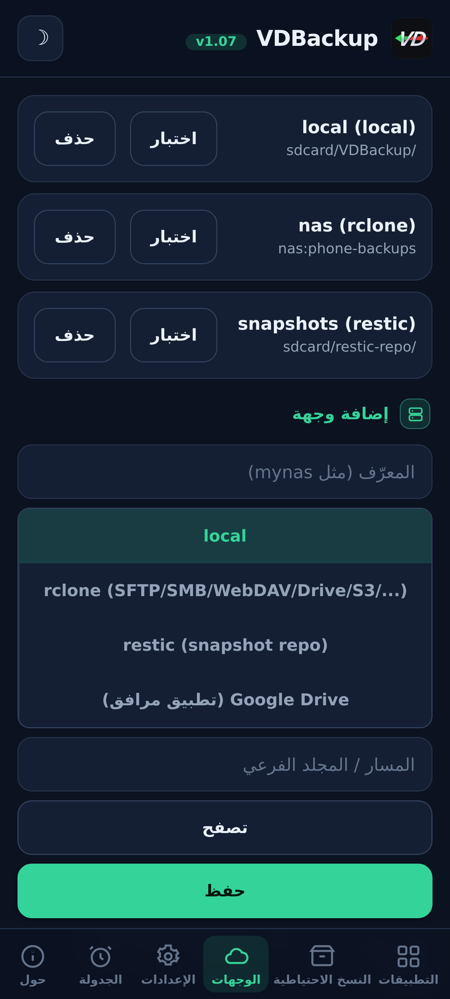
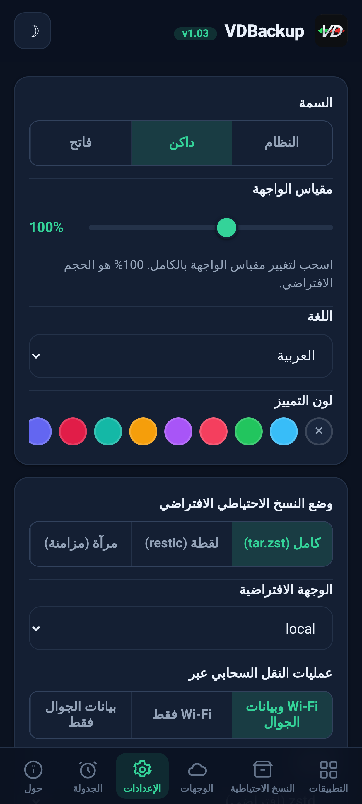
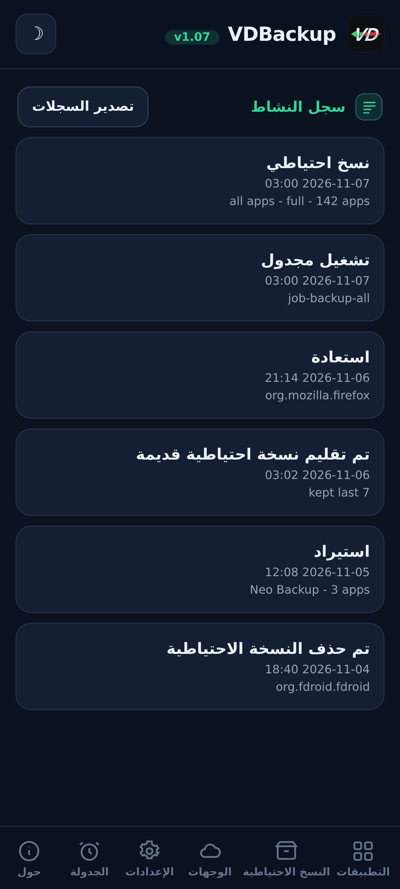

<!--
  VD BACKUP - full app & data backup and restore as root, from a WebUI.
  Copyright (C) 2026  VD171 - SPDX-License-Identifier: AGPL-3.0-or-later
-->

  

  <b>نسخ احتياطي واستعادة كاملان للتطبيقات والبيانات بصلاحيات الجذر, يُدار بالكامل من واجهة WebUI.</b> 
  وحدة KernelSU / APatch / Magisk. بلا مطالبة "منح su"، وبلا تبديل <code>sucompat</code>.

  <a href="https://github.com/VD171/VD-Backup/releases">الإصدارات</a> ·
  <a href="https://github.com/VD171/VD-Backup/wiki">الويكي</a> ·
  <a href="docs/USER-GUIDE.md">دليل المستخدم</a> ·
  <a href="docs/AI-AGENTS.md">وكلاء الذكاء الاصطناعي</a> ·
  <a href="CHANGELOG.md">سجل التغييرات</a> ·
  <a href="CONTRIBUTING.md">المساهمة</a> ·
  <a href="https://xdaforums.com/t/VD-Backup.4807267/">موضوع XDA</a>

> **Languages:** [English](README.md) · [العربية](README.ar.md) · [Čeština](README.cs.md) · [Deutsch](README.de.md) · [Español](README.es.md) · [فارسی](README.fa.md) · [Français](README.fr.md) · [हिन्दी](README.hi.md) · [Bahasa Indonesia](README.in.md) · [Italiano](README.it.md) · [日本語](README.ja.md) · [한국어](README.ko.md) · [Nederlands](README.nl.md) · [Polski](README.pl.md) · [Português](README.pt.md) · [Русский](README.ru.md) · [Svenska](README.sv.md) · [ไทย](README.th.md) · [Türkçe](README.tr.md) · [Tiếng Việt](README.vi.md) · [中文](README.zh.md)

---

## ما هي

VDBackup هي **وحدة WebUI** بصلاحيات الجذر تنسخ تطبيقاتك وبياناتها احتياطيًا وتستعيدها
**دون تطبيق مرافق للميزات الأساسية**: لأن الوحدة تعمل بصلاحيات الجذر أصلًا، فلا شيء "يُسمح به".
هدفها تغطية كل ما تفعله تطبيقات النسخ الاحتياطي الشائعة، في مكان واحد، عبر واجهة WebUI أنيقة.

وهي مصممة لتكون الخَلَف المفتوح الأصيل بصلاحيات الجذر لـ **Swift Backup وNeo-Backup
وAndroid-DataBackup**: اتحاد ما تفعله كلها، تحت رخصة AGPLv3، بل يمكنها حتى استيراد نُسخ
Neo-Backup وAndroid-DataBackup الموجودة كي تنتقل إليها.

## الميزات

- **التطبيقات:** APK (الأساس + الأجزاء)، بيانات التطبيق (`/data/data`)، البيانات المحمية بالجهاز
  (`/data/user_de`)، البيانات الخارجية (`Android/data`)، OBB، الوسائط.
- **بيانات النظام/الخاصة:** الأذونات، AppOps، و(باختيار صريح) SSAID، حيثما يسمح الجذر.
- **أوضاع النسخ الاحتياطي:** **كامل** (`tar.zst` محمول)، **لقطة** (تزايدي +
  مُؤرشف بالإصدارات، عبر `restic`) و**مرآة** (مزامنة 1:1، عبر `rclone`/`rsync`).
- **حفظ أمين:** سياقات SELinux، uid/gid، الأوضاع، xattr والقدرات.
- **الضغط:** بلا / lz4 / zstd / gzip (gzip = "وضع التوافق"، يُفتح في أي مكان).
- **التعمية:** اختيارية ومحمولة (`age` + عبارة مرور، أو zip بتعمية AES-256), غير مرتبطة أبدًا
  بعتاد الجهاز، لذا تُستعاد النسخة على جهاز آخر أو تُفتح على حاسوب.
- **الوجهات:** محلي، SFTP، SCP، SMB، WebDAV، FTP، S3 و70+ غيرها (`rclone`)،
  إضافة إلى مستودعات `rsync` و`restic`. Google Drive اختياري عبر مرافق صغير باختيار صريح.
- **السلامة:** يُتحقق من كل أرشيف مقابل البيان؛ ويتيح لك التشغيل التجريبي واختبار الاستعادة فحص
  نسخة احتياطية دون المساس بأي شيء.
- **الاستعادة الانتقائية والدُّفعية:** استعادة أي مجموعة فرعية من عناصر النسخة الاحتياطية، أو
  تحديد عدة نسخ احتياطية واستعادتها كلها دفعة واحدة؛ حذف النسخ الاحتياطية والاحتفاظ بسجل
  نشاط/تدقيق لكل إجراء مُتلِف.
- **النسخ الاحتياطية الخاصة:** الرسائل (SMS/MMS)، جهات الاتصال وسجل المكالمات، Wi-Fi وBluetooth،
  مع تصدير JSON محمول اختياري يمكنك فتحه على حاسوب.
- **الجدولة + الأتمتة:** مهام **نسخ احتياطي أو استعادة** متكررة تستهدف تطبيقا واحدا أو
  مجموعة أو كل التطبيقات، مع تقليم keep-N، إضافة إلى نسخ احتياطي تلقائي باختيار صريح عند
  التثبيت/التحديث وقائمة تطبيقات مستبعَدة.
- **مصدر التثبيت:** تُبلِّغ التطبيقات المستعادة عن متجر Play كمصدر تثبيتها افتراضيًا (قابل
  للتبديل)؛ ويزيّف خيار متقدم باختيار صريح أيضًا الحزمة المُبادِرة والمصدر.
- **تركيب تطبيق كتطبيق نظام:** تركيب تطبيق مثبّت كتطبيق نظام دون المساس بقسم `/system`
  الحقيقي (وحدة فرعية تراكبية بلا نظام، تدرك NoMount).
- **الخلفية:** يعمل النسخ/الاستعادة منفصلًا ويبقى بعد إغلاق واجهة WebUI، مع إشعارات
  البدء/الانتهاء.
- **الاستيراد:** يستورد نُسخ Neo-Backup وAndroid-DataBackup الموجودة،
  بما فيها المعمّاة بكلمة مرور.

## لقطات الشاشة

| الرئيسية | التطبيقات | الجدولة |
|:---:|:---:|:---:|
|  |  |  |
| **الوجهات** | **الإعدادات** | **سجل النشاط** |
|  |  |  |

## التثبيت

1. نزّل أحدث `VD-Backup-vX.Y.zip` من [الإصدارات](https://github.com/VD171/VD-Backup/releases).
2. فلاشها في مدير KernelSU / APatch / Magisk, قابلة للاستخدام فورًا، دون حاجة لإعادة التشغيل.
3. افتح **واجهة WebUI** للوحدة لإعداد النسخ الاحتياطي وتشغيله. هذا كل شيء.

**الإصدارات.** ستة ملفات zip لكل إصدار. `universal-full`, كل المعماريات وكل الثنائيات مُضمَّنة (بما فيها `rclone` لمزودي السحابة و`restic` للقطات)، يعمل دون اتصال تماماً ولا يُنزَّل أي شيء أبداً، يعمل على أي جهاز، الأكبر. `universal-lite`, كل المعماريات دون أكبر ثنائيين (`rclone`، `restic`)، الأصغر؛ ولا يزال يدعم النسخ المحلي و SSH/SFTP و `rsync` دون أي تنزيل، وأول مرة تستخدم فيها وجهة سحابية (`rclone`) أو وضع اللقطات (`restic`) يعرض تنزيل تلك الإضافة الصغيرة الخاصة بالمعمارية مرة واحدة (مُتحقَّق منها عبر SHA-256) ويخزّنها مؤقتاً، فتعمل تلك الميزات أيضاً. `<abi>-full` (`arm64-v8a`، `armeabi-v7a`، `x86`، `x86_64`), معمارية واحدة مع كل الثنائيات مُضمَّنة، أصغر من `universal-full`. تعرف معماريتك؟ اختر `<abi>-full`؛ تريد الأصغر ولا تمانع تنزيلاً لمرة واحدة للسحابة أو اللقطات؟ `universal-lite`؛ تريد كل شيء مُضمَّناً بلا أي تنزيل (دون اتصال / للاستعادة)؟ إصدار full. انظر [الإصدارات](https://github.com/VD171/VD-Backup/releases).

جديد هنا؟ يرافقك [دليل المستخدم](docs/USER-GUIDE.md) من التثبيت حتى الاستعادة.

## قابلية النقل

نسخك الاحتياطية **ليست محبوسة داخل هذه الوحدة**. كل شيء يستخدم صيغًا قياسية
(`tar`، `gzip`، `zstd`، `age`، `zip`، `restic`) تُفتح على Windows وmacOS وLinux
بأدوات شائعة أو مديري ملفات. وتأتي كل نسخة معمّاة مع ملاحظة **RECOVERY** تحتوي على
الأوامر الدقيقة لفك التعمية والاستخراج على حاسوب.

## البناء

الوحدة عبارة عن shell + WebUI إضافة إلى ثنائيات ساكنة لكل ABI (`tar`، `zstd`، `lz4`،
`rclone`، `rsync`، ssh، `restic`) مبنية لـ `armeabi-v7a`، `arm64-v8a`، `x86`،
`x86_64`. راجع [CONTRIBUTING.md](CONTRIBUTING.md) وسير عمل CI.

## التوثيق

- **[الويكي](https://github.com/VD171/VD-Backup/wiki)**: التوثيق، قابل للتصفح على الإنترنت.
- **[دليل المستخدم](docs/USER-GUIDE.md)**: من البداية إلى النهاية، من التثبيت حتى الاستعادة.
- **[وكلاء الذكاء الاصطناعي](docs/AI-AGENTS.md)**: قُد كل إجراء بلا واجهة عبر واجهة JSON البرمجية.
- **[البنية](docs/ARCHITECTURE.md)** و**[هيكل الملفات](docs/FILE-STRUCTURE.md)**: كيف تعمل.
- **[الملفات الثنائية المُضمَّنة](docs/BINARIES.md)**: المصدر وبصمة SHA-256 لكل ملف ثنائي مُترجَم مسبقًا، للتدقيق الكامل.
- **[الاستعادة](module/etc/RECOVERY.md)**: افتح وفك تشفير نسخة احتياطية على حاسوب دون الوحدة.
- **[المساهمة](CONTRIBUTING.md)** و**[الأمان](SECURITY.md)**.
- **[سجل التغييرات](CHANGELOG.md)** و**[مدونة السلوك](CODE_OF_CONDUCT.md)**.

## ودود للذكاء الاصطناعي

صُممت VDBackup لتكون مرحِّبة بمساعدي ووكلاء الذكاء الاصطناعي، لا بالأشخاص فحسب.
يتحدث المحرك JSON (كل فعل في `helper.sh` يُعيد كائن JSON واحدًا)، والشيفرة والتوثيق وهيكل
الملفات مرتبة لقراءة الآلة، والمساهمات المدعومة بالذكاء الاصطناعي تُراجع وتُقبل كأي مساهمة أخرى.
يستطيع الوكيل إدارة **كل** إجراء في الوحدة بلا واجهة عبر نفس واجهة البرمجة التي تستخدمها الـ WebUI -
راجع **[docs/AI-AGENTS.md](docs/AI-AGENTS.md)** لسطح التحكم الكامل، و
[CONTRIBUTING.md](CONTRIBUTING.md#ai-contributors-welcome) للمساهمة.

## جهات الاتصال

* https://vd171.ru
* https://vd.priv8.ru
* **Telegram:** @VD_Priv8 https://t.me/VD_Priv8
* **Channel:** @Priv8_VD https://t.me/Priv8_VD
* **Discord:** @VD.Priv8 https://discord.com/users/1296831918989639721
* **E-mail:** vd.priv8@pm.me
* **XDA-Developers:** @VD171 https://xdaforums.com/m/vd171.4699873/
* **GitHub:** @VD171 https://github.com/VD171

## انظر أيضًا

مشاريع شقيقة للمؤلف نفسه:

- **[VDInfos](https://github.com/VD171/VD-Infos)**: مُنقِّح طرق الجهاز: يقرأ كل عنصر عبر كل طريقة قادرة على قراءته ويقارنها جنبًا إلى جنب.
- **[VDGoogle](https://github.com/VD171/VD-Google)**: خدمات Google لديك (RCS، Wallet، شهادات Play Integrity)، تُقرأ على جهازك دون إنترنت.
- **[COPG-VD](https://github.com/VD171/COPG-VD)**: مُزيِّف جهاز يحوّل بصمة جديدة إلى ملف تعريف متماسك ومتسق.

## الرخصة

[GNU AGPL-3.0-or-later](LICENSE). حقوق النسخ الشبكية: إن شغّلت نسخة معدَّلة،
ولو كخدمة، فعليك أن تُتيح مصدرها.

---

`android` `backup` `restore` `app-data` `migration` `neo-backup` `databackup` `kernelsu` `apatch` `magisk` `webui` `root` `tar` `zstd` `restic` `rclone` `age` `encryption` `ssaid` `appops` `on-device` `agpl` `ai-friendly` `vdbackup`
