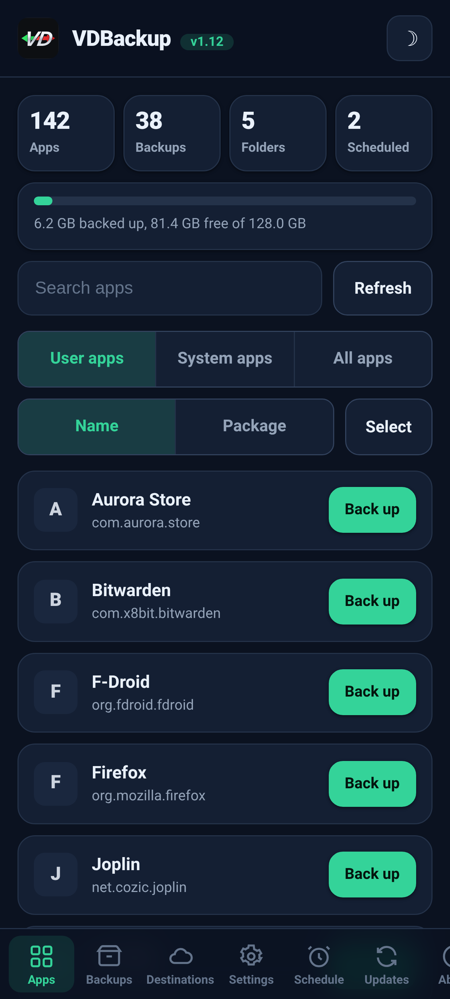
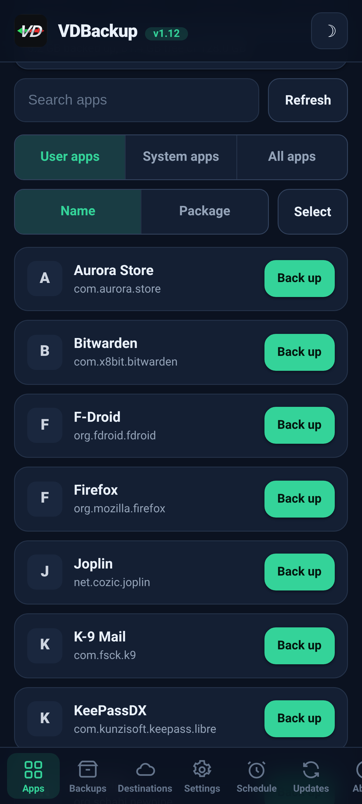
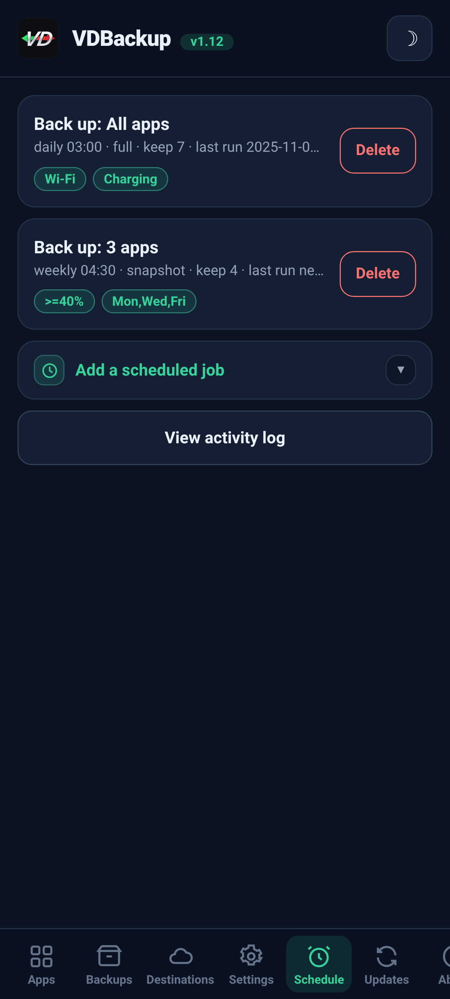
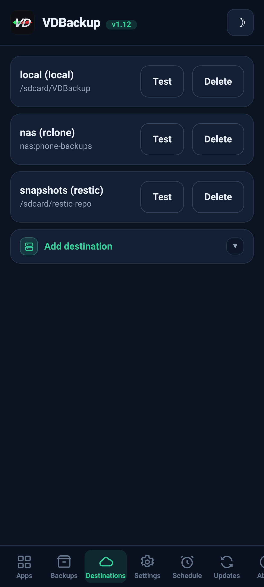
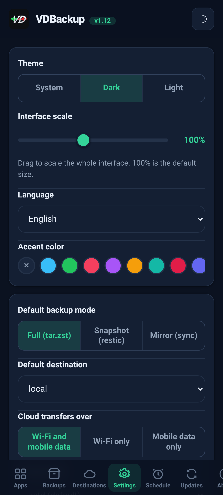
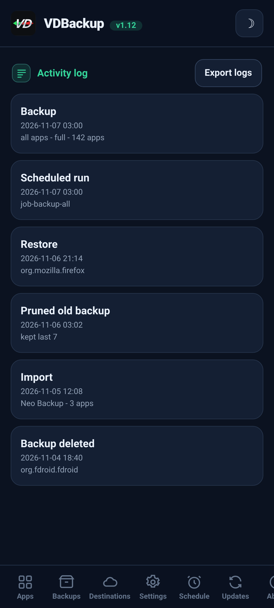

<!--
  VD BACKUP: full app & data backup and restore as root, from a WebUI.
  Copyright (C) 2026  VD171. SPDX-License-Identifier: AGPL-3.0-or-later
-->

# VD Backup

  

  
  
  
  

  <b>Copia de seguridad y restauración completas de apps y datos como root, gestionadas por completo desde una WebUI.</b> 
  Módulo KernelSU / APatch / Magisk. Sin aviso de "conceder su", sin alternar <code>sucompat</code>.

  <a href="https://github.com/VD171/VD-Backup/releases">Releases</a> ·
  <a href="https://github.com/VD171/VD-Backup/wiki/es-Home">Wiki</a> ·
  <a href="https://github.com/VD171/VD-Backup/wiki/es-USER-GUIDE">Guía de usuario</a> ·
  <a href="https://github.com/VD171/VD-Backup/wiki/es-AI-AGENTS">Agentes de IA</a> ·
  <a href="https://github.com/VD171/VD-Backup/wiki/es-ARCHITECTURE">Arquitectura</a> ·
  <a href="https://github.com/VD171/VD-Backup/wiki/es-BINARIES">Binarios incluidos</a> ·
  <a href="https://github.com/VD171/VD-Backup/wiki/es-CHANGELOG">Registro de cambios</a> ·
  <a href="https://xdaforums.com/t/VD-Backup.4807267/">XDA thread</a>

> **Languages:** [English](README.md) · [العربية](README.ar.md) · [Čeština](README.cs.md) · [Deutsch](README.de.md) · [Español](README.es.md) · [فارسی](README.fa.md) · [Français](README.fr.md) · [हिन्दी](README.hi.md) · [Bahasa Indonesia](README.id.md) · [Italiano](README.it.md) · [日本語](README.ja.md) · [한국어](README.ko.md) · [Nederlands](README.nl.md) · [Polski](README.pl.md) · [Português](README.pt.md) · [Русский](README.ru.md) · [Svenska](README.sv.md) · [ไทย](README.th.md) · [Türkçe](README.tr.md) · [Українська](README.uk.md) · [Tiếng Việt](README.vi.md) · [中文](README.zh.md)

| Home | Apps | Schedule |
|:---:|:---:|:---:|
|  |  |  |
| **Destinations** | **Settings** | **Activity log** |
|  |  |  |

---

## Por qué

VDBackup es un **módulo WebUI** root que hace copias de seguridad y restaura tus apps y sus
datos **sin una app complementaria para las funciones principales**: porque el módulo ya
es root, no hay nada que "permitir". Pretende cubrir todo lo que hacen las apps de copia de
seguridad populares, en un único lugar, con una WebUI limpia.

Está pensado como el **sucesor** abierto y root-nativo de **Swift Backup, Neo-Backup y
Android-DataBackup**: la unión de lo que hacen, bajo AGPLv3, e incluso puede
importar copias de seguridad existentes de Neo-Backup y Android-DataBackup para que puedas migrar.

## Funciones

- **Apps:** APK (base + splits), datos de la app (`/data/data`), datos protegidos por el dispositivo
  (`/data/user_de`), datos externos (`Android/data`), OBB, multimedia.
- **Datos de sistema/especiales:** permisos, AppOps y (opcional) SSAID, donde el root lo permite.
- **Modos de copia:** **Full** (`tar.zst` portátil), **Snapshot** (incremental +
  versionado, vía `restic`) y **Mirror** (sincronización 1:1, vía `rclone`/`rsync`).
- **Preservación fiel:** contextos SELinux, uid/gid, modes, xattr y capabilities.
- **Compresión:** ninguna / lz4 / zstd / gzip (gzip = "modo de compatibilidad", se abre en cualquier lugar).
- **Cifrado:** opcional y portátil (`age` + contraseña, o zip AES-256), nunca
  atado al hardware del dispositivo, así que una copia se restaura en otro dispositivo o se abre en un PC.
- **Destinos:** local, SFTP, SCP, SMB, WebDAV, FTP, S3 y más de 70 (`rclone`),
  además de repositorios `rsync` y `restic`. Google Drive opcional mediante un pequeño complemento opt-in.
- **Telegram:** respalda a un canal privado de Telegram como almacenamiento en la nube ilimitado mediante MTProto - restaurar y borrar también desde la WebUI.
- **Integridad:** cada archivo se verifica contra el manifiesto; dry-run y
  restore-test te dejan comprobar una copia sin tocar nada.
- **Restauración selectiva y por lotes:** restaura cualquier subconjunto de los elementos de una copia, o
  selecciona varias copias y restáuralas todas de una vez; elimina copias y mantén un registro de
  actividad/auditoría de cada acción destructiva.
- **Copias especiales:** mensajes (SMS/MMS/RCS), contactos y registro de llamadas, Wi-Fi y Bluetooth,
  con una exportación JSON portátil opcional que puedes abrir en un PC.
- **Archivos de sistema (`/data/adb`):** respalda el propio entorno root - módulos, sus datos y
  configuraciones - todo ello o un subárbol que elijas de un árbol de archivos, con cada archivo restaurado
  a su propietario original y contexto SELinux para que root siga funcionando. Avanzado; solo lo que elijas.
- **Programación + automatización:** trabajos recurrentes de **copia o restauración** que apuntan a una
  app, un conjunto o todas las apps, con poda keep-N, además de copia automática opt-in al
  instalar/actualizar y una lista de apps excluidas.
- **Origen de instalación:** las apps restauradas indican Play Store como su origen de instalación de
  forma predeterminada (conmutable); una opción avanzada opt-in también falsifica el paquete iniciador y el origen.
- **Montaje como app de sistema:** monta una app instalada como app de sistema sin tocar la
  partición `/system` real (submódulo de superposición sin montaje, compatible con NoMount).
- **En segundo plano:** backup/restore se ejecutan desacoplados y sobreviven al cierre de la WebUI, con
  notificaciones de inicio/fin.
- **Migrar hacia aquí:** importa copias de seguridad existentes de Neo-Backup y Android-DataBackup,
  incluidas las protegidas con contraseña.

## Agentes de IA

VDBackup está hecho para ser acogedor con asistentes y agentes de IA, no solo con personas.
El engine habla JSON (cada verbo de `helper.sh` devuelve un único objeto JSON), el
código, la documentación y la estructura de archivos están dispuestos para la lectura por máquina, y
las contribuciones asistidas por IA se revisan y aceptan como cualquier otra. Un agente puede administrar
**cada** acción del módulo sin interfaz a través de la misma API que usa la WebUI -
mira **[docs/AI-AGENTS.md](docs/AI-AGENTS.md)** para la superficie de control completa, y
[CONTRIBUTING.md](CONTRIBUTING.md#ai-contributors-welcome) para contribuir.

## Instalación

1. Descarga el `VD-Backup-vX.Y.zip` más reciente desde [Versiones](https://github.com/VD171/VD-Backup/releases).
2. Instálalo en el gestor KernelSU / APatch / Magisk, utilizable al instante, sin necesidad de reiniciar.
3. Abre la **WebUI** del módulo para configurar y ejecutar las copias. Eso es todo.

**Ediciones.** Cada release viene como seis zips. `universal-full`, todas las arquitecturas y todos los binarios integrados (incl. `rclone` para proveedores de nube y `restic` para instantáneas), totalmente sin conexión, nunca se descarga nada, cualquier dispositivo, el más grande. `universal-lite`, todas las arquitecturas sin los dos binarios más grandes (`rclone`, `restic`), el más pequeño; sigue haciendo copias locales, SSH/SFTP y `rsync` sin ninguna descarga, y la primera vez que uses un destino en la nube (`rclone`) o el modo de instantáneas (`restic`) ofrece descargar ese pequeño complemento específico de la arquitectura una sola vez (verificado por SHA-256) y lo guarda en caché, de modo que esas funciones también funcionan. `<abi>-full` (`arm64-v8a`, `armeabi-v7a`, `x86`, `x86_64`), una sola arquitectura con todos los binarios integrados, más pequeño que `universal-full`. ¿Conoces tu arquitectura? -> elige `<abi>-full`; ¿quieres el más pequeño y no te importa una descarga única para la nube o las instantáneas? -> `universal-lite`; ¿quieres todo integrado sin ninguna descarga (sin conexión / recuperación)? -> una edición full. Ve [Versiones](https://github.com/VD171/VD-Backup/releases).

¿Recién llegas? La [Guía de usuario](docs/USER-GUIDE.md) te lleva desde la instalación hasta la restauración.

## Seguridad

VDBackup se ejecuta como root y maneja los datos de tus apps y, opcionalmente, tus credenciales y frases de contraseña de cifrado; una copia de seguridad puede contener datos sensibles, así que protégela con una frase de contraseña y guárdala en un lugar de confianza. Las credenciales se almacenan cifradas en reposo, nunca en texto claro, y el cifrado nunca está atado al hardware del dispositivo, por lo que la frase de contraseña es lo que protege una copia cifrada. Informa una vulnerabilidad según [SECURITY.md](SECURITY.md).

## Build

El módulo es shell + WebUI más binarios estáticos por ABI (`tar`, `zstd`, `lz4`,
`rclone`, `rsync`, ssh, `restic`) compilados para `armeabi-v7a`, `arm64-v8a`, `x86`,
`x86_64`. Mira [CONTRIBUTING.md](CONTRIBUTING.md) y los workflows de CI.

## Portabilidad

Tus copias de seguridad **no quedan atrapadas en este módulo**. Todo usa formatos estándar
(`tar`, `gzip`, `zstd`, `age`, `zip`, `restic`) que se abren en Windows, macOS y
Linux con herramientas comunes o gestores de archivos. Cada copia cifrada incluye una
nota **RECOVERY** con los comandos exactos para descifrar y extraer en un PC.

## Actualizaciones incrementales (VDLU)

VD Backup incluye el engine **[VDLiveUpdate](https://github.com/VD171/VDLiveUpdate) (VDLU)** (incorporado en `vdlu/`): el módulo se actualiza descargando solo los
archivos que cambiaron (blobs direccionados por contenido + un `manifest.json` firmado), en lugar de volver a
descargar el `.zip` completo. Perfil **reforzado**: la firma ed25519 es obligatoria y las degradaciones están
bloqueadas; el `.zip` completo sigue siendo válido como alternativa.

- **Solo LIVE** (sin reinicio): las actualizaciones se aplican en el siguiente arranque mediante `service.sh`, en segundo plano, sin efecto cuando no hay ningún feed accesible.
- **Estado** en `/data/adb/vdbackup/vdlu/`, fuera del módulo, para que sobreviva a un reflasheo.
- **WebUI:** un panel **Actualizaciones** con un toast de progreso y cancelación; la actualización automática es opcional.

## Documentación

- **[Wiki](https://github.com/VD171/VD-Backup/wiki/es-Home)**: la documentación, navegable en línea.
- **[Guía de usuario](https://github.com/VD171/VD-Backup/wiki/es-USER-GUIDE)**: de principio a fin, desde la instalación hasta la restauración.
- **[Agentes de IA](https://github.com/VD171/VD-Backup/wiki/es-AI-AGENTS)**: gestiona cada acción sin interfaz mediante la API JSON.
- **[Arquitectura](https://github.com/VD171/VD-Backup/wiki/es-ARCHITECTURE)** y **[Estructura de archivos](https://github.com/VD171/VD-Backup/wiki/es-FILE-STRUCTURE)**: cómo funciona.
- **[Binarios incluidos](https://github.com/VD171/VD-Backup/wiki/es-BINARIES)**: procedencia y SHA-256 de cada binario precompilado, para una auditoría completa.
- **[Recuperación](https://github.com/VD171/VD-Backup/wiki/es-RECOVERY)**: abre y descifra una copia de seguridad en un PC, sin el módulo.
- **[Cómo contribuir](https://github.com/VD171/VD-Backup/wiki/es-CONTRIBUTING)** y **[Seguridad](https://github.com/VD171/VD-Backup/wiki/es-SECURITY)**.
- **[Registro de cambios](https://github.com/VD171/VD-Backup/wiki/es-CHANGELOG)** y **[Código de Conducta](https://github.com/VD171/VD-Backup/wiki/es-CODE_OF_CONDUCT)**.

<!-- /vd-docs -->

## Véase también

- **[COPG-VD](https://github.com/VD171/COPG-VD)**: suplantación del fingerprint global del dispositivo / Play Integrity, en todo el dispositivo con alcance por aplicación y una WebUI.
- **[VD-dropbear](https://github.com/VD171/VD-dropbear)**: un demonio SSH independiente con root (Dropbear).
- **[VDGoogle](https://github.com/VD171/VD-Google)**: tus servicios de Google (RCS, Wallet, atestaciones de Play Integrity), leídos en tu dispositivo sin internet.
- **[VDInstaller](https://github.com/VD171/VD-Installer)**: un instalador sideload con root y sin fricción para APK individuales, por lotes y divididos, con un interruptor para el verificador de Play Protect y suplantación del origen de instalación.
- **[VDInfos](https://github.com/VD171/VD-Infos)**: un depurador de métodos del dispositivo: lee cada elemento por todos los métodos que pueden leerlo y los compara lado a lado.
- **[VDLiveUpdate](https://github.com/VD171/VDLiveUpdate)**: un motor de autoactualización incremental y sin flasheo, integrado en módulos KernelSU/APatch/Magisk.
- **[VD-Modules](https://github.com/VD171/VD-Modules)**: nuestro repositorio de módulos MMRL/WebUI-X (instala todos estos desde tu gestor de root).
- **[build.prop](https://github.com/VictorGabriel7Dev/build.prop)**: un conjunto de datos de fingerprints build.prop de Pixel (fork de @T3SL4).
- **[mtproto-store](https://github.com/VictorGabriel7Dev/mtproto-store)**: usa Telegram como almacén de objetos desde una pequeña CLI de Go.

## Contactos

- https://vd171.ru
- https://vd.priv8.ru
- **Telegram:** @VD_Priv8 https://t.me/VD_Priv8
- **Channel:** @Priv8_VD https://t.me/Priv8_VD
- **Discord:** @VD.Priv8 https://discord.com/users/1296831918989639721
- **E-mail:** vd.priv8@pm.me
- **XDA-Developers:** @VD171 https://xdaforums.com/m/vd171.4699873/
- **XDA thread:** https://xdaforums.com/t/VD-Backup.4807267/
- **GitHub:** @VD171 https://github.com/VD171

## Licencia

[GNU AGPL-3.0-or-later](LICENSE). Copyleft de red: si ejecutas una versión modificada,
incluso como servicio, debes ofrecer su código fuente.

## Marcas comerciales

VD Backup es un proyecto independiente y no oficial. No está afiliado a Google LLC ni a ningún otro proveedor, ni cuenta con su respaldo o patrocinio. "Google Drive", "Android" y los nombres y logotipos relacionados son marcas comerciales de sus respectivos propietarios. VD Backup se ejecuta en tu dispositivo y solo sube datos a los destinos que configures.

## Tags

`android` `backup` `restore` `app-data` `migration` `neo-backup` `databackup` `kernelsu` `apatch` `magisk` `webui` `root` `tar` `zstd` `restic` `rclone` `age` `encryption` `ssaid` `appops` `on-device` `agpl` `ai-friendly` `telegram` `rcs` `vdbackup`
