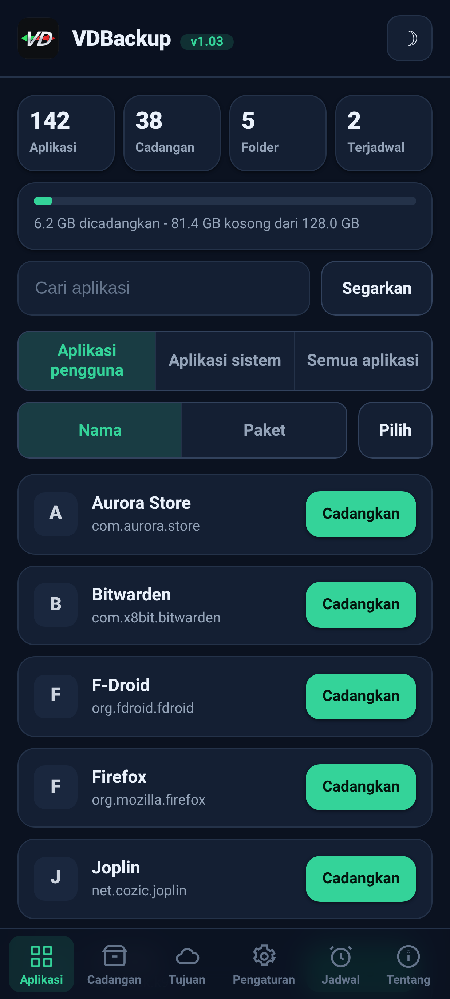
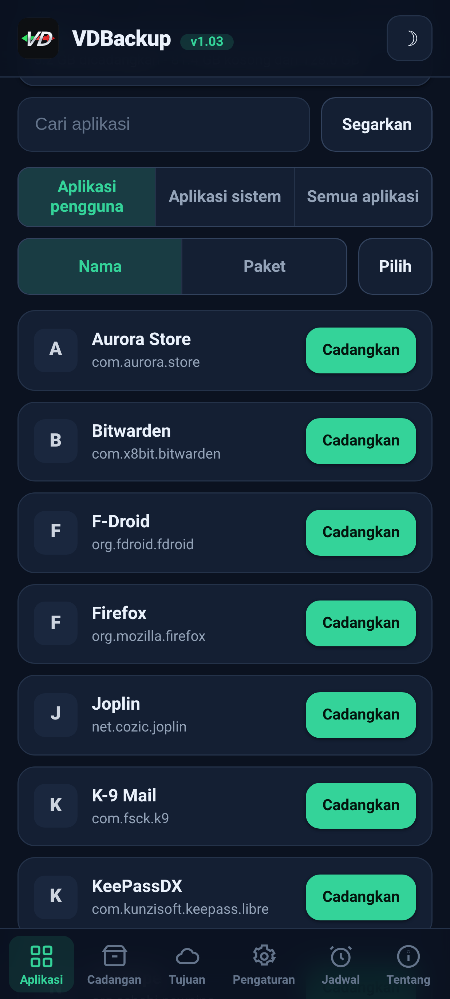
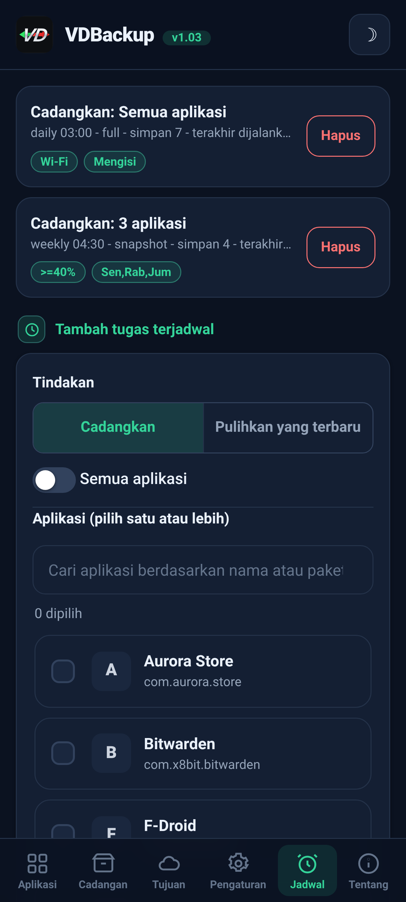
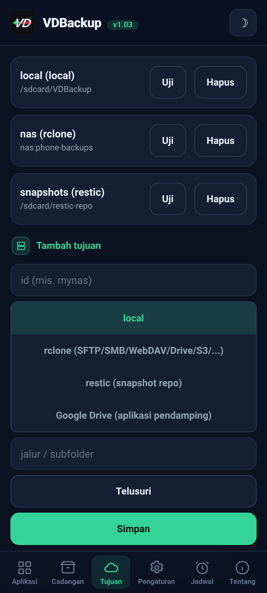
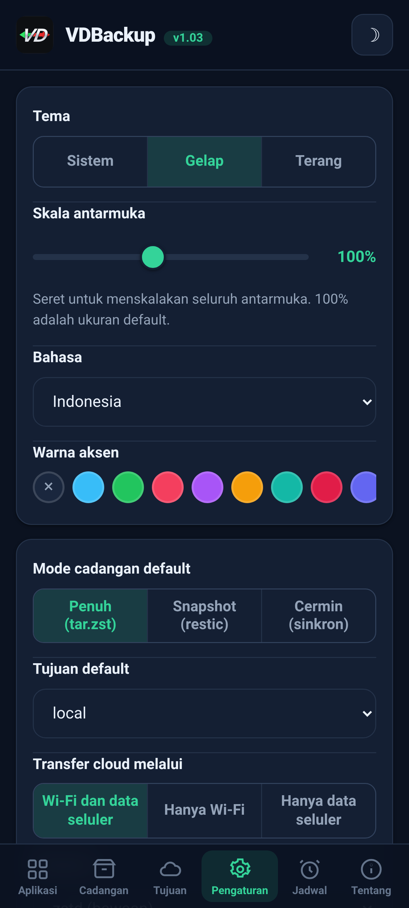
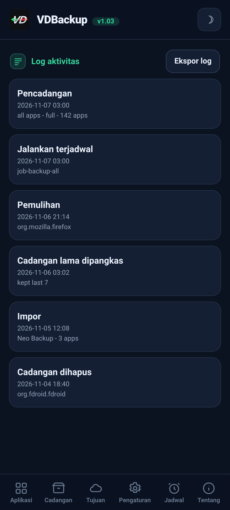

<!--
  VD BACKUP - full app & data backup and restore as root, from a WebUI.
  Copyright (C) 2026  VD171 - SPDX-License-Identifier: AGPL-3.0-or-later
-->

  

  <b>Pencadangan dan pemulihan penuh aplikasi &amp; data sebagai root - sepenuhnya dikendalikan dari sebuah WebUI.</b> 
  Modul KernelSU / APatch / Magisk. Tanpa permintaan "grant su", tanpa mengalihkan <code>sucompat</code>.

  <a href="https://github.com/VD171/VD-Backup/releases">Rilis</a> ·
  <a href="https://github.com/VD171/VD-Backup/wiki">Wiki</a> ·
  <a href="docs/USER-GUIDE.md">Panduan pengguna</a> ·
  <a href="docs/AI-AGENTS.md">Agen AI</a> ·
  <a href="CHANGELOG.md">Changelog</a> ·
  <a href="CONTRIBUTING.md">Berkontribusi</a> ·
  <a href="https://xdaforums.com/t/VD-Backup.4807267/">Utas XDA</a>

> **Languages:** [English](README.md) · [العربية](README.ar.md) · [Čeština](README.cs.md) · [Deutsch](README.de.md) · [Español](README.es.md) · [فارسی](README.fa.md) · [Français](README.fr.md) · [हिन्दी](README.hi.md) · [Bahasa Indonesia](README.in.md) · [Italiano](README.it.md) · [日本語](README.ja.md) · [한국어](README.ko.md) · [Nederlands](README.nl.md) · [Polski](README.pl.md) · [Português](README.pt.md) · [Русский](README.ru.md) · [Svenska](README.sv.md) · [ไทย](README.th.md) · [Türkçe](README.tr.md) · [Tiếng Việt](README.vi.md) · [中文](README.zh.md)

---

## Apa ini

VDBackup adalah **modul WebUI** root yang mencadangkan dan memulihkan aplikasi Anda beserta
datanya **tanpa aplikasi pendamping untuk fitur inti** - karena modulnya sudah root, tidak ada yang
perlu "diizinkan". Tujuannya mencakup segala hal yang dilakukan aplikasi pencadangan populer, dalam
satu tempat, dengan WebUI yang rapi.

Ia dimaksudkan sebagai **penerus** terbuka dan root-native dari **Swift Backup, Neo-Backup, dan
Android-DataBackup**: gabungan dari apa yang mereka lakukan, di bawah AGPLv3, dan bahkan dapat
mengimpor cadangan Neo-Backup dan Android-DataBackup yang sudah ada agar Anda bisa berpindah.

## Fitur

- **Aplikasi:** APK (basis + split), data aplikasi (`/data/data`), data terlindungi perangkat
  (`/data/user_de`), data eksternal (`Android/data`), OBB, media.
- **Data sistem/khusus:** izin, AppOps, dan (opt-in) SSAID, di mana root mengizinkan.
- **Mode pencadangan:** **Full** (`tar.zst` portabel), **Snapshot** (inkremental +
  berversi, via `restic`) dan **Mirror** (sinkronisasi 1:1, via `rclone`/`rsync`).
- **Pelestarian setia:** konteks SELinux, uid/gid, mode, xattr dan kapabilitas.
- **Kompresi:** tidak ada / lz4 / zstd / gzip (gzip = "mode kompatibilitas", terbuka di mana saja).
- **Enkripsi:** opsional dan portabel (`age` + frasa sandi, atau zip AES-256) - tidak pernah
  terikat ke perangkat keras, sehingga sebuah cadangan dapat dipulihkan di perangkat lain atau dibuka di PC.
- **Tujuan:** lokal, SFTP, SCP, SMB, WebDAV, FTP, S3 dan 70+ lainnya (`rclone`),
  ditambah repo `rsync` dan `restic`. Google Drive opsional melalui pendamping kecil yang opt-in.
- **Integritas:** setiap arsip diverifikasi terhadap manifes; dry-run dan restore-test memungkinkan
  Anda memeriksa sebuah cadangan tanpa menyentuh apa pun.
- **Pemulihan selektif & massal:** pulihkan subset mana pun dari item sebuah cadangan, atau pilih beberapa
  cadangan sekaligus dan pulihkan semuanya dalam satu kali; hapus cadangan dan simpan log aktivitas/audit dari
  setiap tindakan destruktif.
- **Cadangan khusus:** pesan (SMS/MMS), kontak dan log panggilan, Wi-Fi dan Bluetooth,
  dengan ekspor JSON portabel opsional yang dapat Anda buka di PC.
- **Penjadwalan + otomasi:** tugas **backup atau restore** berulang yang menargetkan satu aplikasi, sekumpulan,
  atau semua aplikasi, dengan pemangkasan keep-N, ditambah pencadangan otomatis opt-in saat pemasangan/pembaruan
  dan daftar aplikasi yang dikecualikan.
- **Sumber pemasangan:** aplikasi yang dipulihkan melaporkan Play Store sebagai sumber pemasangannya
  secara default (dapat dialihkan); opt-in tingkat lanjut juga memalsukan paket penginisiasi dan sumbernya.
- **Pemasangan aplikasi-sistem:** pasang aplikasi terpasang sebagai aplikasi sistem tanpa menyentuh
  partisi `/system` yang asli (sub-modul overlay systemless, sadar-NoMount).
- **Latar belakang:** pencadangan/pemulihan berjalan terpisah dan tetap hidup setelah WebUI ditutup,
  dengan notifikasi mulai/selesai.
- **Impor masuk:** mengimpor cadangan Neo-Backup dan Android-DataBackup yang sudah ada,
  termasuk yang terenkripsi dengan kata sandi.

## Tangkapan layar

| Beranda | Aplikasi | Jadwal |
|:---:|:---:|:---:|
|  |  |  |
| **Tujuan** | **Pengaturan** | **Log aktivitas** |
|  |  |  |

## Pemasangan

1. Unduh `VD-Backup-vX.Y.zip` terbaru dari [Rilis](https://github.com/VD171/VD-Backup/releases).
2. Flash di manajer KernelSU / APatch / Magisk - langsung bisa dipakai, tanpa perlu reboot.
3. Buka **WebUI** modul untuk mengonfigurasi dan menjalankan pencadangan. Selesai.

**Edisi.** Setiap rilis hadir sebagai enam zip. `universal-full` - setiap arsitektur dan setiap biner tertanam (termasuk `rclone` untuk penyedia cloud dan `restic` untuk snapshot), sepenuhnya offline, tidak pernah ada yang diunduh, perangkat apa pun, terbesar. `universal-lite` - setiap arsitektur tanpa dua biner terbesar (`rclone`, `restic`), terkecil; tetap bisa backup lokal, SSH/SFTP dan `rsync` tanpa unduhan, dan pertama kali kamu memakai tujuan cloud (`rclone`) atau mode snapshot (`restic`) ia menawarkan untuk mengunduh addon kecil per-arsitektur itu sekali (diverifikasi dengan SHA-256) lalu menyimpannya di cache, sehingga fitur-fitur itu pun berfungsi. `<abi>-full` (`arm64-v8a`, `armeabi-v7a`, `x86`, `x86_64`) - satu arsitektur dengan setiap biner tertanam, lebih kecil dari `universal-full`. Tahu arsitekturmu -> pilih `<abi>-full`; mau yang terkecil dan tidak keberatan dengan satu kali unduhan untuk cloud atau snapshot -> `universal-lite`; mau semuanya tertanam tanpa unduhan apa pun (offline / pemulihan) -> edisi full. Lihat [Rilis](https://github.com/VD171/VD-Backup/releases).

Baru di sini? [Panduan pengguna](docs/USER-GUIDE.md) memandu Anda dari pemasangan hingga pemulihan.

## Portabilitas

Cadangan Anda **tidak terkunci di modul ini**. Semuanya memakai format standar
(`tar`, `gzip`, `zstd`, `age`, `zip`, `restic`) yang terbuka di Windows, macOS, dan Linux dengan
alat umum atau manajer berkas. Setiap cadangan terenkripsi disertai catatan **RECOVERY** yang berisi
perintah persis untuk mendekripsi dan mengekstrak di PC.

## Pembangunan

Modul ini adalah shell + WebUI ditambah biner statis per-ABI (`tar`, `zstd`, `lz4`,
`rclone`, `rsync`, ssh, `restic`) yang dibangun untuk `armeabi-v7a`, `arm64-v8a`, `x86`,
`x86_64`. Lihat [CONTRIBUTING.md](CONTRIBUTING.md) dan alur kerja CI.

## Dokumentasi

- **[Wiki](https://github.com/VD171/VD-Backup/wiki)** - dokumentasi, dapat dijelajahi daring.
- **[Panduan pengguna](docs/USER-GUIDE.md)** - menyeluruh, dari pemasangan hingga pemulihan.
- **[Agen AI](docs/AI-AGENTS.md)** - kendalikan setiap tindakan tanpa antarmuka melalui JSON API.
- **[Arsitektur](docs/ARCHITECTURE.md)** dan **[Struktur berkas](docs/FILE-STRUCTURE.md)** - cara kerjanya.
- **[Biner bawaan](docs/BINARIES.md)** - asal-usul dan SHA-256 setiap biner prakompilasi, untuk audit penuh.
- **[Pemulihan](module/etc/RECOVERY.md)** - buka dan dekripsi cadangan di PC, tanpa modul.
- **[Berkontribusi](CONTRIBUTING.md)** dan **[Keamanan](SECURITY.md)**.
- **[Changelog](CHANGELOG.md)** dan **[Pedoman Perilaku](CODE_OF_CONDUCT.md)**.

## Ramah AI

VDBackup dibangun agar menyambut asisten dan agen AI, bukan hanya orang. Mesinnya berbicara JSON
(setiap verba `helper.sh` mengembalikan satu objek JSON), kode, dokumentasi, dan struktur berkasnya
ditata untuk pembacaan mesin, dan kontribusi berbantuan AI ditinjau serta diterima seperti kontribusi
lainnya. Sebuah agen dapat mengelola **setiap** tindakan modul tanpa antarmuka melalui API yang sama
yang digunakan WebUI - lihat **[docs/AI-AGENTS.md](docs/AI-AGENTS.md)** untuk permukaan kendali
lengkap, dan [CONTRIBUTING.md](CONTRIBUTING.md#ai-contributors-welcome) untuk berkontribusi.

## Kontak

* https://vd171.ru
* https://vd.priv8.ru
* **Telegram:** @VD_Priv8 https://t.me/VD_Priv8
* **Channel:** @Priv8_VD https://t.me/Priv8_VD
* **Discord:** @VD.Priv8 https://discord.com/users/1296831918989639721
* **E-mail:** vd.priv8@pm.me
* **XDA-Developers:** @VD171 https://xdaforums.com/m/vd171.4699873/
* **GitHub:** @VD171 https://github.com/VD171

## Lihat juga

Proyek saudara dari penulis yang sama:

- **[VDInfos](https://github.com/VD171/VD-Infos)** - sebuah debugger metode perangkat: membaca setiap item melalui setiap metode yang dapat membacanya dan membandingkannya berdampingan.
- **[VDGoogle](https://github.com/VD171/VD-Google)** - layanan Google Anda (RCS, Wallet, atestasi Play Integrity), dibaca di perangkat Anda tanpa internet.
- **[COPG-VD](https://github.com/VD171/COPG-VD)** - sebuah pemalsu perangkat yang mengubah fingerprint baru menjadi profil yang koheren dan konsisten.

## Lisensi

[GNU AGPL-3.0-or-later](LICENSE). Copyleft jaringan: jika Anda menjalankan versi yang dimodifikasi,
bahkan sebagai layanan, Anda harus menyediakan sumbernya.

---

`android` `backup` `restore` `app-data` `migration` `neo-backup` `databackup` `kernelsu` `apatch` `magisk` `webui` `root` `tar` `zstd` `restic` `rclone` `age` `encryption` `ssaid` `appops` `on-device` `agpl` `ai-friendly` `vdbackup`
