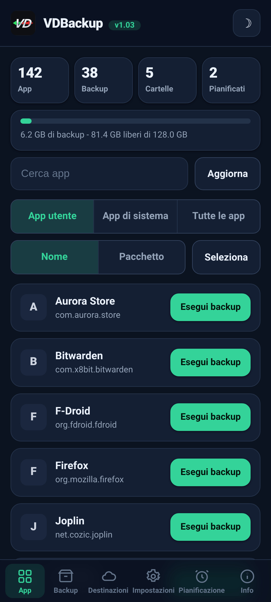
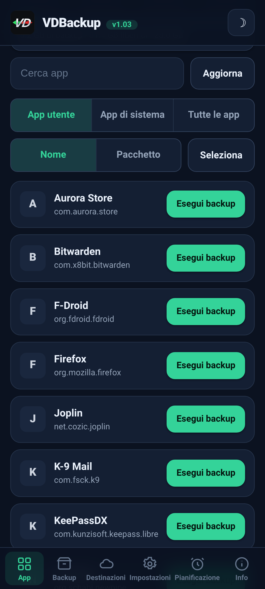
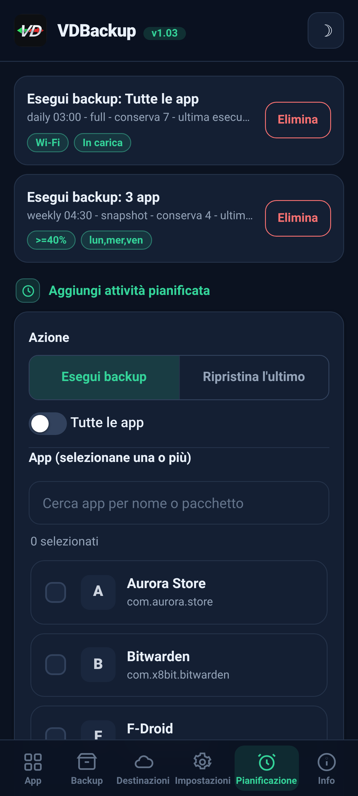
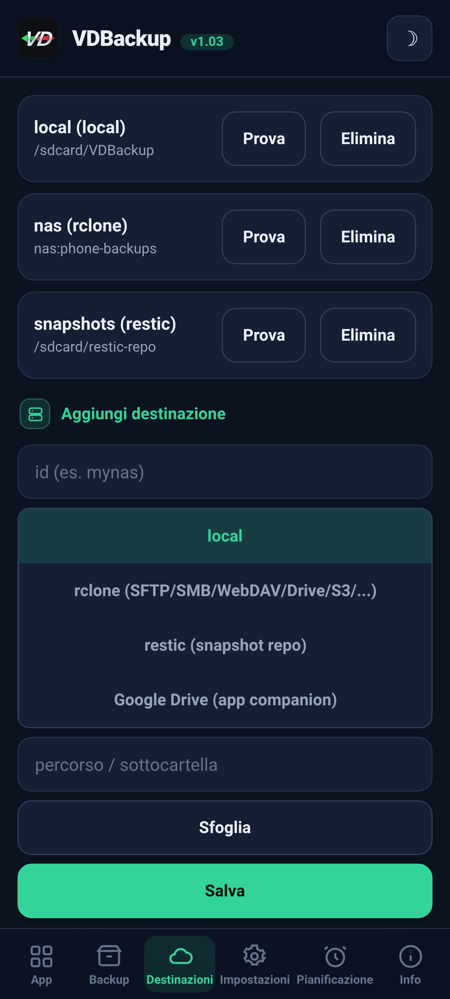
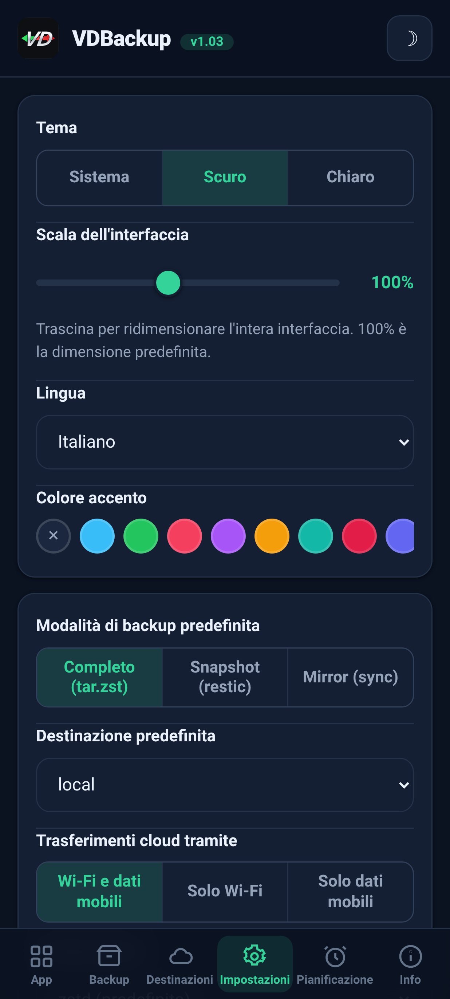
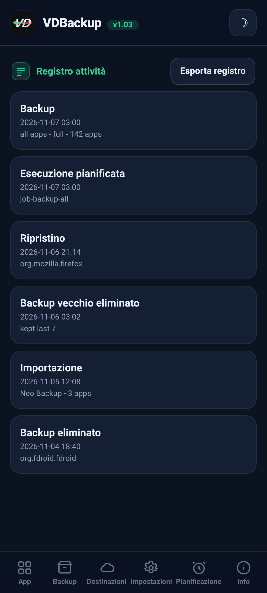

<!--
  VD BACKUP - full app & data backup and restore as root, from a WebUI.
  Copyright (C) 2026  VD171 - SPDX-License-Identifier: AGPL-3.0-or-later
-->

  

  <b>Backup e ripristino completi di app e dati come root - gestiti interamente da una WebUI.</b> 
  Modulo KernelSU / APatch / Magisk. Nessun avviso "concedi su", nessun cambio di <code>sucompat</code>.

  <a href="https://github.com/VD171/VD-Backup/releases">Versioni</a> ·
  <a href="https://github.com/VD171/VD-Backup/wiki">Wiki</a> ·
  <a href="docs/USER-GUIDE.md">Guida utente</a> ·
  <a href="docs/AI-AGENTS.md">Agenti IA</a> ·
  <a href="CHANGELOG.md">Changelog</a> ·
  <a href="CONTRIBUTING.md">Come contribuire</a> ·
  <a href="https://xdaforums.com/t/VD-Backup.4807267/">Thread su XDA</a>

> **Languages:** [English](README.md) · [العربية](README.ar.md) · [Čeština](README.cs.md) · [Deutsch](README.de.md) · [Español](README.es.md) · [فارسی](README.fa.md) · [Français](README.fr.md) · [हिन्दी](README.hi.md) · [Bahasa Indonesia](README.in.md) · [Italiano](README.it.md) · [日本語](README.ja.md) · [한국어](README.ko.md) · [Nederlands](README.nl.md) · [Polski](README.pl.md) · [Português](README.pt.md) · [Русский](README.ru.md) · [Svenska](README.sv.md) · [ไทย](README.th.md) · [Türkçe](README.tr.md) · [Tiếng Việt](README.vi.md) · [中文](README.zh.md)

---

## Cos'è

VDBackup è un **modulo WebUI** root che esegue il backup e il ripristino delle tue app e dei
loro dati **senza un'app companion per le funzioni principali** - perché il modulo è
già root, non c'è nulla da "consentire". Punta a coprire tutto ciò che fanno le app di
backup più popolari, in un unico posto, con una WebUI pulita.

È pensato come il **successore** aperto e root-nativo di **Swift Backup, Neo-Backup e
Android-DataBackup**: l'unione di ciò che fanno, sotto AGPLv3, e può persino
importare i backup esistenti di Neo-Backup e Android-DataBackup così da poter migrare.

## Funzionalità

- **App:** APK (base + splits), dati dell'app (`/data/data`), dati protetti dal dispositivo
  (`/data/user_de`), dati esterni (`Android/data`), OBB, media.
- **Dati di sistema/speciali:** permessi, AppOps e (opzionale) SSAID, dove il root lo consente.
- **Modalità di backup:** **Full** (`tar.zst` portatile), **Snapshot** (incrementale +
  versionato, tramite `restic`) e **Mirror** (sincronizzazione 1:1, tramite `rclone`/`rsync`).
- **Conservazione fedele:** contesti SELinux, uid/gid, modes, xattr e capabilities.
- **Compressione:** nessuna / lz4 / zstd / gzip (gzip = "modalità compatibilità", si apre ovunque).
- **Cifratura:** opzionale e portatile (`age` + passphrase, o zip AES-256) - mai
  legata all'hardware del dispositivo, così un backup si ripristina su un altro dispositivo o si apre su un PC.
- **Destinazioni:** locale, SFTP, SCP, SMB, WebDAV, FTP, S3 e oltre 70 (`rclone`),
  oltre ai repository `rsync` e `restic`. Google Drive opzionale tramite un piccolo companion opt-in.
- **Integrità:** ogni archivio è verificato rispetto al manifest; dry-run e
  restore-test ti permettono di controllare un backup senza toccare nulla.
- **Ripristino selettivo e in blocco:** ripristina qualsiasi sottoinsieme degli elementi di un backup, oppure
  seleziona più backup e ripristinali tutti in una volta; elimina i backup e mantieni un log di attività/audit di
  ogni azione distruttiva.
- **Backup speciali:** messaggi (SMS/MMS), contatti e registro chiamate, Wi-Fi e Bluetooth,
  con un'esportazione JSON portatile opzionale che puoi aprire su un PC.
- **Pianificazione + automazione:** job ricorrenti di **backup o ripristino** con bersaglio una singola app, un
  insieme, o tutte le app, con pruning keep-N, più backup automatico opt-in all'installazione/aggiornamento e un
  elenco di app escluse.
- **Origine di installazione:** le app ripristinate riportano il Play Store come origine di installazione per
  impostazione predefinita (commutabile); un'opzione avanzata opt-in forgia anche il pacchetto e l'origine iniziatori.
- **Montaggio come app di sistema:** monta un'app installata come app di sistema senza toccare la
  partizione `/system` reale (sottomodulo overlay systemless, compatibile con NoMount).
- **In background:** backup/restore vengono eseguiti in modo scollegato e sopravvivono alla chiusura della WebUI, con
  notifiche di inizio/fine.
- **Migrare qui:** importa i backup esistenti di Neo-Backup e Android-DataBackup,
  inclusi quelli protetti da password.

## Screenshot

| Home | App | Pianificazione |
|:---:|:---:|:---:|
|  |  |  |
| **Destinazioni** | **Impostazioni** | **Registro attività** |
|  |  |  |

## Installazione

1. Scarica il `VD-Backup-vX.Y.zip` più recente da [Versioni](https://github.com/VD171/VD-Backup/releases).
2. Installalo nel gestore KernelSU / APatch / Magisk - utilizzabile subito, senza bisogno di riavviare.
3. Apri la **WebUI** del modulo per configurare ed eseguire i backup. Tutto qui.

**Edizioni.** Ogni release è distribuita come sei zip. `universal-full` - ogni architettura e ogni binario incorporato (incl. `rclone` per i provider cloud e `restic` per gli snapshot), completamente offline, non viene mai scaricato nulla, qualsiasi dispositivo, il più grande. `universal-lite` - ogni architettura senza i due binari più grandi (`rclone`, `restic`), il più piccolo; esegue ancora backup locali, SSH/SFTP e `rsync` senza alcun download, e la prima volta che usi una destinazione cloud (`rclone`) o la modalità snapshot (`restic`) propone di scaricare una volta quel piccolo addon per-architettura (verificato con SHA-256) e lo memorizza nella cache, così anche quelle funzioni funzionano. `<abi>-full` (`arm64-v8a`, `armeabi-v7a`, `x86`, `x86_64`) - una singola architettura con ogni binario incorporato, più piccolo di `universal-full`. Conosci la tua architettura -> scegli `<abi>-full`; vuoi il più piccolo e non ti dispiace un download una tantum per cloud o snapshot -> `universal-lite`; vuoi tutto incorporato senza alcun download (offline / ripristino) -> un'edizione full. Vedi [Versioni](https://github.com/VD171/VD-Backup/releases).

Sei nuovo? La [Guida utente](docs/USER-GUIDE.md) ti accompagna dall'installazione al ripristino.

## Portabilità

I tuoi backup **non restano bloccati in questo modulo**. Tutto usa formati standard
(`tar`, `gzip`, `zstd`, `age`, `zip`, `restic`) che si aprono su Windows, macOS e
Linux con strumenti comuni o gestori di file. Ogni backup cifrato include una
nota **RECOVERY** con i comandi esatti per decifrare ed estrarre su un PC.

## Build

Il modulo è shell + WebUI più binari statici per ABI (`tar`, `zstd`, `lz4`,
`rclone`, `rsync`, ssh, `restic`) compilati per `armeabi-v7a`, `arm64-v8a`, `x86`,
`x86_64`. Vedi [CONTRIBUTING.md](CONTRIBUTING.md) e i workflow di CI.

## Documentazione

- **[Wiki](https://github.com/VD171/VD-Backup/wiki)** - la documentazione, consultabile online.
- **[Guida utente](docs/USER-GUIDE.md)** - dall'inizio alla fine, dall'installazione al ripristino.
- **[Agenti IA](docs/AI-AGENTS.md)** - gestisci ogni azione senza interfaccia tramite l'API JSON.
- **[Architettura](docs/ARCHITECTURE.md)** e **[Struttura dei file](docs/FILE-STRUCTURE.md)** - come funziona.
- **[Binari inclusi](docs/BINARIES.md)** - provenienza e SHA-256 di ogni binario precompilato, per un audit completo.
- **[Ripristino](module/etc/RECOVERY.md)** - apri e decifra un backup su un PC, senza il modulo.
- **[Come contribuire](CONTRIBUTING.md)** e **[Sicurezza](SECURITY.md)**.
- **[Changelog](CHANGELOG.md)** e **[Codice di condotta](CODE_OF_CONDUCT.md)**.

## Adatto all'IA

VDBackup è costruito per accogliere assistenti e agenti IA, non solo le persone.
Il engine parla JSON (ogni verbo di `helper.sh` restituisce un singolo oggetto JSON), il
codice, la documentazione e la struttura dei file sono disposti per la lettura da parte delle macchine, e
i contributi assistiti dall'IA vengono esaminati e accettati come qualsiasi altro. Un agente può amministrare
**ogni** azione del modulo senza interfaccia attraverso la stessa API che usa la WebUI -
vedi **[docs/AI-AGENTS.md](docs/AI-AGENTS.md)** per la superficie di controllo completa, e
[CONTRIBUTING.md](CONTRIBUTING.md#ai-contributors-welcome) per contribuire.

## Contatti

* https://vd171.ru
* https://vd.priv8.ru
* **Telegram:** @VD_Priv8 https://t.me/VD_Priv8
* **Channel:** @Priv8_VD https://t.me/Priv8_VD
* **Discord:** @VD.Priv8 https://discord.com/users/1296831918989639721
* **E-mail:** vd.priv8@pm.me
* **XDA-Developers:** @VD171 https://xdaforums.com/m/vd171.4699873/
* **GitHub:** @VD171 https://github.com/VD171

## Vedi anche

Progetti fratelli dello stesso autore:

- **[VDInfos](https://github.com/VD171/VD-Infos)** - un debugger dei metodi del dispositivo: legge ogni elemento con tutti i metodi che possono leggerlo e li confronta fianco a fianco.
- **[VDGoogle](https://github.com/VD171/VD-Google)** - i tuoi servizi Google (RCS, Wallet, attestazioni di Play Integrity), letti sul tuo dispositivo senza internet.
- **[COPG-VD](https://github.com/VD171/COPG-VD)** - uno spoofer del dispositivo che trasforma un fingerprint nuovo in un profilo coerente e consistente.

## Licenza

[GNU AGPL-3.0-or-later](LICENSE). Copyleft di rete: se esegui una versione modificata,
anche come servizio, devi offrirne il codice sorgente.

---

`android` `backup` `restore` `app-data` `migration` `neo-backup` `databackup` `kernelsu` `apatch` `magisk` `webui` `root` `tar` `zstd` `restic` `rclone` `age` `encryption` `ssaid` `appops` `on-device` `agpl` `ai-friendly` `vdbackup`
