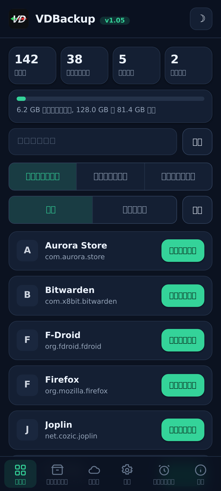
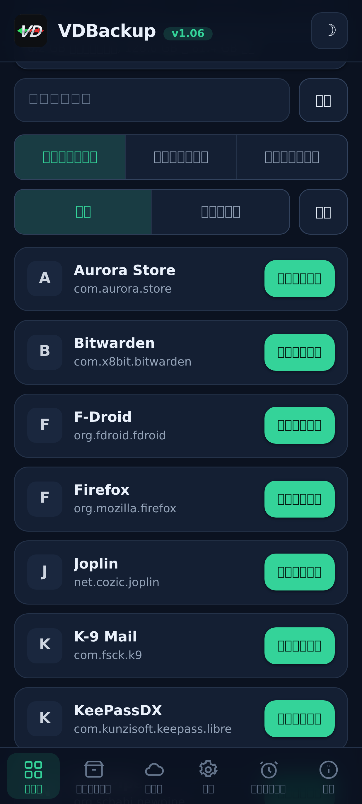
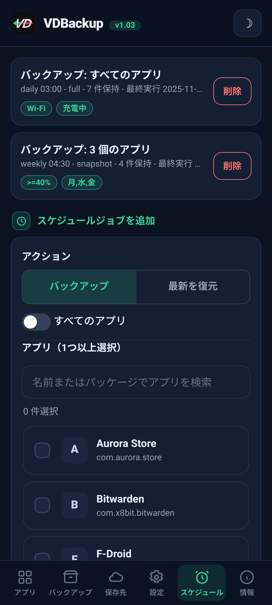
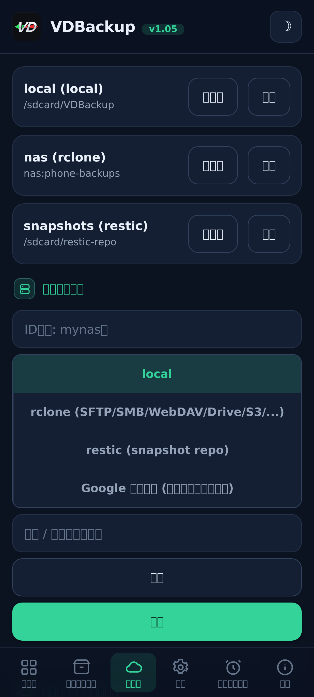
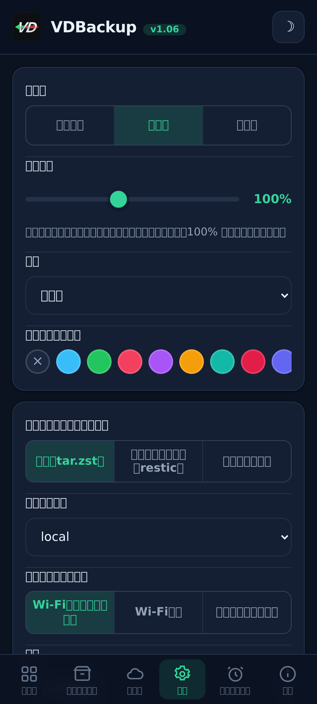
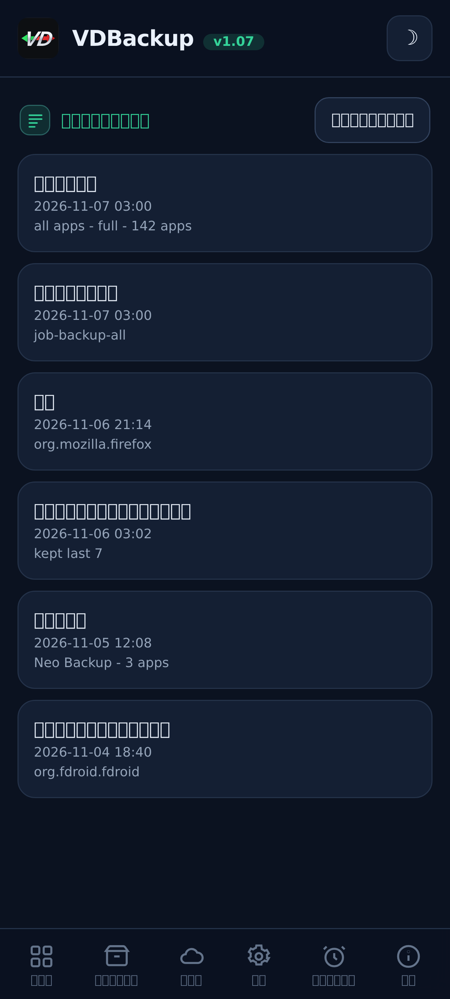

<!--
  VD BACKUP - full app & data backup and restore as root, from a WebUI.
  Copyright (C) 2026  VD171 - SPDX-License-Identifier: AGPL-3.0-or-later
-->

  

  <b>root 権限によるアプリとデータの完全なバックアップと復元, すべて WebUI から操作。</b> 
  KernelSU / APatch / Magisk モジュール。「su を許可」のプロンプトなし、<code>sucompat</code> の切り替えも不要。

  <a href="https://github.com/VD171/VD-Backup/releases">リリース</a> ·
  <a href="https://github.com/VD171/VD-Backup/wiki">Wiki</a> ·
  <a href="docs/USER-GUIDE.md">ユーザーガイド</a> ·
  <a href="docs/AI-AGENTS.md">AI エージェント</a> ·
  <a href="CHANGELOG.md">変更履歴</a> ·
  <a href="CONTRIBUTING.md">貢献</a> ·
  <a href="https://xdaforums.com/t/VD-Backup.4807267/">XDA スレッド</a>

> **Languages:** [English](README.md) · [العربية](README.ar.md) · [Čeština](README.cs.md) · [Deutsch](README.de.md) · [Español](README.es.md) · [فارسی](README.fa.md) · [Français](README.fr.md) · [हिन्दी](README.hi.md) · [Bahasa Indonesia](README.in.md) · [Italiano](README.it.md) · [日本語](README.ja.md) · [한국어](README.ko.md) · [Nederlands](README.nl.md) · [Polski](README.pl.md) · [Português](README.pt.md) · [Русский](README.ru.md) · [Svenska](README.sv.md) · [ไทย](README.th.md) · [Türkçe](README.tr.md) · [Tiếng Việt](README.vi.md) · [中文](README.zh.md)

---

## これは何か

VDBackup は、アプリとそのデータをバックアップおよび復元する root の **WebUI モジュール** です。
**主要機能にコンパニオンアプリは不要**: モジュール自体がすでに root なので、「許可」する対象が
ありません。人気のバックアップアプリが行うすべてを、すっきりした WebUI で一か所にまとめることを
目指しています。

これは、オープンで root ネイティブな **Swift Backup、Neo-Backup、Android-DataBackup の後継** を
目指すものです。それらの機能の和集合を AGPLv3 のもとで提供し、さらに既存の Neo-Backup および
Android-DataBackup のバックアップをインポートして移行することもできます。

## 機能

- **アプリ:** APK (base + splits)、アプリデータ (`/data/data`)、デバイス保護データ
  (`/data/user_de`)、外部データ (`Android/data`)、OBB、メディア。
- **システム/特殊データ:** 権限、AppOps、(オプトインで) SSAID など、root が許す範囲で。
- **バックアップモード:** **Full** (ポータブルな `tar.zst`)、**Snapshot** (`restic` による増分 +
  バージョン管理)、**Mirror** (`rclone`/`rsync` による 1:1 同期)。
- **忠実な保持:** SELinux コンテキスト、uid/gid、モード、xattr、ケーパビリティ。
- **圧縮:** none / lz4 / zstd / gzip (gzip =「互換モード」、どこでも開ける)。
- **暗号化:** オプションでポータブル (`age` + パスフレーズ、または AES-256 zip), デバイスの
  ハードウェアに紐付かないため、バックアップを別のデバイスで復元したり PC で開いたりできます。
- **保存先:** ローカル、SFTP、SCP、SMB、WebDAV、FTP、S3 ほか 70 以上 (`rclone`)、さらに `rsync`
  および `restic` リポジトリ。小さなオプトインのコンパニオンによる Google Drive も任意で利用できます。
- **整合性:** すべてのアーカイブはマニフェストと照合して検証されます。dry-run と復元テストにより、
  何も変更せずにバックアップを確認できます。
- **選択的復元と一括復元:** バックアップの項目の任意の一部を復元でき、あるいは複数のバックアップを
  まとめて選んで一度に復元でき、バックアップの削除や、すべての破壊的な操作の活動/監査ログの保持も
  行えます。
- **特殊バックアップ:** メッセージ (SMS/MMS)、連絡先と通話履歴、Wi-Fi と Bluetooth。PC で開ける
  ポータブルな JSON エクスポートも任意で付けられます。
- **スケジュール + 自動化:** 単一のアプリ, 集合, またはすべてのアプリを対象とする **バックアップまたは復元**
  の定期ジョブ (keep-N 方式で古い世代を刈り込み) に加え、インストール/更新時のオプトインの自動バックアップと
  除外アプリ一覧。
- **インストール元:** 復元したアプリは、デフォルトでインストール元として Play ストアを報告します
  (切り替え可能)。高度なオプトインでは、呼び出し元パッケージとソースも偽装します。
- **システムアプリのマウント:** 実際の `/system` パーティションに触れずに、インストール済みアプリを
  システムアプリとしてマウントします (systemless なオーバーレイのサブモジュール、NoMount 対応)。
- **バックグラウンド:** バックアップ/復元はデタッチして実行され、WebUI を閉じても継続し、
  開始時と終了時に通知します。
- **移行 (インポート):** 既存の Neo-Backup および Android-DataBackup のバックアップを、
  パスワードで暗号化されたものも含めてインポートします。

## スクリーンショット

| ホーム | アプリ | スケジュール |
|:---:|:---:|:---:|
|  |  |  |
| **保存先** | **設定** | **アクティビティログ** |
|  |  |  |

## インストール

1. 最新の `VD-Backup-vX.Y.zip` を [リリース](https://github.com/VD171/VD-Backup/releases) から
   ダウンロードします。
2. KernelSU / APatch / Magisk のマネージャーでフラッシュします, すぐに使え、再起動は不要です。
3. モジュールの **WebUI** を開いて設定し、バックアップを実行します。これだけです。

**エディション。** 各リリースは 6 つの zip で提供されます。`universal-full`, すべてのアーキテクチャとすべてのバイナリを埋め込み (クラウドプロバイダー用の `rclone`、スナップショット用の `restic` を含む)、完全オフラインで何もダウンロードされず、どの端末でも使え、最大。`universal-lite`, すべてのアーキテクチャから最大の 2 つのバイナリ (`rclone`、`restic`) を除いたもので、最小。ローカル・SSH/SFTP・`rsync` のバックアップはダウンロードなしで引き続き可能で、クラウドの保存先 (`rclone`) やスナップショットモード (`restic`) を初めて使うときに、そのアーキテクチャ別の小さなアドオンを一度だけダウンロードするか尋ね (SHA-256 で検証)、キャッシュするので、それらの機能も使えるようになります。`<abi>-full` (`arm64-v8a`、`armeabi-v7a`、`x86`、`x86_64`), 単一アーキテクチャにすべてのバイナリを埋め込み、`universal-full` より小さい。自分のアーキテクチャが分かる -> `<abi>-full`、最小でクラウドやスナップショット用の一度きりのダウンロードを許容できる -> `universal-lite`、すべてを埋め込みでダウンロードなし (オフライン / 復旧) にしたい -> full エディション。[リリース](https://github.com/VD171/VD-Backup/releases) を参照してください。

はじめての方へ: [ユーザーガイド](docs/USER-GUIDE.md) がインストールから復元までを案内します。

## ポータビリティ

バックアップは **このモジュールに縛られません**。すべて標準フォーマット
(`tar`、`gzip`、`zstd`、`age`、`zip`、`restic`) を使用し、Windows、macOS、Linux で一般的な
ツールやファイルマネージャーから開けます。暗号化された各バックアップには、PC で復号して展開する
ための正確なコマンドを記した **RECOVERY** ノートが同梱されます。

## ビルド

モジュールは shell + WebUI に加え、`armeabi-v7a`、`arm64-v8a`、`x86`、`x86_64` 向けにビルドされた
ABI ごとの静的バイナリ (`tar`、`zstd`、`lz4`、`rclone`、`rsync`、ssh、`restic`) で構成されます。
[CONTRIBUTING.md](CONTRIBUTING.md) と CI ワークフローを参照してください。

## ドキュメント

- **[Wiki](https://github.com/VD171/VD-Backup/wiki)**: オンラインで閲覧できるドキュメント。
- **[ユーザーガイド](docs/USER-GUIDE.md)**: インストールから復元まで、一通り解説。
- **[AI エージェント](docs/AI-AGENTS.md)**: JSON API を通じてすべてのアクションをヘッドレスで操作。
- **[アーキテクチャ](docs/ARCHITECTURE.md)** と **[ファイル構成](docs/FILE-STRUCTURE.md)**: 仕組みの解説。
- **[同梱バイナリ](docs/BINARIES.md)**: すべてのビルド済みバイナリの出所と SHA-256、完全な監査のため。
- **[復元](module/etc/RECOVERY.md)**: モジュールなしで PC 上でバックアップを開いて復号。
- **[貢献](CONTRIBUTING.md)** と **[セキュリティ](SECURITY.md)**。
- **[変更履歴](CHANGELOG.md)** と **[行動規範](CODE_OF_CONDUCT.md)**。

## AI フレンドリー

VDBackup は、人だけでなく AI アシスタントやエージェントにも親しみやすいように作られています。
エンジンは JSON を話し (`helper.sh` のすべての verb は単一の JSON オブジェクトを返します)、コード、
ドキュメント、ファイル構成は機械による読み取りを念頭に配置され、AI 支援による貢献も他と同じように
レビューされ受け入れられます。エージェントは、WebUI が使うのと同じ API を通じて、モジュールの
**すべての** アクションをヘッドレスで操作できます, 完全な制御面については
**[docs/AI-AGENTS.md](docs/AI-AGENTS.md)** を、貢献については
[CONTRIBUTING.md](CONTRIBUTING.md#ai-contributors-welcome) を参照してください。

## 連絡先

* https://vd171.ru
* https://vd.priv8.ru
* **Telegram:** @VD_Priv8 https://t.me/VD_Priv8
* **Channel:** @Priv8_VD https://t.me/Priv8_VD
* **Discord:** @VD.Priv8 https://discord.com/users/1296831918989639721
* **E-mail:** vd.priv8@pm.me
* **XDA-Developers:** @VD171 https://xdaforums.com/m/vd171.4699873/
* **GitHub:** @VD171 https://github.com/VD171

## 関連項目

同じ作者による姉妹プロジェクト:

- **[VDInfos](https://github.com/VD171/VD-Infos)**: デバイスのメソッドを調べるデバッガー。各項目を、それを読み取れるあらゆるメソッドで読み取り、結果を並べて比較します。
- **[VDGoogle](https://github.com/VD171/VD-Google)**: あなたの Google サービス (RCS、Wallet、Play Integrity の構成証明) を、インターネットなしでデバイス上で読み取ります。
- **[COPG-VD](https://github.com/VD171/COPG-VD)**: 新しいフィンガープリントを、首尾一貫した整合性のあるプロファイルに変えるデバイススプーファー。

## ライセンス

[GNU AGPL-3.0-or-later](LICENSE)。ネットワークコピーレフト: 改変版をサービスとして実行する
場合でも、そのソースを提供しなければなりません。

---

`android` `backup` `restore` `app-data` `migration` `neo-backup` `databackup` `kernelsu` `apatch` `magisk` `webui` `root` `tar` `zstd` `restic` `rclone` `age` `encryption` `ssaid` `appops` `on-device` `agpl` `ai-friendly` `vdbackup`
