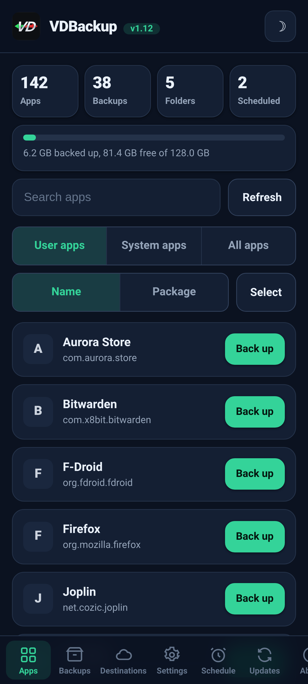
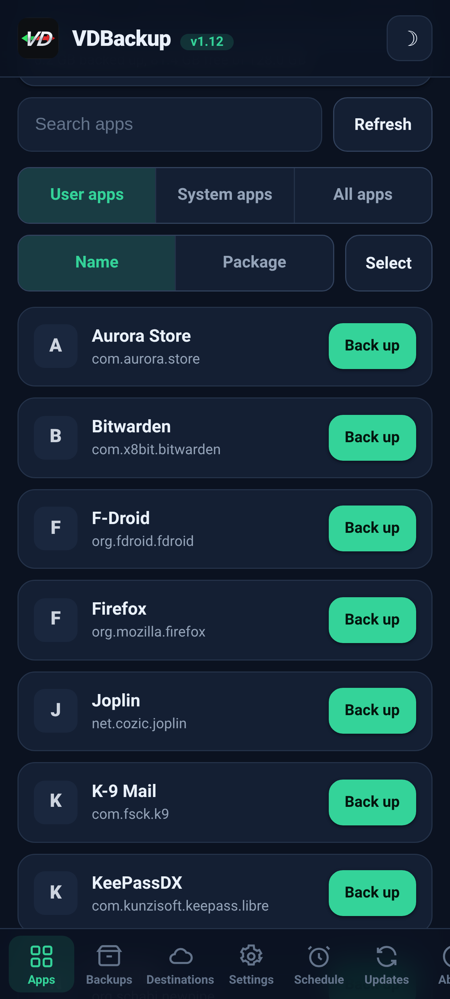
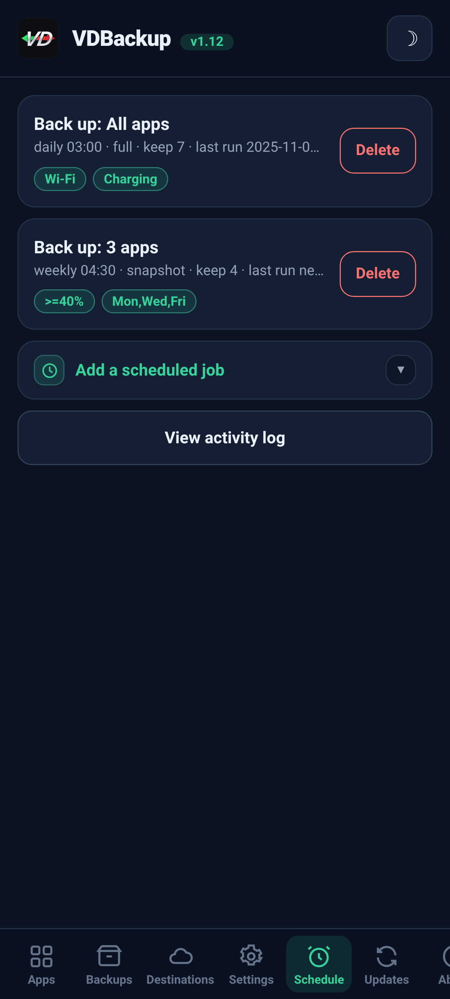
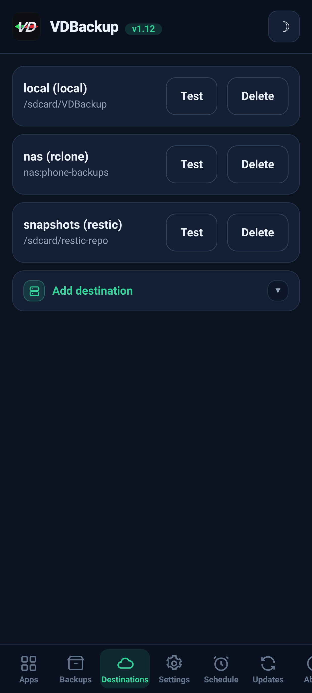
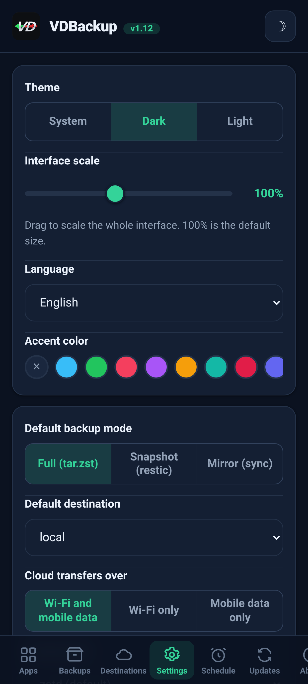
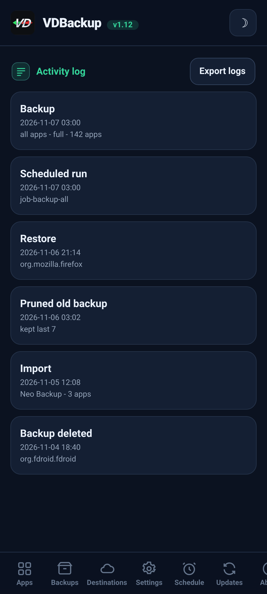

<!--
  ======================================================================
   VD BACKUP  ::  root backup & restore, no grant prompt
   Full app/data backup & restore as root: KernelSU/APatch/Magisk WebUI.

   Copyright (C) 2026  VD171
   SPDX-License-Identifier: AGPL-3.0-or-later

   Free software under the GNU AGPL v3 or later. NETWORK COPYLEFT: run a
   modified version, even as a service, and you MUST offer its source.

   Site           : https://vd171.ru
   Site           : https://vd.priv8.ru
   Source         : https://github.com/VD171/VD-Backup
   GitHub         : @VD171 https://github.com/VD171
   XDA-Developers : @VD171 https://xdaforums.com/m/vd171.4699873/
   XDA thread     : https://xdaforums.com/t/VD-Backup.4807267/
   Telegram       : @VD_Priv8 https://t.me/VD_Priv8
   Channel        : @Priv8_VD https://t.me/Priv8_VD
   Discord        : @VD.Priv8 https://discord.com/users/1296831918989639721
   E-mail         : vd.priv8@pm.me
  ======================================================================
-->

# VD Backup

  

  
  
  
  

  <b>Full app and data backup and restore as root, driven entirely from a WebUI.</b> 
  KernelSU / APatch / Magisk module. No "grant su" prompt, no toggling <code>sucompat</code>.

  <a href="https://github.com/VD171/VD-Backup/releases">Releases</a> ·
  <a href="https://github.com/VD171/VD-Backup/wiki">Wiki</a> ·
  <a href="https://github.com/VD171/VD-Backup/wiki/USER-GUIDE">User guide</a> ·
  <a href="https://github.com/VD171/VD-Backup/wiki/AI-AGENTS">AI agents</a> ·
  <a href="https://github.com/VD171/VD-Backup/wiki/ARCHITECTURE">Architecture</a> ·
  <a href="https://github.com/VD171/VD-Backup/wiki/BINARIES">Bundled binaries</a> ·
  <a href="CHANGELOG.md">Changelog</a> ·
  <a href="https://xdaforums.com/t/VD-Backup.4807267/">XDA thread</a>

> **Languages:** English · [العربية](README.ar.md) · [Čeština](README.cs.md) · [Deutsch](README.de.md) · [Español](README.es.md) · [فارسی](README.fa.md) · [Français](README.fr.md) · [हिन्दी](README.hi.md) · [Bahasa Indonesia](README.id.md) · [Italiano](README.it.md) · [日本語](README.ja.md) · [한국어](README.ko.md) · [Nederlands](README.nl.md) · [Polski](README.pl.md) · [Português](README.pt.md) · [Русский](README.ru.md) · [Svenska](README.sv.md) · [ไทย](README.th.md) · [Türkçe](README.tr.md) · [Українська](README.uk.md) · [Tiếng Việt](README.vi.md) · [中文](README.zh.md)

| Home | Apps | Schedule |
|:---:|:---:|:---:|
|  |  |  |
| **Destinations** | **Settings** | **Activity log** |
|  |  |  |

---

## Why

VDBackup is a root **WebUI module** that backs up and restores your apps and their
data **without a companion app for the core features**, because the module is
already root, there is nothing to "allow". It aims to cover everything the popular
backup apps do, in one place, with a clean WebUI.

It is meant as the open, root-native **successor to Swift Backup, Neo-Backup and
Android-DataBackup**: the union of what they do, under AGPLv3, and it can even
import existing Neo-Backup and Android-DataBackup backups so you can move over.

## Features

- **Apps:** APK (base + splits), app data (`/data/data`), device-protected data
  (`/data/user_de`), external data (`Android/data`), OBB, media.
- **System/special data:** permissions, AppOps, and (opt-in) SSAID, where root allows.
- **Backup modes:** **Full** (portable `tar.zst`), **Snapshot** (incremental +
  versioned, via `restic`) and **Mirror** (1:1 sync, via `rclone`/`rsync`).
- **Faithful preservation:** SELinux contexts, uid/gid, modes, xattr and capabilities.
- **Compression:** none / lz4 / zstd / gzip (gzip = "compatibility mode", opens anywhere).
- **Encryption:** optional and portable (`age` + passphrase, or AES-256 zip), never
  tied to device hardware, so a backup restores on another device or opens on a PC.
  An encrypted backup also seals its metadata (permissions, app label, the file list),
  so the files alone give nothing away, while the WebUI still lists it instantly.
- **Destinations:** local, SFTP, SCP, SMB, WebDAV, FTP, S3 and 70+ more (`rclone`),
  plus `rsync` and `restic` repos. Optional Google Drive via a tiny opt-in companion.
- **Telegram:** back up to a private Telegram channel as unlimited cloud storage over MTProto, restore and delete from the WebUI too.
- **Integrity:** every archive is verified against the manifest, dry-run and
  restore-test let you check a backup without touching anything.
- **Selective & batch restore:** restore any subset of a backup's items, or multi-select
  several backups and restore them all at once, delete backups and keep an activity/audit
  log of every destructive action.
- **Special backups:** messages (SMS/MMS/RCS), contacts and call log, Wi-Fi and Bluetooth,
  with an optional portable JSON export you can open on a PC.
- **System files (`/data/adb`):** back up the root environment itself (modules, their data
  and configs) all of it or a subtree you pick from a file tree, with every file restored to
  its original owner and SELinux context so root keeps working. Advanced, only what you choose.
- **Scheduling + automation:** recurring **backup or restore** jobs targeting one app, a
  set, or all apps, with keep-N pruning, plus opt-in auto-backup on install/update and an
  excluded-apps list.
- **Install source:** restored apps report the Play Store as their install source by
  default (toggleable), an advanced opt-in also forges the initiating package and source.
- **System-app mounting:** mount an installed app as a system app without touching the
  real `/system` partition (systemless overlay sub-module, NoMount-aware).
- **Background:** backup/restore run detached and survive closing the WebUI, with
  start/finish notifications.
- **Migrate in:** imports existing Neo-Backup and Android-DataBackup backups,
  including password-encrypted ones.

## AI agents

VDBackup is built to be welcoming to AI assistants and agents, not just people.
The engine speaks JSON (every `helper.sh` verb returns a single JSON object), the
code, docs and file structure are laid out for machine reading, and AI-assisted
contributions are reviewed and accepted like any other. An agent can administer
**every** action of the module headlessly through the same API the WebUI uses -
see **[docs/AI-AGENTS.md](docs/AI-AGENTS.md)** for the full control surface, and
[CONTRIBUTING.md](CONTRIBUTING.md#ai-contributors-welcome) to contribute.

## Install

1. Download the latest `VD-Backup-vX.Y.zip` from [Releases](https://github.com/VD171/VD-Backup/releases).
2. Flash it in the KernelSU / APatch / Magisk manager, usable immediately, no reboot needed.
3. Open the module's **WebUI** to configure and run backups. That's it.

**Editions.** Six zips per release. `universal-full`: every architecture and
every binary embedded (incl. `rclone` for cloud providers, `restic` for
snapshots), fully offline, nothing ever downloaded, any device, largest.
`universal-lite`: every architecture without the two biggest binaries
(`rclone`, `restic`), smallest, still does local, SSH/SFTP and `rsync` with no
download, and the first time you use a cloud destination (`rclone`) or snapshot
mode (`restic`) it offers to download that small per-architecture addon once
(verified by SHA-256) and caches it, so those features work too. `<abi>-full`
(`arm64-v8a`, `armeabi-v7a`, `x86`, `x86_64`): a single architecture with every
binary embedded, smaller than `universal-full`. Know your arch -> pick
`<abi>-full`, want the smallest and do not mind a one-time download for cloud or
snapshots -> `universal-lite`, want everything embedded with zero downloads
(offline / recovery) -> a full edition. See [Releases](https://github.com/VD171/VD-Backup/releases).

New here? The [User guide](docs/USER-GUIDE.md) walks you from install to restore.

## Security

VDBackup runs as root and handles your app data and, optionally, your credentials
and encryption passphrases, a backup can hold sensitive data, so protect it with a
passphrase and keep it somewhere you trust. Credentials are stored encrypted at rest,
never in clear text, and encryption is never tied to device hardware, so the
passphrase is what guards an encrypted backup. Report a vulnerability per
[SECURITY.md](SECURITY.md).

## Build

The module is shell + WebUI plus per-ABI static binaries (`tar`, `zstd`, `lz4`,
`rclone`, `rsync`, ssh, `restic`) built for `armeabi-v7a`, `arm64-v8a`, `x86`,
`x86_64`. See [CONTRIBUTING.md](CONTRIBUTING.md) and the CI workflows.

## Portability

Your backups are **not locked into this module**. Everything uses standard formats
(`tar`, `gzip`, `zstd`, `age`, `zip`, `restic`) that open on Windows, macOS and
Linux with common tools or file managers. Every encrypted backup ships with a
**RECOVERY** note containing the exact commands to decrypt and extract on a PC.

## Incremental updates (VDLU)

VD Backup ships the **[VDLiveUpdate](https://github.com/VD171/VDLiveUpdate) (VDLU)** engine (vendored in `vdlu/`): the module updates itself by fetching only the
files that changed (content-addressed blobs + a signed `manifest.json`), instead of re-downloading the
whole `.zip`. **Hardened** profile: the ed25519 signature is mandatory and downgrades are blocked, the
full `.zip` stays valid as a fallback.

- **LIVE-only** (no reboot): updates apply on the next boot via `service.sh`, backgrounded, a no-op when
  no feed is reachable.
- **State** in `/data/adb/vdbackup/vdlu/`, outside the module, so it survives a reflash.
- **WebUI:** an **Updates** panel with a progress toast and cancel, auto-update is opt-in.

## Documentation

- **[Wiki](https://github.com/VD171/VD-Backup/wiki)**: the docs, browsable online.
- **[User guide](https://github.com/VD171/VD-Backup/wiki/USER-GUIDE)**: end to end, from install to restore.
- **[AI agents](https://github.com/VD171/VD-Backup/wiki/AI-AGENTS)**: drive every action headlessly over the JSON API.
- **[Architecture](https://github.com/VD171/VD-Backup/wiki/ARCHITECTURE)** and **[File structure](https://github.com/VD171/VD-Backup/wiki/FILE-STRUCTURE)**: how it works.
- **[Bundled binaries](https://github.com/VD171/VD-Backup/wiki/BINARIES)**: provenance and SHA-256 of every prebuilt binary, for full auditing.
- **[Recovery](https://github.com/VD171/VD-Backup/wiki/RECOVERY)**: open and decrypt a backup on a PC, no module needed.
- **[Contributing](https://github.com/VD171/VD-Backup/wiki/CONTRIBUTING)** and **[Security](https://github.com/VD171/VD-Backup/wiki/SECURITY)**.
- **[Changelog](https://github.com/VD171/VD-Backup/wiki/CHANGELOG)** and **[Code of Conduct](https://github.com/VD171/VD-Backup/wiki/CODE_OF_CONDUCT)**.

<!-- /vd-docs -->

## See also

- **[COPG-VD](https://github.com/VD171/COPG-VD)**: global device fingerprint / Play Integrity spoofing, whole-device with per-app scope and a WebUI.
- **[VD-dropbear](https://github.com/VD171/VD-dropbear)**: a standalone rooted SSH daemon (Dropbear).
- **[VDGoogle](https://github.com/VD171/VD-Google)**: your Google services (RCS, Wallet, Play Integrity attestations), read on your device with no internet.
- **[VDInstaller](https://github.com/VD171/VD-Installer)**: a frictionless root sideload installer for single, batch and split APKs, with a Play Protect verifier toggle and install-source spoofing.
- **[VDInfos](https://github.com/VD171/VD-Infos)**: a device method debugger that reads each item through every method that can read it and compares them side by side.
- **[VDLiveUpdate](https://github.com/VD171/VDLiveUpdate)**: a flashless, incremental self-update engine embedded into KernelSU/APatch/Magisk modules.
- **[VD-Modules](https://github.com/VD171/VD-Modules)**: our MMRL/WebUI-X module repository (install all of these from your root manager).
- **[build.prop](https://github.com/VictorGabriel7Dev/build.prop)**: a dataset of Pixel build.prop fingerprints (fork of @T3SL4).
- **[mtproto-store](https://github.com/VictorGabriel7Dev/mtproto-store)**: use Telegram as an object store from a tiny Go CLI.

## Contacts

- https://vd171.ru
- https://vd.priv8.ru
- **Telegram:** @VD_Priv8 https://t.me/VD_Priv8
- **Channel:** @Priv8_VD https://t.me/Priv8_VD
- **Discord:** @VD.Priv8 https://discord.com/users/1296831918989639721
- **E-mail:** vd.priv8@pm.me
- **XDA-Developers:** @VD171 https://xdaforums.com/m/vd171.4699873/
- **XDA thread:** https://xdaforums.com/t/VD-Backup.4807267/
- **GitHub:** @VD171 https://github.com/VD171

## License

[GNU AGPL-3.0-or-later](LICENSE). Network copyleft: if you run a modified version,
even as a service, you must offer its source.

## Trademarks

VD Backup is an independent, unofficial project. It is not affiliated with, endorsed by, or sponsored by Google LLC or any other vendor. "Google Drive", "Android" and related names and logos are trademarks of their respective owners. VD Backup runs on your device and uploads only to the destinations you configure.

## Tags

`android` `backup` `restore` `app-data` `migration` `neo-backup` `databackup` `kernelsu` `apatch` `magisk` `webui` `root` `tar` `zstd` `restic` `rclone` `age` `encryption` `ssaid` `appops` `on-device` `agpl` `ai-friendly` `telegram` `rcs` `vdbackup`

---

📣 **Join the channel for updates:** @Priv8_VD https://t.me/Priv8_VD
