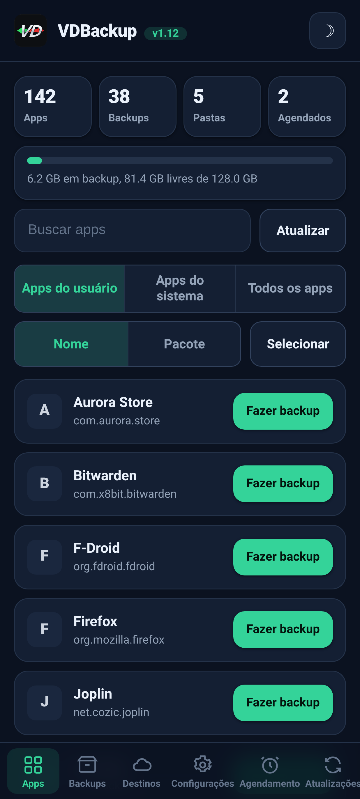
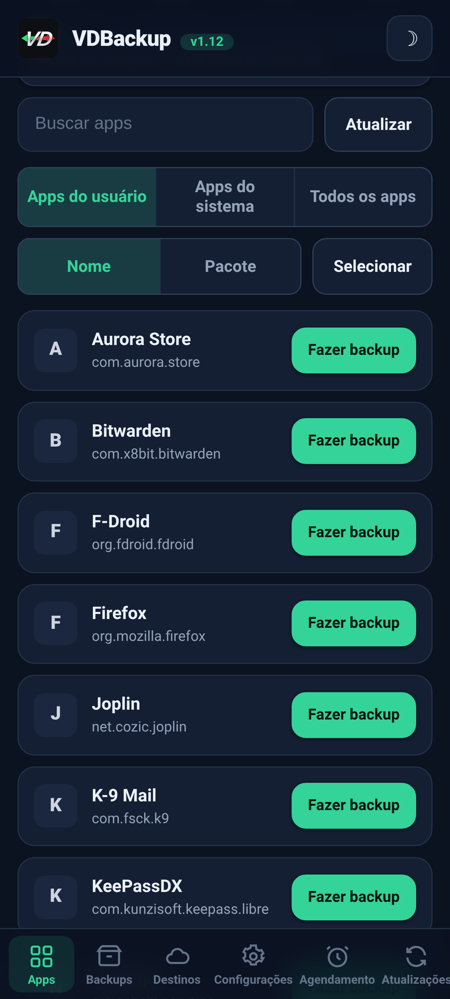
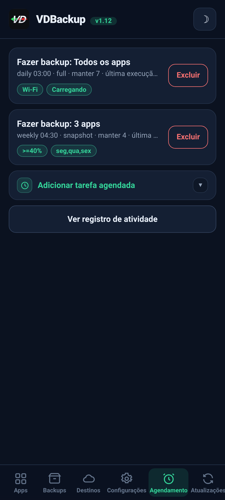
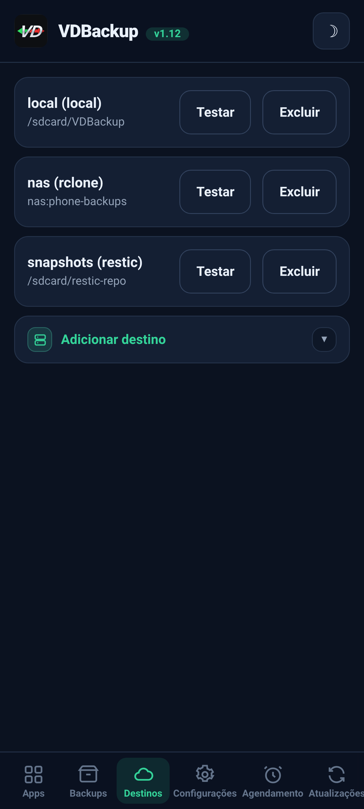
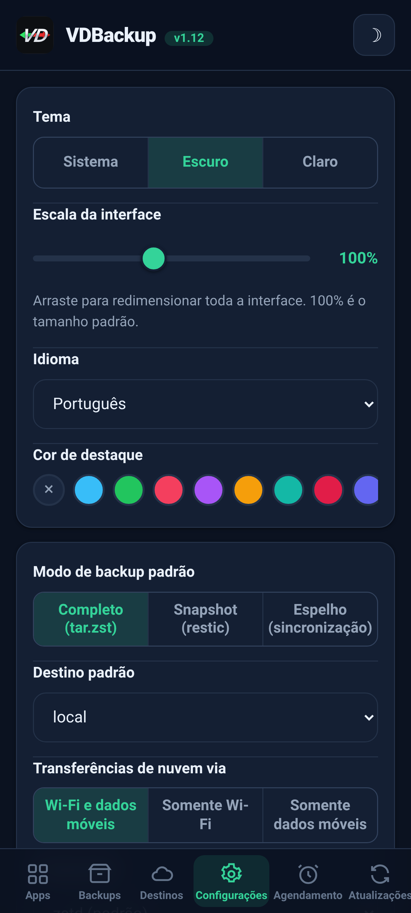
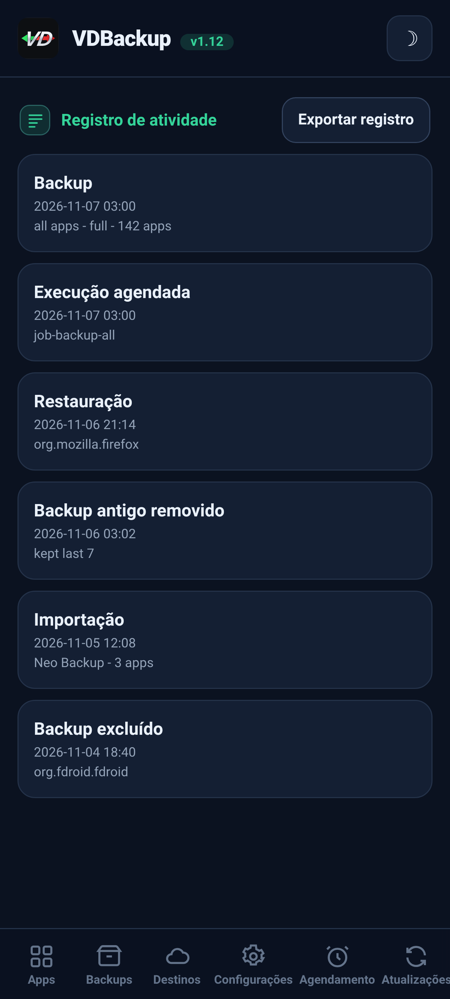

<!--
  ======================================================================
   VD BACKUP  ::  root backup & restore, no grant prompt
   Full app/data backup & restore as root: KernelSU/APatch/Magisk WebUI.

   Copyright (C) 2026  VD171
   SPDX-License-Identifier: AGPL-3.0-or-later

   Free software under the GNU AGPL v3 or later. NETWORK COPYLEFT: run a
   modified version, even as a service, and you MUST offer its source.

   Site           : https://vd171.ru
   Site           : https://vd.priv8.ru
   Source         : https://github.com/VD171/VD-Backup
   GitHub         : @VD171 https://github.com/VD171
   XDA-Developers : @VD171 https://xdaforums.com/m/vd171.4699873/
   XDA thread     : https://xdaforums.com/t/VD-Backup.4807267/
   Telegram       : @VD_Priv8 https://t.me/VD_Priv8
   Channel        : @Priv8_VD https://t.me/Priv8_VD
   Discord        : @VD.Priv8 https://discord.com/users/1296831918989639721
   E-mail         : vd.priv8@pm.me
  ======================================================================
-->

# VD Backup

  

  
  
  
  

  <b>Backup e restauração completos de apps e dados como root, conduzidos inteiramente por uma WebUI.</b> 
  Módulo KernelSU / APatch / Magisk. Sem prompt de "conceder su", sem alternar <code>sucompat</code>.

  <a href="https://github.com/VD171/VD-Backup/releases">Releases</a> ·
  <a href="https://github.com/VD171/VD-Backup/wiki/pt-Home">Wiki</a> ·
  <a href="https://github.com/VD171/VD-Backup/wiki/pt-USER-GUIDE">Guia do usuário</a> ·
  <a href="https://github.com/VD171/VD-Backup/wiki/pt-AI-AGENTS">Agentes de IA</a> ·
  <a href="https://github.com/VD171/VD-Backup/wiki/pt-ARCHITECTURE">Arquitetura</a> ·
  <a href="https://github.com/VD171/VD-Backup/wiki/pt-BINARIES">Binários incluídos</a> ·
  <a href="https://github.com/VD171/VD-Backup/wiki/pt-CHANGELOG">Changelog</a> ·
  <a href="https://xdaforums.com/t/VD-Backup.4807267/">XDA thread</a>

> **Languages:** [English](README.md) · [العربية](README.ar.md) · [Čeština](README.cs.md) · [Deutsch](README.de.md) · [Español](README.es.md) · [فارسی](README.fa.md) · [Français](README.fr.md) · [हिन्दी](README.hi.md) · [Bahasa Indonesia](README.id.md) · [Italiano](README.it.md) · [日本語](README.ja.md) · [한국어](README.ko.md) · [Nederlands](README.nl.md) · [Polski](README.pl.md) · Português · [Русский](README.ru.md) · [Svenska](README.sv.md) · [ไทย](README.th.md) · [Türkçe](README.tr.md) · [Українська](README.uk.md) · [Tiếng Việt](README.vi.md) · [中文](README.zh.md)

| Home | Apps | Schedule |
|:---:|:---:|:---:|
|  |  |  |
| **Destinations** | **Settings** | **Activity log** |
|  |  |  |

---

## Por que

O VDBackup é um **módulo WebUI** root que faz backup e restauração dos seus apps e dos
seus dados **sem um app complementar para os recursos principais**: porque o módulo já
é root, não há nada para "permitir". Ele pretende cobrir tudo o que os apps de backup
populares fazem, em um único lugar, com uma WebUI limpa.

Ele é pensado como o **sucessor** aberto e root-nativo do **Swift Backup, do Neo-Backup e
do Android-DataBackup**: a união do que eles fazem, sob AGPLv3, e ele ainda consegue
importar backups existentes do Neo-Backup e do Android-DataBackup para que você possa migrar.

## Recursos

- **Apps:** APK (base + splits), dados do app (`/data/data`), dados protegidos pelo dispositivo
  (`/data/user_de`), dados externos (`Android/data`), OBB, mídia.
- **Dados de sistema/especiais:** permissões, AppOps e (opcional) SSAID, onde o root permite.
- **Modos de backup:** **Full** (`tar.zst` portátil), **Snapshot** (incremental +
  versionado, via `restic`) e **Mirror** (sincronização 1:1, via `rclone`/`rsync`).
- **Preservação fiel:** contextos SELinux, uid/gid, modes, xattr e capabilities.
- **Compressão:** nenhuma / lz4 / zstd / gzip (gzip = "modo de compatibilidade", abre em qualquer lugar).
- **Criptografia:** opcional e portátil (`age` + senha, ou zip AES-256), nunca
  atrelada ao hardware do dispositivo, então um backup restaura em outro dispositivo ou abre num PC.
- **Destinos:** local, SFTP, SCP, SMB, WebDAV, FTP, S3 e mais de 70 (`rclone`),
  além de repositórios `rsync` e `restic`. Google Drive opcional via um pequeno complemento opt-in.
- **Telegram:** faça backup para um canal privado do Telegram como armazenamento de nuvem ilimitado via MTProto, restaurar e apagar também pela WebUI.
- **Integridade:** todo arquivo é verificado contra o manifesto, dry-run e
  restore-test deixam você conferir um backup sem tocar em nada.
- **Restauração seletiva e em lote:** restaure qualquer subconjunto dos itens de um backup, ou
  selecione vários backups e restaure todos de uma vez, apague backups e mantenha um log de
  atividade/auditoria de toda ação destrutiva.
- **Backups especiais:** mensagens (SMS/MMS/RCS), contatos e registro de chamadas, Wi-Fi e Bluetooth,
  com uma exportação JSON portátil opcional que você pode abrir num PC.
- **Arquivos de sistema (`/data/adb`):** faça backup do próprio ambiente root (módulos, seus dados
  e configurações) tudo isso ou uma subárvore que você escolhe de uma árvore de arquivos, com cada
  arquivo restaurado ao seu dono e contexto SELinux originais para que o root continue funcionando. Avançado, só o que você escolher.
- **Agendamento + automação:** jobs recorrentes de **backup ou restauração** com alvo de um
  app, um conjunto, ou todos os apps, com poda keep-N, mais auto-backup opt-in ao
  instalar/atualizar e uma lista de apps excluídos.
- **Fonte de instalação:** apps restaurados reportam a Play Store como sua fonte de instalação por
  padrão (alternável), um opt-in avançado também forja o pacote iniciador e a fonte.
- **Montagem como app de sistema:** monte um app instalado como app de sistema sem tocar na
  partição `/system` real (sub-módulo de overlay sem sistema, ciente de NoMount).
- **Em segundo plano:** backup/restore rodam destacados e sobrevivem ao fechamento da WebUI, com
  notificações de início/fim.
- **Migrar para cá:** importa backups existentes do Neo-Backup e do Android-DataBackup,
  inclusive os protegidos por senha.

## Agentes de IA

O VDBackup foi feito para ser receptivo a assistentes e agentes de IA, não só a pessoas.
O engine fala JSON (todo verbo do `helper.sh` retorna um único objeto JSON), o
código, a documentação e a estrutura de arquivos são organizados para leitura por máquina, e
contribuições assistidas por IA são revisadas e aceitas como qualquer outra. Um agente pode administrar
**cada** ação do módulo sem interface através da mesma API que a WebUI usa -
veja **[docs/AI-AGENTS.md](docs/AI-AGENTS.md)** para a superfície de controle completa, e
[CONTRIBUTING.md](CONTRIBUTING.md#ai-contributors-welcome) para contribuir.

## Instalação

1. Baixe o `VD-Backup-vX.Y.zip` mais recente em [Versões](https://github.com/VD171/VD-Backup/releases).
2. Instale-o no gerenciador KernelSU / APatch / Magisk, usável na hora, sem precisar reiniciar.
3. Abra a **WebUI** do módulo para configurar e rodar backups. É só isso.

**Edições.** Seis zips por release. `universal-full`, toda arquitetura e todo binário
embutido (incl. `rclone` para provedores de nuvem, `restic` para snapshots), totalmente
offline, nada é baixado, qualquer aparelho, o maior. `universal-lite`, toda arquitetura sem
os dois maiores binários (`rclone`, `restic`), o menor, ainda faz backups locais, SSH/SFTP e
`rsync` sem baixar nada, e na primeira vez que você usa um destino de nuvem (`rclone`) ou o
modo snapshot (`restic`) ele oferece baixar aquele pequeno complemento por arquitetura uma
vez (verificado por SHA-256) e o guarda em cache, então esses recursos também funcionam.
`<abi>-full` (`arm64-v8a`, `armeabi-v7a`, `x86`, `x86_64`), uma única arquitetura com todo
binário embutido, menor que o `universal-full`. Sabe sua arquitetura -> escolha `<abi>-full`;
quer o menor e não se importa com um download único para nuvem ou snapshots -> `universal-lite`;
quer tudo embutido sem downloads (offline / recuperação) -> uma edição full.
Veja [Versões](https://github.com/VD171/VD-Backup/releases).

Chegou agora? O [Guia do usuário](docs/USER-GUIDE.md) leva você da instalação ao restore.

## Segurança

O VDBackup roda como root e lida com os dados dos seus apps e, opcionalmente, com suas credenciais e senhas de criptografia, um backup pode conter dados sensíveis, então proteja-o com uma senha e guarde-o em um lugar em que você confia. As credenciais são armazenadas criptografadas em repouso, nunca em texto claro, e a criptografia nunca é atrelada ao hardware do dispositivo, então a senha é o que protege um backup criptografado. Reporte uma vulnerabilidade conforme o [SECURITY.md](SECURITY.md).

## Build

O módulo é shell + WebUI mais binários estáticos por ABI (`tar`, `zstd`, `lz4`,
`rclone`, `rsync`, ssh, `restic`) compilados para `armeabi-v7a`, `arm64-v8a`, `x86`,
`x86_64`. Veja [CONTRIBUTING.md](CONTRIBUTING.md) e os workflows de CI.

## Portabilidade

Seus backups **não ficam presos a este módulo**. Tudo usa formatos padrão
(`tar`, `gzip`, `zstd`, `age`, `zip`, `restic`) que abrem no Windows, macOS e
Linux com ferramentas comuns ou gerenciadores de arquivos. Todo backup criptografado vem com uma
nota **RECOVERY** contendo os comandos exatos para descriptografar e extrair num PC.

## Atualizações incrementais (VDLU)

O VD Backup traz o engine **[VDLiveUpdate](https://github.com/VD171/VDLiveUpdate) (VDLU)** (incorporado em `vdlu/`): o módulo se atualiza baixando apenas os
arquivos que mudaram (blobs endereçados por conteúdo + um `manifest.json` assinado), em vez de rebaixar o
`.zip` inteiro. Perfil **reforçado**: a assinatura ed25519 é obrigatória e os downgrades são bloqueados, o
`.zip` completo continua válido como alternativa.

- **Somente LIVE** (sem reinício): as atualizações se aplicam no próximo boot via `service.sh`, em segundo plano, sem efeito quando nenhum feed está acessível.
- **Estado** em `/data/adb/vdbackup/vdlu/`, fora do módulo, para sobreviver a um reflash.
- **WebUI:** um painel **Atualizações** com um toast de progresso e cancelamento, a atualização automática é opcional.

## Documentação

- **[Wiki](https://github.com/VD171/VD-Backup/wiki/pt-Home)**: a documentação, navegável online.
- **[Guia do usuário](https://github.com/VD171/VD-Backup/wiki/pt-USER-GUIDE)**: de ponta a ponta, da instalação ao restore.
- **[Agentes de IA](https://github.com/VD171/VD-Backup/wiki/pt-AI-AGENTS)**: conduza cada ação sem interface pela API JSON.
- **[Arquitetura](https://github.com/VD171/VD-Backup/wiki/pt-ARCHITECTURE)** e **[Estrutura de arquivos](https://github.com/VD171/VD-Backup/wiki/pt-FILE-STRUCTURE)**: como funciona.
- **[Binários incluídos](https://github.com/VD171/VD-Backup/wiki/pt-BINARIES)**: proveniência e SHA-256 de cada binário pré-compilado, para auditoria completa.
- **[Recuperação](https://github.com/VD171/VD-Backup/wiki/pt-RECOVERY)**: abra e descriptografe um backup no PC, sem o módulo.
- **[Como contribuir](https://github.com/VD171/VD-Backup/wiki/pt-CONTRIBUTING)** e **[Segurança](https://github.com/VD171/VD-Backup/wiki/pt-SECURITY)**.
- **[Changelog](https://github.com/VD171/VD-Backup/wiki/pt-CHANGELOG)** e **[Código de Conduta](https://github.com/VD171/VD-Backup/wiki/pt-CODE_OF_CONDUCT)**.

<!-- /vd-docs -->

## Veja também

- **[COPG-VD](https://github.com/VD171/COPG-VD)**: falsificação do fingerprint global do dispositivo / Play Integrity, no dispositivo inteiro com escopo por aplicativo e uma WebUI.
- **[VD-dropbear](https://github.com/VD171/VD-dropbear)**: um daemon SSH independente com root (Dropbear).
- **[VDGoogle](https://github.com/VD171/VD-Google)**: seus serviços Google (RCS, Wallet, atestações do Play Integrity), lidos no seu dispositivo sem internet.
- **[VDInstaller](https://github.com/VD171/VD-Installer)**: um instalador sideload com root e sem atrito para APKs únicos, em lote e divididos, com um interruptor para o verificador do Play Protect e falsificação da origem de instalação.
- **[VDInfos](https://github.com/VD171/VD-Infos)**: um depurador de métodos do dispositivo: lê cada item por todos os métodos que conseguem lê-lo e os compara lado a lado.
- **[VDLiveUpdate](https://github.com/VD171/VDLiveUpdate)**: um motor de autoatualização incremental e sem flash, embarcado em módulos KernelSU/APatch/Magisk.
- **[VD-Modules](https://github.com/VD171/VD-Modules)**: nosso repositório de módulos MMRL/WebUI-X (instale todos eles pelo seu gerenciador de root).
- **[build.prop](https://github.com/VictorGabriel7Dev/build.prop)**: um conjunto de dados de fingerprints build.prop de Pixel (fork de @T3SL4).
- **[mtproto-store](https://github.com/VictorGabriel7Dev/mtproto-store)**: use o Telegram como armazenamento de objetos a partir de uma pequena CLI em Go.

## Contatos

- https://vd171.ru
- https://vd.priv8.ru
- **Telegram:** @VD_Priv8 https://t.me/VD_Priv8
- **Channel:** @Priv8_VD https://t.me/Priv8_VD
- **Discord:** @VD.Priv8 https://discord.com/users/1296831918989639721
- **E-mail:** vd.priv8@pm.me
- **XDA-Developers:** @VD171 https://xdaforums.com/m/vd171.4699873/
- **XDA thread:** https://xdaforums.com/t/VD-Backup.4807267/
- **GitHub:** @VD171 https://github.com/VD171

## Licença

[GNU AGPL-3.0-or-later](LICENSE). Copyleft de rede: se você rodar uma versão modificada,
mesmo como serviço, você precisa oferecer o código-fonte dela.

## Marcas registradas

O VD Backup é um projeto independente e não oficial. Não é afiliado, endossado nem patrocinado pela Google LLC ou por qualquer outro fornecedor. "Google Drive", "Android" e os nomes e logotipos relacionados são marcas registradas de seus respectivos proprietários. O VD Backup roda no seu dispositivo e envia dados apenas para os destinos que você configurar.

## Tags

`android` `backup` `restore` `app-data` `migration` `neo-backup` `databackup` `kernelsu` `apatch` `magisk` `webui` `root` `tar` `zstd` `restic` `rclone` `age` `encryption` `ssaid` `appops` `on-device` `agpl` `ai-friendly` `telegram` `rcs` `vdbackup`

---

📣 **Entre no canal para receber atualizações:** @Priv8_VD https://t.me/Priv8_VD
