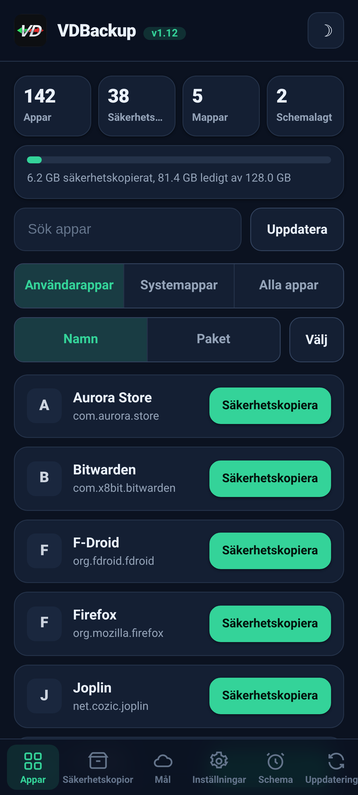
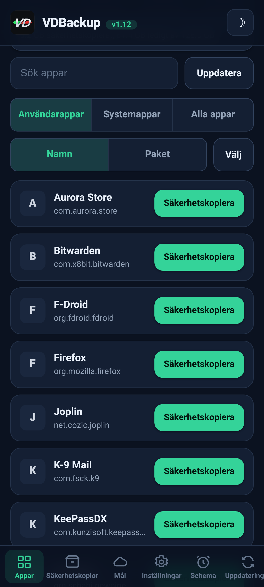
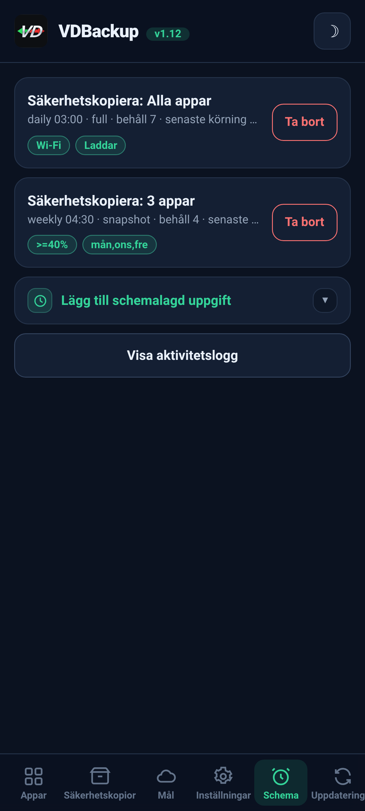
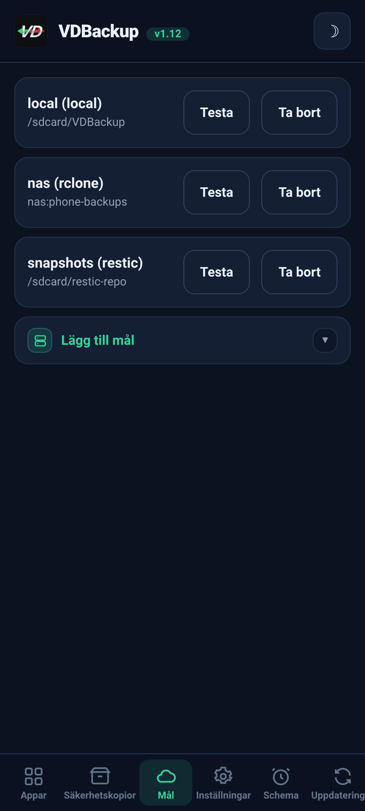
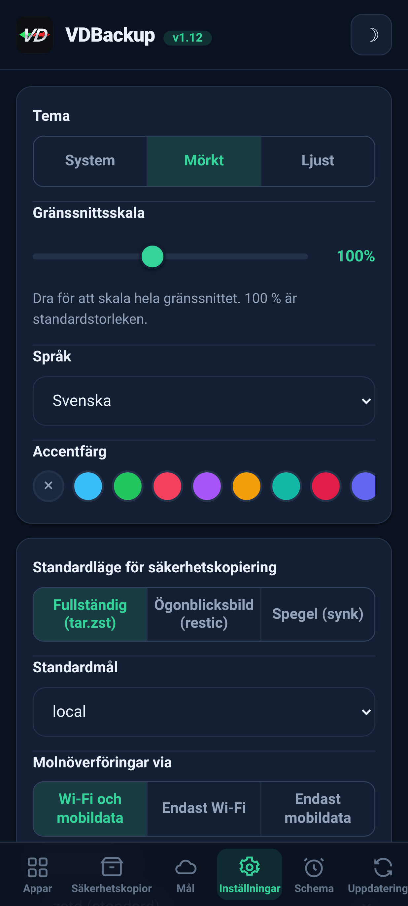
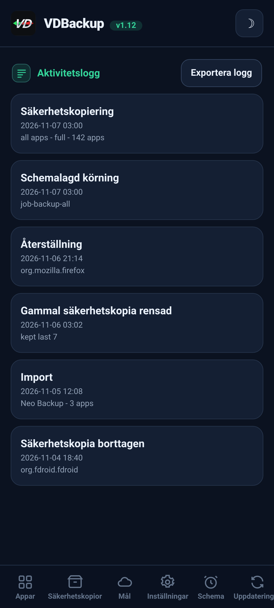

<!--
  ======================================================================
   VD BACKUP  ::  root backup & restore, no grant prompt
   Full app/data backup & restore as root: KernelSU/APatch/Magisk WebUI.

   Copyright (C) 2026  VD171
   SPDX-License-Identifier: AGPL-3.0-or-later

   Free software under the GNU AGPL v3 or later. NETWORK COPYLEFT: run a
   modified version, even as a service, and you MUST offer its source.

   Site           : https://vd171.ru
   Site           : https://vd.priv8.ru
   Source         : https://github.com/VD171/VD-Backup
   GitHub         : @VD171 https://github.com/VD171
   XDA-Developers : @VD171 https://xdaforums.com/m/vd171.4699873/
   XDA thread     : https://xdaforums.com/t/VD-Backup.4807267/
   Telegram       : @VD_Priv8 https://t.me/VD_Priv8
   Channel        : @Priv8_VD https://t.me/Priv8_VD
   Discord        : @VD.Priv8 https://discord.com/users/1296831918989639721
   E-mail         : vd.priv8@pm.me
  ======================================================================
-->

# VD Backup

  

  
  
  
  

  <b>Fullständig säkerhetskopiering och återställning av appar och data som root, helt styrd från ett WebUI.</b> 
  KernelSU- / APatch- / Magisk-modul. Ingen "bevilja su"-fråga, ingen växling av <code>sucompat</code>.

  <a href="https://github.com/VD171/VD-Backup/releases">Releases</a> ·
  <a href="https://github.com/VD171/VD-Backup/wiki/sv-Home">Wiki</a> ·
  <a href="https://github.com/VD171/VD-Backup/wiki/sv-USER-GUIDE">Användarguide</a> ·
  <a href="https://github.com/VD171/VD-Backup/wiki/sv-AI-AGENTS">AI-agenter</a> ·
  <a href="https://github.com/VD171/VD-Backup/wiki/sv-ARCHITECTURE">Arkitektur</a> ·
  <a href="https://github.com/VD171/VD-Backup/wiki/sv-BINARIES">Medföljande binärer</a> ·
  <a href="https://github.com/VD171/VD-Backup/wiki/sv-CHANGELOG">Ändringslogg</a> ·
  <a href="https://xdaforums.com/t/VD-Backup.4807267/">XDA thread</a>

> **Languages:** [English](README.md) · [العربية](README.ar.md) · [Čeština](README.cs.md) · [Deutsch](README.de.md) · [Español](README.es.md) · [فارسی](README.fa.md) · [Français](README.fr.md) · [हिन्दी](README.hi.md) · [Bahasa Indonesia](README.id.md) · [Italiano](README.it.md) · [日本語](README.ja.md) · [한국어](README.ko.md) · [Nederlands](README.nl.md) · [Polski](README.pl.md) · [Português](README.pt.md) · [Русский](README.ru.md) · Svenska · [ไทย](README.th.md) · [Türkçe](README.tr.md) · [Українська](README.uk.md) · [Tiếng Việt](README.vi.md) · [中文](README.zh.md)

| Home | Apps | Schedule |
|:---:|:---:|:---:|
|  |  |  |
| **Destinations** | **Settings** | **Activity log** |
|  |  |  |

---

## Varför

VDBackup är en root-**WebUI-modul** som säkerhetskopierar och återställer dina appar och
deras data **utan en följeslagarapp för kärnfunktionerna**: eftersom modulen redan är
root finns det inget att "tillåta". Målet är att täcka allt som de populära
säkerhetskopieringsapparna gör, på ett ställe, med ett rent WebUI.

Den är tänkt som den öppna, root-nativa **efterföljaren till Swift Backup, Neo-Backup och
Android-DataBackup**: föreningen av vad de gör, under AGPLv3, och den kan till och med
importera befintliga säkerhetskopior från Neo-Backup och Android-DataBackup så att du kan flytta över.

## Funktioner

- **Appar:** APK (bas + splits), appdata (`/data/data`), enhetsskyddad data
  (`/data/user_de`), extern data (`Android/data`), OBB, media.
- **System-/specialdata:** behörigheter, AppOps och (valfritt) SSAID, där root tillåter.
- **Säkerhetskopieringslägen:** **Full** (portabel `tar.zst`), **Snapshot** (inkrementell +
  versionshanterad, via `restic`) och **Mirror** (1:1-synkronisering, via `rclone`/`rsync`).
- **Troget bevarande:** SELinux-kontexter, uid/gid, lägen, xattr och capabilities.
- **Komprimering:** ingen / lz4 / zstd / gzip (gzip = "kompatibilitetsläge", öppnas överallt).
- **Kryptering:** valfri och portabel (`age` + lösenfras eller AES-256-zip), aldrig bunden
  till enhetens hårdvara, så att en säkerhetskopia återställs på en annan enhet eller öppnas på en dator.
- **Destinationer:** lokalt, SFTP, SCP, SMB, WebDAV, FTP, S3 och 70+ till (`rclone`),
  plus `rsync`-förråd och `restic`-förråd. Valfritt Google Drive via en pytteliten valfri följeslagare.
- **Telegram:** säkerhetskopiera till en privat Telegram-kanal som obegränsad molnlagring via MTProto, återställ och ta bort även från WebUI.
- **Integritet:** varje arkiv verifieras mot manifestet, torrkörning (dry-run) och
  återställningstest låter dig kontrollera en säkerhetskopia utan att röra något.
- **Selektiv återställning och batchåterställning:** återställ valfri delmängd av en säkerhetskopias
  objekt, eller markera flera säkerhetskopior och återställ dem alla på en gång, radera säkerhetskopior
  och för en aktivitets-/revisionslogg över varje destruktiv åtgärd.
- **Särskilda säkerhetskopior:** meddelanden (SMS/MMS/RCS), kontakter och samtalslogg, Wi-Fi och
  Bluetooth, med en valfri portabel JSON-export som du kan öppna på en PC.
- **Systemfiler (`/data/adb`):** säkerhetskopiera själva root-miljön (moduler, deras data och
  konfigurationer) allt eller ett delträd som du väljer i ett filträd, där varje fil återställs
  med sin ursprungliga ägare och SELinux-kontext så att root fortsätter att fungera. Avancerat;
  bara det du väljer.
- **Schemaläggning + automatisering:** återkommande jobb för **säkerhetskopiering eller återställning**
  mot en app, en uppsättning, eller alla appar, med keep-N-gallring, plus valfri auto-säkerhetskopiering
  vid installation/uppdatering och en lista över uteslutna appar.
- **Installationskälla:** återställda appar anger som standard Play Store som sin
  installationskälla (växlingsbart), ett avancerat tillval förfalskar även det initierande paketet och källan.
- **Montering som systemapp:** montera en installerad app som en systemapp utan att röra den
  riktiga `/system`-partitionen (systemlöst overlay-undermodul, NoMount-medvetet).
- **Bakgrund:** säkerhetskopiering/återställning körs frikopplat och överlever att WebUI
  stängs, med aviseringar vid start/slut.
- **Migrera in:** importerar befintliga säkerhetskopior från Neo-Backup och
  Android-DataBackup, inklusive lösenordskrypterade.

## AI-agenter

VDBackup är byggt för att välkomna AI-assistenter och -agenter, inte bara människor.
Motorn talar JSON (varje `helper.sh`-verb returnerar ett enda JSON-objekt), koden,
dokumentationen och filstrukturen är upplagda för maskinläsning, och AI-stödda bidrag
granskas och accepteras som alla andra. En agent kan administrera **varje** åtgärd i
modulen huvudlöst via samma API som WebUI använder, se
**[docs/AI-AGENTS.md](docs/AI-AGENTS.md)** för hela styrytan, och
[CONTRIBUTING.md](CONTRIBUTING.md#ai-contributors-welcome) för att bidra.

## Installation

1. Ladda ner den senaste `VD-Backup-vX.Y.zip` från [Utgåvor](https://github.com/VD171/VD-Backup/releases).
2. Flasha den i KernelSU- / APatch- / Magisk-hanteraren, användbar direkt, ingen omstart behövs.
3. Öppna modulens **WebUI** för att konfigurera och köra säkerhetskopior. Det är allt.

**Utgåvor.** Sex zip-filer per release. `universal-full`, alla arkitekturer och alla
binärer inbäddade (inkl. `rclone` för molnleverantörer, `restic` för ögonblicksbilder),
helt offline, inget laddas någonsin ner, alla enheter, störst. `universal-lite`, alla
arkitekturer utan de två största binärerna (`rclone`, `restic`), minst, klarar fortfarande
lokala, SSH/SFTP och `rsync` utan nedladdning, och första gången du använder en
molndestination (`rclone`) eller ögonblicksbildsläge (`restic`) erbjuder den sig att ladda
ner det lilla arkitekturspecifika tillägget en gång (verifierat med SHA-256) och cachar det,
så att även de funktionerna fungerar. `<abi>-full` (`arm64-v8a`, `armeabi-v7a`, `x86`,
`x86_64`), en enda arkitektur med alla binärer inbäddade, mindre än `universal-full`. Vet
du din arkitektur -> välj `<abi>-full`, vill du ha minst och har inget emot en
engångsnedladdning för moln eller ögonblicksbilder -> `universal-lite`, vill du ha allt
inbäddat utan några nedladdningar (offline / återställning) -> en full-utgåva. Se
[Utgåvor](https://github.com/VD171/VD-Backup/releases).

Ny här? [Användarguiden](docs/USER-GUIDE.md) tar dig från installation till återställning.

## Säkerhet

VDBackup körs som root och hanterar dina appdata och, valfritt, dina autentiseringsuppgifter och krypteringslösenfraser, en säkerhetskopia kan innehålla känsliga data, så skydda den med en lösenfras och förvara den på en plats du litar på. Autentiseringsuppgifter lagras krypterade i vila, aldrig i klartext, och krypteringen är aldrig bunden till enhetens hårdvara, så det är lösenfrasen som skyddar en krypterad säkerhetskopia. Rapportera en sårbarhet enligt [SECURITY.md](SECURITY.md).

## Bygga

Modulen är shell + WebUI plus statiska binärer per ABI (`tar`, `zstd`, `lz4`,
`rclone`, `rsync`, ssh, `restic`) byggda för `armeabi-v7a`, `arm64-v8a`, `x86`,
`x86_64`. Se [CONTRIBUTING.md](CONTRIBUTING.md) och CI-arbetsflödena.

## Portabilitet

Dina säkerhetskopior **är inte låsta till den här modulen**. Allt använder standardformat
(`tar`, `gzip`, `zstd`, `age`, `zip`, `restic`) som öppnas på Windows, macOS och Linux med
vanliga verktyg eller filhanterare. Varje krypterad säkerhetskopia levereras med en
**RECOVERY**-anteckning som innehåller de exakta kommandona för att dekryptera och packa upp på en dator.

## Inkrementella uppdateringar (VDLU)

VD Backup levereras med **[VDLiveUpdate](https://github.com/VD171/VDLiveUpdate) (VDLU)**-motorn (inbäddad i `vdlu/`): modulen uppdaterar sig själv genom att bara
hämta de filer som har ändrats (innehållsadresserade blobbar + en signerad `manifest.json`), i stället för att
ladda ner hela `.zip`-filen igen. **Härdad** profil: ed25519-signaturen är obligatorisk och nedgraderingar
blockeras, den fullständiga `.zip`-filen förblir giltig som reservalternativ.

- **Endast LIVE** (ingen omstart): uppdateringar tillämpas vid nästa start via `service.sh`, i bakgrunden, en no-op när ingen feed går att nå.
- **Tillstånd** i `/data/adb/vdbackup/vdlu/`, utanför modulen, så att det överlever en omflashning.
- **WebUI:** en **Uppdateringar**-panel med en förloppstoast och avbryt, automatisk uppdatering är opt-in.

## Dokumentation

- **[Wiki](https://github.com/VD171/VD-Backup/wiki/sv-Home)**: dokumentationen, att bläddra i online.
- **[Användarguide](https://github.com/VD171/VD-Backup/wiki/sv-USER-GUIDE)**: från början till slut, från installation till återställning.
- **[AI-agenter](https://github.com/VD171/VD-Backup/wiki/sv-AI-AGENTS)**: styr varje åtgärd huvudlöst via JSON-API:et.
- **[Arkitektur](https://github.com/VD171/VD-Backup/wiki/sv-ARCHITECTURE)** och **[Filstruktur](https://github.com/VD171/VD-Backup/wiki/sv-FILE-STRUCTURE)**: hur det fungerar.
- **[Medföljande binärer](https://github.com/VD171/VD-Backup/wiki/sv-BINARIES)**: ursprung och SHA-256 för varje förkompilerad binär, för en fullständig granskning.
- **[Återställning](https://github.com/VD171/VD-Backup/wiki/sv-RECOVERY)**: öppna och dekryptera en säkerhetskopia på en dator, utan modulen.
- **[Bidra](https://github.com/VD171/VD-Backup/wiki/sv-CONTRIBUTING)** och **[Säkerhet](https://github.com/VD171/VD-Backup/wiki/sv-SECURITY)**.
- **[Ändringslogg](https://github.com/VD171/VD-Backup/wiki/sv-CHANGELOG)** och **[Uppförandekod](https://github.com/VD171/VD-Backup/wiki/sv-CODE_OF_CONDUCT)**.

<!-- /vd-docs -->

## Se även

- **[COPG-VD](https://github.com/VD171/COPG-VD)**: förfalskning av den globala enhets-fingerprinten / Play Integrity, för hela enheten med omfattning per app och ett WebUI.
- **[VD-dropbear](https://github.com/VD171/VD-dropbear)**: en fristående rootad SSH-daemon (Dropbear).
- **[VDGoogle](https://github.com/VD171/VD-Google)**: dina Google-tjänster (RCS, Wallet, Play Integrity-attesteringar), lästa på din enhet utan internet.
- **[VDInstaller](https://github.com/VD171/VD-Installer)**: en friktionsfri root-sideload-installerare för enskilda, batch- och split-APK:er, med en växel för Play Protect-verifieraren och förfalskning av installationskällan.
- **[VDInfos](https://github.com/VD171/VD-Infos)**: en felsökare för enhetsmetoder: läser varje objekt genom varje metod som kan läsa det och jämför dem sida vid sida.
- **[VDLiveUpdate](https://github.com/VD171/VDLiveUpdate)**: en flashfri, inkrementell självuppdateringsmotor, inbäddad i KernelSU/APatch/Magisk-moduler.
- **[VD-Modules](https://github.com/VD171/VD-Modules)**: vårt MMRL/WebUI-X-modulförråd (installera alla dessa från din root-hanterare).
- **[build.prop](https://github.com/VictorGabriel7Dev/build.prop)**: en datamängd med Pixel-build.prop-fingerprints (fork av @T3SL4).
- **[mtproto-store](https://github.com/VictorGabriel7Dev/mtproto-store)**: använd Telegram som objektlagring från ett pyttelitet Go-CLI.

## Kontakter

- https://vd171.ru
- https://vd.priv8.ru
- **Telegram:** @VD_Priv8 https://t.me/VD_Priv8
- **Channel:** @Priv8_VD https://t.me/Priv8_VD
- **Discord:** @VD.Priv8 https://discord.com/users/1296831918989639721
- **E-mail:** vd.priv8@pm.me
- **XDA-Developers:** @VD171 https://xdaforums.com/m/vd171.4699873/
- **XDA thread:** https://xdaforums.com/t/VD-Backup.4807267/
- **GitHub:** @VD171 https://github.com/VD171

## Licens

[GNU AGPL-3.0-or-later](LICENSE). Nätverkscopyleft: om du kör en modifierad version,
även som en tjänst, måste du erbjuda dess källkod.

## Varumärken

VD Backup är ett oberoende, inofficiellt projekt. Det är inte anslutet till, rekommenderat av eller sponsrat av Google LLC eller någon annan leverantör. "Google Drive", "Android" och relaterade namn och logotyper är varumärken som tillhör sina respektive ägare. VD Backup körs på din enhet och laddar bara upp till de destinationer du konfigurerar.

## Tags

`android` `backup` `restore` `app-data` `migration` `neo-backup` `databackup` `kernelsu` `apatch` `magisk` `webui` `root` `tar` `zstd` `restic` `rclone` `age` `encryption` `ssaid` `appops` `on-device` `agpl` `ai-friendly` `telegram` `rcs` `vdbackup`

---

📣 **Gå med i kanalen för uppdateringar:** @Priv8_VD https://t.me/Priv8_VD
