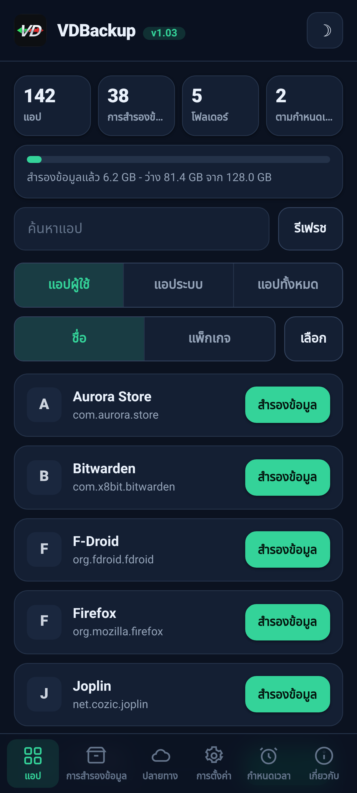
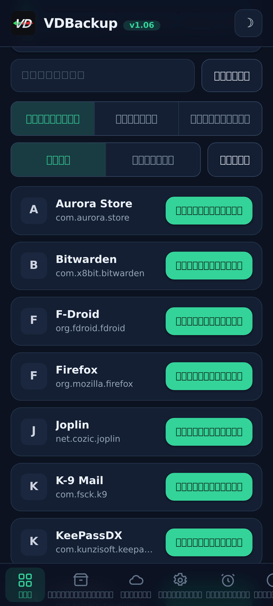
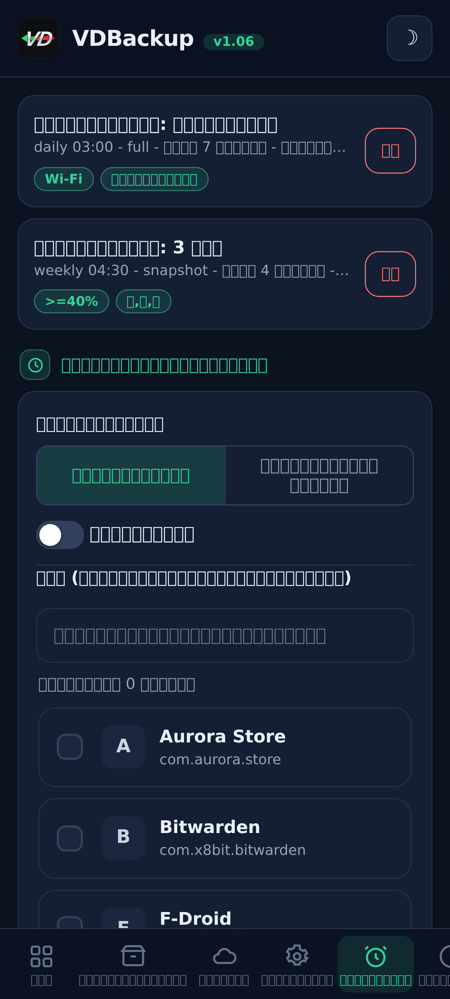
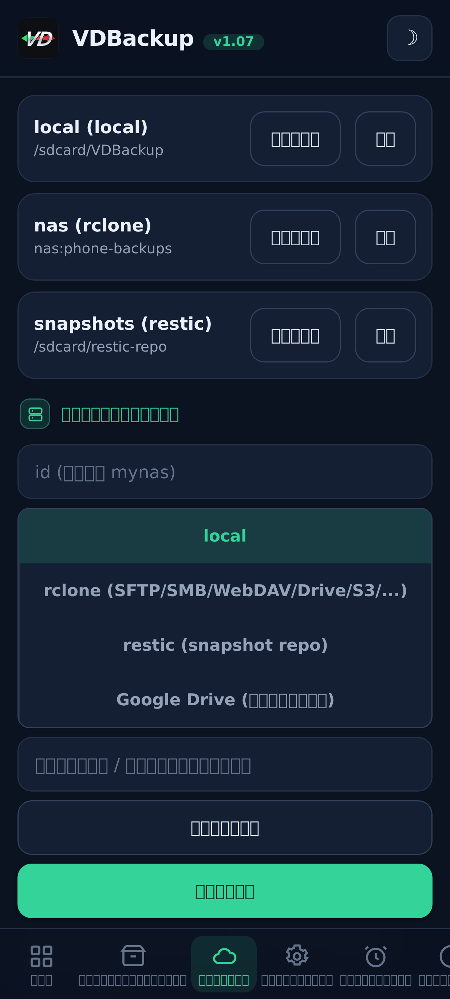
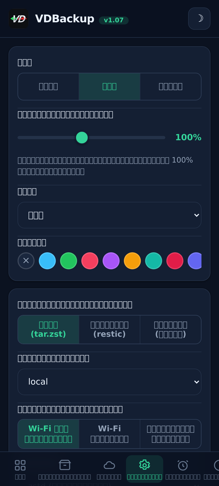
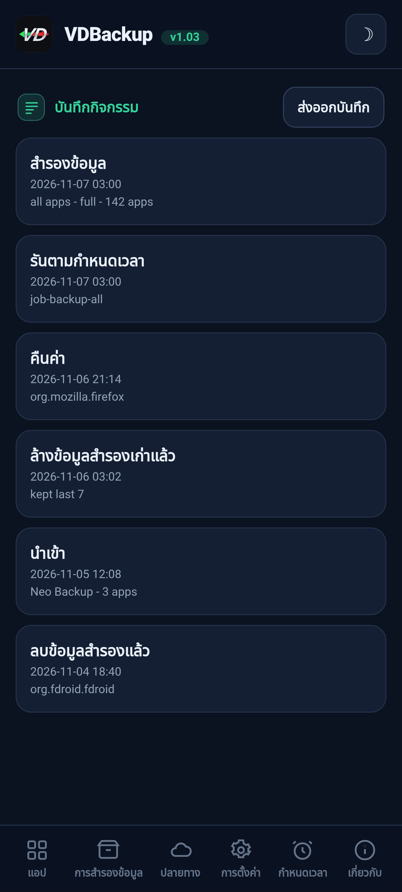

<!--
  VD BACKUP - full app & data backup and restore as root, from a WebUI.
  Copyright (C) 2026  VD171 - SPDX-License-Identifier: AGPL-3.0-or-later
-->

  

  <b>สำรองและกู้คืนแอปและข้อมูลอย่างครบถ้วนในสิทธิ์ root, ควบคุมทั้งหมดผ่าน WebUI.</b> 
  โมดูล KernelSU / APatch / Magisk. ไม่มีข้อความแจ้ง "อนุญาต su" ไม่ต้องสลับ <code>sucompat</code>.

  <a href="https://github.com/VD171/VD-Backup/releases">รุ่นที่เผยแพร่</a> ·
  <a href="https://github.com/VD171/VD-Backup/wiki">วิกิ</a> ·
  <a href="docs/USER-GUIDE.md">คู่มือผู้ใช้</a> ·
  <a href="docs/AI-AGENTS.md">เอเจนต์ AI</a> ·
  <a href="CHANGELOG.md">บันทึกการเปลี่ยนแปลง</a> ·
  <a href="CONTRIBUTING.md">การมีส่วนร่วม</a> ·
  <a href="https://xdaforums.com/t/VD-Backup.4807267/">กระทู้ XDA</a>

> **Languages:** [English](README.md) · [العربية](README.ar.md) · [Čeština](README.cs.md) · [Deutsch](README.de.md) · [Español](README.es.md) · [فارسی](README.fa.md) · [Français](README.fr.md) · [हिन्दी](README.hi.md) · [Bahasa Indonesia](README.in.md) · [Italiano](README.it.md) · [日本語](README.ja.md) · [한국어](README.ko.md) · [Nederlands](README.nl.md) · [Polski](README.pl.md) · [Português](README.pt.md) · [Русский](README.ru.md) · [Svenska](README.sv.md) · [ไทย](README.th.md) · [Türkçe](README.tr.md) · [Tiếng Việt](README.vi.md) · [中文](README.zh.md)

---

## มันคืออะไร

VDBackup เป็น **โมดูล WebUI** ระดับ root ที่สำรองและกู้คืนแอปและข้อมูลของแอป **โดยไม่ต้องมีแอปคู่
สำหรับฟีเจอร์หลัก**: เพราะโมดูลเป็น root อยู่แล้ว จึงไม่มีอะไรให้ต้อง "อนุญาต" มันมุ่งครอบคลุมทุกสิ่งที่
แอปสำรองข้อมูลยอดนิยมทำได้ ไว้ในที่เดียวกันด้วย WebUI ที่สะอาดตา

มันถูกวางให้เป็น **ผู้สืบทอดแบบเปิดและ root-native ของ Swift Backup, Neo-Backup และ
Android-DataBackup**: การรวมสิ่งที่ทั้งสามทำได้เข้าด้วยกันภายใต้ AGPLv3 และยังสามารถนำเข้าการสำรอง
ข้อมูลเดิมของ Neo-Backup และ Android-DataBackup เพื่อให้คุณย้ายมาได้

## ฟีเจอร์

- **แอป:** APK (base + splits), ข้อมูลแอป (`/data/data`), ข้อมูลที่ป้องกันด้วยอุปกรณ์
  (`/data/user_de`), ข้อมูลภายนอก (`Android/data`), OBB, สื่อ.
- **ข้อมูลระบบ/พิเศษ:** สิทธิ์, AppOps และ (เลือกเปิดใช้) SSAID เท่าที่ root อนุญาต.
- **โหมดสำรองข้อมูล:** **Full** (`tar.zst` แบบพกพา), **Snapshot** (เพิ่มส่วนต่าง +
  ทำเวอร์ชัน ผ่าน `restic`) และ **Mirror** (ซิงก์ 1:1 ผ่าน `rclone`/`rsync`).
- **เก็บรักษาอย่างซื่อตรง:** คอนเท็กซ์ SELinux, uid/gid, โหมด, xattr และ capabilities.
- **การบีบอัด:** none / lz4 / zstd / gzip (gzip = "โหมดเข้ากันได้" เปิดได้ทุกที่).
- **การเข้ารหัส:** เป็นทางเลือกและพกพาได้ (`age` + วลีรหัสผ่าน หรือ AES-256 zip), ไม่ผูกกับ
  ฮาร์ดแวร์ของอุปกรณ์ จึงกู้คืนการสำรองข้อมูลบนอุปกรณ์อื่นหรือเปิดบน PC ได้.
- **ปลายทาง:** ในเครื่อง, SFTP, SCP, SMB, WebDAV, FTP, S3 และอีกกว่า 70 แบบ (`rclone`),
  รวมถึงที่เก็บ `rsync` และ `restic` ด้วย. เลือกใช้ Google Drive ได้ผ่านแอปคู่เล็ก ๆ แบบเลือกเปิดใช้.
- **ความสมบูรณ์:** ทุกไฟล์ archive จะถูกตรวจสอบเทียบกับ manifest; dry-run และการทดสอบกู้คืนให้คุณ
  ตรวจสอบการสำรองข้อมูลได้โดยไม่แตะต้องสิ่งใด.
- **การกู้คืนแบบเลือกได้และแบบกลุ่ม:** กู้คืนชุดย่อยใด ๆ ของ items ในการสำรองข้อมูล หรือเลือกหลายการสำรอง
  ข้อมูลพร้อมกันแล้วกู้คืนทั้งหมดในครั้งเดียว; ลบการสำรองข้อมูลและเก็บบันทึกกิจกรรม/การตรวจสอบของทุกการกระทำ
  ที่ทำลายข้อมูล.
- **การสำรองข้อมูลพิเศษ:** ข้อความ (SMS/MMS), รายชื่อติดต่อและบันทึกการโทร, Wi-Fi และ Bluetooth
  พร้อมการส่งออก JSON แบบพกพาที่เป็นตัวเลือกซึ่งคุณเปิดบน PC ได้.
- **การตั้งเวลา + การทำงานอัตโนมัติ:** งานที่ทำซ้ำสำหรับ **การสำรองข้อมูลหรือการกู้คืน** โดยกำหนดเป้าหมาย
  เป็นแอปเดียว ชุดของแอป หรือแอปทั้งหมด พร้อมการตัดแต่งแบบ keep-N บวกกับการสำรองข้อมูลอัตโนมัติแบบเลือก
  เปิดใช้เมื่อติดตั้ง/อัปเดต และรายการแอปที่ยกเว้น.
- **แหล่งติดตั้ง:** แอปที่กู้คืนจะรายงาน Play Store เป็นแหล่งติดตั้งโดยค่าเริ่มต้น (สลับเปิด/ปิดได้);
  ตัวเลือกขั้นสูงแบบเลือกเปิดใช้ยังปลอมแปลง initiating package และ source ด้วย.
- **การเมานต์แอประบบ:** เมานต์แอปที่ติดตั้งให้เป็นแอประบบโดยไม่แตะพาร์ทิชัน `/system` จริง
  (โมดูลย่อย overlay แบบ systemless รับรู้ NoMount).
- **เบื้องหลัง:** การสำรอง/กู้คืนทำงานแบบแยกตัวและยังคงทำงานต่อแม้ปิด WebUI โดยมีการแจ้งเตือน
  ตอนเริ่มและตอนเสร็จ.
- **ย้ายเข้า (นำเข้า):** นำเข้าการสำรองข้อมูลเดิมของ Neo-Backup และ Android-DataBackup รวมถึง
  ที่เข้ารหัสด้วยรหัสผ่าน.

## ภาพหน้าจอ

| หน้าแรก | แอป | กำหนดเวลา |
|:---:|:---:|:---:|
|  |  |  |
| **ปลายทาง** | **การตั้งค่า** | **บันทึกกิจกรรม** |
|  |  |  |

## การติดตั้ง

1. ดาวน์โหลด `VD-Backup-vX.Y.zip` รุ่นล่าสุดจาก [รุ่นที่เผยแพร่](https://github.com/VD171/VD-Backup/releases).
2. แฟลชในตัวจัดการ KernelSU / APatch / Magisk, ใช้งานได้ทันที ไม่ต้องรีบูต.
3. เปิด **WebUI** ของโมดูลเพื่อกำหนดค่าและเรียกใช้การสำรองข้อมูล. แค่นั้นเอง.

**รุ่นย่อย** แต่ละ release มี zip หกไฟล์ `universal-full`, ทุกสถาปัตยกรรมและทุกไบนารีแบบฝังมาในตัว (รวม `rclone`
สำหรับผู้ให้บริการคลาวด์ และ `restic` สำหรับสแนปช็อต) ทำงานออฟไลน์เต็มรูปแบบ ไม่มีการดาวน์โหลดใด ๆ ใช้ได้ทุกเครื่อง
ใหญ่ที่สุด `universal-lite`, ทุกสถาปัตยกรรมแต่ตัดไบนารีสองตัวที่ใหญ่ที่สุด (`rclone`, `restic`) ออก เล็กที่สุด
ยังสำรองข้อมูลแบบในเครื่อง, SSH/SFTP และ `rsync` ได้โดยไม่ต้องดาวน์โหลด และครั้งแรกที่คุณใช้ปลายทางคลาวด์ (`rclone`)
หรือโหมดสแนปช็อต (`restic`) มันจะเสนอให้ดาวน์โหลดส่วนเสริมเฉพาะสถาปัตยกรรมขนาดเล็กนั้นหนึ่งครั้ง (ตรวจสอบด้วย SHA-256)
และแคชไว้ จากนั้นฟีเจอร์เหล่านั้นก็ใช้งานได้ด้วย `<abi>-full` (`arm64-v8a`, `armeabi-v7a`, `x86`, `x86_64`) -
สถาปัตยกรรมเดียวพร้อมทุกไบนารีแบบฝังมาในตัว เล็กกว่า `universal-full` รู้สถาปัตยกรรมของคุณ -> เลือก `<abi>-full`;
อยากได้เล็กที่สุดและไม่ติดขัดกับการดาวน์โหลดครั้งเดียวสำหรับคลาวด์หรือสแนปช็อต -> `universal-lite`;
อยากได้ทุกอย่างแบบฝังมาในตัวโดยไม่ต้องดาวน์โหลดเลย (ออฟไลน์ / การกู้คืน) -> รุ่น full ดู
[รุ่นที่เผยแพร่](https://github.com/VD171/VD-Backup/releases).

เพิ่งเริ่มใช้? [คู่มือผู้ใช้](docs/USER-GUIDE.md) จะพาคุณไปตั้งแต่การติดตั้งจนถึงการกู้คืน.

## ความพกพา

การสำรองข้อมูลของคุณ **ไม่ถูกล็อกไว้กับโมดูลนี้**. ทุกอย่างใช้รูปแบบมาตรฐาน
(`tar`, `gzip`, `zstd`, `age`, `zip`, `restic`) ที่เปิดได้บน Windows, macOS และ Linux ด้วย
เครื่องมือทั่วไปหรือตัวจัดการไฟล์. การสำรองข้อมูลที่เข้ารหัสทุกชุดจะมาพร้อมบันทึก **RECOVERY** ที่มี
คำสั่งที่แน่นอนสำหรับถอดรหัสและแตกไฟล์บน PC.

## การสร้าง (Build)

โมดูลประกอบด้วย shell + WebUI บวกกับไบนารีสแตติกต่อ ABI (`tar`, `zstd`, `lz4`,
`rclone`, `rsync`, ssh, `restic`) ที่สร้างสำหรับ `armeabi-v7a`, `arm64-v8a`, `x86`,
`x86_64`. ดู [CONTRIBUTING.md](CONTRIBUTING.md) และเวิร์กโฟลว์ CI.

## เอกสาร

- **[Wiki](https://github.com/VD171/VD-Backup/wiki)**: เอกสาร เรียกดูออนไลน์ได้.
- **[คู่มือผู้ใช้](docs/USER-GUIDE.md)**: ครบวงจร ตั้งแต่ติดตั้งจนถึงกู้คืน.
- **[เอเจนต์ AI](docs/AI-AGENTS.md)**: สั่งการทุกการกระทำแบบ headless ผ่าน JSON API.
- **[สถาปัตยกรรม](docs/ARCHITECTURE.md)** และ **[โครงสร้างไฟล์](docs/FILE-STRUCTURE.md)**: วิธีการทำงาน.
- **[ไบนารีที่มาพร้อมกัน](docs/BINARIES.md)**: ที่มาและ SHA-256 ของไบนารีที่คอมไพล์ไว้ล่วงหน้าทุกไฟล์ เพื่อการตรวจสอบอย่างครบถ้วน.
- **[การกู้คืน](module/etc/RECOVERY.md)**: เปิดและถอดรหัสข้อมูลสำรองบนพีซีโดยไม่ต้องใช้โมดูล.
- **[การมีส่วนร่วม](CONTRIBUTING.md)** และ **[ความปลอดภัย](SECURITY.md)**.
- **[บันทึกการเปลี่ยนแปลง](CHANGELOG.md)** และ **[หลักปฏิบัติ](CODE_OF_CONDUCT.md)**.

## เป็นมิตรกับ AI

VDBackup สร้างขึ้นให้ต้อนรับผู้ช่วยและเอเจนต์ AI ไม่ใช่แค่คน. เอนจินพูดภาษา JSON (ทุก verb ของ
`helper.sh` คืนค่าเป็นอ็อบเจกต์ JSON ชิ้นเดียว), โค้ด เอกสาร และโครงสร้างไฟล์ถูกจัดวางเพื่อให้เครื่อง
อ่านได้ และการมีส่วนร่วมที่ช่วยเหลือโดย AI จะถูกตรวจทานและยอมรับเช่นเดียวกับรายอื่น. เอเจนต์สามารถ
จัดการ **ทุก** การกระทำของโมดูลแบบ headless ผ่าน API เดียวกับที่ WebUI ใช้, ดูพื้นผิวการควบคุม
ทั้งหมดได้ที่ **[docs/AI-AGENTS.md](docs/AI-AGENTS.md)** และดูการมีส่วนร่วมได้ที่
[CONTRIBUTING.md](CONTRIBUTING.md#ai-contributors-welcome).

## ช่องทางติดต่อ

* https://vd171.ru
* https://vd.priv8.ru
* **Telegram:** @VD_Priv8 https://t.me/VD_Priv8
* **Channel:** @Priv8_VD https://t.me/Priv8_VD
* **Discord:** @VD.Priv8 https://discord.com/users/1296831918989639721
* **E-mail:** vd.priv8@pm.me
* **XDA-Developers:** @VD171 https://xdaforums.com/m/vd171.4699873/
* **GitHub:** @VD171 https://github.com/VD171

## ดูเพิ่มเติม

โปรเจกต์พี่น้องโดยผู้เขียนคนเดียวกัน:

- **[VDInfos](https://github.com/VD171/VD-Infos)**: ตัวดีบักเมธอดของอุปกรณ์: อ่านแต่ละรายการผ่านทุกเมธอดที่อ่านมันได้ แล้วนำมาเทียบกันเคียงข้าง.
- **[VDGoogle](https://github.com/VD171/VD-Google)**: บริการ Google ของคุณ (RCS, Wallet, การรับรอง Play Integrity) อ่านได้บนอุปกรณ์ของคุณโดยไม่ต้องใช้อินเทอร์เน็ต.
- **[COPG-VD](https://github.com/VD171/COPG-VD)**: ตัวปลอมแปลงอุปกรณ์ที่เปลี่ยนฟิงเกอร์พรินต์ใหม่ให้กลายเป็นโปรไฟล์ที่สอดคล้องและกลมกลืน.

## สัญญาอนุญาต

[GNU AGPL-3.0-or-later](LICENSE). Network copyleft: หากคุณรันเวอร์ชันที่แก้ไขแล้ว แม้ในฐานะ
บริการ คุณต้องเสนอซอร์สโค้ดของมัน.

---

`android` `backup` `restore` `app-data` `migration` `neo-backup` `databackup` `kernelsu` `apatch` `magisk` `webui` `root` `tar` `zstd` `restic` `rclone` `age` `encryption` `ssaid` `appops` `on-device` `agpl` `ai-friendly` `vdbackup`
