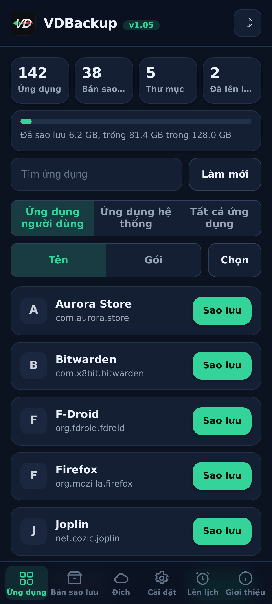
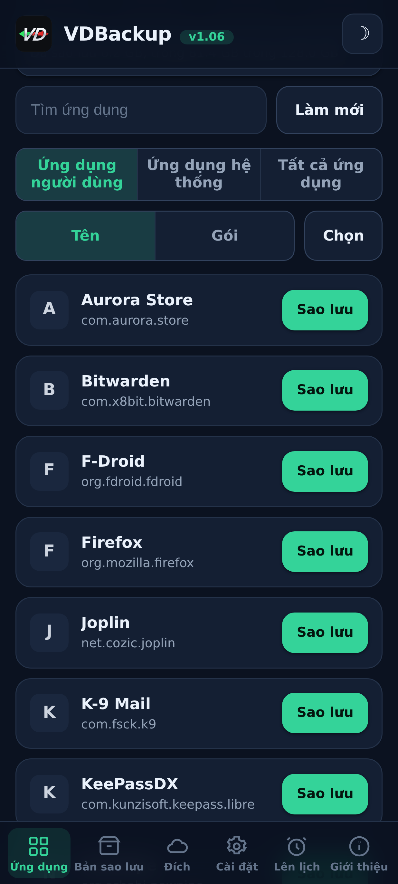
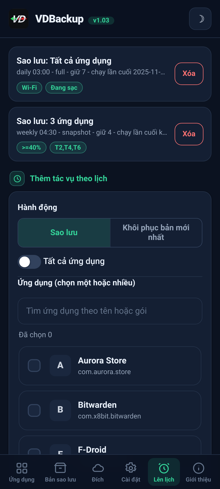
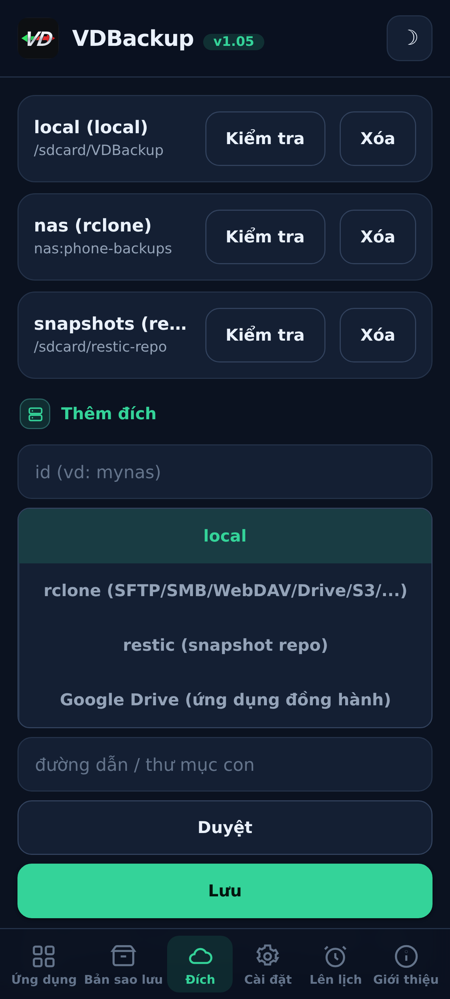
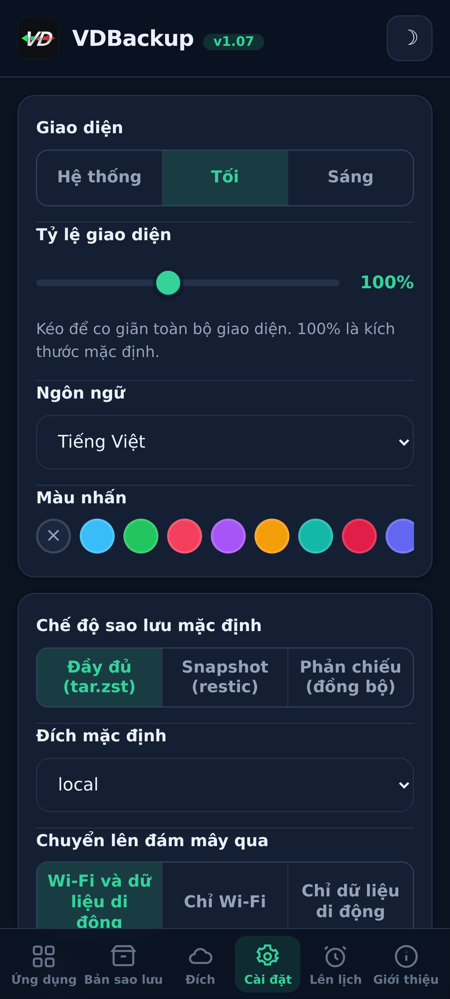
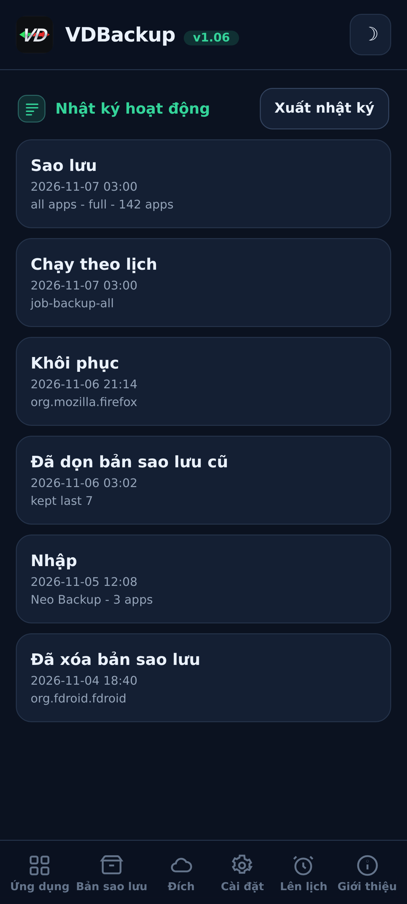

<!--
  VD BACKUP - full app & data backup and restore as root, from a WebUI.
  Copyright (C) 2026  VD171 - SPDX-License-Identifier: AGPL-3.0-or-later
-->

  

  <b>Sao lưu và khôi phục đầy đủ ứng dụng và dữ liệu với quyền root, điều khiển hoàn toàn qua WebUI.</b> 
  Mô-đun KernelSU / APatch / Magisk. Không có lời nhắc "cấp su", không cần bật tắt <code>sucompat</code>.

  <a href="https://github.com/VD171/VD-Backup/releases">Bản phát hành</a> ·
  <a href="https://github.com/VD171/VD-Backup/wiki">Wiki</a> ·
  <a href="docs/USER-GUIDE.md">Hướng dẫn người dùng</a> ·
  <a href="docs/AI-AGENTS.md">Tác nhân AI</a> ·
  <a href="CHANGELOG.md">Nhật ký thay đổi</a> ·
  <a href="CONTRIBUTING.md">Đóng góp</a> ·
  <a href="https://xdaforums.com/t/VD-Backup.4807267/">Chủ đề XDA</a>

> **Languages:** [English](README.md) · [العربية](README.ar.md) · [Čeština](README.cs.md) · [Deutsch](README.de.md) · [Español](README.es.md) · [فارسی](README.fa.md) · [Français](README.fr.md) · [हिन्दी](README.hi.md) · [Bahasa Indonesia](README.in.md) · [Italiano](README.it.md) · [日本語](README.ja.md) · [한국어](README.ko.md) · [Nederlands](README.nl.md) · [Polski](README.pl.md) · [Português](README.pt.md) · [Русский](README.ru.md) · [Svenska](README.sv.md) · [ไทย](README.th.md) · [Türkçe](README.tr.md) · [Tiếng Việt](README.vi.md) · [中文](README.zh.md)

---

## Nó là gì

VDBackup là một **mô-đun WebUI** root giúp sao lưu và khôi phục các ứng dụng cùng dữ liệu của chúng
**mà không cần ứng dụng đồng hành cho các tính năng cốt lõi**: bởi vì mô-đun đã sẵn là root, nên
không có gì để "cho phép". Nó hướng tới việc gói gọn mọi thứ mà các ứng dụng sao lưu phổ biến làm
được vào một nơi, với một WebUI gọn gàng.

Nó được định vị là **người kế nhiệm mở, root-native của Swift Backup, Neo-Backup và
Android-DataBackup**: hợp nhất những gì chúng làm, dưới giấy phép AGPLv3, và thậm chí có thể nhập
các bản sao lưu Neo-Backup và Android-DataBackup hiện có để bạn chuyển sang.

## Tính năng

- **Ứng dụng:** APK (base + splits), dữ liệu ứng dụng (`/data/data`), dữ liệu được thiết bị bảo vệ
  (`/data/user_de`), dữ liệu bên ngoài (`Android/data`), OBB, phương tiện.
- **Dữ liệu hệ thống/đặc biệt:** quyền, AppOps và (tùy chọn bật) SSAID, trong phạm vi root cho phép.
- **Chế độ sao lưu:** **Full** (`tar.zst` khả chuyển), **Snapshot** (tăng dần +
  có phiên bản, qua `restic`) và **Mirror** (đồng bộ 1:1, qua `rclone`/`rsync`).
- **Bảo toàn trung thực:** ngữ cảnh SELinux, uid/gid, chế độ, xattr và capabilities.
- **Nén:** none / lz4 / zstd / gzip (gzip = "chế độ tương thích", mở được ở mọi nơi).
- **Mã hóa:** tùy chọn và khả chuyển (`age` + cụm mật khẩu, hoặc zip AES-256), không bao giờ
  gắn với phần cứng của thiết bị, nên một bản sao lưu có thể khôi phục trên thiết bị khác hoặc mở trên PC.
- **Đích đến:** cục bộ, SFTP, SCP, SMB, WebDAV, FTP, S3 và hơn 70 loại khác (`rclone`), cùng với
  kho `rsync` và `restic`. Tùy chọn Google Drive qua một ứng dụng đồng hành nhỏ bật theo lựa chọn.
- **Tính toàn vẹn:** mọi archive đều được kiểm tra đối chiếu với manifest; dry-run và kiểm thử khôi
  phục cho phép bạn kiểm tra một bản sao lưu mà không đụng chạm đến bất cứ thứ gì.
- **Khôi phục chọn lọc và hàng loạt:** khôi phục bất kỳ tập con nào các mục của một bản sao lưu,
  hoặc chọn nhiều bản sao lưu và khôi phục tất cả cùng một lúc; xóa các bản sao lưu và giữ một
  nhật ký hoạt động/kiểm toán cho mọi hành động phá hủy.
- **Sao lưu đặc biệt:** tin nhắn (SMS/MMS), danh bạ và nhật ký cuộc gọi, Wi-Fi và Bluetooth,
  với một bản xuất JSON khả chuyển tùy chọn mà bạn có thể mở trên PC.
- **Lập lịch + tự động hóa:** các tác vụ **sao lưu hoặc khôi phục** định kỳ nhắm tới một ứng
  dụng, một tập hợp, hoặc tất cả ứng dụng, với việc tỉa bớt theo kiểu keep-N, cùng với tự động
  sao lưu opt-in khi cài đặt/cập nhật và một danh sách ứng dụng loại trừ.
- **Nguồn cài đặt:** các ứng dụng đã khôi phục báo cáo Play Store là nguồn cài đặt của chúng
  theo mặc định (có thể bật/tắt); một tùy chọn opt-in nâng cao còn giả mạo cả gói khởi tạo và nguồn.
- **Gắn ứng dụng hệ thống:** gắn một ứng dụng đã cài làm ứng dụng hệ thống mà không chạm vào
  phân vùng `/system` thật (mô-đun con overlay không-hệ-thống, nhận biết NoMount).
- **Nền:** sao lưu/khôi phục chạy tách rời và vẫn tiếp tục khi đóng WebUI, kèm thông báo khi bắt đầu
  và khi hoàn thành.
- **Di chuyển vào (nhập):** nhập các bản sao lưu Neo-Backup và Android-DataBackup hiện có, kể cả
  các bản được mã hóa bằng mật khẩu.

## Ảnh chụp màn hình

| Trang chủ | Ứng dụng | Lên lịch |
|:---:|:---:|:---:|
|  |  |  |
| **Đích** | **Cài đặt** | **Nhật ký hoạt động** |
|  |  |  |

## Cài đặt

1. Tải `VD-Backup-vX.Y.zip` mới nhất từ [Bản phát hành](https://github.com/VD171/VD-Backup/releases).
2. Flash nó trong trình quản lý KernelSU / APatch / Magisk, dùng được ngay, không cần khởi động lại.
3. Mở **WebUI** của mô-đun để cấu hình và chạy sao lưu. Vậy là xong.

**Các phiên bản.** Mỗi bản phát hành gồm sáu zip. `universal-full`, mọi kiến trúc và mọi tệp nhị phân được nhúng sẵn (gồm `rclone` cho nhà cung cấp đám mây và `restic` cho ảnh chụp nhanh), hoàn toàn ngoại tuyến, không bao giờ tải xuống bất cứ thứ gì, mọi thiết bị, lớn nhất. `universal-lite`, mọi kiến trúc nhưng bỏ hai tệp nhị phân lớn nhất (`rclone`, `restic`), nhỏ nhất; vẫn sao lưu được cục bộ, SSH/SFTP và `rsync` mà không cần tải xuống, và lần đầu tiên bạn dùng đích đám mây (`rclone`) hoặc chế độ ảnh chụp nhanh (`restic`), nó sẽ đề nghị tải phần bổ trợ nhỏ theo kiến trúc đó một lần (được xác minh bằng SHA-256) và lưu vào bộ nhớ đệm, sau đó các tính năng ấy cũng hoạt động. `<abi>-full` (`arm64-v8a`, `armeabi-v7a`, `x86`, `x86_64`), một kiến trúc duy nhất với mọi tệp nhị phân được nhúng sẵn, nhỏ hơn `universal-full`. Biết kiến trúc của bạn -> chọn `<abi>-full`; muốn nhỏ nhất và không ngại một lần tải xuống cho đám mây hoặc ảnh chụp nhanh -> `universal-lite`; muốn mọi thứ được nhúng sẵn mà không tải xuống gì (ngoại tuyến / khôi phục) -> một phiên bản full. Xem [Bản phát hành](https://github.com/VD171/VD-Backup/releases).

Mới làm quen? [Hướng dẫn người dùng](docs/USER-GUIDE.md) sẽ dẫn bạn từ cài đặt đến khôi phục.

## Tính khả chuyển

Các bản sao lưu của bạn **không bị khóa vào mô-đun này**. Mọi thứ đều dùng các định dạng tiêu chuẩn
(`tar`, `gzip`, `zstd`, `age`, `zip`, `restic`) mở được trên Windows, macOS và Linux bằng các công
cụ thông dụng hoặc trình quản lý tệp. Mỗi bản sao lưu được mã hóa đều kèm một ghi chú **RECOVERY**
chứa các lệnh chính xác để giải mã và giải nén trên PC.

## Xây dựng (Build)

Mô-đun gồm shell + WebUI cộng với các tệp nhị phân tĩnh theo từng ABI (`tar`, `zstd`, `lz4`,
`rclone`, `rsync`, ssh, `restic`) được xây dựng cho `armeabi-v7a`, `arm64-v8a`, `x86`,
`x86_64`. Xem [CONTRIBUTING.md](CONTRIBUTING.md) và các quy trình CI.

## Tài liệu

- **[Wiki](https://github.com/VD171/VD-Backup/wiki)**: tài liệu, duyệt trực tuyến.
- **[Hướng dẫn người dùng](docs/USER-GUIDE.md)**: từ đầu đến cuối, từ cài đặt đến khôi phục.
- **[Tác nhân AI](docs/AI-AGENTS.md)**: điều khiển mọi hành động không giao diện qua JSON API.
- **[Kiến trúc](docs/ARCHITECTURE.md)** và **[Cấu trúc tệp](docs/FILE-STRUCTURE.md)**: cách nó hoạt động.
- **[Tệp nhị phân đi kèm](docs/BINARIES.md)**: nguồn gốc và SHA-256 của mọi tệp nhị phân biên dịch sẵn, để kiểm tra đầy đủ.
- **[Khôi phục](module/etc/RECOVERY.md)**: mở và giải mã bản sao lưu trên PC, không cần mô-đun.
- **[Đóng góp](CONTRIBUTING.md)** và **[Bảo mật](SECURITY.md)**.
- **[Nhật ký thay đổi](CHANGELOG.md)** và **[Quy tắc ứng xử](CODE_OF_CONDUCT.md)**.

## Thân thiện với AI

VDBackup được xây dựng để chào đón các trợ lý và tác nhân AI, không chỉ con người. Engine nói JSON
(mọi verb của `helper.sh` trả về một đối tượng JSON duy nhất), mã nguồn, tài liệu và cấu trúc tệp
được bố trí để máy đọc, và các đóng góp có hỗ trợ của AI được xem xét và chấp nhận như mọi đóng góp
khác. Một tác nhân có thể quản trị **mọi** hành động của mô-đun theo kiểu không giao diện qua cùng
API mà WebUI dùng, xem toàn bộ bề mặt điều khiển tại **[docs/AI-AGENTS.md](docs/AI-AGENTS.md)**, và
[CONTRIBUTING.md](CONTRIBUTING.md#ai-contributors-welcome) để đóng góp.

## Liên hệ

* https://vd171.ru
* https://vd.priv8.ru
* **Telegram:** @VD_Priv8 https://t.me/VD_Priv8
* **Channel:** @Priv8_VD https://t.me/Priv8_VD
* **Discord:** @VD.Priv8 https://discord.com/users/1296831918989639721
* **E-mail:** vd.priv8@pm.me
* **XDA-Developers:** @VD171 https://xdaforums.com/m/vd171.4699873/
* **GitHub:** @VD171 https://github.com/VD171

## Xem thêm

Các dự án anh em của cùng tác giả:

- **[VDInfos](https://github.com/VD171/VD-Infos)**: một trình gỡ lỗi phương thức của thiết bị: đọc từng mục qua mọi phương thức có thể đọc nó và so sánh chúng cạnh nhau.
- **[VDGoogle](https://github.com/VD171/VD-Google)**: các dịch vụ Google của bạn (RCS, Wallet, các chứng thực Play Integrity), đọc ngay trên thiết bị của bạn mà không cần internet.
- **[COPG-VD](https://github.com/VD171/COPG-VD)**: một trình giả lập thiết bị biến một fingerprint mới thành một hồ sơ mạch lạc, nhất quán.

## Giấy phép

[GNU AGPL-3.0-or-later](LICENSE). Copyleft mạng: nếu bạn chạy một phiên bản đã sửa đổi, kể cả dưới
dạng một dịch vụ, bạn phải cung cấp mã nguồn của nó.

---

`android` `backup` `restore` `app-data` `migration` `neo-backup` `databackup` `kernelsu` `apatch` `magisk` `webui` `root` `tar` `zstd` `restic` `rclone` `age` `encryption` `ssaid` `appops` `on-device` `agpl` `ai-friendly` `vdbackup`
