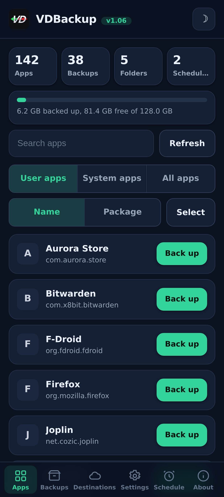
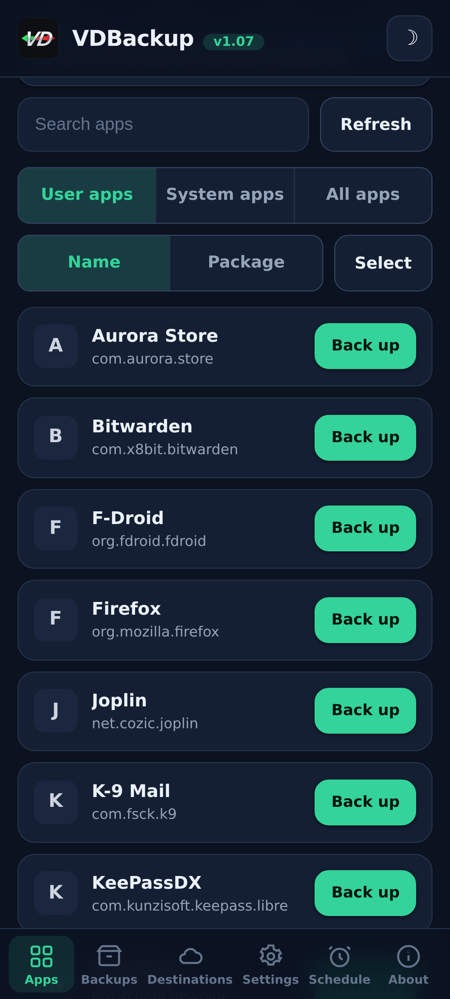
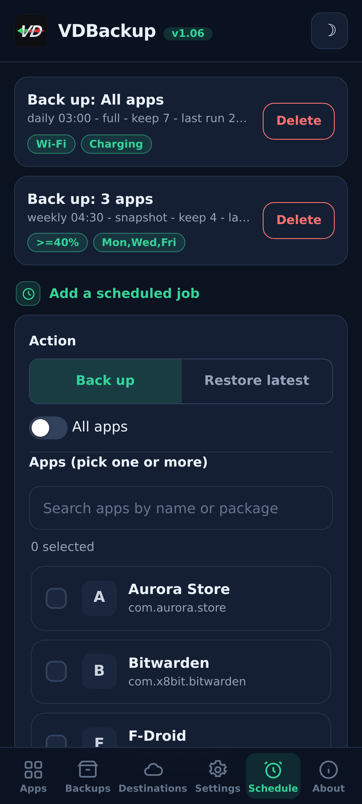
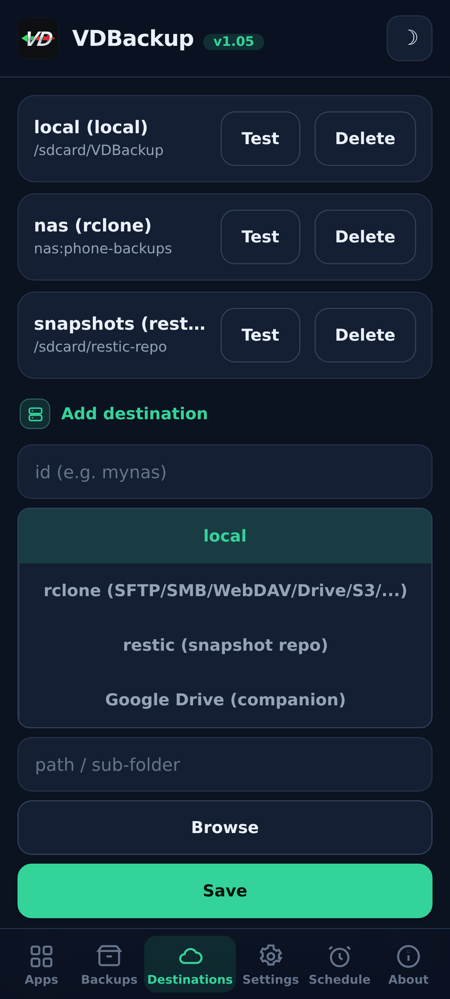
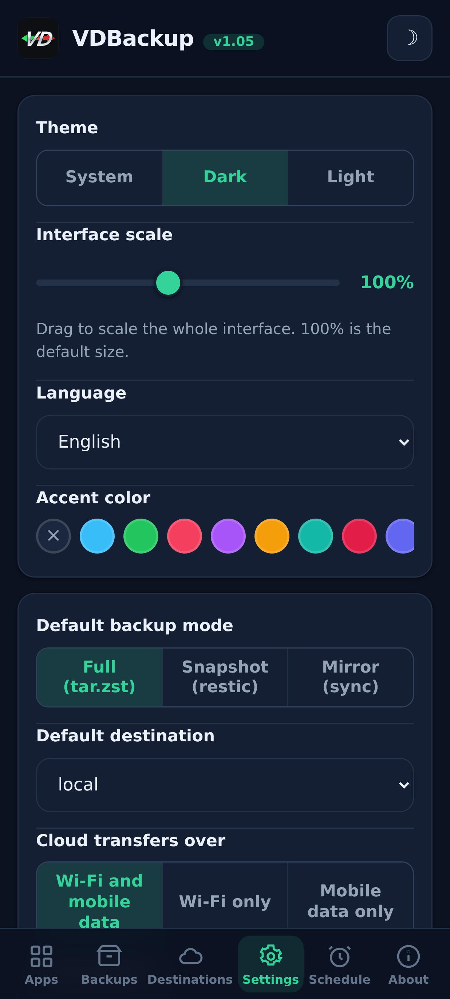
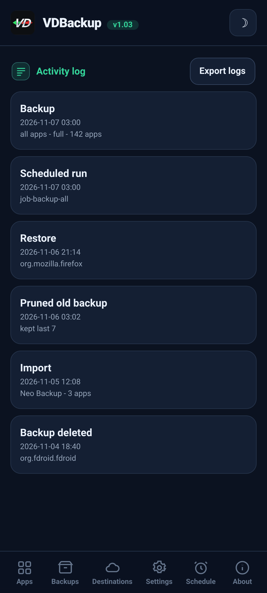

> **Languages:** English · [العربية](ar/USER-GUIDE.md) · [Čeština](cs/USER-GUIDE.md) · [Deutsch](de/USER-GUIDE.md) · [Español](es/USER-GUIDE.md) · [فارسی](fa/USER-GUIDE.md) · [Français](fr/USER-GUIDE.md) · [हिन्दी](hi/USER-GUIDE.md) · [Bahasa Indonesia](in/USER-GUIDE.md) · [Italiano](it/USER-GUIDE.md) · [日本語](ja/USER-GUIDE.md) · [한국어](ko/USER-GUIDE.md) · [Nederlands](nl/USER-GUIDE.md) · [Polski](pl/USER-GUIDE.md) · [Português](pt/USER-GUIDE.md) · [Русский](ru/USER-GUIDE.md) · [Svenska](sv/USER-GUIDE.md) · [ไทย](th/USER-GUIDE.md) · [Türkçe](tr/USER-GUIDE.md) · [Tiếng Việt](vi/USER-GUIDE.md) · [中文](zh/USER-GUIDE.md)

---

# VDBackup user guide

A complete, friendly walkthrough of VDBackup, from installing the module to making
your first backup, restoring it, sending it to the cloud, scheduling it, and opening
it on a PC years later. If you have used Swift Backup, Neo-Backup or
Android-DataBackup before, this will feel familiar - only everything happens in one
place, with nothing to "allow".

## Table of contents

- [1. What VDBackup is](#1-what-vdbackup-is)
- [2. Requirements](#2-requirements)
- [3. Install and first run](#3-install-and-first-run)
- [4. The WebUI tour](#4-the-webui-tour)
- [5. Making a backup](#5-making-a-backup)
  - [5.1 Choosing what to back up](#51-choosing-what-to-back-up)
  - [5.2 Backup modes: Full, Snapshot, Mirror](#52-backup-modes-full-snapshot-mirror)
  - [5.3 Compression](#53-compression)
  - [5.4 Encryption](#54-encryption)
  - [5.5 Verify and dry-run](#55-verify-and-dry-run)
  - [5.6 Special backups (messages, call log, Wi-Fi, Bluetooth, calendar, wallpaper, DNS, system settings)](#56-special-backups-messages-call-log-wi-fi-bluetooth-calendar-wallpaper-dns-system-settings)
  - [5.7 Standalone folder and file backups](#57-standalone-folder-and-file-backups)
- [6. Restoring a backup](#6-restoring-a-backup)
- [7. Destinations: local and remote](#7-destinations-local-and-remote)
- [8. Scheduling and retention](#8-scheduling-and-retention)
- [9. Migrating in: importing Neo-Backup and Android-DataBackup](#9-migrating-in-importing-neo-backup-and-android-databackup)
- [10. SSAID (device ANDROID_ID)](#10-ssaid-device-android_id)
- [11. Portability: opening backups on a PC](#11-portability-opening-backups-on-a-pc)
- [12. Driving VDBackup from an AI assistant](#12-driving-vdbackup-from-an-ai-assistant)
- [13. Troubleshooting and FAQ](#13-troubleshooting-and-faq)
- [14. Uninstalling](#14-uninstalling)

---

## 1. What VDBackup is

VDBackup is a root module with a built-in WebUI that backs up and restores your apps
and their data. It is designed as the open, root-native successor to Swift Backup,
Neo-Backup and Android-DataBackup: it aims to do the union of what those tools do, in
a single place, and it can even import your existing Neo-Backup and
Android-DataBackup backups so you can move over without losing anything.

The key difference from an ordinary backup app: VDBackup runs **entirely from your
root manager's WebUI**, and the module is already root. There is no companion app to
install for the core features, no "grant su" prompt to approve, and nothing to toggle
on. You open the WebUI, pick what to back up, and run it.

Everything VDBackup produces uses **standard formats** (tar, gzip, zstd, age, zip,
restic), so your backups are never locked into the module and are never tied to your
specific device. See [section 11](#11-portability-opening-backups-on-a-pc).

## Screenshots

| Home | Apps | Schedule |
|:---:|:---:|:---:|
|  |  |  |
| **Destinations** | **Settings** | **Activity log** |
|  |  |  |

## 2. Requirements

- **A rooted Android device** managed by **KernelSU**, **APatch** or **Magisk**.
  VDBackup is installed as a module from that manager.
- Enough free storage for your backups (local backups live under the module's state
  directory; see [section 3](#3-install-and-first-run)).
- Nothing else. The module bundles all the binaries it needs (tar, zstd, lz4, rclone,
  rsync, ssh, restic), so **local backup and restore work fully offline**. Only cloud
  destinations talk to the network.

Some fine-grained extras (AppOps, SSAID, a few privileged system bits) rely on the
Android framework; the module handles these internally, with a plain-shell fallback,
and they degrade gracefully when they are not available on your device.

## 3. Install and first run

1. Download the latest `VD-Backup-vX.Y.zip` release.
2. In your KernelSU / APatch / Magisk manager, flash the module zip like any other
   module.
3. It is usable immediately - **no reboot needed**. (A reboot is only ever relevant
   when restoring SSAID; see [section 10](#10-ssaid-device-android_id).)
4. Open the module's **WebUI** from the manager. That is the entire interface.

**Which edition to download.** Each release ships as several flashable zip editions, so
you download only what you need. Pick one:

- **`VD-Backup-<ver>-universal-full.zip`** - every CPU architecture and every binary
  embedded, including `rclone` (cloud providers: Google Drive, S3 and 70+ other rclone
  backends) and `restic` (deduplicated snapshots). Fully offline, nothing is ever
  downloaded. Works on any device. Largest download.
- **`VD-Backup-<ver>-universal-lite.zip`** - every architecture, but **without** the two
  largest binaries (`rclone` and `restic`). Smallest download; still does local, SSH/SFTP
  and rsync backups with no download, with portable `age` encryption. The first time you
  use a cloud destination (`rclone`) or snapshot mode (`restic`), the WebUI offers to
  download that small per-architecture addon once (verified by SHA-256) and caches it;
  afterwards those features work too.
- **`VD-Backup-<ver>-<abi>-full.zip`** (one of `arm64-v8a`, `armeabi-v7a`, `x86`,
  `x86_64`) - a single architecture with every binary embedded (same features as
  `universal-full` but only your device's architecture, so smaller than `universal-full`).

Pick the matching **`<abi>-full`** if you know your device's architecture and want
everything embedded (most phones are **`arm64-v8a`**). Pick **`universal-lite`** if you
want the smallest download and do not mind a one-time, SHA-256-verified download the first
time you use cloud providers (`rclone`) or snapshots (`restic`). Pick a **full** edition if
you want everything embedded with zero downloads (offline / recovery) and are not sure of
the architecture. On install the module keeps only your device's architecture regardless of
the edition you flash.

On first run the module seeds a default configuration (only if none exists yet), so
your settings are preserved across module updates.

**Where state lives.** VDBackup's working data - your configuration, scheduled jobs,
saved destinations, encrypted credentials, logs and audit trail, and staging area -
lives under:

```
/data/adb/vdbackup/
```

**Where backups live.** The backups themselves are written to user-visible, credential
-encrypted storage (so they are only readable after you unlock the device, and they
survive uninstalling the module), one folder per Android user:

```
/sdcard/VDBackup/            (= /data/media/<user>/VDBackup)
```

Keep this in mind for two reasons: backups take up space under `/sdcard/VDBackup`, and
`/data/adb/vdbackup/logs/` is where you look if something goes wrong.

## 4. The WebUI tour

The WebUI is organized into a few tabs:

- **Home** - a home overview showing counts of your backups (apps, backups, folders and scheduled jobs) and a storage bar for how much space your backups use versus free, with status badges, copy-to-clipboard for hashes and paths, and a **Check for updates** action.
- **Apps** - the list of installed apps (user and system), each shown with its real
  name, its package name, and its icon (icons load lazily and are cached, so the list
  stays responsive). The button on a row backs the app up; tapping the row opens that
  app's backup history, where you can restore any previous backup.
- **Backups** - the backups you already have, each showing the app name on one line and
  the package on the next. Tap a backup to see its full details (version, date, size,
  included items, permission counts, and the device it came from). This is also where
  you restore, run a restore-test, delete a backup, or import backups from Neo-Backup or
  Android-DataBackup.
- **Destinations** - manage where backups go: local storage plus any remote
  destinations you add (see [section 7](#7-destinations-local-and-remote)). You can
  test a destination here before relying on it.
- **Settings** - a light/dark theme toggle, an accent-colour picker (presets, a custom
  colour, or reset), a language selector (the interface renders right-to-left for Arabic
  and Persian), an interface scale slider you drag to rescale the whole interface
  (header, content and bottom navigation together) from 85% to 120% (100% is the
  default), for screens of different pixel densities, defaults for new jobs (default compression,
  verify on/off, default encryption), the network policy for cloud transfers (see
  [section 7](#7-destinations-local-and-remote)), auto-backup and the excluded-apps list,
  the install-source option, the encryption key, and scheduling. On/off settings use
  Android-style toggle switches.
- **About** - version, links, the sibling projects (See also), the bundled-binary
  audit manifest, and a **Check for updates** action that reports whether a newer version has
  been published (with its release notes). You install any update through your root manager,
  the same way you flashed the module.

The app also checks for a newer version on its own each time you open it (at most once an hour) and shows the update banner only when one exists; it stays silent when you are up to date or offline.

Confirmations and messages use in-app dialogs (not the old system pop-ups), and a
restore or import asks you to acknowledge that it overwrites the current app data before
it proceeds.

Backups and restores run **detached** as a background root process. You can close the
WebUI, or even close the root manager, and the operation keeps going. When you come
back, the WebUI reattaches and shows live progress with a localized phase label. For a
running job the progress card also shows the live transfer speed and the estimated time
remaining, plus an item counter (for example "12 of 40") with the name of the current
item. On
ROMs that surface shell notifications you also get an Android notification when a job
starts and finishes; either way the in-app progress card is the reliable indicator.

## 5. Making a backup

The basic flow: open **Apps**, choose an app, select what to include, pick a mode,
set compression and (optionally) encryption, then run. Progress appears live and a
notification tells you when it is done.

In the backup dialog you can also choose the **destination** for this backup - local storage or any cloud/remote destination you have added - without changing the default destination in Settings first.

### 5.1 Choosing what to back up

For each app you can include any combination of these items:

| Item | What it is |
|------|-----------|
| **APK** | The installed app itself (base APK + any split APKs). |
| **data** | The app's private data (`/data/data`). This is the usual "app data". |
| **device-protected data** | Direct-boot / device-protected storage (`/data/user_de`). Some apps keep settings here. |
| **external** | The app's external data under `Android/data`. |
| **OBB** | The app's OBB expansion files (`Android/obb`), used by some games. |
| **media** | The app's media under `Android/media`. |

A good default for "back up this app completely" is to include all of them. If you
only want the data (for example to move a game save), you can deselect the APK and the
large OBB/media items.

VDBackup also preserves the things that make a restore faithful: SELinux contexts,
uid/gid ownership, file modes, extended attributes (xattr) and capabilities.

### 5.2 Backup modes: Full, Snapshot, Mirror

VDBackup offers three modes. The WebUI pre-selects **Full**, which is the right choice
for most people.

- **Full** - a complete, self-contained, portable backup written as `tar.zst` (or
  your chosen compression). Each run produces a standalone backup you can copy
  anywhere and open on a PC. Best for: a clean, portable snapshot of an app you can
  archive and move around. This is the default and the most portable option.
- **Snapshot** - incremental and versioned, backed by `restic`. Each run adds a new
  point-in-time snapshot to a repository, storing only what changed and
  de-duplicating across snapshots. Best for: keeping a running history of an app
  without paying full size on every run.
- **Mirror** - a 1:1 sync of the live data to the destination, backed by
  `rclone`/`rsync`. It keeps the destination identical to what is on the device right
  now (changed files are copied, removed files are deleted on the destination). Best
  for: a fast, always-current copy, for example to a cloud remote. Note that the APK
  is still stored compressed even in a mirror, never raw.

### 5.3 Compression

You can pick the compression for a Full backup:

- **none** - no compression (fastest, largest).
- **lz4** - very fast, light compression.
- **zstd** - the default, a strong balance of speed and ratio. You can also pick a
  level (for example a higher level for a smaller file).
- **gzip** - the **"compatibility mode"**. gzip opens with built-in tools on
  practically any computer and in most file managers, with nothing extra to install.
  Choose this when you care most about being able to open the archive anywhere.

If you do not choose, VDBackup uses its configured default (zstd at a sensible level).

### 5.4 Encryption

Encryption is **optional** and portable. VDBackup encrypts with **age** using a
passphrase (scrypt), which was chosen specifically for portability: any standard
`age` tool on any operating system can decrypt your backup with just the passphrase.
Encryption is **never** tied to your device's hardware keys, so an encrypted backup
restores on another device and opens on a PC. (A compatible AES-256 zip mode is also
available for encrypted archives you want to open with a double-click and a password.)

To use encryption, generate the encryption key once (Settings), then enable
encryption for your job and set a passphrase. The passphrase is what protects the
backup, so choose a strong one - there is no hardware key and no recovery backdoor.

**The APK rule (important):**

- The **APK is always stored compressed**, never raw, to save space.
- The **APK is not encrypted by default**, because an app's APK is public content.
- APK encryption and data encryption are **independent toggles**. Turning on data
  encryption does **not** encrypt the APK. If you specifically want the APK encrypted
  too, enable the APK-encryption toggle explicitly.

### 5.5 Verify and dry-run

Two safety options help you trust a backup before you rely on it:

- **Verify** - after writing, VDBackup re-hashes each archive and checks it against
  the manifest. This is **on by default for Full** backups. If a file does not match,
  the job fails with a clear error rather than leaving you with a silently corrupt
  backup.
- **Dry-run** - plans the job and reports the sizes it would produce **without writing
  anything**. Use it to estimate space or to check your item selection before running
  the real thing.

When a backup goes to a **cloud** destination, VDBackup adds two more safeguards. It runs a
final **checksum-verified** step that re-checks the uploaded copy against the original on the
remote, and fails the job (rather than leaving a corrupt copy in the cloud) if they do not
match. And before a Full upload it checks the remote's **free space** and stops early with a
clear **"not enough space"** error if the backup would not fit, instead of filling the remote
and failing partway. (The space check is for Full uploads; Mirror is a delta sync and is
exempt.)

### 5.6 Special backups (messages, call log, Wi-Fi, Bluetooth, calendar, wallpaper, DNS, system settings)

Below the app lists on the **Backups** tab, **Special backups** cover system-wide data
that is not tied to a single app. Pick the categories and back them up; they are archived
with the same SELinux/xattr preservation and optional encryption as app backups. The
categories are:

| Category | What it is |
|----------|-----------|
| **Messages (SMS/MMS)** | Your text messages. |
| **Contacts and call log** | Your contacts and call history. |
| **Wi-Fi networks** | Your saved Wi-Fi networks. |
| **Bluetooth** | Your Bluetooth pairings. |
| **Calendar** | The calendar provider (app and data). A **portable `calendar.json`** is also written, so your events are readable on a PC without the module. |
| **Wallpaper** | Your home and lock-screen wallpaper plus `wallpaper_info.xml`, stored as the raw image. |
| **DNS** | Your private DNS mode and server. |
| **System settings** | A full dump of the device system, global and secure settings. |

For messages, call log and contacts, a **portable copy** (openable JSON) is written too,
so you have a cross-device copy you can read on a PC without the module.

**System settings is opt-in and overwrites your device settings on restore.** Just like
SSAID (see [section 10](#10-ssaid-device-android_id)), the **System settings** category
is the most sensitive one: restoring it overwrites your device-wide settings, so it is
off unless you deliberately select it, asks you to acknowledge first, and is written to
the activity log.

Restoring a special backup overwrites live system data and needs a reboot, so it is gated
behind a prominent acknowledgment and is reliable on the same device and ROM. Restores are
**idempotent**: the raw categories (messages, contacts, Wi-Fi, Bluetooth, calendar) are
restored by **replacing** the data rather than merging it, so restoring the same backup
twice never creates duplicates, and DNS and system settings are simply re-applied.

### 5.7 Standalone folder and file backups

Sometimes you want to back up a plain folder or file that is not an app - a camera
folder, a documents directory, a single database. VDBackup can back up **any absolute
path** on shared storage or under `/data`, with the same portable format as an app
backup: a `tar.zst` archive plus a `manifest.json`, SHA-256 sealed, with a RECOVERY note
when you encrypt it. These path backups are kept separately, under a `.paths` folder in
your backups directory.

- **Pick a path and back it up.** The source must be an absolute path under one of the
  allowed locations (`/storage/emulated`, `/data/media`, `/sdcard`, `/data`). Paths that
  try to climb out with `..` are refused.
- **Restoring writes back to the original location**, so, like any restore, it is
  destructive and asks you to **confirm** before it overwrites anything.
- Like app backups, path backups and restores run **detached** with live progress, use
  your chosen compression, and can be encrypted with a passphrase.

## 6. Restoring a backup

Open the **Backups** tab, pick the backup you want, and start the restore. Because
restore is a destructive action, VDBackup asks you to **confirm** first, and it
records the action in a local audit log.

A restore is **faithful**: VDBackup wipes the app's current state and extracts the
backup, so the app is reverted to the **exact state** captured in that backup
(including ownership, modes, SELinux contexts and xattr). It is not a merge - it is a
true restore to the backup's point in time. Because a restore runs as root, VDBackup
also checks every archive before it extracts anything and refuses a tampered one that
tries to write outside its target, so a modified backup can never overwrite the rest of
your system.

Useful restore options:

- **Restore-test** - extracts the backup to a temporary staging area and verifies it
  **without touching the live app**. This is the safe way to confirm a backup is
  intact and restorable before you overwrite anything. If the test fails you get a
  clear error and your installed app is left untouched.
- **Partial restore** - restore only some of the items that were backed up. For
  example, restore just the app data without reinstalling the APK, or restore the
  save files without the large OBB/media. Pick the items you want on the restore
  screen.
- For **Snapshot** and **Mirror** backups, the restore pulls from the versioned
  repository or the mirrored copy respectively.
- **Install source** - by default a restored app reports the **Play Store** as its
  install source (instead of looking sideloaded), which is what most apps and app checks
  expect. You can turn this off globally in Settings or per restore, and when off the
  original install source is kept. An advanced, opt-in **"forge the initiating source"**
  toggle goes further and also makes the app's initiating package and package source look
  Play-installed; it edits the system package database (backed up first) and takes effect
  after a reboot.

**Batch restore.** The **Backups** tab has a **Select** mode, the same way the Apps tab
has it for batch backup. Turn **Select** on, tick the backups you want with their
checkboxes, and restore them all at once. One options dialog covers the whole selection -
the overwrite acknowledgment, the restore-test and the install-source choice apply to
every backup you picked - and they are restored one after another.

**Deleting a backup.** Open a backup's details (or an app's history) and use **Delete**;
you are asked to confirm, and the deletion is written to the activity log. You can also
cap how many backups to keep per app (retention) so old ones are pruned automatically.

**Mount an installed app as a system app.** From an app's backup history, **Mount as
system** stages the app's APK into a VDBackup overlay sub-module so the root manager
serves it from `/system/app` (or `/system/priv-app`) - the real `/system` partition is
never touched. With **NoMount** on KernelSU it applies live; otherwise it applies after a
reboot. This never depends on NoMount being installed.

## 7. Destinations: local and remote

By default, backups are written to **local** storage under the module's state
directory. You can also add remote destinations in the **Destinations** tab. For a local
destination, **Browse** opens a folder picker so you can pick a sub-folder under shared
storage (`/sdcard`) instead of typing the path.

Remote transport is handled by the bundled tools:

- **rclone** - the hub for a huge range of remotes: **SFTP, SMB, WebDAV, FTP, S3,
  Google Drive** and 70+ more services.
- **rsync** and the **ssh/scp/sftp** suite - for delta sync and plain SSH targets.
- **restic** - encrypted, de-duplicated **Snapshot** repositories (local or remote).

**Creating a cloud remote (no SSH needed).** In the Destinations tab, pick the
**rclone** destination type and use **Add cloud remote**. You can connect **any rclone
backend**: the dropdown offers the popular ones (**Google Drive, Dropbox, OneDrive, Box,
pCloud, Mega, Backblaze B2, S3, SFTP, WebDAV, FTP, SMB**) plus a **Custom (advanced)**
option where you type any other backend type and its `key=value` parameters. Fill in the
fields (host/user/password, or the S3 keys, for example) and save. For providers that sign
you in with a browser (Google Drive, Dropbox, OneDrive, Box, pCloud) use the **Authorize in
browser** button: it signs you in through the phone's own browser and captures the token
automatically, so **no PC is needed** (pasting a token by hand still works as a fallback).
The remote then appears in the destination's remote list. Passwords are stored obscured,
never in clear text. You can list and delete your remotes from the same place.

Two rules keep remote use safe:

- **Credentials are stored encrypted** at rest in the module's state directory, never
  in clear text.
- **Validate before you use.** Use the destination test in the Destinations tab to
  confirm a destination works before you point a real backup at it.

**Network policy (Wi-Fi vs mobile data).** In Settings, "Cloud transfers over" lets you
restrict which connection cloud transfers may use: **Wi-Fi and mobile data** (the
default), **Wi-Fi only**, or **Mobile data only**. When you restrict it, every cloud
transfer - manual or scheduled, upload or restore - checks the active connection first
and refuses to run on the wrong one, so a Wi-Fi-only policy never spends mobile data.
Local backups are never affected.

**Google Drive.** You have two ways to reach Google Drive:

1. **Via rclone** - add Drive as an rclone remote like any other destination, with no
   extra app and **no Google Cloud account**. On any computer run
   `rclone authorize "drive"` once, sign in to your Google account in the browser, and
   paste the token it prints into the Drive remote's token field.
2. **Via the optional companion** - a tiny, opt-in companion app that handles the
   Google sign-in and Drive upload. It is installed **only when you explicitly choose
   the Google Drive companion destination**, never by default, and it is removed when
   you disable it. The one-time Google consent screen is the only step that happens
   outside the WebUI. When the companion is installed, VDBackup reminds you to
   **always hide it with [HMA-OSS](https://github.com/frknkrc44/HMA-OSS)** so that having it present does not reveal root or
   an unlocked bootloader, and it offers to add it to the HMA-OSS list for you. VDBackup also reminds you, when you have local backups, to hide the backup folder (/sdcard/VDBackup) with SUSFS for the same reason.

## 8. Scheduling and retention

VDBackup can run backups - and restores - automatically on a schedule. In the scheduler
you define a job with:

- a **target** - a single app, a set of apps, or **all apps** (minus the excluded-apps
  list) - and the items/mode to use,
- an **action** - **Back up** (the default) or **Restore latest**, which restores each
  target app's most recent backup,
- a destination,
- a **cron-like schedule** - hourly, daily or weekly, at a time you choose (HH:MM),
- a **retention** setting: **keep N** most recent backups for that job, older ones are
  pruned automatically,
- optional **run conditions**: only on **Wi-Fi**, only while **charging**, only at or above
  a **minimum battery level**, and only on chosen **days of the week**.

Scheduled jobs are triggered by a boot-time heartbeat in the module: when a job is
due it runs, records its last-run time so it does not fire twice, and applies
retention to prune old backups. Because everything runs as root in the background,
scheduled backups do not need the WebUI to be open.

**Run conditions (gates).** A scheduled job can carry conditions that must hold for it to
run: Wi-Fi only, charging only, a minimum battery level, and specific days of the week. When
a job is due but a condition is not met, it is **skipped and tried again at the next check** -
its schedule does not advance, so it runs as soon as the condition is satisfied. A built-in
thermal safety check also skips a scheduled job while the device is too hot. Every such skip
is recorded in the activity log.

**Scheduled restore overwrites on every run.** A **Restore latest** job re-restores each
target app's most recent backup every time it fires, and restore is destructive: on every
run it **overwrites the app's current data** with the latest backup. This is deliberate and
opt-in - choose it only when you want the targets held at their most recent backup.

**Auto-backup on install/update.** In Settings you can turn on **automatic backup**: the
same background heartbeat notices apps that were newly installed or updated and backs them
up for you (with keep-N retention). The first run only records what is installed, so
enabling it never backs up your whole device at once.

**Excluded apps (blocklist).** Also in Settings, you can exclude apps you never want
backed up automatically or on a schedule; you can add several at once (multi-select), and
excluded apps are skipped by both.

**Backup presets.** Also in Settings, you can save named presets - sets of items to include, like APK only or APK + OBB - and pick one in the backup dialog to fill the item choices at once.

**Per-app backup items.** Also in Settings, you can choose exactly which items each app backs up in bulk, automatic and scheduled backups - for example APK only, or APK + OBB. A single manual backup still lets you pick at the time, starting from the app's set. Apps you do not set here back up everything.

**App tags.** Tap an app in Settings (Per-app items and tags) to give it free labels - for example games or work. A tag picker then appears above the app list: pick a tag to show only its apps, and back up the whole group at once. You can also reach it from the Apps tab: tap an app, then Items and tags.

**Activity log.** The Schedule tab has a **View activity log** button that opens a full
screen (instantly) showing the local audit trail - backups, restores, deletions, scheduled
and automatic runs, and prunes - newest first. An **Export logs** action saves a log file
(under the backups folder) you can attach to a feedback or bug report.

## 9. Migrating in: importing Neo-Backup and Android-DataBackup

If you are coming from Neo-Backup or Android-DataBackup, you do not have to start
over. From the **Backups** tab you can **import** your existing backups:

1. Point VDBackup at your existing Neo-Backup or Android-DataBackup backup location
   (import-scan lists what it finds there).
2. Choose which backups to import.
3. Start the import. Like other long operations it runs detached with live progress.

**Password-encrypted Neo-Backup backups are supported.** Neo-Backup's AES-256
encrypted backups can be imported - you are **prompted for the password** when it is
needed, and the password is used only to decrypt, never stored in the command line.

## 10. SSAID (device ANDROID_ID)

SSAID is the per-app `ANDROID_ID` - a device-level identifier that some apps read.
VDBackup can back it up and restore it, but this is the most sensitive thing it
touches, so it is handled with extra care:

- **It is OPTIONAL and OFF by default.** VDBackup will **never** capture or restore
  SSAID unless you turn it on explicitly for that job. The WebUI shows a clearly
  marked, highlighted "Optional" notice wherever SSAID appears (backup, restore and
  import), and it stays off until you opt in.
- **It applies only after a reboot on restore.** The Android settings provider caches
  these values, so a restored SSAID takes effect only after you reboot the device.
- **The previous value is always backed up first.** Before overwriting any SSAID,
  VDBackup copies the live `settings_ssaid.xml` byte-for-byte to a timestamped backup
  (which is never auto-deleted). If that safety copy cannot be made, the overwrite
  does not happen. To roll back, restore that saved file and reboot.

**Recommendation:** leave SSAID off unless you specifically know you need it (for
example, a particular app that keys itself to the device ID and that you are migrating
deliberately). For ordinary app and data backups you do not need it.

## 11. Portability: opening backups on a PC

Your backups are **not locked into this module** and are **never hardware-bound**.
Everything uses standard formats, so you can open a backup on Windows, macOS or Linux
without VDBackup installed.

A Full backup folder contains a `manifest.json` (the source of truth describing each
file, the app version and the original owner/context), the APKs as `*.apk.zst`, and
the data archives as `<item>.tar.zst` (or `.tar.gz` / `.tar.lz4`), optionally with a
trailing `.age` when encrypted.

To open one on a PC, in short:

- **Decrypt** (only if the file ends in `.age`) with the standard `age` tool and your
  passphrase or keyfile.
- **Decompress and extract**: `.tar.zst` with `zstd` then `tar`; `.tar.gz` with `tar`
  directly; `.tar.lz4` via `zstd --format=lz4`. An APK is just a zstd-compressed APK,
  so decompressing `base.apk.zst` gives you a normal installable `base.apk`.

Every encrypted backup ships with a **RECOVERY** note containing the exact
copy-paste commands for Windows, macOS and Linux. See
[`../module/etc/RECOVERY.md`](../module/etc/RECOVERY.md) for the full, step-by-step kit.

Note that SELinux contexts, uid/gid and modes are stored inside the tar and are only
reapplied properly when you restore on Android - on a PC you still get all your files,
just without the Android-specific ownership being enforced.

## 12. Driving VDBackup from an AI assistant

VDBackup is built to be friendly to AI assistants and agents, not just people. The
WebUI is only one client of a small JSON API; an agent can administer **every** action
of the module headlessly through that same API (every command returns a single JSON
object, long operations run detached and you poll their progress, and the same safety
rails apply - SSAID stays opt-in, mutating actions stay confirmed and audited).

If you want an assistant to run your backups and restores for you, point it at
[`AI-AGENTS.md`](AI-AGENTS.md), which documents the full control surface: the command
contract, every verb with its arguments and return value, and the safety rules an
agent must respect.

## 13. Troubleshooting and FAQ

**Where are the logs?** Under the module state directory,
`/data/adb/vdbackup/logs/`. Live progress for a running operation is in
`progress-<opid>.json`, and the **audit trail** of mutating actions (restore, delete,
import, SSAID changes) is in `audit.jsonl`.

**A backup/restore seems stuck or I closed the WebUI.** Operations run detached, so
closing the WebUI does not stop them. Reopen the WebUI and it reattaches to any
running operation and shows current progress.

**I got an `ERR_...` message.** Errors are reported with a clear code. A few common
ones:
- `ERR_VERIFY` - a written archive did not match its manifest hash (verification
  caught a bad backup). Re-run the backup.
- `ERR_RESTORE_TEST` - a restore-test failed; the backup did not extract/verify
  cleanly and your live app was left untouched.
- `ERR_UNSAFE_ARCHIVE` - an archive was refused because it tried to write outside its
  target directory (absolute or `..` paths). This protects you from a tampered backup;
  nothing was written.
- `ERR_QUOTA` - a cloud remote did not have enough free space for a Full upload; the backup
  was stopped before uploading anything.

**My remote destination fails.** Use the destination **test** in the Destinations tab
to validate credentials and connectivity. Remember that only cloud destinations need
the network; local backup/restore is fully offline.

**Does any of this phone home or download at runtime?** No. All binaries are bundled
in the module at build time; nothing is fetched to the device at runtime. Only cloud
destinations (rclone/restic/ssh) talk to the network, and only when you use them.

**Will my backup restore on a different phone?** Yes - backups are portable and not
tied to device hardware. (SSAID is the one device-specific exception, and it is opt-in
and reboot-applied; see [section 10](#10-ssaid-device-android_id).)

**My encrypted backup will not open - I lost the passphrase.** There is no recovery
backdoor by design; the passphrase is what protects the backup. Keep it safe.

## 14. Uninstalling

Uninstall VDBackup like any other module from your KernelSU / APatch / Magisk manager.
Uninstalling **preserves your user configuration** and removes only transient state,
so reinstalling later picks up your settings. Your actual backups live under
`/data/adb/vdbackup/` - if you want to remove them too, delete that directory
manually after uninstalling; otherwise they remain available (and, being standard
formats, openable on a PC) even without the module.

---

*This documentation was generated with Claude (Anthropic) and is maintained by VD171. Corrections and improvements are welcome - see [CONTRIBUTING.md](../CONTRIBUTING.md).*
