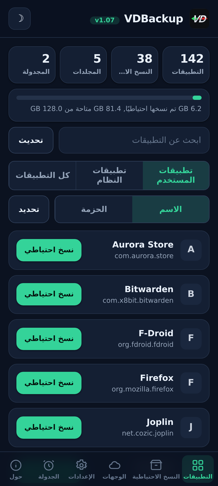
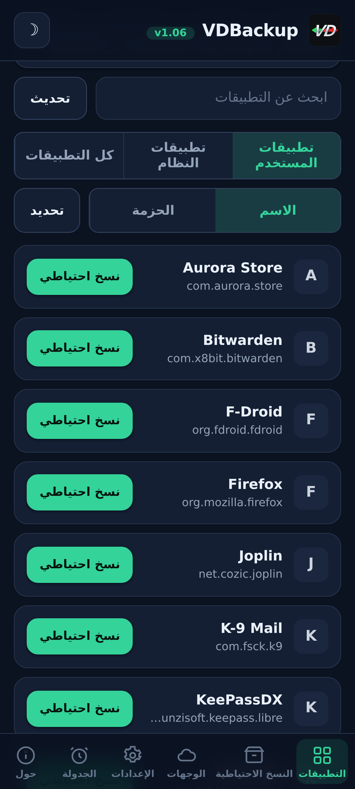
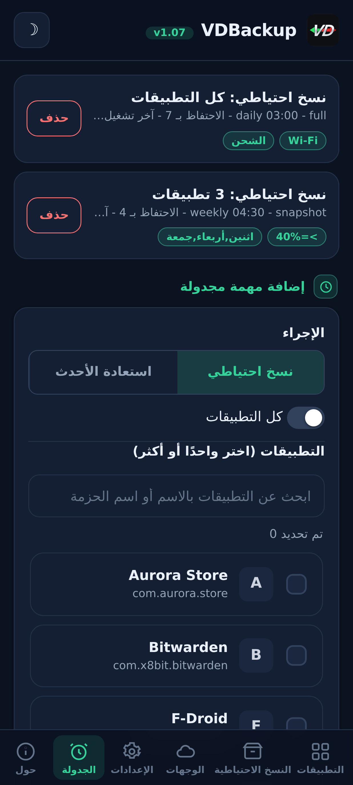
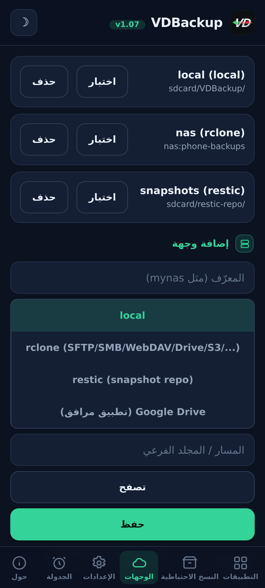
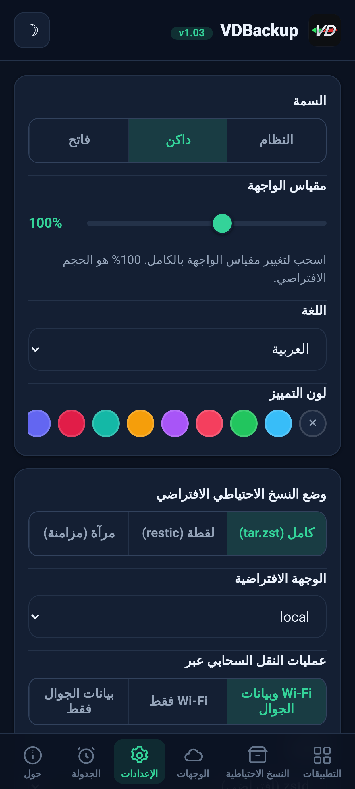
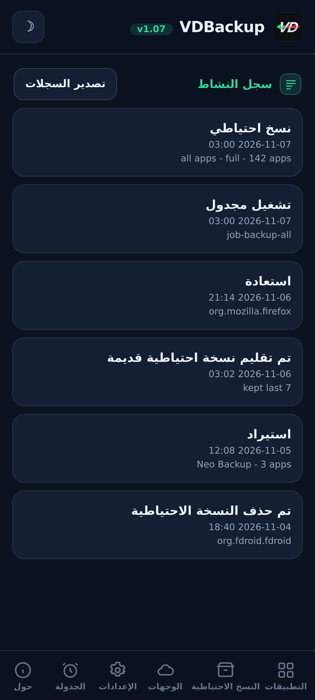

> **Languages:** [English](../USER-GUIDE.md) · العربية · [Čeština](../cs/USER-GUIDE.md) · [Deutsch](../de/USER-GUIDE.md) · [Español](../es/USER-GUIDE.md) · [فارسی](../fa/USER-GUIDE.md) · [Français](../fr/USER-GUIDE.md) · [हिन्दी](../hi/USER-GUIDE.md) · [Bahasa Indonesia](../in/USER-GUIDE.md) · [Italiano](../it/USER-GUIDE.md) · [日本語](../ja/USER-GUIDE.md) · [한국어](../ko/USER-GUIDE.md) · [Nederlands](../nl/USER-GUIDE.md) · [Polski](../pl/USER-GUIDE.md) · [Português](../pt/USER-GUIDE.md) · [Русский](../ru/USER-GUIDE.md) · [Svenska](../sv/USER-GUIDE.md) · [ไทย](../th/USER-GUIDE.md) · [Türkçe](../tr/USER-GUIDE.md) · [Tiếng Việt](../vi/USER-GUIDE.md) · [中文](../zh/USER-GUIDE.md)

---

# دليل مستخدم VDBackup

شرح كامل وودود لـ VDBackup، من تثبيت الوحدة إلى إنشاء أول نسخة احتياطية،
واستعادتها، وإرسالها إلى السحابة، وجدولتها، وفتحها على حاسوب بعد سنوات. إن كنت قد
استخدمت من قبل Swift Backup أو Neo-Backup أو Android-DataBackup، فسيبدو هذا
مألوفا, غير أن كل شيء يحدث في مكان واحد، دون أي شيء "تسمح" به.

## جدول المحتويات

- [1. ما هو VDBackup](#1-ما-هو-vdbackup)
- [2. المتطلبات](#2-المتطلبات)
- [3. التثبيت والتشغيل الأول](#3-التثبيت-والتشغيل-الأول)
- [4. جولة في الـ WebUI](#4-جولة-في-الـ-webui)
- [5. إنشاء نسخة احتياطية](#5-إنشاء-نسخة-احتياطية)
  - [5.1 اختيار ما تنسخه احتياطيا](#51-اختيار-ما-تنسخه-احتياطيا)
  - [5.2 أوضاع النسخ الاحتياطي: Full وSnapshot وMirror](#52-أوضاع-النسخ-الاحتياطي-full-وsnapshot-وmirror)
  - [5.3 الضغط](#53-الضغط)
  - [5.4 التشفير](#54-التشفير)
  - [5.5 التحقق والتشغيل التجريبي](#55-التحقق-والتشغيل-التجريبي)
  - [5.6 النسخ الاحتياطية الخاصة (الرسائل وسجل المكالمات وWi-Fi وBluetooth والتقويم والخلفية وDNS وإعدادات النظام)](#56-النسخ-الاحتياطية-الخاصة-الرسائل-وسجل-المكالمات-وwi-fi-وbluetooth-والتقويم-والخلفية-وdns-وإعدادات-النظام)
  - [5.7 النسخ الاحتياطية المستقلة للمجلدات والملفات](#57-النسخ-الاحتياطية-المستقلة-للمجلدات-والملفات)
- [6. استعادة نسخة احتياطية](#6-استعادة-نسخة-احتياطية)
- [7. الوجهات: المحلية والبعيدة](#7-الوجهات-المحلية-والبعيدة)
  - [7.1 نسخ إعداداتك احتياطيًا](#71-نسخ-إعداداتك-احتياطيا)
- [8. الجدولة والاستبقاء](#8-الجدولة-والاستبقاء)
- [9. الترحيل إلى الداخل: استيراد Neo-Backup وAndroid-DataBackup](#9-الترحيل-إلى-الداخل-استيراد-neo-backup-وandroid-databackup)
- [10. SSAID (مُعرّف ANDROID_ID للجهاز)](#10-ssaid-معرف-android_id-للجهاز)
- [11. قابلية النقل: فتح النسخ الاحتياطية على حاسوب](#11-قابلية-النقل-فتح-النسخ-الاحتياطية-على-حاسوب)
- [12. تشغيل VDBackup من مساعد ذكاء اصطناعي](#12-تشغيل-vdbackup-من-مساعد-ذكاء-اصطناعي)
- [13. استكشاف الأعطال والأسئلة الشائعة](#13-استكشاف-الأعطال-والأسئلة-الشائعة)
- [14. إلغاء التثبيت](#14-إلغاء-التثبيت)

---

## 1. ما هو VDBackup

VDBackup وحدة جذر ذات WebUI مُدمجة تأخذ نسخا احتياطية من تطبيقاتك وبياناتها
وتستعيدها. صُمم ليكون الخلف المفتوح والجذري الأصيل لـ Swift Backup وNeo-Backup
وAndroid-DataBackup: يسعى إلى أداء اتحاد ما تفعله تلك الأدوات، في مكان واحد،
بل يستطيع أيضا استيراد نسخك الاحتياطية الموجودة من Neo-Backup وAndroid-DataBackup
لتنتقل دون أن تفقد شيئا.

الفرق الأساسي عن تطبيق نسخ احتياطي عادي: يعمل VDBackup **كليا من الـ WebUI الخاص
بمدير الجذر لديك**، والوحدة جذرية أصلا. لا يوجد تطبيق مرافق لتثبيته من أجل الميزات
الأساسية، ولا طلب "منح su" لتوافق عليه، ولا شيء لتفعّله. تفتح الـ WebUI، وتختار ما
تنسخه احتياطيا، وتشغّله.

كل ما ينتجه VDBackup يستخدم **صيغا قياسية** (tar وgzip وzstd وage وzip وrestic)،
فنسخك الاحتياطية ليست محبوسة في الوحدة ولا مربوطة بجهازك المحدد أبدا. انظر
[القسم 11](#القسم-11).

## لقطات الشاشة

| الرئيسية | التطبيقات | الجدولة |
|:---:|:---:|:---:|
|  |  |  |
| **الوجهات** | **الإعدادات** | **سجل النشاط** |
|  |  |  |

## 2. المتطلبات

- **جهاز أندرويد مُروّت** مُدار بـ **KernelSU** أو **APatch** أو **Magisk**.
  يُثبَّت VDBackup كوحدة من ذلك المدير.
- مساحة تخزين حرة كافية لنسخك الاحتياطية (النسخ المحلية تقيم ضمن دليل حالة الوحدة؛
  انظر [القسم 3](#القسم-3)).
- لا شيء آخر. تُرفق الوحدة بجميع الملفات الثنائية التي تحتاجها (tar وzstd وlz4
  وrclone وrsync وssh وrestic)، لذا **يعمل النسخ الاحتياطي والاستعادة المحليان
  كاملا دون اتصال**. وحدها وجهات السحابة تتصل بالشبكة.

تعتمد بعض الإضافات الدقيقة (AppOps وSSAID وبعض أجزاء النظام المميزة) على إطار عمل
أندرويد؛ تتولى الوحدة هذه داخليا، مع ارتداد إلى صدفة خالصة، وتتدهور بلطف حين لا
تكون متاحة على جهازك.

## 3. التثبيت والتشغيل الأول

1. نزّل أحدث إصدار `VD-Backup-vX.Y.zip`.
2. في مدير KernelSU / APatch / Magisk لديك، اومِض ملف zip الوحدة كأي وحدة أخرى.
3. تصبح قابلة للاستخدام فورا, **دون حاجة إلى إعادة تشغيل**. (لا تكون إعادة
   التشغيل ذات صلة إلا عند استعادة SSAID؛ انظر [القسم 10](#القسم-10).)
4. افتح **WebUI** الوحدة من المدير. تلك هي الواجهة بأكملها.

**أي إصدار تنزّل.** يأتي كل إصدار في عدة إصدارات zip قابلة للوميض، فلا تنزّل إلا ما تحتاجه. اختر واحدا:

- **`VD-Backup-<ver>-universal-full.zip`**: كل معماريات المعالج وكل الثنائيات مُضمَّنة، بما فيها `rclone` (مزودو السحابة: Google Drive وS3 و70+ خلفية rclone أخرى) و`restic` (لقطات مُزالة التكرار). يعمل دون اتصال تماماً ولا يُنزَّل أي شيء أبداً. تعمل على أي جهاز. أكبر تنزيل.
- **`VD-Backup-<ver>-universal-lite.zip`**: كل المعماريات، لكن **بدون** أكبر ثنائيين (`rclone` و`restic`). أصغر تنزيل؛ لا تزال تؤدي النسخ الاحتياطية المحلية وعبر SSH/SFTP وrsync دون أي تنزيل، بتشفير `age` المحمول. وأول مرة تستخدم فيها وجهة سحابية (`rclone`) أو وضع اللقطات (`restic`)، تعرض واجهة الويب تنزيل تلك الإضافة الصغيرة الخاصة بالمعمارية مرة واحدة (مُتحقَّق منها عبر SHA-256) وتخزّنها مؤقتاً؛ وبعدها تعمل تلك الميزات أيضاً.
- **`VD-Backup-<ver>-<abi>-full.zip`** (إحدى `arm64-v8a` أو `armeabi-v7a` أو `x86` أو `x86_64`), معمارية واحدة فقط بكل الثنائيات مُضمَّنة (بنفس ميزات `universal-full` لكن لمعمارية جهازك وحدها، فأصغر من `universal-full`).

اختر **`<abi>-full`** المطابقة إن كنت تعرف معمارية جهازك وتريد كل شيء مُضمَّناً (معظم الهواتف هي **`arm64-v8a`**). اختر **`universal-lite`** إن أردت أصغر تنزيل ولم تمانع تنزيلاً لمرة واحدة مُتحقَّقاً منه عبر SHA-256 أول مرة تستخدم فيها مزودي السحابة (`rclone`) أو اللقطات (`restic`). اختر إصدار **full** إن أردت كل شيء مُضمَّناً بلا أي تنزيل (دون اتصال / للاستعادة) ولم تكن متأكدا من المعمارية. عند التثبيت تُبقي الوحدة على معمارية جهازك فقط بصرف النظر عن الإصدار الذي تومِضه.

عند التشغيل الأول تزرع الوحدة إعدادا افتراضيا (فقط إن لم يوجد واحد بعد)، فتبقى
إعداداتك محفوظة عبر تحديثات الوحدة.

**أين تقيم الحالة.** بيانات عمل VDBackup, إعداداتك، والمهام المجدولة، والوجهات
المحفوظة، وبيانات الاعتماد المشفرة، والسجلات وسجل التدقيق، ومنطقة التجهيز, تقيم
تحت:

```
/data/adb/vdbackup/
```

**أين تقيم النسخ الاحتياطية.** تُكتَب النسخ الاحتياطية نفسها إلى تخزين مرئي
للمستخدم ومشفَّر ببيانات الاعتماد (فلا تُقرأ إلا بعد فتح قفل الجهاز، وتبقى بعد
إلغاء تثبيت الوحدة)، بمجلد لكل مستخدم أندرويد:

```
/sdcard/VDBackup/            (= /data/media/<user>/VDBackup)
```

ضع هذا في بالك لسببين: تشغل النسخ الاحتياطية مساحة تحت `/sdcard/VDBackup`،
و`/data/adb/vdbackup/logs/` هو حيث تبحث إن ساء شيء.

## 4. جولة في الـ WebUI

تُنظَّم الـ WebUI في بضع علامات تبويب:

- **Home**: نظرة عامة على الصفحة الرئيسية تعرض أعداد نسخك الاحتياطية (التطبيقات والنسخ الاحتياطية والمجلدات والمهام المجدولة) وشريط تخزين لمقدار المساحة التي تستهلكها نسخك الاحتياطية مقابل المتاح، مع شارات حالة، ونسخ الهاشات والمسارات إلى الحافظة، وإجراء **Check for updates**.
- **Apps**: قائمة التطبيقات المثبتة (للمستخدم وللنظام)، كلٌّ يظهر باسمه الحقيقي،
  واسم حزمته، وأيقونته (تُحمَّل الأيقونات بتكاسل وتُخزَّن مؤقتا، فتبقى القائمة
  سريعة الاستجابة). يأخذ الزر على السطر نسخة احتياطية من التطبيق؛ والنقر على السطر
  يفتح سجل النسخ الاحتياطية لذلك التطبيق، حيث تستطيع استعادة أي نسخة سابقة.
- **Backups**: النسخ الاحتياطية التي لديك بالفعل، كلٌّ يعرض اسم التطبيق في سطر
  والحزمة في السطر التالي. انقر نسخة احتياطية لرؤية تفاصيلها الكاملة (الإصدار،
  التاريخ، الحجم، العناصر المضمنة، أعداد الأذونات، والجهاز الذي أتت منه). هنا أيضا
  تستعيد، أو تجري اختبار استعادة، أو تحذف نسخة احتياطية، أو تستورد نسخا من
  Neo-Backup أو Android-DataBackup.
- **Destinations**: إدارة وجهة ذهاب النسخ الاحتياطية: التخزين المحلي بالإضافة إلى
  أي وجهات بعيدة تضيفها (انظر [القسم 7](#القسم-7)). يمكنك
  اختبار وجهة هنا قبل الاعتماد عليها.
- **Settings**: مبدّل سمة فاتحة/داكنة، ومُحدِّد لون التمييز (قوالب جاهزة، أو لون
  مخصص، أو إعادة تعيين)، ومُحدِّد لغة (يُعرَض الرابط من اليمين إلى اليسار للعربية والفارسية)، وشريط تمرير لمقياس الواجهة تسحبه لإعادة تحجيم الواجهة بأكملها (الترويسة والمحتوى والتنقل السفلي معا) من 85% إلى 120% (100% هي القيمة الافتراضية)، لشاشات
  ذات كثافات بكسل مختلفة، وإعدادات افتراضية للمهام الجديدة (الضغط
  الافتراضي، تشغيل/إيقاف التحقق، التشفير الافتراضي)، وسياسة الشبكة لعمليات نقل
  السحابة (انظر [القسم 7](#القسم-7))، والنسخ الاحتياطي التلقائي وقائمة التطبيقات
  المستبعَدة، وخيار مصدر التثبيت، ومفتاح التشفير، والجدولة. إعدادات التشغيل/الإيقاف تستخدم مفاتيح تبديل بنمط أندرويد.
- **About**: الإصدار والروابط والمشاريع الشقيقة (See also) وبيان تدقيق الملفات
  الثنائية المرفقة، وإجراء **Check for updates** الذي يُبلّغ عمّا إذا كان قد نُشر إصدار أحدث (مع
  ملاحظات إصداره). أي تحديث تثبّته عبر مدير الجذر لديك، تمامًا كما فلشت الوحدة.

يتحقق التطبيق أيضًا بنفسه من وجود إصدار أحدث في كل مرة تفتحه فيها (مرة واحدة كل ساعة على الأكثر) ويعرض شريط التحديث فقط عند توفر واحد؛ ويبقى صامتًا عند التحديث أو دون اتصال.

تستخدم التأكيدات والرسائل حوارات داخل التطبيق (لا النوافذ المنبثقة القديمة للنظام)،
وتطلب منك الاستعادة أو الاستيراد الإقرار بأنها تطمس بيانات التطبيق الحالية قبل أن
تمضي.

تعمل النسخ الاحتياطية والاستعادات **منفصلة** كعملية جذر في الخلفية. يمكنك إغلاق
الـ WebUI، أو حتى إغلاق مدير الجذر، وتستمر العملية. وحين تعود، تعيد الـ WebUI
الارتباط وتعرض التقدم الحي بعنوان مرحلة مُترجَم. لمهمة جارية تعرض بطاقة التقدم أيضا
سرعة النقل الحية والوقت المتبقي المقدَّر، بالإضافة إلى عدّاد عناصر (مثلا "12 of 40") مع
اسم العنصر الحالي. على أنظمة ROM التي تُظهِر إشعارات
الصدفة تحصل أيضا على إشعار أندرويد عند بدء مهمة وانتهائها؛ وعلى أي حال فإن بطاقة
التقدم داخل التطبيق هي المؤشر الموثوق.

## 5. إنشاء نسخة احتياطية

التدفق الأساسي: افتح **Apps**، واختر تطبيقا، وحدد ما تضمّنه، واختر وضعا، واضبط
الضغط و(اختياريا) التشفير، ثم شغّل. يظهر التقدم حيا، ويخبرك إشعار متى انتهى.

في مربع حوار النسخ الاحتياطي يمكنك أيضًا اختيار **وجهة** هذه النسخة, التخزين المحلي أو أي وجهة سحابية/بعيدة أضفتها, دون تغيير الوجهة الافتراضية في الإعدادات أولًا.

### 5.1 اختيار ما تنسخه احتياطيا

لكل تطبيق تستطيع تضمين أي مجموعة من هذه العناصر:

| العنصر | ما هو |
|------|-----------|
| **APK** | التطبيق المثبت نفسه (APK الأساسي + أي APK مقسَّمة). |
| **data** | بيانات التطبيق الخاصة (`/data/data`). هذه هي "بيانات التطبيق" المعتادة. |
| **device-protected data** | تخزين الإقلاع المباشر / المحمي بالجهاز (`/data/user_de`). تحفظ بعض التطبيقات إعداداتها هنا. |
| **external** | بيانات التطبيق الخارجية تحت `Android/data`. |
| **OBB** | ملفات توسعة OBB للتطبيق (`Android/obb`)، تستخدمها بعض الألعاب. |
| **media** | وسائط التطبيق تحت `Android/media`. |

افتراض جيد لـ "انسخ هذا التطبيق كاملا" هو تضمين كلها. إن أردت البيانات فقط (مثلا
لنقل حفظ لعبة)، يمكنك إلغاء تحديد APK والعناصر الكبيرة OBB/media.

يحفظ VDBackup أيضا الأشياء التي تجعل الاستعادة أمينة: سياقات SELinux، وملكية
uid/gid، وأنماط الملفات، والسمات الموسّعة (xattr)، والقدرات.

### 5.2 أوضاع النسخ الاحتياطي: Full وSnapshot وMirror

يقدم VDBackup ثلاثة أوضاع. تختار الـ WebUI مسبقا **Full**، وهو الخيار الصائب
لمعظم الناس.

- **Full**: نسخة احتياطية كاملة ومكتفية بذاتها وقابلة للنقل، تُكتَب بصيغة
  `tar.zst` (أو الضغط الذي تختاره). ينتج كل تشغيل نسخة قائمة بذاتها يمكنك نسخها
  إلى أي مكان وفتحها على حاسوب. الأنسب لـ: لقطة نظيفة قابلة للنقل من تطبيق تستطيع
  أرشفتها ونقلها. هذا الوضع الافتراضي والأكثر قابلية للنقل.
- **Snapshot**: تراكمي ومُؤرَّخ بالإصدارات، مدعوم بـ `restic`. يضيف كل تشغيل
  لقطة جديدة في لحظة معينة إلى مستودع، مخزنا فقط ما تغيّر ومزيلا التكرار عبر
  اللقطات. الأنسب لـ: الاحتفاظ بتاريخ جارٍ لتطبيق دون دفع الحجم الكامل في كل
  تشغيل.
- **Mirror**: مزامنة واحد لواحد للبيانات الحية إلى الوجهة، مدعومة بـ
  `rclone`/`rsync`. تُبقي الوجهة مطابقة لما على الجهاز الآن (تُنسَخ الملفات
  المتغيرة، وتُحذَف الملفات المُزالة على الوجهة). الأنسب لـ: نسخة سريعة وحديثة
  دائما، مثلا إلى جهاز سحابي بعيد. لاحظ أن APK يُخزَّن مضغوطا حتى في المرآة، لا
  خاما أبدا.

### 5.3 الضغط

يمكنك اختيار الضغط لنسخة Full:

- **none**: بلا ضغط (الأسرع، الأكبر).
- **lz4**: سريع جدا، ضغط خفيف.
- **zstd**: الافتراضي، توازن قوي بين السرعة والنسبة. يمكنك أيضا اختيار مستوى
  (مثلا مستوى أعلى لملف أصغر).
- **gzip**: **"وضع التوافق"**. يفتح gzip بأدوات مدمجة في أي حاسوب تقريبا وفي معظم
  مديري الملفات، دون أي شيء إضافي لتثبيته. اختره حين يهمك أكثر أن تتمكن من فتح
  الأرشيف في أي مكان.

إن لم تختر، يستخدم VDBackup افتراضه المضبوط (zstd بمستوى معقول).

### 5.4 التشفير

التشفير **اختياري** وقابل للنقل. يشفّر VDBackup بـ **age** باستخدام عبارة مرور
(scrypt)، التي اختيرت تحديدا لقابلية النقل: أي أداة `age` قياسية على أي نظام تشغيل
تستطيع فك تشفير نسختك بعبارة المرور وحدها. التشفير **لا** يُربَط أبدا بمفاتيح عتاد
جهازك، فتُستعاد نسخة مشفرة على جهاز آخر وتُفتَح على حاسوب. (يتوفر أيضا وضع zip
AES-256 متوافق للأرشيفات المشفرة التي تريد فتحها بنقرة مزدوجة وكلمة مرور.)

لاستخدام التشفير، ولّد مفتاح التشفير مرة واحدة (Settings)، ثم فعّل التشفير لمهمتك
واضبط عبارة مرور. عبارة المرور هي ما يحمي النسخة، فاختر واحدة قوية, لا يوجد مفتاح
عتاد ولا باب خلفي للاستعادة.

**قاعدة APK (مهمة):**

- **يُخزَّن APK دائما مضغوطا**، لا خاما أبدا، توفيرا للمساحة.
- **لا يُشفَّر APK افتراضيا**، لأن APK للتطبيق محتوى عام.
- تشفير APK وتشفير البيانات **مفتاحان مستقلان**. تفعيل تشفير البيانات **لا** يشفّر
  APK. إن أردت تحديدا تشفير APK أيضا، فعّل مفتاح تشفير APK صراحة.

### 5.5 التحقق والتشغيل التجريبي

خياران للأمان يساعدانك على الوثوق بنسخة احتياطية قبل الاعتماد عليها:

- **Verify**: بعد الكتابة، يعيد VDBackup حساب تجزئة كل أرشيف ويطابقه مع البيان.
  هذا **مُفعَّل افتراضيا لنسخ Full**. إن لم يتطابق ملف، تفشل المهمة بخطأ واضح
  بدلا من أن تتركك بنسخة احتياطية تالفة بصمت.
- **Dry-run**: يخطط للمهمة ويبلّغ عن الأحجام التي سينتجها **دون كتابة أي شيء**.
  استخدمه لتقدير المساحة أو للتحقق من اختيار عناصرك قبل تشغيل الشيء الحقيقي.

حين تذهب نسخة احتياطية إلى وجهة **سحابية**، يضيف VDBackup حاجزين إضافيين. يشغّل خطوة
نهائية **مُتحقَّقة بالمجموع الاختباري** تعيد فحص النسخة المرفوعة مقابل الأصل على الجهاز
البعيد، وتُفشِل المهمة (بدلا من ترك نسخة تالفة في السحابة) إن لم تتطابقا. وقبل رفع Full
يفحص المساحة **الحرة** للجهاز البعيد ويتوقف مبكرا برسالة **"لا توجد مساحة كافية"** واضحة إن
لم تتّسع النسخة، بدلا من ملء الجهاز البعيد والفشل في المنتصف. (فحص المساحة لعمليات رفع
Full؛ أما Mirror فمزامنة فرقية ومستثناة.)

### 5.6 النسخ الاحتياطية الخاصة (الرسائل وسجل المكالمات وWi-Fi وBluetooth والتقويم والخلفية وDNS وإعدادات النظام)

أسفل قوائم التطبيقات في علامة تبويب **Backups**، تغطي **النسخ الاحتياطية الخاصة** بيانات
على مستوى النظام غير مرتبطة بتطبيق واحد. اختر الفئات وانسخها احتياطيا؛ تُؤرشَف بنفس حفظ
SELinux/xattr والتشفير الاختياري كنسخ التطبيقات. الفئات هي:

| الفئة | ما هي |
|------|-----------|
| **الرسائل (SMS/MMS)** | رسائلك النصية. |
| **جهات الاتصال وسجل المكالمات** | جهات اتصالك وتاريخ مكالماتك. |
| **شبكات Wi-Fi** | شبكات Wi-Fi المحفوظة لديك. |
| **Bluetooth** | اقترانات Bluetooth لديك. |
| **التقويم** | مزوّد التقويم (التطبيق والبيانات). ويُكتَب أيضا **`calendar.json` محمول**، فتكون أحداثك قابلة للقراءة على حاسوب دون الوحدة. |
| **الخلفية** | خلفية شاشتك الرئيسية وشاشة القفل بالإضافة إلى `wallpaper_info.xml`، مخزَّنة كصورة خام. |
| **DNS** | وضع وخادم DNS الخاص لديك. |
| **إعدادات النظام** | تفريغ كامل لإعدادات system وglobal وsecure للجهاز. |

للرسائل وسجل المكالمات وجهات الاتصال، تُكتَب أيضا **نسخة محمولة** (JSON قابلة للفتح)، فتكون لديك
نسخة عابرة للأجهزة تقرؤها على حاسوب دون الوحدة.

**إعدادات النظام اختيارية وتكتب فوق إعدادات جهازك عند الاستعادة.** تماما مثل SSAID (انظر
[القسم 10](#القسم-10))، فإن فئة **إعدادات النظام** هي الأكثر حساسية: استعادتها تكتب فوق إعدادات
جهازك بأكمله، لذا فهي معطَّلة ما لم تخترها عمدا، وتطلب منك الإقرار أولا، وتُكتَب في سجل النشاط.

استعادة نسخة خاصة تطمس بيانات النظام الحية وتحتاج إعادة تشغيل، لذا تُحجب خلف إقرار بارز وتكون
موثوقة على الجهاز وROM نفسيهما. الاستعادات **عديمة التأثير المتكرر**: الفئات الخام (الرسائل وجهات
الاتصال وWi-Fi وBluetooth والتقويم) تُستعاد بـ **استبدال** البيانات بدلا من دمجها، فاستعادة النسخة
نفسها مرتين لا تنشئ تكرارات أبدا، ويُعاد ببساطة تطبيق DNS وإعدادات النظام.

### 5.7 النسخ الاحتياطية المستقلة للمجلدات والملفات

أحيانا تريد نسخ مجلد أو ملف عادي ليس تطبيقا, مجلد كاميرا، أو دليل مستندات، أو قاعدة بيانات
واحدة. يستطيع VDBackup نسخ **أي مسار مطلق** على التخزين المشترك أو تحت `/data`، بنفس الصيغة
المحمولة كنسخة تطبيق: أرشيف `tar.zst` بالإضافة إلى `manifest.json`، مختوم بـ SHA-256، مع مذكرة
RECOVERY حين تشفّره. تُحفَظ نسخ المسارات هذه على حدة، تحت مجلد `.paths` في دليل نسخك الاحتياطية.

- **اختر مسارا وانسخه.** يجب أن يكون المصدر مسارا مطلقا تحت أحد المواقع المسموح بها
  (`/storage/emulated` و`/data/media` و`/sdcard` و`/data`). وتُرفَض المسارات التي تحاول الخروج بـ `..`.
- **الاستعادة تكتب عائدة إلى الموقع الأصلي**، فهي، مثل أي استعادة، مدمّرة وتطلب منك **التأكيد** قبل
  أن تكتب فوق أي شيء.
- مثل نسخ التطبيقات، تعمل نسخ واستعادات المسارات **منفصلة** بتقدم حي، وتستخدم الضغط الذي تختاره،
  ويمكن تشفيرها بعبارة مرور.

## 6. استعادة نسخة احتياطية

افتح علامة تبويب **Backups**، واختر النسخة التي تريدها، وابدأ الاستعادة. ولأن
الاستعادة إجراء مدمّر، يطلب منك VDBackup **التأكيد** أولا، ويسجّل الإجراء في سجل
تدقيق محلي.

الاستعادة **أمينة**: يطمس VDBackup الحالة الحالية للتطبيق ويستخرج النسخة
الاحتياطية، فيعود التطبيق إلى **الحالة المطابقة تماما** الملتقطة في تلك النسخة
(بما في ذلك الملكية والأنماط وسياقات SELinux وxattr). ليست دمجا, بل استعادة
حقيقية إلى لحظة النسخة الاحتياطية. ولأن الاستعادة تعمل بصلاحية الجذر، يفحص VDBackup أيضا كل
أرشيف قبل أن يستخرج أي شيء ويرفض أرشيفا مُلاعَبا يحاول الكتابة خارج هدفه، فلا يمكن لنسخة
معدَّلة أن تكتب فوق بقية نظامك أبدا.

خيارات استعادة مفيدة:

- **Restore-test**: يستخرج النسخة الاحتياطية إلى منطقة تجهيز مؤقتة ويتحقق منها
  **دون المساس بالتطبيق الحي**. هذه الطريقة الآمنة للتأكد من أن نسخة احتياطية
  سليمة وقابلة للاستعادة قبل أن تطمس أي شيء. إن فشل الاختبار تحصل على خطأ واضح
  ويُترَك تطبيقك المثبت دون مساس.
- **Partial restore**: استعادة بعض العناصر التي نُسخت احتياطيا فقط. مثلا، استعادة
  بيانات التطبيق فقط دون إعادة تثبيت APK، أو استعادة ملفات الحفظ دون OBB/media
  الكبيرة. اختر العناصر التي تريدها في شاشة الاستعادة.
- لنسخ **Snapshot** و**Mirror**، تسحب الاستعادة من المستودع المُؤرَّخ أو النسخة
  المعكوسة على التوالي.
- **مصدر التثبيت**: افتراضيا تُبلِّغ التطبيقات المستعادة عن **متجر Play** كمصدر تثبيتها
  (بدلا من أن تبدو مثبّتة جانبيا)، وهو ما تتوقعه معظم التطبيقات وفحوص التطبيقات. يمكنك
  إيقاف ذلك عامًّا في Settings أو لكل استعادة، وحين يكون معطَّلا يُحتفَظ بمصدر التثبيت
  الأصلي. ويذهب مبدّل **"تزييف المصدر المُبادِر"** المتقدم باختيار صريح أبعد فيجعل أيضا
  الحزمة المُبادِرة ومصدر الحزمة للتطبيق يبدوان مثبَّتين من Play؛ وهو يحرّر قاعدة بيانات
  حزم النظام (تُنسَخ احتياطيا أولا) ويسري بعد إعادة التشغيل.

**الاستعادة بالدُّفعات.** تحتوي علامة تبويب **Backups** على وضع **Select** (التحديد)،
تماما كما في علامة تبويب Apps للنسخ الاحتياطي بالدُّفعات. فعّل **Select**، وأشّر على النسخ
التي تريدها عبر مربعات الاختيار، واستعدها كلها دفعة واحدة. يغطّي مربّع حوار خيارات واحد
التحديد بأكمله, إذ ينطبق إقرار الكتابة فوق البيانات واختبار الاستعادة واختيار مصدر التثبيت
على كل نسخة احتياطية حدّدتها, وتُستعاد الواحدة تلو الأخرى.

**حذف نسخة احتياطية.** افتح تفاصيل نسخة احتياطية (أو سجل تطبيق) واستخدم **Delete**؛
يُطلَب منك التأكيد، وتُكتَب عملية الحذف في سجل النشاط. يمكنك أيضا تحديد عدد النسخ المُحتفَظ
بها لكل تطبيق (الاستبقاء) كي تُقلَّم القديمة تلقائيا.

**تركيب تطبيق مثبّت كتطبيق نظام.** من سجل النسخ الاحتياطية لتطبيق، يجهّز **Mount as
system** ملف(ات) APK للتطبيق في وحدة فرعية تراكبية لـ VDBackup كي يخدمه مدير الجذر من
`/system/app` (أو `/system/priv-app`), دون المساس بقسم `/system` الحقيقي أبدا. مع
**NoMount** على KernelSU يسري حيا؛ وإلا يسري بعد إعادة التشغيل. وهذا لا يعتمد أبدا على
تثبيت NoMount.

## 7. الوجهات: المحلية والبعيدة

افتراضيا، تُكتَب النسخ الاحتياطية إلى تخزين **محلي** تحت دليل حالة الوحدة. يمكنك
أيضا إضافة وجهات بعيدة في علامة تبويب **Destinations**. للوجهة المحلية، يفتح
**Browse** مُنتقي مجلدات كي تختار مجلدا فرعيا تحت التخزين المشترك (`/sdcard`) بدلا
من كتابة المسار.

يُتولّى النقل البعيد بالأدوات المُرفقة:

- **rclone**: المحور لمدى هائل من الأجهزة البعيدة: **SFTP وSMB وWebDAV وFTP وS3
  وGoogle Drive** وأكثر من 70 خدمة أخرى.
- **rsync** ومجموعة **ssh/scp/sftp**: للمزامنة الدلتا ولأهداف SSH البسيطة.
- **restic**: مستودعات **Snapshot** مشفرة ومزالة التكرار (محلية أو بعيدة).

**إنشاء جهاز سحابي بعيد (دون حاجة إلى SSH).** في علامة تبويب Destinations، اختر
نوع وجهة **rclone** واستخدم **Add cloud remote**. يمكنك الاتصال بـ **أي backend من
rclone**: تعرض القائمة المنسدلة الخيارات الشائعة (**Google Drive وDropbox وOneDrive
وBox وpCloud وMega وBackblaze B2 وS3 وSFTP وWebDAV وFTP وSMB**) بالإضافة إلى خيار
**Custom (advanced)** حيث تكتب أي نوع backend آخر ومعاملاته بصيغة `key=value`. املأ
الحقول (host/user/password، أو مفاتيح S3 مثلا) واحفظ. بالنسبة للمزوّدين الذين يسجّلون
دخولك عبر المتصفح (Google Drive وDropbox وOneDrive وBox وpCloud) استخدم زر **Authorize
in browser**: يسجّل دخولك عبر متصفح الهاتف نفسه ويلتقط الرمز تلقائيا، فلا حاجة إلى
حاسوب (ولا يزال لصق الرمز يدويا يعمل كحل بديل). يظهر الجهاز البعيد عندئذ في قائمة
الأجهزة البعيدة للوجهة. تُخزَّن كلمات المرور مُعتَّمة، لا بنص صريح أبدا. يمكنك سرد
أجهزتك البعيدة وحذفها من المكان نفسه.

قاعدتان تُبقيان الاستخدام البعيد آمنا:

- **تُخزَّن بيانات الاعتماد مشفرة** في الراحة في دليل حالة الوحدة، لا بنص صريح
  أبدا.
- **تحقق قبل الاستخدام.** استخدم اختبار الوجهة في علامة تبويب Destinations للتأكد
  من أن وجهة تعمل قبل أن توجّه نسخة احتياطية حقيقية إليها.

**سياسة الشبكة (Wi-Fi مقابل بيانات الجوال).** في Settings، يتيح لك "Cloud
transfers over" تقييد نوع الاتصال الذي يجوز لعمليات نقل السحابة استخدامه:
**Wi-Fi and mobile data** (الافتراضي)، أو **Wi-Fi only**، أو **Mobile data
only**. حين تقيّده، يفحص كل نقل سحابي, يدوي أو مجدول، رفع أو استعادة, الاتصال
النشط أولا ويرفض العمل على الخاطئ، فسياسة Wi-Fi only لا تنفق بيانات جوال أبدا.
النسخ الاحتياطية المحلية لا تتأثر أبدا.

**Google Drive.** لديك طريقتان للوصول إلى Google Drive:

1. **عبر rclone**: أضف Drive كجهاز rclone بعيد مثل أي وجهة أخرى، دون تطبيق إضافي
   و**دون حساب Google Cloud**. على أي حاسوب شغّل `rclone authorize "drive"` مرة
   واحدة، وسجّل الدخول إلى حساب Google في المتصفح، والصق الرمز الذي يطبعه في حقل
   رمز جهاز Drive البعيد.
2. **عبر المرافق الاختياري**: تطبيق مرافق صغير اختياري يتولى تسجيل الدخول إلى
   Google ورفع Drive. يُثبَّت **فقط عندما تختار صراحة وجهة مرافق Google Drive**،
   لا افتراضيا أبدا، ويُزال حين تعطّله. شاشة موافقة Google لمرة واحدة هي الخطوة
   الوحيدة التي تحدث خارج الـ WebUI. عند تثبيت المرافق، يذكّرك VDBackup بأن
   **تخفيه دائما بـ [HMA-OSS](https://github.com/frknkrc44/HMA-OSS)** كي لا يكشف وجوده الجذر أو مُحمّل إقلاع مفتوح،
   ويعرض إضافته إلى قائمة [HMA-OSS](https://github.com/frknkrc44/HMA-OSS) نيابة عنك. كما يذكّرك VDBackup، عند وجود نسخ احتياطية محلية، بإخفاء مجلد النسخ الاحتياطي (/sdcard/VDBackup) باستخدام SUSFS للسبب نفسه.

### 7.1 نسخ إعداداتك احتياطيًا

يمكن كتابة إعداد VDBackup نفسه، أي الوجهات والجداول الزمنية والإعدادات المسبقة وبيانات الاعتماد المحفوظة، في ملف واحد ونقله إلى جهاز آخر أو استعادته بعد تثبيت نظيف. في **الإعدادات**، ضمن **نسخة احتياطية من الإعدادات**:

- **تصدير الإعدادات** يكتب ملفًا مشفَّرًا في `VDBackup/.export`. ويطلب دائمًا عبارة مرور، لأن الملف يحمل كلمات مرورك البعيدة.
- **استيراد الإعدادات** يعيد قراءة هذا الملف ويدمجه في هذا الجهاز، دون إزالة أي شيء موجود بالفعل.
- **مسح بيانات الاعتماد المحفوظة** يزيل كلمات المرور البعيدة المحفوظة ومفتاح تشفير الجهاز في خطوة واحدة؛ تبقى وجهاتك وجداولك الزمنية ونسخك الاحتياطية في مكانها.

## 8. الجدولة والاستبقاء

يستطيع VDBackup تشغيل النسخ الاحتياطية, والاستعادات, تلقائيا على جدول. في المُجدوِل
تعرّف مهمة بـ:

- **هدف**: تطبيق واحد أو مجموعة تطبيقات أو **كل التطبيقات** (ما عدا قائمة التطبيقات
  المستبعَدة), والعناصر/الوضع المُستخدَم،
- **إجراء**: **Back up** (الافتراضي) أو **Restore latest**، الذي يستعيد أحدث نسخة
  احتياطية لكل تطبيق هدف،
- وجهة،
- **جدول شبيه بـ cron**: كل ساعة أو يوميا أو أسبوعيا، في وقت تختاره (HH:MM)،
- إعداد **استبقاء**: **الاحتفاظ بأحدث N** نسخة احتياطية لتلك المهمة، والأقدم
  تُقلَّم تلقائيا،
- **شروط تشغيل** اختيارية: فقط على **Wi-Fi**، أو فقط أثناء **الشحن**، أو فقط عند
  **مستوى بطارية أدنى** أو أعلى، وفقط في **أيام الأسبوع** المختارة.

تُطلَق المهام المجدولة بنبضة قلب عند الإقلاع في الوحدة: حين تستحق مهمة تعمل،
وتسجّل وقت آخر تشغيل كي لا تُطلَق مرتين، وتطبّق الاستبقاء لتقليم النسخ القديمة.
ولأن كل شيء يعمل بصلاحية الجذر في الخلفية، لا تحتاج النسخ المجدولة إلى أن تكون الـ
WebUI مفتوحة.

**شروط التشغيل (البوابات).** يمكن أن تحمل المهمة المجدولة شروطا يجب أن تتحقق كي تعمل:
Wi-Fi فقط، أو الشحن فقط، أو مستوى بطارية أدنى، أو أيام محددة من الأسبوع. وعندما تستحق مهمة
لكن لا يتحقق شرط، تُتخطّى **ويُعاد محاولتها في الفحص التالي**: لا يتقدم جدولها، فتعمل حالما
يتحقق الشرط. كما يتخطى فحص سلامة حرارية مدمج المهمة المجدولة بينما يكون الجهاز ساخنا جدا.
ويُسجَّل كل تخطٍّ كهذا في سجل النشاط.

**الاستعادة المجدولة تكتب فوق البيانات في كل تشغيل.** مهمة **Restore latest** تعيد في كل
مرة تُطلَق فيها استعادة أحدث نسخة احتياطية لكل تطبيق هدف، والاستعادة إجراء مدمّر: ففي كل
تشغيل **تكتب فوق البيانات الحالية للتطبيق** بأحدث نسخة احتياطية. هذا متعمَّد وباختيار صريح -
اخترها فقط حين تريد إبقاء الأهداف على أحدث نسخة احتياطية لها.

**نسخ احتياطي تلقائي عند التثبيت/التحديث.** في Settings يمكنك تفعيل **النسخ الاحتياطي
التلقائي**: تلاحظ نبضة الخلفية نفسها التطبيقات المثبتة أو المحدَّثة حديثا وتنسخها احتياطيا
نيابة عنك (مع استبقاء keep-N). التشغيل الأول يسجّل فقط ما هو مثبَّت، فتفعيله لا ينسخ جهازك
كله دفعة واحدة أبدا.

**التطبيقات المستبعَدة (قائمة الحظر).** في Settings أيضا، يمكنك استبعاد التطبيقات التي لا
تريد نسخها احتياطيا تلقائيا أو على جدول أبدا؛ يمكنك إضافة عدة تطبيقات دفعة واحدة (تحديد متعدد)، وتتخطى العمليتان كلتاهما التطبيقات المستبعَدة.

**إعدادات مسبقة للنسخ.** أيضا في الإعدادات، يمكنك حفظ إعدادات مسبقة مُسمّاة, مجموعات من العناصر لتضمينها، مثل APK فقط أو APK + OBB, واختيار واحد في نافذة النسخ لملء اختيارات العناصر دفعة واحدة.

**عناصر النسخ لكل تطبيق.** أيضا في الإعدادات، يمكنك اختيار العناصر التي يُنسخ منها كل تطبيق بالضبط في النسخ الجماعية والتلقائية والمجدولة, مثلا APK فقط، أو APK + OBB. النسخة اليدوية الفردية تظل تتيح لك الاختيار حينها، بدءا من مجموعة التطبيق. التطبيقات التي لا تضبطها هنا يُنسخ منها كل شيء.

**وسوم التطبيقات.** اضغط على تطبيق في الإعدادات (العناصر والوسوم لكل تطبيق) لتمنحه تسميات حرة, مثلا games أو work. يظهر عندئذ منتقي وسوم فوق قائمة التطبيقات: اختر وسما لعرض تطبيقاته فقط، وانسخ المجموعة كلها دفعة واحدة. يمكنك الوصول إليه أيضا من تبويب التطبيقات: اضغط على تطبيق ثم العناصر والوسوم.

**سجل النشاط.** تحوي علامة تبويب Schedule زر **View activity log** يفتح شاشة كاملة (فورا)
تعرض سجل التدقيق المحلي, النسخ الاحتياطية والاستعادات وعمليات الحذف والتشغيلات المجدولة
والتلقائية وعمليات التقليم, الأحدث أولا. يحفظ إجراء **Export logs** ملف سجل (ضمن مجلد
النسخ الاحتياطي) يمكنك إرفاقه بتقرير ملاحظات أو خطأ.

## 9. الترحيل إلى الداخل: استيراد Neo-Backup وAndroid-DataBackup

إن كنت قادما من Neo-Backup أو Android-DataBackup، فلا عليك أن تبدأ من جديد. من
علامة تبويب **Backups** يمكنك **استيراد** نسخك الاحتياطية الموجودة:

1. وجّه VDBackup إلى موقع نسخك الاحتياطية الموجودة من Neo-Backup أو
   Android-DataBackup (يسرد import-scan ما يجده هناك).
2. اختر أي النسخ تستوردها.
3. ابدأ الاستيراد. مثل سائر العمليات الطويلة يعمل منفصلا بتقدم حي.

**نسخ Neo-Backup المشفرة بكلمة مرور مدعومة.** يمكن استيراد نسخ Neo-Backup المشفرة
بـ AES-256, **تُطلَب منك كلمة المرور** حين تلزم، وتُستخدَم كلمة المرور للفك فقط،
ولا تُخزَّن أبدا في سطر الأوامر.

## 10. SSAID (مُعرّف ANDROID_ID للجهاز)

SSAID هو `ANDROID_ID` لكل تطبيق, مُعرّف على مستوى الجهاز تقرؤه بعض التطبيقات.
يستطيع VDBackup نسخه احتياطيا واستعادته، لكن هذا أكثر ما يمسّه حساسية، فيُعامَل
بعناية إضافية:

- **اختياري ومُعطَّل افتراضيا.** **لن** يلتقط VDBackup SSAID أو يستعيده أبدا ما لم
  تفعّله صراحة لتلك المهمة. تُظهِر الـ WebUI إشعار "Optional" مُعلَّما ومُبرَزا
  بوضوح أينما ظهر SSAID (نسخ احتياطي واستعادة واستيراد)، ويبقى معطَّلا حتى تختار
  تفعيله.
- **يُطبَّق فقط بعد إعادة التشغيل عند الاستعادة.** يخزّن مزوّد إعدادات أندرويد هذه
  القيم مؤقتا، فلا يسري SSAID المُستعاد إلا بعد إعادة تشغيل الجهاز.
- **تُؤخَذ القيمة السابقة نسخة احتياطية دائما أولا.** قبل الكتابة فوق أي SSAID،
  ينسخ VDBackup ملف `settings_ssaid.xml` الحي بايتا ببايت إلى نسخة احتياطية
  موسومة بالوقت (لا تُحذَف تلقائيا أبدا). إن تعذّر إجراء تلك النسخة الأمنية، لا
  تحدث الكتابة فوقها. للتراجع، استعِد ذلك الملف المحفوظ وأعِد التشغيل.

**توصية:** اترك SSAID معطَّلا ما لم تعرف تحديدا أنك تحتاجه (مثلا، تطبيق بعينه
يربط نفسه بمُعرّف الجهاز وتُرحّله عن قصد). للنسخ الاحتياطية العادية للتطبيقات
والبيانات لا تحتاجه.

## 11. قابلية النقل: فتح النسخ الاحتياطية على حاسوب

نسخك الاحتياطية **ليست محبوسة في هذه الوحدة** و**ليست مربوطة بالعتاد أبدا**. كل
شيء يستخدم صيغا قياسية، فتستطيع فتح نسخة احتياطية على Windows أو macOS أو Linux
دون تثبيت VDBackup.

يحتوي مجلد نسخة Full على `manifest.json` (مصدر الحقيقة الذي يصف كل ملف، وإصدار
التطبيق، والمالك/السياق الأصلي)، وملفات APK بصيغة `*.apk.zst`، وأرشيفات البيانات
بصيغة `<item>.tar.zst` (أو `.tar.gz` / `.tar.lz4`)، مع لاحقة `.age` اختيارية عند
التشفير.

لفتح واحدة على حاسوب، باختصار:

- **فك التشفير** (فقط إن انتهى الملف بـ `.age`) بأداة `age` القياسية وعبارة مرورك
  أو ملف مفتاحك.
- **فك الضغط والاستخراج**: `.tar.zst` بـ `zstd` ثم `tar`؛ `.tar.gz` بـ `tar`
  مباشرة؛ `.tar.lz4` عبر `zstd --format=lz4`. إن APK مجرد APK مضغوط بـ zstd،
  ففك ضغط `base.apk.zst` يعطيك `base.apk` عاديا قابلا للتثبيت.

تُرفق كل نسخة مشفرة بمذكرة **RECOVERY** تحتوي على أوامر النسخ واللصق الدقيقة
لـ Windows وmacOS وLinux. انظر
[`../module/etc/RECOVERY.md`](RECOVERY.md) للعدة الكاملة خطوة بخطوة.

لاحظ أن سياقات SELinux وuid/gid والأنماط مخزّنة داخل الـ tar ولا تُعاد تطبيقها
بشكل سليم إلا حين تستعيد على أندرويد, على حاسوب تحصل مع ذلك على كل ملفاتك، فقط
دون فرض الملكية الخاصة بأندرويد.

## 12. تشغيل VDBackup من مساعد ذكاء اصطناعي

صُمم VDBackup ليكون ودودا لمساعدي ووكلاء الذكاء الاصطناعي، لا للناس فقط. إن الـ
WebUI ليس إلا أحد عملاء واجهة JSON صغيرة؛ ويستطيع وكيل إدارة **كل** إجراء في
الوحدة دون واجهة رسومية عبر الواجهة نفسها (يُرجِع كل أمر كائن JSON واحدا، وتعمل
العمليات الطويلة منفصلة وتستطلع تقدمها، وتنطبق حواجز الأمان نفسها, يبقى SSAID
اختياريا، وتبقى الإجراءات المُغيِّرة مؤكَّدة ومُدقَّقة).

إن أردت أن يشغّل مساعد نسخك الاحتياطية واستعاداتك نيابة عنك، فوجّهه إلى
[`AI-AGENTS.md`](AI-AGENTS.md)، الذي يوثّق سطح التحكم الكامل: عقد الأوامر، وكل فعل
بوسائطه وقيمته المُرجَعة، وقواعد الأمان التي يجب أن يحترمها الوكيل.

## 13. استكشاف الأعطال والأسئلة الشائعة

**أين السجلات؟** تحت دليل حالة الوحدة، `/data/adb/vdbackup/logs/`. التقدم الحي
لعملية جارية في `progress-<opid>.json`، و**سجل التدقيق** للإجراءات المُغيِّرة
(الاستعادة، الحذف، الاستيراد، تغييرات SSAID) في `audit.jsonl`.

**تبدو نسخة احتياطية/استعادة عالقة أو أغلقت الـ WebUI.** تعمل العمليات منفصلة،
فإغلاق الـ WebUI لا يوقفها. أعِد فتح الـ WebUI وستعيد الارتباط بأي عملية جارية
وتعرض التقدم الحالي.

**وصلتني رسالة `ERR_...`.** تُبلَّغ الأخطاء برمز واضح. بعض الشائعة:
- `ERR_VERIFY`, أرشيف مكتوب لم يطابق تجزئة بيانه (التحقق أمسك نسخة احتياطية
  سيئة). أعِد تشغيل النسخة الاحتياطية.
- `ERR_RESTORE_TEST`, فشل اختبار استعادة؛ لم تُستخرَج/تُتحقَّق النسخة الاحتياطية
  نظيفا وتُرِك تطبيقك الحي دون مساس.
- `ERR_UNSAFE_ARCHIVE`, رُفِض أرشيف لأنه حاول الكتابة خارج دليله الهدف (مسارات مطلقة أو
  `..`). يحميك هذا من نسخة مُلاعَبة؛ ولم يُكتَب أي شيء.
- `ERR_QUOTA`, لم تكن لدى جهاز سحابي بعيد مساحة حرة كافية لرفع Full؛ أُوقِفت النسخة
  الاحتياطية قبل رفع أي شيء.

**تفشل وجهتي البعيدة.** استخدم **اختبار** الوجهة في علامة تبويب Destinations
للتحقق من بيانات الاعتماد والاتصال. تذكّر أن وجهات السحابة وحدها تحتاج الشبكة؛
فالنسخ الاحتياطي/الاستعادة المحليان يعملان كاملا دون اتصال.

**هل يتصل أي من هذا بالخادم أو ينزّل في وقت التشغيل؟** لا. كل الملفات الثنائية
مُرفقة في الوحدة في وقت البناء؛ لا شيء يُجلَب إلى الجهاز في وقت التشغيل. وحدها
وجهات السحابة (rclone/restic/ssh) تتصل بالشبكة، وفقط حين تستخدمها.

**هل تُستعاد نسختي على هاتف مختلف؟** نعم, النسخ الاحتياطية قابلة للنقل وليست
مربوطة بعتاد الجهاز. (SSAID هو الاستثناء الوحيد الخاص بالجهاز، وهو اختياري
ويُطبَّق بعد إعادة التشغيل؛ انظر [القسم 10](#القسم-10).)

**نسختي المشفرة لا تُفتَح, فقدت عبارة المرور.** لا يوجد باب خلفي للاستعادة
بالتصميم؛ عبارة المرور هي ما يحمي النسخة. احفظها في أمان.

## 14. إلغاء التثبيت

أزِل VDBackup مثل أي وحدة أخرى من مدير KernelSU / APatch / Magisk. تحافظ إزالة التثبيت على **إعدادك** وتزيل الحالة المؤقتة فقط، فإعادة التثبيت لاحقًا تستعيد إعداداتك ووجهاتك وجداولك. وتُبقي نسخك الاحتياطية في `/sdcard/VDBackup` (صيغ قياسية، تُفتح على حاسوب بدون الوحدة)، وإعدادك في `/data/adb/vdbackup`، وبيانات اعتمادك المحفوظة وملف rclone.conf ومفتاح age في `/data/misc_ce/0/vdbackup` المشفَّر بالاعتماد (مقفل حتى أول إلغاء قفل). ولإزالة أي منها أيضًا، احذف ذلك المجلد يدويًا بعد إزالة التثبيت.

<!-- doc-footer -->

---

> _تم إنشاء هذا التوثيق باستخدام Claude (Anthropic) ويتولى صيانته VD171. التصحيحات والتحسينات مرحّب بها؛ راجع [CONTRIBUTING.md](CONTRIBUTING.md)._
