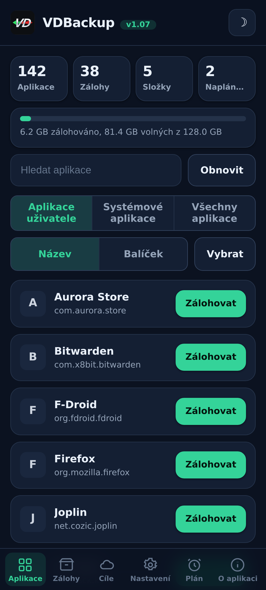
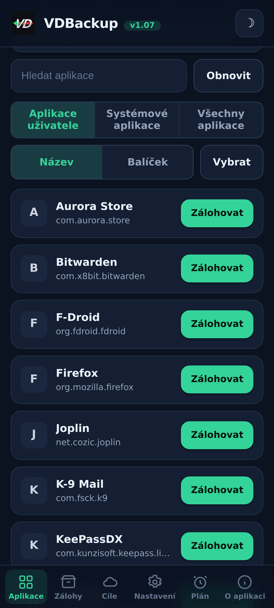
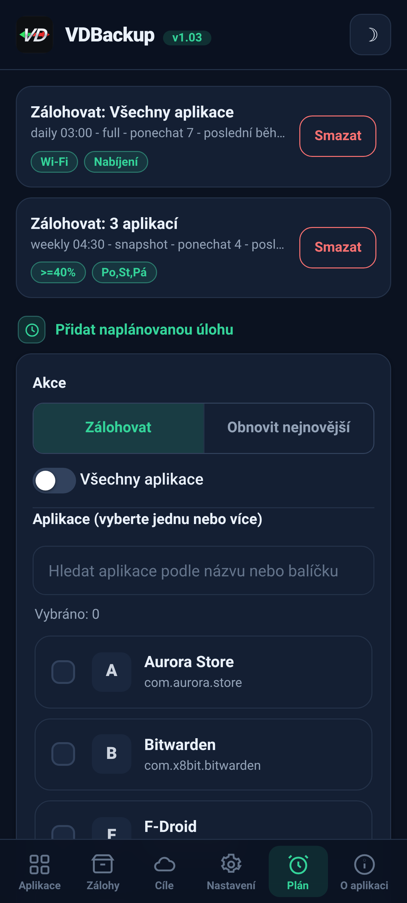
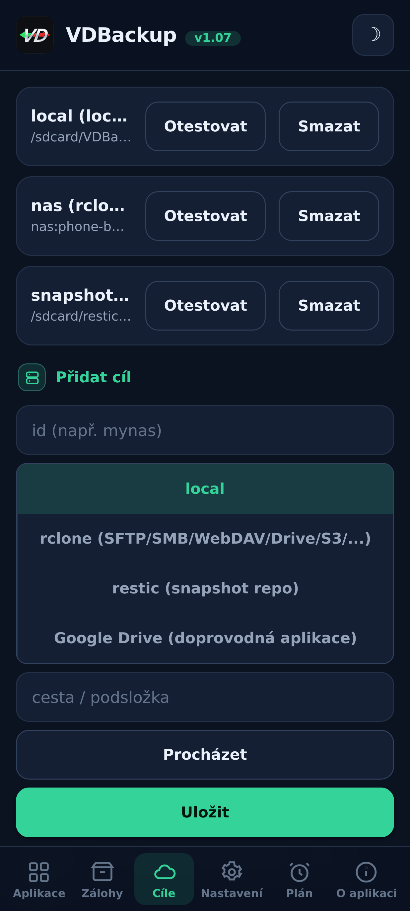
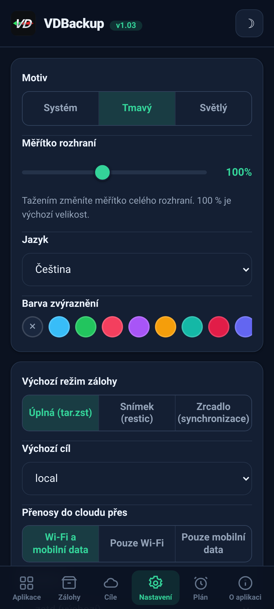
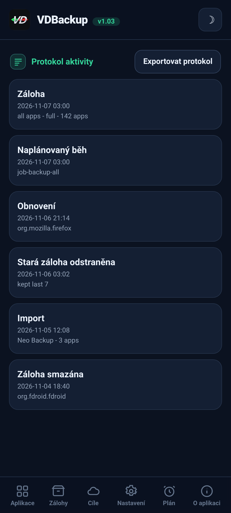

> **Languages:** [English](../USER-GUIDE.md) · [العربية](../ar/USER-GUIDE.md) · Čeština · [Deutsch](../de/USER-GUIDE.md) · [Español](../es/USER-GUIDE.md) · [فارسی](../fa/USER-GUIDE.md) · [Français](../fr/USER-GUIDE.md) · [हिन्दी](../hi/USER-GUIDE.md) · [Bahasa Indonesia](../in/USER-GUIDE.md) · [Italiano](../it/USER-GUIDE.md) · [日本語](../ja/USER-GUIDE.md) · [한국어](../ko/USER-GUIDE.md) · [Nederlands](../nl/USER-GUIDE.md) · [Polski](../pl/USER-GUIDE.md) · [Português](../pt/USER-GUIDE.md) · [Русский](../ru/USER-GUIDE.md) · [Svenska](../sv/USER-GUIDE.md) · [ไทย](../th/USER-GUIDE.md) · [Türkçe](../tr/USER-GUIDE.md) · [Tiếng Việt](../vi/USER-GUIDE.md) · [中文](../zh/USER-GUIDE.md)

---

# Uživatelský průvodce VDBackup

Úplný, přívětivý průchod VDBackup, od instalace modulu přes vytvoření
vaší první zálohy, její obnovu, odeslání do cloudu, naplánování, až po její otevření
na PC o roky později. Pokud jste dříve používali Swift Backup, Neo-Backup nebo
Android-DataBackup, bude vám to povědomé, jen se vše odehrává na jednom
místě, bez čehokoli, co by bylo potřeba "povolit".

## Obsah

- [1. Co je VDBackup](#1-co-je-vdbackup)
- [2. Požadavky](#2-požadavky)
- [3. Instalace a první spuštění](#3-instalace-a-první-spuštění)
- [4. Prohlídka WebUI](#4-prohlídka-webui)
- [5. Vytvoření zálohy](#5-vytvoření-zálohy)
  - [5.1 Výběr toho, co zálohovat](#51-výběr-toho-co-zálohovat)
  - [5.2 Režimy zálohy: Full, Snapshot, Mirror](#52-režimy-zálohy-full-snapshot-mirror)
  - [5.3 Komprese](#53-komprese)
  - [5.4 Šifrování](#54-šifrování)
  - [5.5 Verify a dry-run](#55-verify-a-dry-run)
  - [5.6 Speciální zálohy (zprávy, seznam hovorů, Wi-Fi, Bluetooth, kalendář, tapeta, DNS, systémová nastavení)](#56-speciální-zálohy-zprávy-seznam-hovorů-wi-fi-bluetooth-kalendář-tapeta-dns-systémová-nastavení)
  - [5.7 Samostatné zálohy složek a souborů](#57-samostatné-zálohy-složek-a-souborů)
- [6. Obnova zálohy](#6-obnova-zálohy)
- [7. Cíle: lokální a vzdálené](#7-cíle-lokální-a-vzdálené)
  - [7.1 Záloha vašich nastavení](#71-záloha-vašich-nastavení)
- [8. Plánování a retence](#8-plánování-a-retence)
- [9. Migrace dovnitř: import Neo-Backup a Android-DataBackup](#9-migrace-dovnitř-import-neo-backup-a-android-databackup)
- [10. SSAID (ANDROID_ID zařízení)](#10-ssaid-android_id-zařízení)
- [11. Přenositelnost: otevírání záloh na PC](#11-přenositelnost-otevírání-záloh-na-pc)
- [12. Ovládání VDBackup z AI asistenta](#12-ovládání-vdbackup-z-ai-asistenta)
- [13. Řešení problémů a FAQ](#13-řešení-problémů-a-faq)
- [14. Odinstalace](#14-odinstalace)

---

## 1. Co je VDBackup

VDBackup je root modul s vestavěným WebUI, který zálohuje a obnovuje vaše aplikace
a jejich data. Je navržen jako otevřený, root-native nástupce Swift Backup,
Neo-Backup a Android-DataBackup: jeho cílem je dělat sjednocení toho, co tyto nástroje dělají, na
jednom místě, a dokáže dokonce importovat vaše stávající zálohy Neo-Backup a
Android-DataBackup, takže se můžete přesunout bez ztráty čehokoli.

Klíčový rozdíl oproti běžné zálohovací aplikaci: VDBackup běží **zcela z WebUI vašeho
root manažera**, a modul už je root. Není žádná doprovodná aplikace k
instalaci pro základní funkce, žádná výzva "udělit su" ke schválení, a nic k zapnutí.
Otevřete WebUI, vyberete, co zálohovat, a spustíte to.

Vše, co VDBackup produkuje, používá **standardní formáty** (tar, gzip, zstd, age, zip,
restic), takže vaše zálohy nikdy nejsou uzamčené do modulu a nikdy nejsou vázané na vaše
konkrétní zařízení. Viz [sekce 11](#sekce-11).

## Snímky obrazovky

| Domů | Aplikace | Plán |
|:---:|:---:|:---:|
|  |  |  |
| **Cíle** | **Nastavení** | **Protokol aktivity** |
|  |  |  |

## 2. Požadavky

- **Rootnuté Android zařízení** spravované pomocí **KernelSU**, **APatch** nebo **Magisk**.
  VDBackup se instaluje jako modul z toho manažera.
- Dostatek volného úložiště pro vaše zálohy (lokální zálohy žijí pod stavovým adresářem
  modulu; viz [sekce 3](#sekce-3)).
- Nic dalšího. Modul přibaluje všechny binárky, které potřebuje (tar, zstd, lz4, rclone,
  rsync, ssh, restic), takže **lokální záloha a obnova fungují plně offline**. Pouze cloudové
  cíle komunikují se sítí.

Některé jemnozrnné extra funkce (AppOps, SSAID, pár privilegovaných systémových částí) spoléhají na
Android framework; modul je zpracovává interně, s plain-shell fallbackem,
a degradují elegantně, když nejsou na vašem zařízení dostupné.

## 3. Instalace a první spuštění

1. Stáhněte nejnovější release `VD-Backup-vX.Y.zip`.
2. Ve svém manažeru KernelSU / APatch / Magisk flashněte zip modulu jako jakýkoli jiný
   modul.
3. Je použitelný okamžitě, **není potřeba restart**. (Restart je relevantní pouze
   při obnově SSAID; viz [sekce 10](#sekce-10).)
4. Otevřete **WebUI** modulu z manažera. To je celé rozhraní.

**Kterou edici stáhnout.** Každé vydání je dodáváno jako několik flashovatelných zip edic, takže si stáhnete jen to, co potřebujete. Vyberte jednu:

- **`VD-Backup-<ver>-universal-full.zip`**: každá architektura CPU a každá binárka zabudovaná, včetně `rclone` (cloudoví poskytovatelé: Google Drive, S3 a 70+ dalších rclone backendů) a `restic` (deduplikované snapshoty). Plně offline, nikdy se nic nestahuje. Funguje na jakémkoli zařízení. Největší stahování.
- **`VD-Backup-<ver>-universal-lite.zip`**: každá architektura, ale **bez** dvou největších binárek (`rclone` a `restic`). Nejmenší stahování; stále zvládá lokální zálohy a zálohy přes SSH/SFTP a rsync bez jakéhokoli stahování, s přenositelným šifrováním `age`. Při prvním použití cloudového cíle (`rclone`) nebo režimu snapshotů (`restic`) nabídne WebUI jednorázové stažení onoho malého doplňku pro danou architekturu (ověřeného přes SHA-256) a uloží jej do mezipaměti; poté fungují i tyto funkce.
- **`VD-Backup-<ver>-<abi>-full.zip`** (jedna z `arm64-v8a`, `armeabi-v7a`, `x86`, `x86_64`), jediná architektura s každou binárkou zabudovanou (stejné funkce jako `universal-full`, ale jen pro architekturu vašeho zařízení, takže menší než `universal-full`).

Pokud znáte architekturu svého zařízení a chcete vše zabudované, vyberte odpovídající **`<abi>-full`** (většina telefonů je **`arm64-v8a`**). Pokud chcete nejmenší stahování a nevadí vám jednorázové stažení ověřené přes SHA-256 při prvním použití cloudových poskytovatelů (`rclone`) nebo snapshotů (`restic`), vyberte **`universal-lite`**. Pokud chcete vše zabudované bez jakéhokoli stahování (offline / obnova) a nejste si jisti architekturou, vyberte edici **full**. Při instalaci si modul ponechá pouze architekturu vašeho zařízení bez ohledu na to, kterou edici flashnete.

Při prvním spuštění modul nasadí výchozí konfiguraci (pouze pokud ještě žádná neexistuje), takže
vaše nastavení jsou zachována napříč aktualizacemi modulu.

**Kde žije stav.** Pracovní data VDBackup, vaše konfigurace, naplánované úlohy,
uložené cíle, šifrované přihlašovací údaje, logy a auditní stopa, a staging oblast -
žijí pod:

```
/data/adb/vdbackup/
```

**Kde žijí zálohy.** Samotné zálohy jsou zapisovány do úložiště viditelného uživatelem, šifrovaného
přihlašovacími údaji (takže jsou čitelné až po odemčení zařízení, a
přežijí odinstalaci modulu), jedna složka na Android uživatele:

```
/sdcard/VDBackup/            (= /data/media/<user>/VDBackup)
```

Mějte to na paměti ze dvou důvodů: zálohy zabírají místo pod `/sdcard/VDBackup`, a
`/data/adb/vdbackup/logs/` je místo, kam se díváte, když se něco pokazí.

## 4. Prohlídka WebUI

WebUI je uspořádáno do několika záložek:

- **Home**: úvodní přehled zobrazující počty vašich záloh (aplikace, zálohy, složky a naplánované úlohy) a pruh úložiště, kolik místa vaše zálohy zabírají oproti volnému, se stavovými odznaky, kopírováním hashů a cest do schránky a akcí **Check for updates**.
- **Apps**: seznam nainstalovaných aplikací (uživatelských a systémových), každá zobrazená se svým skutečným
  jménem, názvem balíčku a ikonou (ikony se načítají líně a jsou cachované, takže seznam
  zůstává responzivní). Tlačítko na řádku aplikaci zálohuje; klepnutí na řádek otevře
  historii záloh dané aplikace, kde můžete obnovit libovolnou předchozí zálohu.
- **Backups**: zálohy, které už máte, každá zobrazující jméno aplikace na jednom řádku a
  balíček na dalším. Klepněte na zálohu, abyste viděli její úplné detaily (verze, datum, velikost,
  zahrnuté položky, počty oprávnění, a zařízení, ze kterého pochází). Zde také
  obnovujete, spouštíte restore-test, mažete zálohu, nebo importujete zálohy z Neo-Backup nebo
  Android-DataBackup.
- **Destinations**: spravujte, kam zálohy jdou: lokální úložiště plus jakékoli vzdálené
  cíle, které přidáte (viz [sekce 7](#sekce-7)). Cíl zde můžete
  otestovat, než se na něj spolehnete.
- **Settings**: přepínač světlého/tmavého motivu, selektor barvy zvýraznění (předvolby, vlastní
  barva nebo reset), selektor jazyka (rozhraní se vykresluje zprava doleva pro arabštinu a perštinu), posuvník měřítka rozhraní, kterým táhnutím přeškálujete celé rozhraní
  (záhlaví, obsah a spodní navigace společně) od 85% do 120% (100% je výchozí), pro obrazovky s různou hustotou pixelů,
  výchozí hodnoty pro nové
  úlohy (výchozí komprese, verify zapnuto/vypnuto, výchozí šifrování), síťová politika pro
  cloudové přenosy (viz [sekce 7](#sekce-7)), automatická záloha a seznam vyloučených
  aplikací, volba zdroje instalace, šifrovací
  klíč, a plánování. Nastavení zapnuto/vypnuto používají přepínače ve stylu Androidu.
- **About**: verze, odkazy, příbuzné projekty (See also), auditní manifest přibalených binárních souborů a akce **Check for updates**, která hlásí, zda byla zveřejněna novější verze (s jejími poznámkami k vydání). Jakoukoli aktualizaci nainstalujete přes svého root manažera, stejně jako jste flashovali modul.

Aplikace také sama při každém otevření zkontroluje novější verzi (nejvýše jednou za hodinu) a banner aktualizace zobrazí jen když nějaká je; mlčí, když je aktuální nebo offline.

Potvrzení a zprávy používají dialogy v aplikaci (ne stará systémová vyskakovací okna), a
obnova nebo import vás požádá o potvrzení, že přepíše aktuální data aplikace, než
pokračuje.

Zálohy a obnovy běží **oddělené** jako root proces na pozadí. Můžete zavřít
WebUI, nebo dokonce zavřít root manažera, a operace pokračuje dál. Když se
vrátíte, WebUI se znovu připojí a ukáže živý průběh s lokalizovaným popiskem fáze. U běžící
úlohy karta průběhu také ukazuje živou rychlost přenosu a odhadovaný zbývající čas, plus
počítadlo položek (například "12 of 40") s názvem aktuální položky. Na
ROMech, které vynášejí shellové notifikace, také dostanete Android notifikaci, když úloha
začne a skončí; tak či tak je karta průběhu v aplikaci spolehlivým ukazatelem.

## 5. Vytvoření zálohy

Základní tok: otevřete **Apps**, vyberte aplikaci, zvolte, co zahrnout, vyberte režim,
nastavte kompresi a (volitelně) šifrování, poté spusťte. Průběh se objevuje živě a
notifikace vám řekne, až je hotovo.

V dialogu zálohy můžeš také zvolit **cíl** této zálohy, místní úložiště nebo libovolný přidaný cloudový/vzdálený cíl, bez předchozí změny výchozího cíle v Nastavení.

### 5.1 Výběr toho, co zálohovat

Pro každou aplikaci můžete zahrnout libovolnou kombinaci těchto položek:

| Položka | Co to je |
|------|-----------|
| **APK** | Samotná nainstalovaná aplikace (base APK + jakékoli split APK). |
| **data** | Soukromá data aplikace (`/data/data`). To jsou obvyklá "data aplikace". |
| **device-protected data** | Direct-boot / device-protected úložiště (`/data/user_de`). Některé aplikace zde drží nastavení. |
| **external** | Externí data aplikace pod `Android/data`. |
| **OBB** | OBB expanzní soubory aplikace (`Android/obb`), používané některými hrami. |
| **media** | Média aplikace pod `Android/media`. |

Dobrým výchozím nastavením pro "zálohovat tuto aplikaci kompletně" je zahrnout všechny. Pokud
chcete jen data (například k přesunu uložené hry), můžete odznačit APK a
velké OBB/media položky.

VDBackup také zachovává věci, které činí obnovu věrnou: SELinux kontexty,
uid/gid vlastnictví, režimy souborů, rozšířené atributy (xattr) a capabilities.

### 5.2 Režimy zálohy: Full, Snapshot, Mirror

VDBackup nabízí tři režimy. WebUI předvybírá **Full**, což je správná volba
pro většinu lidí.

- **Full**: úplná, soběstačná, přenosná záloha zapsaná jako `tar.zst` (nebo
  vámi zvolená komprese). Každé spuštění vytvoří samostatnou zálohu, kterou můžete zkopírovat
  kamkoli a otevřít na PC. Nejlepší pro: čistý, přenosný snapshot aplikace, který můžete
  archivovat a přesouvat. Toto je výchozí a nejpřenositelnější volba.
- **Snapshot**: inkrementální a verzovaná, podporovaná `restic`. Každé spuštění přidá nový
  bodový snapshot do repozitáře, ukládá pouze to, co se změnilo, a
  deduplikuje napříč snapshoty. Nejlepší pro: udržování běžící historie aplikace
  bez placení plnou velikostí při každém spuštění.
- **Mirror**: 1:1 synchronizace živých dat do cíle, podporovaná
  `rclone`/`rsync`. Udržuje cíl identický s tím, co je na zařízení právě
  teď (změněné soubory jsou kopírovány, odebrané soubory jsou smazány v cíli). Nejlepší
  pro: rychlou, vždy aktuální kopii, například do cloudového remotu. Všimněte si, že APK
  je stále uloženo komprimované i v mirroru, nikdy surové.

### 5.3 Komprese

Pro Full zálohu můžete vybrat kompresi:

- **none**: žádná komprese (nejrychlejší, největší).
- **lz4**: velmi rychlá, lehká komprese.
- **zstd**: výchozí, silná rovnováha rychlosti a poměru. Můžete také vybrat úroveň
  (například vyšší úroveň pro menší soubor).
- **gzip**: **"režim kompatibility"**. gzip se otevírá vestavěnými nástroji na
  prakticky jakémkoli počítači a ve většině správců souborů, bez čehokoli extra k instalaci.
  Zvolte toto, když vám nejvíce záleží na tom, abyste mohli archiv otevřít kdekoli.

Pokud nevyberete, VDBackup použije svůj nakonfigurovaný výchozí (zstd na rozumné úrovni).

### 5.4 Šifrování

Šifrování je **volitelné** a přenosné. VDBackup šifruje pomocí **age** s použitím
passphrase (scrypt), což bylo zvoleno specificky pro přenositelnost: jakýkoli standardní
`age` nástroj na jakémkoli operačním systému dokáže dešifrovat vaši zálohu jen s passphrase.
Šifrování **nikdy** není vázáno na hardwarové klíče vašeho zařízení, takže šifrovaná záloha
se obnoví na jiném zařízení a otevře se na PC. (K dispozici je také kompatibilní AES-256 zip režim
pro šifrované archivy, které chcete otevřít dvojklikem a heslem.)

Chcete-li použít šifrování, vygenerujte šifrovací klíč jednou (Settings), poté povolte
šifrování pro svou úlohu a nastavte passphrase. Passphrase je to, co chrání
zálohu, takže zvolte silné, není žádný hardwarový klíč a žádná zadní vrátka pro obnovu.

**Pravidlo APK (důležité):**

- **APK je vždy uloženo komprimované**, nikdy surové, kvůli úspoře místa.
- **APK není ve výchozím stavu šifrováno**, protože APK aplikace je veřejný obsah.
- Šifrování APK a šifrování dat jsou **nezávislé přepínače**. Zapnutí šifrování dat
  **nešifruje** APK. Pokud specificky chcete šifrovat i APK,
  povolte přepínač šifrování APK explicitně.

### 5.5 Verify a dry-run

Dvě bezpečnostní volby vám pomáhají důvěřovat záloze, než se na ni spolehnete:

- **Verify**: po zápisu VDBackup znovu zahashuje každý archiv a zkontroluje jej vůči
  manifestu. Toto je **ve výchozím stavu zapnuto pro Full** zálohy. Pokud soubor neodpovídá,
  úloha selže s jasnou chybou místo toho, aby vám zanechala tiše poškozenou
  zálohu.
- **Dry-run**: naplánuje úlohu a nahlásí velikosti, které by vytvořila, **bez zápisu
  čehokoli**. Použijte to k odhadu místa nebo ke kontrole výběru položek před spuštěním
  skutečné věci.

Když záloha směřuje do **cloudového** cíle, VDBackup přidá dvě další pojistky. Provede finální
krok **checksum-verified**, který znovu zkontroluje nahranou kopii proti originálu na remotu a
úlohu nechá selhat (místo aby v cloudu zanechal poškozenou kopii), pokud se neshodují. A před
nahráváním Full zkontroluje **volné místo** remotu a zavčas se zastaví s jasnou chybou **"not
enough space"**, pokud by se záloha nevešla, místo aby remote zaplnil a selhal v půli cesty.
(Kontrola místa je pro nahrávání Full; Mirror je delta synchronizace a je výjimkou.)

### 5.6 Speciální zálohy (zprávy, seznam hovorů, Wi-Fi, Bluetooth, kalendář, tapeta, DNS, systémová nastavení)

Pod seznamy aplikací v záložce **Backups** pokrývají **Speciální zálohy** celosystémová
data, která nejsou vázána na jednu aplikaci. Vyberte kategorie a zálohujte je; jsou
archivovány se stejným zachováním SELinux/xattr a volitelným šifrováním jako zálohy aplikací.
Kategorie jsou:

| Kategorie | Co to je |
|----------|-----------|
| **Zprávy (SMS/MMS)** | Vaše textové zprávy. |
| **Kontakty a seznam hovorů** | Vaše kontakty a historie hovorů. |
| **Sítě Wi-Fi** | Vaše uložené Wi-Fi sítě. |
| **Bluetooth** | Vaše Bluetooth párování. |
| **Kalendář** | Provider kalendáře (aplikace a data). Zapíše se také **přenositelný `calendar.json`**, takže vaše události jsou čitelné na PC bez modulu. |
| **Tapeta** | Vaše tapeta domovské a zamykací obrazovky plus `wallpaper_info.xml`, uložená jako surový obrázek. |
| **DNS** | Váš režim a server privátního DNS. |
| **Systémová nastavení** | Úplný dump system, global a secure nastavení zařízení. |

Pro zprávy, seznam hovorů a kontakty se zapíše také **přenosná kopie** (otevíratelný JSON),
takže máte kopii napříč zařízeními, kterou si přečtete na PC bez modulu.

**Systémová nastavení jsou opt-in a při obnově přepisují nastavení vašeho zařízení.** Stejně jako
SSAID (viz [sekce 10](#sekce-10)) je kategorie **Systémová nastavení** tou nejcitlivější: její obnova
přepíše celosystémová nastavení vašeho zařízení, takže je vypnutá, dokud ji záměrně nevyberete,
nejprve vás požádá o potvrzení a je zapsána do protokolu aktivity.

Obnova speciální zálohy přepíše živá systémová data a vyžaduje restart, proto je chráněna výrazným
potvrzením a je spolehlivá na stejném zařízení a ROM. Obnovy jsou **idempotentní**: surové kategorie
(zprávy, kontakty, Wi-Fi, Bluetooth, kalendář) se obnovují **nahrazením** dat místo jejich slučování,
takže dvojí obnova téže zálohy nikdy nevytvoří duplikáty, a DNS a systémová nastavení se jednoduše
znovu aplikují.

### 5.7 Samostatné zálohy složek a souborů

Někdy chcete zálohovat prostou složku nebo soubor, který není aplikací, složku fotoaparátu,
adresář dokumentů, jednu databázi. VDBackup umí zálohovat **libovolnou absolutní cestu** na sdíleném
úložišti nebo pod `/data`, se stejným přenositelným formátem jako záloha aplikace: archiv `tar.zst`
plus `manifest.json`, zapečetěný SHA-256, s poznámkou RECOVERY, když jej zašifrujete. Tyto zálohy
cest jsou udržovány zvlášť, pod složkou `.paths` ve vašem adresáři záloh.

- **Vyberte cestu a zazálohujte ji.** Zdroj musí být absolutní cesta pod jedním z povolených
  umístění (`/storage/emulated`, `/data/media`, `/sdcard`, `/data`). Cesty, které se pokoušejí
  uniknout pomocí `..`, jsou odmítnuty.
- **Obnova zapisuje zpět na původní umístění**, takže je, jako každá obnova, destruktivní a před
  přepsáním čehokoli vás požádá o **potvrzení**.
- Jako zálohy aplikací běží zálohy a obnovy cest **oddělené** s živým průběhem, používají vámi
  zvolenou kompresi a lze je zašifrovat passphrase.

## 6. Obnova zálohy

Otevřete záložku **Backups**, vyberte zálohu, kterou chcete, a spusťte obnovu. Protože
obnova je destruktivní akce, VDBackup vás nejprve požádá o **potvrzení**, a
zaznamená akci do lokálního auditního logu.

Obnova je **věrná**: VDBackup vymaže aktuální stav aplikace a rozbalí
zálohu, takže je aplikace vrácena do **přesného stavu** zachyceného v té záloze
(včetně vlastnictví, režimů, SELinux kontextů a xattr). Není to sloučení, je to
pravá obnova do bodu v čase zálohy. Protože obnova běží jako root, VDBackup také zkontroluje
každý archiv, než cokoli rozbalí, a odmítne manipulovaný, který se pokouší zapisovat mimo svůj
cíl, takže upravená záloha nikdy nemůže přepsat zbytek vašeho systému.

Užitečné volby obnovy:

- **Restore-test**: rozbalí zálohu do dočasné staging oblasti a ověří ji
  **bez dotknutí se živé aplikace**. Toto je bezpečný způsob, jak potvrdit, že záloha je
  neporušená a obnovitelná, než cokoli přepíšete. Pokud test selže, dostanete
  jasnou chybu a vaše nainstalovaná aplikace zůstane nedotčená.
- **Částečná obnova**: obnovte jen některé z položek, které byly zálohovány. Například
  obnovte jen data aplikace bez přeinstalování APK, nebo obnovte uložené
  soubory bez velkých OBB/media. Vyberte položky, které chcete, na obrazovce obnovy.
- Pro zálohy **Snapshot** a **Mirror** obnova čte z verzovaného
  repozitáře, respektive z mirrorované kopie.
- **Zdroj instalace**: ve výchozím nastavení obnovená aplikace hlásí jako svůj zdroj
  instalace **Play Store** (místo toho, aby vypadala jako sideloaded), což je to, co většina
  aplikací a kontrol aplikací očekává. Můžete to vypnout globálně v Settings nebo pro
  jednotlivou obnovu, a když je vypnuto, zachová se původní zdroj instalace. Pokročilý
  volitelný přepínač **"zfalšovat iniciující zdroj"** jde dál a také učiní iniciující balíček
  a zdroj balíčku aplikace vypadajícími jako instalované z Play; upravuje systémovou databázi
  balíčků (nejprve zálohovanou) a projeví se po restartu.

**Dávková obnova.** Karta **Backups** má režim **Select**, stejně jako jej karta Apps má
pro dávkové zálohování. Zapněte **Select**, zaškrtněte zálohy, které chcete, pomocí jejich
zaškrtávacích políček a obnovte je všechny najednou. Jeden dialog voleb pokrývá celý výběr -
potvrzení přepsání, restore-test i volba zdroje instalace platí pro každou zálohu, kterou
jste vybrali, a obnovují se jedna po druhé.

**Mazání zálohy.** Otevřete podrobnosti zálohy (nebo historii aplikace) a použijte
**Delete**; budete požádáni o potvrzení a smazání se zapíše do protokolu aktivity. Můžete
také omezit, kolik záloh na aplikaci zachovat (retence), aby se staré automaticky prořezávaly.

**Připojení nainstalované aplikace jako systémové.** Z historie záloh aplikace **Mount as
system** připraví APK aplikace do overlay podmodulu VDBackup, aby jej správce root podával
z `/system/app` (nebo `/system/priv-app`), skutečného oddílu `/system` se to nikdy nedotkne.
S **NoMount** na KernelSU se to projeví živě; jinak se to projeví po restartu. Toto nikdy
nezávisí na tom, zda je NoMount nainstalován.

## 7. Cíle: lokální a vzdálené

Ve výchozím stavu jsou zálohy zapisovány do **lokálního** úložiště pod stavovým adresářem
modulu. Vzdálené cíle můžete také přidat v záložce **Destinations**. U lokálního cíle **Browse**
otevře výběr složky, takže můžete vybrat podsložku ve sdíleném úložišti (`/sdcard`) místo psaní cesty.

Vzdálený transport zpracovávají přibalené nástroje:

- **rclone**: hub pro obrovskou škálu remotů: **SFTP, SMB, WebDAV, FTP, S3,
  Google Drive** a 70+ dalších služeb.
- **rsync** a sada **ssh/scp/sftp**: pro delta sync a prosté SSH cíle.
- **restic**: šifrované, deduplikované **Snapshot** repozitáře (lokální nebo vzdálené).

**Vytvoření cloudového remotu (není potřeba SSH).** V záložce Destinations vyberte
typ cíle **rclone** a použijte **Add cloud remote**. Můžete připojit **libovolný rclone
backend**: rozbalovací nabídka nabízí ty oblíbené (**Google Drive, Dropbox, OneDrive,
Box, pCloud, Mega, Backblaze B2, S3, SFTP, WebDAV, FTP, SMB**) plus možnost
**Custom (advanced)**, kde zadáte jakýkoli jiný typ backendu a jeho parametry `key=value`.
Vyplňte pole (host/user/password, nebo například S3 klíče) a uložte. U poskytovatelů,
kteří vás přihlašují přes prohlížeč (Google Drive, Dropbox, OneDrive, Box, pCloud),
použijte tlačítko **Authorize in browser**: přihlásí vás přes prohlížeč samotného telefonu
a zachytí token automaticky, takže není potřeba žádné PC (ruční vložení tokenu stále
funguje jako záloha). Remote se pak objeví v seznamu remotů cíle. Hesla jsou uložena
zatemněná, nikdy v čistém textu. Své remoty můžete vypsat a smazat ze stejného místa.

Dvě pravidla udržují vzdálené použití bezpečné:

- **Přihlašovací údaje jsou uloženy šifrované** v klidu ve stavovém adresáři modulu, nikdy
  v čistém textu.
- **Validujte před použitím.** Použijte test cíle v záložce Destinations k
  potvrzení, že cíl funguje, než na něj namíříte skutečnou zálohu.

**Síťová politika (Wi-Fi vs mobilní data).** V Settings vám "Cloud transfers over" umožňuje
omezit, které připojení smějí cloudové přenosy použít: **Wi-Fi a mobilní data** (
výchozí), **pouze Wi-Fi**, nebo **pouze mobilní data**. Když to omezíte, každý cloudový
přenos, manuální nebo naplánovaný, upload nebo obnova, nejprve zkontroluje aktivní připojení
a odmítne běžet na nesprávném, takže politika pouze-Wi-Fi nikdy neutratí mobilní data.
Lokální zálohy nejsou nikdy ovlivněny.

**Google Drive.** Máte dva způsoby, jak se dostat ke Google Drive:

1. **Přes rclone**: přidejte Drive jako rclone remote jako jakýkoli jiný cíl, bez
   extra aplikace a **bez účtu Google Cloud**. Na jakémkoli počítači spusťte
   `rclone authorize "drive"` jednou, přihlaste se ke svému účtu Google v prohlížeči, a
   vložte token, který vytiskne, do pole tokenu Drive remotu.
2. **Přes volitelný companion**: malá, opt-in doprovodná aplikace, která zpracovává
   Google přihlášení a Drive upload. Instaluje se **pouze když explicitně zvolíte
   cíl Google Drive companion**, nikdy ve výchozím stavu, a odebere se, když
   ji zakážete. Jednorázová obrazovka Google souhlasu je jediný krok, který se děje
   mimo WebUI. Když je companion nainstalován, VDBackup vám připomíná, abyste jej
   **vždy skryli pomocí [HMA-OSS](https://github.com/frknkrc44/HMA-OSS)**, aby jeho přítomnost neprozradila root nebo
   odemčený bootloader, a nabídne přidat jej do seznamu HMA-OSS za vás. VDBackup vám také, když máte místní zálohy, připomene skrýt složku se zálohami (/sdcard/VDBackup) pomocí SUSFS ze stejného důvodu.

### 7.1 Záloha vašich nastavení

Samotné nastavení VDBackup, tedy cíle, plány, předvolby a uložené přihlašovací údaje, lze zapsat do jednoho souboru a přenést na jiné zařízení nebo obnovit po čisté instalaci. V **Nastavení**, v části **Záloha nastavení**:

- **Exportovat nastavení** zapíše šifrovaný soubor do `VDBackup/.export`. Vždy vyžaduje heslovou frázi, protože soubor obsahuje vaše vzdálená hesla.
- **Importovat nastavení** takový soubor načte zpět a sloučí jej s tímto zařízením, aniž by odstranil cokoli, co už tam je.
- **Vymazat uložené přihlašovací údaje** odstraní uložená vzdálená hesla a šifrovací klíč zařízení v jednom kroku; vaše cíle, plány a zálohy zůstanou na místě.

## 8. Plánování a retence

VDBackup může spouštět zálohy, i obnovy, automaticky podle rozvrhu. V plánovači
definujete úlohu s:

- **cílem úlohy**: jednou aplikací, sadou aplikací nebo **všemi aplikacemi** (bez seznamu
  vyloučených aplikací), a položkami/režimem k použití,
- **akcí**: **Back up** (výchozí) nebo **Restore latest**, která obnoví nejnovější zálohu
  každé cílové aplikace,
- cílem,
- **cron-like rozvrhem**: hodinově, denně nebo týdně, v čase, který zvolíte (HH:MM),
- nastavením **retence**: **ponechat N** nejnovějších záloh pro tu úlohu, starší jsou
  automaticky prořezávány,
- volitelnými **podmínkami spuštění**: jen na **Wi-Fi**, jen během **nabíjení**, jen při
  **minimální úrovni baterie** a jen ve zvolené **dny v týdnu**.

Naplánované úlohy jsou spouštěny bootovacím heartbeatem v modulu: když je úloha
splatná, spustí se, zaznamená čas posledního spuštění, aby se nevyvolala dvakrát, a aplikuje
retenci k prořezání starých záloh. Protože vše běží jako root na pozadí,
naplánované zálohy nepotřebují, aby bylo WebUI otevřené.

**Podmínky spuštění (brány).** Naplánovaná úloha může nést podmínky, které musí být splněny,
aby se spustila: jen Wi-Fi, jen nabíjení, minimální úroveň baterie a konkrétní dny v týdnu.
Když je úloha splatná, ale podmínka není splněna, úloha se **přeskočí a zkusí znovu při další
kontrole**: její rozvrh se neposune, takže se spustí, jakmile je podmínka splněna. Vestavěná
kontrola tepelné bezpečnosti také přeskočí naplánovanou úlohu, dokud je zařízení příliš horké.
Každé takové přeskočení se zaznamená do protokolu aktivity.

**Naplánovaná obnova přepisuje při každém běhu.** Úloha **Restore latest** při každém
spuštění znovu obnoví nejnovější zálohu každé cílové aplikace a obnova je destruktivní: při
každém běhu **přepíše aktuální data aplikace** nejnovější zálohou. Je to záměrné a volitelné -
zvolte ji jen tehdy, když chcete cíle držet na jejich nejnovější záloze.

**Automatická záloha při instalaci/aktualizaci.** V Settings můžete zapnout **automatickou
zálohu**: stejný heartbeat na pozadí si všimne aplikací, které byly nově nainstalovány nebo
aktualizovány, a zálohuje je za vás (s retencí keep-N). První běh pouze zaznamená, co je
nainstalováno, takže její zapnutí nikdy nezálohuje celé zařízení najednou.

**Vyloučené aplikace (blocklist).** Rovněž v Settings můžete vyloučit aplikace, které nikdy
nechcete zálohovat automaticky nebo podle rozvrhu; můžete jich přidat několik najednou (vícenásobný výběr) a vyloučené aplikace jsou oběma přeskočeny.

**Předvolby zálohy.** Také v Nastavení si můžete uložit pojmenované předvolby, sady položek k zahrnutí, třeba jen APK nebo APK + OBB, a jednu vybrat v dialogu zálohy, aby se výběr položek vyplnil najednou.

**Položky zálohy pro aplikace.** Také v Nastavení můžete zvolit přesně, které položky každá aplikace zálohuje v hromadných, automatických a naplánovaných zálohách, například jen APK, nebo APK + OBB. Jednotlivá ruční záloha vám stále umožní výběr, počínaje sadou aplikace. Aplikace, které zde nenastavíte, zálohují vše.

**Štítky aplikací.** Klepnutím na aplikaci v Nastavení (Položky a štítky podle aplikace) jí přidělíte volné popisky, například games nebo work. Nad seznamem aplikací se pak objeví výběr štítků: zvolte štítek pro zobrazení jen jeho aplikací a zálohujte celou skupinu najednou. Dostanete se k tomu i z karty Aplikace: klepněte na aplikaci a pak na Položky a štítky.

**Protokol aktivity.** Záložka Schedule má tlačítko **View activity log**, které otevře celou
obrazovku (okamžitě) zobrazující lokální auditní stopu, zálohy, obnovy, mazání, naplánované
a automatické běhy a prořezávání, od nejnovějších. Akce **Export logs** uloží soubor
protokolu (ve složce záloh), který můžete přiložit ke zpětné vazbě nebo hlášení chyby.

## 9. Migrace dovnitř: import Neo-Backup a Android-DataBackup

Pokud přicházíte z Neo-Backup nebo Android-DataBackup, nemusíte začínat
znovu. Ze záložky **Backups** můžete **importovat** své stávající zálohy:

1. Nasměrujte VDBackup na umístění vašich stávajících záloh Neo-Backup nebo Android-DataBackup
   (import-scan vypíše, co tam najde).
2. Zvolte, které zálohy importovat.
3. Spusťte import. Jako jiné dlouhé operace běží oddělený s živým průběhem.

**Heslem šifrované zálohy Neo-Backup jsou podporovány.** AES-256 šifrované zálohy
Neo-Backup lze importovat, jste **vyzváni k zadání hesla**, když je
potřeba, a heslo je použito pouze k dešifrování, nikdy uloženo v příkazové řádce.

## 10. SSAID (ANDROID_ID zařízení)

SSAID je per-aplikační `ANDROID_ID`, identifikátor na úrovni zařízení, který některé aplikace čtou.
VDBackup jej dokáže zálohovat a obnovit, ale toto je ta nejcitlivější věc, které se
dotýká, takže je zpracována s extra péčí:

- **Je VOLITELNÉ a ve výchozím stavu VYPNUTÉ.** VDBackup **nikdy** nezachytí ani neobnoví
  SSAID, pokud to pro danou úlohu explicitně nezapnete. WebUI zobrazuje jasně
  označené, zvýrazněné oznámení "Optional" všude, kde se SSAID objevuje (backup, restore a
  import), a zůstává vypnuté, dokud se nepřihlásíte.
- **Při obnově se uplatní až po restartu.** Android settings provider cachuje
  tyto hodnoty, takže obnovené SSAID nabude účinnosti až po restartu zařízení.
- **Předchozí hodnota je vždy nejprve zálohována.** Před přepsáním jakéhokoli SSAID
  VDBackup zkopíruje živý `settings_ssaid.xml` byte-za-bytem do zálohy s časovým razítkem
  (která není nikdy automaticky smazána). Pokud tuto bezpečnostní kopii nelze vytvořit, přepsání
  se neuskuteční. K rollbacku obnovte ten uložený soubor a restartujte.

**Doporučení:** nechte SSAID vypnuté, pokud specificky nevíte, že ho potřebujete (
například konkrétní aplikaci, která se klíčuje k ID zařízení a kterou migrujete
záměrně). Pro běžné zálohy aplikací a dat ho nepotřebujete.

## 11. Přenositelnost: otevírání záloh na PC

Vaše zálohy **nejsou uzamčené do tohoto modulu** a **nikdy nejsou vázané na hardware**.
Vše používá standardní formáty, takže zálohu můžete otevřít na Windows, macOS nebo Linux
bez nainstalovaného VDBackup.

Složka Full zálohy obsahuje `manifest.json` (zdroj pravdy popisující každý
soubor, verzi aplikace a původního vlastníka/kontext), APK jako `*.apk.zst`, a
datové archivy jako `<item>.tar.zst` (nebo `.tar.gz` / `.tar.lz4`), volitelně s
koncovým `.age`, když jsou šifrované.

Jak otevřít jednu na PC, ve zkratce:

- **Dešifrujte** (pouze pokud soubor končí na `.age`) standardním `age` nástrojem a svou
  passphrase nebo keyfile.
- **Dekomprimujte a rozbalte**: `.tar.zst` pomocí `zstd` poté `tar`; `.tar.gz` pomocí `tar`
  přímo; `.tar.lz4` přes `zstd --format=lz4`. APK je jen zstd-komprimované APK,
  takže dekomprese `base.apk.zst` vám dá normální instalovatelné `base.apk`.

Každá šifrovaná záloha se dodává s poznámkou **RECOVERY** obsahující přesné
copy-paste příkazy pro Windows, macOS a Linux. Viz
[`../module/etc/RECOVERY.md`](RECOVERY.md) pro úplnou sadu krok za krokem.

Všimněte si, že SELinux kontexty, uid/gid a režimy jsou uloženy uvnitř taru a jsou
správně znovu aplikovány, pouze když obnovujete na Androidu, na PC stále dostanete všechny své soubory,
jen bez vynucování Android-specifického vlastnictví.

## 12. Ovládání VDBackup z AI asistenta

VDBackup je postaven tak, aby byl přívětivý k AI asistentům a agentům, nejen k lidem. WebUI
je jen jedním klientem malého JSON API; agent dokáže spravovat **každou** akci
modulu bezhlavě přes to samé API (každý příkaz vrací jeden JSON
objekt, dlouhé operace běží oddělené a vy se dotazujete na jejich průběh, a platí stejné bezpečnostní
zábrany, SSAID zůstává opt-in, mutující akce zůstávají potvrzené a auditované).

Pokud chcete, aby asistent spouštěl vaše zálohy a obnovy za vás, nasměrujte jej na
[`AI-AGENTS.md`](AI-AGENTS.md), který dokumentuje úplnou řídicí plochu: command
kontrakt, každý verb s jeho argumenty a návratovou hodnotou, a bezpečnostní pravidla, která
agent musí respektovat.

## 13. Řešení problémů a FAQ

**Kde jsou logy?** Pod stavovým adresářem modulu,
`/data/adb/vdbackup/logs/`. Živý průběh běžící operace je v
`progress-<opid>.json`, a **auditní stopa** mutujících akcí (restore, delete,
import, změny SSAID) je v `audit.jsonl`.

**Záloha/obnova se zdá zaseknutá nebo jsem zavřel WebUI.** Operace běží oddělené, takže
zavření WebUI je nezastaví. Znovu otevřete WebUI a znovu se připojí k jakékoli
běžící operaci a ukáže aktuální průběh.

**Dostal jsem zprávu `ERR_...`.** Chyby jsou hlášeny s jasným kódem. Pár běžných:
- `ERR_VERIFY`, zapsaný archiv neodpovídal svému hashi v manifestu (verifikace
  zachytila špatnou zálohu). Spusťte zálohu znovu.
- `ERR_RESTORE_TEST`, restore-test selhal; záloha se nerozbalila/neověřila
  čistě a vaše živá aplikace zůstala nedotčená.
- `ERR_UNSAFE_ARCHIVE`, archiv byl odmítnut, protože se pokusil zapisovat mimo svůj cílový
  adresář (absolutní cesty nebo `..`). To vás chrání před manipulovanou zálohou; nic nebylo
  zapsáno.
- `ERR_QUOTA`, cloudový remote neměl dost volného místa pro nahrávání Full; záloha byla
  zastavena dřív, než se cokoli nahrálo.

**Můj vzdálený cíl selhává.** Použijte **test** cíle v záložce Destinations
k validaci přihlašovacích údajů a konektivity. Pamatujte, že pouze cloudové cíle potřebují
síť; lokální záloha/obnova je plně offline.

**Volá něco z tohoto domů nebo stahuje za běhu?** Ne. Všechny binárky jsou přibaleny
v modulu v době buildu; nic se nenačítá na zařízení za běhu. Pouze cloudové
cíle (rclone/restic/ssh) komunikují se sítí, a pouze když je použijete.

**Obnoví se moje záloha na jiném telefonu?** Ano, zálohy jsou přenosné a nejsou
vázané na hardware zařízení. (SSAID je jediná výjimka specifická pro zařízení, a je opt-in
a uplatní se po restartu; viz [sekce 10](#sekce-10).)

**Moje šifrovaná záloha se neotevře, ztratil jsem passphrase.** Není žádná zadní vrátka
pro obnovu, záměrně; passphrase je to, co chrání zálohu. Uchovejte ji v bezpečí.

## 14. Odinstalace

Odinstalujte VDBackup jako kterýkoli jiný modul ze správce KernelSU / APatch / Magisk. Odinstalace **zachová vaše nastavení** a odstraní jen přechodný stav, takže pozdější přeinstalace převezme vaši konfiguraci, cíle a plány. Ponechá vaše zálohy v `/sdcard/VDBackup` (standardní formáty, otevíratelné na PC bez modulu), vaši konfiguraci v `/data/adb/vdbackup` a vaše uložené přihlašovací údaje, rclone.conf a klíč age v úložišti šifrovaném přihlašovacími údaji `/data/misc_ce/0/vdbackup` (zamčeno až do prvního odemknutí). Chcete-li některý z nich také odstranit, smažte po odinstalaci příslušný adresář ručně.

---

*Tato dokumentace byla vygenerována pomocí Claude (Anthropic) a je spravována VD171. Opravy a vylepšení jsou vítány, viz [CONTRIBUTING.md](CONTRIBUTING.md).*
