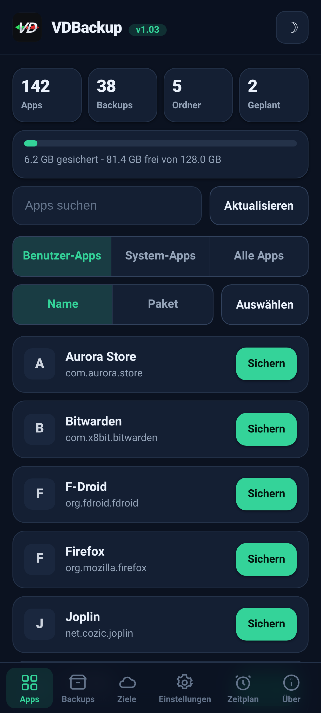
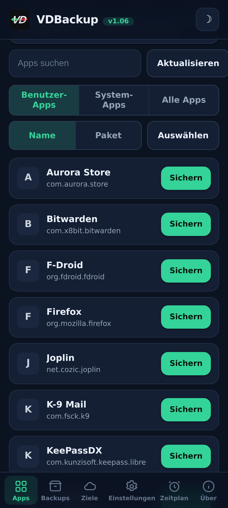
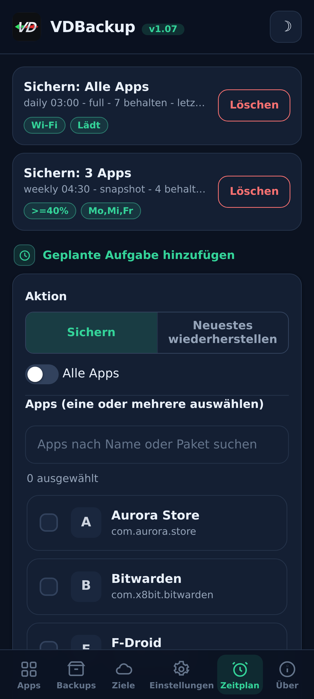
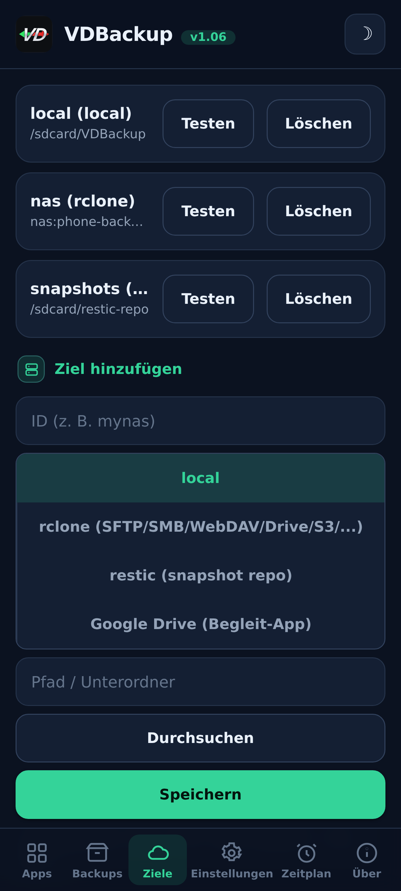
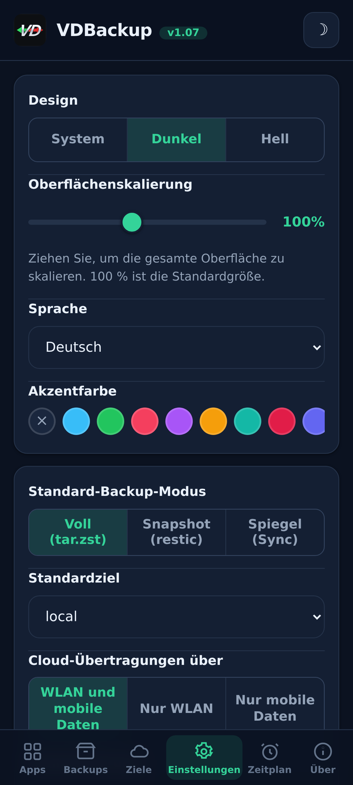
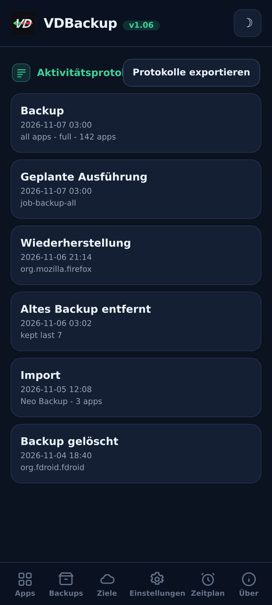

> **Languages:** [English](../USER-GUIDE.md) · [العربية](../ar/USER-GUIDE.md) · [Čeština](../cs/USER-GUIDE.md) · Deutsch · [Español](../es/USER-GUIDE.md) · [فارسی](../fa/USER-GUIDE.md) · [Français](../fr/USER-GUIDE.md) · [हिन्दी](../hi/USER-GUIDE.md) · [Bahasa Indonesia](../in/USER-GUIDE.md) · [Italiano](../it/USER-GUIDE.md) · [日本語](../ja/USER-GUIDE.md) · [한국어](../ko/USER-GUIDE.md) · [Nederlands](../nl/USER-GUIDE.md) · [Polski](../pl/USER-GUIDE.md) · [Português](../pt/USER-GUIDE.md) · [Русский](../ru/USER-GUIDE.md) · [Svenska](../sv/USER-GUIDE.md) · [ไทย](../th/USER-GUIDE.md) · [Türkçe](../tr/USER-GUIDE.md) · [Tiếng Việt](../vi/USER-GUIDE.md) · [中文](../zh/USER-GUIDE.md)

---

# VDBackup-Benutzerhandbuch

Eine vollständige, freundliche Durchführung durch VDBackup, von der Installation des Moduls
über dein erstes Backup, dessen Wiederherstellung, das Senden in die Cloud, das Planen bis
hin zum Öffnen auf einem PC Jahre später. Wenn du zuvor Swift Backup, Neo-Backup oder
Android-DataBackup genutzt hast, wird sich das vertraut anfühlen - nur dass alles an einem
Ort geschieht, ohne dass etwas "erlaubt" werden muss.

## Inhaltsverzeichnis

- [1. Was VDBackup ist](#1-was-vdbackup-ist)
- [2. Voraussetzungen](#2-voraussetzungen)
- [3. Installation und erster Start](#3-installation-und-erster-start)
- [4. Die WebUI-Tour](#4-die-webui-tour)
- [5. Ein Backup erstellen](#5-ein-backup-erstellen)
  - [5.1 Auswählen, was gesichert werden soll](#51-auswählen-was-gesichert-werden-soll)
  - [5.2 Backup-Modi: Full, Snapshot, Mirror](#52-backup-modi-full-snapshot-mirror)
  - [5.3 Komprimierung](#53-komprimierung)
  - [5.4 Verschlüsselung](#54-verschlüsselung)
  - [5.5 Verify und Dry-run](#55-verify-und-dry-run)
  - [5.6 Spezial-Backups (Nachrichten, Anrufliste, WLAN, Bluetooth, Kalender, Hintergrund, DNS, Systemeinstellungen)](#56-spezial-backups-nachrichten-anrufliste-wlan-bluetooth-kalender-hintergrund-dns-systemeinstellungen)
  - [5.7 Eigenständige Backups von Ordnern und Dateien](#57-eigenständige-backups-von-ordnern-und-dateien)
- [6. Ein Backup wiederherstellen](#6-ein-backup-wiederherstellen)
- [7. Ziele: lokal und remote](#7-ziele-lokal-und-remote)
- [8. Planung und Aufbewahrung](#8-planung-und-aufbewahrung)
- [9. Hereinmigrieren: Neo-Backup und Android-DataBackup importieren](#9-hereinmigrieren-neo-backup-und-android-databackup-importieren)
- [10. SSAID (Geräte-ANDROID_ID)](#10-ssaid-geräte-android_id)
- [11. Portabilität: Backups auf einem PC öffnen](#11-portabilität-backups-auf-einem-pc-öffnen)
- [12. VDBackup von einem KI-Assistenten aus steuern](#12-vdbackup-von-einem-ki-assistenten-aus-steuern)
- [13. Fehlerbehebung und FAQ](#13-fehlerbehebung-und-faq)
- [14. Deinstallation](#14-deinstallation)

---

## 1. Was VDBackup ist

VDBackup ist ein root-Modul mit einer integrierten WebUI, das deine Apps und ihre Daten
sichert und wiederherstellt. Es ist als der offene, root-native Nachfolger von Swift Backup,
Neo-Backup und Android-DataBackup konzipiert: Es zielt darauf ab, die Vereinigung dessen zu
leisten, was diese Werkzeuge tun, an einem einzigen Ort, und es kann sogar deine bestehenden
Neo-Backup- und Android-DataBackup-Backups importieren, sodass du umziehen kannst, ohne etwas
zu verlieren.

Der entscheidende Unterschied zu einer gewöhnlichen Backup-App: VDBackup läuft **vollständig
aus der WebUI deines root-Managers**, und das Modul ist bereits root. Es gibt keine Begleit-App
zu installieren für die Kernfunktionen, keine "su gewähren"-Aufforderung zu bestätigen und
nichts einzuschalten. Du öffnest die WebUI, wählst aus, was gesichert werden soll, und führst
es aus.

Alles, was VDBackup erzeugt, verwendet **Standardformate** (tar, gzip, zstd, age, zip,
restic), sodass deine Backups nie an das Modul gebunden und nie an dein spezielles Gerät
gekoppelt sind. Siehe [Abschnitt 11](#abschnitt-11).

## Screenshots

| Start | Apps | Zeitplan |
|:---:|:---:|:---:|
|  |  |  |
| **Ziele** | **Einstellungen** | **Aktivitätsprotokoll** |
|  |  |  |

## 2. Voraussetzungen

- **Ein gerootetes Android-Gerät**, verwaltet von **KernelSU**, **APatch** oder **Magisk**.
  VDBackup wird als Modul aus diesem Manager installiert.
- Genügend freier Speicher für deine Backups (lokale Backups liegen unter dem
  Zustandsverzeichnis des Moduls; siehe [Abschnitt 3](#abschnitt-3)).
- Sonst nichts. Das Modul bündelt alle benötigten Binärdateien (tar, zstd, lz4, rclone,
  rsync, ssh, restic), sodass **lokales Backup und Restore vollständig offline funktionieren**.
  Nur Cloud-Ziele sprechen mit dem Netzwerk.

Einige feingranulare Extras (AppOps, SSAID, ein paar privilegierte Systembits) stützen sich auf
das Android-Framework; das Modul handhabt diese intern, mit einem reinen Shell-Fallback, und
sie degradieren elegant, wenn sie auf deinem Gerät nicht verfügbar sind.

## 3. Installation und erster Start

1. Lade das neueste `VD-Backup-vX.Y.zip`-Release herunter.
2. Flashe in deinem KernelSU-/APatch-/Magisk-Manager die Modul-Zip wie jedes andere Modul.
3. Es ist sofort nutzbar - **kein Neustart nötig**. (Ein Neustart ist nur beim Wiederherstellen
   von SSAID jemals relevant; siehe [Abschnitt 10](#abschnitt-10).)
4. Öffne die **WebUI** des Moduls aus dem Manager. Das ist die gesamte Oberfläche.

**Welche Edition herunterladen.** Jedes Release wird als mehrere flashbare Zip-Editionen ausgeliefert, sodass du nur herunterlädst, was du brauchst. Wähle eine:

- **`VD-Backup-<ver>-universal-full.zip`** - jede CPU-Architektur und jede Binärdatei eingebettet, einschließlich `rclone` (Cloud-Anbieter: Google Drive, S3 und 70+ weitere rclone-Backends) und `restic` (deduplizierte Snapshots). Vollständig offline, nie wird etwas heruntergeladen. Funktioniert auf jedem Gerät. Größter Download.
- **`VD-Backup-<ver>-universal-lite.zip`** - jede Architektur, aber **ohne** die zwei größten Binärdateien (`rclone` und `restic`). Kleinster Download; erledigt weiterhin lokale, SSH/SFTP- und rsync-Backups ohne jeden Download, mit portabler `age`-Verschlüsselung. Beim ersten Mal, wenn du ein Cloud-Ziel (`rclone`) oder den Snapshot-Modus (`restic`) nutzt, bietet die WebUI an, dieses kleine, architekturspezifische Add-on einmalig herunterzuladen (per SHA-256 verifiziert) und zwischenzuspeichern; danach laufen auch diese Funktionen.
- **`VD-Backup-<ver>-<abi>-full.zip`** (eine von `arm64-v8a`, `armeabi-v7a`, `x86`, `x86_64`) - eine einzige Architektur mit jeder Binärdatei eingebettet (dieselben Funktionen wie `universal-full`, aber nur für die Architektur deines Geräts, also kleiner als `universal-full`).

Wenn du die Architektur deines Geräts kennst und alles eingebettet willst, wähle die passende **`<abi>-full`** (die meisten Telefone sind **`arm64-v8a`**). Wenn du den kleinsten Download willst und nichts gegen einen einmaligen, per SHA-256 verifizierten Download beim ersten Nutzen von Cloud-Anbietern (`rclone`) oder Snapshots (`restic`) hast, wähle **`universal-lite`**. Wenn du alles eingebettet ohne jeden Download (offline / Wiederherstellung) willst und dir bei der Architektur nicht sicher bist, wähle eine **full**-Edition. Bei der Installation behält das Modul unabhängig von der geflashten Edition nur die Architektur deines Geräts.

Beim ersten Start legt das Modul eine Standardkonfiguration an (nur falls noch keine existiert),
sodass deine Einstellungen über Modul-Updates hinweg erhalten bleiben.

**Wo der Zustand lebt.** VDBackups Arbeitsdaten - deine Konfiguration, geplante Aufträge,
gespeicherte Ziele, verschlüsselte Zugangsdaten, Protokolle und Audit-Trail sowie der
Staging-Bereich - liegen unter:

```
/data/adb/vdbackup/
```

**Wo Backups leben.** Die Backups selbst werden in benutzersichtbaren, zugangsdaten-verschlüsselten
Speicher geschrieben (sodass sie erst lesbar sind, nachdem du das Gerät entsperrt hast, und
sie das Deinstallieren des Moduls überleben), ein Ordner pro Android-Benutzer:

```
/sdcard/VDBackup/            (= /data/media/<user>/VDBackup)
```

Behalte das aus zwei Gründen im Kopf: Backups belegen Platz unter `/sdcard/VDBackup`, und
`/data/adb/vdbackup/logs/` ist der Ort, an dem du nachschaust, wenn etwas schiefgeht.

## 4. Die WebUI-Tour

Die WebUI ist in einige wenige Tabs gegliedert:

- **Home** - eine Startübersicht, die Zählungen deiner Backups (Apps, Backups, Ordner und geplante Aufträge) und einen Speicherbalken dafür zeigt, wie viel Platz deine Backups gegenüber dem freien Platz belegen, mit Status-Badges, Kopieren von Hashes und Pfaden in die Zwischenablage und einer Aktion **Check for updates**.
- **Apps** - die Liste der installierten Apps (Benutzer und System), jede mit ihrem echten
  Namen, ihrem Paketnamen und ihrem Symbol angezeigt (Symbole laden verzögert und werden
  zwischengespeichert, sodass die Liste reaktionsschnell bleibt). Die Schaltfläche in einer
  Zeile sichert die App; ein Tippen auf die Zeile öffnet den Backup-Verlauf dieser App, wo du
  jedes frühere Backup wiederherstellen kannst.
- **Backups** - die Backups, die du bereits hast, jedes zeigt den App-Namen in einer Zeile
  und das Paket in der nächsten. Tippe auf ein Backup, um seine vollständigen Details zu sehen
  (Version, Datum, Größe, enthaltene Elemente, Berechtigungszählungen und das Gerät, von dem
  es stammt). Hier stellst du auch wieder her, führst einen Restore-Test aus, löschst ein
  Backup oder importierst Backups aus Neo-Backup oder Android-DataBackup.
- **Ziele** - verwalte, wohin Backups gehen: lokaler Speicher plus beliebige Remote-Ziele, die
  du hinzufügst (siehe [Abschnitt 7](#abschnitt-7)). Du kannst ein Ziel
  hier testen, bevor du dich darauf verlässt.
- **Einstellungen** - ein Hell-/Dunkel-Themenumschalter, eine Akzentfarbauswahl
  (Voreinstellungen, eine eigene Farbe oder Zurücksetzen) und eine Sprachauswahl (die Oberfläche wird für Arabisch und Persisch von rechts nach links dargestellt), einen Schieberegler für die Oberflächenskalierung, mit dem Sie die
  gesamte Oberfläche (Kopfzeile, Inhalt und untere Navigation zusammen) von 85% bis 120% skalieren (100% ist die Voreinstellung), für
  Bildschirme unterschiedlicher Pixeldichte, Standardwerte
  für neue Aufträge (Standardkomprimierung, Verify an/aus, Standardverschlüsselung), die
  Netzwerkrichtlinie für Cloud-Transfers (siehe
  [Abschnitt 7](#abschnitt-7)), Auto-Backup und die Liste ausgeschlossener Apps, die
  Installationsquellen-Option, der Verschlüsselungsschlüssel und die Planung.
  Ein/Aus-Einstellungen verwenden Umschalter im Android-Stil.
- **Über** - Version, Links, die Schwesterprojekte (Siehe auch), das Audit-Manifest der
  gebündelten Binärdateien und eine Aktion **Check for updates**, die meldet, ob eine neuere
  Version veröffentlicht wurde (mit ihren Release-Notes). Jedes Update installierst du über deinen
  Root-Manager, genauso wie du das Modul geflasht hast.

Die App sucht außerdem bei jedem Öffnen von selbst nach einer neueren Version (höchstens einmal pro Stunde) und zeigt das Update-Banner nur, wenn es eine gibt; sie bleibt still, wenn aktuell oder offline.

Bestätigungen und Meldungen nutzen App-interne Dialoge (nicht die alten System-Pop-ups), und
eine Wiederherstellung oder ein Import bittet dich zu bestätigen, dass die aktuellen App-Daten
überschrieben werden, bevor er fortfährt.

Backups und Wiederherstellungen laufen **abgekoppelt** als Hintergrund-root-Prozess. Du kannst
die WebUI schließen oder sogar den root-Manager schließen, und die Operation läuft weiter. Wenn
du zurückkommst, hängt sich die WebUI wieder an und zeigt den Live-Fortschritt mit einem
lokalisierten Phasen-Label. Bei einem laufenden Auftrag zeigt die Fortschrittskarte außerdem
die Live-Übertragungsgeschwindigkeit und die geschätzte Restzeit sowie einen Elementzähler
(zum Beispiel "12 von 40") mit dem Namen des aktuellen Elements. Auf ROMs, die
Shell-Benachrichtigungen durchreichen, erhältst du
außerdem eine Android-Benachrichtigung, wenn ein Auftrag startet und endet; in jedem Fall ist
die App-interne Fortschrittskarte der verlässliche Indikator.

## 5. Ein Backup erstellen

Der grundlegende Ablauf: öffne **Apps**, wähle eine App, wähle aus, was einbezogen werden soll,
wähle einen Modus, stelle Komprimierung und (optional) Verschlüsselung ein, dann führe aus. Der
Fortschritt erscheint live, und eine Benachrichtigung sagt dir, wann er fertig ist.

Im Backup-Dialog kannst du auch das **Ziel** dieses Backups wählen - lokaler Speicher oder ein von dir hinzugefügtes Cloud-/Remote-Ziel - ohne vorher das Standardziel in den Einstellungen zu ändern.

### 5.1 Auswählen, was gesichert werden soll

Für jede App kannst du eine beliebige Kombination dieser Elemente einbeziehen:

| Element | Was es ist |
|------|-----------|
| **APK** | Die installierte App selbst (Basis-APK + etwaige Split-APKs). |
| **data** | Die privaten Daten der App (`/data/data`). Das sind die üblichen "App-Daten". |
| **device-protected data** | Direct-Boot-/geräteschützender Speicher (`/data/user_de`). Manche Apps legen hier Einstellungen ab. |
| **external** | Die externen Daten der App unter `Android/data`. |
| **OBB** | Die OBB-Erweiterungsdateien der App (`Android/obb`), von manchen Spielen genutzt. |
| **media** | Die Medien der App unter `Android/media`. |

Ein guter Standard für "diese App vollständig sichern" ist, sie alle einzubeziehen. Wenn du nur
die Daten möchtest (zum Beispiel, um einen Spielstand zu verschieben), kannst du das APK und die
großen OBB-/Medien-Elemente abwählen.

VDBackup bewahrt außerdem die Dinge, die eine Wiederherstellung originalgetreu machen:
SELinux-Kontexte, uid/gid-Eigentümerschaft, Dateimodi, erweiterte Attribute (xattr) und
Capabilities.

### 5.2 Backup-Modi: Full, Snapshot, Mirror

VDBackup bietet drei Modi. Die WebUI wählt **Full** vor, was für die meisten Menschen die
richtige Wahl ist.

- **Full** - ein vollständiges, eigenständiges, portables Backup, geschrieben als `tar.zst`
  (oder deine gewählte Komprimierung). Jeder Lauf erzeugt ein alleinstehendes Backup, das du
  überallhin kopieren und auf einem PC öffnen kannst. Am besten für: einen sauberen, portablen
  Snapshot einer App, den du archivieren und herumbewegen kannst. Das ist der Standard und die
  portabelste Option.
- **Snapshot** - inkrementell und versioniert, gestützt auf `restic`. Jeder Lauf fügt einem
  Repository einen neuen Zeitpunkt-Snapshot hinzu, speichert nur das Geänderte und
  dedupliziert über Snapshots hinweg. Am besten für: einen laufenden Verlauf einer App zu
  führen, ohne bei jedem Lauf die volle Größe zu zahlen.
- **Mirror** - eine 1:1-Synchronisierung der Live-Daten zum Ziel, gestützt auf `rclone`/`rsync`.
  Es hält das Ziel identisch mit dem, was gerade jetzt auf dem Gerät ist (geänderte Dateien
  werden kopiert, entfernte Dateien werden am Ziel gelöscht). Am besten für: eine schnelle,
  stets aktuelle Kopie, zum Beispiel zu einem Cloud-Remote. Beachte, dass das APK auch in
  einem Mirror komprimiert gespeichert wird, nie roh.

### 5.3 Komprimierung

Du kannst die Komprimierung für ein Full-Backup wählen:

- **none** - keine Komprimierung (am schnellsten, am größten).
- **lz4** - sehr schnell, leichte Komprimierung.
- **zstd** - der Standard, eine starke Balance aus Geschwindigkeit und Verhältnis. Du kannst
  auch eine Stufe wählen (zum Beispiel eine höhere Stufe für eine kleinere Datei).
- **gzip** - der **"Kompatibilitätsmodus"**. gzip lässt sich mit eingebauten Werkzeugen auf
  praktisch jedem Computer und in den meisten Dateimanagern öffnen, ohne dass etwas Zusätzliches
  zu installieren ist. Wähle dies, wenn dir am wichtigsten ist, das Archiv überall öffnen zu
  können.

Wenn du nichts wählst, verwendet VDBackup seinen konfigurierten Standard (zstd auf einer
sinnvollen Stufe).

### 5.4 Verschlüsselung

Verschlüsselung ist **optional** und portabel. VDBackup verschlüsselt mit **age** unter
Verwendung einer Passphrase (scrypt), was speziell wegen der Portabilität gewählt wurde: jedes
standardmäßige `age`-Werkzeug auf jedem Betriebssystem kann dein Backup allein mit der
Passphrase entschlüsseln. Verschlüsselung ist **nie** an die Hardware-Schlüssel deines Geräts
gebunden, sodass ein verschlüsseltes Backup auf einem anderen Gerät wiederhergestellt und auf
einem PC geöffnet werden kann. (Ein kompatibler AES-256-Zip-Modus ist ebenfalls für
verschlüsselte Archive verfügbar, die du mit einem Doppelklick und einem Passwort öffnen möchtest.)

Um Verschlüsselung zu nutzen, erzeuge den Verschlüsselungsschlüssel einmal (Einstellungen),
aktiviere dann die Verschlüsselung für deinen Auftrag und lege eine Passphrase fest. Die
Passphrase ist das, was das Backup schützt, also wähle eine starke - es gibt keinen
Hardware-Schlüssel und keine Wiederherstellungs-Hintertür.

**Die APK-Regel (wichtig):**

- Das **APK wird immer komprimiert gespeichert**, nie roh, um Platz zu sparen.
- Das **APK wird standardmäßig nicht verschlüsselt**, da das APK einer App öffentlicher Inhalt ist.
- APK-Verschlüsselung und Datenverschlüsselung sind **unabhängige Schalter**. Das Einschalten
  der Datenverschlüsselung verschlüsselt das APK **nicht**. Wenn du ausdrücklich möchtest, dass
  auch das APK verschlüsselt wird, aktiviere den APK-Verschlüsselungsschalter explizit.

### 5.5 Verify und Dry-run

Zwei Sicherheitsoptionen helfen dir, einem Backup zu vertrauen, bevor du dich darauf verlässt:

- **Verify** - nach dem Schreiben re-hasht VDBackup jedes Archiv und prüft es gegen das
  Manifest. Dies ist **standardmäßig an für Full**-Backups. Wenn eine Datei nicht übereinstimmt,
  schlägt der Auftrag mit einem klaren Fehler fehl, statt dir ein stillschweigend beschädigtes
  Backup zu hinterlassen.
- **Dry-run** - plant den Auftrag und meldet die Größen, die er erzeugen würde, **ohne etwas zu
  schreiben**. Nutze es, um Platz abzuschätzen oder deine Elementauswahl zu prüfen, bevor du die
  echte Sache ausführst.

Wenn ein Backup zu einem **Cloud**-Ziel geht, fügt VDBackup zwei weitere Absicherungen hinzu.
Es führt einen abschließenden **checksum-verified**-Schritt aus, der die hochgeladene Kopie
erneut gegen das Original auf dem Remote prüft, und lässt den Auftrag fehlschlagen (statt eine
beschädigte Kopie in der Cloud zu hinterlassen), wenn sie nicht übereinstimmen. Und vor einem
Full-Upload prüft es den **freien Speicher** des Remotes und stoppt frühzeitig mit einem klaren
**"not enough space"**-Fehler, wenn das Backup nicht passen würde, statt das Remote zu füllen und
auf halbem Weg zu scheitern. (Die Speicherprüfung gilt für Full-Uploads; Mirror ist ein
Delta-Sync und ist ausgenommen.)

### 5.6 Spezial-Backups (Nachrichten, Anrufliste, WLAN, Bluetooth, Kalender, Hintergrund, DNS, Systemeinstellungen)

Unterhalb der App-Listen im **Backups**-Tab decken **Spezial-Backups** systemweite Daten ab, die
nicht an eine einzelne App gebunden sind. Wähle die Kategorien und sichere sie; sie werden mit
derselben SELinux-/xattr-Bewahrung und optionalen Verschlüsselung wie App-Backups archiviert. Die
Kategorien sind:

| Kategorie | Was es ist |
|----------|-----------|
| **Nachrichten (SMS/MMS)** | Deine Textnachrichten. |
| **Kontakte und Anrufliste** | Deine Kontakte und dein Anrufverlauf. |
| **WLAN-Netzwerke** | Deine gespeicherten WLAN-Netzwerke. |
| **Bluetooth** | Deine Bluetooth-Kopplungen. |
| **Kalender** | Der Kalender-Provider (App und Daten). Außerdem wird eine **portable `calendar.json`** geschrieben, sodass deine Termine auf einem PC ohne das Modul lesbar sind. |
| **Hintergrund** | Dein Start- und Sperrbildschirm-Hintergrund samt `wallpaper_info.xml`, als rohes Bild gespeichert. |
| **DNS** | Dein privater DNS-Modus und -Server. |
| **Systemeinstellungen** | Ein vollständiger Dump der system-, global- und secure-Einstellungen des Geräts. |

Für Nachrichten, Anrufliste und Kontakte wird außerdem eine **portable Kopie** (öffenbares JSON)
geschrieben, sodass du eine geräteübergreifende Kopie hast, die du auf einem PC ohne das Modul lesen
kannst.

**Systemeinstellungen sind Opt-in und überschreiben bei der Wiederherstellung deine Geräteeinstellungen.**
Genau wie SSAID (siehe [Abschnitt 10](#abschnitt-10)) ist die Kategorie **Systemeinstellungen** die
sensibelste: ihre Wiederherstellung überschreibt deine geräteweiten Einstellungen, daher ist sie aus,
es sei denn, du wählst sie bewusst, bittet dich zuerst um Bestätigung und wird in das
Aktivitätsprotokoll geschrieben.

Das Wiederherstellen eines Spezial-Backups überschreibt Live-Systemdaten und braucht einen Neustart,
daher ist es hinter einer auffälligen Bestätigung abgesichert und auf demselben Gerät und derselben
ROM zuverlässig. Wiederherstellungen sind **idempotent**: die rohen Kategorien (Nachrichten, Kontakte,
WLAN, Bluetooth, Kalender) werden wiederhergestellt, indem die Daten **ersetzt** statt zusammengeführt
werden, sodass das zweimalige Wiederherstellen desselben Backups nie Duplikate erzeugt, und DNS sowie
Systemeinstellungen werden einfach erneut angewendet.

### 5.7 Eigenständige Backups von Ordnern und Dateien

Manchmal möchtest du einen einfachen Ordner oder eine Datei sichern, die keine App ist - einen
Kameraordner, ein Dokumentenverzeichnis, eine einzelne Datenbank. VDBackup kann **jeden absoluten
Pfad** auf dem geteilten Speicher oder unter `/data` sichern, mit demselben portablen Format wie ein
App-Backup: ein `tar.zst`-Archiv plus eine `manifest.json`, SHA-256-versiegelt, mit einer
RECOVERY-Notiz, wenn du es verschlüsselst. Diese Pfad-Backups werden getrennt gehalten, unter einem
`.paths`-Ordner in deinem Backup-Verzeichnis.

- **Wähle einen Pfad und sichere ihn.** Die Quelle muss ein absoluter Pfad unter einem der erlaubten
  Orte sein (`/storage/emulated`, `/data/media`, `/sdcard`, `/data`). Pfade, die mit `..` auszubrechen
  versuchen, werden abgelehnt.
- **Das Wiederherstellen schreibt an den ursprünglichen Ort zurück**, daher ist es wie jede
  Wiederherstellung destruktiv und bittet dich zu **bestätigen**, bevor es irgendetwas überschreibt.
- Wie App-Backups laufen Pfad-Backups und -Wiederherstellungen **abgekoppelt** mit Live-Fortschritt,
  nutzen deine gewählte Komprimierung und können mit einer Passphrase verschlüsselt werden.

## 6. Ein Backup wiederherstellen

Öffne den **Backups**-Tab, wähle das gewünschte Backup und starte die Wiederherstellung. Da die
Wiederherstellung eine destruktive Aktion ist, bittet VDBackup dich zuerst um **Bestätigung**,
und es hält die Aktion in einem lokalen Audit-Protokoll fest.

Eine Wiederherstellung ist **originalgetreu**: VDBackup löscht den aktuellen Zustand der App und
extrahiert das Backup, sodass die App auf den **exakten Zustand** zurückgesetzt wird, der in
diesem Backup erfasst wurde (einschließlich Eigentümerschaft, Modi, SELinux-Kontexte und xattr).
Es ist keine Zusammenführung - es ist eine echte Wiederherstellung auf den Zeitpunkt des Backups.
Da eine Wiederherstellung als root läuft, prüft VDBackup außerdem jedes Archiv, bevor es
irgendetwas extrahiert, und verweigert ein manipuliertes, das außerhalb seines Ziels zu schreiben
versucht, sodass ein verändertes Backup nie den Rest deines Systems überschreiben kann.

Nützliche Wiederherstellungsoptionen:

- **Restore-Test** - extrahiert das Backup in einen temporären Staging-Bereich und verifiziert
  es, **ohne die Live-App zu berühren**. Dies ist der sichere Weg zu bestätigen, dass ein Backup
  intakt und wiederherstellbar ist, bevor du irgendetwas überschreibst. Wenn der Test fehlschlägt,
  erhältst du einen klaren Fehler, und deine installierte App bleibt unberührt.
- **Teilweise Wiederherstellung** - stelle nur einen Teil der gesicherten Elemente wieder her.
  Zum Beispiel nur die App-Daten wiederherstellen, ohne das APK neu zu installieren, oder die
  Speicherdateien wiederherstellen ohne die großen OBB/Medien. Wähle die gewünschten Elemente im
  Wiederherstellungsbildschirm.
- Bei **Snapshot**- und **Mirror**-Backups zieht die Wiederherstellung jeweils aus dem
  versionierten Repository bzw. der gespiegelten Kopie.
- **Installationsquelle** - standardmäßig meldet eine wiederhergestellte App den **Play Store**
  als ihre Installationsquelle (statt sideloaded auszusehen), was die meisten Apps und
  App-Prüfungen erwarten. Du kannst dies global in den Einstellungen oder pro Wiederherstellung
  ausschalten; ausgeschaltet bleibt die ursprüngliche Installationsquelle erhalten. Ein
  erweiterter Opt-in-Schalter **"die initiierende Quelle fälschen"** geht weiter und lässt auch
  das initiierende Paket und die Paketquelle der App Play-installiert aussehen; er bearbeitet die
  System-Paketdatenbank (zuvor gesichert) und wird nach einem Neustart wirksam.

**Stapelweises Wiederherstellen.** Der Tab **Backups** hat einen **Select**-Modus, genauso
wie ihn der Tab Apps für die Stapelsicherung hat. Schalte **Select** ein, hake die gewünschten
Backups über ihre Kontrollkästchen an und stelle sie alle auf einmal wieder her. Ein einziger
Optionsdialog deckt die gesamte Auswahl ab - die Überschreiben-Bestätigung, der restore-test
und die Wahl der Installationsquelle gelten für jedes von dir ausgewählte Backup - und sie
werden nacheinander wiederhergestellt.

**Ein Backup löschen.** Öffne die Details eines Backups (oder den Verlauf einer App) und nutze
**Löschen**; du wirst um Bestätigung gebeten, und die Löschung wird in das Aktivitätsprotokoll
geschrieben. Du kannst außerdem begrenzen, wie viele Backups pro App behalten werden
(Aufbewahrung), sodass alte automatisch beschnitten werden.

**Eine installierte App als System-App einhängen.** Aus dem Backup-Verlauf einer App stellt
**Als System einhängen** das APK der App in ein VDBackup-Overlay-Submodul bereit, sodass der
root-Manager es aus `/system/app` (oder `/system/priv-app`) bereitstellt - die echte
`/system`-Partition wird nie angefasst. Mit **NoMount** auf KernelSU greift es live; andernfalls
greift es nach einem Neustart. Dies hängt nie davon ab, dass NoMount installiert ist.

## 7. Ziele: lokal und remote

Standardmäßig werden Backups in **lokalen** Speicher unter dem Zustandsverzeichnis des Moduls
geschrieben. Du kannst im **Ziele**-Tab auch Remote-Ziele hinzufügen. Bei einem lokalen Ziel
öffnet **Durchsuchen** einen Ordnerauswähler, sodass du einen Unterordner unter dem gemeinsamen
Speicher (`/sdcard`) wählen kannst, statt den Pfad einzutippen.

Der Remote-Transport wird von den gebündelten Werkzeugen gehandhabt:

- **rclone** - die Drehscheibe für eine riesige Bandbreite an Remotes: **SFTP, SMB, WebDAV, FTP,
  S3, Google Drive** und 70+ weitere Dienste.
- **rsync** und die **ssh/scp/sftp**-Suite - für Delta-Sync und schlichte SSH-Ziele.
- **restic** - verschlüsselte, deduplizierte **Snapshot**-Repositories (lokal oder remote).

**Ein Cloud-Remote erstellen (kein SSH nötig).** Wähle im Ziele-Tab den **rclone**-Zieltyp und
nutze **Cloud-Remote hinzufügen**. Du kannst **jedes rclone-Backend** verbinden: das Dropdown
bietet die gängigen an (**Google Drive, Dropbox, OneDrive, Box, pCloud, Mega, Backblaze B2, S3,
SFTP, WebDAV, FTP, SMB**) sowie eine Option **Benutzerdefiniert (erweitert)**, in der du jeden
anderen Backend-Typ und seine `key=value`-Parameter eintippst. Fülle die Felder aus
(Host/Benutzer/Passwort oder zum Beispiel die S3-Schlüssel) und speichere. Für Anbieter, die
dich per Browser anmelden (Google Drive, Dropbox, OneDrive, Box, pCloud), nutze die Schaltfläche
**Im Browser autorisieren**: sie meldet dich über den Browser des Telefons selbst an und erfasst
den Token automatisch, sodass kein PC nötig ist (einen Token von Hand einzufügen funktioniert
weiterhin als Fallback). Das Remote erscheint dann in der Remote-Liste des Ziels. Passwörter
werden verschleiert gespeichert, nie im Klartext. Du kannst deine Remotes von derselben Stelle
aus auflisten und löschen.

Zwei Regeln halten die Remote-Nutzung sicher:

- **Zugangsdaten werden verschlüsselt** im Ruhezustand im Zustandsverzeichnis des Moduls
  gespeichert, nie im Klartext.
- **Vor der Nutzung validieren.** Nutze den Zieltest im Ziele-Tab, um zu bestätigen, dass ein
  Ziel funktioniert, bevor du ein echtes Backup darauf richtest.

**Netzwerkrichtlinie (WLAN vs. mobile Daten).** In den Einstellungen lässt dich "Cloud-Transfers
über" einschränken, welche Verbindung Cloud-Transfers nutzen dürfen: **WLAN und mobile Daten**
(der Standard), **nur WLAN** oder **nur mobile Daten**. Wenn du es einschränkst, prüft jeder
Cloud-Transfer - manuell oder geplant, Upload oder Restore - zuerst die aktive Verbindung und
weigert sich, auf der falschen zu laufen, sodass eine Nur-WLAN-Richtlinie nie mobile Daten
verbraucht. Lokale Backups sind nie betroffen.

**Google Drive.** Du hast zwei Wege, Google Drive zu erreichen:

1. **Über rclone** - füge Drive wie jedes andere Ziel als rclone-Remote hinzu, ohne zusätzliche
   App und **ohne Google-Cloud-Konto**. Führe auf einem beliebigen Computer einmal
   `rclone authorize "drive"` aus, melde dich im Browser bei deinem Google-Konto an und füge
   den ausgegebenen Token in das Token-Feld des Drive-Remotes ein.
2. **Über den optionalen Begleiter** - eine winzige, Opt-in-Begleit-App, die die Google-Anmeldung
   und den Drive-Upload handhabt. Sie wird **nur installiert, wenn du ausdrücklich das Google
   Drive-Begleitziel wählst**, nie standardmäßig, und sie wird entfernt, wenn du sie
   deaktivierst. Der einmalige Google-Zustimmungsbildschirm ist der einzige Schritt, der
   außerhalb der WebUI geschieht. Wenn der Begleiter installiert ist, erinnert VDBackup dich
   daran, ihn **immer mit [HMA-OSS](https://github.com/frknkrc44/HMA-OSS) zu verbergen**, damit seine Anwesenheit nicht root oder einen
   entsperrten Bootloader verrät, und es bietet an, ihn für dich zur HMA-OSS-Liste hinzuzufügen. VDBackup erinnert dich außerdem, wenn du lokale Backups hast, den Backup-Ordner (/sdcard/VDBackup) aus demselben Grund mit SUSFS zu verbergen.

## 8. Planung und Aufbewahrung

VDBackup kann Backups - und Wiederherstellungen - automatisch nach einem Zeitplan ausführen.
Im Planer definierst du einen Auftrag mit:

- einem **Ziel** - einer einzelnen App, einem Satz von Apps oder **allen Apps** (abzüglich der
  Liste ausgeschlossener Apps) - und den zu verwendenden Elementen/dem Modus,
- einer **Aktion** - **Back up** (Standard) oder **Restore latest**, die das neueste Backup
  jeder Ziel-App wiederherstellt,
- einem Ziel,
- einem **cron-artigen Zeitplan** - stündlich, täglich oder wöchentlich, zu einer von dir
  gewählten Zeit (HH:MM),
- einer **Aufbewahrungs**-Einstellung: **N behalten** der neuesten Backups für diesen Auftrag,
  ältere werden automatisch beschnitten,
- optionalen **Ausführungsbedingungen**: nur im **WLAN**, nur während des **Ladens**, nur ab
  einem **Mindest-Akkustand** und nur an gewählten **Wochentagen**.

Geplante Aufträge werden durch einen Boot-Zeit-Heartbeat im Modul ausgelöst: wenn ein Auftrag
fällig ist, läuft er, hält seine letzte Laufzeit fest, damit er nicht zweimal auslöst, und
wendet Aufbewahrung an, um alte Backups zu beschneiden. Da alles als root im Hintergrund läuft,
brauchen geplante Backups nicht, dass die WebUI offen ist.

**Ausführungsbedingungen (Gates).** Ein geplanter Auftrag kann Bedingungen tragen, die erfüllt
sein müssen, damit er läuft: nur WLAN, nur Laden, ein Mindest-Akkustand und bestimmte
Wochentage. Wenn ein Auftrag fällig ist, aber eine Bedingung nicht erfüllt ist, wird er
**übersprungen und bei der nächsten Prüfung erneut versucht** - sein Zeitplan rückt nicht vor,
sodass er läuft, sobald die Bedingung erfüllt ist. Eine eingebaute thermische Sicherheitsprüfung
überspringt einen geplanten Auftrag außerdem, während das Gerät zu heiß ist. Jedes solche
Überspringen wird im Aktivitätsprotokoll festgehalten.

**Geplante Wiederherstellung überschreibt bei jedem Lauf.** Ein **Restore latest**-Auftrag
stellt bei jeder Auslösung erneut das neueste Backup jeder Ziel-App wieder her, und
Wiederherstellen ist destruktiv: bei jedem Lauf **überschreibt es die aktuellen Daten der App**
mit dem neuesten Backup. Das ist beabsichtigt und opt-in - wähle es nur, wenn du die Ziele auf
ihrem neuesten Backup halten willst.

**Auto-Backup bei Installation/Update.** In den Einstellungen kannst du **automatisches Backup**
aktivieren: derselbe Hintergrund-Heartbeat bemerkt neu installierte oder aktualisierte Apps und
sichert sie für dich (mit keep-N-Aufbewahrung). Der erste Lauf erfasst nur, was installiert ist,
sodass das Aktivieren nie dein ganzes Gerät auf einmal sichert.

**Ausgeschlossene Apps (Sperrliste).** Ebenfalls in den Einstellungen kannst du Apps ausschließen,
die du nie automatisch oder nach Zeitplan gesichert haben möchtest; du kannst mehrere auf einmal hinzufügen (Mehrfachauswahl), und ausgeschlossene Apps werden
von beiden übersprungen.

**Backup-Voreinstellungen.** Ebenfalls in den Einstellungen kannst du benannte Voreinstellungen speichern - Sätze von Elementen wie nur APK oder APK + OBB - und eine im Backup-Dialog wählen, um die Elementauswahl auf einmal zu füllen.

**Backup-Elemente pro App.** Ebenfalls in den Einstellungen kannst du genau wählen, welche Elemente jede App in Massen-, automatischen und geplanten Backups sichert - zum Beispiel nur APK oder APK + OBB. Ein einzelnes manuelles Backup lässt dich weiterhin wählen, ausgehend von der App-Auswahl. Apps, die du hier nicht festlegst, sichern alles.

**App-Tags.** Tippe in den Einstellungen (Elemente und Tags pro App) auf eine App, um ihr freie Labels zu geben - zum Beispiel games oder work. Über der App-Liste erscheint dann eine Tag-Auswahl: Wähle einen Tag, um nur dessen Apps zu zeigen, und sichere die ganze Gruppe auf einmal. Du erreichst es auch über den Tab Apps: Tippe auf eine App und dann auf Elemente und Tags.

**Aktivitätsprotokoll.** Der Zeitplan-Tab hat eine Schaltfläche **Aktivitätsprotokoll anzeigen**,
die einen ganzen Bildschirm (sofort) öffnet und den lokalen Audit-Trail zeigt - Backups,
Wiederherstellungen, Löschungen, geplante und automatische Läufe sowie Bereinigungen - das
Neueste zuerst. Eine Aktion **Protokolle exportieren** speichert eine Protokolldatei (im
Backups-Ordner), die du an eine Rückmeldung oder einen Fehlerbericht anhängen kannst.

## 9. Hereinmigrieren: Neo-Backup und Android-DataBackup importieren

Wenn du von Neo-Backup oder Android-DataBackup kommst, musst du nicht von vorne anfangen. Vom
**Backups**-Tab aus kannst du deine bestehenden Backups **importieren**:

1. Richte VDBackup auf deinen bestehenden Neo-Backup- oder Android-DataBackup-Backup-Ort
   (import-scan listet auf, was es dort findet).
2. Wähle, welche Backups importiert werden sollen.
3. Starte den Import. Wie andere lange Operationen läuft er abgekoppelt mit Live-Fortschritt.

**Passwortverschlüsselte Neo-Backup-Backups werden unterstützt.** Neo-Backups AES-256-verschlüsselte
Backups können importiert werden - du wirst **nach dem Passwort gefragt**, wenn es benötigt
wird, und das Passwort wird nur zum Entschlüsseln verwendet, nie in der Befehlszeile gespeichert.

## 10. SSAID (Geräte-ANDROID_ID)

SSAID ist die pro-App-`ANDROID_ID` - ein geräteweiter Bezeichner, den manche Apps lesen.
VDBackup kann ihn sichern und wiederherstellen, aber dies ist das Sensibelste, das es berührt,
daher wird es mit besonderer Sorgfalt behandelt:

- **Es ist OPTIONAL und standardmäßig AUS.** VDBackup wird **niemals** SSAID erfassen oder
  wiederherstellen, es sei denn, du schaltest es für diesen Auftrag explizit ein. Die WebUI
  zeigt einen klar markierten, hervorgehobenen "Optional"-Hinweis, wo immer SSAID erscheint
  (Backup, Restore und Import), und es bleibt aus, bis du dich dafür entscheidest.
- **Es greift bei der Wiederherstellung erst nach einem Neustart.** Der Android-Einstellungsanbieter
  cacht diese Werte, sodass ein wiederhergestelltes SSAID erst nach einem Neustart des Geräts
  wirksam wird.
- **Der vorherige Wert wird immer zuerst gesichert.** Bevor irgendein SSAID überschrieben wird,
  kopiert VDBackup die Live-`settings_ssaid.xml` Byte für Byte in ein zeitgestempeltes Backup
  (das nie automatisch gelöscht wird). Wenn diese Sicherheitskopie nicht erstellt werden kann,
  geschieht das Überschreiben nicht. Um ein Rollback durchzuführen, stelle diese gesicherte
  Datei wieder her und starte neu.

**Empfehlung:** lass SSAID aus, es sei denn, du weißt ausdrücklich, dass du es brauchst (zum
Beispiel eine bestimmte App, die sich an die Geräte-ID koppelt und die du bewusst migrierst).
Für gewöhnliche App- und Datenbackups brauchst du es nicht.

## 11. Portabilität: Backups auf einem PC öffnen

Deine Backups sind **nicht an dieses Modul gebunden** und sind **nie hardwaregebunden**. Alles
verwendet Standardformate, sodass du ein Backup auf Windows, macOS oder Linux ohne installiertes
VDBackup öffnen kannst.

Ein Full-Backup-Ordner enthält eine `manifest.json` (die Quelle der Wahrheit, die jede Datei,
die App-Version und den ursprünglichen Eigentümer/Kontext beschreibt), die APKs als `*.apk.zst`
und die Datenarchive als `<item>.tar.zst` (oder `.tar.gz` / `.tar.lz4`), optional mit einem
angehängten `.age`, wenn verschlüsselt.

Um eines auf einem PC zu öffnen, kurz gesagt:

- **Entschlüsseln** (nur wenn die Datei auf `.age` endet) mit dem standardmäßigen `age`-Werkzeug
  und deiner Passphrase oder Schlüsseldatei.
- **Dekomprimieren und extrahieren**: `.tar.zst` mit `zstd` dann `tar`; `.tar.gz` mit `tar`
  direkt; `.tar.lz4` über `zstd --format=lz4`. Ein APK ist einfach ein zstd-komprimiertes APK,
  sodass das Dekomprimieren von `base.apk.zst` dir ein normales installierbares `base.apk` gibt.

Jedes verschlüsselte Backup wird mit einer **RECOVERY**-Notiz ausgeliefert, die die exakten
Copy-Paste-Befehle für Windows, macOS und Linux enthält. Siehe
[`../module/etc/RECOVERY.md`](RECOVERY.md) für das vollständige, schrittweise Kit.

Beachte, dass SELinux-Kontexte, uid/gid und Modi im tar gespeichert sind und nur dann richtig
wieder angewendet werden, wenn du auf Android wiederherstellst - auf einem PC bekommst du
trotzdem all deine Dateien, nur ohne dass die Android-spezifische Eigentümerschaft erzwungen wird.

## 12. VDBackup von einem KI-Assistenten aus steuern

VDBackup ist darauf ausgelegt, nicht nur für Menschen, sondern auch für KI-Assistenten und
-Agenten freundlich zu sein. Die WebUI ist nur ein Client einer kleinen JSON-API; ein Agent
kann **jede** Aktion des Moduls kopflos über dieselbe API verwalten (jeder Befehl gibt ein
einzelnes JSON-Objekt zurück, lange Operationen laufen abgekoppelt und du fragst ihren
Fortschritt per Polling ab, und dieselben Sicherheitsleitplanken gelten - SSAID bleibt Opt-in,
mutierende Aktionen bleiben bestätigt und auditiert).

Wenn du möchtest, dass ein Assistent deine Backups und Wiederherstellungen für dich ausführt,
verweise ihn auf [`AI-AGENTS.md`](AI-AGENTS.md), das die vollständige Steuerungsoberfläche
dokumentiert: den Befehlsvertrag, jedes Verb mit seinen Argumenten und seinem Rückgabewert und
die Sicherheitsregeln, die ein Agent beachten muss.

## 13. Fehlerbehebung und FAQ

**Wo sind die Protokolle?** Unter dem Modul-Zustandsverzeichnis, `/data/adb/vdbackup/logs/`.
Der Live-Fortschritt für eine laufende Operation ist in `progress-<opid>.json`, und der
**Audit-Trail** mutierender Aktionen (restore, delete, import, SSAID-Änderungen) ist in
`audit.jsonl`.

**Ein Backup/Restore scheint zu hängen oder ich habe die WebUI geschlossen.** Operationen laufen
abgekoppelt, sodass das Schließen der WebUI sie nicht stoppt. Öffne die WebUI erneut, und sie
hängt sich wieder an jede laufende Operation an und zeigt den aktuellen Fortschritt.

**Ich habe eine `ERR_...`-Meldung erhalten.** Fehler werden mit einem klaren Code gemeldet.
Einige häufige:
- `ERR_VERIFY` - ein geschriebenes Archiv stimmte nicht mit seinem Manifest-Hash überein (die
  Verifizierung hat ein fehlerhaftes Backup erwischt). Führe das Backup erneut aus.
- `ERR_RESTORE_TEST` - ein Restore-Test ist fehlgeschlagen; das Backup ließ sich nicht sauber
  extrahieren/verifizieren, und deine Live-App blieb unberührt.
- `ERR_UNSAFE_ARCHIVE` - ein Archiv wurde abgelehnt, weil es außerhalb seines Zielverzeichnisses
  schreiben wollte (absolute oder `..`-Pfade). Das schützt dich vor einem manipulierten Backup; es
  wurde nichts geschrieben.
- `ERR_QUOTA` - ein Cloud-Remote hatte nicht genug freien Speicher für einen Full-Upload; das
  Backup wurde gestoppt, bevor irgendetwas hochgeladen wurde.

**Mein Remote-Ziel schlägt fehl.** Nutze den Ziel-**Test** im Ziele-Tab, um Zugangsdaten und
Konnektivität zu validieren. Denke daran, dass nur Cloud-Ziele das Netzwerk brauchen; lokales
Backup/Restore ist vollständig offline.

**Telefoniert irgendetwas davon nach Hause oder lädt zur Laufzeit herunter?** Nein. Alle
Binärdateien sind zur Build-Zeit im Modul gebündelt; zur Laufzeit wird nichts auf das Gerät
geholt. Nur Cloud-Ziele (rclone/restic/ssh) sprechen mit dem Netzwerk, und nur, wenn du sie nutzt.

**Wird mein Backup auf einem anderen Telefon wiederhergestellt?** Ja - Backups sind portabel
und nicht an die Gerätehardware gebunden. (SSAID ist die eine gerätespezifische Ausnahme, und
es ist Opt-in und wird per Neustart angewendet; siehe [Abschnitt 10](#abschnitt-10).)

**Mein verschlüsseltes Backup lässt sich nicht öffnen - ich habe die Passphrase verloren.** Es
gibt bauartbedingt keine Wiederherstellungs-Hintertür; die Passphrase ist das, was das Backup
schützt. Bewahre sie sicher auf.

## 14. Deinstallation

Deinstalliere VDBackup wie jedes andere Modul aus deinem KernelSU-/APatch-/Magisk-Manager. Die
Deinstallation **bewahrt deine Benutzerkonfiguration** und entfernt nur vorübergehenden
Zustand, sodass eine spätere Neuinstallation deine Einstellungen aufgreift. Deine
tatsächlichen Backups leben unter `/data/adb/vdbackup/` - wenn du sie auch entfernen möchtest,
lösche dieses Verzeichnis nach der Deinstallation manuell; andernfalls bleiben sie verfügbar
(und, da es Standardformate sind, auf einem PC öffenbar) auch ohne das Modul.

---

*Diese Dokumentation wurde mit Claude (Anthropic) erstellt und wird von VD171 gepflegt. Korrekturen und Verbesserungen sind willkommen - siehe [CONTRIBUTING.md](CONTRIBUTING.md).*
