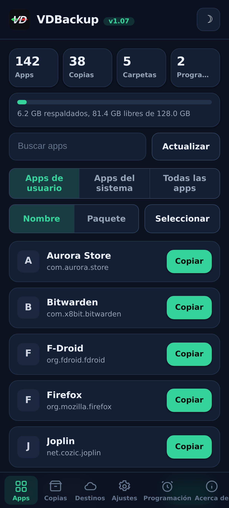
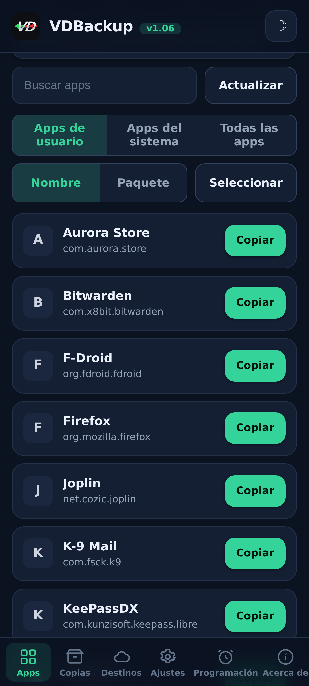
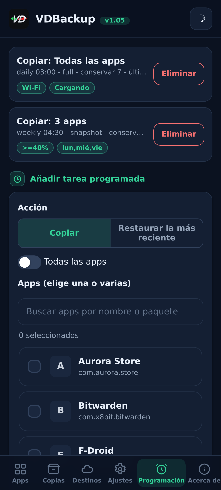
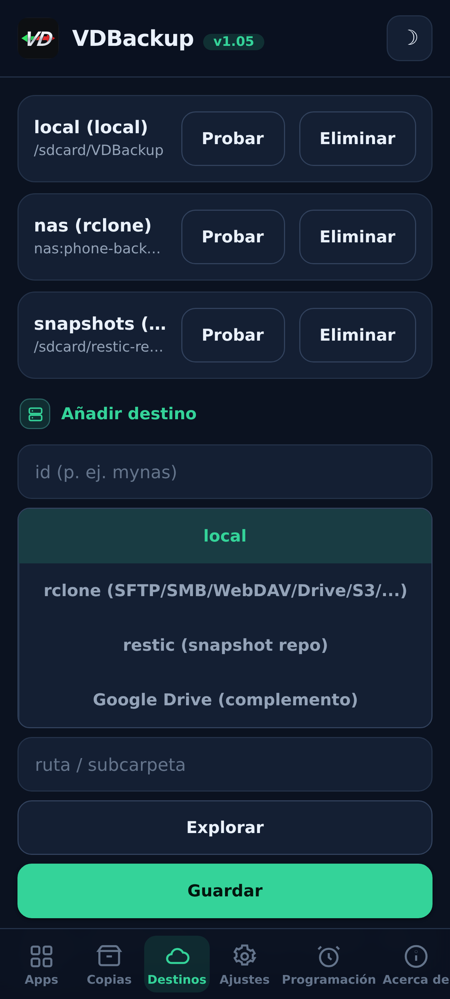
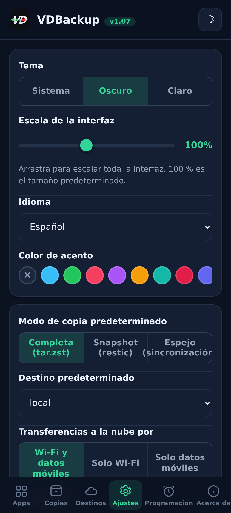
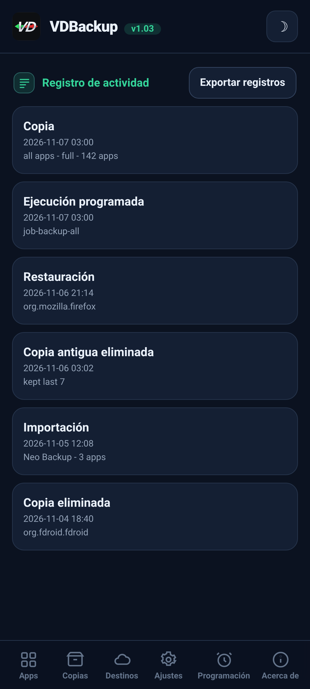

> **Languages:** [English](../USER-GUIDE.md) · [العربية](../ar/USER-GUIDE.md) · [Čeština](../cs/USER-GUIDE.md) · [Deutsch](../de/USER-GUIDE.md) · Español · [فارسی](../fa/USER-GUIDE.md) · [Français](../fr/USER-GUIDE.md) · [हिन्दी](../hi/USER-GUIDE.md) · [Bahasa Indonesia](../in/USER-GUIDE.md) · [Italiano](../it/USER-GUIDE.md) · [日本語](../ja/USER-GUIDE.md) · [한국어](../ko/USER-GUIDE.md) · [Nederlands](../nl/USER-GUIDE.md) · [Polski](../pl/USER-GUIDE.md) · [Português](../pt/USER-GUIDE.md) · [Русский](../ru/USER-GUIDE.md) · [Svenska](../sv/USER-GUIDE.md) · [ไทย](../th/USER-GUIDE.md) · [Türkçe](../tr/USER-GUIDE.md) · [Tiếng Việt](../vi/USER-GUIDE.md) · [中文](../zh/USER-GUIDE.md)

---

# Guía de usuario de VDBackup

Un recorrido completo y amigable por VDBackup, desde instalar el módulo hasta hacer
tu primer backup, restaurarlo, enviarlo a la nube, programarlo, y abrirlo
en un PC años después. Si has usado antes Swift Backup, Neo-Backup o
Android-DataBackup, esto te resultará familiar, solo que todo ocurre en un
único lugar, sin nada que "permitir".

## Tabla de contenidos

- [1. Qué es VDBackup](#1-qué-es-vdbackup)
- [2. Requisitos](#2-requisitos)
- [3. Instalación y primera ejecución](#3-instalación-y-primera-ejecución)
- [4. Recorrido por la WebUI](#4-recorrido-por-la-webui)
- [5. Hacer un backup](#5-hacer-un-backup)
  - [5.1 Elegir qué respaldar](#51-elegir-qué-respaldar)
  - [5.2 Modos de backup: Full, Snapshot, Mirror](#52-modos-de-backup-full-snapshot-mirror)
  - [5.3 Compresión](#53-compresión)
  - [5.4 Cifrado](#54-cifrado)
  - [5.5 Verify y dry-run](#55-verify-y-dry-run)
  - [5.6 Copias especiales (mensajes, registro de llamadas, Wi-Fi, Bluetooth, calendario, fondo de pantalla, DNS, ajustes del sistema)](#56-copias-especiales-mensajes-registro-de-llamadas-wi-fi-bluetooth-calendario-fondo-de-pantalla-dns-ajustes-del-sistema)
  - [5.7 Copias independientes de carpetas y archivos](#57-copias-independientes-de-carpetas-y-archivos)
- [6. Restaurar un backup](#6-restaurar-un-backup)
- [7. Destinos: local y remoto](#7-destinos-local-y-remoto)
  - [7.1 Copia de tu configuración](#71-copia-de-tu-configuración)
- [8. Programación y retención](#8-programación-y-retención)
- [9. Migrar a VDBackup: importar Neo-Backup y Android-DataBackup](#9-migrar-a-vdbackup-importar-neo-backup-y-android-databackup)
- [10. SSAID (ANDROID_ID del dispositivo)](#10-ssaid-android_id-del-dispositivo)
- [11. Portabilidad: abrir backups en un PC](#11-portabilidad-abrir-backups-en-un-pc)
- [12. Manejar VDBackup desde un asistente de IA](#12-manejar-vdbackup-desde-un-asistente-de-ia)
- [13. Resolución de problemas y FAQ](#13-resolución-de-problemas-y-faq)
- [14. Desinstalar](#14-desinstalar)

---

## 1. Qué es VDBackup

VDBackup es un módulo root con una WebUI integrada que respalda y restaura tus apps
y sus datos. Está diseñado como el sucesor abierto y root-native de Swift Backup,
Neo-Backup y Android-DataBackup: busca hacer la unión de lo que esas herramientas hacen, en
un único lugar, e incluso puede importar tus backups existentes de Neo-Backup y de
Android-DataBackup para que puedas migrar sin perder nada.

La diferencia clave respecto a una app de backup común: VDBackup corre **enteramente desde la
WebUI de tu gestor de root**, y el módulo ya es root. No hay app companera que
instalar para las funciones principales, ningún prompt de "conceder su" que aprobar, y nada
que activar. Abres la WebUI, eliges qué respaldar, y lo ejecutas.

Todo lo que VDBackup produce usa **formatos estándar** (tar, gzip, zstd, age, zip,
restic), así que tus backups nunca quedan atados al módulo y nunca quedan ligados a tu
dispositivo específico. Ve la [sección 11](#sección-11).

## Capturas de pantalla

| Inicio | Apps | Programación |
|:---:|:---:|:---:|
|  |  |  |
| **Destinos** | **Ajustes** | **Registro de actividad** |
|  |  |  |

## 2. Requisitos

- **Un dispositivo Android rooteado** gestionado por **KernelSU**, **APatch** o **Magisk**.
  VDBackup se instala como un módulo desde ese gestor.
- Suficiente almacenamiento libre para tus backups (los backups locales viven bajo el directorio
  de estado del módulo; ve la [sección 3](#sección-3)).
- Nada más. El módulo empaqueta todos los binarios que necesita (tar, zstd, lz4, rclone,
  rsync, ssh, restic), así que **el backup y la restauración locales funcionan totalmente offline**. Solo
  los destinos de nube hablan con la red.

Algunos extras finos (AppOps, SSAID, algunos bits privilegiados de sistema) dependen del
framework de Android; el módulo los maneja internamente, con un fallback en shell puro, y
degradan graciosamente cuando no están disponibles en tu dispositivo.

## 3. Instalación y primera ejecución

1. Descarga el release más reciente `VD-Backup-vX.Y.zip`.
2. En tu gestor KernelSU / APatch / Magisk, flashea el zip del módulo como cualquier otro
   módulo.
3. Es usable de inmediato, **sin necesidad de reboot**. (Un reboot solo es relevante
   al restaurar SSAID; ve la [sección 10](#sección-10).)
4. Abre la **WebUI** del módulo desde el gestor. Esa es la interfaz entera.

**Qué edición descargar.** Cada release viene como varias ediciones de zip flasheables, así que descargas solo lo que necesitas. Elige una:

- **`VD-Backup-<ver>-universal-full.zip`**: todas las arquitecturas de CPU y todos los binarios integrados, incluidos `rclone` (proveedores de nube: Google Drive, S3 y más de 70 backends de rclone) y `restic` (snapshots deduplicados). Totalmente sin conexión, nunca se descarga nada. Funciona en cualquier dispositivo. La descarga más grande.
- **`VD-Backup-<ver>-universal-lite.zip`**: todas las arquitecturas, pero **sin** los dos binarios más grandes (`rclone` y `restic`). La descarga más pequeña; sigue haciendo copias locales, por SSH/SFTP y rsync sin ninguna descarga, con cifrado `age` portable. La primera vez que uses un destino en la nube (`rclone`) o el modo de snapshots (`restic`), la WebUI ofrece descargar ese pequeño complemento específico de la arquitectura una sola vez (verificado por SHA-256) y lo guarda en caché; después esas funciones también funcionan.
- **`VD-Backup-<ver>-<abi>-full.zip`** (una de `arm64-v8a`, `armeabi-v7a`, `x86`, `x86_64`), una sola arquitectura con todos los binarios integrados (las mismas funciones que `universal-full` pero solo para la arquitectura de tu dispositivo, así que más pequeña que `universal-full`).

Si conoces la arquitectura de tu dispositivo y quieres todo integrado, elige la **`<abi>-full`** que corresponda (la mayoría de los teléfonos son **`arm64-v8a`**). Si quieres la descarga más pequeña y no te importa una descarga única, verificada por SHA-256, la primera vez que uses proveedores de nube (`rclone`) o snapshots (`restic`), elige **`universal-lite`**. Si quieres todo integrado sin ninguna descarga (sin conexión / recuperación) y no estás seguro de la arquitectura, elige una edición **full**. Al instalar, el módulo conserva solo la arquitectura de tu dispositivo, sin importar la edición que flashees.

En la primera ejecución el módulo siembra una configuración por defecto (solo si aún no existe
ninguna), así que tus ajustes se preservan a través de las actualizaciones del módulo.

**Dónde vive el estado.** Los datos de trabajo de VDBackup, tu configuración, trabajos agendados,
destinos guardados, credenciales cifradas, logs y traza de auditoría, y área de staging -
viven bajo:

```
/data/adb/vdbackup/
```

**Dónde viven los backups.** Los backups en sí se escriben en almacenamiento visible al usuario y
cifrado por credencial (así que solo son legibles tras desbloquear el dispositivo, y
sobreviven a la desinstalación del módulo), una carpeta por usuario de Android:

```
/sdcard/VDBackup/            (= /data/media/<user>/VDBackup)
```

Ten esto en mente por dos razones: los backups ocupan espacio bajo `/sdcard/VDBackup`, y
`/data/adb/vdbackup/logs/` es donde miras si algo sale mal.

## 4. Recorrido por la WebUI

La WebUI está organizada en unas cuantas pestañas:

- **Home**: un resumen inicial que muestra conteos de tus backups (apps, backups, carpetas y trabajos programados) y una barra de almacenamiento de cuánto espacio usan tus backups frente al libre, con insignias de estado, copiar hashes y rutas al portapapeles, y una acción **Check for updates**.
- **Apps**: la lista de apps instaladas (de usuario y de sistema), cada una mostrada con su nombre
  real, su nombre de paquete, y su ícono (los íconos cargan bajo demanda y se cachean, así que la
  lista se mantiene responsiva). El botón en una fila respalda la app; tocar la fila abre el
  historial de backups de esa app, donde puedes restaurar cualquier backup anterior.
- **Backups**: los backups que ya tienes, cada uno mostrando el nombre de la app en una línea y el
  paquete en la siguiente. Toca un backup para ver sus detalles completos (versión, fecha, tamaño,
  items incluidos, conteos de permisos, y el dispositivo del que vino). Aquí también es donde
  restauras, corres un restore-test, borras un backup, o importas backups de Neo-Backup o de
  Android-DataBackup.
- **Destinations**: gestiona a dónde van los backups: almacenamiento local más cualquier
  destino remoto que agregues (ve la [sección 7](#sección-7)). Puedes
  probar un destino aquí antes de depender de él.
- **Settings**: un toggle de tema claro/oscuro, un selector de color de acento (preajustes, un color
  personalizado, o restablecer) y un selector de idioma (la interfaz se muestra de derecha a izquierda para árabe y persa), un control deslizante de escala de la interfaz que arrastras para
  reescalar toda la interfaz (encabezado, contenido y navegación inferior juntos) de 85% a 120% (100% es el valor predeterminado),
  para pantallas de diferentes densidades de píxeles, valores por defecto para nuevos
  trabajos (compresión por defecto, verify activado/desactivado, cifrado por defecto), la política de red para
  transferencias de nube (ve la [sección 7](#sección-7)), la copia automática y la lista de apps excluidas,
  la opción de origen de instalación, la clave de cifrado,
  y la programación. Los ajustes de activado/desactivado usan interruptores de estilo Android.
- **About**: versión, enlaces, los proyectos hermanos (Ver también), el manifiesto de auditoría de los binarios empaquetados, y una acción **Check for updates** que informa si se ha publicado una versión más nueva (con sus notas de versión). Instalas cualquier actualización a través de tu gestor root, igual que como instalaste el módulo.

La app también busca por su cuenta una versión más nueva cada vez que la abres (como máximo una vez por hora) y muestra el aviso de actualización solo cuando hay una; permanece en silencio si está al día o sin conexión.

Las confirmaciones y los mensajes usan diálogos en la app (no los viejos pop-ups del sistema), y un
restore o import te pide que reconozcas que sobrescribe los datos actuales de la app antes
de proceder.

Los backups y restauraciones corren **desacoplados** como un proceso root en segundo plano. Puedes cerrar
la WebUI, o incluso cerrar el gestor de root, y la operación sigue. Cuando vuelves,
la WebUI se reacopla y muestra el progreso en vivo con un label de fase localizado. Para un
trabajo en curso el card de progreso también muestra la velocidad de transferencia en vivo y el
tiempo restante estimado, más un contador de ítems (por ejemplo "12 de 40") con el nombre del
ítem actual. En
ROMs que exponen notificaciones de shell también recibes una notificación de Android cuando un trabajo
empieza y termina; de cualquier forma el card de progreso en la app es el indicador fiable.

## 5. Hacer un backup

El flujo básico: abre **Apps**, elige una app, selecciona qué incluir, elige un modo,
fija la compresión y (opcionalmente) el cifrado, luego ejecuta. El progreso aparece en vivo y una
notificación te avisa cuando termina.

En el diálogo de copia también puedes elegir el **destino** de esta copia, almacenamiento local o cualquier destino en la nube/remoto que hayas añadido, sin cambiar antes el destino predeterminado en Ajustes.

### 5.1 Elegir qué respaldar

Para cada app puedes incluir cualquier combinación de estos items:

| Item | Qué es |
|------|-----------|
| **APK** | La app instalada en sí (APK base + cualquier split APK). |
| **data** | Los datos privados de la app (`/data/data`). Estos son los "datos de la app" habituales. |
| **device-protected data** | Almacenamiento direct-boot / device-protected (`/data/user_de`). Algunas apps guardan ajustes aquí. |
| **external** | Los datos externos de la app bajo `Android/data`. |
| **OBB** | Los archivos de expansión OBB de la app (`Android/obb`), usados por algunos juegos. |
| **media** | El media de la app bajo `Android/media`. |

Un buen valor por defecto para "respaldar esta app por completo" es incluirlos todos. Si
solo quieres los datos (por ejemplo para mover un save de un juego), puedes deseleccionar el APK y los
grandes items OBB/media.

VDBackup también preserva las cosas que hacen fiel a una restauración: contextos SELinux,
ownership uid/gid, modos de archivo, atributos extendidos (xattr) y capabilities.

### 5.2 Modos de backup: Full, Snapshot, Mirror

VDBackup ofrece tres modos. La WebUI preselecciona **Full**, que es la elección correcta
para la mayoría de la gente.

- **Full**: un backup completo, autocontenido y portable escrito como `tar.zst` (o
  la compresión que elijas). Cada ejecución produce un backup standalone que puedes copiar
  a cualquier lugar y abrir en un PC. Mejor para: un snapshot limpio y portable de una app que puedes
  archivar y mover por ahí. Este es el valor por defecto y la opción más portable.
- **Snapshot**: incremental y versionado, respaldado por `restic`. Cada ejecución agrega un nuevo
  snapshot point-in-time a un repositorio, guardando solo lo que cambió y
  de-duplicando entre snapshots. Mejor para: mantener un historial corriente de una app
  sin pagar el tamaño completo en cada ejecución.
- **Mirror**: un sync 1:1 de los datos vivos al destino, respaldado por
  `rclone`/`rsync`. Mantiene el destino idéntico a lo que está en el dispositivo ahora mismo
  (los archivos cambiados se copian, los archivos removidos se borran en el destino). Mejor
  para: una copia rápida y siempre actual, por ejemplo a un remoto de nube. Nota que el APK
  aún se guarda comprimido incluso en un mirror, nunca crudo.

### 5.3 Compresión

Puedes elegir la compresión para un backup Full:

- **none**: sin compresión (más rápido, más grande).
- **lz4**: compresión muy rápida y ligera.
- **zstd**: el valor por defecto, un fuerte equilibrio entre velocidad y ratio. También puedes elegir un
  nivel (por ejemplo un nivel más alto para un archivo más pequeño).
- **gzip**: el **"modo de compatibilidad"**. gzip abre con herramientas integradas en
  prácticamente cualquier computadora y en la mayoría de los gestores de archivos, sin nada extra que instalar.
  Elige esto cuando lo que más te importa es poder abrir el archive en cualquier lugar.

Si no eliges, VDBackup usa su valor por defecto configurado (zstd en un nivel sensato).

### 5.4 Cifrado

El cifrado es **opcional** y portable. VDBackup cifra con **age** usando una
passphrase (scrypt), que fue elegida específicamente por portabilidad: cualquier herramienta
`age` estándar en cualquier sistema operativo puede descifrar tu backup con solo la passphrase.
El cifrado **nunca** queda atado a las claves de hardware de tu dispositivo, así que un backup cifrado
se restaura en otro dispositivo y abre en un PC. (También hay disponible un modo zip AES-256
compatible para archives cifrados que quieras abrir con un doble clic y una contraseña.)

Para usar cifrado, genera la clave de cifrado una vez (Settings), luego habilita el
cifrado para tu trabajo y fija una passphrase. La passphrase es lo que protege el
backup, así que elige una fuerte, no hay clave de hardware ni backdoor de recuperación.

**La regla del APK (importante):**

- El **APK siempre se guarda comprimido**, nunca crudo, para ahorrar espacio.
- El **APK no se cifra por defecto**, porque el APK de una app es contenido público.
- El cifrado de APK y el cifrado de datos son **toggles independientes**. Activar el
  cifrado de datos **no** cifra el APK. Si específicamente quieres el APK cifrado
  también, habilita el toggle de cifrado de APK explícitamente.

### 5.5 Verify y dry-run

Dos opciones de seguridad te ayudan a confiar en un backup antes de depender de él:

- **Verify**: tras escribir, VDBackup re-hashea cada archive y lo comprueba contra
  el manifest. Esto está **activado por defecto para backups Full**. Si un archivo no coincide,
  el trabajo falla con un error claro en vez de dejarte con un backup silenciosamente corrupto.
- **Dry-run**: planea el trabajo y reporta los tamaños que produciría **sin escribir
  nada**. Úsalo para estimar espacio o para comprobar tu selección de items antes de correr
  la cosa real.

Cuando un backup va a un destino de **nube**, VDBackup añade dos salvaguardas más. Corre un paso
final **verificado por checksum** que vuelve a comprobar la copia subida contra el original en el
remoto, y falla el trabajo (en vez de dejar una copia corrupta en la nube) si no coinciden. Y
antes de un upload Full comprueba el **espacio libre** del remoto y se detiene pronto con un error
claro de **"espacio insuficiente"** si el backup no cabe, en vez de llenar el remoto y fallar a
medio camino. (La comprobación de espacio es para uploads Full; el Mirror es un delta sync y está
exento.)

### 5.6 Copias especiales (mensajes, registro de llamadas, Wi-Fi, Bluetooth, calendario, fondo de pantalla, DNS, ajustes del sistema)

Debajo de las listas de apps en la pestaña **Backups**, las **Copias especiales** cubren datos
a nivel de todo el sistema que no están atados a una sola app. Elige las categorías y respáldalas; se
archivan con la misma preservación de SELinux/xattr y el mismo cifrado opcional que las copias de app.
Las categorías son:

| Categoría | Qué es |
|----------|-----------|
| **Mensajes (SMS/MMS)** | Tus mensajes de texto. |
| **Contactos y registro de llamadas** | Tus contactos y tu historial de llamadas. |
| **Redes Wi-Fi** | Tus redes Wi-Fi guardadas. |
| **Bluetooth** | Tus emparejamientos Bluetooth. |
| **Calendario** | El proveedor de calendario (app y datos). También se escribe un **`calendar.json` portátil**, así tus eventos son legibles en un PC sin el módulo. |
| **Fondo de pantalla** | El fondo de pantalla de inicio y de bloqueo más `wallpaper_info.xml`, guardado como la imagen en crudo. |
| **DNS** | Tu modo y servidor de DNS privado. |
| **Ajustes del sistema** | Un volcado completo de los ajustes system, global y secure del dispositivo. |

Para mensajes, registro de llamadas y contactos, también se escribe una **copia portátil** (JSON abrible),
así tienes una copia multidispositivo que puedes leer en un PC sin el módulo.

**Los ajustes del sistema son opt-in y sobrescriben los ajustes de tu dispositivo en el restore.** Igual
que SSAID (ve la [sección 10](#sección-10)), la categoría **Ajustes del sistema** es la más sensible:
restaurarla sobrescribe los ajustes de todo tu dispositivo, así que está apagada salvo que la selecciones
deliberadamente, te pide reconocerla primero, y se escribe en el registro de actividad.

Restaurar una copia especial sobrescribe datos vivos del sistema y necesita un reboot, así que está
protegida tras un reconocimiento prominente y es fiable en el mismo dispositivo y la misma ROM. Las
restauraciones son **idempotentes**: las categorías crudas (mensajes, contactos, Wi-Fi, Bluetooth,
calendario) se restauran **reemplazando** los datos en vez de fusionarlos, así que restaurar la misma
copia dos veces nunca crea duplicados, y el DNS y los ajustes del sistema simplemente se re-aplican.

### 5.7 Copias independientes de carpetas y archivos

A veces quieres respaldar una carpeta o un archivo común que no es una app, una carpeta de
cámara, un directorio de documentos, una sola base de datos. VDBackup puede respaldar **cualquier
ruta absoluta** en el almacenamiento compartido o bajo `/data`, con el mismo formato portable que una
copia de app: un archive `tar.zst` más un `manifest.json`, sellado con SHA-256, con una nota RECOVERY
cuando lo cifras. Estas copias de ruta se mantienen aparte, bajo una carpeta `.paths` en tu directorio
de backups.

- **Elige una ruta y respáldala.** El origen debe ser una ruta absoluta bajo una de las ubicaciones
  permitidas (`/storage/emulated`, `/data/media`, `/sdcard`, `/data`). Las rutas que intentan salir con
  `..` se rechazan.
- **Restaurar escribe de vuelta en la ubicación original**, así que, como cualquier restauración, es
  destructiva y te pide **confirmar** antes de sobrescribir nada.
- Como las copias de app, las copias y restauraciones de ruta corren **desacopladas** con progreso en
  vivo, usan la compresión que elijas, y pueden cifrarse con una passphrase.

## 6. Restaurar un backup

Abre la pestaña **Backups**, elige el backup que quieres, y empieza la restauración. Como la
restauración es una acción destructiva, VDBackup te pide **confirmar** primero, y
registra la acción en un log de auditoría local.

Una restauración es **fiel**: VDBackup borra el estado actual de la app y extrae el
backup, así que la app es revertida al **estado exacto** capturado en ese backup
(incluyendo ownership, modos, contextos SELinux y xattr). No es un merge, es una
restauración verdadera al punto en el tiempo del backup. Como una restauración corre como
root, VDBackup también comprueba cada archive antes de extraer nada y rechaza uno manipulado
que intente escribir fuera de su objetivo, así que una copia modificada nunca puede
sobrescribir el resto de tu sistema.

Opciones útiles de restauración:

- **Restore-test**: extrae el backup a un área de staging temporal y lo verifica
  **sin tocar la app viva**. Esta es la forma segura de confirmar que un backup está
  íntegro y es restaurable antes de que sobrescribas nada. Si el test falla recibes un
  error claro y tu app instalada queda intacta.
- **Restauración parcial**: restaura solo algunos de los items que fueron respaldados. Por
  ejemplo, restaura solo los datos de la app sin reinstalar el APK, o restaura los archivos de
  save sin los grandes OBB/media. Elige los items que quieres en la pantalla de restauración.
- Para backups **Snapshot** y **Mirror**, la restauración jala del repositorio versionado
  o de la copia espejada respectivamente.
- **Origen de instalación**: por defecto una app restaurada indica la **Play Store** como su
  origen de instalación (en vez de parecer sideloaded), que es lo que la mayoría de apps y comprobaciones
  de apps esperan. Puedes desactivarlo globalmente en Settings o por restauración, y cuando está
  desactivado se conserva el origen de instalación original. Un toggle avanzado y opt-in **"falsificar el
  origen iniciador"** va más allá y además hace que el paquete iniciador y el origen del paquete de la app
  parezcan instalados por Play; edita la base de datos de paquetes del sistema (respaldada primero) y surte
  efecto tras un reboot.

**Restauración por lotes.** La pestaña **Backups** tiene un modo **Select**, igual que la
pestaña Apps lo tiene para el backup por lotes. Activa **Select**, marca los backups que
quieras con sus casillas, y restáuralos todos de una vez. Un único diálogo de opciones cubre
toda la selección, el reconocimiento de sobrescritura, el restore-test y la opción de origen
de instalación se aplican a cada backup que elegiste, y se restauran uno tras otro.

**Borrar un backup.** Abre los detalles de un backup (o el historial de una app) y usa **Delete**;
se te pide confirmar, y el borrado se escribe en el registro de actividad. También puedes
limitar cuántos backups mantener por app (retención) para que los viejos se poden automáticamente.

**Montar una app instalada como app de sistema.** Desde el historial de backups de una app, **Mount as
system** prepara el APK de la app en un submódulo de superposición de VDBackup para que el gestor de root
lo sirva desde `/system/app` (o `/system/priv-app`), la partición `/system` real nunca se toca. Con
**NoMount** en KernelSU se aplica en vivo; de lo contrario se aplica tras un reboot. Esto nunca depende de
que NoMount esté instalado.

## 7. Destinos: local y remoto

Por defecto, los backups se escriben en almacenamiento **local** bajo el directorio de estado del
módulo. También puedes agregar destinos remotos en la pestaña **Destinations**. Para un destino local,
**Browse** abre un selector de carpetas para que puedas elegir una subcarpeta bajo el almacenamiento
compartido (`/sdcard`) en vez de escribir la ruta.

El transporte remoto lo manejan las herramientas empaquetadas:

- **rclone**: el hub para un enorme rango de remotos: **SFTP, SMB, WebDAV, FTP, S3,
  Google Drive** y más de 70 servicios más.
- **rsync** y la suite **ssh/scp/sftp**: para delta sync y targets SSH simples.
- **restic**: repositorios **Snapshot** cifrados y de-duplicados (locales o remotos).

**Crear un remoto de nube (sin SSH necesario).** En la pestaña Destinations, elige el
tipo de destino **rclone** y usa **Add cloud remote**. Puedes conectar **cualquier backend
de rclone**: el desplegable ofrece los populares (**Google Drive, Dropbox, OneDrive, Box,
pCloud, Mega, Backblaze B2, S3, SFTP, WebDAV, FTP, SMB**) más una opción **Custom (advanced)**
donde escribes cualquier otro tipo de backend y sus parámetros `key=value`. Llena los campos
(host/user/password, o las claves S3, por ejemplo) y guarda. Para los proveedores que te
inician sesión con un navegador (Google Drive, Dropbox, OneDrive, Box, pCloud) usa el botón
**Authorize in browser**: te inicia sesión a través del propio navegador del teléfono y captura
el token automáticamente, así que no se necesita PC (pegar un token a mano sigue funcionando
como alternativa). El remoto entonces aparece en la lista de remotos del destino. Las
contraseñas se guardan ofuscadas, nunca en texto claro. Puedes listar y borrar tus remotos
desde el mismo lugar.

Dos reglas mantienen seguro el uso remoto:

- **Las credenciales se guardan cifradas** en reposo en el directorio de estado del módulo, nunca
  en texto claro.
- **Valida antes de usar.** Usa el test de destino en la pestaña Destinations para
  confirmar que un destino funciona antes de apuntar un backup real a él.

**Política de red (Wi-Fi vs datos móviles).** En Settings, "Cloud transfers over" te permite
restringir qué conexión pueden usar las transferencias de nube: **Wi-Fi y datos móviles** (el
valor por defecto), **solo Wi-Fi**, o **solo datos móviles**. Cuando la restringes, cada transferencia de nube
- manual o agendada, upload o restauración, revisa la conexión activa primero
y se niega a correr en la equivocada, así que una política solo-Wi-Fi nunca gasta datos móviles.
Los backups locales nunca se ven afectados.

**Google Drive.** Tienes dos maneras de llegar a Google Drive:

1. **Vía rclone**: agrega Drive como un remoto rclone como cualquier otro destino, sin
   app extra y **sin cuenta de Google Cloud**. En cualquier computadora corre
   `rclone authorize "drive"` una vez, inicia sesión en tu cuenta de Google en el navegador, y
   pega el token que imprime en el campo de token del remoto Drive.
2. **Vía el companero opcional**: una app companera minúscula y opt-in que maneja el
   inicio de sesión de Google y el upload a Drive. Se instala **solo cuando eliges explícitamente
   el destino companero de Google Drive**, nunca por defecto, y se remueve cuando
   lo deshabilitas. La pantalla de consentimiento de Google de una sola vez es el único paso que ocurre
   fuera de la WebUI. Cuando el companero está instalado, VDBackup te recuerda
   **ocultarlo siempre con [HMA-OSS](https://github.com/frknkrc44/HMA-OSS)** para que su presencia no revele root o
   un bootloader desbloqueado, y se ofrece a agregarlo a la lista de [HMA-OSS](https://github.com/frknkrc44/HMA-OSS) por ti. VDBackup también te recuerda, cuando tienes copias locales, ocultar la carpeta de copias (/sdcard/VDBackup) con SUSFS por la misma razón.

### 7.1 Copia de tu configuración

Tu propia configuración de VDBackup, los destinos, programaciones, ajustes predefinidos y credenciales guardadas, puede guardarse en un único archivo y llevarse a otro dispositivo o restaurarse tras una instalación limpia. En **Configuración**, en **Copia de la configuración**:

- **Exportar configuración** escribe un archivo cifrado en `VDBackup/.export`. Siempre pide una frase de contraseña, porque el archivo contiene tus contraseñas remotas.
- **Importar configuración** vuelve a leer ese archivo y lo combina en este dispositivo, sin eliminar nada de lo que ya hay.
- **Borrar credenciales guardadas** elimina las contraseñas remotas guardadas y la clave de cifrado del dispositivo en un solo paso; tus destinos, programaciones y copias se mantienen en su lugar.

## 8. Programación y retención

VDBackup puede correr backups, y restauraciones, automáticamente según una programación. En el
programador defines un trabajo con:

- un **objetivo**: una sola app, un conjunto de apps o **todas las apps** (menos la lista de
  apps excluidas), y los items/modo a usar,
- una **acción**: **Back up** (por defecto) o **Restore latest**, que restaura el backup más
  reciente de cada app objetivo,
- un destino,
- una **programación tipo cron**: cada hora, diaria o semanal, a una hora que elijas (HH:MM),
- un ajuste de **retención**: **mantener N** backups más recientes para ese trabajo, los más viejos se
  podan automáticamente,
- **condiciones de ejecución** opcionales: solo en **Wi-Fi**, solo mientras **carga**, solo con un
  **nivel mínimo de batería**, y solo en **días de la semana** elegidos.

Los trabajos agendados son disparados por un heartbeat de arranque en el módulo: cuando un trabajo está
vencido corre, registra su hora de última ejecución para no dispararse dos veces, y aplica
retención para podar backups viejos. Como todo corre como root en segundo plano, los
backups agendados no necesitan que la WebUI esté abierta.

**Condiciones de ejecución (gates).** Un trabajo agendado puede llevar condiciones que deben
cumplirse para que corra: solo Wi-Fi, solo cargando, un nivel mínimo de batería, y días
específicos de la semana. Cuando un trabajo está vencido pero una condición no se cumple, se
**omite y se reintenta en la siguiente comprobación**: su programación no avanza, así que corre
en cuanto la condición se satisface. Una comprobación térmica integrada también omite un trabajo
agendado mientras el dispositivo está demasiado caliente. Cada una de esas omisiones queda
registrada en el registro de actividad.

**La restauración agendada sobrescribe en cada ejecución.** Un trabajo **Restore latest**
vuelve a restaurar el backup más reciente de cada app objetivo cada vez que se dispara, y la
restauración es destructiva: en cada ejecución **sobrescribe los datos actuales de la app** con
el backup más reciente. Esto es deliberado y opcional, elígelo solo cuando quieras mantener los
objetivos en su backup más reciente.

**Copia automática al instalar/actualizar.** En Settings puedes activar la **copia automática**: el
mismo heartbeat de segundo plano detecta apps recién instaladas o actualizadas y las respalda por
ti (con retención keep-N). La primera ejecución solo registra lo que está instalado, así que
activarlo nunca respalda todo tu dispositivo de una vez.

**Apps excluidas (lista de bloqueo).** También en Settings, puedes excluir apps que nunca quieres
respaldar automáticamente o según una programación; puedes añadir varias a la vez (selección múltiple), y las apps excluidas son omitidas por ambos.

**Ajustes de copia predefinidos.** También en Ajustes puedes guardar presets con nombre, conjuntos de elementos a incluir, como solo APK o APK + OBB, y elegir uno en el diálogo de copia para rellenar los elementos de una vez.

**Elementos de copia por app.** También en Ajustes puedes elegir exactamente qué elementos respalda cada app en copias masivas, automáticas y programadas, por ejemplo solo APK, o APK + OBB. Una copia manual individual te sigue dejando elegir, partiendo del conjunto de la app. Las apps que no configures aquí respaldan todo.

**Etiquetas de apps.** Toca una app en Ajustes (Elementos y etiquetas por app) para darle nombres libres, por ejemplo games o work. Encima de la lista de apps aparece entonces un selector de etiquetas: elige una etiqueta para mostrar solo sus apps y respalda todo el grupo a la vez. También puedes acceder desde la pestaña Apps: toca una app y luego Elementos y etiquetas.

**Registro de actividad.** La pestaña Schedule tiene un botón **View activity log** que abre una
pantalla completa (al instante) que muestra la traza de auditoría local, backups, restauraciones,
borrados, ejecuciones agendadas y automáticas, y podas, del más reciente primero. Una acción
**Export logs** guarda un archivo de registro (en la carpeta de copias) que puedes adjuntar a un
informe de comentarios o de error.

## 9. Migrar a VDBackup: importar Neo-Backup y Android-DataBackup

Si vienes de Neo-Backup o de Android-DataBackup, no tienes que empezar
de cero. Desde la pestaña **Backups** puedes **importar** tus backups existentes:

1. Apunta VDBackup a la ubicación de tus backups existentes de Neo-Backup o de Android-DataBackup
   (el import-scan lista lo que encuentra ahí).
2. Elige cuáles backups importar.
3. Empieza el import. Como otras operaciones largas corre desacoplado con progreso en vivo.

**Los backups de Neo-Backup cifrados por contraseña están soportados.** Los backups cifrados
AES-256 de Neo-Backup pueden importarse, se te **solicita la contraseña** cuando es
necesaria, y la contraseña se usa solo para descifrar, nunca se guarda en la línea de comandos.

## 10. SSAID (ANDROID_ID del dispositivo)

SSAID es el `ANDROID_ID` por-app, un identificador a nivel de dispositivo que algunas apps leen.
VDBackup puede respaldarlo y restaurarlo, pero esta es la cosa más sensible que
toca, así que se maneja con cuidado extra:

- **Es OPCIONAL y está APAGADO por defecto.** VDBackup **nunca** capturará ni restaurará
  SSAID a menos que lo actives explícitamente para ese trabajo. La WebUI muestra un aviso
  "Optional" claramente marcado y resaltado donde sea que aparezca SSAID (backup, restore e
  import), y se mantiene apagado hasta que hagas opt-in.
- **Se aplica solo tras un reboot en el restore.** El settings provider de Android cachea
  estos valores, así que un SSAID restaurado entra en efecto solo tras reiniciar el dispositivo.
- **El valor anterior siempre se respalda primero.** Antes de sobrescribir cualquier SSAID,
  VDBackup copia el `settings_ssaid.xml` vivo byte-a-byte a un backup con timestamp
  (que nunca se auto-borra). Si esa copia de seguridad no puede hacerse, la sobrescritura
  no ocurre. Para revertir, restaura ese archivo guardado y reinicia.

**Recomendación:** deja SSAID apagado a menos que sepas específicamente que lo necesitas (por
ejemplo, una app particular que se atan al ID del dispositivo y que estás migrando
deliberadamente). Para backups comunes de app y datos no lo necesitas.

## 11. Portabilidad: abrir backups en un PC

Tus backups **no quedan atados a este módulo** y **nunca son hardware-bound**.
Todo usa formatos estándar, así que puedes abrir un backup en Windows, macOS o Linux
sin VDBackup instalado.

Una carpeta de backup Full contiene un `manifest.json` (la fuente de la verdad que describe cada
archivo, la versión de la app y el owner/contexto original), los APKs como `*.apk.zst`, y
los archives de datos como `<item>.tar.zst` (o `.tar.gz` / `.tar.lz4`), opcionalmente con un
`.age` al final cuando están cifrados.

Para abrir uno en un PC, en resumen:

- **Descifra** (solo si el archivo termina en `.age`) con la herramienta `age` estándar y tu
  passphrase o keyfile.
- **Descomprime y extrae**: `.tar.zst` con `zstd` luego `tar`; `.tar.gz` con `tar`
  directamente; `.tar.lz4` vía `zstd --format=lz4`. Un APK es solo un APK comprimido con zstd,
  así que descomprimir `base.apk.zst` te da un `base.apk` normal e instalable.

Cada backup cifrado viene con una nota **RECOVERY** que contiene los comandos exactos
de copiar-pegar para Windows, macOS y Linux. Ve
[`../module/etc/RECOVERY.md`](RECOVERY.md) para el kit completo, paso a paso.

Nota que los contextos SELinux, uid/gid y modos se guardan dentro del tar y solo se
reaplican correctamente cuando restauras en Android, en un PC aún obtienes todos tus
archivos, solo sin que el ownership específico de Android sea impuesto.

## 12. Manejar VDBackup desde un asistente de IA

VDBackup está construido para ser amigable con asistentes y agentes de IA, no solo con personas. La
WebUI es solo un cliente de una pequeña API JSON; un agente puede administrar **toda** acción
del módulo de forma headless a través de esa misma API (cada comando devuelve un único objeto JSON,
las operaciones largas corren desacopladas y haces poll de su progreso, y aplican las mismas barandillas
de seguridad, SSAID se mantiene opt-in, las acciones mutables se mantienen confirmadas y auditadas).

Si quieres que un asistente corra tus backups y restauraciones por ti, apúntalo a
[`AI-AGENTS.md`](AI-AGENTS.md), que documenta toda la superficie de control: el contrato
de comando, cada verbo con sus argumentos y valor de retorno, y las reglas de seguridad que un
agente debe respetar.

## 13. Resolución de problemas y FAQ

**¿Dónde están los logs?** Bajo el directorio de estado del módulo,
`/data/adb/vdbackup/logs/`. El progreso en vivo de una operación en curso está en
`progress-<opid>.json`, y la **traza de auditoría** de acciones mutables (restore, delete,
import, cambios de SSAID) está en `audit.jsonl`.

**Un backup/restore parece atascado o cerré la WebUI.** Las operaciones corren desacopladas, así que
cerrar la WebUI no las detiene. Reabre la WebUI y se reacopla a cualquier operación en
curso y muestra el progreso actual.

**Recibí un mensaje `ERR_...`.** Los errores se reportan con un código claro. Algunos comunes:
- `ERR_VERIFY`, un archive escrito no coincidió con el hash de su manifest (la verificación
  atrapó un backup malo). Vuelve a correr el backup.
- `ERR_RESTORE_TEST`, un restore-test falló; el backup no extrajo/verificó
  limpiamente y tu app viva quedó intacta.
- `ERR_UNSAFE_ARCHIVE`, un archive fue rechazado porque intentó escribir fuera de su
  directorio objetivo (rutas absolutas o con `..`). Esto te protege de una copia manipulada;
  no se escribió nada.
- `ERR_QUOTA`, un remoto de nube no tenía suficiente espacio libre para un upload Full; el backup
  se detuvo antes de subir nada.

**Mi destino remoto falla.** Usa el **test** de destino en la pestaña Destinations para
validar credenciales y conectividad. Recuerda que solo los destinos de nube necesitan
la red; el backup/restauración local es totalmente offline.

**¿Algo de esto hace phone home o descarga en runtime?** No. Todos los binarios están empaquetados
en el módulo en tiempo de build; nada se trae al dispositivo en runtime. Solo los destinos de nube
(rclone/restic/ssh) hablan con la red, y solo cuando los usas.

**¿Mi backup se restaurará en un teléfono diferente?** Sí, los backups son portables y no
están atados al hardware del dispositivo. (SSAID es la única excepción específica de dispositivo, y es opt-in
y aplicado-en-el-reboot; ve la [sección 10](#sección-10).)

**Mi backup cifrado no abre, perdí la passphrase.** No hay backdoor de recuperación
por diseño; la passphrase es lo que protege el backup. Mantenla a salvo.

## 14. Desinstalar

Desinstala VDBackup como cualquier otro módulo desde tu gestor KernelSU / APatch / Magisk. La desinstalación **conserva tu configuración** y elimina solo el estado transitorio, así que reinstalar luego retoma tu configuración, destinos y programaciones. Mantiene tus copias en `/sdcard/VDBackup` (formatos estándar, abribles en un PC sin el módulo), tu configuración en `/data/adb/vdbackup`, y tus credenciales guardadas, el rclone.conf y la clave age en `/data/misc_ce/0/vdbackup` (cifrado por credencial, bloqueado hasta el primer desbloqueo). Para eliminar alguno de ellos también, borra ese directorio manualmente tras desinstalar.

<!-- doc-footer -->

---

> _Esta documentación se generó con Claude (Anthropic) y la mantiene VD171. Las correcciones y mejoras son bienvenidas; consulta [CONTRIBUTING.md](CONTRIBUTING.md)._
