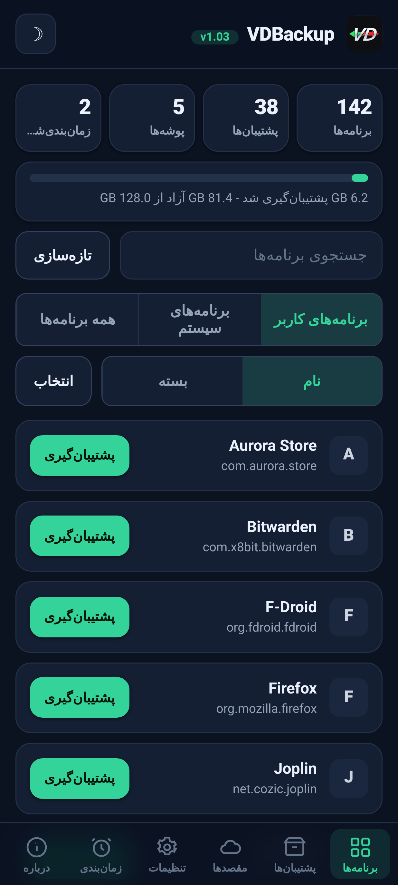
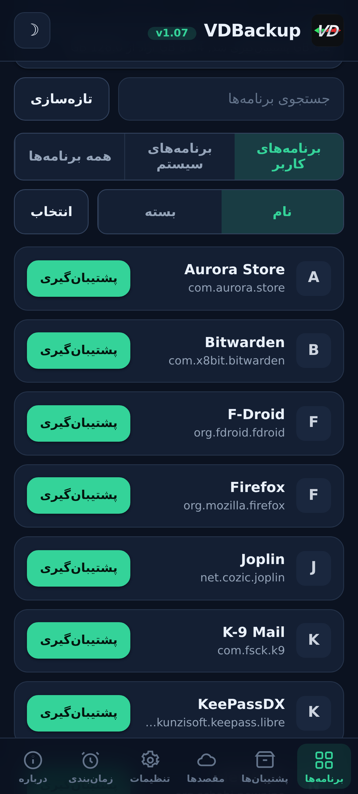
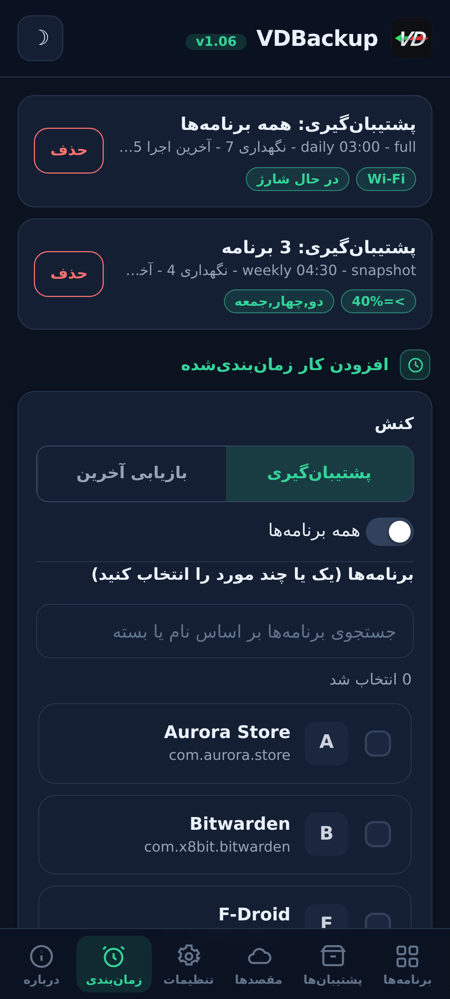
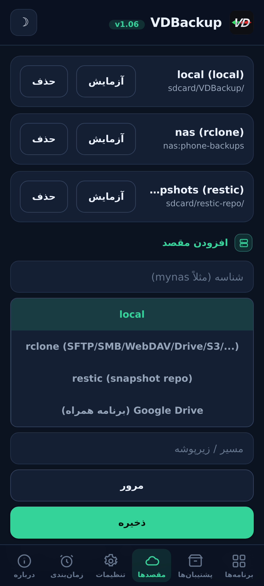
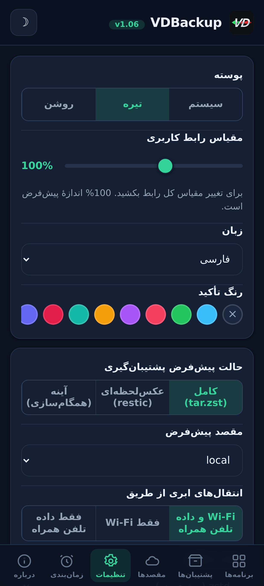
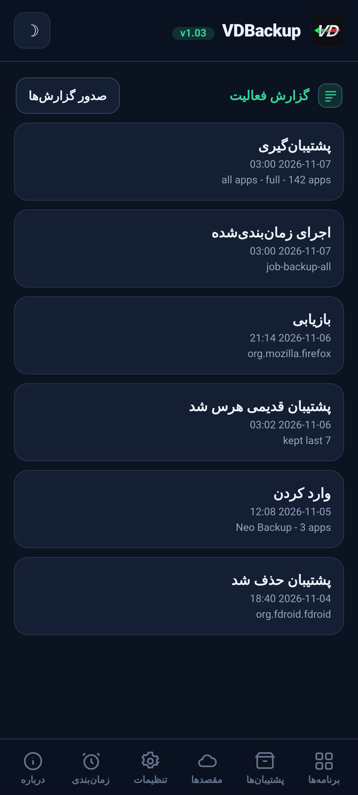

> **Languages:** [English](../USER-GUIDE.md) · [العربية](../ar/USER-GUIDE.md) · [Čeština](../cs/USER-GUIDE.md) · [Deutsch](../de/USER-GUIDE.md) · [Español](../es/USER-GUIDE.md) · فارسی · [Français](../fr/USER-GUIDE.md) · [हिन्दी](../hi/USER-GUIDE.md) · [Bahasa Indonesia](../in/USER-GUIDE.md) · [Italiano](../it/USER-GUIDE.md) · [日本語](../ja/USER-GUIDE.md) · [한국어](../ko/USER-GUIDE.md) · [Nederlands](../nl/USER-GUIDE.md) · [Polski](../pl/USER-GUIDE.md) · [Português](../pt/USER-GUIDE.md) · [Русский](../ru/USER-GUIDE.md) · [Svenska](../sv/USER-GUIDE.md) · [ไทย](../th/USER-GUIDE.md) · [Türkçe](../tr/USER-GUIDE.md) · [Tiếng Việt](../vi/USER-GUIDE.md) · [中文](../zh/USER-GUIDE.md)

---

# راهنمای کاربر VDBackup

گام‌به‌گام کامل و دوستانه VDBackup، از نصب ماژول تا ساختن نخستین پشتیبان، بازیابی
آن، فرستادنش به ابر، زمان‌بندی آن، و گشودنش روی یک رایانه پس از سال‌ها. اگر پیش‌تر
از Swift Backup یا Neo-Backup یا Android-DataBackup استفاده کرده‌اید، این برایتان
آشنا خواهد بود, جز اینکه همه چیز در یک جا رخ می‌دهد، بی‌آنکه چیزی را «اجازه»
بدهید.

## فهرست مطالب

- [۱. VDBackup چیست](#۱-vdbackup-چیست)
- [۲. پیش‌نیازها](#۲-پیشنیازها)
- [۳. نصب و نخستین اجرا](#۳-نصب-و-نخستین-اجرا)
- [۴. گشت‌وگذار در WebUI](#۴-گشتوگذار-در-webui)
- [۵. ساختن یک پشتیبان](#۵-ساختن-یک-پشتیبان)
  - [۵.۱ گزیدن آنچه پشتیبان می‌گیرید](#۵۱-گزیدن-آنچه-پشتیبان-میگیرید)
  - [۵.۲ حالت‌های پشتیبان: Full و Snapshot و Mirror](#۵۲-حالتهای-پشتیبان-full-و-snapshot-و-mirror)
  - [۵.۳ فشرده‌سازی](#۵۳-فشردهسازی)
  - [۵.۴ رمزگذاری](#۵۴-رمزگذاری)
  - [۵.۵ راستی‌آزمایی و اجرای آزمایشی](#۵۵-راستیآزمایی-و-اجرای-آزمایشی)
  - [۵.۶ پشتیبان‌های ویژه (پیام‌ها، گزارش تماس، Wi-Fi، Bluetooth، تقویم، کاغذدیواری، DNS، تنظیمات سیستم)](#۵۶-پشتیبانهای-ویژه-پیامها-گزارش-تماس-wi-fi-bluetooth-تقویم-کاغذدیواری-dns-تنظیمات-سیستم)
  - [۵.۷ پشتیبان‌های مستقل پوشه و فایل](#۵۷-پشتیبانهای-مستقل-پوشه-و-فایل)
- [۶. بازیابی یک پشتیبان](#۶-بازیابی-یک-پشتیبان)
- [۷. مقصدها: محلی و ریموت](#۷-مقصدها-محلی-و-ریموت)
  - [۷.۱ پشتیبان‌گیری از تنظیمات شما](#۷۱-پشتیبانگیری-از-تنظیمات-شما)
- [۸. زمان‌بندی و نگه‌داشت](#۸-زمانبندی-و-نگهداشت)
- [۹. مهاجرت به درون: ورود Neo-Backup و Android-DataBackup](#۹-مهاجرت-به-درون-ورود-neo-backup-و-android-databackup)
- [۱۰. SSAID (شناسه ANDROID_ID دستگاه)](#۱۰-ssaid-شناسه-android_id-دستگاه)
- [۱۱. قابلیت حمل: گشودن پشتیبان‌ها روی رایانه](#۱۱-قابلیت-حمل-گشودن-پشتیبانها-روی-رایانه)
- [۱۲. راندن VDBackup از یک دستیار هوش مصنوعی](#۱۲-راندن-vdbackup-از-یک-دستیار-هوش-مصنوعی)
- [۱۳. عیب‌یابی و پرسش‌های پرتکرار](#۱۳-عیبیابی-و-پرسشهای-پرتکرار)
- [۱۴. حذف نصب](#۱۴-حذف-نصب)

---

## ۱. VDBackup چیست

‫VDBackup یک ماژول root با یک WebUI توکار است که از برنامه‌هایتان و داده‌هایشان
پشتیبان می‌گیرد و آن‌ها را بازمی‌گرداند. این ماژول به‌عنوان جانشین باز و
root-native برای Swift Backup و Neo-Backup و Android-DataBackup طراحی شده است:
هدفش انجام اجتماع آنچه آن ابزارها می‌کنند، در یک جا، است، و حتی می‌تواند
پشتیبان‌های موجود Neo-Backup و Android-DataBackup شما را وارد کند تا بتوانید بی‌آنکه
چیزی از دست بدهید، کوچ کنید.

تفاوت کلیدی با یک برنامه پشتیبان‌گیری معمولی: ‫VDBackup **کاملا از WebUI مدیر root
شما** اجرا می‌شود، و ماژول پیشاپیش root است. برای ویژگی‌های اصلی نه برنامه همراهی
برای نصب هست، نه درخواست «اعطای su» برای تأیید، و نه چیزی برای روشن‌کردن. ‫WebUI را
می‌گشایید، برمی‌گزینید که از چه پشتیبان بگیرید، و آن را اجرا می‌کنید.

هر چه VDBackup تولید می‌کند از **قالب‌های استاندارد** (tar و gzip و zstd و age و
zip و restic) استفاده می‌کند، پس پشتیبان‌هایتان هرگز در ماژول حبس نمی‌شوند و هرگز
به دستگاه مشخص شما گره نمی‌خورند. [بخش ۱۱](#بخش-۱۱)
را ببینید.

## اسکرین‌شات‌ها

| خانه | برنامه‌ها | زمان‌بندی |
|:---:|:---:|:---:|
|  |  |  |
| **مقصدها** | **تنظیمات** | **گزارش فعالیت** |
|  |  |  |

## ۲. پیش‌نیازها

- **یک دستگاه اندروید روت‌شده** که با **KernelSU** یا **APatch** یا **Magisk**
  مدیریت می‌شود. ‫VDBackup به‌عنوان یک ماژول از آن مدیر نصب می‌شود.
- فضای ذخیره آزاد بسنده برای پشتیبان‌هایتان (پشتیبان‌های محلی زیر دایرکتوری وضعیت
  ماژول اقامت دارند؛ [بخش ۳](#بخش-۳) را ببینید).
- هیچ چیز دیگری. ماژول همه فایل‌های اجرایی موردنیازش را بسته‌بندی می‌کند (tar و zstd
  و lz4 و rclone و rsync و ssh و restic)، پس **پشتیبان‌گیری و بازیابی محلی کاملا
  آفلاین کار می‌کنند**. تنها مقصدهای ابری با شبکه گفت‌وگو می‌کنند.

برخی افزوده‌های ریزدانه (AppOps و SSAID و چند جزء ممتاز سیستمی) به چارچوب اندروید
تکیه دارند؛ ماژول این‌ها را درونی، با بازگشتی پوسته-ساده، مدیریت می‌کند، و وقتی روی
دستگاه شما در دسترس نباشند با مهربانی تنزل می‌یابند.

## ۳. نصب و نخستین اجرا

1. تازه‌ترین نسخه `VD-Backup-vX.Y.zip` را دانلود کنید.
2. در مدیر KernelSU / APatch / Magisk خود، zip ماژول را مانند هر ماژول دیگری فلش
   کنید.
3. بی‌درنگ قابل‌استفاده است, **بدون نیاز به راه‌اندازی مجدد**. (راه‌اندازی مجدد
   تنها هنگام بازیابی SSAID ربط می‌یابد؛ [بخش ۱۰](#بخش-۱۰) را
   ببینید.)
4. ‫**WebUI** ماژول را از مدیر بگشایید. همین تمام رابط است.

**کدام نسخه را دانلود کنید.** هر انتشار به‌صورت چند نسخهٔ zip قابل‌فلش عرضه می‌شود، پس تنها آنچه را نیاز دارید دانلود می‌کنید. یکی را برگزینید:

- **`VD-Backup-<ver>-universal-full.zip`**: هر معماری CPU و هر باینری به‌صورت تعبیه‌شده، شامل `rclone` (ارائه‌دهندگان ابری: Google Drive، S3 و 70+ backend دیگرِ rclone) و `restic` (snapshotهای حذف‌تکرارشده). کاملاً آفلاین و هرگز چیزی دانلود نمی‌شود. روی هر دستگاهی کار می‌کند. بزرگ‌ترین دانلود.
- **`VD-Backup-<ver>-universal-lite.zip`**: هر معماری، اما **بدون** دو باینریِ بزرگ‌تر (`rclone` و `restic`). کوچک‌ترین دانلود؛ همچنان پشتیبان‌های محلی و از راه SSH/SFTP و rsync را بدون هیچ دانلودی با رمزگذاری قابل‌حملِ `age` انجام می‌دهد. نخستین باری که از یک مقصد ابری (`rclone`) یا حالت snapshot (`restic`) استفاده کنید، WebUI پیشنهاد می‌دهد آن افزونهٔ کوچکِ مخصوص معماری را یک بار دانلود کند (تأییدشده با SHA-256) و آن را کَش می‌کند؛ پس از آن این قابلیت‌ها نیز کار می‌کنند.
- **`VD-Backup-<ver>-<abi>-full.zip`** (یکی از `arm64-v8a`، `armeabi-v7a`، `x86`، `x86_64`), تنها یک معماری با هر باینری به‌صورت تعبیه‌شده (همان امکانات `universal-full` اما فقط برای معماری دستگاه شما، پس کوچک‌تر از `universal-full`).

اگر معماری دستگاهتان را می‌دانید و همه‌چیز را تعبیه‌شده می‌خواهید، **`<abi>-full`** مطابق را برگزینید (بیشتر گوشی‌ها **`arm64-v8a`** هستند). اگر کوچک‌ترین دانلود را می‌خواهید و با یک دانلود یک‌بارهٔ تأییدشده با SHA-256 در نخستین استفاده از ارائه‌دهندگان ابری (`rclone`) یا snapshotها (`restic`) مشکلی ندارید، **`universal-lite`** را برگزینید. اگر همه‌چیز را تعبیه‌شده و بدون هیچ دانلودی می‌خواهید (آفلاین / بازیابی) و از معماری مطمئن نیستید، یک نسخهٔ **full** را برگزینید. هنگام نصب، ماژول صرف‌نظر از نسخه‌ای که فلش می‌کنید تنها معماری دستگاه شما را نگه می‌دارد.

در نخستین اجرا ماژول یک پیکربندی پیش‌فرض می‌کارد (تنها اگر هنوز هیچ پیکربندی وجود
نداشته باشد)، پس تنظیمات شما در سراسر به‌روزرسانی‌های ماژول حفظ می‌شوند.

**وضعیت کجا اقامت دارد.** داده کاری VDBackup, پیکربندی شما، کارهای زمان‌بندی‌شده،
مقصدهای ذخیره‌شده، گواهی‌های رمزگذاری‌شده، لاگ‌ها و رد پای حسابرسی، و ناحیه
آماده‌سازی, زیر این اقامت دارد:

```
/data/adb/vdbackup/
```

**پشتیبان‌ها کجا اقامت دارند.** خودِ پشتیبان‌ها در ذخیره‌ای نوشته می‌شوند که برای
کاربر دیدنی و با گواهی‌ها رمزگذاری‌شده است (پس تنها پس از بازکردن قفل دستگاه
خواندنی‌اند، و از حذف نصب ماژول جان سالم به در می‌برند)، یک پوشه برای هر کاربر
اندروید:

```
/sdcard/VDBackup/            (= /data/media/<user>/VDBackup)
```

این را به دو دلیل در نظر داشته باشید: پشتیبان‌ها زیر `/sdcard/VDBackup` جا
می‌گیرند، و `/data/adb/vdbackup/logs/` جایی است که اگر چیزی خطا رود آن‌جا را نگاه
می‌کنید.

## ۴. گشت‌وگذار در WebUI

‫WebUI در چند زبانه سامان یافته است:

- **Home**: یک نمای کلی خانه که شمار پشتیبان‌هایتان (برنامه‌ها، پشتیبان‌ها، پوشه‌ها و کارهای زمان‌بندی‌شده) و یک نوار ذخیره‌سازی را نشان می‌دهد که پشتیبان‌هایتان چه‌قدر فضا در برابر فضای آزاد مصرف می‌کنند، همراه با نشان‌های وضعیت، رونوشت هش‌ها و مسیرها به کلیپ‌بورد، و یک کنش **Check for updates**.
- **Apps**: فهرست برنامه‌های نصب‌شده (کاربر و سیستم)، هر یک با نام واقعی‌اش، نام
  بسته‌اش، و آیکونش نمایش داده می‌شود (آیکون‌ها با تنبلی بار می‌شوند و کَش
  می‌گردند، پس فهرست پاسخگو می‌ماند). دکمه روی یک ردیف از برنامه پشتیبان می‌گیرد؛
  زدن روی ردیف تاریخچه پشتیبان آن برنامه را می‌گشاید، جایی که می‌توانید هر پشتیبان
  پیشین را بازگردانید.
- **Backups**: پشتیبان‌هایی که از پیش دارید، هر یک نام برنامه را در یک خط و بسته
  را در خط بعد نشان می‌دهد. روی یک پشتیبان بزنید تا جزئیات کاملش را ببینید (نسخه،
  تاریخ، اندازه، اقلام گنجانده‌شده، شمار مجوزها، و دستگاهی که از آن آمده است).
  این‌جا همچنین جایی است که بازمی‌گردانید، آزمون‌بازیابی اجرا می‌کنید، پشتیبانی را
  حذف می‌کنید، یا پشتیبان‌ها را از Neo-Backup یا Android-DataBackup وارد می‌کنید.
- **Destinations**: مدیریت اینکه پشتیبان‌ها کجا می‌روند: ذخیره محلی به‌علاوه هر
  مقصد ریموتی که می‌افزایید ([بخش ۷](#بخش-۷) را ببینید).
  می‌توانید پیش از تکیه‌کردن بر یک مقصد، آن را این‌جا بیازمایید.
- **Settings**: یک کلید پوسته روشن/تاریک، یک گزینشگر رنگ تأکید (پیش‌تنظیم‌ها، یک
  رنگ سفارشی، یا بازنشانی)، و یک گزینشگر زبان (رابط برای عربی و فارسی از راست به چپ نمایش داده می‌شود)، یک لغزندهٔ مقیاس رابط که با کشیدن آن کل رابط را (سرصفحه، محتوا و ناوبری پایین با هم) از 85% تا 120% بازمقیاس می‌کنید (100% پیش‌فرض است)، برای
  نمایشگرهای با چگالی پیکسل متفاوت، پیش‌فرض‌های کارهای نو (فشرده‌سازی
  پیش‌فرض، راستی‌آزمایی روشن/خاموش، رمزگذاری پیش‌فرض)، سیاست شبکه برای انتقال‌های
  ابری ([بخش ۷](#بخش-۷) را ببینید)، پشتیبان‌گیری خودکار و فهرست برنامه‌های مستثنا،
  گزینهٔ منبع نصب، کلید رمزگذاری، و زمان‌بندی. تنظیمات روشن/خاموش از کلیدهای تعویضی به سبک اندروید استفاده می‌کنند.
- **About**: نسخه، پیوندها، پروژه‌های خواهر (See also)، مانیفست حسابرسی
  باینری‌های بسته‌بندی‌شده، و یک کنش **Check for updates** که گزارش می‌دهد آیا نسخهٔ جدیدتری منتشر
  شده است (همراه با یادداشت‌های انتشارش). هر به‌روزرسانی را از طریق مدیر روت خود نصب می‌کنید، درست
  مثل همان‌طور که ماژول را فلش کردید.

برنامه همچنین هر بار که آن را باز می‌کنید خودش نسخهٔ جدیدتر را بررسی می‌کند (حداکثر ساعتی یک‌بار) و بنر به‌روزرسانی را فقط وقتی موجود باشد نشان می‌دهد؛ هنگام به‌روز بودن یا آفلاین ساکت است.

تأییدها و پیام‌ها از دیالوگ‌های درون‌برنامه بهره می‌برند (نه پاپ‌آپ‌های کهنه
سیستمی)، و یک بازیابی یا ورود از شما می‌خواهد بپذیرید که داده کنونی برنامه را
بازنویسی می‌کند، پیش از آنکه پیش رود.

پشتیبان‌ها و بازیابی‌ها **جدا** به‌عنوان یک فرایند root پس‌زمینه اجرا می‌شوند.
می‌توانید WebUI را ببندید، یا حتی مدیر root را ببندید، و عملیات ادامه می‌یابد. وقتی
بازمی‌گردید، WebUI دوباره پیوند می‌خورد و پیشرفت زنده را با یک برچسب مرحله
محلی‌شده نشان می‌دهد. برای یک کار در حال اجرا، کارت پیشرفت سرعت انتقال زنده و زمان تخمینی
باقی‌مانده را نیز نشان می‌دهد، به‌علاوه یک شمارنده اقلام (مثلا «12 of 40») با نام مورد کنونی.
روی ROMهایی که اعلان‌های پوسته را نمایان می‌کنند هنگام آغاز و
پایان یک کار یک اعلان اندروید هم می‌گیرید؛ به‌هر‌روی کارت پیشرفت درون‌برنامه نشانگر
قابل‌اعتماد است.

## ۵. ساختن یک پشتیبان

جریان پایه: ‫**Apps** را بگشایید، یک برنامه برگزینید، آنچه را می‌گنجانید انتخاب
کنید، یک حالت برگزینید، فشرده‌سازی و (اختیاری) رمزگذاری را تنظیم کنید، سپس اجرا
کنید. پیشرفت زنده پدیدار می‌شود و یک اعلان به شما می‌گوید کِی تمام شد.

در پنجرهٔ پشتیبان‌گیری می‌توانید **مقصد** این پشتیبان را هم انتخاب کنید, حافظهٔ محلی یا هر مقصد ابری/دور که افزوده‌اید, بدون تغییر مقصد پیش‌فرض در تنظیمات.

### ۵.۱ گزیدن آنچه پشتیبان می‌گیرید

برای هر برنامه می‌توانید هر ترکیبی از این اقلام را بگنجانید:

| قلم | چیست |
|------|-----------|
| **APK** | خودِ برنامه نصب‌شده (APK پایه + هر APK تقسیم‌شده). |
| **data** | داده خصوصی برنامه (`/data/data`). این همان «داده برنامه» معمول است. |
| **device-protected data** | ذخیره بوت-مستقیم / محافظت‌شده با دستگاه (`/data/user_de`). برخی برنامه‌ها تنظیمات را این‌جا نگه می‌دارند. |
| **external** | داده بیرونی برنامه زیر `Android/data`. |
| **OBB** | فایل‌های بسط OBB برنامه (`Android/obb`)، که برخی بازی‌ها به کار می‌برند. |
| **media** | رسانه برنامه زیر `Android/media`. |

یک پیش‌فرض خوب برای «از این برنامه کامل پشتیبان بگیر» گنجاندن همه آن‌هاست. اگر تنها
داده را می‌خواهید (مثلا برای جابه‌جا کردن سیوِ یک بازی)، می‌توانید APK و اقلام
بزرگ OBB/media را برندارید.

‫VDBackup همچنین چیزهایی را که بازیابی را وفادار می‌کنند حفظ می‌کند: زمینه‌های
SELinux، مالکیت uid/gid، حالت‌های فایل، صفت‌های گسترده (xattr) و قابلیت‌ها.

### ۵.۲ حالت‌های پشتیبان: Full و Snapshot و Mirror

‫VDBackup سه حالت پیشنهاد می‌دهد. ‫WebUI از پیش **Full** را برمی‌گزیند، که برای
بیشتر مردم گزینه درست است.

- **Full**: یک پشتیبان کامل، خوداتکا و قابل‌حمل که به‌صورت `tar.zst` (یا
  فشرده‌سازی برگزیده شما) نوشته می‌شود. هر اجرا یک پشتیبان مستقل تولید می‌کند که
  می‌توانید هر جا کپی کنید و روی رایانه بگشایید. بهترین برای: یک عکس تمیز و
  قابل‌حمل از برنامه‌ای که می‌توانید بایگانی کنید و جابه‌جا کنید. این گزینه
  پیش‌فرض و قابل‌حمل‌ترین گزینه است.
- **Snapshot**: افزایشی و نسخه‌بندی‌شده، با پشتوانه `restic`. هر اجرا یک عکس نو از
  یک لحظه معین به یک مخزن می‌افزاید، و تنها آنچه را تغییر کرده ذخیره و در سراسر
  عکس‌ها بی‌تکرار می‌کند. بهترین برای: نگه‌داشتن تاریخچه جاری یک برنامه بی‌آنکه در
  هر اجرا اندازه کامل را بپردازید.
- **Mirror**: یک همگام‌سازی یک‌به‌یک داده زنده به مقصد، با پشتوانه
  `rclone`/`rsync`. مقصد را همسان با آنچه هم‌اکنون روی دستگاه است نگه می‌دارد
  (فایل‌های تغییریافته کپی می‌شوند، فایل‌های برداشته‌شده روی مقصد حذف می‌گردند).
  بهترین برای: یک کپی تند و همواره-روز، مثلا به یک ریموت ابری. توجه کنید که APK حتی
  در یک آینه هم فشرده ذخیره می‌شود، هرگز خام نه.

### ۵.۳ فشرده‌سازی

می‌توانید فشرده‌سازی یک پشتیبان Full را برگزینید:

- **none**: بی فشرده‌سازی (تندترین، بزرگ‌ترین).
- **lz4**: بسیار تند، فشرده‌سازی سبک.
- **zstd**: پیش‌فرض، توازنی نیرومند میان سرعت و نسبت. می‌توانید یک سطح هم برگزینید
  (مثلا سطحی بالاتر برای فایلی کوچک‌تر).
- **gzip**: **«حالت سازگاری»**. ‫gzip با ابزارهای توکار تقریبا هر رایانه‌ای و در
  بیشتر مدیران فایل، بی‌آنکه چیز افزوده‌ای نصب شود، باز می‌شود. این را وقتی برگزینید
  که بیش از همه برایتان مهم است که بتوانید بایگانی را هر جا بگشایید.

اگر برنگزینید، VDBackup از پیش‌فرض پیکربندی‌شده‌اش (zstd در سطحی معقول) بهره
می‌برد.

### ۵.۴ رمزگذاری

رمزگذاری **اختیاری** و قابل‌حمل است. ‫VDBackup با **age** و با یک عبارت‌عبور
(scrypt) رمزگذاری می‌کند، که به‌طور مشخص برای قابلیت حمل برگزیده شد: هر ابزار `age`
استانداردی روی هر سیستم‌عاملی می‌تواند پشتیبان شما را تنها با عبارت‌عبور
رمزگشایی کند. رمزگذاری **هرگز** به کلیدهای سخت‌افزاری دستگاه شما گره نمی‌خورد، پس
یک پشتیبان رمزگذاری‌شده روی دستگاهی دیگر بازمی‌گردد و روی رایانه باز می‌شود. (یک
حالت zip سازگار AES-256 نیز برای بایگانی‌های رمزگذاری‌شده‌ای که می‌خواهید با
دوبار-کلیک و یک گذرواژه بگشایید در دسترس است.)

برای به‌کارگیری رمزگذاری، کلید رمزگذاری را یک‌بار تولید کنید (Settings)، سپس
رمزگذاری را برای کارتان فعال کنید و یک عبارت‌عبور تنظیم کنید. عبارت‌عبور همان چیزی
است که پشتیبان را می‌پاید، پس یک عبارت نیرومند برگزینید, نه کلید سخت‌افزاری هست و
نه درِ پشتی بازیابی.

**قاعده APK (مهم):**

- **‫APK همواره فشرده ذخیره می‌شود**، هرگز خام نه، برای صرفه‌جویی در فضا.
- **‫APK به‌طور پیش‌فرض رمزگذاری نمی‌شود**، زیرا APK یک برنامه محتوایی عمومی است.
- رمزگذاری APK و رمزگذاری داده **کلیدهای مستقل**اند. روشن‌کردن رمزگذاری داده APK را
  **رمزگذاری نمی‌کند**. اگر به‌طور مشخص می‌خواهید APK هم رمزگذاری شود، کلید
  رمزگذاری APK را صریحا فعال کنید.

### ۵.۵ راستی‌آزمایی و اجرای آزمایشی

دو گزینه ایمنی به شما یاری می‌کنند پیش از تکیه بر یک پشتیبان به آن اعتماد کنید:

- **Verify**: پس از نوشتن، VDBackup هر بایگانی را دوباره درهم‌سازی می‌کند و آن را
  در برابر مانیفست می‌سنجد. این برای پشتیبان‌های **Full به‌طور پیش‌فرض روشن** است.
  اگر فایلی همخوان نباشد، کار با خطایی روشن شکست می‌خورد به‌جای آنکه شما را با
  پشتیبانی که بی‌صدا خراب است رها کند.
- **Dry-run**: کار را برنامه‌ریزی می‌کند و اندازه‌هایی را که تولید می‌کرد **بی
  نوشتن هیچ چیز** گزارش می‌دهد. از آن برای برآورد فضا یا بررسی گزینش اقلامتان پیش از
  اجرای چیز واقعی بهره ببرید.

وقتی یک پشتیبان به یک مقصد **ابری** می‌رود، VDBackup دو محافظ دیگر می‌افزاید. یک گام پایانی
**راستی‌آزمایی‌شده با جمع کنترلی** اجرا می‌کند که نسخه بارگذاری‌شده را در برابر اصل روی ریموت
بازبینی می‌کند، و اگر همخوان نباشند کار را ناموفق می‌کند (به‌جای آنکه یک نسخه خراب در ابر رها
کند). و پیش از یک بارگذاری Full، فضای **آزاد** ریموت را بررسی می‌کند و اگر پشتیبان جا نشود با
یک خطای روشن **«فضای کافی نیست»** زود متوقف می‌شود، به‌جای آنکه ریموت را پر کند و در میانه
شکست بخورد. (بررسی فضا برای بارگذاری‌های Full است؛ Mirror یک همگام‌سازی دلتاست و مستثناست.)

### ۵.۶ پشتیبان‌های ویژه (پیام‌ها، گزارش تماس، Wi-Fi، Bluetooth، تقویم، کاغذدیواری، DNS، تنظیمات سیستم)

زیرِ فهرست‌های برنامه در زبانه **Backups**، **پشتیبان‌های ویژه** دادهٔ سیستم‌گستری را
دربرمی‌گیرند که به یک برنامهٔ تنها گره نخورده است. دسته‌ها را برگزینید و از آن‌ها پشتیبان
بگیرید؛ با همان حفظ SELinux/xattr و رمزنگاری اختیاری مانند پشتیبان‌های برنامه بایگانی می‌شوند.
دسته‌ها این‌هایند:

| دسته | چیست |
|------|-----------|
| **پیام‌ها (SMS/MMS)** | پیام‌های متنی شما. |
| **مخاطبان و گزارش تماس** | مخاطبان و تاریخچه تماس شما. |
| **شبکه‌های Wi-Fi** | شبکه‌های Wi-Fi ذخیره‌شده شما. |
| **Bluetooth** | جفت‌شدن‌های Bluetooth شما. |
| **تقویم** | ارائه‌دهنده تقویم (برنامه و داده). یک **`calendar.json` قابل حمل** نیز نوشته می‌شود، تا رویدادهای شما روی رایانه و بدون ماژول خواندنی باشند. |
| **کاغذدیواری** | کاغذدیواری صفحه خانه و قفل شما به‌علاوه `wallpaper_info.xml`، ذخیره‌شده به‌صورت تصویر خام. |
| **DNS** | حالت و سرور DNS خصوصی شما. |
| **تنظیمات سیستم** | تخلیه کامل تنظیمات system و global و secure دستگاه. |

برای پیام‌ها، گزارش تماس و مخاطبان، یک **نسخهٔ قابل حمل** (JSON قابل بازشدن) نیز نوشته می‌شود،
تا یک نسخهٔ میان‌دستگاهی داشته باشید که بتوانید روی رایانه و بدون ماژول بخوانید.

**تنظیمات سیستم انتخابی است و هنگام بازیابی تنظیمات دستگاه شما را بازنویسی می‌کند.** درست مانند
SSAID (‫[بخش ۱۰](#بخش-۱۰) را ببینید)، دستهٔ **تنظیمات سیستم** حساس‌ترین است: بازیابی آن تنظیمات
سراسر دستگاه شما را بازنویسی می‌کند، پس خاموش است مگر آنکه عمدا آن را برگزینید، نخست از شما
می‌خواهد که بپذیرید، و در گزارش فعالیت نوشته می‌شود.

بازیابی یک پشتیبان ویژه دادهٔ سیستمی زنده را بازنویسی می‌کند و به راه‌اندازی مجدد نیاز دارد، پس
پشت یک تأیید برجسته مهار شده و روی همان دستگاه و همان ROM قابل اعتماد است. بازیابی‌ها
**خنثی‌پذیر** هستند: دسته‌های خام (پیام‌ها، مخاطبان، Wi-Fi، Bluetooth، تقویم) با **جایگزینی** داده
به‌جای ادغام آن بازیابی می‌شوند، پس بازیابی دوباره همان پشتیبان هرگز تکراری نمی‌سازد، و DNS و
تنظیمات سیستم به‌سادگی دوباره اعمال می‌شوند.

### ۵.۷ پشتیبان‌های مستقل پوشه و فایل

گاهی می‌خواهید از یک پوشه یا فایل ساده که برنامه نیست پشتیبان بگیرید, یک پوشه دوربین، یک
دایرکتوری اسناد، یک پایگاه‌داده تنها. ‫VDBackup می‌تواند از **هر مسیر مطلق** روی ذخیره مشترک یا
زیر `/data` پشتیبان بگیرد، با همان قالب قابل‌حمل یک پشتیبان برنامه: یک بایگانی `tar.zst` به‌علاوه
یک `manifest.json`، مهر‌و‌موم‌شده با SHA-256، با یک یادداشت RECOVERY هنگامی که آن را رمزگذاری
می‌کنید. این پشتیبان‌های مسیر جدا نگه داشته می‌شوند، زیر یک پوشه `.paths` در دایرکتوری پشتیبان‌های
شما.

- **یک مسیر برگزینید و از آن پشتیبان بگیرید.** منبع باید یک مسیر مطلق زیر یکی از مکان‌های مجاز
  باشد (`/storage/emulated`، `/data/media`، `/sdcard`، `/data`). مسیرهایی که می‌کوشند با `..` بیرون
  بروند رد می‌شوند.
- **بازیابی به مکان اصلی بازمی‌نویسد**، پس، مانند هر بازیابی، ویرانگر است و پیش از بازنویسی هر چیزی
  از شما **تأیید** می‌خواهد.
- مانند پشتیبان‌های برنامه، پشتیبان‌ها و بازیابی‌های مسیر **جدا** با پیشرفت زنده اجرا می‌شوند، از
  فشرده‌سازی برگزیده شما بهره می‌برند، و می‌توانند با یک عبارت‌عبور رمزگذاری شوند.

## ۶. بازیابی یک پشتیبان

زبانه **Backups** را بگشایید، پشتیبانی را که می‌خواهید برگزینید، و بازیابی را آغاز
کنید. چون بازیابی کنشی ویرانگر است، VDBackup نخست از شما **تأیید** می‌خواهد، و کنش
را در یک لاگ حسابرسی محلی ثبت می‌کند.

یک بازیابی **وفادار** است: ‫VDBackup حالت کنونی برنامه را پاک می‌کند و پشتیبان را
استخراج می‌کند، پس برنامه به **حالت دقیقِ** گرفته‌شده در آن پشتیبان بازمی‌گردد
(شامل مالکیت، حالت‌ها، زمینه‌های SELinux و xattr). این یک ادغام نیست, یک بازیابی
راستین به لحظه زمانی پشتیبان است. چون بازیابی با دسترسی root اجرا می‌شود، VDBackup همچنین پیش
از آنکه چیزی را استخراج کند هر بایگانی را بررسی می‌کند و بایگانی دست‌کاری‌شده‌ای را که می‌کوشد
بیرون از هدف خود بنویسد رد می‌کند، پس یک پشتیبان تغییریافته هرگز نمی‌تواند بقیه سیستم شما را
بازنویسی کند.

گزینه‌های سودمند بازیابی:

- **Restore-test**: پشتیبان را به یک ناحیه آماده‌سازی موقت استخراج می‌کند و آن را
  **بی دست‌زدن به برنامه زنده** راستی‌آزمایی می‌کند. این راه ایمن برای اطمینان از
  اینکه یک پشتیبان سالم و بازیافتنی است پیش از آنکه چیزی را بازنویسی کنید. اگر آزمون
  شکست بخورد خطایی روشن می‌گیرید و برنامه نصب‌شده شما دست‌نخورده می‌ماند.
- **Partial restore**: تنها برخی از اقلامی را که پشتیبان گرفته شده‌اند بازگردانید.
  مثلا، تنها داده برنامه را بی نصب دوباره APK بازگردانید، یا فایل‌های سیو را بی
  OBB/media بزرگ بازگردانید. اقلامی را که می‌خواهید در صفحه بازیابی برگزینید.
- برای پشتیبان‌های **Snapshot** و **Mirror**، بازیابی به‌ترتیب از مخزن نسخه‌بندی‌شده
  یا کپی آینه‌شده می‌کشد.
- **منبع نصب**: به‌طور پیش‌فرض یک برنامهٔ بازیابی‌شده **Play Store** را به‌عنوان منبع نصب
  خود گزارش می‌دهد (به‌جای آنکه به‌نظر sideload‌شده بیاید)، که همان چیزی است که بیشتر
  برنامه‌ها و بررسی‌های برنامه انتظار دارند. می‌توانید این را به‌صورت سراسری در Settings یا برای
  هر بازیابی خاموش کنید، و وقتی خاموش باشد منبع نصب اصلی نگه داشته می‌شود. یک گزینهٔ پیشرفته و
  با انتخاب صریح به نام **"جعل منبع آغازگر"** پیش‌تر می‌رود و بستهٔ آغازگر و منبع بستهٔ برنامه را
  نیز نصب‌شده از Play نشان می‌دهد؛ این کار پایگاه‌دادهٔ بسته‌های سیستم را ویرایش می‌کند (که نخست
  پشتیبان گرفته می‌شود) و پس از یک راه‌اندازی مجدد اثرگذار می‌شود.

**بازیابی دسته‌ای.** زبانه **Backups** یک حالت **Select** دارد، درست همان‌گونه که زبانه Apps
آن را برای پشتیبان‌گیری دسته‌ای دارد. **Select** را روشن کنید، پشتیبان‌هایی را که می‌خواهید با
کادرهای انتخابشان تیک بزنید، و همه را یکجا بازگردانید. یک کادر گفتگوی گزینه‌ها کل انتخاب را
پوشش می‌دهد, تأیید بازنویسی، restore-test و گزینهٔ منبع نصب برای هر پشتیبانی که برگزیده‌اید
اعمال می‌شود, و آن‌ها یکی پس از دیگری بازیابی می‌شوند.

**حذف یک پشتیبان.** جزئیات یک پشتیبان (یا تاریخچهٔ یک برنامه) را بگشایید و از **Delete** بهره
ببرید؛ از شما تأیید خواسته می‌شود، و حذف در گزارش فعالیت نوشته می‌شود. همچنین می‌توانید سقفِ
شمار پشتیبان‌هایی را که برای هر برنامه نگه می‌دارید تعیین کنید (نگه‌داشت) تا کهنه‌ها خودکار هرس
شوند.

**سوار کردن یک برنامهٔ نصب‌شده به‌عنوان برنامهٔ سیستمی.** از تاریخچهٔ پشتیبان یک برنامه، **Mount
as system** فایل‌های APK برنامه را درون یک زیرماژول روکش VDBackup آماده می‌کند تا مدیر روت آن
را از `/system/app` (یا `/system/priv-app`) سرو کند, پارتیشن واقعی `/system` هرگز لمس نمی‌شود.
با **NoMount** روی KernelSU به‌صورت زنده اعمال می‌شود؛ در غیر این صورت پس از یک راه‌اندازی مجدد
اعمال می‌شود. این هرگز به نصب‌بودن NoMount وابسته نیست.

## ۷. مقصدها: محلی و ریموت

به‌طور پیش‌فرض، پشتیبان‌ها به ذخیره **محلی** زیر دایرکتوری وضعیت ماژول نوشته
می‌شوند. همچنین می‌توانید در زبانه **Destinations** مقصدهای ریموت بیفزایید. برای یک
مقصد محلی، **Browse** یک گزینشگر پوشه می‌گشاید تا به‌جای تایپ مسیر، یک زیرپوشه زیر
ذخیرهٔ مشترک (`/sdcard`) برگزینید.

حمل‌ونقل ریموت با ابزارهای بسته‌بندی‌شده انجام می‌شود:

- **rclone**: محور برای گستره‌ای عظیم از ریموت‌ها: ‫**SFTP و SMB و WebDAV و FTP و
  S3 و Google Drive** و بیش از ۷۰ سرویس دیگر.
- **rsync** و مجموعه **ssh/scp/sftp**: برای همگام‌سازی دلتا و هدف‌های ساده SSH.
- **restic**: مخازن **Snapshot** رمزگذاری‌شده و بی‌تکرار (محلی یا ریموت).

**ساختن یک ریموت ابری (بی نیاز به SSH).** در زبانه Destinations، نوع مقصد
**rclone** را برگزینید و از **Add cloud remote** بهره ببرید. می‌توانید **هر backendِ
rclone** را متصل کنید: فهرست کشویی موارد پرکاربرد را پیشنهاد می‌دهد (**Google Drive،
Dropbox، OneDrive، Box، pCloud، Mega، Backblaze B2، S3، SFTP، WebDAV، FTP، SMB**)
به‌علاوه یک گزینه **Custom (advanced)** که در آن هر نوع backend دیگر و پارامترهای
`key=value` آن را تایپ می‌کنید. میدان‌ها را پر کنید (host/user/password، یا برای نمونه
کلیدهای S3) و ذخیره کنید. برای ارائه‌دهندگانی که شما را با مرورگر وارد می‌کنند (Google
Drive، Dropbox، OneDrive، Box، pCloud) از دکمه **Authorize in browser** استفاده کنید:
شما را از طریق مرورگر خودِ گوشی وارد می‌کند و توکن را به‌صورت خودکار می‌گیرد، پس **به
هیچ رایانه‌ای نیاز نیست** (چسباندن دستیِ توکن همچنان به‌عنوان راه‌حل پشتیبان کار می‌کند).
سپس ریموت در فهرست ریموت مقصد پدیدار می‌شود. گذرواژه‌ها مبهم‌شده ذخیره می‌شوند، هرگز
به‌صورت متن صریح. می‌توانید ریموت‌هایتان را از همان جا فهرست و حذف کنید.

دو قاعده کاربرد ریموت را ایمن نگه می‌دارند:

- **گواهی‌ها رمزگذاری‌شده ذخیره می‌شوند** در حالت سکون در دایرکتوری وضعیت ماژول،
  هرگز به‌صورت متن صریح.
- **پیش از کاربرد راستی‌آزمایی کنید.** از آزمون مقصد در زبانه Destinations بهره
  ببرید تا پیش از نشانه‌رفتن یک پشتیبان واقعی به یک مقصد، کارکرد آن را تأیید کنید.

**سیاست شبکه (Wi-Fi در برابر داده همراه).** در Settings، «Cloud transfers over»
به شما می‌دهد که محدود کنید انتقال‌های ابری از کدام اتصال می‌توانند بهره ببرند:
‫**Wi-Fi and mobile data** (پیش‌فرض)، یا **Wi-Fi only**، یا **Mobile data only**.
وقتی محدودش می‌کنید، هر انتقال ابری, دستی یا زمان‌بندی‌شده، بارگذاری یا بازیابی -
نخست اتصال فعال را بررسی می‌کند و از اجرا روی نادرست سر باز می‌زند، پس یک سیاست
Wi-Fi only هرگز داده همراه خرج نمی‌کند. پشتیبان‌های محلی هرگز متأثر نمی‌شوند.

**Google Drive.** دو راه برای رسیدن به Google Drive دارید:

1. **از راه rclone**: Drive را مانند هر مقصد دیگری یک ریموت rclone بیفزایید، بی
   برنامه افزوده و **بی حساب Google Cloud**. روی هر رایانه‌ای یک‌بار
   `rclone authorize "drive"` را اجرا کنید، در مرورگر به حساب Google خود وارد
   شوید، و توکنی را که چاپ می‌کند در میدان توکن ریموت Drive بچسبانید.
2. **از راه همراه اختیاری**: یک برنامه همراه کوچک و انتخابی که ورود به Google و
   بارگذاری Drive را سامان می‌دهد. **تنها وقتی که شما صریحا مقصد همراه Google Drive
   را برگزینید** نصب می‌شود، هرگز به‌طور پیش‌فرض نه، و وقتی غیرفعالش کنید برداشته
   می‌شود. صفحه رضایت یک‌باره Google تنها گامی است که بیرون از WebUI رخ می‌دهد.
   وقتی همراه نصب است، VDBackup به شما یادآوری می‌کند که **همواره آن را با [HMA-OSS](https://github.com/frknkrc44/HMA-OSS)
   پنهان کنید** تا حضورش root یا یک بوت‌لودر قفل‌گشوده را آشکار نکند، و پیشنهاد
   می‌دهد آن را برایتان به فهرست HMA-OSS بیفزاید. همچنین VDBackup هنگام وجود نسخه‌های پشتیبان محلی، به همان دلیل یادآوری می‌کند که پوشهٔ پشتیبان (/sdcard/VDBackup) را با SUSFS پنهان کنید.

### ۷.۱ پشتیبان‌گیری از تنظیمات شما

خودِ پیکربندی VDBackup، یعنی مقصدها، زمان‌بندی‌ها، پیش‌تنظیم‌ها و اعتبارنامه‌های ذخیره‌شده، می‌تواند در یک فایل نوشته و به دستگاه دیگری برده شود یا پس از نصب تمیز بازیابی شود. در **تنظیمات**، زیر **پشتیبان تنظیمات**:

- **برون‌بری تنظیمات** یک فایل رمزگذاری‌شده در `VDBackup/.export` می‌نویسد. همیشه یک عبارت عبور می‌خواهد، زیرا فایل حاوی گذرواژه‌های راه دور شماست.
- **درون‌ریزی تنظیمات** چنین فایلی را دوباره می‌خواند و بدون حذف آنچه از قبل هست با این دستگاه ادغام می‌کند.
- **پاک کردن اعتبارنامه‌های ذخیره‌شده** گذرواژه‌های راه دور ذخیره‌شده و کلید رمزگذاری دستگاه را در یک مرحله حذف می‌کند؛ مقصدها، زمان‌بندی‌ها و پشتیبان‌های شما سر جای خود می‌مانند.

## ۸. زمان‌بندی و نگه‌داشت

‫VDBackup می‌تواند پشتیبان‌ها, و بازیابی‌ها, را خودکار بر پایه یک زمان‌بندی اجرا کند. در
زمان‌بند یک کار را با این‌ها تعریف می‌کنید:

- یک **هدف**: یک برنامهٔ تک، یک مجموعه برنامه، یا **همهٔ برنامه‌ها** (منهای فهرست برنامه‌های
  مستثنا), و اقلام/حالتی که به کار می‌رود،
- یک **کنش**: **Back up** (پیش‌فرض) یا **Restore latest**، که تازه‌ترین پشتیبان هر برنامهٔ هدف
  را بازمی‌گرداند،
- یک مقصد،
- یک **زمان‌بندی شبه-cron**: ساعتی، روزانه یا هفتگی، در زمانی که برمی‌گزینید
  (HH:MM)،
- یک تنظیم **نگه‌داشت**: **نگه‌داشتن N** پشتیبان تازه‌ترین برای آن کار، کهنه‌ترها
  خودکار هرس می‌شوند،
- **شرط‌های اجرای** اختیاری: تنها روی **Wi-Fi**، تنها هنگام **شارژ**، تنها در یک
  **سطح باتری کمینه** یا بالاتر، و تنها در **روزهای هفته** برگزیده.

کارهای زمان‌بندی‌شده با یک ضربان‌قلب هنگام راه‌اندازی در ماژول به راه می‌افتند: وقتی
یک کار سررسید می‌شود اجرا می‌شود، زمان آخرین-اجرایش را ثبت می‌کند تا دوبار شلیک
نشود، و نگه‌داشت را برای هرس پشتیبان‌های کهنه اعمال می‌کند. چون همه چیز به‌عنوان
root در پس‌زمینه اجرا می‌شود، پشتیبان‌های زمان‌بندی‌شده نیازی به باز بودن WebUI
ندارند.

**شرط‌های اجرا (دروازه‌ها).** یک کار زمان‌بندی‌شده می‌تواند شرط‌هایی داشته باشد که برای اجرا
باید برقرار باشند: تنها Wi-Fi، تنها شارژ، یک سطح باتری کمینه، و روزهای مشخصی از هفته. وقتی یک
کار سررسید شود اما شرطی برقرار نباشد، کار **رد می‌شود و در بررسی بعدی دوباره تلاش می‌شود** -
زمان‌بندی‌اش پیش نمی‌رود، پس به‌محض برآورده‌شدن شرط اجرا می‌شود. یک بررسی ایمنی حرارتی درون‌ساخت
نیز تا وقتی دستگاه بیش‌از‌حد داغ است کار زمان‌بندی‌شده را رد می‌کند. هر چنین ردی در گزارش فعالیت
ثبت می‌شود.

**بازیابی زمان‌بندی‌شده در هر اجرا بازنویسی می‌کند.** یک کار **Restore latest** هر بار که شلیک
شود تازه‌ترین پشتیبان هر برنامهٔ هدف را دوباره بازمی‌گرداند، و بازیابی ویرانگر است: در هر اجرا
**داده‌های کنونی برنامه را با تازه‌ترین پشتیبان بازنویسی می‌کند**. این عمدی و با انتخاب صریح است -
تنها هنگامی آن را برگزینید که بخواهید هدف‌ها را روی تازه‌ترین پشتیبانشان نگه دارید.

**پشتیبان‌گیری خودکار هنگام نصب/به‌روزرسانی.** در Settings می‌توانید **پشتیبان‌گیری خودکار** را
روشن کنید: همان ضربانِ پس‌زمینه برنامه‌هایی را که تازه نصب یا به‌روز شده‌اند درمی‌یابد و برایتان
از آن‌ها پشتیبان می‌گیرد (با نگه‌داشت keep-N). نخستین اجرا تنها ثبت می‌کند چه چیزی نصب است، پس
فعال‌کردن آن هرگز همهٔ دستگاهتان را یک‌جا پشتیبان نمی‌گیرد.

**برنامه‌های مستثنا (blocklist).** همچنین در Settings، می‌توانید برنامه‌هایی را که هرگز نمی‌خواهید
خودکار یا بر پایهٔ زمان‌بندی پشتیبان گرفته شوند مستثنا کنید؛ می‌توانید چند تا را یک‌جا بیفزایید (گزینش چندگانه)، و برنامه‌های مستثنا توسط هر دو نادیده
گرفته می‌شوند.

**پیش‌تنظیم‌های پشتیبان.** همچنین در تنظیمات می‌توانید پیش‌تنظیم‌های نام‌دار ذخیره کنید, مجموعه‌هایی از موارد برای گنجاندن، مانند فقط APK یا APK + OBB, و یکی را در پنجرهٔ پشتیبان انتخاب کنید تا انتخاب موارد یکجا پر شود.

**موارد پشتیبان برای هر برنامه.** همچنین در تنظیمات می‌توانید دقیقا انتخاب کنید که هر برنامه در پشتیبان‌های انبوه، خودکار و زمان‌بندی‌شده چه مواردی را پشتیبان بگیرد, مثلا فقط APK یا APK + OBB. پشتیبان دستی تکی همچنان امکان انتخاب در همان لحظه را می‌دهد، با شروع از مجموعهٔ برنامه. برنامه‌هایی که اینجا تنظیم نکنید، همه‌چیز را پشتیبان می‌گیرند.

**برچسب‌های برنامه.** در تنظیمات (موارد و برچسب‌های هر برنامه) روی یک برنامه بزنید تا به آن برچسب‌های آزاد بدهید, مثلا games یا work. سپس بالای فهرست برنامه‌ها یک انتخابگر برچسب ظاهر می‌شود: برچسبی را انتخاب کنید تا فقط برنامه‌های آن نمایش داده شود و کل گروه را به‌یکباره پشتیبان بگیرید. از زبانه برنامه‌ها هم می‌توانید به آن برسید: روی یک برنامه بزنید و سپس موارد و برچسب‌ها.

**گزارش فعالیت.** زبانهٔ Schedule یک دکمهٔ **View activity log** دارد که یک صفحهٔ کامل را (بی‌درنگ)
باز می‌کند و رد پای ممیزی محلی را نشان می‌دهد, پشتیبان‌ها، بازیابی‌ها، حذف‌ها، اجراهای
زمان‌بندی‌شده و خودکار، و هرس‌ها, جدیدترین نخست. یک کنش **Export logs** یک فایل گزارش (در پوشهٔ
پشتیبان‌ها) ذخیره می‌کند که می‌توانید آن را به گزارش بازخورد یا اشکال پیوست کنید.

## ۹. مهاجرت به درون: ورود Neo-Backup و Android-DataBackup

اگر از Neo-Backup یا Android-DataBackup می‌آیید، لازم نیست از نو آغاز کنید. از
زبانه **Backups** می‌توانید پشتیبان‌های موجودتان را **وارد** کنید:

1. ‫VDBackup را به مکان پشتیبان موجود Neo-Backup یا Android-DataBackup خود
   نشانه بگیرید (import-scan آنچه را آن‌جا می‌یابد فهرست می‌کند).
2. برگزینید که کدام پشتیبان‌ها را وارد می‌کنید.
3. ورود را آغاز کنید. مانند دیگر عملیات طولانی جدا و با پیشرفت زنده اجرا می‌شود.

**پشتیبان‌های Neo-Backup رمزگذاری‌شده با گذرواژه پشتیبانی می‌شوند.** پشتیبان‌های
AES-256 رمزگذاری‌شده Neo-Backup را می‌توان وارد کرد, هنگام نیاز **گذرواژه از شما
خواسته می‌شود**، و گذرواژه تنها برای رمزگشایی به کار می‌رود، هرگز در خط فرمان ذخیره
نمی‌شود.

## ۱۰. SSAID (شناسه ANDROID_ID دستگاه)

‫SSAID همان `ANDROID_ID` هر-برنامه است, یک شناسه در سطح دستگاه که برخی برنامه‌ها
می‌خوانند. ‫VDBackup می‌تواند از آن پشتیبان بگیرد و بازش گرداند، اما این حساس‌ترین
چیزی است که لمس می‌کند، پس با مراقبت افزوده سامان می‌یابد:

- **اختیاری است و به‌طور پیش‌فرض خاموش.** ‫VDBackup **هرگز** SSAID را نمی‌گیرد یا
  بازنمی‌گرداند مگر آنکه آن را صریحا برای آن کار روشن کنید. ‫WebUI هر جا SSAID
  پدیدار شود یک اعلان «Optional» به‌روشنی نشانه‌دار و برجسته نشان می‌دهد (پشتیبان،
  بازیابی و ورود)، و تا زمانی که انتخابش نکنید خاموش می‌ماند.
- **تنها پس از راه‌اندازی مجدد در بازیابی اعمال می‌شود.** فراهم‌کننده تنظیمات اندروید
  این مقادیر را کَش می‌کند، پس یک SSAID بازیافته تنها پس از آنکه دستگاه را دوباره
  راه بیندازید اثرگذار می‌شود.
- **مقدار پیشین همواره نخست پشتیبان گرفته می‌شود.** پیش از بازنویسی هر SSAID،
  VDBackup فایل زنده `settings_ssaid.xml` را بایت‌به‌بایت به یک پشتیبان زمان‌مُهر
  کپی می‌کند (که هرگز خودکار حذف نمی‌شود). اگر آن کپی ایمنی ساخته نشود، بازنویسی رخ
  نمی‌دهد. برای بازگشت، آن فایل ذخیره‌شده را بازگردانید و دوباره راه‌اندازی کنید.

**توصیه:** ‫SSAID را خاموش بگذارید مگر آنکه به‌طور مشخص بدانید به آن نیاز دارید
(مثلا، برنامه‌ای که خود را به شناسه دستگاه کلید می‌زند و آن را عامدانه مهاجرت
می‌دهید). برای پشتیبان‌های معمول برنامه و داده به آن نیاز ندارید.

## ۱۱. قابلیت حمل: گشودن پشتیبان‌ها روی رایانه

پشتیبان‌های شما **در این ماژول حبس نیستند** و **هرگز به سخت‌افزار گره نمی‌خورند**.
همه چیز از قالب‌های استاندارد بهره می‌برد، پس می‌توانید یک پشتیبان را روی Windows یا
macOS یا Linux بی نصب VDBackup بگشایید.

یک پوشه پشتیبان Full شامل یک `manifest.json` است (سرچشمه حقیقت که هر فایل، نسخه
برنامه و مالک/زمینه اصلی را توصیف می‌کند)، فایل‌های APK به‌صورت `*.apk.zst`، و
بایگانی‌های داده به‌صورت `<item>.tar.zst` (یا `.tar.gz` / `.tar.lz4`)، با یک پسوند
دنباله‌ای `.age` در حالت رمزگذاری اختیاری.

برای گشودن یکی روی رایانه، کوتاه‌سخن:

- **رمزگشایی** (تنها اگر فایل به `.age` پایان یابد) با ابزار استاندارد `age` و
  عبارت‌عبور یا فایل‌کلید شما.
- **فشرده‌گشایی و استخراج**: ‫`.tar.zst` با `zstd` سپس `tar`؛ ‫`.tar.gz` مستقیم با
  `tar`؛ ‫`.tar.lz4` از راه `zstd --format=lz4`. یک APK فقط یک APK فشرده‌شده با
  zstd است، پس فشرده‌گشایی `base.apk.zst` به شما یک `base.apk` عادیِ نصب‌شدنی
  می‌دهد.

هر پشتیبان رمزگذاری‌شده با یک یادداشت **RECOVERY** عرضه می‌شود که فرمان‌های دقیق
کپی-و-چسباندن برای Windows و macOS و Linux را دربردارد. برای کیت کامل و گام‌به‌گام
[`../module/etc/RECOVERY.md`](RECOVERY.md) را ببینید.

توجه کنید که زمینه‌های SELinux و uid/gid و حالت‌ها درون tar ذخیره می‌شوند و تنها
وقتی روی اندروید بازمی‌گردانید به‌درستی دوباره اعمال می‌شوند, روی رایانه باز هم همه
فایل‌هایتان را می‌گیرید، فقط بی آنکه مالکیت ویژه اندروید اعمال شود.

## ۱۲. راندن VDBackup از یک دستیار هوش مصنوعی

‫VDBackup ساخته شده تا به دستیارها و عامل‌های هوش مصنوعی دوستانه باشد، نه فقط به
مردم. ‫WebUI تنها یکی از کلاینت‌های یک API کوچک JSON است؛ یک عامل می‌تواند **هر**
کنش ماژول را بدون رابط گرافیکی از همان API مدیریت کند (هر فرمان یک شیء JSON واحد
برمی‌گرداند، عملیات طولانی جدا اجرا می‌شوند و پیشرفتشان را پرس‌وجو می‌کنید، و همان
نرده‌های ایمنی برقرارند, ‫SSAID انتخابی می‌ماند، کنش‌های دگرگون‌کننده تأییدشده و
حسابرسی‌شده می‌مانند).

اگر می‌خواهید دستیاری پشتیبان‌ها و بازیابی‌هایتان را برایتان براند، او را به
[`AI-AGENTS.md`](AI-AGENTS.md) نشانه بگیرید، که سطح کنترل کامل را مستند می‌کند:
قرارداد فرمان، هر فعل با آرگومان‌ها و مقدار بازگشتی‌اش، و قاعده‌های ایمنی که یک
عامل باید رعایت کند.

## ۱۳. عیب‌یابی و پرسش‌های پرتکرار

**لاگ‌ها کجایند؟** زیر دایرکتوری وضعیت ماژول، `/data/adb/vdbackup/logs/`. پیشرفت
زنده یک عملیات در حال اجرا در `progress-<opid>.json` است، و **رد پای حسابرسی**
کنش‌های دگرگون‌کننده (بازیابی، حذف، ورود، تغییرهای SSAID) در `audit.jsonl`.

**یک پشتیبان/بازیابی گیرکرده به نظر می‌رسد یا WebUI را بستم.** عملیات جدا اجرا
می‌شوند، پس بستن WebUI آن‌ها را متوقف نمی‌کند. ‫WebUI را دوباره بگشایید و به هر
عملیات در حال اجرا دوباره پیوند می‌خورد و پیشرفت کنونی را نشان می‌دهد.

**یک پیام `ERR_...` گرفتم.** خطاها با یک کد روشن گزارش می‌شوند. چند مورد پرتکرار:
- `ERR_VERIFY`, یک بایگانی نوشته‌شده با درهم مانیفستش همخوان نبود (راستی‌آزمایی یک
  پشتیبان بد را گرفت). پشتیبان را دوباره اجرا کنید.
- `ERR_RESTORE_TEST`, یک آزمون‌بازیابی شکست خورد؛ پشتیبان تمیز استخراج/راستی‌آزمایی
  نشد و برنامه زنده شما دست‌نخورده ماند.
- `ERR_UNSAFE_ARCHIVE`, یک بایگانی رد شد چون کوشید بیرون از دایرکتوری هدف خود بنویسد (مسیرهای
  مطلق یا `..`). این شما را از یک پشتیبان دست‌کاری‌شده می‌پاید؛ هیچ چیز نوشته نشد.
- `ERR_QUOTA`, یک ریموت ابری فضای آزاد کافی برای یک بارگذاری Full نداشت؛ پشتیبان پیش از
  بارگذاری هر چیزی متوقف شد.

**مقصد ریموت من شکست می‌خورد.** از **آزمون** مقصد در زبانه Destinations برای
راستی‌آزمایی گواهی‌ها و اتصال بهره ببرید. به یاد داشته باشید که تنها مقصدهای ابری
به شبکه نیاز دارند؛ پشتیبان‌گیری/بازیابی محلی کاملا آفلاین است.

**آیا هیچ‌یک از این‌ها به خانه زنگ می‌زند یا در زمان اجرا دانلود می‌کند؟** نه. همه
فایل‌های اجرایی در زمان ساخت در ماژول بسته‌بندی شده‌اند؛ در زمان اجرا هیچ چیز به
دستگاه آورده نمی‌شود. تنها مقصدهای ابری (rclone/restic/ssh) با شبکه گفت‌وگو می‌کنند،
و تنها وقتی از آن‌ها بهره ببرید.

**آیا پشتیبان من روی گوشی دیگری بازمی‌گردد؟** بله, پشتیبان‌ها قابل‌حمل‌اند و به
سخت‌افزار دستگاه گره نخورده‌اند. (SSAID تنها استثنای ویژه دستگاه است، و انتخابی است
و پس از راه‌اندازی مجدد اعمال می‌شود؛ [بخش ۱۰](#بخش-۱۰) را
ببینید.)

**پشتیبان رمزگذاری‌شده من باز نمی‌شود, عبارت‌عبور را گم کردم.** به طراحی هیچ درِ
پشتی بازیابی نیست؛ عبارت‌عبور همان چیزی است که پشتیبان را می‌پاید. آن را ایمن نگه
دارید.

## ۱۴. حذف نصب

VDBackup را مانند هر ماژول دیگری از مدیر KernelSU / APatch / Magisk خود حذف کنید. حذف نصب **تنظیمات شما را حفظ می‌کند** و تنها وضعیت گذرا را پاک می‌کند، پس نصب دوبارهٔ بعدی پیکربندی، مقصدها و زمان‌بندی‌های شما را برمی‌گیرد. پشتیبان‌های شما را در `/sdcard/VDBackup` (قالب‌های استاندارد، قابل باز شدن روی رایانه بدون ماژول)، پیکربندی شما را در `/data/adb/vdbackup` و اعتبارنامه‌های ذخیره‌شده، rclone.conf و کلید age را در `/data/misc_ce/0/vdbackup` رمزگذاری‌شده با اعتبارنامه (قفل تا نخستین باز کردن قفل) نگه می‌دارد. برای حذف هر یک از این‌ها نیز، آن پوشه را پس از حذف نصب به‌صورت دستی پاک کنید.

---

*این مستندات با Claude (Anthropic) تولید شده و توسط VD171 نگه‌داری می‌شود. تصحیح‌ها و بهبودها خوشامد است, [CONTRIBUTING.md](CONTRIBUTING.md) را ببینید.*
