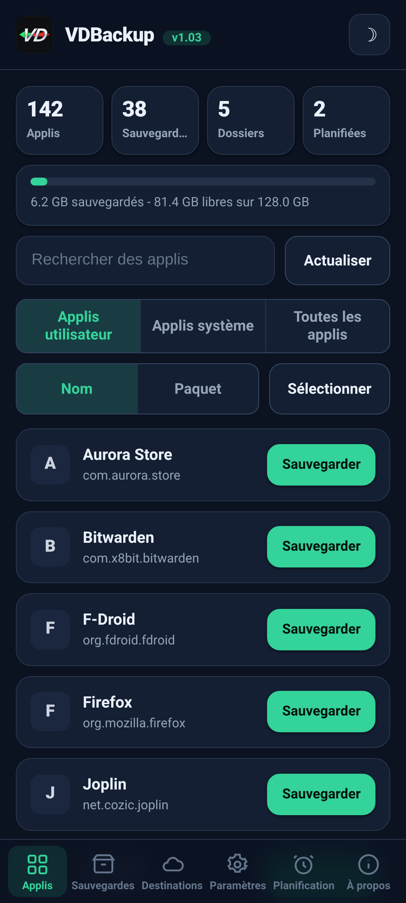
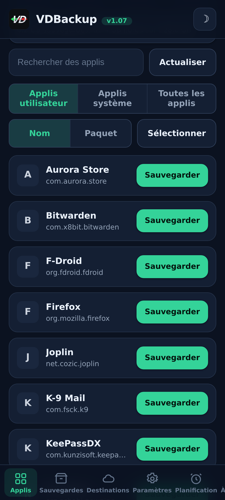
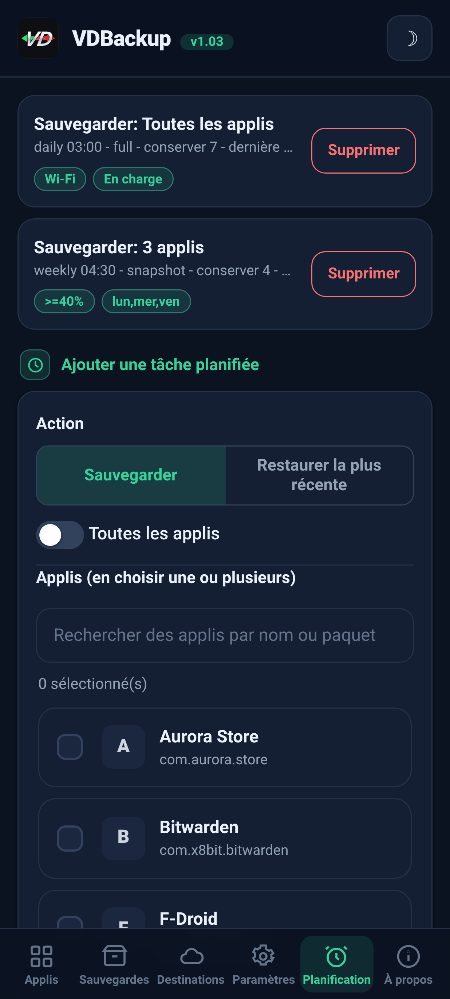
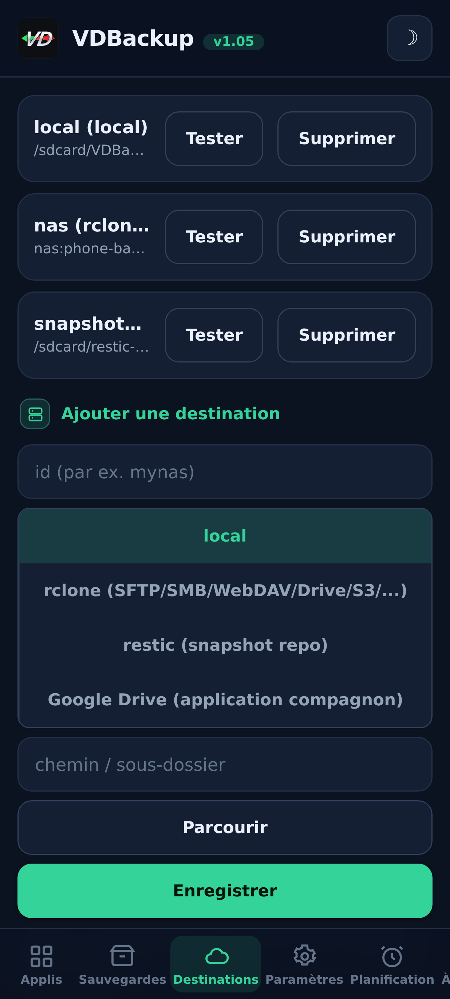
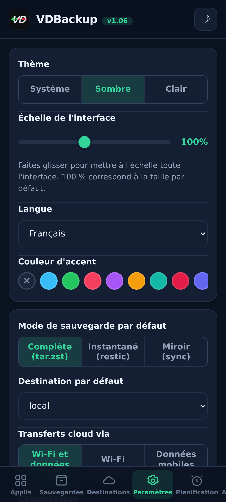
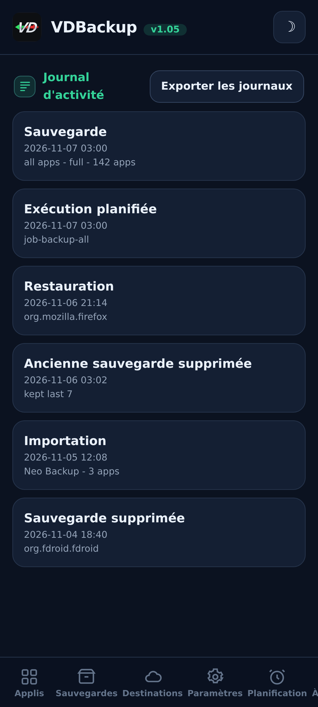

> **Languages:** [English](../USER-GUIDE.md) · [العربية](../ar/USER-GUIDE.md) · [Čeština](../cs/USER-GUIDE.md) · [Deutsch](../de/USER-GUIDE.md) · [Español](../es/USER-GUIDE.md) · [فارسی](../fa/USER-GUIDE.md) · Français · [हिन्दी](../hi/USER-GUIDE.md) · [Bahasa Indonesia](../in/USER-GUIDE.md) · [Italiano](../it/USER-GUIDE.md) · [日本語](../ja/USER-GUIDE.md) · [한국어](../ko/USER-GUIDE.md) · [Nederlands](../nl/USER-GUIDE.md) · [Polski](../pl/USER-GUIDE.md) · [Português](../pt/USER-GUIDE.md) · [Русский](../ru/USER-GUIDE.md) · [Svenska](../sv/USER-GUIDE.md) · [ไทย](../th/USER-GUIDE.md) · [Türkçe](../tr/USER-GUIDE.md) · [Tiếng Việt](../vi/USER-GUIDE.md) · [中文](../zh/USER-GUIDE.md)

---

# Guide utilisateur de VDBackup

Une présentation complète et accessible de VDBackup, de l'installation du module à la création de
votre première sauvegarde, sa restauration, son envoi vers le cloud, sa planification, et son ouverture
sur un PC des années plus tard. Si vous avez déjà utilisé Swift Backup, Neo-Backup ou
Android-DataBackup, cela vous semblera familier, sauf que tout se passe au même
endroit, sans rien à "autoriser".

## Table des matières

- [1. What VDBackup is](#1-what-vdbackup-is)
- [2. Requirements](#2-requirements)
- [3. Install and first run](#3-install-and-first-run)
- [4. The WebUI tour](#4-the-webui-tour)
- [5. Making a backup](#5-making-a-backup)
  - [5.1 Choosing what to back up](#51-choosing-what-to-back-up)
  - [5.2 Backup modes: Full, Snapshot, Mirror](#52-backup-modes-full-snapshot-mirror)
  - [5.3 Compression](#53-compression)
  - [5.4 Encryption](#54-encryption)
  - [5.5 Verify and dry-run](#55-verify-and-dry-run)
  - [5.6 Special backups (messages, call log, Wi-Fi, Bluetooth, calendar, wallpaper, DNS, system settings)](#56-special-backups-messages-call-log-wi-fi-bluetooth-calendar-wallpaper-dns-system-settings)
  - [5.7 Standalone folder and file backups](#57-standalone-folder-and-file-backups)
- [6. Restoring a backup](#6-restoring-a-backup)
- [7. Destinations: local and remote](#7-destinations-local-and-remote)
  - [7.1 Sauvegarder vos réglages](#71-sauvegarder-vos-réglages)
- [8. Scheduling and retention](#8-scheduling-and-retention)
- [9. Migrating in: importing Neo-Backup and Android-DataBackup](#9-migrating-in-importing-neo-backup-and-android-databackup)
- [10. SSAID (device ANDROID_ID)](#10-ssaid-device-android_id)
- [11. Portability: opening backups on a PC](#11-portability-opening-backups-on-a-pc)
- [12. Driving VDBackup from an AI assistant](#12-driving-vdbackup-from-an-ai-assistant)
- [13. Troubleshooting and FAQ](#13-troubleshooting-and-faq)
- [14. Uninstalling](#14-uninstalling)

---

## 1. Ce qu'est VDBackup

VDBackup est un module root avec une WebUI intégrée qui sauvegarde et restaure vos applications
et leurs données. Il est conçu comme le successeur ouvert et root-natif de Swift Backup,
Neo-Backup et Android-DataBackup : il vise à faire l'union de ce que font ces outils, en
un seul endroit, et il peut même importer vos sauvegardes Neo-Backup et
Android-DataBackup existantes afin que vous puissiez migrer sans rien perdre.

La différence clé par rapport à une application de sauvegarde ordinaire : VDBackup fonctionne **entièrement
depuis la WebUI de votre gestionnaire root**, et le module est déjà root. Il n'y a pas d'application compagne
à installer pour les fonctions de base, pas d'invite "accorder su" à approuver, et rien à activer.
Vous ouvrez la WebUI, choisissez ce qu'il faut sauvegarder, et vous lancez.

Tout ce que VDBackup produit utilise des **formats standard** (tar, gzip, zstd, age, zip,
restic), vos sauvegardes ne sont donc jamais enfermées dans le module et jamais liées à votre
appareil précis. Voir la [section 11](#section-11).

## Captures d'écran

| Accueil | Applis | Planification |
|:---:|:---:|:---:|
|  |  |  |
| **Destinations** | **Paramètres** | **Journal d'activité** |
|  |  |  |

## 2. Prérequis

- **Un appareil Android rooté** géré par **KernelSU**, **APatch** ou **Magisk**.
  VDBackup s'installe comme un module depuis ce gestionnaire.
- Assez d'espace de stockage libre pour vos sauvegardes (les sauvegardes locales résident sous le répertoire
  d'état du module ; voir la [section 3](#section-3)).
- Rien d'autre. Le module embarque tous les binaires dont il a besoin (tar, zstd, lz4, rclone,
  rsync, ssh, restic), donc **la sauvegarde et la restauration locales fonctionnent entièrement hors ligne**. Seules les
  destinations cloud communiquent avec le réseau.

Quelques extras fins (AppOps, SSAID, quelques morceaux système privilégiés) s'appuient sur le
framework Android ; le module les gère en interne, avec un repli en shell pur,
et ils se dégradent proprement quand ils ne sont pas disponibles sur votre appareil.

## 3. Installation et premier lancement

1. Téléchargez la dernière release `VD-Backup-vX.Y.zip`.
2. Dans votre gestionnaire KernelSU / APatch / Magisk, flashez le zip du module comme n'importe quel autre
   module.
3. Il est utilisable immédiatement, **aucun redémarrage nécessaire**. (Un redémarrage n'est jamais pertinent
   que lors de la restauration du SSAID ; voir la [section 10](#section-10).)
4. Ouvrez la **WebUI** du module depuis le gestionnaire. C'est toute l'interface.

**Quelle édition télécharger.** Chaque release est livrée en plusieurs éditions zip flashables, pour que vous ne téléchargiez que ce dont vous avez besoin. Choisissez-en une :

- **`VD-Backup-<ver>-universal-full.zip`**: toutes les architectures CPU et tous les binaires intégrés, dont `rclone` (fournisseurs cloud : Google Drive, S3 et plus de 70 autres backends rclone) et `restic` (snapshots dédupliqués). Entièrement hors ligne, rien n'est jamais téléchargé. Fonctionne sur n'importe quel appareil. Le plus gros téléchargement.
- **`VD-Backup-<ver>-universal-lite.zip`**: toutes les architectures, mais **sans** les deux plus gros binaires (`rclone` et `restic`). Le plus petit téléchargement ; fait toujours les sauvegardes locales, SSH/SFTP et rsync sans aucun téléchargement, avec le chiffrement portable `age`. La première fois que vous utilisez une destination cloud (`rclone`) ou le mode instantané (`restic`), la WebUI propose de télécharger une seule fois ce petit module complémentaire propre à l'architecture (vérifié par SHA-256) et le met en cache ; ensuite ces fonctions marchent aussi.
- **`VD-Backup-<ver>-<abi>-full.zip`** (l'une parmi `arm64-v8a`, `armeabi-v7a`, `x86`, `x86_64`), une seule architecture avec tous les binaires intégrés (les mêmes fonctions que `universal-full` mais uniquement pour l'architecture de votre appareil, donc plus petit que `universal-full`).

Si vous connaissez l'architecture de votre appareil et voulez tout intégré, choisissez la **`<abi>-full`** correspondante (la plupart des téléphones sont en **`arm64-v8a`**). Si vous voulez le plus petit téléchargement et qu'un téléchargement unique vérifié par SHA-256, la première fois que vous utilisez les fournisseurs cloud (`rclone`) ou les snapshots (`restic`), ne vous dérange pas, choisissez **`universal-lite`**. Si vous voulez tout intégré sans aucun téléchargement (hors ligne / récupération) et n'êtes pas sûr de l'architecture, choisissez une édition **full**. À l'installation, le module ne conserve que l'architecture de votre appareil, quelle que soit l'édition que vous flashez.

Au premier lancement, le module amorce une configuration par défaut (seulement si aucune n'existe encore), afin que
vos réglages soient préservés d'une mise à jour du module à l'autre.

**Où vivent les données d'état.** Les données de travail de VDBackup, votre configuration, les tâches planifiées,
les destinations enregistrées, les identifiants chiffrés, les journaux et la piste d'audit, et la zone de préparation -
vivent sous :

```
/data/adb/vdbackup/
```

**Où vivent les sauvegardes.** Les sauvegardes elles-mêmes sont écrites dans un stockage visible par l'utilisateur et
chiffré par identifiants (elles ne sont donc lisibles qu'après le déverrouillage de l'appareil, et elles
survivent à la désinstallation du module), un dossier par utilisateur Android :

```
/sdcard/VDBackup/            (= /data/media/<user>/VDBackup)
```

Gardez cela à l'esprit pour deux raisons : les sauvegardes occupent de l'espace sous `/sdcard/VDBackup`, et
`/data/adb/vdbackup/logs/` est l'endroit où regarder si quelque chose tourne mal.

## 4. Visite de la WebUI

La WebUI est organisée en quelques onglets :

- **Home**: un aperçu d'accueil montrant les comptes de vos sauvegardes (apps, sauvegardes, dossiers et tâches planifiées) et une barre de stockage indiquant l'espace utilisé par vos sauvegardes par rapport à l'espace libre, avec des badges de statut, copier les hachages et les chemins dans le presse-papiers, et une action **Check for updates**.
- **Apps**: la liste des applications installées (utilisateur et système), chacune affichée avec son vrai
  nom, son nom de package, et son icône (les icônes se chargent à la demande et sont mises en cache, la liste
  reste donc réactive). Le bouton sur une ligne sauvegarde l'app ; toucher la ligne ouvre l'historique de
  sauvegardes de cette app, où vous pouvez restaurer n'importe quelle sauvegarde précédente.
- **Backups**: les sauvegardes que vous avez déjà, chacune affichant le nom de l'app sur une ligne et
  le package sur la suivante. Touchez une sauvegarde pour voir tous ses détails (version, date, taille,
  items inclus, nombres de permissions, et l'appareil d'où elle provient). C'est aussi là que
  vous restaurez, lancez un test de restauration, supprimez une sauvegarde, ou importez des sauvegardes depuis Neo-Backup ou
  Android-DataBackup.
- **Destinations**: gérez où vont les sauvegardes : le stockage local plus toutes les destinations
  distantes que vous ajoutez (voir la [section 7](#section-7)). Vous pouvez
  tester une destination ici avant de compter dessus.
- **Settings**: un bascule de thème clair/sombre, un sélecteur de couleur d'accent (préréglages, une
  couleur personnalisée, ou réinitialisation) et un sélecteur de langue (l'interface s'affiche de droite à gauche pour l'arabe et le persan), un curseur d'échelle de l'interface que vous faites glisser
  pour redimensionner toute l'interface (en-tête, contenu et navigation du bas ensemble) de 85 % à 120 % (100 % est la valeur par défaut), pour les écrans de différentes densités de pixels,
  les valeurs par défaut pour les nouvelles
  tâches (compression par défaut, verify activé/désactivé, chiffrement par défaut), la politique réseau pour les
  transferts cloud (voir la [section 7](#section-7)), la sauvegarde automatique et la liste des apps exclues,
  l'option de source d'installation, la clé de chiffrement,
  et la planification. Les réglages activé/désactivé utilisent des interrupteurs à bascule de style Android.
- **About**: version, liens, les projets frères (Voir aussi), le manifeste d'audit des binaires empaquetés, et une action **Check for updates** qui indique si une version plus récente a été publiée (avec ses notes de version). Vous installez toute mise à jour via votre gestionnaire root, de la même façon que vous avez flashé le module.

L'app vérifie aussi d'elle-même s'il existe une version plus récente à chaque ouverture (au plus une fois par heure) et n'affiche la bannière de mise à jour que s'il y en a une ; elle reste silencieuse si à jour ou hors ligne.

Les confirmations et messages utilisent des boîtes de dialogue intégrées à l'app (pas les anciens pop-ups système), et une
restauration ou un import vous demande de reconnaître qu'il écrase les données actuelles de l'app avant
de continuer.

Les sauvegardes et restaurations s'exécutent **détachées** comme un processus root en arrière-plan. Vous pouvez fermer la
WebUI, ou même fermer le gestionnaire root, et l'opération continue. Quand vous
revenez, la WebUI se rattache et affiche la progression en direct avec un libellé de phase localisé. Pour
une tâche en cours, la carte de progression affiche aussi le débit de transfert en direct et le
temps restant estimé, plus un compteur d'éléments (par exemple "12 sur 40") avec le nom de
l'élément en cours. Sur
les ROM qui exposent les notifications shell, vous recevez aussi une notification Android quand une tâche
démarre et se termine ; dans tous les cas, la carte de progression intégrée à l'app est l'indicateur fiable.

## 5. Créer une sauvegarde

Le flux de base : ouvrez **Apps**, choisissez une app, sélectionnez ce qu'il faut inclure, choisissez un mode,
réglez la compression et (optionnellement) le chiffrement, puis lancez. La progression apparaît en direct et une
notification vous indique quand c'est terminé.

Dans la boîte de dialogue de sauvegarde, tu peux aussi choisir la **destination** de cette sauvegarde, stockage local ou toute destination cloud/distante ajoutée, sans d'abord changer la destination par défaut dans les Paramètres.

### 5.1 Choisir ce qu'il faut sauvegarder

Pour chaque app, vous pouvez inclure n'importe quelle combinaison de ces items :

| Item | Ce que c'est |
|------|-----------|
| **APK** | L'application installée elle-même (APK de base + éventuels APK splits). |
| **data** | Les données privées de l'app (`/data/data`). Ce sont les "données de l'app" habituelles. |
| **device-protected data** | Stockage direct-boot / protégé par l'appareil (`/data/user_de`). Certaines apps y conservent des réglages. |
| **external** | Les données externes de l'app sous `Android/data`. |
| **OBB** | Les fichiers d'extension OBB de l'app (`Android/obb`), utilisés par certains jeux. |
| **media** | Les médias de l'app sous `Android/media`. |

Un bon réglage par défaut pour "sauvegarder cette app complètement" est de tout inclure. Si vous
ne voulez que les données (par exemple pour déplacer une sauvegarde de jeu), vous pouvez désélectionner l'APK et les
gros items OBB/media.

VDBackup préserve aussi ce qui rend une restauration fidèle : contextes SELinux,
propriété uid/gid, modes de fichier, attributs étendus (xattr) et capacités.

### 5.2 Modes de sauvegarde : Full, Snapshot, Mirror

VDBackup propose trois modes. La WebUI présélectionne **Full**, qui est le bon choix
pour la plupart des gens.

- **Full**: une sauvegarde complète, autonome et portable, écrite en `tar.zst` (ou
  la compression que vous choisissez). Chaque exécution produit une sauvegarde indépendante que vous pouvez copier
  n'importe où et ouvrir sur un PC. Idéal pour : un instantané propre et portable d'une app que vous pouvez
  archiver et déplacer. C'est l'option par défaut et la plus portable.
- **Snapshot**: incrémental et versionné, appuyé par `restic`. Chaque exécution ajoute un nouveau
  snapshot ponctuel à un dépôt, ne stockant que ce qui a changé et
  dédupliquant entre les snapshots. Idéal pour : conserver un historique continu d'une app
  sans payer la taille complète à chaque exécution.
- **Mirror**: une synchro 1:1 des données en service vers la destination, appuyée par
  `rclone`/`rsync`. Elle garde la destination identique à ce qui est sur l'appareil à l'instant
  présent (les fichiers modifiés sont copiés, les fichiers supprimés sont supprimés sur la destination). Idéal
  pour : une copie rapide et toujours à jour, par exemple vers un remote cloud. Notez que l'APK
  est tout de même stocké compressé même dans un mirror, jamais brut.

### 5.3 Compression

Vous pouvez choisir la compression pour une sauvegarde Full :

- **none**: aucune compression (le plus rapide, le plus volumineux).
- **lz4**: compression très rapide et légère.
- **zstd**: le choix par défaut, un bon équilibre entre vitesse et ratio. Vous pouvez aussi choisir un
  niveau (par exemple un niveau plus élevé pour un fichier plus petit).
- **gzip**: le **"mode compatibilité"**. gzip s'ouvre avec des outils intégrés sur
  pratiquement n'importe quel ordinateur et dans la plupart des gestionnaires de fichiers, sans rien à installer en plus.
  Choisissez-le quand votre priorité est de pouvoir ouvrir l'archive n'importe où.

Si vous ne choisissez pas, VDBackup utilise sa valeur par défaut configurée (zstd à un niveau raisonnable).

### 5.4 Chiffrement

Le chiffrement est **optionnel** et portable. VDBackup chiffre avec **age** en utilisant une
phrase secrète (scrypt), qui a été choisie spécifiquement pour la portabilité : n'importe quel outil `age`
standard sur n'importe quel système d'exploitation peut déchiffrer votre sauvegarde avec seulement la phrase secrète.
Le chiffrement n'est **jamais** lié aux clés matérielles de votre appareil, donc une sauvegarde chiffrée
se restaure sur un autre appareil et s'ouvre sur un PC. (Un mode zip AES-256 compatible est aussi
disponible pour les archives chiffrées que vous voulez ouvrir d'un double-clic avec un mot de passe.)

Pour utiliser le chiffrement, générez une fois la clé de chiffrement (Settings), puis activez
le chiffrement pour votre tâche et définissez une phrase secrète. La phrase secrète est ce qui protège la
sauvegarde, choisissez-en donc une forte, il n'y a pas de clé matérielle et pas de porte dérobée de récupération.

**La règle de l'APK (importante) :**

- L'**APK est toujours stocké compressé**, jamais brut, pour économiser de l'espace.
- L'**APK n'est pas chiffré par défaut**, car l'APK d'une app est un contenu public.
- Le chiffrement de l'APK et le chiffrement des données sont des **bascules indépendantes**. Activer le chiffrement
  des données ne chiffre **pas** l'APK. Si vous voulez spécifiquement que l'APK soit chiffré
  aussi, activez explicitement la bascule de chiffrement de l'APK.

### 5.5 Verify et dry-run

Deux options de sûreté vous aident à faire confiance à une sauvegarde avant d'en dépendre :

- **Verify**: après l'écriture, VDBackup re-hache chaque archive et la vérifie par rapport
  au manifeste. C'est **activé par défaut pour les sauvegardes Full**. Si un fichier ne correspond pas,
  la tâche échoue avec une erreur claire plutôt que de vous laisser avec une sauvegarde silencieusement corrompue.
- **Dry-run**: planifie la tâche et rapporte les tailles qu'elle produirait **sans rien
  écrire**. Utilisez-le pour estimer l'espace ou pour vérifier votre sélection d'items avant de lancer
  la vraie opération.

Quand une sauvegarde part vers une destination **cloud**, VDBackup ajoute deux garde-fous
supplémentaires. Il effectue une étape finale **vérifiée par somme de contrôle** qui revérifie la
copie téléversée face à l'original sur le remote, et fait échouer la tâche (plutôt que de laisser
une copie corrompue dans le cloud) s'ils ne correspondent pas. Et avant un téléversement Full, il
vérifie l'**espace libre** du remote et s'arrête tôt avec une erreur claire d'**"espace
insuffisant"** si la sauvegarde ne tient pas, au lieu de remplir le remote et d'échouer à
mi-chemin. (La vérification d'espace concerne les téléversements Full ; le Mirror est une synchro
delta et en est exempt.)

### 5.6 Sauvegardes spéciales (messages, journal d'appels, Wi-Fi, Bluetooth, calendrier, fond d'écran, DNS, réglages système)

Sous les listes d'apps de l'onglet **Backups**, les **Sauvegardes spéciales** couvrent des données
à l'échelle du système qui ne sont pas liées à une seule app. Choisissez les catégories et
sauvegardez-les ; elles sont archivées avec la même préservation SELinux/xattr et le même chiffrement
optionnel que les sauvegardes d'apps. Les catégories sont :

| Catégorie | Ce que c'est |
|----------|-----------|
| **Messages (SMS/MMS)** | Vos messages texte. |
| **Contacts et journal d'appels** | Vos contacts et votre historique d'appels. |
| **Réseaux Wi-Fi** | Vos réseaux Wi-Fi enregistrés. |
| **Bluetooth** | Vos appairages Bluetooth. |
| **Calendrier** | Le fournisseur de calendrier (app et données). Un **`calendar.json` portable** est également écrit, pour que vos événements soient lisibles sur un PC sans le module. |
| **Fond d'écran** | Vos fonds d'écran d'accueil et de verrouillage plus `wallpaper_info.xml`, stockés comme l'image brute. |
| **DNS** | Votre mode DNS privé et votre serveur. |
| **Réglages système** | Un dump complet des réglages système, global et secure de l'appareil. |

Pour les messages, le journal d'appels et les contacts, une **copie portable** (JSON ouvrable) est
également écrite, vous disposez ainsi d'une copie multi-appareils lisible sur un PC sans le module.

**Les réglages système sont opt-in et écrasent les réglages de votre appareil à la restauration.**
Tout comme SSAID (voir la [section 10](#section-10)), la catégorie **Réglages système** est la plus
sensible : la restaurer écrase les réglages à l'échelle de votre appareil, elle est donc désactivée à
moins que vous ne la sélectionniez délibérément, vous demande d'abord de reconnaître, et est écrite
dans le journal d'activité.

Restaurer une sauvegarde spéciale écrase des données système en service et nécessite un redémarrage,
elle est donc protégée par une reconnaissance bien visible et fiable sur le même appareil et la même
ROM. Les restaurations sont **idempotentes** : les catégories brutes (messages, contacts, Wi-Fi,
Bluetooth, calendrier) sont restaurées en **remplaçant** les données plutôt qu'en les fusionnant, de
sorte que restaurer deux fois la même sauvegarde ne crée jamais de doublons, et le DNS et les réglages
système sont simplement réappliqués.

### 5.7 Sauvegardes autonomes de dossiers et de fichiers

Parfois vous voulez sauvegarder un simple dossier ou fichier qui n'est pas une app, un dossier
d'appareil photo, un répertoire de documents, une seule base de données. VDBackup peut sauvegarder
**n'importe quel chemin absolu** sur le stockage partagé ou sous `/data`, avec le même format portable
qu'une sauvegarde d'app : une archive `tar.zst` plus un `manifest.json`, scellé en SHA-256, avec une
note RECOVERY quand vous la chiffrez. Ces sauvegardes de chemin sont conservées séparément, sous un
dossier `.paths` dans votre répertoire de sauvegardes.

- **Choisissez un chemin et sauvegardez-le.** La source doit être un chemin absolu sous l'un des
  emplacements autorisés (`/storage/emulated`, `/data/media`, `/sdcard`, `/data`). Les chemins qui
  tentent de remonter avec `..` sont refusés.
- **La restauration réécrit vers l'emplacement d'origine**, donc, comme toute restauration, elle est
  destructrice et vous demande de **confirmer** avant d'écraser quoi que ce soit.
- Comme les sauvegardes d'apps, les sauvegardes et restaurations de chemin s'exécutent **détachées**
  avec une progression en direct, utilisent la compression que vous choisissez, et peuvent être
  chiffrées avec une phrase secrète.

## 6. Restaurer une sauvegarde

Ouvrez l'onglet **Backups**, choisissez la sauvegarde que vous voulez, et démarrez la restauration. Parce que
la restauration est une action destructrice, VDBackup vous demande de **confirmer** d'abord, et il
enregistre l'action dans un journal d'audit local.

Une restauration est **fidèle** : VDBackup efface l'état actuel de l'app et extrait la
sauvegarde, de sorte que l'app est ramenée à l'**état exact** capturé dans cette sauvegarde
(y compris propriété, modes, contextes SELinux et xattr). Ce n'est pas une fusion, c'est une
vraie restauration au point temporel de la sauvegarde. Parce qu'une restauration s'exécute en
root, VDBackup vérifie aussi chaque archive avant d'extraire quoi que ce soit et refuse une archive
altérée qui tente d'écrire hors de sa cible, de sorte qu'une sauvegarde modifiée ne peut jamais
écraser le reste de votre système.

Options de restauration utiles :

- **Restore-test**: extrait la sauvegarde vers une zone de préparation temporaire et la vérifie
  **sans toucher à l'app en service**. C'est la façon sûre de confirmer qu'une sauvegarde est
  intacte et restaurable avant d'écraser quoi que ce soit. Si le test échoue, vous obtenez une
  erreur claire et votre app installée reste intacte.
- **Restauration partielle**: restaurez seulement certains des items qui ont été sauvegardés. Par
  exemple, restaurez juste les données de l'app sans réinstaller l'APK, ou restaurez les
  fichiers de sauvegarde sans les gros OBB/media. Choisissez les items voulus sur l'écran de restauration.
- Pour les sauvegardes **Snapshot** et **Mirror**, la restauration tire respectivement du dépôt versionné
  ou de la copie en miroir.
- **Source d'installation**: par défaut, une app restaurée indique le **Play Store** comme sa
  source d'installation (au lieu d'avoir l'air sideloadée), ce qu'attendent la plupart des apps et des
  vérifications d'app. Vous pouvez le désactiver globalement dans Settings ou par restauration, et quand
  c'est désactivé la source d'installation d'origine est conservée. Une bascule avancée opt-in
  **"forger la source d'origine"** va plus loin et fait aussi en sorte que le paquet et la source du paquet
  à l'origine de l'installation de l'app aient l'air installés depuis le Play Store ; elle modifie la base de
  données système des paquets (sauvegardée d'abord) et prend effet après un redémarrage.

**Restauration par lot.** L'onglet **Backups** dispose d'un mode **Select**, de la même manière que l'onglet
**Apps** l'a pour la sauvegarde par lot. Activez **Select**, cochez les sauvegardes voulues avec leurs cases, et
restaurez-les toutes en une fois. Une seule boîte de dialogue d'options couvre toute la sélection, la
confirmation d'écrasement, le restore-test et le choix de la source d'installation s'appliquent à chaque
sauvegarde choisie, et elles sont restaurées l'une après l'autre.

**Supprimer une sauvegarde.** Ouvrez les détails d'une sauvegarde (ou l'historique d'une app) et utilisez
**Delete** ; il vous est demandé de confirmer, et la suppression est écrite dans le journal d'activité. Vous
pouvez aussi plafonner le nombre de sauvegardes à conserver par app (rétention) afin que les anciennes soient
élaguées automatiquement.

**Monter une app installée en tant qu'app système.** Depuis l'historique de sauvegardes d'une app, **Mount as
system** prépare l'APK de l'app dans un sous-module d'overlay VDBackup afin que le gestionnaire root la serve
depuis `/system/app` (ou `/system/priv-app`), la vraie partition `/system` n'est jamais touchée. Avec
**NoMount** sur KernelSU, cela s'applique en direct ; sinon cela s'applique après un redémarrage. Cela ne
dépend jamais de l'installation de NoMount.

## 7. Destinations : locale et distante

Par défaut, les sauvegardes sont écrites dans le stockage **local** sous le répertoire d'état du
module. Vous pouvez aussi ajouter des destinations distantes dans l'onglet **Destinations**. Pour une
destination locale, **Browse** ouvre un sélecteur de dossier afin que vous puissiez choisir un
sous-dossier sous le stockage partagé (`/sdcard`) au lieu de taper le chemin.

Le transport distant est géré par les outils empaquetés :

- **rclone**: le hub pour un énorme éventail de remotes : **SFTP, SMB, WebDAV, FTP, S3,
  Google Drive** et plus de 70 autres services.
- **rsync** et la suite **ssh/scp/sftp**: pour la synchro delta et les cibles SSH simples.
- **restic**: des dépôts **Snapshot** chiffrés et dédupliqués (locaux ou distants).

**Créer un remote cloud (pas de SSH nécessaire).** Dans l'onglet Destinations, choisissez le
type de destination **rclone** et utilisez **Add cloud remote**. Vous pouvez connecter
**n'importe quel backend rclone** : la liste déroulante propose les plus courants (**Google Drive,
Dropbox, OneDrive, Box, pCloud, Mega, Backblaze B2, S3, SFTP, WebDAV, FTP, SMB**) plus une option
**Custom (advanced)** où vous tapez n'importe quel autre type de backend et ses paramètres
`key=value`. Remplissez les champs (host/user/password, ou les clés S3, par exemple) et
enregistrez. Pour les fournisseurs qui vous connectent via un navigateur (Google Drive, Dropbox,
OneDrive, Box, pCloud), utilisez le bouton **Authorize in browser** : il vous connecte via le
navigateur du téléphone lui-même et capture le token automatiquement, donc **aucun PC n'est
nécessaire** (coller un token à la main reste possible comme solution de repli). Le remote apparaît
alors dans la liste des remotes de la destination. Les mots de passe sont stockés obscurcis, jamais
en clair. Vous pouvez lister et supprimer vos remotes depuis le même endroit.

Deux règles rendent l'usage distant sûr :

- **Les identifiants sont stockés chiffrés** au repos dans le répertoire d'état du module, jamais
  en clair.
- **Validez avant d'utiliser.** Utilisez le test de destination dans l'onglet Destinations pour
  confirmer qu'une destination fonctionne avant d'y pointer une vraie sauvegarde.

**Politique réseau (Wi-Fi vs données mobiles).** Dans Settings, "Cloud transfers over" vous permet de
restreindre quelle connexion les transferts cloud peuvent utiliser : **Wi-Fi et données mobiles** (le
choix par défaut), **Wi-Fi uniquement**, ou **Données mobiles uniquement**. Quand vous le restreignez, chaque transfert
cloud, manuel ou planifié, téléversement ou restauration, vérifie d'abord la connexion active
et refuse de s'exécuter sur la mauvaise, de sorte qu'une politique Wi-Fi uniquement ne dépense jamais de données mobiles.
Les sauvegardes locales ne sont jamais affectées.

**Google Drive.** Vous avez deux façons d'atteindre Google Drive :

1. **Via rclone**: ajoutez Drive comme un remote rclone comme n'importe quelle autre destination, sans
   application supplémentaire et **sans compte Google Cloud**. Sur n'importe quel ordinateur, lancez
   `rclone authorize "drive"` une fois, connectez-vous à votre compte Google dans le navigateur, et
   collez le token qu'il affiche dans le champ token du remote Drive.
2. **Via le compagnon optionnel**: une petite application compagne opt-in qui gère la
   connexion Google et le téléversement vers Drive. Elle est installée **uniquement quand vous choisissez explicitement
   la destination compagnon Google Drive**, jamais par défaut, et elle est retirée quand
   vous la désactivez. L'écran de consentement Google unique est la seule étape qui se passe
   hors de la WebUI. Quand le compagnon est installé, VDBackup vous rappelle de
   **toujours le masquer avec [HMA-OSS](https://github.com/frknkrc44/HMA-OSS)** afin que sa présence ne révèle ni root ni
   un bootloader déverrouillé, et il propose de l'ajouter à la liste [HMA-OSS](https://github.com/frknkrc44/HMA-OSS) pour vous. VDBackup vous rappelle aussi, lorsque vous avez des sauvegardes locales, de masquer le dossier de sauvegarde (/sdcard/VDBackup) avec SUSFS pour la même raison.

### 7.1 Sauvegarder vos réglages

Votre propre configuration de VDBackup, les destinations, planifications, préréglages et identifiants enregistrés, peut être écrite dans un seul fichier et emportée sur un autre appareil ou restaurée après une réinstallation. Dans **Réglages**, sous **Sauvegarde des réglages** :

- **Exporter les réglages** écrit un fichier chiffré dans `VDBackup/.export`. Il demande toujours une phrase secrète, car le fichier contient vos mots de passe distants.
- **Importer les réglages** relit un tel fichier et le fusionne dans cet appareil, sans supprimer ce qui s'y trouve déjà.
- **Effacer les identifiants enregistrés** supprime les mots de passe distants enregistrés et la clé de chiffrement de l'appareil en une seule étape ; vos destinations, planifications et sauvegardes restent en place.

## 8. Planification et rétention

VDBackup peut exécuter des sauvegardes, et des restaurations, automatiquement selon une planification. Dans le
planificateur, vous définissez une tâche avec :

- une **cible**: une seule app, un ensemble d'apps, ou **toutes les apps** (moins la liste des apps exclues), et
  les items/le mode à utiliser,
- une **action**: **Back up** (par défaut) ou **Restore latest**, qui restaure la sauvegarde la plus récente de
  chaque app ciblée,
- une destination,
- une **planification de type cron**: horaire, quotidienne ou hebdomadaire, à une heure que vous choisissez (HH:MM),
- un réglage de **rétention** : **garder les N** sauvegardes les plus récentes de cette tâche, les plus anciennes sont
  élaguées automatiquement,
- des **conditions d'exécution** optionnelles : uniquement en **Wi-Fi**, uniquement en **charge**,
  uniquement à un **niveau de batterie minimum**, et uniquement les **jours de la semaine** choisis.

Les tâches planifiées sont déclenchées par un battement de cœur au démarrage dans le module : quand une tâche est
due, elle s'exécute, enregistre son heure de dernière exécution afin de ne pas se déclencher deux fois, et applique la
rétention pour élaguer les anciennes sauvegardes. Parce que tout s'exécute en root en arrière-plan, les
sauvegardes planifiées n'ont pas besoin que la WebUI soit ouverte.

**Conditions d'exécution (gates).** Une tâche planifiée peut porter des conditions qui doivent
être remplies pour qu'elle s'exécute : Wi-Fi uniquement, charge uniquement, un niveau de batterie
minimum, et des jours précis de la semaine. Quand une tâche est due mais qu'une condition n'est
pas remplie, elle est **ignorée et réessayée à la prochaine vérification**: sa planification
n'avance pas, elle s'exécute donc dès que la condition est satisfaite. Une vérification thermique
intégrée ignore aussi une tâche planifiée tant que l'appareil est trop chaud. Chacun de ces sauts
est consigné dans le journal d'activité.

**La restauration planifiée écrase à chaque exécution.** Une tâche **Restore latest** re-restaure la sauvegarde
la plus récente de chaque app ciblée à chaque déclenchement, et la restauration est destructrice : à chaque
exécution, elle **écrase les données actuelles de l'app** par la dernière sauvegarde. C'est délibéré et opt-in -
ne la choisissez que lorsque vous voulez maintenir les cibles à leur sauvegarde la plus récente.

**Sauvegarde automatique à l'installation/mise à jour.** Dans Settings, vous pouvez activer la **sauvegarde
automatique** : le même battement de cœur en arrière-plan remarque les apps nouvellement installées ou mises à
jour et les sauvegarde pour vous (avec rétention keep-N). La première exécution ne fait qu'enregistrer ce qui
est installé, de sorte que l'activer ne sauvegarde jamais tout votre appareil d'un coup.

**Apps exclues (liste de blocage).** Toujours dans Settings, vous pouvez exclure les apps que vous ne voulez
jamais voir sauvegardées automatiquement ou selon une planification ; vous pouvez en ajouter plusieurs à la fois (sélection multiple), et les apps exclues sont ignorées par les deux.

**Préréglages de sauvegarde.** Également dans les Réglages, vous pouvez enregistrer des préréglages nommés, des ensembles d'éléments à inclure, comme APK seul ou APK + OBB, et en choisir un dans la boîte de sauvegarde pour remplir les choix d'un coup.

**Éléments de sauvegarde par app.** Également dans les Réglages, vous pouvez choisir exactement quels éléments chaque app sauvegarde dans les sauvegardes en masse, automatiques et planifiées, par exemple APK seul, ou APK + OBB. Une sauvegarde manuelle individuelle vous laisse toujours choisir sur le moment, à partir de l'ensemble de l'app. Les apps que vous ne réglez pas ici sauvegardent tout.

**Étiquettes d'applications.** Touchez une application dans les Réglages (Éléments et étiquettes par application) pour lui donner des libellés libres, par exemple games ou work. Un sélecteur d'étiquettes apparaît alors au-dessus de la liste : choisissez une étiquette pour n'afficher que ses applications, et sauvegardez tout le groupe d'un coup. Vous pouvez aussi y accéder depuis l'onglet Applications : touchez une application, puis Éléments et étiquettes.

**Journal d'activité.** L'onglet Schedule dispose d'un bouton **View activity log** qui ouvre un écran complet
(instantanément) affichant la piste d'audit locale, sauvegardes, restaurations, suppressions, exécutions planifiées et automatiques, et élagages -
les plus récentes d'abord. Une action **Export logs** enregistre un fichier journal (dans le dossier des sauvegardes) que vous pouvez joindre à un rapport de retour ou de bogue.

## 9. Migrer : importer Neo-Backup et Android-DataBackup

Si vous venez de Neo-Backup ou Android-DataBackup, vous n'avez pas à repartir
de zéro. Depuis l'onglet **Backups**, vous pouvez **importer** vos sauvegardes existantes :

1. Pointez VDBackup vers l'emplacement de vos sauvegardes Neo-Backup ou Android-DataBackup
   existantes (import-scan liste ce qu'il y trouve).
2. Choisissez quelles sauvegardes importer.
3. Démarrez l'import. Comme les autres opérations longues, il s'exécute détaché avec une progression en direct.

**Les sauvegardes Neo-Backup chiffrées par mot de passe sont prises en charge.** Les sauvegardes Neo-Backup
chiffrées en AES-256 peuvent être importées, le **mot de passe vous est demandé** quand il est
nécessaire, et le mot de passe n'est utilisé que pour déchiffrer, jamais stocké dans la ligne de commande.

## 10. SSAID (ANDROID_ID de l'appareil)

Le SSAID est l'`ANDROID_ID` par app, un identifiant au niveau de l'appareil que certaines apps lisent.
VDBackup peut le sauvegarder et le restaurer, mais c'est la chose la plus sensible qu'il
touche, elle est donc gérée avec un soin particulier :

- **Il est OPTIONNEL et DÉSACTIVÉ par défaut.** VDBackup ne capturera ni ne restaurera **jamais** le
  SSAID sauf si vous l'activez explicitement pour cette tâche. La WebUI affiche un avis "Optional"
  clairement marqué et mis en évidence partout où le SSAID apparaît (sauvegarde, restauration et
  import), et il reste désactivé jusqu'à ce que vous l'activiez.
- **Il ne s'applique qu'après un redémarrage à la restauration.** Le fournisseur de réglages Android met en cache
  ces valeurs, donc un SSAID restauré ne prend effet qu'après le redémarrage de l'appareil.
- **La valeur précédente est toujours sauvegardée d'abord.** Avant d'écraser tout SSAID,
  VDBackup copie le `settings_ssaid.xml` en service octet pour octet vers une sauvegarde horodatée
  (qui n'est jamais auto-supprimée). Si cette copie de sûreté ne peut pas être faite, l'écrasement
  n'a pas lieu. Pour revenir en arrière, restaurez ce fichier enregistré et redémarrez.

**Recommandation :** laissez le SSAID désactivé sauf si vous savez spécifiquement en avoir besoin (par
exemple, une app particulière qui se lie à l'ID de l'appareil et que vous migrez
délibérément). Pour les sauvegardes d'apps et de données ordinaires, vous n'en avez pas besoin.

## 11. Portabilité : ouvrir les sauvegardes sur un PC

Vos sauvegardes **ne sont pas enfermées dans ce module** et ne sont **jamais liées au matériel**.
Tout utilise des formats standard, vous pouvez donc ouvrir une sauvegarde sous Windows, macOS ou Linux
sans VDBackup installé.

Un dossier de sauvegarde Full contient un `manifest.json` (la source de vérité décrivant chaque
fichier, la version de l'app et le propriétaire/contexte d'origine), les APK en `*.apk.zst`, et
les archives de données en `<item>.tar.zst` (ou `.tar.gz` / `.tar.lz4`), optionnellement avec un
`.age` final quand elles sont chiffrées.

Pour en ouvrir une sur un PC, en bref :

- **Déchiffrez** (seulement si le fichier se termine par `.age`) avec l'outil standard `age` et votre
  phrase secrète ou votre fichier de clé.
- **Décompressez et extrayez** : `.tar.zst` avec `zstd` puis `tar` ; `.tar.gz` avec `tar`
  directement ; `.tar.lz4` via `zstd --format=lz4`. Un APK n'est qu'un APK compressé en zstd,
  donc décompresser `base.apk.zst` vous donne un `base.apk` normal et installable.

Chaque sauvegarde chiffrée est livrée avec une note **RECOVERY** contenant les commandes exactes
à copier-coller pour Windows, macOS et Linux. Voir
[`../module/etc/RECOVERY.md`](RECOVERY.md) pour le kit complet, étape par étape.

Notez que les contextes SELinux, uid/gid et modes sont stockés à l'intérieur du tar et ne sont
réappliqués correctement que lorsque vous restaurez sur Android, sur un PC vous obtenez tout de même tous vos fichiers,
juste sans que la propriété spécifique à Android soit appliquée.

## 12. Piloter VDBackup depuis un assistant IA

VDBackup est construit pour être accueillant envers les assistants et agents IA, pas seulement les personnes. La
WebUI n'est qu'un client d'une petite API JSON ; un agent peut administrer **chaque** action
du module sans interface via cette même API (chaque commande renvoie un seul objet JSON,
les opérations longues s'exécutent détachées et vous interrogez leur progression, et les mêmes garde-fous
s'appliquent, le SSAID reste opt-in, les actions mutantes restent confirmées et auditées).

Si vous voulez qu'un assistant exécute vos sauvegardes et restaurations pour vous, pointez-le vers
[`AI-AGENTS.md`](AI-AGENTS.md), qui documente toute la surface de contrôle : le contrat de
commande, chaque verbe avec ses arguments et sa valeur de retour, et les règles de sûreté qu'un
agent doit respecter.

## 13. Dépannage et FAQ

**Où sont les journaux ?** Sous le répertoire d'état du module,
`/data/adb/vdbackup/logs/`. La progression en direct d'une opération en cours est dans
`progress-<opid>.json`, et la **piste d'audit** des actions mutantes (restauration, suppression,
import, changements de SSAID) est dans `audit.jsonl`.

**Une sauvegarde/restauration semble bloquée ou j'ai fermé la WebUI.** Les opérations s'exécutent détachées, donc
fermer la WebUI ne les arrête pas. Rouvrez la WebUI et elle se rattache à toute
opération en cours et affiche la progression actuelle.

**J'ai reçu un message `ERR_...`.** Les erreurs sont rapportées avec un code clair. Quelques
courantes :
- `ERR_VERIFY`, une archive écrite ne correspondait pas à son hash de manifeste (la vérification
  a attrapé une mauvaise sauvegarde). Relancez la sauvegarde.
- `ERR_RESTORE_TEST`, un test de restauration a échoué ; la sauvegarde ne s'est pas extraite/vérifiée
  proprement et votre app en service est restée intacte.
- `ERR_UNSAFE_ARCHIVE`, une archive a été refusée parce qu'elle tentait d'écrire hors de son
  répertoire cible (chemins absolus ou `..`). Cela vous protège d'une sauvegarde altérée ; rien n'a
  été écrit.
- `ERR_QUOTA`, un remote cloud n'avait pas assez d'espace libre pour un téléversement Full ; la
  sauvegarde a été arrêtée avant tout téléversement.

**Ma destination distante échoue.** Utilisez le **test** de destination dans l'onglet Destinations
pour valider les identifiants et la connectivité. Rappelez-vous que seules les destinations cloud ont besoin
du réseau ; la sauvegarde/restauration locale est entièrement hors ligne.

**Est-ce que quelque chose là-dedans téléphone à la maison ou télécharge à l'exécution ?** Non. Tous les binaires sont empaquetés
dans le module au moment du build ; rien n'est récupéré sur l'appareil à l'exécution. Seules les destinations
cloud (rclone/restic/ssh) communiquent avec le réseau, et seulement quand vous les utilisez.

**Ma sauvegarde se restaurera-t-elle sur un autre téléphone ?** Oui, les sauvegardes sont portables et non
liées au matériel de l'appareil. (Le SSAID est la seule exception spécifique à l'appareil, et il est opt-in
et appliqué au redémarrage ; voir la [section 10](#section-10).)

**Ma sauvegarde chiffrée ne s'ouvre pas, j'ai perdu la phrase secrète.** Il n'y a pas de porte dérobée de récupération
par conception ; la phrase secrète est ce qui protège la sauvegarde. Gardez-la en sécurité.

## 14. Désinstallation

Désinstallez VDBackup comme tout autre module depuis votre gestionnaire KernelSU / APatch / Magisk. La désinstallation **préserve votre configuration** et ne supprime que l'état transitoire, donc une réinstallation ultérieure reprend votre configuration, vos destinations et vos planifications. Elle conserve vos sauvegardes sous `/sdcard/VDBackup` (formats standard, ouvrables sur un PC sans le module), votre configuration sous `/data/adb/vdbackup`, et vos identifiants enregistrés, le rclone.conf et la clé age sous `/data/misc_ce/0/vdbackup` chiffré par identifiant (verrouillé jusqu'au premier déverrouillage). Pour supprimer l'un d'eux aussi, effacez ce répertoire manuellement après la désinstallation.

---

*Cette documentation a été générée avec Claude (Anthropic) et est maintenue par VD171. Les corrections et améliorations sont les bienvenues, voir [CONTRIBUTING.md](CONTRIBUTING.md).*
