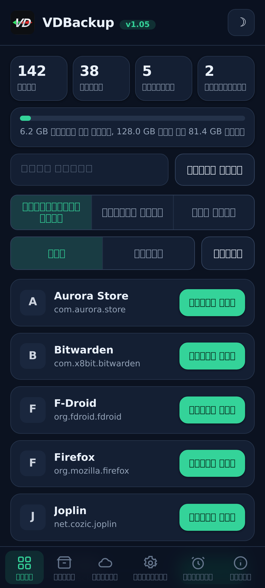
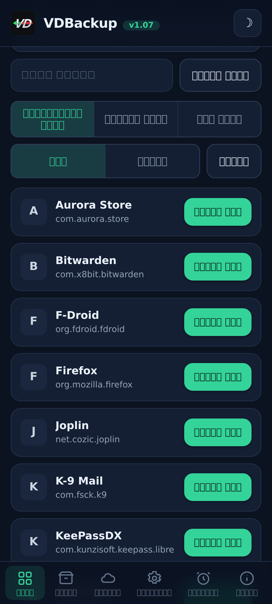
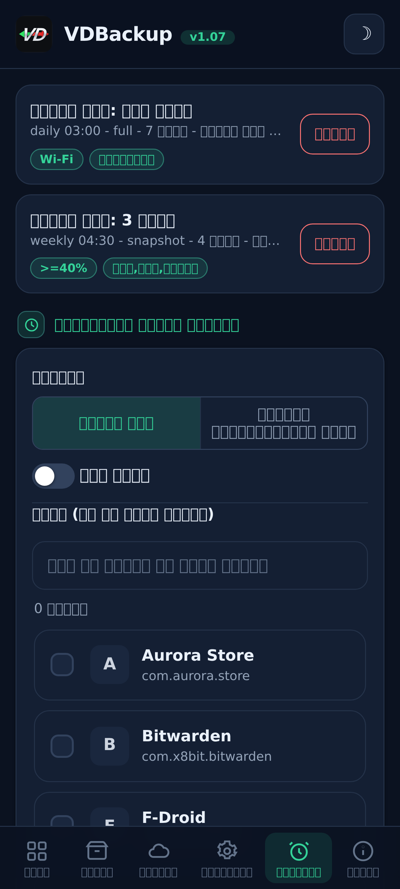
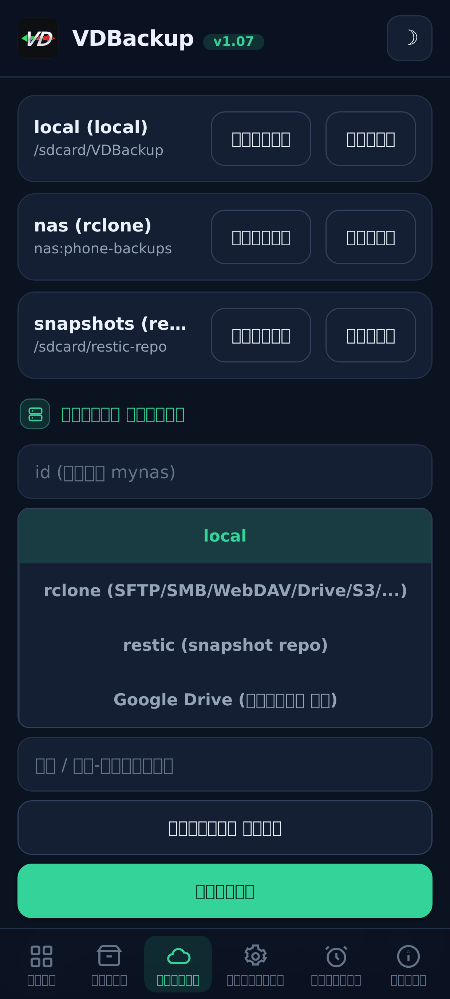
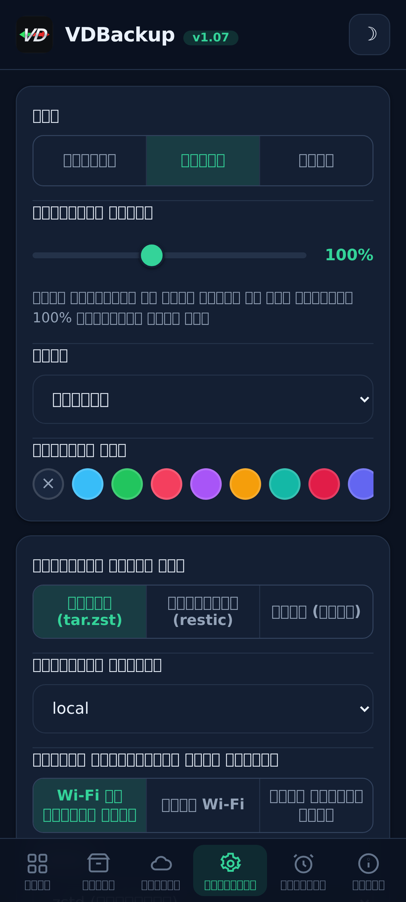
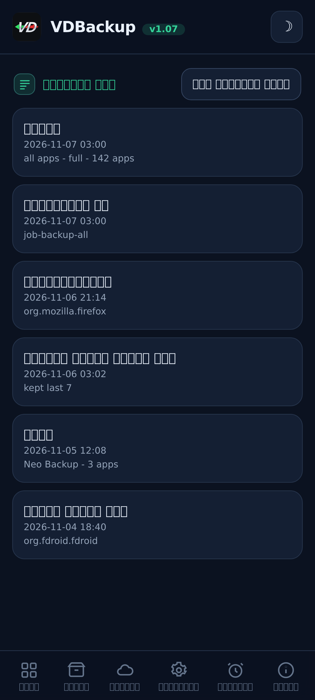

> **Languages:** [English](../USER-GUIDE.md) · [العربية](../ar/USER-GUIDE.md) · [Čeština](../cs/USER-GUIDE.md) · [Deutsch](../de/USER-GUIDE.md) · [Español](../es/USER-GUIDE.md) · [فارسی](../fa/USER-GUIDE.md) · [Français](../fr/USER-GUIDE.md) · हिन्दी · [Bahasa Indonesia](../in/USER-GUIDE.md) · [Italiano](../it/USER-GUIDE.md) · [日本語](../ja/USER-GUIDE.md) · [한국어](../ko/USER-GUIDE.md) · [Nederlands](../nl/USER-GUIDE.md) · [Polski](../pl/USER-GUIDE.md) · [Português](../pt/USER-GUIDE.md) · [Русский](../ru/USER-GUIDE.md) · [Svenska](../sv/USER-GUIDE.md) · [ไทย](../th/USER-GUIDE.md) · [Türkçe](../tr/USER-GUIDE.md) · [Tiếng Việt](../vi/USER-GUIDE.md) · [中文](../zh/USER-GUIDE.md)

---

# VDBackup उपयोगकर्ता मार्गदर्शिका

VDBackup की एक पूर्ण, मित्रवत पैदल-यात्रा, मॉड्यूल इंस्टॉल करने से लेकर अपना
पहला backup बनाने, उसे restore करने, उसे क्लाउड में भेजने, उसे निर्धारित करने, और वर्षों बाद उसे
PC पर खोलने तक। यदि आपने पहले Swift Backup, Neo-Backup या
Android-DataBackup का उपयोग किया है, तो यह परिचित लगेगा - बस सब कुछ एक ही
जगह होता है, और कुछ भी "अनुमति देने" को नहीं।

## विषय-सूची

- [1. VDBackup क्या है](#1-vdbackup-कय-ह)
- [2. आवश्यकताएँ](#2-आवशयकतए)
- [3. इंस्टॉल और पहली बार चलाना](#3-इसटल-और-पहल-बर-चलन)
- [4. WebUI की सैर](#4-webui-क-सर)
- [5. एक backup बनाना](#5-एक-backup-बनन)
  - [5.1 क्या backup करना है चुनना](#51-कय-backup-करन-ह-चनन)
  - [5.2 Backup modes: Full, Snapshot, Mirror](#52-backup-modes-full-snapshot-mirror)
  - [5.3 संपीड़न](#53-सपडन)
  - [5.4 एन्क्रिप्शन](#54-एनकरपशन)
  - [5.5 Verify और dry-run](#55-verify-और-dry-run)
  - [5.6 विशेष बैकअप (संदेश, कॉल लॉग, Wi-Fi, Bluetooth, कैलेंडर, वॉलपेपर, DNS, सिस्टम सेटिंग्स)](#56-वशष-बकअप-सदश-कल-लग-wi-fi-bluetooth-कलडर-वलपपर-dns-ससटम-सटगस)
  - [5.7 स्वतंत्र फ़ोल्डर और फ़ाइल बैकअप](#57-सवततर-फलडर-और-फइल-बकअप)
- [6. एक backup को restore करना](#6-एक-backup-क-restore-करन)
- [7. गंतव्य: स्थानीय और remote](#7-गतवय-सथनय-और-remote)
- [8. निर्धारण और धारण](#8-नरधरण-और-धरण)
- [9. माइग्रेट करना: Neo-Backup और Android-DataBackup आयात करना](#9-मइगरट-करन-neo-backup-और-android-databackup-आयत-करन)
- [10. SSAID (डिवाइस ANDROID_ID)](#10-ssaid-डवइस-android_id)
- [11. पोर्टेबिलिटी: PC पर backups खोलना](#11-परटबलट-pc-पर-backups-खलन)
- [12. किसी AI असिस्टेंट से VDBackup चलाना](#12-कस-ai-अससटट-स-vdbackup-चलन)
- [13. समस्या-निवारण और FAQ](#13-समसय-नवरण-और-faq)
- [14. अनइंस्टॉल करना](#14-अनइसटल-करन)

---

## 1. VDBackup क्या है

VDBackup एक root मॉड्यूल है जिसमें एक अंतर्निहित WebUI है जो आपके ऐप्स और उनके डेटा का
backup और restore करता है। इसे Swift Backup, Neo-Backup और Android-DataBackup के
खुले, root-native उत्तराधिकारी के रूप में डिज़ाइन किया गया है: इसका लक्ष्य उन उपकरणों के कार्यों का
संघ एक ही जगह करना है, और यह आपके मौजूदा Neo-Backup और
Android-DataBackup backups को आयात तक कर सकता है ताकि आप बिना कुछ खोए स्थानांतरित हो सकें।

एक सामान्य backup ऐप से मुख्य अंतर: VDBackup **पूरी तरह आपके root प्रबंधक के WebUI से**
चलता है, और मॉड्यूल पहले से ही root है। मुख्य सुविधाओं के लिए इंस्टॉल करने को कोई साथी ऐप
नहीं, अनुमोदित करने को कोई "grant su" प्रॉम्प्ट नहीं, और चालू करने को कुछ नहीं।
आप WebUI खोलते हैं, backup करने के लिए चुनते हैं, और उसे चलाते हैं।

VDBackup जो कुछ भी तैयार करता है वह **मानक प्रारूपों** (tar, gzip, zstd, age, zip,
restic) का उपयोग करता है, इसलिए आपके backups कभी मॉड्यूल में बंद नहीं रहते और कभी आपके
विशिष्ट डिवाइस से बंधे नहीं रहते। [खंड 11](#खड-11) देखें।

## स्क्रीनशॉट

| होम | ऐप्स | शेड्यूल |
|:---:|:---:|:---:|
|  |  |  |
| **गंतव्य** | **सेटिंग्स** | **गतिविधि लॉग** |
|  |  |  |

## 2. आवश्यकताएँ

- **KernelSU**, **APatch** या **Magisk** द्वारा प्रबंधित एक **rooted Android डिवाइस**।
  VDBackup को उस प्रबंधक से एक मॉड्यूल के रूप में इंस्टॉल किया जाता है।
- आपके backups के लिए पर्याप्त खाली स्टोरेज (स्थानीय backups मॉड्यूल की state निर्देशिका
  के अंतर्गत रहते हैं; [खंड 3](#खड-3) देखें)।
- और कुछ नहीं। मॉड्यूल अपने लिए आवश्यक सभी बाइनरी बंडल करता है (tar, zstd, lz4, rclone,
  rsync, ssh, restic), इसलिए **स्थानीय backup और restore पूरी तरह ऑफ़लाइन काम करते हैं**। केवल
  क्लाउड गंतव्य ही नेटवर्क से बात करते हैं।

कुछ बारीक अतिरिक्त (AppOps, SSAID, कुछ विशेषाधिकृत सिस्टम हिस्से) Android
फ़्रेमवर्क पर निर्भर करते हैं; मॉड्यूल इन्हें आंतरिक रूप से संभालता है, एक plain-shell fallback के साथ,
और जब वे आपके डिवाइस पर उपलब्ध न हों तो वे सहजता से क्षीण हो जाते हैं।

## 3. इंस्टॉल और पहली बार चलाना

1. नवीनतम `VD-Backup-vX.Y.zip` रिलीज़ डाउनलोड करें।
2. अपने KernelSU / APatch / Magisk प्रबंधक में, मॉड्यूल zip को किसी भी अन्य मॉड्यूल की तरह
   flash करें।
3. यह तुरंत उपयोग योग्य है - **reboot की ज़रूरत नहीं**। (reboot केवल तभी प्रासंगिक है
   जब SSAID को restore किया जाए; [खंड 10](#खड-10) देखें।)
4. प्रबंधक से मॉड्यूल का **WebUI** खोलें। वही पूरा इंटरफ़ेस है।

**कौन-सा संस्करण डाउनलोड करें।** हर रिलीज़ कई flashable zip संस्करणों के रूप में आती है, ताकि आप केवल वही डाउनलोड करें जिसकी आपको ज़रूरत है। एक चुनें:

- **`VD-Backup-<ver>-universal-full.zip`** - हर CPU आर्किटेक्चर और हर बाइनरी एम्बेडेड, जिसमें `rclone` (cloud प्रदाता: Google Drive, S3 और 70+ अन्य rclone backends) तथा `restic` (deduplicated snapshots) शामिल हैं। पूरी तरह ऑफ़लाइन, कभी कुछ भी डाउनलोड नहीं होता। किसी भी डिवाइस पर काम करता है। सबसे बड़ा डाउनलोड।
- **`VD-Backup-<ver>-universal-lite.zip`** - हर आर्किटेक्चर, पर दो सबसे बड़े बाइनरी (`rclone` और `restic`) **के बिना**। सबसे छोटा डाउनलोड; यह अब भी बिना कोई डाउनलोड किए portable `age` एन्क्रिप्शन के साथ local, SSH/SFTP और rsync बैकअप करता है। जब आप पहली बार किसी cloud गंतव्य (`rclone`) या snapshot मोड (`restic`) का उपयोग करते हैं, तो WebUI उस छोटे प्रति-आर्किटेक्चर ऐडऑन को एक बार डाउनलोड करने की पेशकश करता है (SHA-256 से सत्यापित) और उसे कैश कर लेता है; उसके बाद वे सुविधाएँ भी काम करती हैं।
- **`VD-Backup-<ver>-<abi>-full.zip`** (`arm64-v8a`, `armeabi-v7a`, `x86`, `x86_64` में से एक) - हर बाइनरी एम्बेडेड के साथ एकल आर्किटेक्चर (`universal-full` जैसी ही सुविधाएँ पर केवल आपके डिवाइस के आर्किटेक्चर के लिए, इसलिए `universal-full` से छोटा)।

यदि आप अपने डिवाइस का आर्किटेक्चर जानते हैं और सब कुछ एम्बेडेड चाहते हैं, तो मेल खाने वाला **`<abi>-full`** चुनें (अधिकांश फ़ोन **`arm64-v8a`** होते हैं)। यदि आप सबसे छोटा डाउनलोड चाहते हैं और पहली बार cloud प्रदाता (`rclone`) या snapshots (`restic`) का उपयोग करते समय एक बार का, SHA-256 से सत्यापित डाउनलोड आपको मंज़ूर है, तो **`universal-lite`** चुनें। यदि आप सब कुछ एम्बेडेड, बिना किसी डाउनलोड के (ऑफ़लाइन / रिकवरी) चाहते हैं और आर्किटेक्चर के बारे में निश्चित नहीं हैं, तो कोई **full** संस्करण चुनें। इंस्टॉल पर मॉड्यूल, आप जो भी संस्करण flash करें, केवल आपके डिवाइस के आर्किटेक्चर को ही रखता है।

पहली बार चलाने पर मॉड्यूल एक default कॉन्फ़िगरेशन बीज देता है (केवल तभी जब कोई मौजूद न हो), ताकि
आपकी सेटिंग्स मॉड्यूल अपडेट के दौरान संरक्षित रहें।

**State कहाँ रहती है।** VDBackup का कार्यकारी डेटा - आपकी कॉन्फ़िगरेशन, निर्धारित कार्य,
सहेजे गए गंतव्य, एन्क्रिप्टेड क्रेडेंशियल, लॉग और ऑडिट ट्रेल, तथा staging क्षेत्र -
इसके अंतर्गत रहता है:

```
/data/adb/vdbackup/
```

**Backups कहाँ रहते हैं।** Backups स्वयं उपयोगकर्ता-दृश्य, क्रेडेंशियल-एन्क्रिप्टेड स्टोरेज में
लिखे जाते हैं (ताकि वे केवल तब पढ़े जा सकें जब आप डिवाइस अनलॉक करें, और वे मॉड्यूल अनइंस्टॉल
करने के बाद भी बचे रहें), प्रति Android उपयोगकर्ता एक फ़ोल्डर:

```
/sdcard/VDBackup/            (= /data/media/<user>/VDBackup)
```

इसे दो कारणों से ध्यान में रखें: backups `/sdcard/VDBackup` के अंतर्गत जगह लेते हैं, और
`/data/adb/vdbackup/logs/` वह जगह है जहाँ कुछ गलत होने पर आप देखते हैं।

## 4. WebUI की सैर

WebUI कुछ टैब में व्यवस्थित है:

- **Home** - एक होम ओवरव्यू जो आपके backups की गिनती (ऐप्स, backups, फ़ोल्डर और निर्धारित कार्य) और एक स्टोरेज बार दिखाता है कि आपके backups कितनी जगह उपयोग करते हैं बनाम कितनी खाली है, स्थिति बैज, hashes और paths को क्लिपबोर्ड पर कॉपी करने, और एक **Check for updates** क्रिया के साथ।
- **Apps** - इंस्टॉल किए गए ऐप्स की सूची (उपयोगकर्ता और सिस्टम), प्रत्येक अपने असली नाम,
  अपने package नाम, और अपने आइकन के साथ दिखाया गया (आइकन आलस्य से लोड होते हैं और कैश होते हैं, इसलिए
  सूची उत्तरदायी बनी रहती है)। किसी पंक्ति पर बटन ऐप का backup करता है; पंक्ति को टैप करने से उस
  ऐप का backup इतिहास खुलता है, जहाँ आप किसी भी पिछले backup को restore कर सकते हैं।
- **Backups** - वे backups जो आपके पास पहले से हैं, प्रत्येक एक पंक्ति पर ऐप नाम और
  अगली पंक्ति पर package दिखाता है। किसी backup को टैप करके उसका पूरा विवरण देखें (संस्करण, तिथि, आकार,
  शामिल items, अनुमति गणना, और वह डिवाइस जहाँ से यह आया)। यहीं आप भी
  restore करते हैं, restore-test चलाते हैं, backup हटाते हैं, या Neo-Backup या
  Android-DataBackup से backups आयात करते हैं।
- **Destinations** - प्रबंधित करें कि backups कहाँ जाते हैं: स्थानीय स्टोरेज के साथ-साथ कोई भी remote
  गंतव्य जो आप जोड़ते हैं ([खंड 7](#खड-7) देखें)। आप इस पर
  भरोसा करने से पहले यहाँ किसी गंतव्य का परीक्षण कर सकते हैं।
- **Settings** - एक light/dark थीम टॉगल, एक accent-रंग चयनकर्ता (प्रीसेट, एक कस्टम रंग, या रीसेट),
  और एक भाषा चयनकर्ता (इंटरफ़ेस अरबी और फ़ारसी के लिए दाएँ-से-बाएँ प्रस्तुत होता है), एक इंटरफ़ेस स्केल स्लाइडर जिसे आप खींचकर पूरे इंटरफ़ेस को (हेडर, सामग्री और निचला नेविगेशन एक साथ) 85% से 120% तक
  पुनः स्केल करते हैं (100% default है), विभिन्न पिक्सेल घनत्व वाली स्क्रीनों के लिए, नए कार्यों के लिए default
  (default संपीड़न, verify चालू/बंद, default एन्क्रिप्शन), क्लाउड ट्रांसफर के लिए नेटवर्क नीति
  ([खंड 7](#खड-7) देखें), स्वचालित बैकअप और बहिष्कृत-ऐप्स सूची,
  इंस्टॉल-स्रोत विकल्प, एन्क्रिप्शन कुंजी, और निर्धारण। चालू/बंद सेटिंग्स Android-शैली के टॉगल स्विच का उपयोग करती हैं।
- **About** - संस्करण, लिंक, सहोदर प्रोजेक्ट (See also), बंडल-बाइनरी ऑडिट manifest, और एक **Check for updates** क्रिया जो बताती है कि कोई नया संस्करण प्रकाशित हुआ है या नहीं (उसके रिलीज़ नोट्स के साथ)। कोई भी अपडेट आप अपने root मैनेजर से इंस्टॉल करते हैं, ठीक वैसे ही जैसे आपने मॉड्यूल फ़्लैश किया था।

ऐप हर बार खुलने पर खुद भी नई वर्शन जाँचता है (घंटे में अधिकतम एक बार) और केवल उपलब्ध होने पर अपडेट बैनर दिखाता है; अद्यतित या ऑफ़लाइन होने पर चुप रहता है।

पुष्टि और संदेश इन-ऐप डायलॉग का उपयोग करते हैं (पुराने सिस्टम पॉप-अप नहीं), और एक
restore या import आगे बढ़ने से पहले आपसे यह स्वीकार करवाता है कि यह वर्तमान ऐप डेटा को अधिलेखित
करता है।

Backups और restores एक बैकग्राउंड root प्रक्रिया के रूप में **detached** चलते हैं। आप WebUI
बंद कर सकते हैं, या root प्रबंधक तक बंद कर सकते हैं, और कार्रवाई चलती रहती है। जब आप
वापस आते हैं, WebUI फिर से जुड़ जाता है और एक स्थानीयकृत चरण लेबल के साथ live प्रगति दिखाता है। किसी
चल रहे कार्य के लिए प्रगति कार्ड live स्थानांतरण गति और अनुमानित शेष समय भी दिखाता है, साथ ही एक
आइटम काउंटर (उदाहरण के लिए "12 of 40") वर्तमान आइटम के नाम के साथ। उन
ROMs पर जो shell सूचनाएँ सामने लाते हैं, आपको एक कार्य शुरू और समाप्त होने पर एक Android सूचना भी
मिलती है; किसी भी स्थिति में इन-ऐप प्रगति कार्ड ही भरोसेमंद संकेतक है।

## 5. एक backup बनाना

मूल प्रवाह: **Apps** खोलें, एक ऐप चुनें, शामिल करने के लिए चुनें, एक mode चुनें,
संपीड़न और (वैकल्पिक रूप से) एन्क्रिप्शन सेट करें, फिर चलाएँ। प्रगति live दिखती है और एक
सूचना आपको बताती है कि यह कब हो गया।

बैकअप डायलॉग में आप इस बैकअप का **गंतव्य** भी चुन सकते हैं - लोकल स्टोरेज या आपके द्वारा जोड़ा गया कोई क्लाउड/रिमोट गंतव्य - पहले सेटिंग्स में डिफ़ॉल्ट गंतव्य बदले बिना।

### 5.1 क्या backup करना है चुनना

प्रत्येक ऐप के लिए आप इन items का कोई भी संयोजन शामिल कर सकते हैं:

| Item | यह क्या है |
|------|-----------|
| **APK** | इंस्टॉल किया गया ऐप स्वयं (base APK + कोई भी split APK)। |
| **data** | ऐप का निजी डेटा (`/data/data`)। यह सामान्य "ऐप डेटा" है। |
| **device-protected data** | Direct-boot / device-protected स्टोरेज (`/data/user_de`)। कुछ ऐप्स यहाँ सेटिंग्स रखते हैं। |
| **external** | `Android/data` के अंतर्गत ऐप का बाहरी डेटा। |
| **OBB** | ऐप की OBB विस्तार फ़ाइलें (`Android/obb`), कुछ गेम द्वारा उपयोग की जाती हैं। |
| **media** | `Android/media` के अंतर्गत ऐप की मीडिया। |

"इस ऐप का पूरी तरह backup करें" के लिए एक अच्छा default है इन सभी को शामिल करना। यदि आप
केवल डेटा चाहते हैं (उदाहरण के लिए किसी गेम सेव को स्थानांतरित करने के लिए), तो आप APK और
बड़े OBB/media items को अचयनित कर सकते हैं।

VDBackup उन चीज़ों को भी संरक्षित करता है जो एक restore को विश्वासयोग्य बनाती हैं: SELinux संदर्भ,
uid/gid स्वामित्व, फ़ाइल modes, विस्तारित विशेषताएँ (xattr) और क्षमताएँ।

### 5.2 Backup modes: Full, Snapshot, Mirror

VDBackup तीन modes प्रदान करता है। WebUI पहले से **Full** चुनता है, जो अधिकांश लोगों के लिए
सही विकल्प है।

- **Full** - एक पूर्ण, आत्मनिर्भर, पोर्टेबल backup जो `tar.zst` (या आपके चुने हुए
  संपीड़न) के रूप में लिखा जाता है। प्रत्येक रन एक स्वतंत्र backup तैयार करता है जिसे आप कहीं भी
  कॉपी करके PC पर खोल सकते हैं। सर्वश्रेष्ठ: किसी ऐप का स्वच्छ, पोर्टेबल snapshot जिसे आप
  संग्रहीत और इधर-उधर ले जा सकते हैं। यह default और सबसे पोर्टेबल विकल्प है।
- **Snapshot** - वृद्धिशील और संस्करणित, `restic` द्वारा समर्थित। प्रत्येक रन एक रिपॉजिटरी में
  एक नया समय-बिंदु snapshot जोड़ता है, केवल वही संग्रहीत करता है जो बदला है और
  snapshots के बीच de-duplicate करता है। सर्वश्रेष्ठ: किसी ऐप का चालू इतिहास रखना
  बिना हर रन पर पूरा आकार चुकाए।
- **Mirror** - live डेटा का गंतव्य से 1:1 sync, `rclone`/`rsync` द्वारा समर्थित।
  यह गंतव्य को ठीक वही रखता है जो अभी डिवाइस पर है (बदली फ़ाइलें कॉपी होती हैं, हटाई
  फ़ाइलें गंतव्य पर हटा दी जाती हैं)। सर्वश्रेष्ठ: एक तेज़, हमेशा-ताज़ा कॉपी, उदाहरण के लिए
  किसी क्लाउड remote पर। ध्यान दें कि APK एक mirror में भी संपीड़ित संग्रहीत रहता है, कभी कच्चा नहीं।

### 5.3 संपीड़न

आप एक Full backup के लिए संपीड़न चुन सकते हैं:

- **none** - कोई संपीड़न नहीं (सबसे तेज़, सबसे बड़ा)।
- **lz4** - बहुत तेज़, हल्का संपीड़न।
- **zstd** - default, गति और अनुपात का एक मज़बूत संतुलन। आप एक level भी चुन सकते हैं
  (उदाहरण के लिए छोटी फ़ाइल के लिए एक उच्च level)।
- **gzip** - **"संगतता mode"**। gzip व्यावहारिक रूप से किसी भी कंप्यूटर पर और अधिकांश फ़ाइल
  प्रबंधकों में अंतर्निहित उपकरणों से खुलता है, इंस्टॉल करने को कुछ अतिरिक्त नहीं।
  इसे तब चुनें जब आप सबसे अधिक इस बात की परवाह करते हों कि संग्रह कहीं भी खुल सके।

यदि आप नहीं चुनते, तो VDBackup अपना कॉन्फ़िगर किया गया default उपयोग करता है (एक समझदार level पर zstd)।

### 5.4 एन्क्रिप्शन

एन्क्रिप्शन **वैकल्पिक** और पोर्टेबल है। VDBackup एक passphrase (scrypt) का उपयोग करके
**age** से एन्क्रिप्ट करता है, जिसे खास तौर पर पोर्टेबिलिटी के लिए चुना गया था: किसी भी ऑपरेटिंग
सिस्टम पर कोई भी मानक `age` उपकरण केवल passphrase से आपके backup को डिक्रिप्ट कर सकता है।
एन्क्रिप्शन **कभी** आपके डिवाइस की हार्डवेयर कुंजियों से बंधा नहीं होता, इसलिए एक एन्क्रिप्टेड backup
किसी दूसरे डिवाइस पर restore होता है और PC पर खुलता है। (एक संगत AES-256 zip mode भी
उन एन्क्रिप्टेड संग्रहों के लिए उपलब्ध है जिन्हें आप डबल-क्लिक और पासवर्ड से खोलना चाहते हैं।)

एन्क्रिप्शन का उपयोग करने के लिए, एन्क्रिप्शन कुंजी एक बार बनाएँ (Settings), फिर अपने कार्य के लिए
एन्क्रिप्शन सक्षम करें और एक passphrase सेट करें। passphrase ही backup की रक्षा करती है, इसलिए
एक मज़बूत चुनें - कोई हार्डवेयर कुंजी नहीं और कोई पुनर्प्राप्ति backdoor नहीं।

**APK नियम (महत्वपूर्ण):**

- जगह बचाने के लिए **APK हमेशा संपीड़ित संग्रहीत होता है**, कभी कच्चा नहीं।
- **APK default रूप से एन्क्रिप्ट नहीं होता**, क्योंकि किसी ऐप का APK सार्वजनिक सामग्री है।
- APK एन्क्रिप्शन और डेटा एन्क्रिप्शन **स्वतंत्र टॉगल** हैं। डेटा एन्क्रिप्शन चालू करने से
  APK एन्क्रिप्ट **नहीं** होता। यदि आप खास तौर पर APK को भी एन्क्रिप्ट करना चाहते हैं,
  तो APK-एन्क्रिप्शन टॉगल को स्पष्ट रूप से सक्षम करें।

### 5.5 Verify और dry-run

दो सुरक्षा विकल्प आपको किसी backup पर भरोसा करने से पहले उस पर भरोसा करने में मदद करते हैं:

- **Verify** - लिखने के बाद, VDBackup प्रत्येक संग्रह को फिर से hash करता है और उसे
  manifest के विरुद्ध जाँचता है। यह **Full backups के लिए default रूप से चालू है**। यदि कोई फ़ाइल मेल नहीं खाती,
  तो कार्य एक स्पष्ट त्रुटि के साथ विफल हो जाता है, बजाय आपको एक चुपचाप भ्रष्ट
  backup के साथ छोड़ने के।
- **Dry-run** - कार्य की योजना बनाता है और उन आकारों की रिपोर्ट देता है जो वह बनाएगा **बिना कुछ
  लिखे**। इसका उपयोग जगह का अनुमान लगाने या असली चीज़ चलाने से पहले अपने item चयन की जाँच करने के लिए करें।

जब कोई backup किसी **क्लाउड** गंतव्य पर जाता है, तो VDBackup दो और सुरक्षा उपाय जोड़ता है। यह एक
अंतिम **चेकसम-सत्यापित** चरण चलाता है जो अपलोड की गई कॉपी को remote पर मूल के विरुद्ध फिर से जाँचता
है, और मेल न खाने पर कार्य को विफल कर देता है (बजाय क्लाउड में एक भ्रष्ट कॉपी छोड़ने के)। और किसी
Full अपलोड से पहले यह remote का **खाली स्थान** जाँचता है और यदि backup फ़िट न हो तो एक स्पष्ट **"पर्याप्त
स्थान नहीं"** त्रुटि के साथ जल्दी रुक जाता है, बजाय remote को भरकर बीच में विफल होने के। (स्थान जाँच
Full अपलोड के लिए है; Mirror एक delta sync है और इससे मुक्त है।)

### 5.6 विशेष बैकअप (संदेश, कॉल लॉग, Wi-Fi, Bluetooth, कैलेंडर, वॉलपेपर, DNS, सिस्टम सेटिंग्स)

**Backups** टैब पर ऐप सूचियों के नीचे, **विशेष बैकअप** उस सिस्टम-व्यापी डेटा को कवर करते हैं जो किसी एक
ऐप से बँधा नहीं है। श्रेणियाँ चुनें और उनका बैकअप करें; वे ऐप बैकअप जैसा ही SELinux/xattr संरक्षण
और वैकल्पिक एन्क्रिप्शन के साथ अभिलेखित होते हैं। श्रेणियाँ हैं:

| श्रेणी | यह क्या है |
|----------|-----------|
| **संदेश (SMS/MMS)** | आपके टेक्स्ट संदेश। |
| **संपर्क और कॉल लॉग** | आपके संपर्क और कॉल इतिहास। |
| **Wi-Fi नेटवर्क** | आपके सहेजे गए Wi-Fi नेटवर्क। |
| **Bluetooth** | आपकी Bluetooth जोड़ियाँ। |
| **कैलेंडर** | कैलेंडर provider (app और डेटा)। एक **पोर्टेबल `calendar.json`** भी लिखा जाता है, ताकि आपके इवेंट मॉड्यूल के बिना किसी PC पर पढ़े जा सकें। |
| **वॉलपेपर** | आपका होम और लॉक-स्क्रीन वॉलपेपर तथा `wallpaper_info.xml`, कच्ची छवि के रूप में संग्रहीत। |
| **DNS** | आपका निजी DNS mode और सर्वर। |
| **सिस्टम सेटिंग्स** | डिवाइस के system, global और secure settings का पूरा dump। |

संदेश, कॉल लॉग और संपर्कों के लिए, एक **पोर्टेबल प्रति** (खोलने योग्य JSON) भी लिखी जाती है, ताकि
आपके पास एक क्रॉस-डिवाइस प्रति हो जिसे आप मॉड्यूल के बिना किसी PC पर पढ़ सकें।

**सिस्टम सेटिंग्स opt-in है और restore पर आपकी डिवाइस सेटिंग्स को अधिलेखित करती है।** ठीक SSAID
([खंड 10](#खड-10) देखें) की तरह, **सिस्टम सेटिंग्स** श्रेणी सबसे संवेदनशील है: इसे restore करना आपकी
डिवाइस-व्यापी सेटिंग्स को अधिलेखित करता है, इसलिए यह तब तक बंद रहती है जब तक आप इसे जानबूझकर न चुनें,
पहले आपसे स्वीकृति माँगती है, और गतिविधि लॉग में लिखी जाती है।

किसी विशेष बैकअप को restore करना लाइव सिस्टम डेटा को अधिलेखित करता है और एक reboot की ज़रूरत होती है,
इसलिए यह एक प्रमुख स्वीकृति के पीछे गेट किया गया है और समान डिवाइस व ROM पर विश्वसनीय है। restore
**idempotent** होते हैं: कच्ची श्रेणियाँ (संदेश, संपर्क, Wi-Fi, Bluetooth, कैलेंडर) डेटा को विलय करने
के बजाय **प्रतिस्थापित** करके restore की जाती हैं, इसलिए उसी बैकअप को दो बार restore करने से कभी
डुप्लिकेट नहीं बनते, और DNS तथा सिस्टम सेटिंग्स बस फिर से लागू कर दी जाती हैं।

### 5.7 स्वतंत्र फ़ोल्डर और फ़ाइल बैकअप

कभी-कभी आप किसी ऐसे सादे फ़ोल्डर या फ़ाइल का बैकअप लेना चाहते हैं जो कोई ऐप नहीं है - एक कैमरा
फ़ोल्डर, एक दस्तावेज़ निर्देशिका, एक अकेली डेटाबेस। VDBackup साझा स्टोरेज पर या `/data` के अंतर्गत
**किसी भी निरपेक्ष पथ** का बैकअप ले सकता है, ऐप बैकअप जैसे ही पोर्टेबल प्रारूप के साथ: एक `tar.zst`
संग्रह तथा एक `manifest.json`, SHA-256 सीलबंद, जब आप इसे एन्क्रिप्ट करते हैं तो एक RECOVERY नोट के
साथ। ये पथ बैकअप अलग से रखे जाते हैं, आपकी backups निर्देशिका में एक `.paths` फ़ोल्डर के अंतर्गत।

- **एक पथ चुनें और उसका बैकअप लें।** स्रोत अनुमत स्थानों में से एक के अंतर्गत एक निरपेक्ष पथ होना
  चाहिए (`/storage/emulated`, `/data/media`, `/sdcard`, `/data`)। वे पथ जो `..` के साथ बाहर निकलने
  की कोशिश करते हैं, अस्वीकार कर दिए जाते हैं।
- **restore मूल स्थान पर वापस लिखता है**, इसलिए, किसी भी restore की तरह, यह विनाशकारी है और कुछ भी
  अधिलेखित करने से पहले आपसे **पुष्टि** माँगता है।
- ऐप बैकअप की तरह, पथ बैकअप और restore live प्रगति के साथ **detached** चलते हैं, आपके चुने हुए
  संपीड़न का उपयोग करते हैं, और एक passphrase से एन्क्रिप्ट किए जा सकते हैं।

## 6. एक backup को restore करना

**Backups** टैब खोलें, जो backup आप चाहते हैं उसे चुनें, और restore शुरू करें। चूँकि
restore एक विनाशकारी क्रिया है, VDBackup पहले आपसे **पुष्टि** माँगता है, और वह
उस क्रिया को एक स्थानीय ऑडिट लॉग में दर्ज करता है।

एक restore **विश्वासयोग्य** है: VDBackup ऐप की वर्तमान स्थिति को मिटा देता है और backup
निकालता है, ताकि ऐप उस backup में कैप्चर की गई **ठीक-ठीक स्थिति** में वापस आ जाए
(स्वामित्व, modes, SELinux संदर्भ और xattr सहित)। यह एक merge नहीं है - यह backup के समय-बिंदु
पर एक सच्चा restore है। चूँकि restore root के रूप में चलता है, VDBackup कुछ भी निकालने से पहले हर
संग्रह की जाँच भी करता है और ऐसे छेड़छाड़ किए गए संग्रह को अस्वीकार कर देता है जो अपने लक्ष्य से बाहर
लिखने की कोशिश करता है, ताकि एक संशोधित backup कभी आपके शेष सिस्टम को अधिलेखित न कर सके।

उपयोगी restore विकल्प:

- **Restore-test** - backup को एक अस्थायी staging क्षेत्र में निकालता है और उसे
  **बिना live ऐप को छुए** सत्यापित करता है। यह किसी भी चीज़ को अधिलेखित करने से पहले यह पुष्टि
  करने का सुरक्षित तरीका है कि एक backup अक्षुण्ण और restore करने योग्य है। यदि परीक्षण विफल होता है तो आपको एक
  स्पष्ट त्रुटि मिलती है और आपका इंस्टॉल किया गया ऐप अछूता छोड़ दिया जाता है।
- **Partial restore** - backup किए गए items में से केवल कुछ को restore करें। उदाहरण के
  लिए, APK को फिर से इंस्टॉल किए बिना केवल ऐप डेटा restore करें, या बड़े OBB/media के बिना सेव
  फ़ाइलें restore करें। restore स्क्रीन पर आप जो items चाहते हैं उन्हें चुनें।
- **Snapshot** और **Mirror** backups के लिए, restore क्रमशः संस्करणित रिपॉजिटरी
  या mirror की गई कॉपी से खींचता है।
- **इंस्टॉल स्रोत** - डिफ़ॉल्ट रूप से एक रिस्टोर किया गया ऐप अपने इंस्टॉल स्रोत के रूप में **Play Store**
  बताता है (sideloaded दिखने के बजाय), जिसकी अधिकांश ऐप्स और ऐप जाँचें अपेक्षा करती हैं। आप इसे Settings में
  वैश्विक रूप से या प्रति रिस्टोर बंद कर सकते हैं, और बंद होने पर मूल इंस्टॉल स्रोत रखा जाता है। एक उन्नत,
  opt-in **"आरंभकर्ता स्रोत को गढ़ें"** टॉगल और आगे जाता है और ऐप के आरंभकर्ता पैकेज व पैकेज स्रोत को भी
  Play-installed जैसा दिखाता है; यह सिस्टम पैकेज डेटाबेस संपादित करता है (पहले बैकअप लिया जाता है) और एक
  रिबूट के बाद प्रभावी होता है।

**बैच restore।** **Backups** टैब में एक **Select** मोड है, ठीक वैसे ही जैसे Apps टैब में बैच बैकअप के लिए है।
**Select** चालू करें, जो backups आप चाहते हैं उन्हें उनके चेकबॉक्स से टिक करें, और उन सभी को एक साथ restore करें।
एक ही विकल्प संवाद पूरे चयन को कवर करता है - अधिलेखन स्वीकृति, restore-test और इंस्टॉल-स्रोत विकल्प आपके चुने हुए
हर backup पर लागू होते हैं - और वे एक के बाद एक restore होते हैं।

**किसी बैकअप को हटाना।** किसी बैकअप का विवरण (या किसी ऐप का इतिहास) खोलें और **Delete** का उपयोग करें;
आपसे पुष्टि माँगी जाती है, और हटाना गतिविधि लॉग में लिखा जाता है। आप यह भी सीमित कर सकते हैं कि प्रति ऐप
कितने बैकअप रखने हैं (प्रतिधारण) ताकि पुराने स्वचालित रूप से छँट जाएँ।

**किसी इंस्टॉल्ड ऐप को सिस्टम ऐप के रूप में माउंट करना।** किसी ऐप के बैकअप इतिहास से, **Mount as system**
ऐप के APK को एक VDBackup ओवरले उप-मॉड्यूल में स्टेज करता है ताकि root मैनेजर इसे `/system/app` (या
`/system/priv-app`) से परोसे - असली `/system` विभाजन कभी नहीं छुआ जाता। KernelSU पर **NoMount** के साथ यह
live लागू होता है; अन्यथा यह एक reboot के बाद लागू होता है। यह कभी NoMount के इंस्टॉल होने पर निर्भर नहीं करता।

## 7. गंतव्य: स्थानीय और remote

Default रूप से, backups मॉड्यूल की state निर्देशिका के अंतर्गत **स्थानीय** स्टोरेज में
लिखे जाते हैं। आप **Destinations** टैब में remote गंतव्य भी जोड़ सकते हैं। एक स्थानीय गंतव्य के
लिए, **Browse** एक फ़ोल्डर चयनकर्ता खोलता है ताकि आप पथ टाइप करने के बजाय साझा स्टोरेज
(`/sdcard`) के अंतर्गत एक उप-फ़ोल्डर चुन सकें।

Remote ट्रांसपोर्ट बंडल किए गए उपकरणों द्वारा संभाला जाता है:

- **rclone** - remotes की एक विशाल श्रेणी का केंद्र: **SFTP, SMB, WebDAV, FTP, S3,
  Google Drive** और 70+ अधिक सेवाएँ।
- **rsync** और **ssh/scp/sftp** सुइट - delta sync और सादे SSH लक्ष्यों के लिए।
- **restic** - एन्क्रिप्टेड, de-duplicated **Snapshot** रिपॉजिटरी (स्थानीय या remote)।

**एक क्लाउड remote बनाना (SSH की ज़रूरत नहीं)।** Destinations टैब में, **rclone** गंतव्य
प्रकार चुनें और **Add cloud remote** का उपयोग करें। आप **कोई भी rclone backend** जोड़ सकते हैं:
ड्रॉपडाउन लोकप्रिय विकल्प देता है (**Google Drive, Dropbox, OneDrive, Box, pCloud, Mega,
Backblaze B2, S3, SFTP, WebDAV, FTP, SMB**) और साथ में एक **Custom (advanced)** विकल्प जहाँ आप
कोई भी अन्य backend प्रकार और उसके `key=value` पैरामीटर टाइप करते हैं। फ़ील्ड भरें
(host/user/password, या उदाहरण के लिए S3 कुंजियाँ) और सहेजें। जो प्रदाता आपको ब्राउज़र से साइन-इन
कराते हैं (Google Drive, Dropbox, OneDrive, Box, pCloud) उनके लिए **Authorize in browser** बटन
का उपयोग करें: यह आपको फ़ोन के अपने ब्राउज़र के ज़रिए साइन-इन कराता है और token को स्वतः पकड़ लेता है,
इसलिए **किसी PC की ज़रूरत नहीं** (token को हाथ से चिपकाना अब भी फ़ॉलबैक के रूप में काम करता है)। फिर
remote गंतव्य की remote सूची में दिखाई देता है। पासवर्ड अस्पष्ट रूप में संग्रहीत होते हैं, कभी स्पष्ट टेक्स्ट
में नहीं। आप उसी जगह से अपने remotes को सूचीबद्ध और हटा सकते हैं।

दो नियम remote उपयोग को सुरक्षित रखते हैं:

- **क्रेडेंशियल एन्क्रिप्टेड संग्रहीत होते हैं** मॉड्यूल की state निर्देशिका में विश्राम में, कभी
  स्पष्ट टेक्स्ट में नहीं।
- **उपयोग करने से पहले सत्यापित करें।** किसी असली backup को किसी गंतव्य की ओर इंगित करने से पहले यह
  पुष्टि करने के लिए Destinations टैब में गंतव्य परीक्षण का उपयोग करें कि गंतव्य काम करता है।

**नेटवर्क नीति (Wi-Fi बनाम मोबाइल डेटा)।** Settings में, "Cloud transfers over" आपको यह
प्रतिबंधित करने देता है कि क्लाउड ट्रांसफर कौन-सा कनेक्शन उपयोग कर सकते हैं: **Wi-Fi और मोबाइल डेटा** (default),
**केवल Wi-Fi**, या **केवल मोबाइल डेटा**। जब आप इसे प्रतिबंधित करते हैं, तो हर क्लाउड
ट्रांसफर - मैनुअल या निर्धारित, अपलोड या restore - पहले सक्रिय कनेक्शन जाँचता है
और गलत कनेक्शन पर चलने से इनकार करता है, इसलिए केवल-Wi-Fi नीति कभी मोबाइल डेटा खर्च नहीं करती।
स्थानीय backups कभी प्रभावित नहीं होते।

**Google Drive.** Google Drive तक पहुँचने के आपके पास दो तरीके हैं:

1. **rclone के माध्यम से** - Drive को किसी अन्य गंतव्य की तरह एक rclone remote के रूप में जोड़ें, बिना
   किसी अतिरिक्त ऐप और **बिना किसी Google Cloud खाते** के। किसी भी कंप्यूटर पर एक बार
   `rclone authorize "drive"` चलाएँ, ब्राउज़र में अपने Google खाते में साइन इन करें, और
   जो token वह प्रिंट करता है उसे Drive remote के token फ़ील्ड में पेस्ट करें।
2. **वैकल्पिक साथी के माध्यम से** - एक छोटा, opt-in साथी ऐप जो Google साइन-इन और
   Drive अपलोड संभालता है। यह **केवल तब इंस्टॉल होता है जब आप स्पष्ट रूप से
   Google Drive साथी गंतव्य चुनते हैं**, कभी default रूप से नहीं, और जब
   आप इसे अक्षम करते हैं तो यह हटा दिया जाता है। एक-बार की Google सहमति स्क्रीन ही एकमात्र चरण है जो
   WebUI के बाहर होता है। जब साथी इंस्टॉल हो जाता है, तो VDBackup आपको याद दिलाता है कि
   **इसे हमेशा [HMA-OSS](https://github.com/frknkrc44/HMA-OSS) से छिपाएँ** ताकि इसकी उपस्थिति root या
   अनलॉक किए गए bootloader को उजागर न करे, और वह इसे आपके लिए HMA-OSS सूची में जोड़ने की पेशकश करता है। VDBackup आपको यह भी याद दिलाता है, जब आपके पास स्थानीय बैकअप हों, कि उसी कारण से बैकअप फ़ोल्डर (/sdcard/VDBackup) को SUSFS से छिपाएँ।

## 8. निर्धारण और धारण

VDBackup एक निर्धारण पर स्वचालित रूप से backups - और restores - चला सकता है। निर्धारक में आप एक
कार्य परिभाषित करते हैं, जिसमें:

- एक **लक्ष्य** - एक अकेला ऐप, ऐप्स का एक समूह, या **सभी ऐप्स** (बहिष्कृत-ऐप्स सूची को छोड़कर) - और उपयोग करने के
  लिए items/mode,
- एक **action** - **Back up** (default) या **Restore latest**, जो हर लक्षित ऐप का सबसे हाल का backup restore करता
  है,
- एक गंतव्य,
- एक **cron-जैसा निर्धारण** - प्रति घंटा, दैनिक या साप्ताहिक, आपके चुने हुए समय पर (HH:MM),
- एक **धारण** सेटिंग: उस कार्य के लिए **N सबसे हाल के backups रखें**, पुराने
  स्वचालित रूप से छँट जाते हैं,
- वैकल्पिक **रन शर्तें**: केवल **Wi-Fi** पर, केवल **चार्ज होते समय**, केवल किसी **न्यूनतम बैटरी
  स्तर** पर या उससे ऊपर, और केवल चुने हुए **सप्ताह के दिनों** पर।

निर्धारित कार्य मॉड्यूल में एक boot-time heartbeat द्वारा ट्रिगर होते हैं: जब कोई कार्य
देय होता है तो वह चलता है, अपने अंतिम-रन समय को रिकॉर्ड करता है ताकि वह दो बार न चले, और पुराने
backups छाँटने के लिए धारण लागू करता है। चूँकि सब कुछ बैकग्राउंड में root के रूप में चलता है,
निर्धारित backups को WebUI के खुले रहने की ज़रूरत नहीं।

**रन शर्तें (गेट)।** एक निर्धारित कार्य ऐसी शर्तें ले जा सकता है जिन्हें चलने के लिए पूरा होना
चाहिए: केवल Wi-Fi, केवल चार्जिंग, एक न्यूनतम बैटरी स्तर, और सप्ताह के विशिष्ट दिन। जब कोई कार्य देय
हो पर कोई शर्त पूरी न हो, तो उसे **छोड़ दिया जाता है और अगली जाँच पर फिर से प्रयास किया जाता है** -
उसका शेड्यूल आगे नहीं बढ़ता, इसलिए शर्त पूरी होते ही वह चल पड़ता है। एक अंतर्निहित ऊष्मीय सुरक्षा जाँच
भी डिवाइस के बहुत गर्म होने पर एक निर्धारित कार्य को छोड़ देती है। ऐसा हर स्किप गतिविधि लॉग में दर्ज
होता है।

**निर्धारित restore हर रन पर अधिलेखित करता है।** एक **Restore latest** कार्य हर बार ट्रिगर होने पर हर लक्षित ऐप का
सबसे हाल का backup फिर से restore करता है, और restore विनाशकारी है: हर रन पर यह **ऐप के वर्तमान डेटा को अधिलेखित**
कर देता है सबसे हाल के backup से। यह जानबूझकर और opt-in है - इसे केवल तभी चुनें जब आप लक्ष्यों को उनके सबसे हाल के
backup पर बनाए रखना चाहते हों।

**इंस्टॉल/अपडेट पर स्वचालित बैकअप।** Settings में आप **स्वचालित बैकअप** चालू कर सकते हैं: वही बैकग्राउंड
heartbeat उन ऐप्स को नोटिस करता है जो नए इंस्टॉल या अपडेट किए गए थे और आपके लिए उनका बैकअप लेता है (keep-N
प्रतिधारण के साथ)। पहला रन केवल यह रिकॉर्ड करता है कि क्या इंस्टॉल है, इसलिए इसे सक्षम करने पर कभी एक साथ
आपके पूरे डिवाइस का बैकअप नहीं होता।

**बहिष्कृत ऐप्स (blocklist)।** Settings में ही, आप उन ऐप्स को बाहर रख सकते हैं जिनका आप कभी स्वचालित रूप से
या निर्धारण पर बैकअप नहीं चाहते; आप एक साथ कई जोड़ सकते हैं (बहु-चयन), और बहिष्कृत ऐप्स दोनों द्वारा छोड़ दिए जाते हैं।

**बैकअप प्रीसेट.** Settings में ही, आप नामित प्रीसेट सहेज सकते हैं - शामिल करने के आइटम के सेट, जैसे केवल APK या APK + OBB - और बैकअप संवाद में एक चुनकर आइटम विकल्प एक साथ भर सकते हैं।

**प्रति-ऐप बैकअप आइटम.** Settings में ही, आप चुन सकते हैं कि थोक, स्वचालित और अनुसूचित बैकअप में हर ऐप वास्तव में कौन-से आइटम बैकअप करे - जैसे केवल APK, या APK + OBB। एकल मैनुअल बैकअप में आप तब भी चुन सकते हैं, ऐप के सेट से शुरू करते हुए। जिन ऐप्स को आप यहाँ सेट नहीं करते वे सब कुछ बैकअप करते हैं।

**ऐप टैग.** किसी ऐप को मुक्त लेबल देने के लिए सेटिंग्स (प्रति-ऐप आइटम और टैग) में उस पर टैप करें - उदाहरण के लिए games या work. फिर ऐप सूची के ऊपर एक टैग चयनकर्ता दिखता है: केवल उसके ऐप्स दिखाने के लिए टैग चुनें, और पूरे समूह का एक साथ बैकअप लें. आप इसे Apps टैब से भी खोल सकते हैं: किसी ऐप पर टैप करें, फिर आइटम और टैग.

**गतिविधि लॉग।** Schedule टैब में एक **View activity log** बटन है जो एक पूर्ण स्क्रीन खोलता है (तुरंत) और स्थानीय ऑडिट ट्रेल दिखाता है - बैकअप,
रिस्टोर, हटाना, निर्धारित और स्वचालित रन, और छँटाई - नवीनतम पहले। एक **Export logs** क्रिया एक लॉग फ़ाइल सहेजती है (backups फ़ोल्डर के अंदर) जिसे आप फ़ीडबैक या बग रिपोर्ट के साथ संलग्न कर सकते हैं।

## 9. माइग्रेट करना: Neo-Backup और Android-DataBackup आयात करना

यदि आप Neo-Backup या Android-DataBackup से आ रहे हैं, तो आपको शुरू से शुरू
करने की ज़रूरत नहीं। **Backups** टैब से आप अपने मौजूदा backups **आयात** कर सकते हैं:

1. VDBackup को अपने मौजूदा Neo-Backup या Android-DataBackup backup स्थान की ओर इंगित करें
   (import-scan वहाँ जो मिलता है उसे सूचीबद्ध करता है)।
2. चुनें कि कौन-से backups आयात करने हैं।
3. आयात शुरू करें। अन्य लंबी कार्रवाइयों की तरह यह live प्रगति के साथ detached चलता है।

**पासवर्ड-एन्क्रिप्टेड Neo-Backup backups समर्थित हैं।** Neo-Backup के AES-256 एन्क्रिप्टेड
backups आयात किए जा सकते हैं - जब ज़रूरत हो तो आपसे **पासवर्ड माँगा जाता है**, और
पासवर्ड केवल डिक्रिप्ट करने के लिए उपयोग होता है, कभी कमांड लाइन में संग्रहीत नहीं होता।

## 10. SSAID (डिवाइस ANDROID_ID)

SSAID प्रति-ऐप `ANDROID_ID` है - एक डिवाइस-स्तरीय पहचानकर्ता जिसे कुछ ऐप्स पढ़ते हैं।
VDBackup इसका backup और restore कर सकता है, लेकिन यह सबसे संवेदनशील चीज़ है जिसे यह
छूता है, इसलिए इसे अतिरिक्त सावधानी के साथ संभाला जाता है:

- **यह वैकल्पिक है और default रूप से बंद है।** VDBackup SSAID को **कभी** कैप्चर या restore
  नहीं करेगा जब तक आप उस कार्य के लिए इसे स्पष्ट रूप से चालू न करें। WebUI जहाँ भी SSAID दिखता है
  वहाँ (backup, restore और import) एक स्पष्ट रूप से चिह्नित, उजागर "Optional" सूचना दिखाता है,
  और यह तब तक बंद रहता है जब तक आप opt in न करें।
- **यह restore पर केवल एक reboot के बाद लागू होता है।** Android सेटिंग्स प्रदाता इन
  मानों को कैश करता है, इसलिए एक restore किया गया SSAID केवल तब प्रभावी होता है जब आप डिवाइस को reboot करें।
- **पिछला मान हमेशा पहले backup किया जाता है।** किसी भी SSAID को अधिलेखित करने से पहले,
  VDBackup live `settings_ssaid.xml` को byte-दर-byte एक timestamped backup में कॉपी करता है
  (जो कभी स्वतः-हटाया नहीं जाता)। यदि वह सुरक्षा कॉपी नहीं बनाई जा सकती, तो अधिलेखन
  नहीं होता। rollback करने के लिए, उस सहेजी गई फ़ाइल को restore करें और reboot करें।

**सिफ़ारिश:** SSAID को बंद रहने दें जब तक आप खास तौर पर न जानते हों कि आपको इसकी ज़रूरत है (उदाहरण
के लिए, एक विशेष ऐप जो खुद को डिवाइस ID से जोड़ता है और जिसे आप जानबूझकर माइग्रेट कर रहे हैं)।
सामान्य ऐप और डेटा backups के लिए आपको इसकी ज़रूरत नहीं।

## 11. पोर्टेबिलिटी: PC पर backups खोलना

आपके backups **इस मॉड्यूल में बंद नहीं हैं** और **कभी हार्डवेयर-बाउंड नहीं हैं**।
सब कुछ मानक प्रारूपों का उपयोग करता है, इसलिए आप Windows, macOS या Linux पर VDBackup इंस्टॉल
किए बिना एक backup खोल सकते हैं।

एक Full backup फ़ोल्डर में एक `manifest.json` होता है (सत्य का स्रोत जो प्रत्येक फ़ाइल, ऐप संस्करण
और मूल स्वामी/संदर्भ का वर्णन करता है), APKs `*.apk.zst` के रूप में, और
डेटा संग्रह `<item>.tar.zst` (या `.tar.gz` / `.tar.lz4`) के रूप में, एन्क्रिप्टेड होने पर
वैकल्पिक रूप से एक अनुगामी `.age` के साथ।

PC पर एक को खोलने के लिए, संक्षेप में:

- **डिक्रिप्ट करें** (केवल यदि फ़ाइल `.age` से समाप्त होती है) मानक `age` उपकरण और अपने
  passphrase या keyfile के साथ।
- **डीकंप्रेस और निकालें**: `.tar.zst` को `zstd` फिर `tar` से; `.tar.gz` को सीधे `tar`
  से; `.tar.lz4` को `zstd --format=lz4` के माध्यम से। एक APK बस एक zstd-संपीड़ित APK है,
  इसलिए `base.apk.zst` को डीकंप्रेस करने पर आपको एक सामान्य इंस्टॉल-योग्य `base.apk` मिलता है।

हर एन्क्रिप्टेड backup एक **RECOVERY** नोट के साथ आता है जिसमें Windows, macOS और Linux के लिए
ठीक-ठीक कॉपी-पेस्ट कमांड होते हैं। पूरी, चरण-दर-चरण किट के लिए
[`../module/etc/RECOVERY.md`](RECOVERY.md) देखें।

ध्यान दें कि SELinux संदर्भ, uid/gid और modes tar के अंदर संग्रहीत होते हैं और केवल तभी
ठीक से फिर से लागू होते हैं जब आप Android पर restore करते हैं - एक PC पर आपको फिर भी अपनी सारी फ़ाइलें मिलती हैं,
बस Android-विशिष्ट स्वामित्व के बिना जो लागू नहीं किया जाता।

## 12. किसी AI असिस्टेंट से VDBackup चलाना

VDBackup केवल लोगों के लिए नहीं, बल्कि AI असिस्टेंट और एजेंटों के लिए मित्रवत होने के लिए बनाया गया है। WebUI
एक छोटे JSON API का केवल एक क्लाइंट है; एक एजेंट उसी API के माध्यम से मॉड्यूल की **हर** क्रिया को
headless रूप से प्रशासित कर सकता है (हर कमांड एक ही JSON ऑब्जेक्ट लौटाता है, लंबी कार्रवाइयाँ
detached चलती हैं और आप उनकी प्रगति poll करते हैं, और वही सुरक्षा रेलिंग
लागू होती हैं - SSAID opt-in रहता है, परिवर्तनकारी क्रियाएँ पुष्ट और ऑडिट की रहती हैं)।

यदि आप चाहते हैं कि कोई असिस्टेंट आपके लिए आपके backups और restores चलाए, तो उसे
[`AI-AGENTS.md`](AI-AGENTS.md) की ओर इंगित करें, जो पूरी नियंत्रण सतह का दस्तावेज़ीकरण करता है: कमांड
अनुबंध, हर verb अपने आर्गुमेंट और लौटाए गए मान के साथ, और वे सुरक्षा नियम जिनका एक एजेंट को
पालन करना चाहिए।

## 13. समस्या-निवारण और FAQ

**लॉग कहाँ हैं?** मॉड्यूल state निर्देशिका के अंतर्गत,
`/data/adb/vdbackup/logs/`। किसी चल रही कार्रवाई के लिए live प्रगति
`progress-<opid>.json` में है, और परिवर्तनकारी क्रियाओं (restore, delete,
import, SSAID परिवर्तन) का **ऑडिट ट्रेल** `audit.jsonl` में है।

**एक backup/restore अटका हुआ लगता है या मैंने WebUI बंद कर दिया।** कार्रवाइयाँ detached चलती हैं, इसलिए
WebUI बंद करने से वे रुकती नहीं। WebUI फिर से खोलें और यह किसी भी चल रही कार्रवाई से फिर से जुड़
जाता है और वर्तमान प्रगति दिखाता है।

**मुझे एक `ERR_...` संदेश मिला।** त्रुटियाँ एक स्पष्ट कोड के साथ रिपोर्ट की जाती हैं। कुछ सामान्य:
- `ERR_VERIFY` - एक लिखा गया संग्रह अपने manifest hash से मेल नहीं खाता (सत्यापन ने एक
  खराब backup पकड़ा)। backup फिर से चलाएँ।
- `ERR_RESTORE_TEST` - एक restore-test विफल हुआ; backup साफ़-साफ़ नहीं निकला/सत्यापित हुआ
  और आपका live ऐप अछूता छोड़ दिया गया।
- `ERR_UNSAFE_ARCHIVE` - एक संग्रह अस्वीकार कर दिया गया क्योंकि वह अपनी लक्ष्य निर्देशिका से बाहर
  (निरपेक्ष या `..` पथ) लिखने की कोशिश कर रहा था। यह आपको एक छेड़छाड़ किए गए backup से बचाता है; कुछ
  भी नहीं लिखा गया।
- `ERR_QUOTA` - किसी क्लाउड remote में Full अपलोड के लिए पर्याप्त खाली स्थान नहीं था; कुछ भी अपलोड
  होने से पहले backup रोक दिया गया।

**मेरा remote गंतव्य विफल होता है।** क्रेडेंशियल और कनेक्टिविटी को सत्यापित करने के लिए Destinations
टैब में गंतव्य **परीक्षण** का उपयोग करें। याद रखें कि केवल क्लाउड गंतव्यों को नेटवर्क की ज़रूरत
होती है; स्थानीय backup/restore पूरी तरह ऑफ़लाइन है।

**क्या इसमें से कुछ भी phone home करता है या runtime पर डाउनलोड करता है?** नहीं। सभी बाइनरी build समय पर
मॉड्यूल में बंडल की जाती हैं; runtime पर डिवाइस पर कुछ भी नहीं लाया जाता। केवल क्लाउड गंतव्य
(rclone/restic/ssh) नेटवर्क से बात करते हैं, और केवल तब जब आप उनका उपयोग करते हैं।

**क्या मेरा backup एक अलग फ़ोन पर restore होगा?** हाँ - backups पोर्टेबल हैं और डिवाइस हार्डवेयर
से बंधे नहीं हैं। (SSAID एक डिवाइस-विशिष्ट अपवाद है, और यह opt-in और reboot पर
लागू होता है; [खंड 10](#खड-10) देखें।)

**मेरा एन्क्रिप्टेड backup नहीं खुलेगा - मैंने passphrase खो दिया।** डिज़ाइन के अनुसार कोई
पुनर्प्राप्ति backdoor नहीं है; passphrase ही backup की रक्षा करती है। इसे सुरक्षित रखें।

## 14. अनइंस्टॉल करना

VDBackup को अपने KernelSU / APatch / Magisk प्रबंधक से किसी भी अन्य मॉड्यूल की तरह अनइंस्टॉल करें।
अनइंस्टॉल करना **आपकी उपयोगकर्ता कॉन्फ़िगरेशन को संरक्षित करता है** और केवल क्षणिक state हटाता है,
इसलिए बाद में फिर से इंस्टॉल करने पर आपकी सेटिंग्स उठा ली जाती हैं। आपके असली backups
`/data/adb/vdbackup/` के अंतर्गत रहते हैं - यदि आप उन्हें भी हटाना चाहते हैं, तो अनइंस्टॉल करने के बाद
उस निर्देशिका को मैन्युअल रूप से हटाएँ; अन्यथा वे उपलब्ध बने रहते हैं (और, मानक प्रारूप होने के कारण,
मॉड्यूल के बिना भी PC पर खोले जा सकते हैं)।

---

*यह दस्तावेज़ीकरण Claude (Anthropic) के साथ तैयार किया गया था और इसे VD171 द्वारा अनुरक्षित किया जाता है। सुधार और बेहतरी का स्वागत है - [CONTRIBUTING.md](CONTRIBUTING.md) देखें।*
