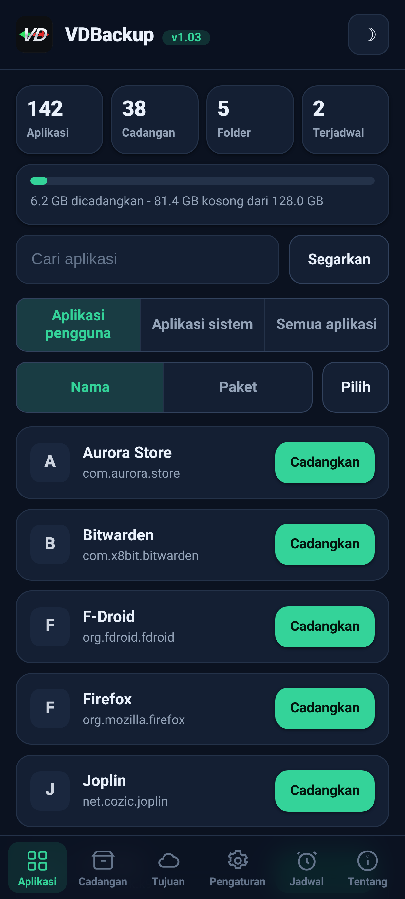
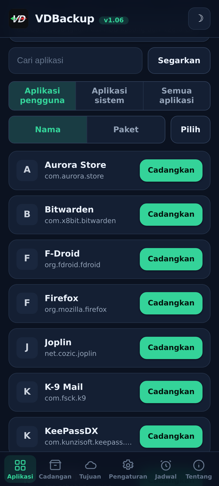
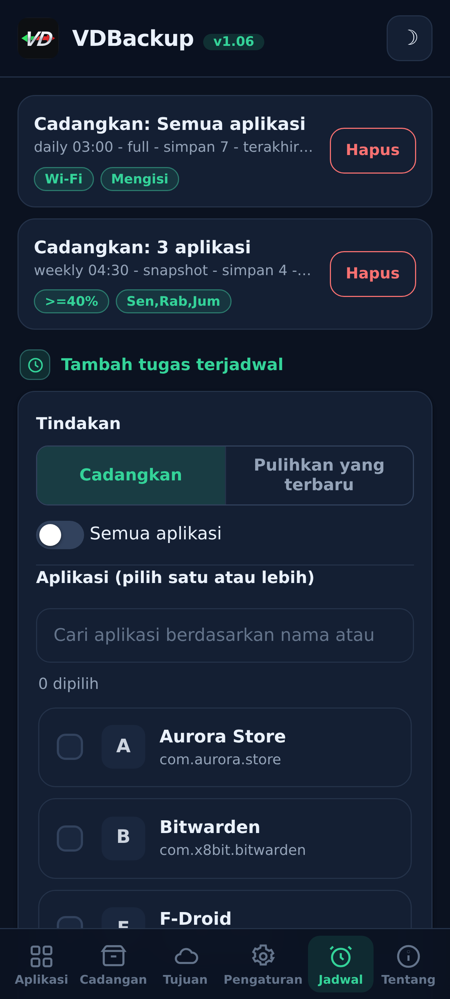
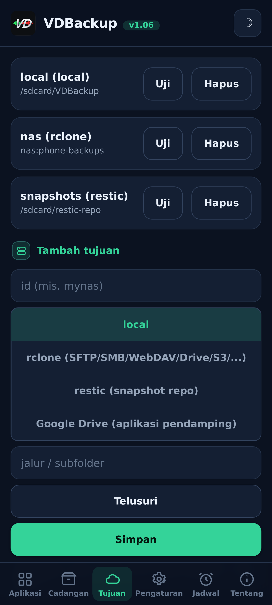
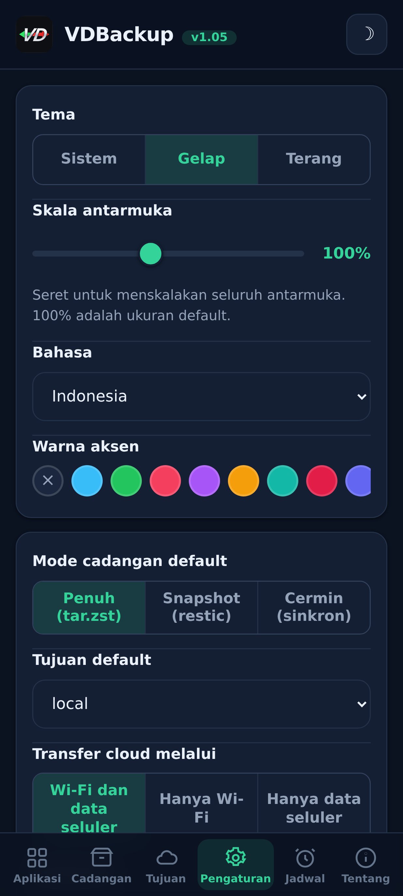
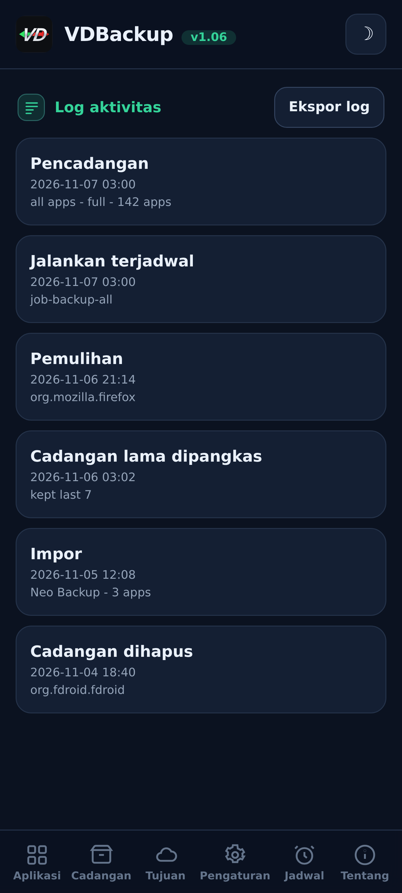

> **Languages:** [English](../USER-GUIDE.md) · [العربية](../ar/USER-GUIDE.md) · [Čeština](../cs/USER-GUIDE.md) · [Deutsch](../de/USER-GUIDE.md) · [Español](../es/USER-GUIDE.md) · [فارسی](../fa/USER-GUIDE.md) · [Français](../fr/USER-GUIDE.md) · [हिन्दी](../hi/USER-GUIDE.md) · Bahasa Indonesia · [Italiano](../it/USER-GUIDE.md) · [日本語](../ja/USER-GUIDE.md) · [한국어](../ko/USER-GUIDE.md) · [Nederlands](../nl/USER-GUIDE.md) · [Polski](../pl/USER-GUIDE.md) · [Português](../pt/USER-GUIDE.md) · [Русский](../ru/USER-GUIDE.md) · [Svenska](../sv/USER-GUIDE.md) · [ไทย](../th/USER-GUIDE.md) · [Türkçe](../tr/USER-GUIDE.md) · [Tiếng Việt](../vi/USER-GUIDE.md) · [中文](../zh/USER-GUIDE.md)

---

# Panduan pengguna VDBackup

Panduan lengkap dan ramah tentang VDBackup, dari memasang modul hingga membuat
backup pertama Anda, merestorenya, mengirimnya ke cloud, menjadwalkannya, dan membukanya
di PC bertahun-tahun kemudian. Jika Anda pernah memakai Swift Backup, Neo-Backup atau
Android-DataBackup sebelumnya, ini akan terasa familier, hanya saja semuanya terjadi di satu
tempat, tanpa ada yang perlu "diizinkan".

## Daftar isi

- [1. Apa itu VDBackup](#1-apa-itu-vdbackup)
- [2. Persyaratan](#2-persyaratan)
- [3. Pasang dan jalankan pertama kali](#3-pasang-dan-jalankan-pertama-kali)
- [4. Tur WebUI](#4-tur-webui)
- [5. Membuat backup](#5-membuat-backup)
  - [5.1 Memilih apa yang dibackup](#51-memilih-apa-yang-dibackup)
  - [5.2 Mode backup: Full, Snapshot, Mirror](#52-mode-backup-full-snapshot-mirror)
  - [5.3 Kompresi](#53-kompresi)
  - [5.4 Enkripsi](#54-enkripsi)
  - [5.5 Verify dan dry-run](#55-verify-dan-dry-run)
  - [5.6 Backup khusus (pesan, log panggilan, Wi-Fi, Bluetooth, kalender, wallpaper, DNS, pengaturan sistem)](#56-backup-khusus-pesan-log-panggilan-wi-fi-bluetooth-kalender-wallpaper-dns-pengaturan-sistem)
  - [5.7 Backup folder dan file mandiri](#57-backup-folder-dan-file-mandiri)
- [6. Merestore backup](#6-merestore-backup)
- [7. Tujuan: lokal dan remote](#7-tujuan-lokal-dan-remote)
  - [7.1 Mencadangkan pengaturan Anda](#71-mencadangkan-pengaturan-anda)
- [8. Penjadwalan dan retensi](#8-penjadwalan-dan-retensi)
- [9. Migrasi masuk: mengimpor Neo-Backup dan Android-DataBackup](#9-migrasi-masuk-mengimpor-neo-backup-dan-android-databackup)
- [10. SSAID (ANDROID_ID perangkat)](#10-ssaid-android_id-perangkat)
- [11. Portabilitas: membuka backup di PC](#11-portabilitas-membuka-backup-di-pc)
- [12. Mengendalikan VDBackup dari asisten AI](#12-mengendalikan-vdbackup-dari-asisten-ai)
- [13. Pemecahan masalah dan FAQ](#13-pemecahan-masalah-dan-faq)
- [14. Menghapus instalasi](#14-menghapus-instalasi)

---

## 1. Apa itu VDBackup

VDBackup adalah modul root dengan WebUI bawaan yang membackup dan merestore aplikasi
dan datanya. Ia dirancang sebagai penerus terbuka dan root-native dari Swift Backup,
Neo-Backup dan Android-DataBackup: ia bertujuan melakukan gabungan dari apa yang alat-alat itu lakukan, dalam
satu tempat, dan ia bahkan bisa mengimpor backup Neo-Backup dan
Android-DataBackup yang sudah ada sehingga Anda bisa pindah tanpa kehilangan apa pun.

Perbedaan utama dari aplikasi backup biasa: VDBackup berjalan **sepenuhnya dari WebUI
manajer root Anda**, dan modulnya sudah root. Tidak ada aplikasi pendamping untuk
dipasang bagi fitur inti, tidak ada prompt "grant su" untuk disetujui, dan tidak ada yang perlu dialihkan
ke aktif. Anda membuka WebUI, memilih apa yang dibackup, dan menjalankannya.

Semua yang dihasilkan VDBackup memakai **format standar** (tar, gzip, zstd, age, zip,
restic), jadi backup Anda tidak pernah terkunci pada modul dan tidak pernah terikat pada
perangkat spesifik Anda. Lihat [bagian 11](#bagian-11).

## Tangkapan layar

| Beranda | Aplikasi | Jadwal |
|:---:|:---:|:---:|
|  |  |  |
| **Tujuan** | **Pengaturan** | **Log aktivitas** |
|  |  |  |

## 2. Persyaratan

- **Perangkat Android yang di-root** yang dikelola oleh **KernelSU**, **APatch** atau **Magisk**.
  VDBackup dipasang sebagai modul dari manajer tersebut.
- Penyimpanan kosong yang cukup untuk backup Anda (backup lokal berada di bawah direktori
  state modul; lihat [bagian 3](#bagian-3)).
- Tidak ada yang lain. Modul membundel semua biner yang dibutuhkannya (tar, zstd, lz4, rclone,
  rsync, ssh, restic), jadi **backup dan restore lokal bekerja sepenuhnya offline**. Hanya tujuan
  cloud yang berkomunikasi dengan jaringan.

Beberapa ekstra yang halus (AppOps, SSAID, beberapa bit sistem berhak istimewa) bergantung pada
framework Android; modul menangani ini secara internal, dengan fallback plain-shell,
dan mereka merosot dengan mulus saat tidak tersedia di perangkat Anda.

## 3. Pasang dan jalankan pertama kali

1. Unduh rilis `VD-Backup-vX.Y.zip` terbaru.
2. Di manajer KernelSU / APatch / Magisk Anda, flash zip modul seperti modul
   lainnya.
3. Ia langsung bisa dipakai, **tidak perlu reboot**. (Reboot hanya pernah relevan
   saat merestore SSAID; lihat [bagian 10](#bagian-10).)
4. Buka **WebUI** modul dari manajer. Itulah seluruh antarmukanya.

**Edisi mana yang diunduh.** Setiap rilis hadir sebagai beberapa edisi zip yang bisa di-flash, jadi Anda hanya mengunduh yang Anda butuhkan. Pilih salah satu:

- **`VD-Backup-<ver>-universal-full.zip`**: setiap arsitektur CPU dan setiap biner tertanam, termasuk `rclone` (penyedia cloud: Google Drive, S3 dan 70+ backend rclone lainnya) dan `restic` (snapshot terdeduplikasi). Sepenuhnya offline, tidak pernah ada yang diunduh. Berfungsi di perangkat mana pun. Unduhan terbesar.
- **`VD-Backup-<ver>-universal-lite.zip`**: setiap arsitektur, tetapi **tanpa** dua biner terbesar (`rclone` dan `restic`). Unduhan terkecil; tetap bisa backup lokal, SSH/SFTP, dan rsync tanpa unduhan, dengan enkripsi portabel `age`. Pertama kali Anda memakai tujuan cloud (`rclone`) atau mode snapshot (`restic`), WebUI menawarkan untuk mengunduh addon kecil per-arsitektur itu sekali (diverifikasi dengan SHA-256) lalu menyimpannya di cache; setelah itu fitur-fitur tersebut pun berfungsi.
- **`VD-Backup-<ver>-<abi>-full.zip`** (salah satu dari `arm64-v8a`, `armeabi-v7a`, `x86`, `x86_64`), satu arsitektur dengan setiap biner tertanam (fitur yang sama dengan `universal-full` tetapi hanya untuk arsitektur perangkat Anda, jadi lebih kecil dari `universal-full`).

Jika Anda tahu arsitektur perangkat Anda dan ingin semuanya tertanam, pilih **`<abi>-full`** yang cocok (kebanyakan ponsel adalah **`arm64-v8a`**). Jika Anda ingin unduhan terkecil dan tidak keberatan dengan satu kali unduhan terverifikasi SHA-256 saat pertama kali memakai penyedia cloud (`rclone`) atau snapshot (`restic`), pilih **`universal-lite`**. Jika Anda ingin semuanya tertanam tanpa unduhan apa pun (offline / pemulihan) dan tidak yakin dengan arsitekturnya, pilih edisi **full**. Saat dipasang, modul hanya menyimpan arsitektur perangkat Anda terlepas dari edisi yang Anda flash.

Pada jalankan pertama modul menanamkan konfigurasi default (hanya jika belum ada), jadi
pengaturan Anda terjaga melintasi pembaruan modul.

**Di mana state berada.** Data kerja VDBackup, konfigurasi Anda, pekerjaan terjadwal,
tujuan tersimpan, kredensial terenkripsi, log dan jejak audit, serta area staging -
berada di bawah:

```
/data/adb/vdbackup/
```

**Di mana backup berada.** Backup itu sendiri ditulis ke penyimpanan yang terlihat pengguna dan
terenkripsi-kredensial (sehingga hanya dapat dibaca setelah Anda membuka kunci perangkat, dan mereka
bertahan meski modul dihapus), satu folder per pengguna Android:

```
/sdcard/VDBackup/            (= /data/media/<user>/VDBackup)
```

Ingat ini karena dua alasan: backup memakan ruang di bawah `/sdcard/VDBackup`, dan
`/data/adb/vdbackup/logs/` adalah tempat Anda melihat jika ada yang salah.

## 4. Tur WebUI

WebUI diatur dalam beberapa tab:

- **Home**: ringkasan beranda yang menampilkan jumlah backup Anda (aplikasi, backup, folder, dan pekerjaan terjadwal) dan sebuah bilah penyimpanan untuk berapa banyak ruang yang dipakai backup Anda dibanding yang bebas, dengan lencana status, salin hash dan path ke papan klip, serta aksi **Check for updates**.
- **Apps**: daftar aplikasi terpasang (pengguna dan sistem), masing-masing ditampilkan dengan nama
  aslinya, nama package-nya, dan ikonnya (ikon dimuat secara malas dan di-cache, jadi daftar
  tetap responsif). Tombol pada baris membackup aplikasi; menekan baris membuka riwayat
  backup aplikasi itu, tempat Anda bisa merestore backup sebelumnya mana pun.
- **Backups**: backup yang sudah Anda miliki, masing-masing menampilkan nama aplikasi di satu baris dan
  package di baris berikutnya. Ketuk sebuah backup untuk melihat detail lengkapnya (versi, tanggal, ukuran,
  item yang disertakan, jumlah izin, dan perangkat asalnya). Di sinilah juga Anda
  merestore, menjalankan restore-test, menghapus backup, atau mengimpor backup dari Neo-Backup atau
  Android-DataBackup.
- **Destinations**: kelola ke mana backup pergi: penyimpanan lokal plus tujuan remote mana pun
  yang Anda tambahkan (lihat [bagian 7](#bagian-7)). Anda bisa
  menguji sebuah tujuan di sini sebelum mengandalkannya.
- **Settings**: sakelar tema terang/gelap, pemilih warna aksen (preset, warna kustom,
  atau reset), dan pemilih bahasa (antarmuka ditampilkan dari kanan ke kiri untuk bahasa Arab dan Persia), penggeser skala antarmuka yang Anda seret untuk mengubah skala
  seluruh antarmuka (header, konten, dan navigasi bawah bersama-sama) dari 85% hingga 120% (100% adalah default), untuk layar dengan kepadatan piksel berbeda,
  default untuk pekerjaan
  baru (kompresi default, verify aktif/mati, enkripsi default), kebijakan jaringan untuk
  transfer cloud (lihat [bagian 7](#bagian-7)), pencadangan otomatis dan daftar aplikasi
  yang dikecualikan, opsi sumber pemasangan, kunci enkripsi, dan penjadwalan. Pengaturan aktif/mati memakai sakelar bergaya Android.
- **About**: versi, tautan, proyek saudara (See also), manifest audit biner yang dibundel, dan aksi **Check for updates** yang melaporkan apakah versi yang lebih baru telah dirilis (beserta catatan rilisnya). Anda memasang pembaruan apa pun melalui manajer root Anda, sama seperti saat Anda mem-flash modul.

Aplikasi juga memeriksa sendiri versi yang lebih baru setiap kali kamu membukanya (paling banyak sekali per jam) dan menampilkan banner pembaruan hanya ketika ada; tetap diam jika sudah terbaru atau luring.

Konfirmasi dan pesan memakai dialog dalam-aplikasi (bukan pop-up sistem lama), dan sebuah
restore atau impor meminta Anda mengakui bahwa ia menimpa data aplikasi saat ini sebelum
melanjutkan.

Backup dan restore berjalan **terlepas** sebagai proses root latar belakang. Anda bisa menutup
WebUI, atau bahkan menutup manajer root, dan operasi tetap berjalan. Saat Anda kembali,
WebUI reattach dan menampilkan kemajuan live dengan label fase terlokalisasi. Untuk sebuah
pekerjaan yang sedang berjalan, kartu kemajuan juga menampilkan kecepatan transfer live dan
perkiraan waktu tersisa, plus penghitung item (misalnya "12 of 40") dengan nama item saat ini. Pada
ROM yang menampilkan notifikasi shell, Anda juga mendapat notifikasi Android saat sebuah pekerjaan
mulai dan selesai; bagaimanapun kartu kemajuan dalam-aplikasi adalah indikator yang andal.

## 5. Membuat backup

Alur dasar: buka **Apps**, pilih sebuah aplikasi, pilih apa yang disertakan, pilih mode,
setel kompresi dan (opsional) enkripsi, lalu jalankan. Kemajuan muncul live dan sebuah
notifikasi memberi tahu Anda saat selesai.

Pada dialog pencadangan kamu juga bisa memilih **tujuan** cadangan ini, penyimpanan lokal atau tujuan cloud/jarak jauh mana pun yang kamu tambahkan, tanpa mengubah tujuan default di Pengaturan terlebih dahulu.

### 5.1 Memilih apa yang dibackup

Untuk setiap aplikasi Anda bisa menyertakan kombinasi mana pun dari item berikut:

| Item | Apa itu |
|------|-----------|
| **APK** | Aplikasi terpasang itu sendiri (APK base + APK split mana pun). |
| **data** | Data pribadi aplikasi (`/data/data`). Ini adalah "data aplikasi" yang biasa. |
| **device-protected data** | Penyimpanan direct-boot / device-protected (`/data/user_de`). Beberapa aplikasi menyimpan pengaturan di sini. |
| **external** | Data eksternal aplikasi di bawah `Android/data`. |
| **OBB** | File ekspansi OBB aplikasi (`Android/obb`), dipakai oleh beberapa gim. |
| **media** | Media aplikasi di bawah `Android/media`. |

Default yang baik untuk "backup aplikasi ini sepenuhnya" adalah menyertakan semuanya. Jika Anda
hanya ingin datanya (misalnya untuk memindahkan save gim), Anda bisa membatalkan pilihan APK dan
item OBB/media yang besar.

VDBackup juga melestarikan hal-hal yang membuat restore menjadi setia: konteks SELinux,
kepemilikan uid/gid, mode file, atribut diperluas (xattr) dan kapabilitas.

### 5.2 Mode backup: Full, Snapshot, Mirror

VDBackup menawarkan tiga mode. WebUI memilih **Full** terlebih dahulu, yang merupakan pilihan tepat
untuk kebanyakan orang.

- **Full**: backup yang lengkap, mandiri, dan portabel yang ditulis sebagai `tar.zst` (atau
  kompresi pilihan Anda). Setiap jalankan menghasilkan backup berdiri sendiri yang bisa Anda salin
  ke mana saja dan buka di PC. Terbaik untuk: snapshot aplikasi yang bersih dan portabel yang bisa Anda
  arsipkan dan pindahkan. Ini adalah default dan opsi paling portabel.
- **Snapshot**: inkremental dan berversi, didukung oleh `restic`. Setiap jalankan menambah
  snapshot titik-waktu baru ke sebuah repositori, menyimpan hanya apa yang berubah dan
  men-dedup melintasi snapshot. Terbaik untuk: menyimpan riwayat berjalan sebuah aplikasi
  tanpa membayar ukuran penuh pada setiap jalankan.
- **Mirror**: sinkronisasi 1:1 dari data live ke tujuan, didukung oleh
  `rclone`/`rsync`. Ia menjaga tujuan identik dengan apa yang ada di perangkat saat
  ini (file yang berubah disalin, file yang dihapus dihapus di tujuan). Terbaik
  untuk: salinan cepat yang selalu-terkini, misalnya ke remote cloud. Perhatikan bahwa APK
  tetap disimpan terkompresi bahkan dalam mirror, tidak pernah mentah.

### 5.3 Kompresi

Anda bisa memilih kompresi untuk backup Full:

- **none**: tanpa kompresi (tercepat, terbesar).
- **lz4**: sangat cepat, kompresi ringan.
- **zstd**: default, keseimbangan kuat antara kecepatan dan rasio. Anda juga bisa memilih
  level (misalnya level lebih tinggi untuk file lebih kecil).
- **gzip**: **"mode kompatibilitas"**. gzip terbuka dengan alat bawaan di
  praktis komputer mana pun dan di sebagian besar pengelola file, tanpa tambahan untuk dipasang.
  Pilih ini saat Anda paling peduli tentang kemampuan membuka arsip di mana saja.

Jika Anda tidak memilih, VDBackup memakai default yang dikonfigurasi (zstd pada level yang wajar).

### 5.4 Enkripsi

Enkripsi bersifat **opsional** dan portabel. VDBackup mengenkripsi dengan **age** memakai
passphrase (scrypt), yang dipilih khusus demi portabilitas: alat
`age` standar mana pun di sistem operasi mana pun bisa mendekripsi backup Anda cukup dengan passphrase.
Enkripsi **tidak pernah** terikat pada kunci perangkat keras perangkat Anda, jadi backup terenkripsi
direstore di perangkat lain dan terbuka di PC. (Mode zip AES-256 yang kompatibel juga
tersedia untuk arsip terenkripsi yang ingin Anda buka dengan klik-ganda dan kata sandi.)

Untuk memakai enkripsi, buat kunci enkripsi sekali (Settings), lalu aktifkan
enkripsi untuk pekerjaan Anda dan setel passphrase. Passphrase itulah yang melindungi
backup, jadi pilih yang kuat, tidak ada kunci perangkat keras dan tidak ada backdoor pemulihan.

**Aturan APK (penting):**

- **APK selalu disimpan terkompresi**, tidak pernah mentah, untuk menghemat ruang.
- **APK tidak dienkripsi secara default**, karena APK aplikasi adalah konten publik.
- Enkripsi APK dan enkripsi data adalah **sakelar independen**. Mengaktifkan enkripsi data
  **tidak** mengenkripsi APK. Jika Anda secara khusus ingin APK juga dienkripsi,
  aktifkan sakelar enkripsi-APK secara eksplisit.

### 5.5 Verify dan dry-run

Dua opsi keamanan membantu Anda memercayai sebuah backup sebelum mengandalkannya:

- **Verify**: setelah menulis, VDBackup me-rehash setiap arsip dan memeriksanya terhadap
  manifest. Ini **aktif secara default untuk backup Full**. Jika sebuah file tidak cocok,
  pekerjaan gagal dengan error yang jelas alih-alih meninggalkan Anda dengan backup yang
  rusak secara diam-diam.
- **Dry-run**: merencanakan pekerjaan dan melaporkan ukuran yang akan dihasilkannya **tanpa menulis
  apa pun**. Gunakan untuk memperkirakan ruang atau memeriksa pilihan item Anda sebelum menjalankan
  yang sebenarnya.

Ketika sebuah backup menuju tujuan **cloud**, VDBackup menambahkan dua pengaman lagi. Ia menjalankan
langkah **terverifikasi-checksum** terakhir yang memeriksa ulang salinan yang diunggah terhadap aslinya
di remote, dan menggagalkan pekerjaan (alih-alih meninggalkan salinan rusak di cloud) jika keduanya tidak
cocok. Dan sebelum unggahan Full, ia memeriksa **ruang bebas** remote dan berhenti lebih awal dengan error
**"ruang tidak cukup"** yang jelas jika backup tidak akan muat, alih-alih memenuhi remote dan gagal di
tengah jalan. (Pemeriksaan ruang untuk unggahan Full; Mirror adalah sinkronisasi delta dan dikecualikan.)

### 5.6 Backup khusus (pesan, log panggilan, Wi-Fi, Bluetooth, kalender, wallpaper, DNS, pengaturan sistem)

Di bawah daftar aplikasi pada tab **Backups**, **Backup khusus** mencakup data sistem-wide
yang tidak terikat pada satu aplikasi. Pilih kategorinya dan backup; mereka diarsipkan
dengan pelestarian SELinux/xattr yang sama dan enkripsi opsional seperti backup aplikasi.
Kategorinya adalah:

| Kategori | Apa itu |
|----------|-----------|
| **Pesan (SMS/MMS)** | Pesan teks Anda. |
| **Kontak dan log panggilan** | Kontak dan riwayat panggilan Anda. |
| **Jaringan Wi-Fi** | Jaringan Wi-Fi tersimpan Anda. |
| **Bluetooth** | Pemasangan Bluetooth Anda. |
| **Kalender** | Provider kalender (app dan data). Sebuah **`calendar.json` portabel** juga ditulis, sehingga acara Anda dapat dibaca di PC tanpa modul. |
| **Wallpaper** | Wallpaper beranda dan layar-kunci Anda plus `wallpaper_info.xml`, disimpan sebagai gambar mentah. |
| **DNS** | Mode DNS privat dan server Anda. |
| **Pengaturan sistem** | Dump lengkap pengaturan system, global, dan secure perangkat. |

Untuk pesan, log panggilan, dan kontak, sebuah **salinan portabel** (JSON yang dapat dibuka) juga
ditulis, sehingga Anda punya salinan lintas-perangkat yang bisa dibaca di PC tanpa modul.

**Pengaturan sistem bersifat opt-in dan menimpa pengaturan perangkat Anda saat restore.** Sama seperti
SSAID (lihat [bagian 10](#bagian-10)), kategori **Pengaturan sistem** adalah yang paling sensitif:
merestorenya menimpa pengaturan di seluruh perangkat Anda, jadi ia mati kecuali Anda sengaja memilihnya,
meminta Anda mengakui terlebih dahulu, dan ditulis ke log aktivitas.

Merestore backup khusus menimpa data sistem yang live dan butuh reboot, jadi ia dibatasi di balik
pemberitahuan yang menonjol dan andal pada perangkat dan ROM yang sama. Restore bersifat **idempoten**:
kategori mentah (pesan, kontak, Wi-Fi, Bluetooth, kalender) direstore dengan **mengganti** data alih-alih
menggabungkannya, jadi merestore backup yang sama dua kali tidak pernah membuat duplikat, dan DNS serta
pengaturan sistem cukup diterapkan ulang.

### 5.7 Backup folder dan file mandiri

Kadang Anda ingin membackup folder atau file biasa yang bukan aplikasi, sebuah folder kamera,
sebuah direktori dokumen, satu basis data. VDBackup dapat membackup **sembarang path absolut** di
penyimpanan bersama atau di bawah `/data`, dengan format portabel yang sama seperti backup aplikasi:
sebuah arsip `tar.zst` plus sebuah `manifest.json`, disegel SHA-256, dengan catatan RECOVERY saat Anda
mengenkripsinya. Backup path ini disimpan terpisah, di bawah folder `.paths` di direktori backups Anda.

- **Pilih sebuah path dan backup.** Sumbernya harus sebuah path absolut di bawah salah satu lokasi
  yang diizinkan (`/storage/emulated`, `/data/media`, `/sdcard`, `/data`). Path yang mencoba keluar
  dengan `..` ditolak.
- **Merestore menulis kembali ke lokasi asli**, jadi, seperti restore mana pun, ia merusak dan meminta
  Anda **mengonfirmasi** sebelum menimpa apa pun.
- Seperti backup aplikasi, backup dan restore path berjalan **terlepas** dengan kemajuan live, memakai
  kompresi pilihan Anda, dan dapat dienkripsi dengan passphrase.

## 6. Merestore backup

Buka tab **Backups**, pilih backup yang Anda inginkan, dan mulai restore. Karena
restore adalah tindakan merusak, VDBackup meminta Anda **mengonfirmasi** terlebih dahulu, dan ia
mencatat tindakan tersebut dalam log audit lokal.

Sebuah restore bersifat **setia**: VDBackup menghapus keadaan aplikasi saat ini dan mengekstrak
backup, sehingga aplikasi dikembalikan ke **keadaan persis** yang ditangkap dalam backup itu
(termasuk kepemilikan, mode, konteks SELinux dan xattr). Ia bukan merge, ia adalah
restore sejati ke titik waktu backup. Karena restore berjalan sebagai root, VDBackup juga memeriksa
setiap arsip sebelum mengekstrak apa pun dan menolak arsip yang dirusak yang mencoba menulis di luar
targetnya, sehingga backup yang dimodifikasi tidak akan pernah bisa menimpa sisa sistem Anda.

Opsi restore yang berguna:

- **Restore-test**: mengekstrak backup ke area staging sementara dan memverifikasinya
  **tanpa menyentuh aplikasi yang live**. Ini adalah cara aman untuk memastikan sebuah backup
  utuh dan dapat direstore sebelum Anda menimpa apa pun. Jika tes gagal Anda mendapat
  error yang jelas dan aplikasi terpasang Anda dibiarkan tak tersentuh.
- **Partial restore**: merestore hanya sebagian item yang dibackup. Sebagai
  contoh, restore hanya data aplikasi tanpa memasang ulang APK, atau restore file
  save tanpa OBB/media yang besar. Pilih item yang Anda inginkan di layar restore.
- Untuk backup **Snapshot** dan **Mirror**, restore menarik dari repositori berversi
  atau salinan termirror secara berturut-turut.
- **Sumber pemasangan**: secara default aplikasi yang dipulihkan melaporkan **Play Store** sebagai
  sumber pemasangannya (alih-alih tampak sideload), yang diharapkan sebagian besar aplikasi dan
  pemeriksaan aplikasi. Anda bisa mematikannya secara global di Settings atau per restore, dan saat
  mati sumber pemasangan aslinya dipertahankan. Sebuah sakelar opt-in tingkat lanjut **"palsukan sumber
  penginisiasi"** melangkah lebih jauh dan juga membuat paket penginisiasi dan sumber paket aplikasi
  tampak terpasang-dari-Play; ia mengedit basis data paket sistem (dibackup terlebih dahulu) dan berlaku
  setelah reboot.

**Restore massal.** Tab **Backups** punya mode **Select**, sama seperti yang dimiliki tab **Apps** untuk backup
massal. Aktifkan **Select**, centang backup yang Anda inginkan dengan kotak centangnya, dan restore semuanya
sekaligus. Satu dialog opsi mencakup seluruh pilihan, pengakuan penimpaan, restore-test dan pilihan sumber-instal
berlaku untuk setiap backup yang Anda pilih, dan mereka direstore satu demi satu.

**Menghapus backup.** Buka detail sebuah backup (atau riwayat sebuah aplikasi) dan gunakan **Delete**;
Anda diminta mengonfirmasi, dan penghapusan dicatat ke log aktivitas. Anda juga bisa membatasi
berapa banyak backup yang disimpan per aplikasi (retensi) sehingga yang lama dipangkas secara otomatis.

**Memasang aplikasi terpasang sebagai aplikasi sistem.** Dari riwayat backup sebuah aplikasi, **Mount as
system** menempatkan APK aplikasi ke dalam sub-modul overlay VDBackup sehingga manajer root
menyajikannya dari `/system/app` (atau `/system/priv-app`), partisi `/system` yang asli tidak pernah
disentuh. Dengan **NoMount** pada KernelSU ia berlaku live; jika tidak, ia berlaku setelah reboot.
Ini tidak pernah bergantung pada NoMount terpasang.

## 7. Tujuan: lokal dan remote

Secara default, backup ditulis ke penyimpanan **lokal** di bawah direktori state
modul. Anda juga bisa menambahkan tujuan remote di tab **Destinations**. Untuk tujuan
lokal, **Browse** membuka pemilih folder sehingga Anda bisa memilih sub-folder di bawah
penyimpanan bersama (`/sdcard`) alih-alih mengetik path-nya.

Transport remote ditangani oleh alat yang dibundel:

- **rclone**: hub untuk rentang luas remote: **SFTP, SMB, WebDAV, FTP, S3,
  Google Drive** dan 70+ layanan lainnya.
- **rsync** dan suite **ssh/scp/sftp**: untuk sinkronisasi delta dan target SSH biasa.
- **restic**: repositori **Snapshot** terenkripsi dan ter-dedup (lokal atau remote).

**Membuat remote cloud (tanpa butuh SSH).** Di tab Destinations, pilih tipe tujuan
**rclone** dan gunakan **Add cloud remote**. Anda bisa menghubungkan **backend rclone apa pun**:
menu dropdown menawarkan yang populer (**Google Drive, Dropbox, OneDrive, Box, pCloud, Mega,
Backblaze B2, S3, SFTP, WebDAV, FTP, SMB**) ditambah opsi **Custom (advanced)** tempat Anda
mengetik tipe backend lain apa pun beserta parameter `key=value`-nya. Isi field
(host/user/password, atau kunci S3, misalnya) dan simpan. Untuk penyedia yang membuat Anda masuk
lewat peramban (Google Drive, Dropbox, OneDrive, Box, pCloud), gunakan tombol **Authorize in
browser**: ia membuat Anda masuk lewat peramban ponsel sendiri dan menangkap token secara
otomatis, jadi **tidak butuh PC** (menempel token secara manual tetap berfungsi sebagai cadangan).
Remote lalu muncul di daftar remote tujuan. Kata sandi disimpan dalam keadaan tersamar, tidak
pernah dalam teks polos. Anda bisa mendaftar dan menghapus remote Anda dari tempat yang sama.

Dua aturan menjaga penggunaan remote tetap aman:

- **Kredensial disimpan terenkripsi** saat diam di direktori state modul, tidak pernah
  dalam teks polos.
- **Validasi sebelum Anda memakai.** Gunakan tes tujuan di tab Destinations untuk
  memastikan sebuah tujuan bekerja sebelum Anda mengarahkan backup sungguhan ke sana.

**Kebijakan jaringan (Wi-Fi vs data seluler).** Di Settings, "Cloud transfers over" membiarkan Anda
membatasi koneksi mana yang boleh dipakai transfer cloud: **Wi-Fi dan data seluler** (default),
**Hanya Wi-Fi**, atau **Hanya data seluler**. Saat Anda membatasinya, setiap transfer
cloud, manual atau terjadwal, unggah atau restore, memeriksa koneksi aktif terlebih dahulu
dan menolak berjalan di koneksi yang salah, jadi kebijakan hanya-Wi-Fi tidak pernah menghabiskan data seluler.
Backup lokal tidak pernah terpengaruh.

**Google Drive.** Anda punya dua cara untuk menjangkau Google Drive:

1. **Via rclone**: tambahkan Drive sebagai remote rclone seperti tujuan lainnya, tanpa
   aplikasi tambahan dan **tanpa akun Google Cloud**. Di komputer mana pun jalankan
   `rclone authorize "drive"` sekali, masuk ke akun Google Anda di peramban, dan
   tempel token yang dicetaknya ke field token remote Drive.
2. **Via pendamping opsional**: aplikasi pendamping kecil yang opt-in yang menangani
   sign-in Google dan unggah Drive. Ia dipasang **hanya saat Anda secara eksplisit memilih
   tujuan pendamping Google Drive**, tidak pernah secara default, dan ia dihapus saat
   Anda menonaktifkannya. Layar persetujuan Google satu kali adalah satu-satunya langkah yang terjadi
   di luar WebUI. Saat pendamping terpasang, VDBackup mengingatkan Anda untuk
   **selalu menyembunyikannya dengan [HMA-OSS](https://github.com/frknkrc44/HMA-OSS)** agar keberadaannya tidak mengungkap root atau
   bootloader yang tidak terkunci, dan ia menawarkan untuk menambahkannya ke daftar [HMA-OSS](https://github.com/frknkrc44/HMA-OSS) untuk Anda. VDBackup juga mengingatkan Anda, saat punya cadangan lokal, untuk menyembunyikan folder cadangan (/sdcard/VDBackup) dengan SUSFS karena alasan yang sama.

### 7.1 Mencadangkan pengaturan Anda

Penyiapan VDBackup itu sendiri, yaitu tujuan, jadwal, prasetel, dan kredensial tersimpan, dapat ditulis ke satu berkas dan dibawa ke perangkat lain atau dipulihkan setelah pemasangan bersih. Di **Pengaturan**, pada **Cadangan pengaturan**:

- **Ekspor pengaturan** menulis berkas terenkripsi ke `VDBackup/.export`. Ia selalu meminta frasa sandi, karena berkas berisi kata sandi jarak jauh Anda.
- **Impor pengaturan** membaca kembali berkas semacam itu dan menggabungkannya ke perangkat ini, tanpa menghapus apa pun yang sudah ada.
- **Hapus kredensial tersimpan** menghapus kata sandi jarak jauh tersimpan dan kunci enkripsi perangkat dalam satu langkah; tujuan, jadwal, dan cadangan Anda tetap di tempatnya.

## 8. Penjadwalan dan retensi

VDBackup bisa menjalankan backup, dan restore, secara otomatis sesuai jadwal. Di penjadwal Anda menetapkan
sebuah pekerjaan dengan:

- sebuah **target**: satu aplikasi, sekumpulan aplikasi, atau **semua aplikasi** (dikurangi daftar
  aplikasi-yang-dikecualikan), dan item/mode yang dipakai,
- sebuah **action**: **Back up** (default) atau **Restore latest**, yang merestore backup terbaru dari setiap
  aplikasi target,
- sebuah tujuan,
- **jadwal mirip-cron**: per jam, harian atau mingguan, pada waktu yang Anda pilih (HH:MM),
- pengaturan **retensi**: **simpan N** backup terbaru untuk pekerjaan itu, yang lebih lama
  dipangkas secara otomatis,
- **kondisi jalan** opsional: hanya di **Wi-Fi**, hanya saat **mengisi daya**, hanya pada atau di atas
  **level baterai minimum**, dan hanya pada **hari-hari dalam seminggu** yang dipilih.

Pekerjaan terjadwal dipicu oleh heartbeat saat-boot di modul: saat sebuah pekerjaan
jatuh tempo ia berjalan, mencatat waktu jalankan-terakhirnya agar tidak memicu dua kali, dan menerapkan
retensi untuk memangkas backup lama. Karena semuanya berjalan sebagai root di latar belakang,
backup terjadwal tidak butuh WebUI terbuka.

**Kondisi jalan (gerbang).** Sebuah pekerjaan terjadwal dapat membawa kondisi yang harus terpenuhi agar
ia berjalan: hanya Wi-Fi, hanya mengisi daya, level baterai minimum, dan hari-hari tertentu dalam
seminggu. Ketika sebuah pekerjaan jatuh tempo tetapi sebuah kondisi tidak terpenuhi, ia **dilewati dan
dicoba lagi pada pemeriksaan berikutnya**: jadwalnya tidak maju, sehingga ia berjalan begitu kondisinya
terpenuhi. Sebuah pemeriksaan keamanan termal bawaan juga melewati pekerjaan terjadwal selama perangkat
terlalu panas. Setiap pelewatan seperti itu dicatat di log aktivitas.

**Restore terjadwal menimpa pada setiap jalannya.** Sebuah pekerjaan **Restore latest** me-restore ulang backup
terbaru dari setiap aplikasi target setiap kali ia terpicu, dan restore bersifat merusak: pada setiap jalannya ia
**menimpa data aplikasi saat ini** dengan backup terbaru. Ini disengaja dan opt-in, pilih hanya bila Anda ingin
target dipertahankan pada backup terbarunya.

**Pencadangan otomatis saat pemasangan/pembaruan.** Di Settings Anda bisa mengaktifkan **pencadangan
otomatis**: heartbeat latar belakang yang sama memperhatikan aplikasi yang baru dipasang atau diperbarui
dan membackup-nya untuk Anda (dengan retensi keep-N). Jalankan pertama hanya mencatat apa yang terpasang,
sehingga mengaktifkannya tidak pernah membackup seluruh perangkat Anda sekaligus.

**Aplikasi yang dikecualikan (blocklist).** Juga di Settings, Anda bisa mengecualikan aplikasi yang
tidak pernah ingin dibackup secara otomatis atau sesuai jadwal; Anda bisa menambahkan beberapa sekaligus (pilih-banyak), dan aplikasi yang dikecualikan dilewati oleh keduanya.

**Praset cadangan.** Juga di Pengaturan, Anda bisa menyimpan praset bernama, kumpulan item yang disertakan, seperti hanya APK atau APK + OBB, dan memilih satu di dialog cadangan untuk mengisi pilihan item sekaligus.

**Item cadangan per aplikasi.** Juga di Pengaturan, Anda bisa memilih persis item mana yang dicadangkan setiap aplikasi dalam cadangan massal, otomatis, dan terjadwal, misalnya hanya APK, atau APK + OBB. Cadangan manual tunggal tetap membiarkan Anda memilih saat itu, dimulai dari set aplikasi. Aplikasi yang tidak Anda atur di sini mencadangkan semuanya.

**Tag aplikasi.** Ketuk aplikasi di Pengaturan (Item dan tag per aplikasi) untuk memberinya label bebas, misalnya games atau work. Pemilih tag lalu muncul di atas daftar aplikasi: pilih tag untuk menampilkan hanya aplikasinya, dan cadangkan seluruh grup sekaligus. Anda juga bisa membukanya dari tab Apl: ketuk aplikasi, lalu Item dan tag.

**Log aktivitas.** Tab Schedule punya tombol **View activity log** yang membuka layar penuh (seketika) menampilkan jejak audit lokal -
backup, restore, penghapusan, jalankan terjadwal dan otomatis, serta pemangkasan, terbaru lebih dahulu. Aksi **Export logs** menyimpan berkas log (di dalam folder backup) yang bisa Anda lampirkan ke laporan umpan balik atau bug.

## 9. Migrasi masuk: mengimpor Neo-Backup dan Android-DataBackup

Jika Anda datang dari Neo-Backup atau Android-DataBackup, Anda tidak harus memulai
dari awal. Dari tab **Backups** Anda bisa **mengimpor** backup yang sudah ada:

1. Arahkan VDBackup ke lokasi backup Neo-Backup atau Android-DataBackup Anda yang sudah ada
   (import-scan mendaftar apa yang ia temukan di sana).
2. Pilih backup mana yang akan diimpor.
3. Mulai impor. Seperti operasi panjang lainnya ia berjalan terlepas dengan kemajuan live.

**Backup Neo-Backup terenkripsi-kata sandi didukung.** Backup Neo-Backup yang terenkripsi
AES-256 bisa diimpor, Anda **diminta kata sandi** saat
dibutuhkan, dan kata sandi dipakai hanya untuk mendekripsi, tidak pernah disimpan di baris perintah.

## 10. SSAID (ANDROID_ID perangkat)

SSAID adalah `ANDROID_ID` per-aplikasi, sebuah pengenal tingkat-perangkat yang dibaca beberapa aplikasi.
VDBackup bisa membackup dan merestorenya, tetapi ini adalah hal paling sensitif yang
disentuhnya, jadi ia ditangani dengan kehati-hatian ekstra:

- **Ia OPSIONAL dan MATI secara default.** VDBackup **tidak pernah** akan menangkap atau merestore
  SSAID kecuali Anda mengaktifkannya secara eksplisit untuk pekerjaan itu. WebUI menampilkan pemberitahuan
  "Optional" yang ditandai jelas dan disorot di mana pun SSAID muncul (backup, restore dan
  impor), dan ia tetap mati hingga Anda ikut serta.
- **Ia berlaku hanya setelah reboot saat restore.** Penyedia pengaturan Android men-cache
  nilai-nilai ini, jadi SSAID yang direstore berlaku hanya setelah Anda reboot perangkat.
- **Nilai sebelumnya selalu dibackup terlebih dahulu.** Sebelum menimpa SSAID mana pun,
  VDBackup menyalin `settings_ssaid.xml` yang live byte-demi-byte ke backup bertanda-waktu
  (yang tidak pernah dihapus-otomatis). Jika salinan pengaman itu tidak bisa dibuat, penimpaan
  tidak terjadi. Untuk rollback, restore file tersimpan itu dan reboot.

**Rekomendasi:** biarkan SSAID mati kecuali Anda secara khusus tahu Anda membutuhkannya (misalnya,
sebuah aplikasi tertentu yang mengikatkan dirinya ke ID perangkat dan yang Anda migrasikan
secara sengaja). Untuk backup aplikasi dan data biasa Anda tidak membutuhkannya.

## 11. Portabilitas: membuka backup di PC

Backup Anda **tidak terkunci pada modul ini** dan **tidak pernah terikat-perangkat-keras**.
Semuanya memakai format standar, jadi Anda bisa membuka backup di Windows, macOS atau Linux
tanpa VDBackup terpasang.

Folder backup Full berisi `manifest.json` (sumber kebenaran yang menjelaskan setiap
file, versi aplikasi dan pemilik/konteks asli), APK sebagai `*.apk.zst`, dan
arsip data sebagai `<item>.tar.zst` (atau `.tar.gz` / `.tar.lz4`), secara opsional dengan
akhiran `.age` saat terenkripsi.

Untuk membuka satu di PC, singkatnya:

- **Dekripsi** (hanya jika file berakhir `.age`) dengan alat `age` standar dan
  passphrase atau keyfile Anda.
- **Dekompresi dan ekstrak**: `.tar.zst` dengan `zstd` lalu `tar`; `.tar.gz` dengan `tar`
  langsung; `.tar.lz4` via `zstd --format=lz4`. Sebuah APK hanyalah APK terkompresi-zstd,
  jadi mendekompresi `base.apk.zst` memberi Anda `base.apk` normal yang bisa dipasang.

Setiap backup terenkripsi disertai catatan **RECOVERY** berisi perintah salin-tempel
yang persis untuk Windows, macOS dan Linux. Lihat
[`../module/etc/RECOVERY.md`](RECOVERY.md) untuk kit langkah-demi-langkah yang lengkap.

Perhatikan bahwa konteks SELinux, uid/gid dan mode disimpan di dalam tar dan hanya
diterapkan ulang dengan benar saat Anda merestore di Android, di PC Anda tetap mendapat semua file Anda,
hanya tanpa kepemilikan spesifik-Android ditegakkan.

## 12. Mengendalikan VDBackup dari asisten AI

VDBackup dibangun agar ramah terhadap asisten dan agen AI, bukan hanya orang. WebUI
hanyalah salah satu klien dari sebuah JSON API kecil; sebuah agen bisa mengelola **setiap** tindakan
modul secara headless melalui API yang sama itu (setiap perintah mengembalikan satu objek JSON
tunggal, operasi panjang berjalan terlepas dan Anda poll kemajuannya, dan pengaman yang sama
berlaku, SSAID tetap opt-in, tindakan yang mengubah tetap dikonfirmasi dan diaudit).

Jika Anda ingin asisten menjalankan backup dan restore untuk Anda, arahkan ke
[`AI-AGENTS.md`](AI-AGENTS.md), yang mendokumentasikan seluruh permukaan kendali: kontrak
perintah, setiap verb dengan argumen dan nilai kembaliannya, dan aturan keamanan yang harus
dipatuhi agen.

## 13. Pemecahan masalah dan FAQ

**Di mana log-nya?** Di bawah direktori state modul,
`/data/adb/vdbackup/logs/`. Kemajuan live untuk operasi yang berjalan ada di
`progress-<opid>.json`, dan **jejak audit** dari tindakan yang mengubah (restore, delete,
import, perubahan SSAID) ada di `audit.jsonl`.

**Sebuah backup/restore tampak macet atau saya menutup WebUI.** Operasi berjalan terlepas, jadi
menutup WebUI tidak menghentikannya. Buka kembali WebUI dan ia reattach ke operasi mana pun yang
berjalan dan menampilkan kemajuan saat ini.

**Saya mendapat pesan `ERR_...`.** Error dilaporkan dengan kode yang jelas. Beberapa yang
umum:
- `ERR_VERIFY`, sebuah arsip yang ditulis tidak cocok dengan hash manifestnya (verifikasi
  menangkap backup buruk). Jalankan ulang backup.
- `ERR_RESTORE_TEST`, sebuah restore-test gagal; backup tidak diekstrak/diverifikasi
  dengan bersih dan aplikasi live Anda dibiarkan tak tersentuh.
- `ERR_UNSAFE_ARCHIVE`, sebuah arsip ditolak karena mencoba menulis di luar direktori targetnya
  (path absolut atau `..`). Ini melindungi Anda dari backup yang dirusak; tidak ada yang ditulis.
- `ERR_QUOTA`, sebuah remote cloud tidak punya cukup ruang bebas untuk unggahan Full; backup
  dihentikan sebelum mengunggah apa pun.

**Tujuan remote saya gagal.** Gunakan **tes** tujuan di tab Destinations
untuk memvalidasi kredensial dan konektivitas. Ingat bahwa hanya tujuan cloud yang butuh
jaringan; backup/restore lokal sepenuhnya offline.

**Apakah ada yang menghubungi-pulang atau mengunduh saat runtime?** Tidak. Semua biner dibundel
di modul saat build; tidak ada yang diambil ke perangkat saat runtime. Hanya tujuan cloud
(rclone/restic/ssh) yang berkomunikasi dengan jaringan, dan hanya saat Anda memakainya.

**Apakah backup saya akan direstore di ponsel lain?** Ya, backup portabel dan tidak
terikat pada perangkat keras perangkat. (SSAID adalah satu pengecualian spesifik-perangkat, dan ia opt-in
dan berlaku-reboot; lihat [bagian 10](#bagian-10).)

**Backup terenkripsi saya tidak mau terbuka, saya kehilangan passphrase.** Tidak ada backdoor
pemulihan berdasarkan desain; passphrase itulah yang melindungi backup. Jaga agar tetap aman.

## 14. Menghapus instalasi

Copot VDBackup seperti modul lain dari pengelola KernelSU / APatch / Magisk Anda. Pencopotan **mempertahankan penyiapan Anda** dan hanya menghapus status sementara, jadi memasang ulang nanti mengambil kembali konfigurasi, tujuan, dan jadwal Anda. Ia menyimpan cadangan Anda di `/sdcard/VDBackup` (format standar, dapat dibuka di PC tanpa modul), konfigurasi Anda di `/data/adb/vdbackup`, dan kredensial tersimpan Anda, rclone.conf, serta kunci age di `/data/misc_ce/0/vdbackup` yang terenkripsi-kredensial (terkunci hingga pembukaan kunci pertama). Untuk menghapus salah satunya juga, hapus direktori itu secara manual setelah mencopot.

<!-- doc-footer -->

---

> _Dokumentasi ini dibuat dengan Claude (Anthropic) dan dikelola oleh VD171. Koreksi dan perbaikan dipersilakan; lihat [CONTRIBUTING.md](CONTRIBUTING.md)._
