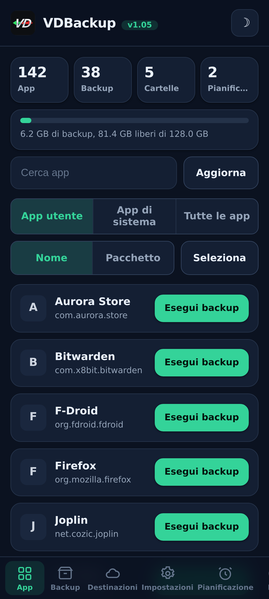
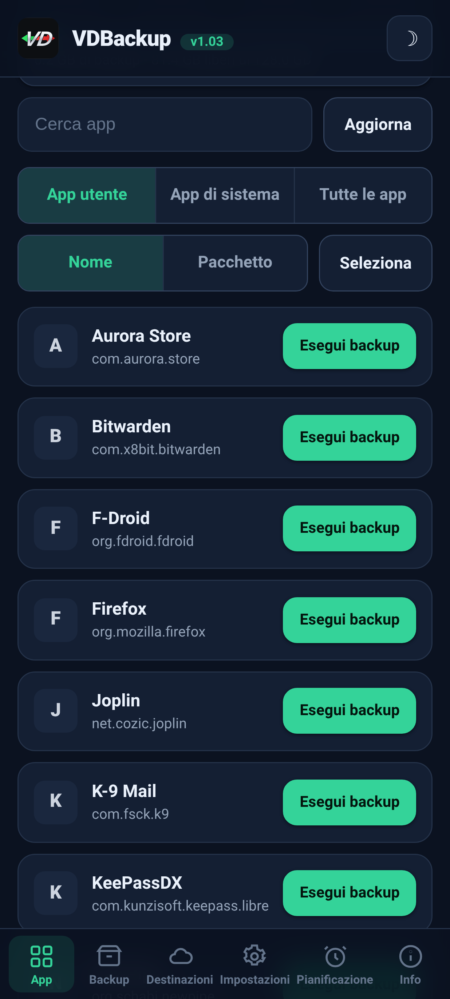
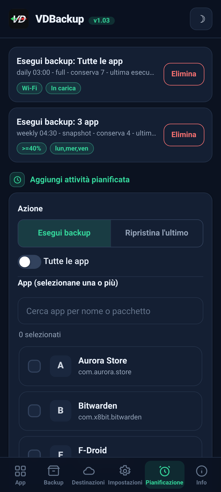
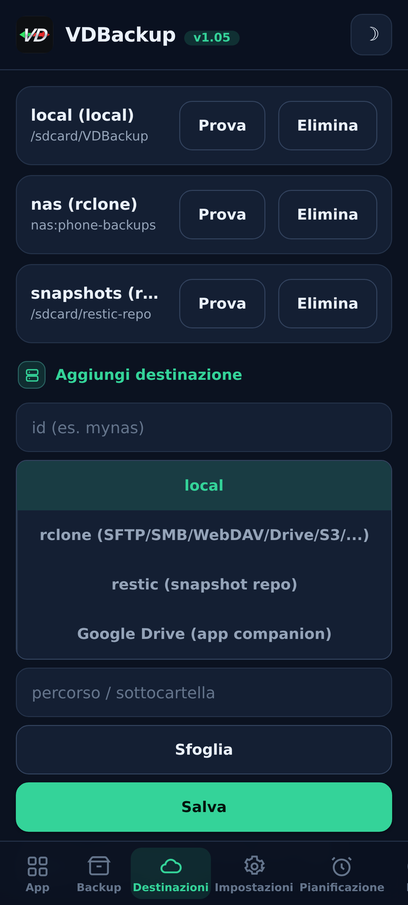
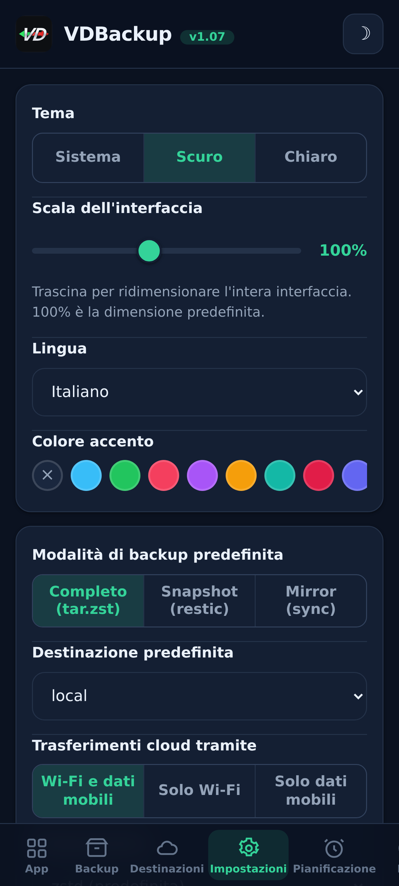
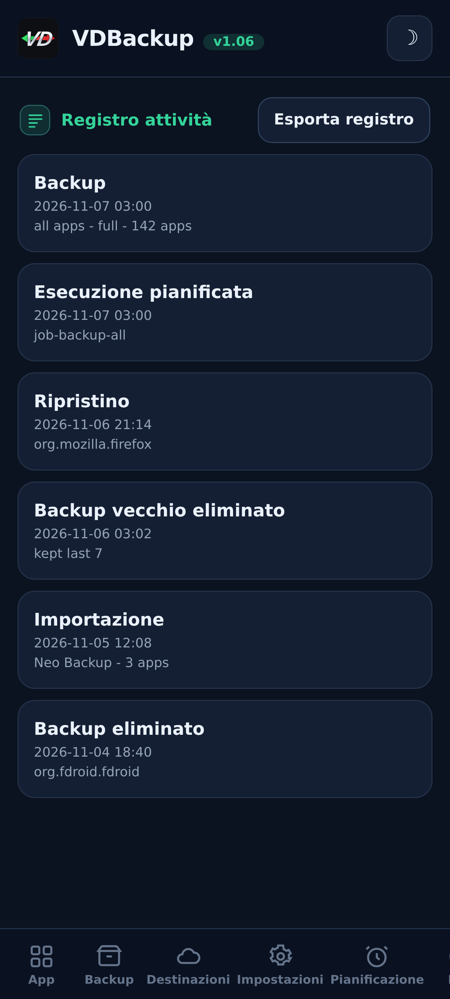

> **Languages:** [English](../USER-GUIDE.md) · [العربية](../ar/USER-GUIDE.md) · [Čeština](../cs/USER-GUIDE.md) · [Deutsch](../de/USER-GUIDE.md) · [Español](../es/USER-GUIDE.md) · [فارسی](../fa/USER-GUIDE.md) · [Français](../fr/USER-GUIDE.md) · [हिन्दी](../hi/USER-GUIDE.md) · [Bahasa Indonesia](../in/USER-GUIDE.md) · Italiano · [日本語](../ja/USER-GUIDE.md) · [한국어](../ko/USER-GUIDE.md) · [Nederlands](../nl/USER-GUIDE.md) · [Polski](../pl/USER-GUIDE.md) · [Português](../pt/USER-GUIDE.md) · [Русский](../ru/USER-GUIDE.md) · [Svenska](../sv/USER-GUIDE.md) · [ไทย](../th/USER-GUIDE.md) · [Türkçe](../tr/USER-GUIDE.md) · [Tiếng Việt](../vi/USER-GUIDE.md) · [中文](../zh/USER-GUIDE.md)

---

# Guida utente di VDBackup

Una panoramica completa e accessibile di VDBackup, dall'installazione del modulo alla creazione del
tuo primo backup, al suo ripristino, all'invio nel cloud, alla pianificazione e all'apertura
su un PC anni dopo. Se hai già usato Swift Backup, Neo-Backup o
Android-DataBackup, questo ti sembrerà familiare - solo che tutto avviene in un unico
posto, senza nulla da "consentire".

## Indice

- [1. What VDBackup is](#1-what-vdbackup-is)
- [2. Requirements](#2-requirements)
- [3. Install and first run](#3-install-and-first-run)
- [4. The WebUI tour](#4-the-webui-tour)
- [5. Making a backup](#5-making-a-backup)
  - [5.1 Choosing what to back up](#51-choosing-what-to-back-up)
  - [5.2 Backup modes: Full, Snapshot, Mirror](#52-backup-modes-full-snapshot-mirror)
  - [5.3 Compression](#53-compression)
  - [5.4 Encryption](#54-encryption)
  - [5.5 Verify and dry-run](#55-verify-and-dry-run)
  - [5.6 Special backups (messages, call log, Wi-Fi, Bluetooth, calendar, wallpaper, DNS, system settings)](#56-special-backups-messages-call-log-wi-fi-bluetooth-calendar-wallpaper-dns-system-settings)
  - [5.7 Standalone folder and file backups](#57-standalone-folder-and-file-backups)
- [6. Restoring a backup](#6-restoring-a-backup)
- [7. Destinations: local and remote](#7-destinations-local-and-remote)
- [8. Scheduling and retention](#8-scheduling-and-retention)
- [9. Migrating in: importing Neo-Backup and Android-DataBackup](#9-migrating-in-importing-neo-backup-and-android-databackup)
- [10. SSAID (device ANDROID_ID)](#10-ssaid-device-android_id)
- [11. Portability: opening backups on a PC](#11-portability-opening-backups-on-a-pc)
- [12. Driving VDBackup from an AI assistant](#12-driving-vdbackup-from-an-ai-assistant)
- [13. Troubleshooting and FAQ](#13-troubleshooting-and-faq)
- [14. Uninstalling](#14-uninstalling)

---

## 1. Cos'è VDBackup

VDBackup è un modulo root con una WebUI integrata che esegue il backup e il ripristino delle tue app
e dei loro dati. È progettato come il successore aperto e root-nativo di Swift Backup,
Neo-Backup e Android-DataBackup : mira a fare l'unione di ciò che fanno quegli strumenti, in
un unico posto, e può persino importare i tuoi backup Neo-Backup e
Android-DataBackup esistenti così da poter migrare senza perdere nulla.

La differenza chiave rispetto a una normale app di backup : VDBackup funziona **interamente
dalla WebUI del tuo gestore root**, e il modulo è già root. Non c'è nessuna app compagna
da installare per le funzioni principali, nessun prompt "concedi su" da approvare, e nulla da attivare.
Apri la WebUI, scegli cosa salvare, ed esegui.

Tutto ciò che VDBackup produce usa **formati standard** (tar, gzip, zstd, age, zip,
restic), quindi i tuoi backup non sono mai bloccati nel modulo e non sono mai legati al tuo
dispositivo specifico. Vedi la [sezione 11](#sezione-11).

## Screenshot

| Home | App | Pianificazione |
|:---:|:---:|:---:|
|  |  |  |
| **Destinazioni** | **Impostazioni** | **Registro attività** |
|  |  |  |

## 2. Requisiti

- **Un dispositivo Android con root** gestito da **KernelSU**, **APatch** o **Magisk**.
  VDBackup si installa come modulo da quel gestore.
- Spazio di archiviazione libero sufficiente per i tuoi backup (i backup locali risiedono sotto la directory
  di stato del modulo ; vedi la [sezione 3](#sezione-3)).
- Nient'altro. Il modulo include tutti i binari di cui ha bisogno (tar, zstd, lz4, rclone,
  rsync, ssh, restic), quindi **il backup e il ripristino locali funzionano completamente offline**. Solo le
  destinazioni cloud comunicano con la rete.

Alcuni extra a grana fine (AppOps, SSAID, alcuni pezzi di sistema privilegiati) si appoggiano al
framework Android ; il modulo li gestisce internamente, con un ripiego in shell puro,
e degradano in modo elegante quando non sono disponibili sul tuo dispositivo.

## 3. Installazione e primo avvio

1. Scarica l'ultima release `VD-Backup-vX.Y.zip`.
2. Nel tuo gestore KernelSU / APatch / Magisk, flasha lo zip del modulo come qualsiasi altro
   modulo.
3. È utilizzabile immediatamente - **nessun riavvio necessario**. (Un riavvio è rilevante solo
   quando si ripristina il SSAID ; vedi la [sezione 10](#sezione-10).)
4. Apri la **WebUI** del modulo dal gestore. Quella è l'intera interfaccia.

**Quale edizione scaricare.** Ogni release è distribuita come diverse edizioni zip flashabili, così scarichi solo ciò che ti serve. Scegline una:

- **`VD-Backup-<ver>-universal-full.zip`** - ogni architettura CPU e ogni binario incorporato, inclusi `rclone` (provider cloud: Google Drive, S3 e oltre 70 altri backend rclone) e `restic` (snapshot deduplicati). Completamente offline, non viene mai scaricato nulla. Funziona su qualsiasi dispositivo. Il download più grande.
- **`VD-Backup-<ver>-universal-lite.zip`** - ogni architettura, ma **senza** i due binari più grandi (`rclone` e `restic`). Il download più piccolo; fa comunque backup locali, SSH/SFTP e rsync senza alcun download, con cifratura portabile `age`. La prima volta che usi una destinazione cloud (`rclone`) o la modalità snapshot (`restic`), la WebUI propone di scaricare una volta quel piccolo addon per-architettura (verificato con SHA-256) e lo memorizza nella cache; da quel momento anche quelle funzioni funzionano.
- **`VD-Backup-<ver>-<abi>-full.zip`** (una tra `arm64-v8a`, `armeabi-v7a`, `x86`, `x86_64`) - una singola architettura con ogni binario incorporato (le stesse funzioni di `universal-full` ma solo per l'architettura del tuo dispositivo, quindi più piccola di `universal-full`).

Se conosci l'architettura del tuo dispositivo e vuoi tutto incorporato, scegli la **`<abi>-full`** corrispondente (la maggior parte dei telefoni è **`arm64-v8a`**). Se vuoi il download più piccolo e non ti dispiace un download una tantum, verificato con SHA-256, la prima volta che usi i provider cloud (`rclone`) o gli snapshot (`restic`), scegli **`universal-lite`**. Se vuoi tutto incorporato senza alcun download (offline / ripristino) e non sei sicuro dell'architettura, scegli un'edizione **full**. All'installazione il modulo conserva solo l'architettura del tuo dispositivo, indipendentemente dall'edizione che flashi.

Al primo avvio il modulo inizializza una configurazione predefinita (solo se non ne esiste ancora una), così che
le tue impostazioni siano preservate attraverso gli aggiornamenti del modulo.

**Dove risiedono i dati di stato.** I dati di lavoro di VDBackup - la tua configurazione, i lavori pianificati,
le destinazioni salvate, le credenziali cifrate, i log e la traccia di audit, e l'area di preparazione -
risiedono sotto :

```
/data/adb/vdbackup/
```

**Dove risiedono i backup.** I backup stessi vengono scritti in un'archiviazione visibile all'utente e
cifrata con le credenziali (così sono leggibili solo dopo lo sblocco del dispositivo, e
sopravvivono alla disinstallazione del modulo), una cartella per utente Android :

```
/sdcard/VDBackup/            (= /data/media/<user>/VDBackup)
```

Tienilo a mente per due motivi : i backup occupano spazio sotto `/sdcard/VDBackup`, e
`/data/adb/vdbackup/logs/` è dove guardare se qualcosa va storto.

## 4. Visita della WebUI

La WebUI è organizzata in alcune schede :

- **Home** - una panoramica iniziale che mostra i conteggi dei tuoi backup (app, backup, cartelle e lavori pianificati) e una barra di archiviazione di quanto spazio usano i tuoi backup rispetto a quello libero, con badge di stato, copia negli appunti di hash e percorsi, e un'azione **Check for updates**.
- **Apps** - l'elenco delle app installate (utente e sistema), ognuna mostrata con il suo vero
  nome, il suo nome di package, e la sua icona (le icone si caricano pigramente e sono in cache, così l'elenco
  resta reattivo). Il pulsante su una riga esegue il backup dell'app ; toccare la riga apre la cronologia di
  backup di quell'app, dove puoi ripristinare qualsiasi backup precedente.
- **Backups** - i backup che hai già, ognuno che mostra il nome dell'app su una riga e
  il package su quella successiva. Tocca un backup per vedere tutti i suoi dettagli (versione, data, dimensione,
  items inclusi, conteggi di permessi, e il dispositivo da cui proviene). Qui è anche dove
  ripristini, esegui un test di ripristino, elimini un backup, o importi backup da Neo-Backup o
  Android-DataBackup.
- **Destinations** - gestisci dove vanno i backup : l'archiviazione locale più qualsiasi destinazione
  remota che aggiungi (vedi la [sezione 7](#sezione-7)). Puoi
  testare una destinazione qui prima di affidartici.
- **Settings** - un interruttore di tema chiaro/scuro, un selettore del colore d'accento (preset, un colore
  personalizzato, o ripristino) e un selettore di lingua (l'interfaccia viene visualizzata da destra a sinistra per l'arabo e il persiano), un cursore di scala dell'interfaccia che trascini
  per ridimensionare l'intera interfaccia (intestazione, contenuto e navigazione inferiore insieme) da 85% a 120% (100% è il valore predefinito), per schermi di diverse densità di pixel,
  i valori predefiniti per i nuovi
  lavori (compressione predefinita, verify attivo/disattivo, cifratura predefinita), la politica di rete per i
  trasferimenti cloud (vedi la [sezione 7](#sezione-7)), il backup automatico e l'elenco delle app escluse,
  l'opzione dell'origine di installazione, la chiave di cifratura,
  e la pianificazione. Le impostazioni on/off usano interruttori in stile Android.
- **About** - versione, link, i progetti fratelli (Vedi anche), il manifesto di audit dei binari impacchettati, e un'azione **Check for updates** che segnala se è stata pubblicata una versione più recente (con le sue note di rilascio). Installi qualsiasi aggiornamento tramite il tuo gestore root, allo stesso modo in cui hai flashato il modulo.

L'app controlla inoltre da sola se c'è una versione più recente ogni volta che la apri (al massimo una volta all'ora) e mostra il banner di aggiornamento solo quando c'è; resta in silenzio se aggiornata o offline.

Le conferme e i messaggi usano finestre di dialogo integrate nell'app (non i vecchi pop-up di sistema), e un
ripristino o un'importazione ti chiede di riconoscere che sovrascrive i dati attuali dell'app prima
di procedere.

I backup e i ripristini vengono eseguiti **staccati** come processo root in background. Puoi chiudere la
WebUI, o persino chiudere il gestore root, e l'operazione continua. Quando
torni, la WebUI si riaggancia e mostra l'avanzamento in tempo reale con un'etichetta di fase localizzata. Per
un lavoro in corso la scheda di avanzamento mostra anche la velocità di trasferimento in tempo
reale e il tempo rimanente stimato, più un contatore di item (per esempio "12 di 40") con il nome
dell'item corrente. Sulle
ROM che espongono le notifiche shell ricevi anche una notifica Android quando un lavoro
inizia e finisce ; in ogni caso, la scheda di avanzamento integrata nell'app è l'indicatore affidabile.

## 5. Creare un backup

Il flusso di base : apri **Apps**, scegli un'app, seleziona cosa includere, scegli una modalità,
imposta la compressione e (opzionalmente) la cifratura, poi esegui. L'avanzamento appare in tempo reale e una
notifica ti dice quando è finito.

Nella finestra di backup puoi anche scegliere la **destinazione** di questo backup - archiviazione locale o qualsiasi destinazione cloud/remota aggiunta - senza prima cambiare la destinazione predefinita nelle Impostazioni.

### 5.1 Scegliere cosa salvare

Per ogni app puoi includere qualsiasi combinazione di questi items :

| Item | Cos'è |
|------|-----------|
| **APK** | L'applicazione installata stessa (APK di base + eventuali APK split). |
| **data** | I dati privati dell'app (`/data/data`). Questi sono i soliti "dati dell'app". |
| **device-protected data** | Archiviazione direct-boot / protetta dal dispositivo (`/data/user_de`). Alcune app ci tengono le impostazioni. |
| **external** | I dati esterni dell'app sotto `Android/data`. |
| **OBB** | I file di espansione OBB dell'app (`Android/obb`), usati da alcuni giochi. |
| **media** | I media dell'app sotto `Android/media`. |

Un buon valore predefinito per "salvare completamente questa app" è includerli tutti. Se
vuoi solo i dati (per esempio per spostare un salvataggio di gioco), puoi deselezionare l'APK e i
grandi items OBB/media.

VDBackup preserva anche le cose che rendono un ripristino fedele : contesti SELinux,
proprietà uid/gid, modi dei file, attributi estesi (xattr) e capacità.

### 5.2 Modalità di backup : Full, Snapshot, Mirror

VDBackup offre tre modalità. La WebUI preseleziona **Full**, che è la scelta giusta
per la maggior parte delle persone.

- **Full** - un backup completo, autonomo e portabile, scritto come `tar.zst` (o
  la compressione che scegli). Ogni esecuzione produce un backup indipendente che puoi copiare
  ovunque e aprire su un PC. Ideale per : un'istantanea pulita e portabile di un'app che puoi
  archiviare e spostare. Questa è l'opzione predefinita e la più portabile.
- **Snapshot** - incrementale e versionato, supportato da `restic`. Ogni esecuzione aggiunge un nuovo
  snapshot puntuale a un repository, memorizzando solo ciò che è cambiato e
  deduplicando tra gli snapshot. Ideale per : mantenere una cronologia continua di un'app
  senza pagare la dimensione completa a ogni esecuzione.
- **Mirror** - una sincronizzazione 1:1 dei dati in uso verso la destinazione, supportata da
  `rclone`/`rsync`. Mantiene la destinazione identica a ciò che è sul dispositivo in questo
  momento (i file modificati vengono copiati, i file rimossi vengono eliminati sulla destinazione). Ideale
  per : una copia veloce e sempre aggiornata, per esempio verso un remote cloud. Nota che l'APK
  viene comunque memorizzato compresso anche in un mirror, mai grezzo.

### 5.3 Compressione

Puoi scegliere la compressione per un backup Full :

- **none** - nessuna compressione (la più veloce, la più grande).
- **lz4** - compressione molto veloce e leggera.
- **zstd** - quella predefinita, un buon equilibrio tra velocità e rapporto. Puoi anche scegliere un
  livello (per esempio un livello più alto per un file più piccolo).
- **gzip** - la **"modalità compatibilità"**. gzip si apre con strumenti integrati su
  praticamente qualsiasi computer e nella maggior parte dei gestori di file, senza nulla di extra da installare.
  Scegli questa quando ti interessa soprattutto poter aprire l'archivio ovunque.

Se non scegli, VDBackup usa il suo valore predefinito configurato (zstd a un livello ragionevole).

### 5.4 Cifratura

La cifratura è **opzionale** e portabile. VDBackup cifra con **age** usando una
passphrase (scrypt), scelta specificamente per la portabilità : qualsiasi strumento `age`
standard su qualsiasi sistema operativo può decifrare il tuo backup con la sola passphrase.
La cifratura non è **mai** legata alle chiavi hardware del tuo dispositivo, quindi un backup cifrato
si ripristina su un altro dispositivo e si apre su un PC. (È disponibile anche una modalità zip AES-256 compatibile
per gli archivi cifrati che vuoi aprire con un doppio clic e una password.)

Per usare la cifratura, genera una volta la chiave di cifratura (Settings), poi abilita
la cifratura per il tuo lavoro e imposta una passphrase. La passphrase è ciò che protegge il
backup, quindi scegline una forte - non c'è chiave hardware e nessuna backdoor di recupero.

**La regola dell'APK (importante) :**

- L'**APK è sempre memorizzato compresso**, mai grezzo, per risparmiare spazio.
- L'**APK non è cifrato per default**, perché l'APK di un'app è contenuto pubblico.
- La cifratura dell'APK e la cifratura dei dati sono **interruttori indipendenti**. Attivare la cifratura
  dei dati **non** cifra l'APK. Se vuoi specificamente che anche l'APK sia cifrato,
  abilita esplicitamente l'interruttore di cifratura dell'APK.

### 5.5 Verify e dry-run

Due opzioni di sicurezza ti aiutano a fidarti di un backup prima di affidartici :

- **Verify** - dopo la scrittura, VDBackup ri-calcola l'hash di ogni archivio e lo confronta con
  il manifesto. Questo è **attivo per default per i backup Full**. Se un file non corrisponde,
  il lavoro fallisce con un errore chiaro invece di lasciarti con un backup silenziosamente corrotto.
- **Dry-run** - pianifica il lavoro e riporta le dimensioni che produrrebbe **senza scrivere
  nulla**. Usalo per stimare lo spazio o per verificare la tua selezione di items prima di eseguire
  l'operazione vera.

Quando un backup va verso una destinazione **cloud**, VDBackup aggiunge due salvaguardie in più.
Esegue un passo finale **verificato con checksum** che ricontrolla la copia caricata rispetto
all'originale sul remote, e fa fallire il lavoro (invece di lasciare una copia corrotta nel cloud)
se non corrispondono. E prima di un caricamento Full controlla lo **spazio libero** del remote e si
ferma per tempo con un chiaro errore di **"spazio insufficiente"** se il backup non ci sta, invece
di riempire il remote e fallire a metà strada. (Il controllo dello spazio è per i caricamenti Full ;
il Mirror è un delta sync ed è esente.)

### 5.6 Backup speciali (messaggi, registro chiamate, Wi-Fi, Bluetooth, calendario, sfondo, DNS, impostazioni di sistema)

Sotto gli elenchi di app nella scheda **Backups**, i **Backup speciali** coprono dati a livello
di sistema che non sono legati a una singola app. Scegli le categorie ed eseguine il backup ; vengono
archiviati con la stessa conservazione SELinux/xattr e la stessa cifratura opzionale dei backup di app.
Le categorie sono :

| Categoria | Cos'è |
|----------|-----------|
| **Messaggi (SMS/MMS)** | I tuoi messaggi di testo. |
| **Contatti e registro chiamate** | I tuoi contatti e la cronologia delle chiamate. |
| **Reti Wi-Fi** | Le tue reti Wi-Fi salvate. |
| **Bluetooth** | I tuoi abbinamenti Bluetooth. |
| **Calendario** | Il provider del calendario (app e dati). Viene scritto anche un **`calendar.json` portabile**, così i tuoi eventi sono leggibili su un PC senza il modulo. |
| **Sfondo** | Il tuo sfondo della home e della schermata di blocco più `wallpaper_info.xml`, memorizzato come immagine grezza. |
| **DNS** | La tua modalità DNS privata e il server. |
| **Impostazioni di sistema** | Un dump completo delle impostazioni system, global e secure del dispositivo. |

Per i messaggi, il registro chiamate e i contatti viene scritta anche una **copia portabile** (JSON
apribile), così hai una copia multi-dispositivo che puoi leggere su un PC senza il modulo.

**Le impostazioni di sistema sono opt-in e sovrascrivono le impostazioni del dispositivo al ripristino.**
Proprio come SSAID (vedi la [sezione 10](#sezione-10)), la categoria **Impostazioni di sistema** è la più
sensibile : ripristinarla sovrascrive le impostazioni a livello di dispositivo, quindi è disattivata a
meno che tu non la selezioni deliberatamente, ti chiede prima di riconoscere, ed è scritta nel log di
attività.

Il ripristino di un backup speciale sovrascrive i dati di sistema in uso e richiede un riavvio, quindi è
protetto da un riconoscimento prominente ed è affidabile sullo stesso dispositivo e sulla stessa ROM. I
ripristini sono **idempotenti** : le categorie grezze (messaggi, contatti, Wi-Fi, Bluetooth, calendario)
vengono ripristinate **sostituendo** i dati invece di fonderli, così ripristinare lo stesso backup due
volte non crea mai duplicati, e DNS e impostazioni di sistema vengono semplicemente riapplicati.

### 5.7 Backup autonomi di cartelle e file

A volte vuoi eseguire il backup di una semplice cartella o di un file che non è un'app - una cartella
della fotocamera, una directory di documenti, un singolo database. VDBackup può eseguire il backup di
**qualsiasi percorso assoluto** sull'archiviazione condivisa o sotto `/data`, con lo stesso formato
portabile di un backup di app : un archivio `tar.zst` più un `manifest.json`, sigillato in SHA-256, con
una nota RECOVERY quando lo cifri. Questi backup di percorso sono tenuti separatamente, sotto una
cartella `.paths` nella tua directory dei backup.

- **Scegli un percorso ed eseguine il backup.** La sorgente deve essere un percorso assoluto sotto una
  delle posizioni consentite (`/storage/emulated`, `/data/media`, `/sdcard`, `/data`). I percorsi che
  cercano di uscire con `..` vengono rifiutati.
- **Il ripristino riscrive nella posizione originale**, quindi, come ogni ripristino, è distruttivo e ti
  chiede di **confermare** prima di sovrascrivere qualcosa.
- Come i backup di app, i backup e i ripristini di percorso vengono eseguiti **staccati** con avanzamento
  in tempo reale, usano la compressione che scegli, e possono essere cifrati con una passphrase.

## 6. Ripristinare un backup

Apri la scheda **Backups**, scegli il backup che vuoi, e avvia il ripristino. Poiché
il ripristino è un'azione distruttiva, VDBackup ti chiede di **confermare** prima, e
registra l'azione in un log di audit locale.

Un ripristino è **fedele** : VDBackup cancella lo stato attuale dell'app ed estrae il
backup, così l'app è riportata allo **stato esatto** catturato in quel backup
(inclusi proprietà, modi, contesti SELinux e xattr). Non è una fusione - è un
vero ripristino al punto temporale del backup. Poiché un ripristino viene eseguito come root,
VDBackup controlla anche ogni archivio prima di estrarre qualsiasi cosa e rifiuta un archivio manomesso
che cerca di scrivere fuori dalla sua destinazione, così un backup modificato non può mai sovrascrivere
il resto del tuo sistema.

Opzioni di ripristino utili :

- **Restore-test** - estrae il backup in un'area di preparazione temporanea e lo verifica
  **senza toccare l'app in uso**. Questo è il modo sicuro per confermare che un backup sia
  intatto e ripristinabile prima di sovrascrivere qualcosa. Se il test fallisce ottieni un
  errore chiaro e la tua app installata resta intatta.
- **Ripristino parziale** - ripristina solo alcuni degli items di cui è stato fatto il backup. Per
  esempio, ripristina solo i dati dell'app senza reinstallare l'APK, o ripristina i
  file di salvataggio senza i grandi OBB/media. Scegli gli items che vuoi nella schermata di ripristino.
- Per i backup **Snapshot** e **Mirror**, il ripristino attinge rispettivamente dal repository versionato
  o dalla copia in mirror.
- **Origine di installazione** - per impostazione predefinita un'app ripristinata riporta il **Play Store**
  come origine di installazione (invece di sembrare caricata lateralmente), che è ciò che la maggior parte
  delle app e dei controlli delle app si aspetta. Puoi disattivarlo globalmente in Settings o per singolo
  ripristino, e quando è disattivato viene mantenuta l'origine di installazione originale. Un'opzione avanzata
  opt-in **"forgia l'origine iniziatrice"** va oltre e fa sembrare installati dal Play Store anche il
  pacchetto e l'origine iniziatori dell'app ; modifica il database dei pacchetti di sistema (prima ne esegue
  il backup) e ha effetto dopo un riavvio.

**Ripristino in blocco.** La scheda **Backups** ha una modalità **Select**, nello stesso modo in cui la scheda
**Apps** ce l'ha per il backup in blocco. Attiva **Select**, spunta i backup che vuoi con le loro caselle, e
ripristinali tutti in una volta. Un'unica finestra di opzioni copre l'intera selezione - il riconoscimento della
sovrascrittura, il restore-test e la scelta della sorgente di installazione si applicano a ogni backup scelto - e
vengono ripristinati uno dopo l'altro.

**Eliminare un backup.** Apri i dettagli di un backup (o la cronologia di un'app) e usa **Delete** ;
ti viene chiesto di confermare, e l'eliminazione viene scritta nel log di attività. Puoi anche
limitare quanti backup mantenere per app (retention) così che quelli vecchi vengano potati automaticamente.

**Montare un'app installata come app di sistema.** Dalla cronologia di backup di un'app, **Mount as
system** prepara l'APK dell'app in un sottomodulo overlay di VDBackup così che il gestore root lo
serva da `/system/app` (o `/system/priv-app`) - la partizione `/system` reale non viene mai toccata. Con
**NoMount** su KernelSU si applica a caldo ; altrimenti si applica dopo un riavvio. Questo non dipende mai
dall'avere NoMount installato.

## 7. Destinazioni : locale e remota

Per default, i backup vengono scritti nell'archiviazione **locale** sotto la directory di stato del
modulo. Puoi anche aggiungere destinazioni remote nella scheda **Destinations**. Per una destinazione
locale, **Browse** apre un selettore di cartelle così che tu possa scegliere una sottocartella sotto
l'archiviazione condivisa (`/sdcard`) invece di digitare il percorso.

Il trasporto remoto è gestito dagli strumenti impacchettati :

- **rclone** - l'hub per un'enorme gamma di remote : **SFTP, SMB, WebDAV, FTP, S3,
  Google Drive** e oltre 70 altri servizi.
- **rsync** e la suite **ssh/scp/sftp** - per la sincronizzazione delta e i target SSH semplici.
- **restic** - repository **Snapshot** cifrati e deduplicati (locali o remoti).

**Creare un remote cloud (nessun SSH necessario).** Nella scheda Destinations, scegli il
tipo di destinazione **rclone** e usa **Add cloud remote**. Puoi collegare **qualsiasi backend
rclone**: il menu a tendina offre quelli più diffusi (**Google Drive, Dropbox, OneDrive, Box,
pCloud, Mega, Backblaze B2, S3, SFTP, WebDAV, FTP, SMB**) più un'opzione **Custom (advanced)**
dove digiti qualsiasi altro tipo di backend e i suoi parametri `key=value`. Compila i campi
(host/user/password, o le chiavi S3, per esempio) e salva. Per i provider che ti fanno accedere
con un browser (Google Drive, Dropbox, OneDrive, Box, pCloud) usa il pulsante **Authorize in
browser**: ti fa accedere tramite il browser del telefono stesso e cattura il token
automaticamente, quindi **non serve alcun PC** (incollare un token a mano funziona ancora come
fallback). Il remote appare quindi nell'elenco dei remote della destinazione. Le password sono
memorizzate offuscate, mai in chiaro. Puoi elencare ed eliminare i tuoi remote dallo stesso posto.

Due regole rendono sicuro l'uso remoto :

- **Le credenziali sono memorizzate cifrate** a riposo nella directory di stato del modulo, mai
  in chiaro.
- **Valida prima di usare.** Usa il test di destinazione nella scheda Destinations per
  confermare che una destinazione funzioni prima di puntarci un backup reale.

**Politica di rete (Wi-Fi vs dati mobili).** In Settings, "Cloud transfers over" ti permette di
limitare quale connessione i trasferimenti cloud possono usare : **Wi-Fi e dati mobili** (il
valore predefinito), **Solo Wi-Fi**, o **Solo dati mobili**. Quando lo limiti, ogni trasferimento
cloud - manuale o pianificato, caricamento o ripristino - verifica prima la connessione attiva
e rifiuta di eseguirsi su quella sbagliata, così una politica solo-Wi-Fi non spende mai dati mobili.
I backup locali non sono mai interessati.

**Google Drive.** Hai due modi per raggiungere Google Drive :

1. **Tramite rclone** - aggiungi Drive come un remote rclone come qualsiasi altra destinazione, senza
   app extra e **senza account Google Cloud**. Su qualsiasi computer esegui
   `rclone authorize "drive"` una volta, accedi al tuo account Google nel browser, e
   incolla il token che stampa nel campo token del remote Drive.
2. **Tramite il compagno opzionale** - una piccola app compagna opt-in che gestisce
   l'accesso a Google e il caricamento su Drive. Viene installata **solo quando scegli esplicitamente
   la destinazione compagna Google Drive**, mai per default, e viene rimossa quando
   la disabiliti. La schermata di consenso Google una tantum è l'unico passo che avviene
   fuori dalla WebUI. Quando il compagno è installato, VDBackup ti ricorda di
   **nasconderlo sempre con HMA-OSS** così che la sua presenza non riveli né root né
   un bootloader sbloccato, e si offre di aggiungerlo alla lista HMA-OSS per te.

## 8. Pianificazione e ritenzione

VDBackup può eseguire i backup - e i ripristini - automaticamente secondo una pianificazione. Nel pianificatore
definisci un lavoro con :

- un **bersaglio** - una singola app, un insieme di app, o **tutte le app** (meno la lista delle app escluse) - e
  gli items/la modalità da usare,
- un'**action** - **Back up** (predefinita) o **Restore latest**, che ripristina il backup più recente di ogni app
  bersaglio,
- una destinazione,
- una **pianificazione di tipo cron** - oraria, giornaliera o settimanale, a un orario che scegli (HH:MM),
- un'impostazione di **ritenzione** : **mantieni gli N** backup più recenti di quel lavoro, quelli più vecchi vengono
  potati automaticamente,
- **condizioni di esecuzione** opzionali : solo in **Wi-Fi**, solo mentre è in **carica**, solo con
  un **livello minimo di batteria**, e solo nei **giorni della settimana** scelti.

I lavori pianificati sono attivati da un battito di cuore all'avvio nel modulo : quando un lavoro è
dovuto viene eseguito, registra l'orario della sua ultima esecuzione così da non attivarsi due volte, e applica la
ritenzione per potare i vecchi backup. Poiché tutto viene eseguito come root in background, i
backup pianificati non hanno bisogno che la WebUI sia aperta.

**Condizioni di esecuzione (gate).** Un lavoro pianificato può portare condizioni che devono valere
perché venga eseguito : solo Wi-Fi, solo in carica, un livello minimo di batteria, e giorni
specifici della settimana. Quando un lavoro è dovuto ma una condizione non è soddisfatta, viene
**saltato e riprovato al controllo successivo** - la sua pianificazione non avanza, quindi viene
eseguito non appena la condizione è soddisfatta. Un controllo termico integrato salta anche un
lavoro pianificato mentre il dispositivo è troppo caldo. Ognuno di questi salti viene registrato nel
log di attività.

**Il ripristino pianificato sovrascrive a ogni esecuzione.** Un lavoro **Restore latest** ripristina di nuovo il
backup più recente di ogni app bersaglio ogni volta che scatta, e il ripristino è distruttivo : a ogni esecuzione
**sovrascrive i dati attuali dell'app** con il backup più recente. Questo è deliberato e opt-in - sceglilo solo
quando vuoi mantenere i bersagli al loro backup più recente.

**Backup automatico all'installazione/aggiornamento.** In Settings puoi attivare il **backup
automatico** : lo stesso battito di cuore in background nota le app appena installate o aggiornate e
ne esegue il backup per te (con ritenzione keep-N). La prima esecuzione registra solo ciò che è
installato, così abilitarlo non esegue mai il backup dell'intero dispositivo tutto in una volta.

**App escluse (blocklist).** Sempre in Settings, puoi escludere le app di cui non vuoi mai eseguire
il backup automaticamente o su pianificazione ; puoi aggiungerne diverse in una volta (selezione multipla), e le app escluse vengono saltate da entrambi.

**Log di attività.** La scheda Schedule ha un pulsante **View activity log** che apre una schermata completa
(istantaneamente) che mostra la traccia di audit locale - backup, ripristini, eliminazioni, esecuzioni pianificate e automatiche, e potature -
dalla più recente. Un'azione **Export logs** salva un file di log (nella cartella dei backup) che puoi allegare a una segnalazione di feedback o di bug.

## 9. Migrare : importare Neo-Backup e Android-DataBackup

Se vieni da Neo-Backup o Android-DataBackup, non devi ricominciare
da capo. Dalla scheda **Backups** puoi **importare** i tuoi backup esistenti :

1. Punta VDBackup alla posizione dei tuoi backup Neo-Backup o Android-DataBackup
   esistenti (import-scan elenca ciò che vi trova).
2. Scegli quali backup importare.
3. Avvia l'importazione. Come le altre operazioni lunghe viene eseguita staccata con avanzamento in tempo reale.

**I backup Neo-Backup cifrati con password sono supportati.** I backup Neo-Backup
cifrati in AES-256 possono essere importati - ti viene **richiesta la password** quando è
necessaria, e la password è usata solo per decifrare, mai memorizzata nella riga di comando.

## 10. SSAID (ANDROID_ID del dispositivo)

Il SSAID è l'`ANDROID_ID` per-app - un identificatore a livello di dispositivo che alcune app leggono.
VDBackup può eseguirne il backup e il ripristino, ma questa è la cosa più sensibile che
tocca, quindi è gestita con cura extra :

- **È OPZIONALE e DISATTIVATO per default.** VDBackup non catturerà né ripristinerà **mai** il
  SSAID a meno che tu non lo attivi esplicitamente per quel lavoro. La WebUI mostra un avviso "Optional"
  chiaramente contrassegnato ed evidenziato ovunque appaia il SSAID (backup, ripristino e
  importazione), e resta disattivato finché non aderisci.
- **Si applica solo dopo un riavvio al ripristino.** Il provider delle impostazioni Android mette in cache
  questi valori, quindi un SSAID ripristinato ha effetto solo dopo aver riavviato il dispositivo.
- **Il valore precedente viene sempre salvato prima.** Prima di sovrascrivere qualsiasi SSAID,
  VDBackup copia il `settings_ssaid.xml` in uso byte per byte in un backup con marca temporale
  (che non viene mai eliminato automaticamente). Se quella copia di sicurezza non può essere fatta, la sovrascrittura
  non avviene. Per tornare indietro, ripristina quel file salvato e riavvia.

**Raccomandazione :** lascia il SSAID disattivato a meno che tu non sappia specificamente di averne bisogno (per
esempio, una particolare app che si lega all'ID del dispositivo e che stai migrando
deliberatamente). Per i normali backup di app e dati non ne hai bisogno.

## 11. Portabilità : aprire i backup su un PC

I tuoi backup **non sono bloccati in questo modulo** e non sono **mai legati all'hardware**.
Tutto usa formati standard, quindi puoi aprire un backup su Windows, macOS o Linux
senza VDBackup installato.

Una cartella di backup Full contiene un `manifest.json` (la fonte di verità che descrive ogni
file, la versione dell'app e il proprietario/contesto originale), gli APK come `*.apk.zst`, e
gli archivi di dati come `<item>.tar.zst` (o `.tar.gz` / `.tar.lz4`), opzionalmente con un
`.age` finale quando cifrati.

Per aprirne uno su un PC, in breve :

- **Decifra** (solo se il file termina in `.age`) con lo strumento standard `age` e la tua
  passphrase o il file di chiave.
- **Decomprimi ed estrai** : `.tar.zst` con `zstd` poi `tar` ; `.tar.gz` con `tar`
  direttamente ; `.tar.lz4` tramite `zstd --format=lz4`. Un APK è solo un APK compresso con zstd,
  quindi decomprimere `base.apk.zst` ti dà un normale `base.apk` installabile.

Ogni backup cifrato viene fornito con una nota **RECOVERY** contenente gli esatti comandi
da copiare e incollare per Windows, macOS e Linux. Vedi
[`../module/etc/RECOVERY.md`](RECOVERY.md) per il kit completo, passo dopo passo.

Nota che i contesti SELinux, uid/gid e modi sono memorizzati all'interno del tar e vengono
riapplicati correttamente solo quando ripristini su Android - su un PC ottieni comunque tutti i tuoi file,
solo senza che la proprietà specifica di Android venga imposta.

## 12. Pilotare VDBackup da un assistente IA

VDBackup è costruito per essere accogliente verso gli assistenti e gli agenti IA, non solo le persone. La
WebUI è solo uno dei client di una piccola API JSON ; un agente può amministrare **ogni** azione
del modulo senza interfaccia tramite quella stessa API (ogni comando restituisce un singolo oggetto JSON,
le operazioni lunghe vengono eseguite staccate e ne interroghi l'avanzamento, e si applicano le stesse
protezioni - il SSAID resta opt-in, le azioni mutanti restano confermate e auditate).

Se vuoi che un assistente esegua i tuoi backup e ripristini per te, indirizzalo a
[`AI-AGENTS.md`](AI-AGENTS.md), che documenta l'intera superficie di controllo : il contratto di
comando, ogni verbo con i suoi argomenti e il suo valore di ritorno, e le regole di sicurezza che un
agente deve rispettare.

## 13. Risoluzione dei problemi e FAQ

**Dove sono i log ?** Sotto la directory di stato del modulo,
`/data/adb/vdbackup/logs/`. L'avanzamento in tempo reale di un'operazione in corso è in
`progress-<opid>.json`, e la **traccia di audit** delle azioni mutanti (ripristino, eliminazione,
importazione, modifiche al SSAID) è in `audit.jsonl`.

**Un backup/ripristino sembra bloccato o ho chiuso la WebUI.** Le operazioni vengono eseguite staccate, quindi
chiudere la WebUI non le ferma. Riapri la WebUI e si riaggancia a qualsiasi
operazione in corso e mostra l'avanzamento attuale.

**Ho ricevuto un messaggio `ERR_...`.** Gli errori sono riportati con un codice chiaro. Alcuni
comuni :
- `ERR_VERIFY` - un archivio scritto non corrispondeva all'hash del suo manifesto (la verifica
  ha colto un backup difettoso). Riesegui il backup.
- `ERR_RESTORE_TEST` - un test di ripristino è fallito ; il backup non si è estratto/verificato
  in modo pulito e la tua app in uso è rimasta intatta.
- `ERR_UNSAFE_ARCHIVE` - un archivio è stato rifiutato perché cercava di scrivere fuori dalla sua
  directory di destinazione (percorsi assoluti o `..`). Questo ti protegge da un backup manomesso ;
  non è stato scritto nulla.
- `ERR_QUOTA` - un remote cloud non aveva spazio libero sufficiente per un caricamento Full ; il
  backup è stato interrotto prima di caricare qualsiasi cosa.

**La mia destinazione remota fallisce.** Usa il **test** di destinazione nella scheda Destinations
per validare credenziali e connettività. Ricorda che solo le destinazioni cloud hanno bisogno
della rete ; il backup/ripristino locale è completamente offline.

**Qualcosa di tutto questo telefona a casa o scarica a runtime ?** No. Tutti i binari sono impacchettati
nel modulo al momento del build ; nulla viene recuperato sul dispositivo a runtime. Solo le destinazioni
cloud (rclone/restic/ssh) comunicano con la rete, e solo quando le usi.

**Il mio backup si ripristinerà su un telefono diverso ?** Sì - i backup sono portabili e non
legati all'hardware del dispositivo. (Il SSAID è l'unica eccezione specifica del dispositivo, ed è opt-in
e applicato al riavvio ; vedi la [sezione 10](#sezione-10).)

**Il mio backup cifrato non si apre - ho perso la passphrase.** Non c'è backdoor di recupero
per progettazione ; la passphrase è ciò che protegge il backup. Tienila al sicuro.

## 14. Disinstallazione

Disinstalla VDBackup come qualsiasi altro modulo dal tuo gestore KernelSU / APatch / Magisk.
La disinstallazione **preserva la tua configurazione utente** e rimuove solo lo stato transitorio,
così una reinstallazione successiva riprende le tue impostazioni. I tuoi backup effettivi risiedono sotto
`/data/adb/vdbackup/` - se vuoi rimuovere anche quelli, elimina quella directory
manualmente dopo la disinstallazione ; altrimenti restano disponibili (e, essendo in formati
standard, apribili su un PC) anche senza il modulo.

---

*Questa documentazione è stata generata con Claude (Anthropic) ed è mantenuta da VD171. Correzioni e miglioramenti sono benvenuti - vedi [CONTRIBUTING.md](CONTRIBUTING.md).*
