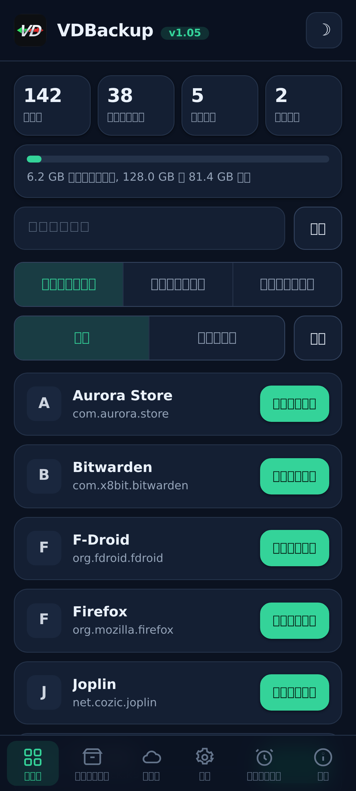
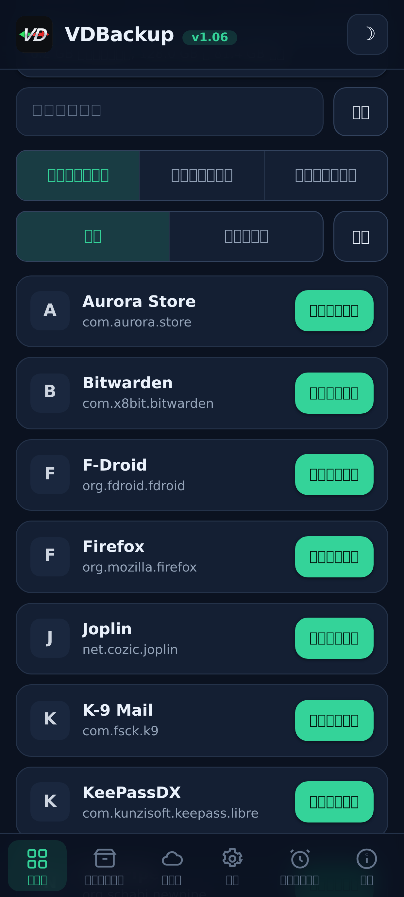
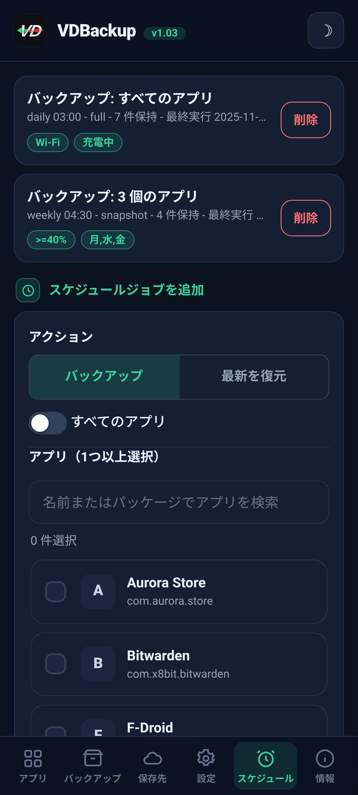
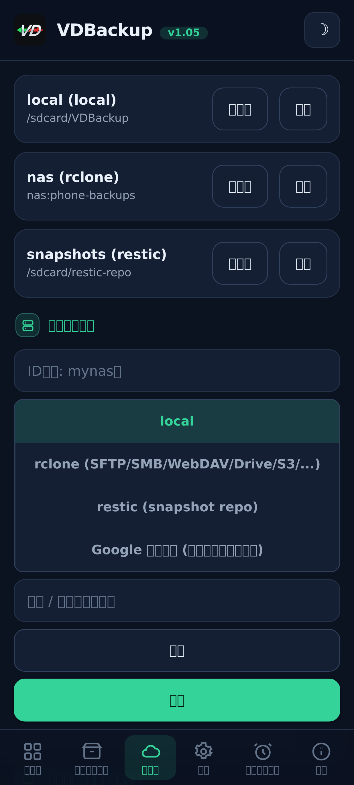
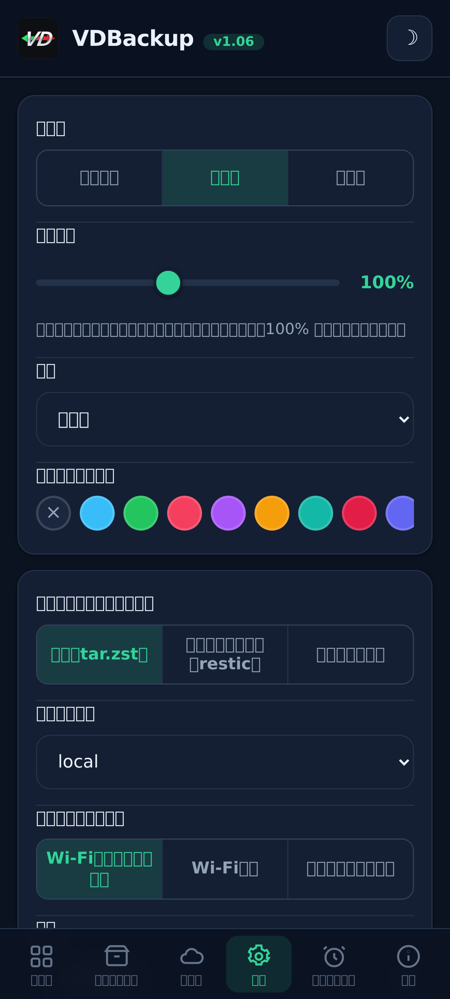
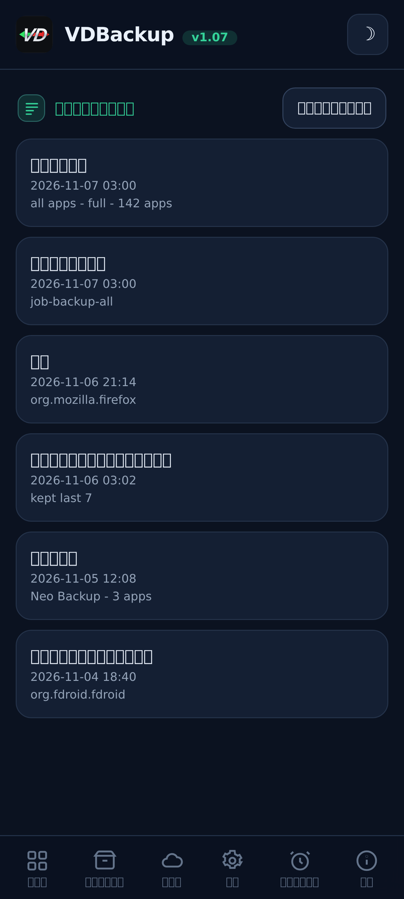

> **Languages:** [English](../USER-GUIDE.md) · [العربية](../ar/USER-GUIDE.md) · [Čeština](../cs/USER-GUIDE.md) · [Deutsch](../de/USER-GUIDE.md) · [Español](../es/USER-GUIDE.md) · [فارسی](../fa/USER-GUIDE.md) · [Français](../fr/USER-GUIDE.md) · [हिन्दी](../hi/USER-GUIDE.md) · [Bahasa Indonesia](../in/USER-GUIDE.md) · [Italiano](../it/USER-GUIDE.md) · 日本語 · [한국어](../ko/USER-GUIDE.md) · [Nederlands](../nl/USER-GUIDE.md) · [Polski](../pl/USER-GUIDE.md) · [Português](../pt/USER-GUIDE.md) · [Русский](../ru/USER-GUIDE.md) · [Svenska](../sv/USER-GUIDE.md) · [ไทย](../th/USER-GUIDE.md) · [Türkçe](../tr/USER-GUIDE.md) · [Tiếng Việt](../vi/USER-GUIDE.md) · [中文](../zh/USER-GUIDE.md)

---

# VDBackup ユーザーガイド

モジュールのインストールから、最初の backup の作成、その復元、クラウドへの送信、スケジュール設定、
そして何年も後に PC で開くところまで、VDBackup の完全で親しみやすい手引きです。以前に
Swift Backup, Neo-Backup, Android-DataBackup を使ったことがあれば、これは馴染み深く感じられる
でしょう, ただし、すべてが 1 か所で起こり、「許可」するものは何もありません。

## 目次

- [1. VDBackup とは](#1-vdbackup-とは)
- [2. 要件](#2-要件)
- [3. インストールと初回起動](#3-インストールと初回起動)
- [4. WebUI ツアー](#4-webui-ツアー)
- [5. backup の作成](#5-backup-の作成)
  - [5.1 何を backup するかの選択](#51-何を-backup-するかの選択)
  - [5.2 backup モード: Full, Snapshot, Mirror](#52-backup-モード-full-snapshot-mirror)
  - [5.3 圧縮](#53-圧縮)
  - [5.4 暗号化](#54-暗号化)
  - [5.5 Verify と dry-run](#55-verify-と-dry-run)
  - [5.6 特殊バックアップ (メッセージ, 通話履歴, Wi-Fi, Bluetooth, カレンダー, 壁紙, DNS, システム設定)](#56-特殊バックアップ-メッセージ-通話履歴-wi-fi-bluetooth-カレンダー-壁紙-dns-システム設定)
  - [5.7 スタンドアロンのフォルダとファイルの backup](#57-スタンドアロンのフォルダとファイルの-backup)
- [6. backup の復元](#6-backup-の復元)
- [7. 宛先: ローカルとリモート](#7-宛先-ローカルとリモート)
  - [7.1 設定のバックアップ](#71-設定のバックアップ)
- [8. スケジューリングとリテンション](#8-スケジューリングとリテンション)
- [9. 移行: Neo-Backup と Android-DataBackup のインポート](#9-移行-neo-backup-と-android-databackup-のインポート)
- [10. SSAID (デバイスの ANDROID_ID)](#10-ssaid-デバイスの-android_id)
- [11. ポータビリティ: PC で backup を開く](#11-ポータビリティ-pc-で-backup-を開く)
- [12. AI アシスタントから VDBackup を操作する](#12-ai-アシスタントから-vdbackup-を操作する)
- [13. トラブルシューティングと FAQ](#13-トラブルシューティングと-faq)
- [14. アンインストール](#14-アンインストール)

---

## 1. VDBackup とは

VDBackup は、WebUI を内蔵し、あなたのアプリとそのデータを backup / 復元する root モジュールです。
Swift Backup, Neo-Backup, Android-DataBackup のオープンで root-native な後継として設計されて
おり、それらのツールが行うことの和集合 (union) を 1 か所で行うことを目指します。さらに、既存の
Neo-Backup と Android-DataBackup の backup をインポートできるので、何も失わずに移行できます。

通常の backup アプリとの主な違い: VDBackup は **完全にあなたの root マネージャーの WebUI から**
動作し、モジュールはすでに root です。コア機能のためにインストールするコンパニオンアプリも、承認
する「su を付与」のプロンプトも、オンにするトグルもありません。WebUI を開き、backup するものを選び、
実行するだけです。

VDBackup が生成するものはすべて **標準フォーマット** (tar, gzip, zstd, age, zip, restic) を
使うため、あなたの backup がモジュールに閉じ込められることも、特定のデバイスに縛られることも決して
ありません。[セクション 11](#セクション-11) を参照してください。

## スクリーンショット

| ホーム | アプリ | スケジュール |
|:---:|:---:|:---:|
|  |  |  |
| **保存先** | **設定** | **アクティビティログ** |
|  |  |  |

## 2. 要件

- **root 化された Android デバイス** で、**KernelSU**, **APatch**, **Magisk** のいずれかで
  管理されているもの。VDBackup はそのマネージャーからモジュールとしてインストールされます。
- backup 用の十分な空き容量 (ローカルの backup はモジュールの状態ディレクトリ配下に置かれます;
  [セクション 3](#セクション-3) を参照)。
- それ以外は何もありません。モジュールは必要なすべてのバイナリ (tar, zstd, lz4, rclone, rsync,
  ssh, restic) を同梱しているので、**ローカルの backup と復元は完全にオフラインで動作します**。
  ネットワークと通信するのはクラウドの宛先だけです。

一部のきめ細かい追加機能 (AppOps, SSAID, 少数の特権的なシステム機能) は Android framework に
依存します; モジュールはこれらを内部で処理し、プレーンシェルの fallback を持ち、デバイスで利用
できないときは緩やかに機能を落とします。

## 3. インストールと初回起動

1. 最新の `VD-Backup-vX.Y.zip` リリースをダウンロードします。
2. KernelSU / APatch / Magisk マネージャーで、他のモジュールと同じようにモジュールの zip を
   flash します。
3. すぐに使えます, **リブート不要** (リブートが関係するのは SSAID を復元するときだけです;
   [セクション 10](#セクション-10) を参照)。
4. マネージャーからモジュールの **WebUI** を開きます。それがインターフェースのすべてです。

**どのエディションをダウンロードするか。** 各リリースは複数の flash 可能な zip エディションとして提供されるため、必要なものだけをダウンロードできます。いずれか 1 つを選んでください:

- **`VD-Backup-<ver>-universal-full.zip`**: すべての CPU アーキテクチャとすべてのバイナリを埋め込み。`rclone` (cloud プロバイダ: Google Drive、S3 ほか 70 以上の rclone バックエンド) と `restic` (重複排除スナップショット) を含みます。完全オフラインで、何もダウンロードされません。どのデバイスでも動作します。最も大きいダウンロードです。
- **`VD-Backup-<ver>-universal-lite.zip`**: すべてのアーキテクチャ。ただし 2 つの最大のバイナリ (`rclone` と `restic`) は **含みません**。最も小さいダウンロードです。portable な `age` 暗号化とともに、ローカル、SSH/SFTP、rsync のバックアップはダウンロードなしで引き続き行えます。クラウドの保存先 (`rclone`) やスナップショットモード (`restic`) を初めて使うとき、WebUI がそのアーキテクチャ別の小さなアドオンを一度だけダウンロードするか尋ね (SHA-256 で検証)、キャッシュします。その後はそれらの機能も使えるようになります。
- **`VD-Backup-<ver>-<abi>-full.zip`** (`arm64-v8a`、`armeabi-v7a`、`x86`、`x86_64` のいずれか), すべてのバイナリを埋め込んだ単一のアーキテクチャ (`universal-full` と同じ機能ですが、お使いのデバイスのアーキテクチャのみのため `universal-full` より小さくなります)。

お使いのデバイスのアーキテクチャが分かっていてすべてを埋め込みで欲しい場合は、対応する **`<abi>-full`** を選んでください (ほとんどのスマートフォンは **`arm64-v8a`** です)。最も小さいダウンロードが欲しく、cloud プロバイダ (`rclone`) やスナップショット (`restic`) を初めて使うときの SHA-256 で検証される一度きりのダウンロードを許容できる場合は、**`universal-lite`** を選んでください。すべてを埋め込みでダウンロードなし (オフライン / 復旧) にしたいがアーキテクチャが分からない場合は、**full** エディションを選んでください。インストール時、モジュールは flash したエディションに関わらず、お使いのデバイスのアーキテクチャだけを残します。

初回起動時、モジュールはデフォルト設定を seed します (まだ存在しない場合のみ)。そのため、モジュールの
更新をまたいで設定が保持されます。

**状態の保存場所。** VDBackup の作業データ, 設定、スケジュールされたジョブ、保存した宛先、暗号化
された認証情報、ログと audit trail、staging 領域, は以下の配下に置かれます:

```
/data/adb/vdbackup/
```

**backup の保存場所。** backup そのものは、ユーザーから見える、credential で暗号化されたストレージ
に書き込まれます (そのため、デバイスをアンロックした後にのみ読み取り可能で、モジュールをアンインス
トールしても残ります)。Android ユーザーごとに 1 フォルダです:

```
/sdcard/VDBackup/            (= /data/media/<user>/VDBackup)
```

これは 2 つの理由で覚えておいてください: backup は `/sdcard/VDBackup` 配下の容量を使うこと、
そして何か問題が起きたときに見る場所が `/data/adb/vdbackup/logs/` であることです。

## 4. WebUI ツアー

WebUI はいくつかのタブに整理されています:

- **Home**: backup の件数 (アプリ、backup、フォルダ、スケジュール済みジョブ) と、backup が使用している容量を空き容量と対比して示すストレージバーを表示するホーム概要。ステータスバッジ、ハッシュとパスのクリップボードへのコピー、そして **Check for updates** アクションを備えます。
- **Apps**: インストール済みアプリ (ユーザーとシステム) の一覧。各アプリは実際の名前、package 名、
  アイコンとともに表示されます (アイコンは遅延読み込みされてキャッシュされるので、一覧は応答性を
  保ちます)。行のボタンはそのアプリを backup します; 行をタップするとそのアプリの backup 履歴が
  開き、以前のどの backup でも復元できます。
- **Backups**: すでに持っている backup。各項目はアプリ名を 1 行目に、package を次の行に表示
  します。backup をタップすると、その全詳細 (バージョン, 日付, サイズ, 含まれる items, 権限数,
  それが由来するデバイス) が見られます。ここはまた、復元したり、restore-test を実行したり、backup を
  削除したり、Neo-Backup や Android-DataBackup から backup をインポートしたりする場所でもあります。
- **Destinations**: backup の送り先を管理します: ローカルストレージに加え、あなたが追加した任意の
  リモート宛先 (
  [セクション 7](#セクション-7) を参照)。頼りにする前に、ここで宛先をテスト
  できます。
- **Settings**: ライト/ダークのテーマ切り替え、アクセントカラーのピッカー (プリセット、カスタム
  カラー、またはリセット)、言語セレクタ (インターフェースはアラビア語とペルシア語では右から左に表示されます)、インターフェースのスケールスライダー (ドラッグしてインターフェース全体 (ヘッダー、コンテンツ、下部ナビゲーションをまとめて) を 85% から 120% に再スケール; 100% がデフォルト。異なるピクセル密度の画面向け)、新しいジョブのデフォルト (デフォルトの圧縮, verify のオン/オフ,
  デフォルトの暗号化)、クラウド転送のネットワークポリシー (
  [セクション 7](#セクション-7) を参照)、自動 backup と除外アプリの一覧、インストール元のオプション、
  暗号化鍵、スケジューリング。オン/オフの設定は Android スタイルのトグルスイッチを使います。
- **About**: バージョン、リンク、姉妹プロジェクト (See also)、同梱バイナリの監査マニフェスト、そしてより新しいバージョンが公開されているかどうかを (そのリリースノートとともに) 報告する **Check for updates** アクション。更新は、モジュールをフラッシュしたのと同じように、あなたの root マネージャーからインストールします。

アプリは開くたびに自分で新しいバージョンを確認し（最大で1時間に1回）、ある場合のみ更新バナーを表示します。最新またはオフラインのときは何も表示しません。

確認とメッセージはアプリ内ダイアログ (古いシステムのポップアップではなく) を使い、復元やインポートは
進める前に、現在のアプリデータを上書きすることを承認するよう求めます。

backup と復元は、バックグラウンドの root プロセスとして **detached** で実行されます。WebUI を
閉じても、あるいは root マネージャーを閉じても、操作は続きます。戻ってくると、WebUI は再アタッチ
して、ローカライズされた phase ラベルとともにライブの進捗を表示します。実行中のジョブでは、進捗
カードはさらに、ライブの転送速度と推定残り時間、そして現在の item 名を伴う item カウンター
(たとえば "12 of 40") も表示します。シェル通知を表に出す ROM
では、ジョブの開始時と終了時に Android 通知も届きます; いずれにせよ、アプリ内の進捗カードが信頼
できる指標です。

## 5. backup の作成

基本の流れ: **Apps** を開き、アプリを選び、含めるものを選択し、モードを選び、圧縮と (任意で) 暗号化を
設定してから実行します。進捗がライブで表示され、完了すると通知が知らせます。

バックアップのダイアログでは、このバックアップの**保存先**も選べます（ローカルストレージや、追加したクラウド/リモートの保存先）。設定で既定の保存先を先に変える必要はありません。

### 5.1 何を backup するかの選択

各アプリについて、これらの items を任意に組み合わせて含められます:

| Item | それが何か |
|------|-----------|
| **APK** | インストールされたアプリ本体 (base APK + split APK)。 |
| **data** | アプリのプライベートデータ (`/data/data`)。これが通常の「アプリデータ」です。 |
| **device-protected data** | Direct-boot / device-protected ストレージ (`/data/user_de`)。一部のアプリは設定をここに保存します。 |
| **external** | `Android/data` 配下のアプリの external データ。 |
| **OBB** | アプリの OBB 拡張ファイル (`Android/obb`)。一部のゲームが使います。 |
| **media** | `Android/media` 配下のアプリのメディア。 |

「このアプリを丸ごと backup する」の良いデフォルトは、すべてを含めることです。データだけが欲しい
場合 (たとえばゲームのセーブを移すため)、APK と大きな OBB/media の items を選択解除できます。

VDBackup は、復元を忠実にするものも保全します: SELinux context, uid/gid の所有権, file modes,
拡張属性 (xattr), capabilities。

### 5.2 backup モード: Full, Snapshot, Mirror

VDBackup は 3 つのモードを提供します。WebUI は **Full** をあらかじめ選択しており、これがほとんどの
人にとって正しい選択です。

- **Full**: 完結した、自己完結型で、ポータブルな backup。`tar.zst` (または選んだ圧縮) として
  書き込まれます。各実行は、どこへでもコピーでき PC で開ける、スタンドアロンの backup を生み出します。
  最適な用途: アーカイブして持ち運べる、アプリのクリーンでポータブルなスナップショット。これがデフォ
  ルトで、最もポータブルな選択肢です。
- **Snapshot**: 増分でバージョン管理され、`restic` に支えられています。各実行はリポジトリに新しい
  時点のスナップショットを追加し、変更分だけを保存してスナップショット間で de-duplicate します。
  最適な用途: 毎回フルサイズを払わずに、アプリの継続的な履歴を保つこと。
- **Mirror**: 稼働中のデータの宛先への 1:1 の sync。`rclone`/`rsync` に支えられています。宛先を
  今デバイス上にあるものと同一に保ちます (変更されたファイルはコピーされ、削除されたファイルは宛先で
  削除されます)。最適な用途: たとえばクラウドの remote への、高速で常に最新のコピー。mirror でも
  APK は依然として圧縮して保存され、決して raw ではないことに注意してください。

### 5.3 圧縮

Full backup の圧縮を選べます:

- **none**: 圧縮なし (最速, 最大)。
- **lz4**: 非常に高速で、軽い圧縮。
- **zstd**: デフォルト。速度と比率の強力なバランス。レベルも選べます (たとえば、より小さなファイルの
  ために高いレベルを選ぶ)。
- **gzip**: **「互換モード」**。gzip は実質どのコンピュータでも、ほとんどのファイルマネージャーでも、
  追加で何もインストールせずに組み込みツールで開けます。どこでもアーカイブを開けることを最も重視する
  ときはこれを選んでください。

選ばない場合、VDBackup は設定されたデフォルト (妥当なレベルの zstd) を使います。

### 5.4 暗号化

暗号化は **任意** でポータブルです。VDBackup は passphrase (scrypt) を使って **age** で暗号化
します。これはポータビリティのために特別に選ばれました: どの OS 上のどの標準 `age` ツールでも、
passphrase だけであなたの backup を復号できます。暗号化はデバイスのハードウェア鍵に **決して**
縛られないので、暗号化された backup は別のデバイスで復元でき、PC で開けます。(ダブルクリックと
パスワードで開きたい暗号化アーカイブのために、互換性のある AES-256 zip モードも利用できます。)

暗号化を使うには、暗号化鍵を一度生成し (Settings)、それからジョブの暗号化を有効にして passphrase を
設定します。backup を守るのは passphrase なので、強いものを選んでください, ハードウェア鍵も、
復元のための裏口もありません。

**APK のルール (重要):**

- **APK は常に圧縮して保存され**、容量を節約するため、決して raw ではありません。
- **APK はデフォルトでは暗号化されません**。アプリの APK は公開コンテンツだからです。
- APK の暗号化とデータの暗号化は **独立したトグル** です。データの暗号化をオンにしても、APK は
  暗号化され **ません**。APK も特に暗号化したい場合は、APK 暗号化のトグルを明示的に有効にしてください。

### 5.5 Verify と dry-run

backup を頼りにする前に信頼するのに役立つ、2 つの安全オプション:

- **Verify**: 書き込み後、VDBackup は各アーカイブを re-hash して manifest と照合します。これは
  Full backup では **デフォルトでオン** です。ファイルが一致しない場合、サイレントに壊れた backup を
  残す代わりに、ジョブは明確なエラーで失敗します。
- **Dry-run**: ジョブを計画し、生成されるであろうサイズを **何も書き込まずに** 報告します。容量を
  見積もったり、本番の実行前に items の選択を確認したりするのに使ってください。

backup が **クラウド** の宛先に送られるとき、VDBackup はさらに 2 つの保護を追加します。最後に
**checksum-verified** のステップを実行し、アップロードしたコピーをリモート上の元のものと再チェック
します。一致しなければ (壊れたコピーをクラウドに残す代わりに) ジョブを失敗させます。また、Full の
アップロードの前にリモートの **空き容量** を確認し、backup が収まらない場合は、リモートを埋めて
途中で失敗する代わりに、明確な **「容量不足」** エラーで早期に停止します。(容量チェックは Full の
アップロードが対象です。Mirror は差分同期なので対象外です。)

### 5.6 特殊バックアップ (メッセージ, 通話履歴, Wi-Fi, Bluetooth, カレンダー, 壁紙, DNS, システム設定)

**Backups** タブのアプリ一覧の下にある **特殊バックアップ** は、単一のアプリに紐付かないシステム
全体のデータを対象とします。カテゴリを選んで backup してください。これらは、アプリの backup と同じ
SELinux/xattr の保全と任意の暗号化とともにアーカイブされます。カテゴリは次のとおりです:

| カテゴリ | それが何か |
|----------|-----------|
| **メッセージ (SMS/MMS)** | あなたのテキストメッセージ。 |
| **連絡先と通話履歴** | あなたの連絡先と通話履歴。 |
| **Wi-Fi ネットワーク** | あなたの保存された Wi-Fi ネットワーク。 |
| **Bluetooth** | あなたの Bluetooth のペアリング。 |
| **カレンダー** | カレンダー provider (app とデータ)。**ポータブルな `calendar.json`** も書き込まれるので、モジュールなしで PC で予定を読めます。 |
| **壁紙** | あなたのホームとロック画面の壁紙と `wallpaper_info.xml`、raw 画像として保存。 |
| **DNS** | あなたの private DNS モードとサーバー。 |
| **システム設定** | デバイスの system, global, secure settings の完全な dump。 |

メッセージ, 通話履歴, 連絡先については、**ポータブルなコピー** (開ける JSON) も書き込まれるので、
モジュールなしで PC で読める、デバイスをまたいだコピーが手に入ります。

**システム設定は opt-in で、復元時にデバイスの設定を上書きします。** SSAID ([セクション 10](#セクション-10)
を参照) とちょうど同じく、**システム設定** カテゴリは最も繊細なものです: 復元するとデバイス全体の
設定を上書きするため、意図的に選ばない限りオフで、まず承認を求め、活動ログに書き込まれます。

特殊バックアップの復元は稼働中のシステムデータを上書きし、リブートを必要とするため、目立つ承認の背後に
ゲートされ、同じデバイスと ROM で信頼できます。復元は **idempotent** です: 生のカテゴリ (メッセージ,
連絡先, Wi-Fi, Bluetooth, カレンダー) はデータをマージするのではなく **置き換え** て復元されるので、
同じ backup を 2 回復元しても重複が生じることはなく、DNS とシステム設定は単に再適用されます。

### 5.7 スタンドアロンのフォルダとファイルの backup

アプリではない、ただのフォルダやファイルを backup したいことがあります, カメラのフォルダ、
ドキュメントのディレクトリ、単一のデータベースなど。VDBackup は、共有ストレージ上または `/data`
配下の **任意の絶対パス** を、アプリの backup と同じポータブルなフォーマットで backup できます:
`tar.zst` アーカイブと `manifest.json`、SHA-256 で封印され、暗号化するときは RECOVERY のメモ付き。
これらのパス backup は別に、backups ディレクトリ内の `.paths` フォルダの下に保管されます。

- **パスを選んで backup します。** ソースは、許可された場所 (`/storage/emulated`, `/data/media`,
  `/sdcard`, `/data`) のいずれかの配下の絶対パスでなければなりません。`..` で外に出ようとするパスは
  拒否されます。
- **復元は元の場所へ書き戻す** ので、どの復元とも同じく破壊的で、何かを上書きする前に **確認** を
  求めます。
- アプリの backup と同じく、パスの backup と復元はライブの進捗とともに **detached** で実行され、
  選んだ圧縮を使い、passphrase で暗号化できます。

## 6. backup の復元

**Backups** タブを開き、欲しい backup を選んで、復元を開始します。復元は破壊的な操作なので、
VDBackup はまず **確認** を求め、その操作をローカルの audit ログに記録します。

復元は **忠実** です: VDBackup はアプリの現在の状態を消去して backup を展開するので、アプリは
その backup に捉えられた **正確な状態** に戻されます (所有権, modes, SELinux context, xattr を
含む)。これはマージではありません, backup の時点への真の復元です。復元は root として実行されるため、
VDBackup は何かを展開する前にすべてのアーカイブも検査し、対象の外に書き込もうとする改ざんされた
アーカイブを拒否するので、変更された backup があなたのシステムの残りを上書きすることは決してありません。

便利な復元オプション:

- **Restore-test**: backup を一時的な staging 領域に展開して、**稼働中のアプリに触れずに** 検証
  します。これは、何かを上書きする前に backup が無傷で復元可能だと確認する安全な方法です。テストが
  失敗したら、明確なエラーが得られ、インストール済みのアプリは手つかずのまま残されます。
- **Partial restore**: backup された items の一部だけを復元します。たとえば、APK を再インストール
  せずにアプリデータだけを復元したり、大きな OBB/media なしでセーブファイルを復元したりします。復元
  画面で欲しい items を選んでください。
- **Snapshot** と **Mirror** の backup では、復元はそれぞれバージョン管理されたリポジトリ、または
  mirror されたコピーから取得します。
- **インストール元**: デフォルトでは、復元したアプリはインストール元として **Play ストア** を報告
  します (サイドロードされたように見える代わりに)。これはほとんどのアプリやアプリのチェックが期待する
  ものです。これは Settings で全体的に、または復元ごとにオフにでき、オフのときは元のインストール元が
  保たれます。高度なオプトインの **「呼び出し元ソースを偽装」** トグルはさらに踏み込み、アプリの
  呼び出し元パッケージとパッケージソースも Play からインストールされたように見せます。これはシステムの
  パッケージデータベースを編集し (先に backup されます)、リブート後に有効になります。

**一括復元。** **Backups** タブには、Apps タブが一括バックアップ用に持っているのと同じように **Select**
モードがあります。**Select** をオンにし、欲しい backup をそのチェックボックスでチェックして、それらを
まとめて一度に復元します。1 つのオプションダイアログが選択全体をカバーし, 上書きの確認, restore-test,
インストール元の選択は、選んだすべての backup に適用されます, そしてそれらは次々に復元されます。

**バックアップの削除。** backup の詳細 (またはアプリの履歴) を開いて **Delete** を使います。確認を
求められ、削除は活動ログに書き込まれます。アプリごとに保持する backup の数に上限を設ける (リテン
ション) こともでき、古いものは自動的に剪定されます。

**インストール済みアプリをシステムアプリとしてマウントする。** アプリの backup 履歴から
**Mount as system** を使うと、アプリの APK を VDBackup のオーバーレイのサブモジュールに staging し、
root マネージャーがそれを `/system/app` (または `/system/priv-app`) から提供します, 実際の
`/system` パーティションに触れることは決してありません。KernelSU の **NoMount** があればライブで
適用され、なければリブート後に適用されます。これは NoMount がインストールされていることに決して
依存しません。

## 7. 宛先: ローカルとリモート

デフォルトでは、backup はモジュールの状態ディレクトリ配下の **ローカル** ストレージに書き込まれます。
**Destinations** タブでリモート宛先を追加することもできます。ローカル宛先では、**Browse** を使うと、
パスを入力する代わりに共有ストレージ (`/sdcard`) 配下のサブフォルダを選べるフォルダピッカーが開きます。

リモート転送は同梱ツールが処理します:

- **rclone**: 膨大な種類の remote のハブ: **SFTP, SMB, WebDAV, FTP, S3, Google Drive** と
  70 以上のサービス。
- **rsync** と **ssh/scp/sftp** スイート, 差分 sync とプレーンな SSH ターゲット用。
- **restic**: 暗号化され de-duplicate された **Snapshot** リポジトリ (ローカルまたはリモート)。

**cloud remote の作成 (SSH 不要)。** Destinations タブで **rclone** の宛先タイプを選び、
**Add cloud remote** を使います。**任意の rclone backend** を接続できます: ドロップダウンには主要な
もの (**Google Drive, Dropbox, OneDrive, Box, pCloud, Mega, Backblaze B2, S3, SFTP, WebDAV, FTP,
SMB**) に加えて、他の任意の backend タイプとその `key=value` パラメータを入力できる
**Custom (advanced)** オプションが用意されています。フィールド (たとえば host/user/password、または
S3 のキー) を埋めて保存します。ブラウザでサインインさせるプロバイダ (Google Drive, Dropbox,
OneDrive, Box, pCloud) では **Authorize in browser** ボタンを使います: 電話自身のブラウザで
サインインし、token を自動的に取得するので、**PC は不要です** (token を手動で貼り付ける方法も
フォールバックとして引き続き使えます)。すると remote がその宛先の remote 一覧に現れます。パスワードは
obscured で保存され、決して平文ではありません。remote の一覧表示と削除は同じ場所からできます。

2 つのルールがリモート利用を安全に保ちます:

- **認証情報は暗号化して保存** され、モジュールの状態ディレクトリで保管時も平文ではありません。
- **使う前に検証。** Destinations タブの宛先テストを使って、本番の backup を向ける前に宛先が機能
  することを確認してください。

**ネットワークポリシー (Wi-Fi 対モバイルデータ)。** Settings の "Cloud transfers over" で、
クラウド転送が使える接続を制限できます: **Wi-Fi とモバイルデータ** (デフォルト), **Wi-Fi のみ**,
**モバイルデータのみ**。制限すると、すべてのクラウド転送, 手動かスケジュールか、アップロードか復元か
を問わず, がまず有効な接続を確認し、間違った方での実行を拒否します。そのため、Wi-Fi のみのポリシーが
モバイルデータを消費することは決してありません。ローカルの backup は影響を受けません。

**Google Drive。** Google Drive に到達する方法は 2 つあります:

1. **rclone 経由**: 他の宛先と同じように Drive を rclone remote として追加します。追加のアプリも
   **Google Cloud アカウント** も不要です。どのコンピュータでも一度 `rclone authorize "drive"`
   を実行し、ブラウザで Google アカウントにサインインし、出力された token を Drive remote の token
   フィールドに貼り付けます。
2. **任意のコンパニオン経由**: Google サインインと Drive アップロードを処理する、小さな opt-in の
   コンパニオンアプリ。これは **Google Drive コンパニオンの宛先を明示的に選んだときのみ** インス
   トールされ、決してデフォルトではなく、無効にすると削除されます。一度きりの Google 同意画面が、
   WebUI の外で起こる唯一のステップです。コンパニオンがインストールされると、VDBackup は、それが
   存在することで root やアンロックされた bootloader を露呈しないよう **常に [HMA-OSS](https://github.com/frknkrc44/HMA-OSS) で隠す** よう
   念を押し、HMA-OSS の一覧に追加することを申し出ます。 また VDBackup は、ローカルバックアップがあるとき、同じ理由でバックアップフォルダ（/sdcard/VDBackup）を SUSFS で隠すよう促します。

### 7.1 設定のバックアップ

VDBackup の設定そのもの、保存先・スケジュール・プリセット・保存済みの認証情報を 1 つのファイルに書き出し、別の端末へ持ち出したり、クリーンインストール後に復元したりできます。**設定** の **設定のバックアップ** で:

- **設定をエクスポート** は暗号化ファイルを `VDBackup/.export` に書き出します。ファイルにはリモートのパスワードが含まれるため、常にパスフレーズを求めます。
- **設定をインポート** はそのファイルを読み戻し、既にあるものを削除せずにこの端末へ統合します。
- **保存済みの認証情報を消去** は、保存済みのリモートパスワードと端末の暗号化キーを 1 ステップで削除します。保存先・スケジュール・バックアップはそのまま残ります。

## 8. スケジューリングとリテンション

VDBackup はスケジュールに従って自動的に backup, そして復元, を実行できます。スケジューラでは、次の内容で
ジョブを定義します:

- **対象**: 単一のアプリ, アプリの集合, または **すべてのアプリ** (除外アプリのリストを除く), と、使う
  items/mode、
- **action**: **Back up** (デフォルト) または **Restore latest**。後者は各対象アプリの最新の backup を復元
  します、
- 宛先、
- **cron 風のスケジュール**: 毎時, 毎日, 毎週、あなたが選ぶ時刻 (HH:MM) に、
- **リテンション** 設定: そのジョブについて最新の **N 個を保持** し、古いものは自動的に剪定されます、
- 任意の **実行条件**: **Wi-Fi** のときだけ、**充電中** のときだけ、**最小バッテリー残量** 以上の
  ときだけ、そして選んだ **曜日** だけ。

スケジュールされたジョブは、モジュール内のブート時の heartbeat によってトリガーされます: ジョブの
期限が来ると実行され、二重に発火しないよう最終実行時刻を記録し、古い backup を剪定するためリテン
ションを適用します。すべてがバックグラウンドで root として動くので、スケジュールされた backup に
WebUI を開いておく必要はありません。

**実行条件 (ゲート)** スケジュールされたジョブは、実行されるために満たされていなければならない条件
を持つことができます: Wi-Fi のときだけ、充電中のときだけ、最小バッテリー残量、そして特定の曜日。
ジョブの期限が来ても条件が満たされていない場合、そのジョブは **スキップされ、次のチェックで再試行**
されます, スケジュールは進まないので、条件が満たされ次第すぐに実行されます。組み込みのサーマル
安全チェックも、デバイスが高温すぎるあいだはスケジュールされたジョブをスキップします。そのような
スキップはすべて活動ログに記録されます。

**スケジュールされた復元は実行ごとに上書きします。** **Restore latest** のジョブは、発火するたびに各対象
アプリの最新の backup を再度復元します。復元は破壊的です: 実行ごとに、最新の backup で **アプリの現在の
データを上書き** します。これは意図的でオプトインです, 対象を最新の backup の状態に保ちたいときにだけ
選んでください。

**インストール/更新時の自動バックアップ。** Settings で **自動バックアップ** をオンにできます: 同じ
バックグラウンドの heartbeat が、新しくインストールまたは更新されたアプリに気づき、あなたの代わりに
backup します (keep-N のリテンション付き)。初回の実行はインストール済みのものを記録するだけなので、
有効にしてもデバイス全体を一度に backup することは決してありません。

**除外アプリ (ブロックリスト)。** 同じく Settings で、自動またはスケジュールで決して backup したく
ないアプリを除外できます。一度に複数を追加できます (複数選択)。除外されたアプリはどちらでもスキップされます。

**バックアッププリセット.** Settings では、含める項目の名前付きプリセット（APK のみ、APK + OBB など）を保存し、バックアップ画面で一つ選ぶだけで項目選択を一度に埋められます。

**アプリごとのバックアップ項目.** Settings では、一括・自動・スケジュールのバックアップで各アプリがバックアップする項目を正確に選べます, 例: APK のみ、または APK + OBB。単一の手動バックアップでは、アプリの設定を起点に、引き続きその場で選べます。ここで設定しないアプリはすべてバックアップします。

**アプリのタグ。** 設定（アプリごとの項目とタグ）でアプリをタップすると、games や work のような自由なラベルを付けられます。するとアプリ一覧の上にタグ選択が現れます: タグを選ぶとそのアプリだけが表示され、グループ全体を一度にバックアップできます。 アプリタブからも開けます: アプリをタップして項目とタグを選びます。

**活動ログ。** Schedule タブには **View activity log** ボタンがあり、全画面を (瞬時に) 開いてローカルの audit trail -
backup, 復元, 削除, スケジュールおよび自動の実行, 剪定, を新しい順に表示します。**Export logs** アクションは、フィードバックやバグ報告に添付できるログファイルを (backups フォルダ内に) 保存します。

## 9. 移行: Neo-Backup と Android-DataBackup のインポート

Neo-Backup や Android-DataBackup から来る場合、最初からやり直す必要はありません。**Backups** タブ
から、既存の backup を **インポート** できます:

1. 既存の Neo-Backup または Android-DataBackup の backup 場所を VDBackup に指し示します
   (import-scan がそこで見つけたものを一覧表示します)。
2. インポートする backup を選びます。
3. インポートを開始します。他の長時間操作と同様、ライブの進捗とともに detached で実行されます。

**パスワードで暗号化された Neo-Backup の backup がサポートされています。** Neo-Backup の AES-256
で暗号化された backup はインポートできます, 必要なときに **パスワードを尋ねられ**、パスワードは
復号にのみ使われ、コマンドラインに保存されることは決してありません。

## 10. SSAID (デバイスの ANDROID_ID)

SSAID はアプリごとの `ANDROID_ID`, 一部のアプリが読むデバイスレベルの識別子です。VDBackup はこれを
backup / 復元できますが、これはそれが触れる中で最も繊細なものなので、特別な注意をもって扱われます:

- **これは任意で、デフォルトはオフです。** VDBackup は、そのジョブについて明示的にオンにしない限り、
  SSAID を **決して** 取得も復元もしません。WebUI は、SSAID が現れるあらゆる場所 (backup, restore,
  import) で、明確に印された強調された "Optional" の注意書きを表示し、あなたが opt-in するまでオフの
  ままです。
- **復元では、リブート後にのみ適用されます。** Android の settings provider がこれらの値をキャッシュ
  するため、復元された SSAID はデバイスをリブートした後にのみ有効になります。
- **以前の値は常に先に backup されます。** どの SSAID も上書きする前に、VDBackup は稼働中の
  `settings_ssaid.xml` をバイト単位で正確に、timestamp 付きの backup にコピーします (これは自動
  削除されることはありません)。その安全コピーが作れない場合、上書きは起こりません。ロールバックする
  には、その保存されたファイルを復元してリブートします。

**推奨:** 特にそれが必要だと分かっている場合 (たとえば、自身を device ID に結びつけていて、意図的に
移行している特定のアプリ) を除いて、SSAID はオフのままにしてください。通常のアプリとデータの backup
には必要ありません。

## 11. ポータビリティ: PC で backup を開く

あなたの backup は **このモジュールに閉じ込められておらず**、**決してハードウェアに縛られていません**。
すべてが標準フォーマットを使うので、VDBackup をインストールせずに Windows, macOS, Linux で backup を
開けます。

Full backup のフォルダには、`manifest.json` (各ファイル, アプリのバージョン, 元の所有者/context を
記述する真実の源)、`*.apk.zst` としての APK、`<item>.tar.zst` (または `.tar.gz` / `.tar.lz4`)
としてのデータアーカイブが含まれ、暗号化されている場合は末尾に `.age` が付きます。

PC で開くには、手短に言うと:

- **復号** (ファイルが `.age` で終わる場合のみ): 標準の `age` ツールと、あなたの passphrase または
  keyfile を使います。
- **解凍と展開**: `.tar.zst` は `zstd` の後に `tar`; `.tar.gz` は `tar` で直接; `.tar.lz4` は
  `zstd --format=lz4` 経由。APK は単に zstd 圧縮された APK なので、`base.apk.zst` を解凍すると、
  通常のインストール可能な `base.apk` が得られます。

すべての暗号化 backup には、Windows, macOS, Linux 向けの正確なコピペコマンドを含む **RECOVERY**
のメモが同梱されています。完全な手順キットは
[`../module/etc/RECOVERY.md`](RECOVERY.md) を参照してください。

SELinux context, uid/gid, modes は tar の内部に保存され、Android で復元したときにのみ正しく再適用
されることに注意してください, PC では、ファイルはすべて手に入りますが、Android 固有の所有権が強制
されないだけです。

## 12. AI アシスタントから VDBackup を操作する

VDBackup は、人だけでなく AI アシスタントやエージェントにも親しみやすいように作られています。WebUI は
小さな JSON API のクライアントの 1 つにすぎません; エージェントは、同じ API を通じてモジュールの
**すべて** の操作を headless で管理できます (すべてのコマンドは 1 つの JSON オブジェクトを返し、長時間
操作は detached で実行され、その進捗を poll し、同じ安全柵が適用されます, SSAID は opt-in のまま、
変更を伴う操作は確認され audit されたままです)。

アシスタントに backup と復元を代行させたい場合は、
[`AI-AGENTS.md`](AI-AGENTS.md) を指し示してください。そこには完全な制御面が文書化されています:
コマンド契約、引数と戻り値を伴うすべての verb、そしてエージェントが守らなければならない安全ルール。

## 13. トラブルシューティングと FAQ

**ログはどこですか。** モジュールの状態ディレクトリ配下、`/data/adb/vdbackup/logs/` です。実行中の
操作のライブ進捗は `progress-<opid>.json` にあり、変更を伴う操作 (restore, delete, import, SSAID
の変更) の **audit trail** は `audit.jsonl` にあります。

**backup/restore が止まっているように見える、または WebUI を閉じてしまいました。** 操作は detached で
実行されるので、WebUI を閉じても止まりません。WebUI を開き直すと、実行中の操作に再アタッチして現在の
進捗を表示します。

**`ERR_...` メッセージが出ました。** エラーは明確なコードとともに報告されます。よくあるものをいくつか:
- `ERR_VERIFY`, 書き込まれたアーカイブが manifest のハッシュと一致しませんでした (verify が不良な
  backup を捉えた)。backup を再実行してください。
- `ERR_RESTORE_TEST`, restore-test が失敗しました; backup はきれいに展開/verify されず、稼働中の
  アプリは手つかずのまま残されました。
- `ERR_UNSAFE_ARCHIVE`, アーカイブが対象ディレクトリの外 (絶対パスまたは `..` のパス) に書き込もう
  としたため拒否されました。これは改ざんされた backup からあなたを守ります; 何も書き込まれていません。
- `ERR_QUOTA`, クラウドの remote に Full のアップロードのための十分な空き容量がありませんでした;
  backup は何もアップロードする前に停止されました。

**リモート宛先が失敗します。** Destinations タブの宛先 **テスト** を使って、認証情報と接続性を検証して
ください。ネットワークが必要なのはクラウドの宛先だけで、ローカルの backup/restore は完全にオフライン
であることを思い出してください。

**これらは phone home したり、runtime にダウンロードしたりしますか。** いいえ。すべてのバイナリは
build 時にモジュールに同梱されており、runtime にデバイスへ取得されるものは何もありません。ネットワーク
と通信するのはクラウドの宛先 (rclone/restic/ssh) だけで、それもあなたが使うときだけです。

**私の backup は別のスマホで復元できますか。** はい, backup はポータブルで、デバイスのハードウェアに
縛られていません。(SSAID が唯一のデバイス固有の例外で、opt-in かつリブートで適用されます;
[セクション 10](#セクション-10) を参照。)

**暗号化した backup が開けません, passphrase をなくしました。** 設計上、復元のための裏口はありません;
backup を守るのは passphrase です。安全に保管してください。

## 14. アンインストール

KernelSU / APatch / Magisk マネージャーから、他のモジュールと同じように VDBackup をアンインストール
します。アンインストールは **ユーザー設定を保持** し、一時的な状態だけを削除するので、後で再インストール
すると設定を拾い上げます。実際の backup は `/data/adb/vdbackup/` 配下にあります, それらも削除したい
場合は、アンインストール後にそのディレクトリを手動で削除してください; そうでなければ、モジュールが
なくても利用可能なまま (そして標準フォーマットなので PC で開ける) 残ります。

---

*このドキュメントは Claude (Anthropic) で生成され、VD171 が保守しています。訂正や改善を歓迎します, [CONTRIBUTING.md](CONTRIBUTING.md) を参照してください。*
