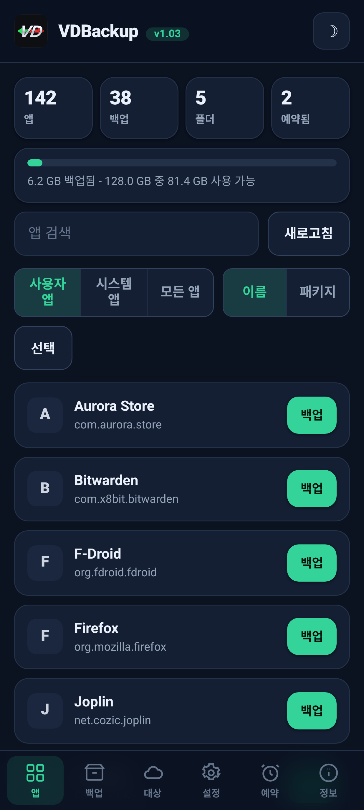
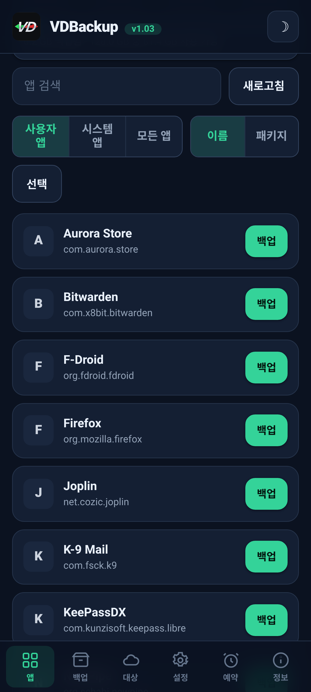
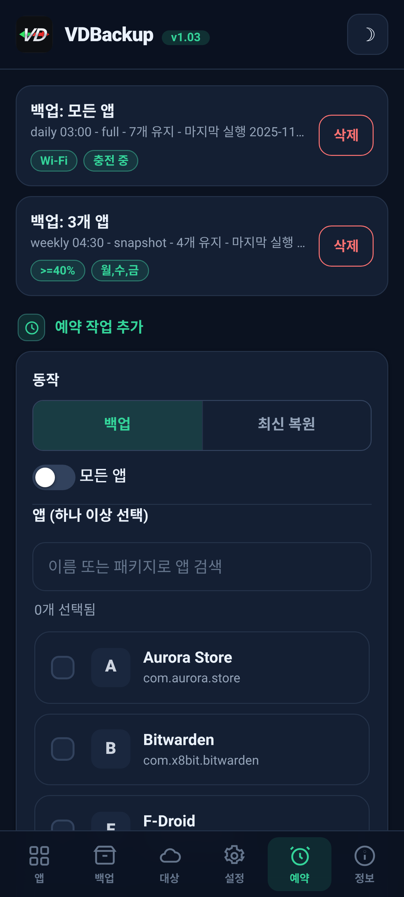
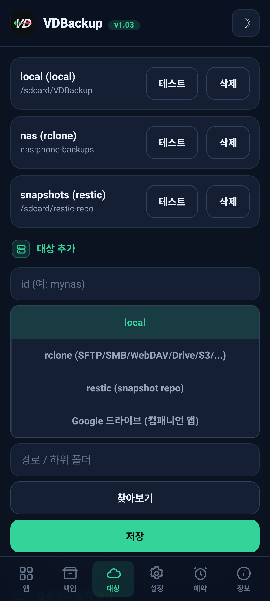
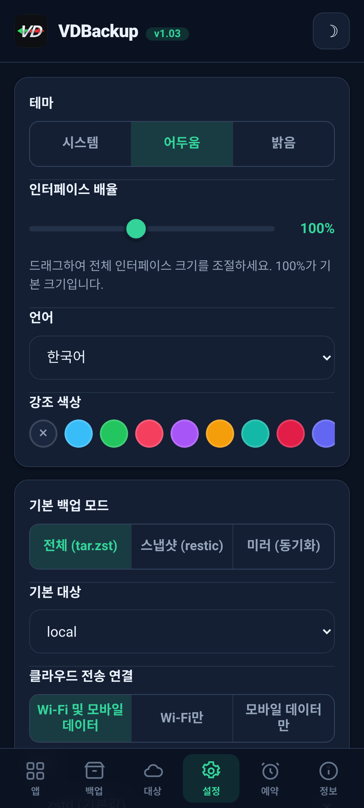
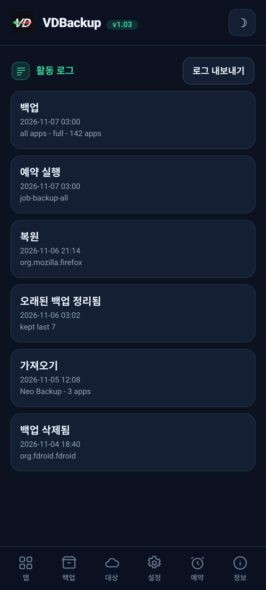

> **Languages:** [English](../USER-GUIDE.md) · [العربية](../ar/USER-GUIDE.md) · [Čeština](../cs/USER-GUIDE.md) · [Deutsch](../de/USER-GUIDE.md) · [Español](../es/USER-GUIDE.md) · [فارسی](../fa/USER-GUIDE.md) · [Français](../fr/USER-GUIDE.md) · [हिन्दी](../hi/USER-GUIDE.md) · [Bahasa Indonesia](../in/USER-GUIDE.md) · [Italiano](../it/USER-GUIDE.md) · [日本語](../ja/USER-GUIDE.md) · 한국어 · [Nederlands](../nl/USER-GUIDE.md) · [Polski](../pl/USER-GUIDE.md) · [Português](../pt/USER-GUIDE.md) · [Русский](../ru/USER-GUIDE.md) · [Svenska](../sv/USER-GUIDE.md) · [ไทย](../th/USER-GUIDE.md) · [Türkçe](../tr/USER-GUIDE.md) · [Tiếng Việt](../vi/USER-GUIDE.md) · [中文](../zh/USER-GUIDE.md)

---

# VDBackup 사용자 가이드

모듈 설치부터 첫 백업 만들기, 복원하기, 클라우드로 보내기, 예약하기, 그리고 몇 년 뒤 PC에서
열어 보기까지 VDBackup을 친절하게 완전히 안내합니다. Swift Backup, Neo-Backup 또는
Android-DataBackup을 써 본 적이 있다면 익숙하게 느껴질 것입니다 - 다만 모든 것이 한곳에서
일어나고, "허용"할 것이 아무것도 없습니다.

## 목차

- [1. What VDBackup is](#1-what-vdbackup-is)
- [2. Requirements](#2-requirements)
- [3. Install and first run](#3-install-and-first-run)
- [4. The WebUI tour](#4-the-webui-tour)
- [5. Making a backup](#5-making-a-backup)
  - [5.1 Choosing what to back up](#51-choosing-what-to-back-up)
  - [5.2 Backup modes: Full, Snapshot, Mirror](#52-backup-modes-full-snapshot-mirror)
  - [5.3 Compression](#53-compression)
  - [5.4 Encryption](#54-encryption)
  - [5.5 Verify and dry-run](#55-verify-and-dry-run)
  - [5.6 Special backups (messages, call log, Wi-Fi, Bluetooth, calendar, wallpaper, DNS, system settings)](#56-special-backups-messages-call-log-wi-fi-bluetooth-calendar-wallpaper-dns-system-settings)
  - [5.7 Standalone folder and file backups](#57-standalone-folder-and-file-backups)
- [6. Restoring a backup](#6-restoring-a-backup)
- [7. Destinations: local and remote](#7-destinations-local-and-remote)
- [8. Scheduling and retention](#8-scheduling-and-retention)
- [9. Migrating in: importing Neo-Backup and Android-DataBackup](#9-migrating-in-importing-neo-backup-and-android-databackup)
- [10. SSAID (device ANDROID_ID)](#10-ssaid-device-android_id)
- [11. Portability: opening backups on a PC](#11-portability-opening-backups-on-a-pc)
- [12. Driving VDBackup from an AI assistant](#12-driving-vdbackup-from-an-ai-assistant)
- [13. Troubleshooting and FAQ](#13-troubleshooting-and-faq)
- [14. Uninstalling](#14-uninstalling)

---

## 1. What VDBackup is

VDBackup은 앱과 그 데이터를 백업하고 복원하는, WebUI가 내장된 root 모듈입니다. Swift
Backup, Neo-Backup, Android-DataBackup의 개방적이고 root 네이티브인 후계자로 설계되었습니다:
그 도구들이 하는 일의 합집합을 한곳에서 해내는 것을 목표로 하며, 심지어 기존 Neo-Backup과
Android-DataBackup 백업을 가져올 수도 있어 아무것도 잃지 않고 옮겨올 수 있습니다.

평범한 백업 앱과의 핵심 차이: VDBackup은 **전적으로 당신의 root 매니저 WebUI에서** 실행되며,
모듈은 이미 root입니다. 핵심 기능을 위해 설치할 컴패니언 앱도, 승인할 "su 허용" 프롬프트도,
켜야 할 토글도 없습니다. WebUI를 열고, 백업할 것을 고르고, 실행하면 됩니다.

VDBackup이 생성하는 모든 것은 **표준 형식**(tar, gzip, zstd, age, zip, restic)을 사용하므로,
당신의 백업은 결코 모듈에 종속되지 않고 특정 기기에 묶이지도 않습니다.
[11절](#11절)을 참고하세요.

## 스크린샷

| 홈 | 앱 | 예약 |
|:---:|:---:|:---:|
|  |  |  |
| **대상** | **설정** | **활동 로그** |
|  |  |  |

## 2. Requirements

- **KernelSU**, **APatch** 또는 **Magisk**로 관리되는 **루팅된 Android 기기**. VDBackup은
  해당 매니저에서 모듈로 설치됩니다.
- 백업을 위한 충분한 여유 저장 공간(로컬 백업은 모듈의 상태 디렉터리 아래에 저장됩니다.
  [3절](#3절) 참고).
- 그 밖에는 아무것도 필요 없습니다. 모듈은 필요한 모든 바이너리(tar, zstd, lz4, rclone,
  rsync, ssh, restic)를 번들로 제공하므로, **로컬 백업과 복원은 완전히 오프라인으로**
  작동합니다. 클라우드 대상만 네트워크와 통신합니다.

일부 세밀한 부가 기능(AppOps, SSAID, 몇 가지 권한 있는 시스템 조각)은 Android 프레임워크에
의존합니다. 모듈은 이를 평범한 셸 폴백과 함께 내부적으로 처리하며, 기기에서 사용할 수 없을
때는 우아하게 성능이 저하됩니다.

## 3. Install and first run

1. 최신 `VD-Backup-vX.Y.zip` 릴리스를 다운로드합니다.
2. KernelSU / APatch / Magisk 매니저에서 다른 모듈처럼 모듈 zip을 플래시합니다.
3. 즉시 사용할 수 있습니다 - **재부팅이 필요 없습니다**. (재부팅은 SSAID를 복원할 때에만
   관련이 있습니다. [10절](#10절) 참고.)
4. 매니저에서 모듈의 **WebUI**를 엽니다. 그것이 인터페이스의 전부입니다.

**어떤 에디션을 다운로드할지.** 각 릴리스는 여러 플래시 가능한 zip 에디션으로 제공되므로,
필요한 것만 다운로드하면 됩니다. 하나를 고르세요:

- **`VD-Backup-<ver>-universal-full.zip`** - 모든 CPU 아키텍처와 모든 바이너리를 내장.
  `rclone`(클라우드 제공자: Google Drive, S3 및 기타 70여 종의 rclone 백엔드)과
  `restic`(중복 제거 스냅샷)을 포함합니다. 완전 오프라인으로 아무것도 다운로드하지 않습니다.
  어떤 기기에서든 작동합니다. 가장 큰 다운로드입니다.
- **`VD-Backup-<ver>-universal-lite.zip`** - 모든 아키텍처. 단 가장 큰 두 바이너리
  (`rclone`과 `restic`)는 **제외**합니다. 가장 작은 다운로드이며, 이식 가능한 `age` 암호화와
  함께 로컬, SSH/SFTP, rsync 백업은 다운로드 없이 여전히 처리합니다. 클라우드 대상(`rclone`)이나
  스냅샷 모드(`restic`)를 처음 사용할 때 WebUI가 해당 아키텍처용 작은 애드온을 한 번
  (SHA-256으로 검증) 내려받아 캐시하도록 제안하며, 이후에는 그 기능도 동작합니다.
- **`VD-Backup-<ver>-<abi>-full.zip`** (`arm64-v8a`, `armeabi-v7a`, `x86`, `x86_64` 중
  하나) - 모든 바이너리를 내장한 단일 아키텍처(`universal-full`과 기능은 같지만 기기의
  아키텍처만 담으므로 `universal-full`보다 작습니다).

기기의 아키텍처를 알고 모든 것을 원한다면, 맞는 **`<abi>-full`**을 고르세요(대부분의 폰은
**`arm64-v8a`**입니다). 가장 작은 다운로드를 원하고 클라우드 제공자(`rclone`)나 스냅샷(`restic`)을
처음 쓸 때 SHA-256으로 검증되는 한 번의 다운로드가 괜찮다면 **`universal-lite`**을 고르세요.
다운로드 없이 모든 것을 내장하길 원하고(오프라인 / 복구) 아키텍처가 확실하지 않다면 **full** 에디션을
고르세요. 설치 시 모듈은 어떤 에디션을 플래시했든 기기의 아키텍처만 남깁니다.

최초 실행 시 모듈은 기본 구성을 심어 둡니다(아직 아무 구성도 없을 때만). 그래서 모듈 업데이트
전반에 걸쳐 설정이 보존됩니다.

**상태가 저장되는 곳.** VDBackup의 작업 데이터 - 구성, 예약 작업, 저장된 대상, 암호화된
자격 증명, 로그와 감사 추적, 그리고 스테이징 영역 - 은 다음 아래에 저장됩니다:

```
/data/adb/vdbackup/
```

**백업이 저장되는 곳.** 백업 자체는 사용자에게 보이고 자격 증명으로 암호화되는 저장소에
기록됩니다(그래서 기기를 잠금 해제한 뒤에야 읽을 수 있고, 모듈을 제거해도 남아 있습니다).
Android 사용자별로 폴더 하나씩:

```
/sdcard/VDBackup/            (= /data/media/<user>/VDBackup)
```

두 가지 이유로 이를 기억해 두세요: 백업은 `/sdcard/VDBackup` 아래에서 공간을 차지하고,
문제가 생겼을 때 들여다볼 곳은 `/data/adb/vdbackup/logs/`입니다.

## 4. The WebUI tour

WebUI는 몇 개의 탭으로 구성됩니다:

- **Home** - 백업 개수(앱, 백업, 폴더, 예약 작업)와, 백업이 사용하는 공간을 여유 공간과 대비해 보여 주는 저장 공간 막대를 표시하는 홈 개요. 상태 배지, 해시와 경로의 클립보드 복사, 그리고 **Check for updates** 동작을 제공합니다.
- **Apps** - 설치된 앱 목록(사용자 및 시스템)으로, 각 앱이 실제 이름, 패키지 이름,
  아이콘과 함께 표시됩니다(아이콘은 지연 로드되고 캐시되므로 목록이 반응성을 유지합니다).
  행의 버튼은 앱을 백업하고, 행을 탭하면 그 앱의 백업 기록이 열려 이전 백업을 복원할 수
  있습니다.
- **Backups** - 이미 가지고 있는 백업으로, 각 항목이 한 줄에 앱 이름, 그다음 줄에 패키지를
  표시합니다. 백업을 탭하면 전체 세부 정보(버전, 날짜, 크기, 포함된 항목, 권한 개수, 그리고
  출처가 된 기기)를 볼 수 있습니다. 여기서 복원하고, 복원 테스트를 실행하고, 백업을
  삭제하고, Neo-Backup이나 Android-DataBackup에서 백업을 가져올 수도 있습니다.
- **Destinations** - 백업이 어디로 갈지 관리합니다: 로컬 저장소에 더해 추가하는 원격 대상
  ([7절](#7절) 참고). 의존하기 전에 여기서 대상을 테스트할 수
  있습니다.
- **Settings** - 밝은/어두운 테마 토글, 강조 색상 선택기(프리셋, 사용자 지정 색상, 또는 재설정),
  언어 선택기(인터페이스가 아랍어와 페르시아어에서는 오른쪽에서 왼쪽으로 렌더링됩니다), 드래그하여 전체 인터페이스(헤더, 콘텐츠, 하단 내비게이션을 함께)를 85%에서 120%까지 다시 크기 조정하는 인터페이스 스케일 슬라이더(기본값 100%, 서로 다른 픽셀 밀도의 화면용), 새 작업의 기본값(기본 압축, verify 켬/끔, 기본 암호화), 클라우드 전송을 위한 네트워크 정책
  ([7절](#7절) 참고), 자동 백업 및 제외 앱 목록, 설치 출처 옵션, 암호화 키, 그리고 예약 설정. 켬/끔 설정은 Android 스타일 토글 스위치를 사용합니다.
- **About** - 버전, 링크, 자매 프로젝트(See also), 번들 바이너리 감사 매니페스트, 그리고 더 새로운 버전이 게시되었는지 (릴리스 노트와 함께) 보고하는 **Check for updates** 동작. 모든 업데이트는 모듈을 플래시한 것과 같은 방식으로 root 매니저를 통해 설치합니다.

확인과 메시지는 (옛 시스템 팝업이 아니라) 인앱 대화상자를 사용하며, 복원이나 가져오기는
진행 전에 현재 앱 데이터를 덮어쓴다는 점을 인지하도록 요청합니다.

백업과 복원은 백그라운드 root 프로세스로 **분리되어(detached)** 실행됩니다. WebUI를 닫거나
심지어 root 매니저를 닫아도 작업은 계속됩니다. 돌아오면 WebUI가 다시 붙어 현지화된 단계
레이블과 함께 실시간 진행 상황을 보여 줍니다. 실행 중인 작업의 경우 진행 카드는 실시간 전송
속도와 예상 남은 시간, 그리고 현재 item 이름이 포함된 item 카운터(예: "12 of 40")도
보여 줍니다. 셸 알림을 표시하는 ROM에서는 작업이 시작되고
끝날 때 Android 알림도 받습니다. 어느 쪽이든 인앱 진행 카드가 믿을 수 있는 지표입니다.

## 5. Making a backup

기본 흐름: **Apps**를 열고, 앱을 고르고, 포함할 항목을 선택하고, 모드를 고르고, 압축과
(선택적으로) 암호화를 설정한 다음 실행합니다. 진행 상황이 실시간으로 나타나고, 완료되면
알림이 알려 줍니다.

### 5.1 Choosing what to back up

각 앱에 대해 다음 항목의 어떤 조합이든 포함할 수 있습니다:

| 항목 | 무엇인지 |
|------|-----------|
| **APK** | 설치된 앱 자체(기본 APK + 분할 APK). |
| **data** | 앱의 비공개 데이터(`/data/data`). 흔히 말하는 "앱 데이터"입니다. |
| **device-protected data** | 다이렉트 부트 / 기기 보호 저장소(`/data/user_de`). 일부 앱은 여기에 설정을 보관합니다. |
| **external** | `Android/data` 아래의 앱 외부 데이터. |
| **OBB** | 일부 게임이 사용하는 앱의 OBB 확장 파일(`Android/obb`). |
| **media** | `Android/media` 아래의 앱 미디어. |

"이 앱을 완전히 백업"하기 위한 좋은 기본값은 이들을 모두 포함하는 것입니다. 데이터만
원한다면(예: 게임 세이브를 옮기는 경우) APK와 큰 OBB/media 항목을 선택 해제할 수 있습니다.

VDBackup은 복원을 충실하게 만들어 주는 것들도 보존합니다: SELinux 컨텍스트, uid/gid 소유권,
파일 modes, 확장 속성(xattr), 그리고 capabilities.

### 5.2 Backup modes: Full, Snapshot, Mirror

VDBackup은 세 가지 모드를 제공합니다. WebUI는 대부분의 사람에게 적절한 선택인 **Full**을
미리 선택해 둡니다.

- **Full** - `tar.zst`(또는 선택한 압축)로 기록되는 완전하고 자립적이며 이식 가능한 백업.
  실행할 때마다 어디로든 복사해 PC에서 열 수 있는 독립 백업이 생성됩니다. 추천 용도:
  보관하고 이리저리 옮길 수 있는, 앱의 깔끔하고 이식 가능한 스냅샷. 이것이 기본값이자 가장
  이식성이 높은 선택입니다.
- **Snapshot** - `restic`이 뒷받침하는 증분식이자 버전 관리형 백업. 실행할 때마다 저장소에
  새 시점 스냅샷을 추가하며, 변경된 것만 저장하고 스냅샷 간에 중복을 제거합니다. 추천 용도:
  실행할 때마다 전체 크기를 치르지 않으면서 앱의 이력을 이어 가기.
- **Mirror** - `rclone`/`rsync`가 뒷받침하는, 라이브 데이터와 대상 간의 1:1 동기화. 대상을
  지금 이 순간 기기에 있는 것과 동일하게 유지합니다(변경된 파일은 복사되고, 삭제된 파일은
  대상에서 삭제됩니다). 추천 용도: 예컨대 클라우드 원격으로 가는, 빠르고 항상 최신인 사본.
  mirror에서도 APK는 원본이 아니라 여전히 압축되어 저장된다는 점에 유의하세요.

### 5.3 Compression

Full 백업의 압축을 고를 수 있습니다:

- **none** - 압축 없음(가장 빠르고 가장 큼).
- **lz4** - 매우 빠르고 가벼운 압축.
- **zstd** - 기본값으로, 속도와 비율의 탄탄한 균형. 레벨도 고를 수 있습니다(예: 더 작은
  파일을 위한 더 높은 레벨).
- **gzip** - **"호환성 모드"**. gzip은 사실상 어떤 컴퓨터에서든, 대부분의 파일 매니저에서
  내장 도구로 추가 설치 없이 열립니다. 아카이브를 어디서든 열 수 있는 것이 가장 중요할 때
  이것을 고르세요.

선택하지 않으면 VDBackup은 설정된 기본값(합리적인 레벨의 zstd)을 사용합니다.

### 5.4 Encryption

암호화는 **선택 사항**이며 이식 가능합니다. VDBackup은 암호문(scrypt)을 사용하는 **age**로
암호화하며, 이는 바로 이식성을 위해 선택되었습니다: 어떤 운영체제의 표준 `age` 도구든
암호문만으로 백업을 복호화할 수 있습니다. 암호화는 **결코** 기기의 하드웨어 키에 묶이지
않으므로, 암호화된 백업은 다른 기기에서 복원되고 PC에서 열립니다. (더블 클릭과 비밀번호로
열고 싶은 암호화 아카이브를 위해 호환 가능한 AES-256 zip 모드도 사용할 수 있습니다.)

암호화를 사용하려면 암호화 키를 한 번 생성한 다음(Settings), 작업에 대해 암호화를
활성화하고 암호문을 설정하세요. 백업을 보호하는 것은 암호문이므로 강력한 것을 고르세요 -
하드웨어 키도, 복구 백도어도 없습니다.

**APK 규칙(중요):**

- **APK는 공간을 아끼기 위해 항상 압축되어 저장**되며, 결코 원본으로 저장되지 않습니다.
- 앱의 APK는 공개 콘텐츠이므로 **APK는 기본적으로 암호화되지 않습니다**.
- APK 암호화와 데이터 암호화는 **독립적인 토글**입니다. 데이터 암호화를 켜도 APK는
  암호화되지 **않습니다**. APK도 암호화하길 특별히 원한다면 APK 암호화 토글을 명시적으로
  활성화하세요.

### 5.5 Verify and dry-run

두 가지 안전 옵션이 백업을 신뢰하기 전에 도움이 됩니다:

- **Verify** - 기록 후 VDBackup은 각 아카이브를 다시 해시하여 매니페스트와 대조합니다.
  Full 백업에서는 **기본으로 켜져** 있습니다. 파일이 일치하지 않으면 작업은 조용히 손상된
  백업을 남기는 대신 명확한 오류와 함께 실패합니다.
- **Dry-run** - 작업을 계획하고 생성될 크기를 **아무것도 기록하지 않고** 보고합니다. 공간을
  추산하거나 실제로 실행하기 전에 항목 선택을 확인하는 데 사용하세요.

백업이 **클라우드** 대상으로 갈 때, VDBackup은 두 가지 보호 장치를 더 추가합니다. 마지막에
**checksum-verified** 단계를 실행하여 업로드된 복사본을 원격의 원본과 다시 대조하고, 일치하지
않으면 (손상된 복사본을 클라우드에 남기는 대신) 작업을 실패시킵니다. 또한 Full 업로드 전에
원격의 **여유 공간**을 확인하여, 백업이 들어가지 않으면 원격을 채우고 중간에 실패하는 대신
명확한 **"공간 부족"** 오류와 함께 조기에 중단합니다. (공간 검사는 Full 업로드에 적용됩니다.
Mirror는 델타 동기화이므로 예외입니다.)

### 5.6 Special backups (messages, call log, Wi-Fi, Bluetooth, calendar, wallpaper, DNS, system settings)

**Backups** 탭의 앱 목록 아래에 있는 **Special backups**는 단일 앱에 묶이지 않은 시스템 전역
데이터를 다룹니다. 범주를 고르고 백업하세요. 이들은 앱 백업과 동일한 SELinux/xattr 보존과
선택적 암호화로 아카이브됩니다. 범주는 다음과 같습니다:

| 범주 | 무엇인지 |
|------|-----------|
| **메시지(SMS/MMS)** | 문자 메시지. |
| **연락처와 통화 기록** | 연락처와 통화 내역. |
| **Wi-Fi 네트워크** | 저장된 Wi-Fi 네트워크. |
| **Bluetooth** | Bluetooth 페어링. |
| **캘린더** | 캘린더 provider(앱과 데이터). **이식형 `calendar.json`**도 기록되므로, 모듈 없이도 PC에서 일정을 읽을 수 있습니다. |
| **배경화면** | 홈 및 잠금 화면 배경화면과 `wallpaper_info.xml`, 원본 이미지로 저장. |
| **DNS** | 비공개 DNS 모드와 서버. |
| **시스템 설정** | 기기 system, global, secure 설정의 전체 덤프. |

메시지, 통화 기록, 연락처의 경우 **이식형 사본**(열 수 있는 JSON)도 기록되므로, 모듈 없이
PC에서 읽을 수 있는 기기 간 사본을 갖게 됩니다.

**시스템 설정은 옵트인이며 복원 시 기기 설정을 덮어씁니다.** SSAID([10절](#10절) 참고)와 꼭
마찬가지로, **시스템 설정** 범주는 가장 민감한 것입니다: 복원하면 기기 전역 설정을 덮어쓰므로,
신중하게 선택하지 않는 한 꺼져 있고, 먼저 인지하도록 요청하며, 활동 로그에 기록됩니다.

특수 백업을 복원하면 라이브 시스템 데이터를 덮어쓰며 재부팅이 필요하므로, 눈에 띄는 확인
뒤에 막혀 있고 같은 기기와 같은 ROM에서 신뢰할 수 있습니다. 복원은 **멱등적**입니다: 원시
범주(메시지, 연락처, Wi-Fi, Bluetooth, 캘린더)는 병합이 아니라 데이터를 **교체**하여
복원되므로, 같은 백업을 두 번 복원해도 결코 중복이 생기지 않으며, DNS와 시스템 설정은 그저
다시 적용됩니다.

### 5.7 Standalone folder and file backups

때로는 앱이 아닌 평범한 폴더나 파일 - 카메라 폴더, 문서 디렉터리, 단일 데이터베이스 - 을
백업하고 싶을 때가 있습니다. VDBackup은 공유 저장소나 `/data` 아래의 **임의의 절대 경로**를
앱 백업과 동일한 이식 가능한 형식으로 백업할 수 있습니다: `tar.zst` 아카이브와
`manifest.json`, SHA-256으로 봉인되며, 암호화하면 RECOVERY 노트가 함께 제공됩니다. 이러한
경로 백업은 backups 디렉터리의 `.paths` 폴더 아래에 따로 보관됩니다.

- **경로를 고르고 백업하세요.** 원본은 허용된 위치 중 하나(`/storage/emulated`, `/data/media`,
  `/sdcard`, `/data`) 아래의 절대 경로여야 합니다. `..`로 빠져나가려는 경로는 거부됩니다.
- **복원은 원래 위치로 다시 기록**하므로, 다른 복원과 마찬가지로 파괴적이며 무언가를
  덮어쓰기 전에 **확인**을 요청합니다.
- 앱 백업과 마찬가지로, 경로 백업과 복원은 실시간 진행 상황과 함께 **detached**로 실행되고,
  선택한 압축을 사용하며, 암호문으로 암호화할 수 있습니다.

## 6. Restoring a backup

**Backups** 탭을 열고, 원하는 백업을 고르고, 복원을 시작합니다. 복원은 파괴적인 동작이므로
VDBackup은 먼저 **확인**을 요청하고, 그 동작을 로컬 감사 로그에 기록합니다.

복원은 **충실합니다**: VDBackup은 앱의 현재 상태를 지우고 백업을 추출하므로, 앱은 그 백업에
포착된 **정확한 상태**(소유권, modes, SELinux 컨텍스트, xattr 포함)로 되돌아갑니다. 병합이
아니라 - 백업 시점으로의 진정한 복원입니다. 복원은 root로 실행되므로, VDBackup은 무언가를
추출하기 전에 모든 아카이브를 검사하고 대상 밖에 기록하려는 변조된 아카이브를 거부합니다.
그래서 수정된 백업이 결코 시스템의 나머지를 덮어쓸 수 없습니다.

유용한 복원 옵션:

- **Restore-test** - 백업을 임시 스테이징 영역으로 추출해 **라이브 앱을 건드리지 않고**
  검증합니다. 무언가를 덮어쓰기 전에 백업이 온전하고 복원 가능한지 확인하는 안전한
  방법입니다. 테스트가 실패하면 명확한 오류를 받고 설치된 앱은 그대로 남습니다.
- **Partial restore** - 백업한 항목 중 일부만 복원합니다. 예를 들어 APK를 다시 설치하지
  않고 앱 데이터만 복원하거나, 큰 OBB/media 없이 세이브 파일만 복원합니다. 복원 화면에서
  원하는 항목을 고르세요.
- **Snapshot**과 **Mirror** 백업의 경우, 복원은 각각 버전 관리형 저장소나 미러링된 사본에서
  가져옵니다.
- **설치 출처** - 기본적으로 복원된 앱은 (사이드로드된 것처럼 보이는 대신) **Play Store**를
  설치 출처로 보고하며, 이는 대부분의 앱과 앱 검사가 기대하는 것입니다. 이를 Settings에서
  전역으로 끄거나 복원마다 끌 수 있으며, 꺼져 있으면 원래 설치 출처가 유지됩니다. 고급 옵트인
  **"초기 출처 위조"** 토글은 한 걸음 더 나아가 앱의 초기 패키지와 패키지 출처까지 Play에서
  설치된 것처럼 보이게 만듭니다. 이는 시스템 패키지 데이터베이스를 편집하며(먼저 백업됨)
  재부팅 후에 적용됩니다.

**일괄 복원.** **Backups** 탭에는 **Select** 모드가 있습니다. Apps 탭에 일괄 백업용으로 있는
것과 같은 방식입니다. **Select**를 켜고, 체크박스로 원하는 백업들을 표시한 다음, 한 번에 모두
복원합니다. 하나의 옵션 대화상자가 선택 전체를 다룹니다 - 덮어쓰기 확인, restore-test, 설치 출처
선택이 당신이 고른 모든 백업에 적용됩니다 - 그리고 백업들은 차례로 하나씩 복원됩니다.

**백업 삭제하기.** 백업의 세부 정보(또는 앱의 기록)를 열고 **Delete**를 사용하세요. 확인을
요청받으며, 삭제는 활동 로그에 기록됩니다. 앱마다 유지할 백업 개수를 제한하여(보존) 오래된
것이 자동으로 정리되게 할 수도 있습니다.

**설치된 앱을 시스템 앱으로 마운트하기.** 앱의 백업 기록에서 **Mount as system**은 앱의 APK를
VDBackup 오버레이 서브모듈로 스테이징하여 root 매니저가 이를 `/system/app`(또는
`/system/priv-app`)에서 제공하게 합니다 - 실제 `/system` 파티션은 결코 건드리지 않습니다.
KernelSU에서 **NoMount**가 있으면 라이브로 적용되고, 그렇지 않으면 재부팅 후에 적용됩니다.
이것은 NoMount가 설치되어 있는지에 결코 의존하지 않습니다.

## 7. Destinations: local and remote

기본적으로 백업은 모듈의 상태 디렉터리 아래의 **로컬** 저장소에 기록됩니다. **Destinations**
탭에서 원격 대상을 추가할 수도 있습니다. 로컬 대상의 경우 **Browse**를 누르면 경로를 입력하는 대신
공유 저장소(`/sdcard`) 아래의 하위 폴더를 고를 수 있는 폴더 선택기가 열립니다.

원격 전송은 번들된 도구들이 처리합니다:

- **rclone** - 방대한 범위의 원격을 위한 허브: **SFTP, SMB, WebDAV, FTP, S3, Google
  Drive** 및 70개 이상의 서비스.
- **rsync**와 **ssh/scp/sftp** 모음 - 델타 동기화와 평범한 SSH 대상을 위한 것.
- **restic** - 암호화되고 중복이 제거된 **Snapshot** 저장소(로컬 또는 원격).

**클라우드 원격 만들기(SSH 불필요).** Destinations 탭에서 **rclone** 대상 유형을 고르고
**Add cloud remote**를 사용하세요. **임의의 rclone backend**를 연결할 수 있습니다: 드롭다운에는
많이 쓰이는 것들(**Google Drive, Dropbox, OneDrive, Box, pCloud, Mega, Backblaze B2, S3, SFTP,
WebDAV, FTP, SMB**)과 더불어, 그 밖의 임의의 backend 유형과 그 `key=value` 매개변수를 입력하는
**Custom (advanced)** 옵션이 있습니다. 필드(예: host/user/password, 또는 S3 키)를 채운 뒤
저장합니다. 브라우저로 로그인시키는 제공자(Google Drive, Dropbox, OneDrive, Box, pCloud)의 경우
**Authorize in browser** 버튼을 사용하세요: 휴대폰 자체 브라우저로 로그인하고 토큰을 자동으로
캡처하므로 **PC가 필요 없습니다**(토큰을 손으로 붙여넣는 방법도 폴백으로 여전히 작동합니다). 그러면
원격이 그 대상의 원격 목록에 나타납니다. 비밀번호는 평문이 아니라 난독화되어 저장됩니다. 같은
곳에서 원격을 나열하고 삭제할 수 있습니다.

두 가지 규칙이 원격 사용을 안전하게 지켜 줍니다:

- **자격 증명은 저장 시 암호화됩니다** - 모듈의 상태 디렉터리에, 결코 평문으로가 아니라.
- **사용하기 전에 검증하세요.** Destinations 탭의 대상 테스트를 사용해, 실제 백업을
  겨누기 전에 대상이 작동하는지 확인하세요.

**네트워크 정책(Wi-Fi 대 모바일 데이터).** Settings에서 "Cloud transfers over"로 클라우드
전송이 어떤 연결을 사용할 수 있는지 제한할 수 있습니다: **Wi-Fi and mobile data**(기본값),
**Wi-Fi only**, 또는 **Mobile data only**. 제한하면, 모든 클라우드 전송 - 수동이든 예약이든,
업로드든 복원이든 - 은 먼저 활성 연결을 확인하고 잘못된 연결에서는 실행을 거부하므로,
Wi-Fi 전용 정책은 결코 모바일 데이터를 쓰지 않습니다. 로컬 백업은 결코 영향을 받지 않습니다.

**Google Drive.** Google Drive에 도달하는 방법은 두 가지입니다:

1. **rclone를 통해** - 추가 앱도 **Google Cloud 계정도 없이**, 다른 대상처럼 Drive를
   rclone 원격으로 추가합니다. 아무 컴퓨터에서든 `rclone authorize "drive"`를 한 번
   실행하고, 브라우저에서 Google 계정에 로그인한 뒤, 그것이 출력한 토큰을 Drive 원격의 토큰
   필드에 붙여넣습니다.
2. **선택적 컴패니언을 통해** - Google 로그인과 Drive 업로드를 처리하는 작고 옵트인 방식인
   컴패니언 앱. **Google Drive 컴패니언 대상을 명시적으로 고를 때만** 설치되며, 결코 기본으로
   설치되지 않고, 비활성화하면 제거됩니다. 일회성 Google 동의 화면이 WebUI 바깥에서 일어나는
   유일한 단계입니다. 컴패니언이 설치되면, VDBackup은 그 존재가 root나 잠금 해제된
   부트로더를 드러내지 않도록 **항상 HMA-OSS로 숨기라고** 상기시켜 주며, 대신 HMA-OSS
   목록에 추가해 주겠다고 제안합니다.

## 8. Scheduling and retention

VDBackup은 예약에 따라 백업을 - 그리고 복원을 - 자동으로 실행할 수 있습니다. 스케줄러에서
다음으로 작업을 정의합니다:

- **대상** - 단일 앱, 앱 집합, 또는 **모든 앱**(제외 앱 목록 제외) - 과 사용할 항목/모드,
- **동작** - **Back up**(기본값) 또는 각 대상 앱의 가장 최근 백업을 복원하는 **Restore latest**,
- 대상(destination),
- **cron 비슷한 예약** - 매시간, 매일 또는 매주, 당신이 고른 시각(HH:MM)에,
- **보존** 설정: 그 작업에 대해 가장 최근 백업 **N개 유지**, 오래된 것은 자동으로
  정리됩니다,
- 선택적 **실행 조건**: **Wi-Fi**일 때만, **충전 중**일 때만, **최소 배터리 수준** 이상일
  때만, 그리고 선택한 **요일**에만.

예약 작업은 모듈의 부팅 시 하트비트로 트리거됩니다: 작업이 실행 예정이면 실행되고, 두 번
발동하지 않도록 마지막 실행 시각을 기록하며, 오래된 백업을 정리하도록 보존 정책을 적용합니다.
모든 것이 백그라운드에서 root로 실행되므로, 예약 백업은 WebUI가 열려 있을 필요가 없습니다.

**실행 조건(게이트).** 예약 작업은 실행되기 위해 충족되어야 하는 조건을 가질 수 있습니다: Wi-Fi
전용, 충전 전용, 최소 배터리 수준, 그리고 특정 요일. 작업이 실행 예정이지만 조건이 충족되지 않으면,
그 작업은 **건너뛰어지고 다음 확인 때 다시 시도**됩니다 - 스케줄이 진행되지 않으므로, 조건이
충족되는 즉시 실행됩니다. 내장된 열 안전 검사도 기기가 너무 뜨거운 동안에는 예약 작업을
건너뜁니다. 그러한 모든 건너뜀은 활동 로그에 기록됩니다.

**예약 복원은 매 실행마다 덮어씁니다.** **Restore latest** 작업은 발동될 때마다 각 대상 앱의 가장
최근 백업을 다시 복원하며, 복원은 파괴적입니다: 매 실행마다 **앱의 현재 데이터를** 가장 최근
백업으로 **덮어씁니다**. 이는 의도적이고 옵트인입니다 - 대상을 가장 최근 백업 상태로 유지하고
싶을 때만 선택하세요.

**설치/업데이트 시 자동 백업.** Settings에서 **자동 백업**을 켤 수 있습니다: 동일한 백그라운드
하트비트가 새로 설치되거나 업데이트된 앱을 알아채고 대신 백업해 줍니다(keep-N 보존과 함께).
첫 실행은 무엇이 설치되어 있는지만 기록하므로, 활성화해도 기기 전체를 한꺼번에 백업하지
않습니다.

**제외 앱(차단 목록).** 역시 Settings에서, 자동으로든 예약으로든 결코 백업하고 싶지 않은 앱을
제외할 수 있습니다. 여러 개를 한 번에 추가할 수 있으며(다중 선택), 제외된 앱은 둘 다에서 건너뜁니다.

**활동 로그.** Schedule 탭에는 로컬 감사 추적 - 백업, 복원, 삭제, 예약 및 자동 실행, 정리 - 을
최신순으로 보여 주는 전체 화면을 (즉시) 여는 **View activity log** 버튼이 있습니다. **Export logs**
동작은 피드백이나 버그 리포트에 첨부할 수 있는 로그 파일을 (백업 폴더 아래에) 저장합니다.

## 9. Migrating in: importing Neo-Backup and Android-DataBackup

Neo-Backup이나 Android-DataBackup에서 넘어오는 경우, 처음부터 다시 시작할 필요가 없습니다.
**Backups** 탭에서 기존 백업을 **가져올** 수 있습니다:

1. VDBackup을 기존 Neo-Backup이나 Android-DataBackup 백업 위치로 겨눕니다(import-scan이
   거기서 찾은 것을 나열합니다).
2. 가져올 백업을 고릅니다.
3. 가져오기를 시작합니다. 다른 긴 작업처럼 실시간 진행 상황과 함께 분리되어 실행됩니다.

**비밀번호로 암호화된 Neo-Backup 백업이 지원됩니다.** Neo-Backup의 AES-256 암호화 백업을
가져올 수 있습니다 - 필요할 때 **비밀번호를 묻고**, 비밀번호는 복호화에만 사용되며 명령줄에는
결코 저장되지 않습니다.

## 10. SSAID (device ANDROID_ID)

SSAID는 앱별 `ANDROID_ID` - 일부 앱이 읽는 기기 수준 식별자입니다. VDBackup은 이를 백업하고
복원할 수 있지만, 이것은 건드리는 것 중 가장 민감한 것이므로 각별한 주의로 다룹니다:

- **선택 사항이며 기본으로 꺼져 있습니다.** VDBackup은 그 작업에 대해 명시적으로 켜지 않는
  한 **결코** SSAID를 캡처하거나 복원하지 않습니다. WebUI는 SSAID가 나타나는 모든 곳(백업,
  복원, 가져오기)에 명확히 표시된 강조형 "Optional" 안내를 보여 주며, 옵트인하기 전까지
  꺼진 상태로 유지됩니다.
- **복원 시 재부팅 후에만 적용됩니다.** Android 설정 provider가 이 값들을 캐시하므로,
  복원된 SSAID는 기기를 재부팅한 뒤에야 효력이 생깁니다.
- **이전 값은 항상 먼저 백업됩니다.** 어떤 SSAID든 덮어쓰기 전에, VDBackup은 라이브
  `settings_ssaid.xml`을 바이트 단위로 그대로 타임스탬프가 찍힌 백업으로 복사합니다(이것은
  결코 자동 삭제되지 않습니다). 그 안전 사본을 만들 수 없으면 덮어쓰기는 일어나지 않습니다.
  롤백하려면 그 저장된 파일을 복원하고 재부팅하세요.

**권장 사항:** 특별히 필요하다는 것을 알지 않는 한(예: 기기 ID에 자신을 결부시키고, 당신이
신중하게 이전 중인 특정 앱) SSAID는 꺼 두세요. 일반적인 앱과 데이터 백업에는 필요하지
않습니다.

## 11. Portability: opening backups on a PC

당신의 백업은 **이 모듈에 종속되지 않으며** **결코 하드웨어에 묶이지 않습니다**. 모든 것이
표준 형식을 사용하므로, VDBackup이 설치되지 않은 Windows, macOS 또는 Linux에서 백업을 열 수
있습니다.

Full 백업 폴더에는 `manifest.json`(각 파일, 앱 버전, 원래 소유자/컨텍스트를 기술하는 진실의
원천), `*.apk.zst` 형태의 APK, 그리고 `<item>.tar.zst`(또는 `.tar.gz` / `.tar.lz4`) 형태의
데이터 아카이브가 들어 있으며, 암호화된 경우 선택적으로 끝에 `.age`가 붙습니다.

PC에서 하나를 여는 방법, 요약하면:

- **복호화**(파일이 `.age`로 끝날 때만) - 표준 `age` 도구와 당신의 암호문 또는 키 파일로.
- **압축 해제 및 추출**: `.tar.zst`는 `zstd` 다음에 `tar`로; `.tar.gz`는 `tar`로 바로;
  `.tar.lz4`는 `zstd --format=lz4`로. APK는 그저 zstd로 압축된 APK이므로, `base.apk.zst`를
  압축 해제하면 평범하게 설치 가능한 `base.apk`를 얻습니다.

모든 암호화된 백업에는 Windows, macOS, Linux용의 정확한 복사-붙여넣기 명령이 담긴 **RECOVERY**
노트가 함께 제공됩니다. 전체 단계별 키트는
[`../module/etc/RECOVERY.md`](RECOVERY.md)를 참고하세요.

SELinux 컨텍스트, uid/gid, modes는 tar 안에 저장되며 Android에서 복원할 때에만 제대로 다시
적용된다는 점에 유의하세요 - PC에서는 여전히 모든 파일을 얻지만, Android 특유의 소유권이
강제되지는 않습니다.

## 12. Driving VDBackup from an AI assistant

VDBackup은 사람뿐 아니라 AI 어시스턴트와 에이전트에게도 친화적으로 만들어졌습니다. WebUI는
작은 JSON API의 한 클라이언트일 뿐이며, 에이전트는 바로 그 같은 API를 통해 모듈의 **모든**
동작을 헤드리스로 관리할 수 있습니다(모든 명령이 단일 JSON 객체를 반환하고, 긴 작업은
분리되어 실행되며 그 진행 상황을 폴링하고, 같은 안전 장치가 적용됩니다 - SSAID는 옵트인으로
유지되고, 변경 동작은 확인되고 감사되는 상태로 유지됩니다).

어시스턴트가 당신을 위해 백업과 복원을 실행하길 원한다면, 전체 제어 표면을 문서화한
[`AI-AGENTS.md`](AI-AGENTS.md)로 그것을 겨누세요: 명령 계약, 각 동사와 그 인자 및 반환값,
그리고 에이전트가 반드시 지켜야 할 안전 규칙.

## 13. Troubleshooting and FAQ

**로그는 어디에 있나요?** 모듈 상태 디렉터리 아래, `/data/adb/vdbackup/logs/`에 있습니다.
실행 중인 작업의 실시간 진행 상황은 `progress-<opid>.json`에 있고, 변경 동작(복원, 삭제,
가져오기, SSAID 변경)의 **감사 추적**은 `audit.jsonl`에 있습니다.

**백업/복원이 멈춘 것 같거나 WebUI를 닫았습니다.** 작업은 분리되어 실행되므로 WebUI를 닫아도
멈추지 않습니다. WebUI를 다시 열면 실행 중인 작업에 다시 붙어 현재 진행 상황을 보여 줍니다.

**`ERR_...` 메시지를 받았습니다.** 오류는 명확한 코드와 함께 보고됩니다. 흔한 몇 가지:
- `ERR_VERIFY` - 기록된 아카이브가 매니페스트 해시와 일치하지 않았습니다(검증이 잘못된
  백업을 잡아냈습니다). 백업을 다시 실행하세요.
- `ERR_RESTORE_TEST` - 복원 테스트가 실패했습니다. 백업이 깨끗하게 추출/검증되지 않았고
  라이브 앱은 그대로 남았습니다.
- `ERR_UNSAFE_ARCHIVE` - 아카이브가 대상 디렉터리 밖에 기록하려 했기 때문에(절대 경로 또는
  `..` 경로) 거부되었습니다. 이는 변조된 백업으로부터 당신을 보호합니다. 아무것도 기록되지
  않았습니다.
- `ERR_QUOTA` - 클라우드 원격에 Full 업로드를 위한 충분한 여유 공간이 없었습니다. 백업은
  아무것도 업로드하기 전에 중단되었습니다.

**원격 대상이 실패합니다.** Destinations 탭의 대상 **테스트**를 사용해 자격 증명과 연결을
검증하세요. 네트워크가 필요한 것은 클라우드 대상뿐이고, 로컬 백업/복원은 완전히
오프라인이라는 점을 기억하세요.

**이 중 무엇이든 집에 전화를 걸거나 런타임에 다운로드하나요?** 아닙니다. 모든 바이너리는
빌드 시 모듈에 번들됩니다. 런타임에 기기로 가져오는 것은 아무것도 없습니다. 클라우드
대상(rclone/restic/ssh)만 네트워크와 통신하며, 그것도 당신이 사용할 때뿐입니다.

**내 백업이 다른 폰에서 복원되나요?** 네 - 백업은 이식 가능하며 기기 하드웨어에 묶이지
않습니다. (SSAID가 유일한 기기별 예외이며, 옵트인이고 재부팅으로 적용됩니다.
[10절](#10절) 참고.)

**암호화된 백업이 열리지 않습니다 - 암호문을 잃어버렸습니다.** 설계상 복구 백도어가
없습니다. 백업을 보호하는 것은 암호문입니다. 안전하게 보관하세요.

## 14. Uninstalling

다른 모듈과 마찬가지로 KernelSU / APatch / Magisk 매니저에서 VDBackup을 제거하세요. 제거는
**사용자 구성을 보존**하고 일시적인 상태만 제거하므로, 나중에 다시 설치하면 설정을
이어받습니다. 실제 백업은 `/data/adb/vdbackup/` 아래에 있습니다 - 그것도 제거하길 원한다면,
제거 후 그 디렉터리를 수동으로 삭제하세요. 그렇지 않으면 모듈이 없어도 계속 사용할 수
있습니다(그리고 표준 형식이므로 PC에서도 열 수 있습니다).

---

*이 문서는 Claude (Anthropic)로 생성되었으며 VD171이 관리합니다. 수정과 개선을 환영합니다 - [CONTRIBUTING.md](CONTRIBUTING.md)를 참고하세요.*
