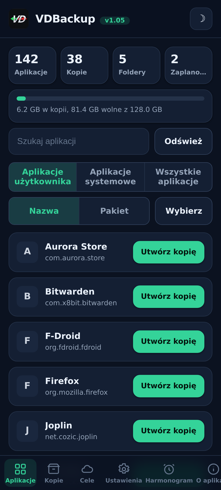
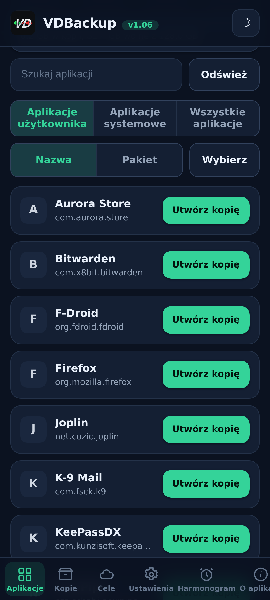
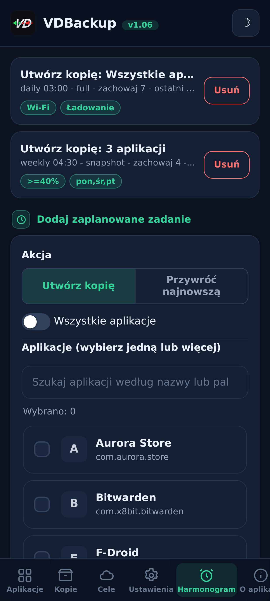
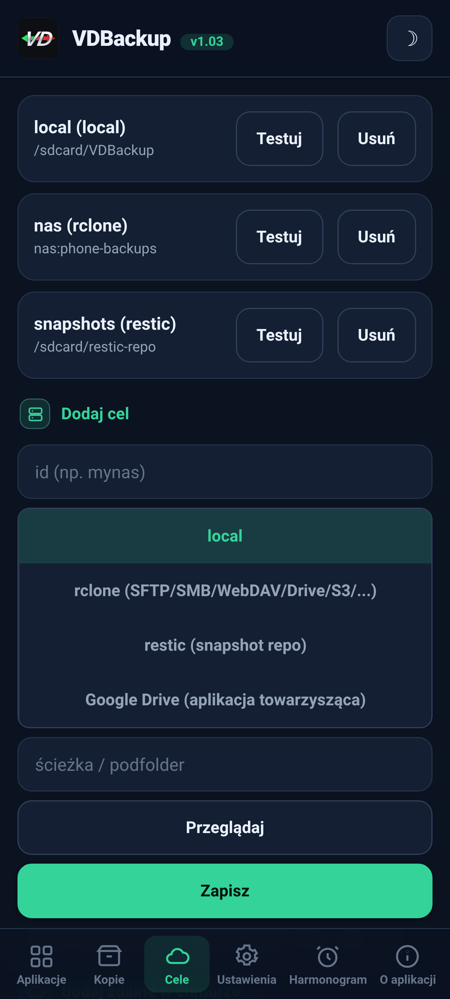
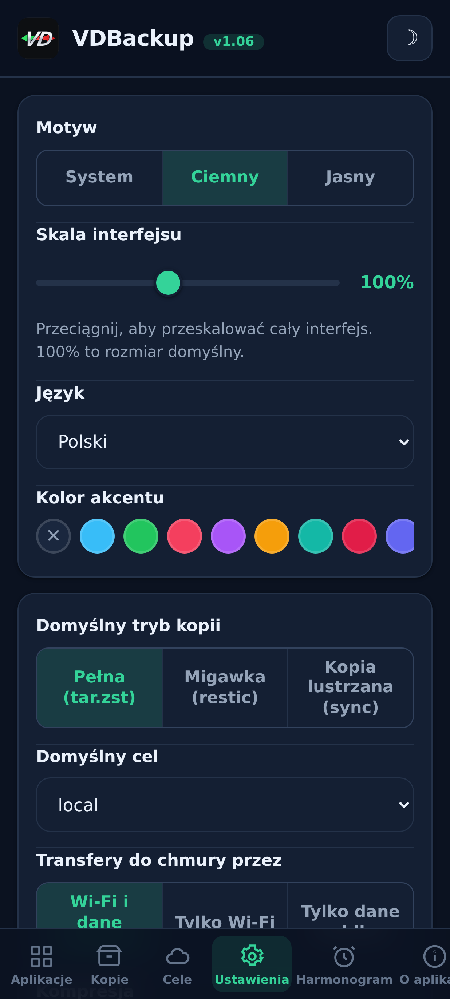
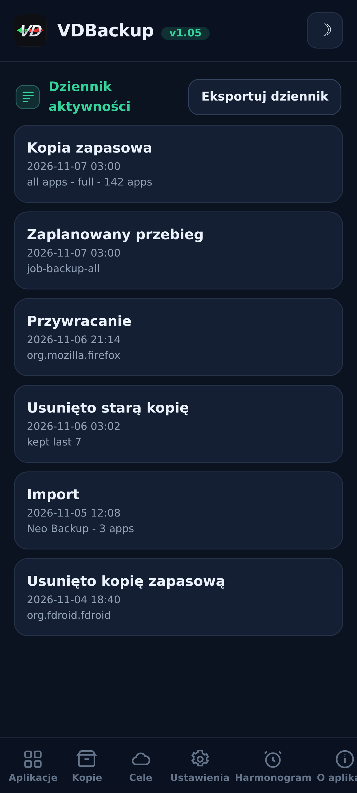

> **Languages:** [English](../USER-GUIDE.md) · [العربية](../ar/USER-GUIDE.md) · [Čeština](../cs/USER-GUIDE.md) · [Deutsch](../de/USER-GUIDE.md) · [Español](../es/USER-GUIDE.md) · [فارسی](../fa/USER-GUIDE.md) · [Français](../fr/USER-GUIDE.md) · [हिन्दी](../hi/USER-GUIDE.md) · [Bahasa Indonesia](../in/USER-GUIDE.md) · [Italiano](../it/USER-GUIDE.md) · [日本語](../ja/USER-GUIDE.md) · [한국어](../ko/USER-GUIDE.md) · [Nederlands](../nl/USER-GUIDE.md) · Polski · [Português](../pt/USER-GUIDE.md) · [Русский](../ru/USER-GUIDE.md) · [Svenska](../sv/USER-GUIDE.md) · [ไทย](../th/USER-GUIDE.md) · [Türkçe](../tr/USER-GUIDE.md) · [Tiếng Việt](../vi/USER-GUIDE.md) · [中文](../zh/USER-GUIDE.md)

---

# Przewodnik użytkownika VDBackup

Kompletne, przyjazne przejście przez VDBackup, od instalacji modułu po utworzenie
pierwszej kopii, jej przywrócenie, wysłanie do chmury, zaplanowanie i otwarcie
jej na PC lata później. Jeśli wcześniej używałeś Swift Backup, Neo-Backup lub
Android-DataBackup, będzie to znajome - tylko wszystko dzieje się w jednym
miejscu, bez niczego do "zezwolenia".

## Spis treści

- [1. Czym jest VDBackup](#1-czym-jest-vdbackup)
- [2. Wymagania](#2-wymagania)
- [3. Instalacja i pierwsze uruchomienie](#3-instalacja-i-pierwsze-uruchomienie)
- [4. Przewodnik po WebUI](#4-przewodnik-po-webui)
- [5. Tworzenie kopii](#5-tworzenie-kopii)
  - [5.1 Wybór tego, co kopiować](#51-wybór-tego-co-kopiować)
  - [5.2 Tryby kopii: Full, Snapshot, Mirror](#52-tryby-kopii-full-snapshot-mirror)
  - [5.3 Kompresja](#53-kompresja)
  - [5.4 Szyfrowanie](#54-szyfrowanie)
  - [5.5 Verify i dry-run](#55-verify-i-dry-run)
  - [5.6 Kopie specjalne (wiadomości, rejestr połączeń, Wi-Fi, Bluetooth, kalendarz, tapeta, DNS, ustawienia systemowe)](#56-kopie-specjalne-wiadomości-rejestr-połączeń-wi-fi-bluetooth-kalendarz-tapeta-dns-ustawienia-systemowe)
  - [5.7 Samodzielne kopie folderów i plików](#57-samodzielne-kopie-folderów-i-plików)
- [6. Przywracanie kopii](#6-przywracanie-kopii)
- [7. Cele: lokalne i zdalne](#7-cele-lokalne-i-zdalne)
- [8. Planowanie i retencja](#8-planowanie-i-retencja)
- [9. Migracja do środka: import Neo-Backup i Android-DataBackup](#9-migracja-do-środka-import-neo-backup-i-android-databackup)
- [10. SSAID (ANDROID_ID urządzenia)](#10-ssaid-android_id-urządzenia)
- [11. Przenośność: otwieranie kopii na PC](#11-przenośność-otwieranie-kopii-na-pc)
- [12. Sterowanie VDBackup z asystenta AI](#12-sterowanie-vdbackup-z-asystenta-ai)
- [13. Rozwiązywanie problemów i FAQ](#13-rozwiązywanie-problemów-i-faq)
- [14. Odinstalowanie](#14-odinstalowanie)

---

## 1. Czym jest VDBackup

VDBackup to moduł root z wbudowanym WebUI, który tworzy kopie i przywraca twoje aplikacje
oraz ich dane. Jest zaprojektowany jako otwarty, root-native następca Swift Backup,
Neo-Backup i Android-DataBackup: dąży do tego, by robić sumę tego, co robią te narzędzia, w
jednym miejscu, i potrafi nawet importować twoje istniejące kopie Neo-Backup i
Android-DataBackup, więc możesz się przenieść bez utraty czegokolwiek.

Kluczowa różnica względem zwykłej aplikacji do kopii: VDBackup działa **całkowicie z WebUI twojego
menedżera root**, a moduł jest już rootem. Nie ma aplikacji towarzyszącej do
instalacji dla podstawowych funkcji, żadnego monitu "przyznaj su" do zatwierdzenia i niczego do włączenia.
Otwierasz WebUI, wybierasz, co skopiować, i uruchamiasz.

Wszystko, co produkuje VDBackup, używa **standardowych formatów** (tar, gzip, zstd, age, zip,
restic), więc twoje kopie nigdy nie są zamknięte w module i nigdy nie są związane z twoim
konkretnym urządzeniem. Zobacz [sekcja 11](#sekcja-11).

## Zrzuty ekranu

| Ekran główny | Aplikacje | Harmonogram |
|:---:|:---:|:---:|
|  |  |  |
| **Cele** | **Ustawienia** | **Dziennik aktywności** |
|  |  |  |

## 2. Wymagania

- **Urządzenie z Androidem z rootem** zarządzane przez **KernelSU**, **APatch** lub **Magisk**.
  VDBackup instaluje się jako moduł z tego menedżera.
- Wystarczająco wolnego miejsca na twoje kopie (kopie lokalne żyją pod katalogiem stanu
  modułu; zobacz [sekcja 3](#sekcja-3)).
- Nic więcej. Moduł dołącza wszystkie binaria, których potrzebuje (tar, zstd, lz4, rclone,
  rsync, ssh, restic), więc **lokalna kopia i przywracanie działają w pełni offline**. Tylko cele
  chmurowe komunikują się z siecią.

Niektóre drobnoziarniste dodatki (AppOps, SSAID, kilka uprzywilejowanych fragmentów systemu) polegają na
frameworku Androida; moduł obsługuje je wewnętrznie, z fallbackiem plain-shell,
i degradują się elegancko, gdy nie są dostępne na twoim urządzeniu.

## 3. Instalacja i pierwsze uruchomienie

1. Pobierz najnowsze wydanie `VD-Backup-vX.Y.zip`.
2. W swoim menedżerze KernelSU / APatch / Magisk flashnij zip modułu jak każdy inny
   moduł.
3. Jest używalny natychmiast - **restart nie jest potrzebny**. (Restart jest istotny tylko
   przy przywracaniu SSAID; zobacz [sekcja 10](#sekcja-10).)
4. Otwórz **WebUI** modułu z menedżera. To jest cały interfejs.

**Którą edycję pobrać.** Każde wydanie jest dostarczane jako kilka flashowalnych edycji zip, więc
pobierasz tylko to, czego potrzebujesz. Wybierz jedną:

- **`VD-Backup-<ver>-universal-full.zip`** - każda architektura CPU i każdy plik binarny wbudowany, w tym
  `rclone` (dostawcy chmury: Google Drive, S3 i 70+ innych backendów rclone) i `restic`
  (zdeduplikowane migawki). W pełni offline, nic nigdy nie jest pobierane. Działa na każdym
  urządzeniu. Największy plik do pobrania.
- **`VD-Backup-<ver>-universal-lite.zip`** - każda architektura, ale **bez** dwóch największych
  plików binarnych (`rclone` i `restic`). Najmniejszy plik do pobrania; nadal wykonuje kopie
  lokalne oraz przez SSH/SFTP i rsync bez pobierania, z przenośnym szyfrowaniem `age`. Przy
  pierwszym użyciu miejsca docelowego w chmurze (`rclone`) lub trybu migawek (`restic`) WebUI
  proponuje jednorazowe pobranie tego małego dodatku dla danej architektury (zweryfikowanego
  przez SHA-256) i zapisuje go w pamięci podręcznej; potem te funkcje też działają.
- **`VD-Backup-<ver>-<abi>-full.zip`** (jedna z `arm64-v8a`, `armeabi-v7a`, `x86`, `x86_64`) -
  pojedyncza architektura z każdym plikiem binarnym wbudowanym (te same funkcje co `universal-full`, ale
  tylko dla architektury twojego urządzenia, więc mniejszy niż `universal-full`).

Jeśli znasz architekturę swojego urządzenia i chcesz wszystko wbudowane, wybierz pasującą
**`<abi>-full`** (większość telefonów to **`arm64-v8a`**). Jeśli chcesz najmniejszy plik do
pobrania i nie przeszkadza ci jednorazowe, zweryfikowane przez SHA-256 pobranie przy pierwszym
użyciu dostawców chmury (`rclone`) lub migawek (`restic`), wybierz **`universal-lite`**. Jeśli
chcesz wszystko wbudowane bez pobierania (offline / odzyskiwanie) i nie masz pewności co do
architektury, wybierz edycję **full**. Podczas instalacji moduł zachowuje
tylko architekturę twojego urządzenia, niezależnie od tego, którą edycję flashujesz.

Przy pierwszym uruchomieniu moduł zasiewa domyślną konfigurację (tylko jeśli żadna jeszcze nie istnieje), więc
twoje ustawienia są zachowane przez aktualizacje modułu.

**Gdzie żyje stan.** Dane robocze VDBackup - twoja konfiguracja, zaplanowane zadania,
zapisane cele, zaszyfrowane poświadczenia, logi i ścieżka audytu oraz obszar staging -
żyją pod:

```
/data/adb/vdbackup/
```

**Gdzie żyją kopie.** Same kopie są zapisywane do widocznego dla użytkownika, szyfrowanego
poświadczeniami magazynu (więc są czytelne dopiero po odblokowaniu urządzenia i
przeżywają odinstalowanie modułu), jeden folder na użytkownika Androida:

```
/sdcard/VDBackup/            (= /data/media/<user>/VDBackup)
```

Miej to na uwadze z dwóch powodów: kopie zajmują miejsce pod `/sdcard/VDBackup`, a
`/data/adb/vdbackup/logs/` to miejsce, gdzie zaglądasz, gdy coś pójdzie nie tak.

## 4. Przewodnik po WebUI

WebUI jest zorganizowane w kilka zakładek:

- **Home** - przegląd startowy pokazujący liczby twoich kopii (aplikacje, kopie, foldery i zaplanowane zadania) oraz pasek pamięci, ile miejsca zajmują twoje kopie w stosunku do wolnego, ze znaczkami statusu, kopiowaniem hashów i ścieżek do schowka oraz akcją **Check for updates**.
- **Apps** - lista zainstalowanych aplikacji (użytkownika i systemowych), każda pokazana ze swoją prawdziwą
  nazwą, nazwą pakietu i ikoną (ikony ładują się leniwie i są cachowane, więc lista
  pozostaje responsywna). Przycisk w wierszu tworzy kopię aplikacji; dotknięcie wiersza otwiera
  historię kopii tej aplikacji, gdzie możesz przywrócić dowolną wcześniejszą kopię.
- **Backups** - kopie, które już masz, każda pokazująca nazwę aplikacji w jednej linii i
  pakiet w następnej. Dotknij kopii, aby zobaczyć jej pełne szczegóły (wersja, data, rozmiar,
  dołączone elementy, liczby uprawnień oraz urządzenie, z którego pochodzi). Tu również
  przywracasz, uruchamiasz restore-test, usuwasz kopię lub importujesz kopie z Neo-Backup lub
  Android-DataBackup.
- **Destinations** - zarządzaj, dokąd trafiają kopie: magazyn lokalny plus dowolne zdalne
  cele, które dodasz (zobacz [sekcja 7](#sekcja-7)). Możesz tu
  przetestować cel, zanim na nim polegniesz.
- **Settings** - przełącznik motywu jasny/ciemny, selektor koloru akcentu (gotowe ustawienia,
  własny kolor lub reset), selektor języka (interfejs jest renderowany od prawej do lewej dla
  języka arabskiego i perskiego), suwak skali interfejsu, który przeciągasz, aby przeskalować
  cały interfejs (nagłówek, treść i dolna nawigacja razem) od 85% do 120% (100% jest domyślne), do ekranów o różnej
  gęstości pikseli, domyślne wartości dla nowych
  zadań (domyślna kompresja, verify wł/wył, domyślne szyfrowanie), polityka sieciowa dla
  przesyłów chmurowych (zobacz [sekcja 7](#sekcja-7)), automatyczna kopia i lista wykluczonych
  aplikacji, opcja źródła instalacji, klucz
  szyfrowania oraz planowanie. Ustawienia wł/wył używają przełączników w stylu Androida.
- **About** - wersja, linki, projekty siostrzane (See also), manifest audytu dołączonych plików binarnych oraz akcja **Check for updates**, która zgłasza, czy opublikowano nowszą wersję (wraz z jej informacjami o wydaniu). Każdą aktualizację instalujesz przez swojego menedżera roota, tak samo jak flashowałeś moduł.

Aplikacja sama też sprawdza nowszą wersję przy każdym otwarciu (najwyżej raz na godzinę) i pokazuje baner aktualizacji tylko, gdy jest dostępna; milczy, gdy jest aktualna lub offline.

Potwierdzenia i komunikaty używają dialogów w aplikacji (nie starych systemowych wyskakujących okien), a
przywracanie lub import prosi cię o potwierdzenie, że nadpisuje bieżące dane aplikacji, zanim
kontynuuje.

Kopie i przywracania działają **odłączone** jako proces root w tle. Możesz zamknąć
WebUI, a nawet zamknąć menedżer root, a operacja trwa dalej. Gdy
wrócisz, WebUI podłącza się ponownie i pokazuje żywy postęp ze zlokalizowaną etykietą fazy. Dla
trwającego zadania karta postępu pokazuje też na żywo prędkość transferu i szacowany pozostały
czas oraz licznik elementów (na przykład "12 z 40") z nazwą bieżącego elementu. Na
ROM-ach, które wynoszą powiadomienia shellowe, otrzymasz również powiadomienie Androida, gdy zadanie
się rozpocznie i zakończy; tak czy inaczej karta postępu w aplikacji jest niezawodnym wskaźnikiem.

## 5. Tworzenie kopii

Podstawowy przepływ: otwórz **Apps**, wybierz aplikację, zaznacz, co dołączyć, wybierz tryb,
ustaw kompresję i (opcjonalnie) szyfrowanie, a następnie uruchom. Postęp pojawia się na żywo, a
powiadomienie mówi ci, kiedy jest gotowe.

W oknie kopii zapasowej możesz też wybrać **miejsce docelowe** tej kopii - pamięć lokalną lub dowolne dodane miejsce w chmurze/zdalne - bez wcześniejszej zmiany domyślnego miejsca w Ustawieniach.

### 5.1 Wybór tego, co kopiować

Dla każdej aplikacji możesz dołączyć dowolną kombinację tych elementów:

| Element | Czym jest |
|------|-----------|
| **APK** | Sama zainstalowana aplikacja (base APK + dowolne split APK). |
| **data** | Prywatne dane aplikacji (`/data/data`). To są zwykłe "dane aplikacji". |
| **device-protected data** | Magazyn direct-boot / device-protected (`/data/user_de`). Niektóre aplikacje trzymają tu ustawienia. |
| **external** | Zewnętrzne dane aplikacji pod `Android/data`. |
| **OBB** | Pliki rozszerzeń OBB aplikacji (`Android/obb`), używane przez niektóre gry. |
| **media** | Media aplikacji pod `Android/media`. |

Dobrym domyślnym ustawieniem dla "skopiuj tę aplikację kompletnie" jest dołączenie wszystkich. Jeśli
chcesz tylko dane (na przykład by przenieść zapis gry), możesz odznaczyć APK i
duże elementy OBB/media.

VDBackup zachowuje też rzeczy, które czynią przywracanie wiernym: konteksty SELinux,
własność uid/gid, tryby plików, atrybuty rozszerzone (xattr) i capabilities.

### 5.2 Tryby kopii: Full, Snapshot, Mirror

VDBackup oferuje trzy tryby. WebUI wstępnie wybiera **Full**, co jest właściwym wyborem
dla większości osób.

- **Full** - kompletna, samowystarczalna, przenośna kopia zapisana jako `tar.zst` (lub
  wybrana przez ciebie kompresja). Każde uruchomienie tworzy samodzielną kopię, którą możesz skopiować
  gdziekolwiek i otworzyć na PC. Najlepsze dla: czystego, przenośnego snapshota aplikacji, który możesz
  zarchiwizować i przenosić. To domyślna i najbardziej przenośna opcja.
- **Snapshot** - przyrostowa i wersjonowana, oparta na `restic`. Każde uruchomienie dodaje nowy
  snapshot w punkcie czasu do repozytorium, przechowując tylko to, co się zmieniło, i
  deduplikując między snapshotami. Najlepsze dla: utrzymywania bieżącej historii aplikacji
  bez płacenia pełnym rozmiarem przy każdym uruchomieniu.
- **Mirror** - synchronizacja 1:1 żywych danych do celu, oparta na
  `rclone`/`rsync`. Utrzymuje cel identyczny z tym, co jest na urządzeniu teraz
  (zmienione pliki są kopiowane, usunięte pliki są kasowane w celu). Najlepsze
  dla: szybkiej, zawsze aktualnej kopii, na przykład do zdalnego chmurowego. Zauważ, że APK
  nadal jest przechowywane skompresowane nawet w mirrorze, nigdy surowe.

### 5.3 Kompresja

Możesz wybrać kompresję dla kopii Full:

- **none** - brak kompresji (najszybsze, największe).
- **lz4** - bardzo szybka, lekka kompresja.
- **zstd** - domyślna, mocna równowaga szybkości i współczynnika. Możesz też wybrać poziom
  (na przykład wyższy poziom dla mniejszego pliku).
- **gzip** - **"tryb zgodności"**. gzip otwiera się wbudowanymi narzędziami na
  praktycznie każdym komputerze i w większości menedżerów plików, bez niczego dodatkowego do instalacji.
  Wybierz to, gdy najbardziej zależy ci na możliwości otwarcia archiwum gdziekolwiek.

Jeśli nie wybierzesz, VDBackup użyje swojego skonfigurowanego domyślnego (zstd na rozsądnym poziomie).

### 5.4 Szyfrowanie

Szyfrowanie jest **opcjonalne** i przenośne. VDBackup szyfruje za pomocą **age** używając
passphrase (scrypt), co zostało wybrane specjalnie pod kątem przenośności: dowolne standardowe
narzędzie `age` na dowolnym systemie operacyjnym potrafi odszyfrować twoją kopię za pomocą samej passphrase.
Szyfrowanie **nigdy** nie jest związane z kluczami sprzętowymi twojego urządzenia, więc zaszyfrowana kopia
przywraca się na innym urządzeniu i otwiera na PC. (Dostępny jest też zgodny tryb zip AES-256
dla zaszyfrowanych archiwów, które chcesz otworzyć dwuklikiem i hasłem.)

Aby użyć szyfrowania, wygeneruj klucz szyfrujący raz (Settings), następnie włącz
szyfrowanie dla swojego zadania i ustaw passphrase. Passphrase jest tym, co chroni
kopię, więc wybierz silne - nie ma klucza sprzętowego ani tylnej furtki do odzyskiwania.

**Reguła APK (ważne):**

- **APK jest zawsze przechowywane skompresowane**, nigdy surowe, by oszczędzić miejsce.
- **APK nie jest domyślnie szyfrowane**, ponieważ APK aplikacji to treść publiczna.
- Szyfrowanie APK i szyfrowanie danych to **niezależne przełączniki**. Włączenie szyfrowania
  danych **nie** szyfruje APK. Jeśli konkretnie chcesz zaszyfrować też APK,
  włącz przełącznik szyfrowania APK jawnie.

### 5.5 Verify i dry-run

Dwie opcje bezpieczeństwa pomagają ci zaufać kopii, zanim na niej polegniesz:

- **Verify** - po zapisie VDBackup ponownie hashuje każde archiwum i sprawdza je względem
  manifestu. To jest **domyślnie włączone dla kopii Full**. Jeśli plik się nie zgadza,
  zadanie kończy się niepowodzeniem z czytelnym błędem, zamiast zostawiać cię z cicho uszkodzoną
  kopią.
- **Dry-run** - planuje zadanie i raportuje rozmiary, które by wyprodukowało, **bez zapisywania
  czegokolwiek**. Użyj tego, by oszacować miejsce lub sprawdzić swój wybór elementów przed uruchomieniem
  prawdziwej rzeczy.

Gdy kopia trafia do celu w **chmurze**, VDBackup dodaje dwa dodatkowe zabezpieczenia. Uruchamia
końcowy krok **checksum-verified**, który ponownie porównuje przesłaną kopię z oryginałem na zdalnym
celu, i kończy zadanie niepowodzeniem (zamiast zostawiać uszkodzoną kopię w chmurze), jeśli się nie
zgadzają. A przed wysyłką Full sprawdza **wolne miejsce** zdalnego celu i zatrzymuje się wcześnie z
czytelnym błędem **"not enough space"**, jeśli kopia by się nie zmieściła, zamiast zapełniać zdalny
cel i zawieść w połowie. (Kontrola miejsca dotyczy wysyłek Full; Mirror jest synchronizacją delta i
jest z tego wyłączony.)

### 5.6 Kopie specjalne (wiadomości, rejestr połączeń, Wi-Fi, Bluetooth, kalendarz, tapeta, DNS, ustawienia systemowe)

Pod listami aplikacji na zakładce **Backups** sekcja **Kopie specjalne** obejmuje dane
ogólnosystemowe, które nie są powiązane z pojedynczą aplikacją. Wybierz kategorie i wykonaj ich
kopię; są one archiwizowane z tym samym zachowaniem SELinux/xattr i opcjonalnym szyfrowaniem co
kopie aplikacji. Kategorie to:

| Kategoria | Czym jest |
|-----------|-----------|
| **Wiadomości (SMS/MMS)** | Twoje wiadomości tekstowe. |
| **Kontakty i rejestr połączeń** | Twoje kontakty i historia połączeń. |
| **Sieci Wi-Fi** | Twoje zapisane sieci Wi-Fi. |
| **Bluetooth** | Twoje sparowania Bluetooth. |
| **Kalendarz** | Provider kalendarza (aplikacja i dane). Zapisywany jest też **przenośny `calendar.json`**, więc twoje wydarzenia są czytelne na PC bez modułu. |
| **Tapeta** | Twoja tapeta ekranu głównego i blokady oraz `wallpaper_info.xml`, przechowywana jako surowy obraz. |
| **DNS** | Twój tryb i serwer prywatnego DNS. |
| **Ustawienia systemowe** | Pełny zrzut ustawień system, global i secure urządzenia. |

Dla wiadomości, rejestru połączeń i kontaktów zapisywana jest też **przenośna kopia** (otwieralny
JSON), więc masz kopię międzyurządzeniową, którą możesz odczytać na komputerze bez modułu.

**Ustawienia systemowe są opt-in i nadpisują ustawienia twojego urządzenia przy przywracaniu.**
Tak jak SSAID (zobacz [sekcja 10](#sekcja-10)), kategoria **Ustawienia systemowe** jest
najwrażliwsza: jej przywrócenie nadpisuje ustawienia całego urządzenia, więc jest wyłączona,
chyba że wybierzesz ją celowo, najpierw prosi cię o potwierdzenie i jest zapisywana w dzienniku
aktywności.

Przywracanie kopii specjalnej nadpisuje żywe dane systemowe i wymaga restartu, więc jest
zabezpieczone wyraźnym potwierdzeniem i jest niezawodne na tym samym urządzeniu i tej samej ROM.
Przywracania są **idempotentne**: surowe kategorie (wiadomości, kontakty, Wi-Fi, Bluetooth,
kalendarz) są przywracane przez **zastąpienie** danych zamiast ich scalania, więc dwukrotne
przywrócenie tej samej kopii nigdy nie tworzy duplikatów, a DNS i ustawienia systemowe są po
prostu ponownie stosowane.

### 5.7 Samodzielne kopie folderów i plików

Czasami chcesz zrobić kopię zwykłego folderu lub pliku, który nie jest aplikacją - folderu
aparatu, katalogu dokumentów, pojedynczej bazy danych. VDBackup potrafi zrobić kopię **dowolnej
ścieżki bezwzględnej** w pamięci współdzielonej lub pod `/data`, w tym samym przenośnym formacie
co kopia aplikacji: archiwum `tar.zst` plus `manifest.json`, zapieczętowane SHA-256, z notatką
RECOVERY, gdy je zaszyfrujesz. Te kopie ścieżek są trzymane osobno, pod folderem `.paths` w twoim
katalogu kopii.

- **Wybierz ścieżkę i wykonaj jej kopię.** Źródło musi być ścieżką bezwzględną pod jedną z
  dozwolonych lokalizacji (`/storage/emulated`, `/data/media`, `/sdcard`, `/data`). Ścieżki, które
  próbują wyjść na zewnątrz za pomocą `..`, są odrzucane.
- **Przywracanie zapisuje z powrotem do oryginalnej lokalizacji**, więc, jak każde przywracanie,
  jest destrukcyjne i prosi cię o **potwierdzenie**, zanim cokolwiek nadpisze.
- Jak kopie aplikacji, kopie i przywracania ścieżek działają **odłączone** z żywym postępem,
  używają wybranej przez ciebie kompresji i mogą być zaszyfrowane za pomocą passphrase.

## 6. Przywracanie kopii

Otwórz zakładkę **Backups**, wybierz kopię, którą chcesz, i rozpocznij przywracanie. Ponieważ
przywracanie jest akcją destrukcyjną, VDBackup najpierw prosi cię o **potwierdzenie**, i
zapisuje akcję w lokalnym logu audytu.

Przywracanie jest **wierne**: VDBackup wymazuje bieżący stan aplikacji i rozpakowuje
kopię, więc aplikacja jest przywracana do **dokładnego stanu** uchwyconego w tej kopii
(wraz z własnością, trybami, kontekstami SELinux i xattr). To nie jest scalenie - to
prawdziwe przywrócenie do punktu w czasie kopii. Ponieważ przywracanie działa jako root,
VDBackup sprawdza też każde archiwum, zanim cokolwiek rozpakuje, i odrzuca zmanipulowane, które
próbuje zapisać poza swoim celem, więc zmodyfikowana kopia nigdy nie może nadpisać reszty twojego
systemu.

Przydatne opcje przywracania:

- **Restore-test** - rozpakowuje kopię do tymczasowego obszaru staging i weryfikuje ją
  **bez dotykania żywej aplikacji**. To bezpieczny sposób na potwierdzenie, że kopia jest
  nienaruszona i możliwa do przywrócenia, zanim cokolwiek nadpiszesz. Jeśli test się nie powiedzie, otrzymasz
  czytelny błąd, a twoja zainstalowana aplikacja pozostaje nietknięta.
- **Częściowe przywracanie** - przywróć tylko niektóre z elementów, które zostały skopiowane. Na przykład
  przywróć same dane aplikacji bez reinstalacji APK, lub przywróć pliki
  zapisu bez dużych OBB/media. Wybierz elementy, które chcesz, na ekranie przywracania.
- Dla kopii **Snapshot** i **Mirror** przywracanie pobiera odpowiednio z wersjonowanego
  repozytorium lub z mirrorowanej kopii.
- **Źródło instalacji** - domyślnie przywrócona aplikacja zgłasza **Sklep Play** jako swoje
  źródło instalacji (zamiast wyglądać na sideloaded), czego oczekuje większość aplikacji i
  kontroli aplikacji. Możesz to wyłączyć globalnie w Settings lub dla pojedynczego przywracania,
  a po wyłączeniu zachowywane jest oryginalne źródło instalacji. Zaawansowany, opcjonalny
  przełącznik **"sfałszuj źródło inicjujące"** idzie dalej i sprawia też, że pakiet inicjujący i
  źródło pakietu aplikacji wyglądają na zainstalowane z Play; edytuje on systemową bazę pakietów
  (wcześniej zarchiwizowaną) i wchodzi w życie po restarcie.

**Przywracanie wsadowe.** Zakładka **Backups** ma tryb **Select**, tak samo jak zakładka Apps ma go
do wsadowego tworzenia kopii. Włącz **Select**, zaznacz polami wyboru kopie, które chcesz, i przywróć
je wszystkie naraz. Jedno okno opcji obejmuje cały wybór - potwierdzenie nadpisania, restore-test oraz
wybór źródła instalacji dotyczą każdej wybranej przez ciebie kopii - a są one przywracane jedna po
drugiej.

**Usuwanie kopii.** Otwórz szczegóły kopii (lub historię aplikacji) i użyj **Delete**;
zostaniesz poproszony o potwierdzenie, a usunięcie jest zapisywane w dzienniku aktywności.
Możesz też ograniczyć, ile kopii zachować na aplikację (retencja), aby stare były przycinane
automatycznie.

**Zamontuj zainstalowaną aplikację jako systemową.** Z historii kopii aplikacji **Mount as
system** przygotowuje APK aplikacji w podmodule overlay VDBackup, aby menedżer root serwował ją
z `/system/app` (lub `/system/priv-app`) - rzeczywista partycja `/system` nigdy nie jest
naruszana. Z **NoMount** na KernelSU stosuje się na żywo; w przeciwnym razie stosuje się po
restarcie. Nigdy nie zależy to od tego, czy NoMount jest zainstalowany.

## 7. Cele: lokalne i zdalne

Domyślnie kopie są zapisywane do magazynu **lokalnego** pod katalogiem stanu
modułu. Możesz też dodać cele zdalne w zakładce **Destinations**. Dla celu lokalnego **Browse**
otwiera selektor folderów, abyś mógł wybrać podfolder w pamięci współdzielonej (`/sdcard`) zamiast
wpisywać ścieżkę.

Transport zdalny jest obsługiwany przez dołączone narzędzia:

- **rclone** - hub dla ogromnego zakresu zdalnych: **SFTP, SMB, WebDAV, FTP, S3,
  Google Drive** i 70+ innych usług.
- **rsync** oraz pakiet **ssh/scp/sftp** - dla delta sync i zwykłych celów SSH.
- **restic** - zaszyfrowane, deduplikowane repozytoria **Snapshot** (lokalne lub zdalne).

**Tworzenie zdalnego chmurowego (SSH niepotrzebne).** W zakładce Destinations wybierz
typ celu **rclone** i użyj **Add cloud remote**. Możesz połączyć **dowolny backend rclone**:
lista rozwijana oferuje popularne (**Google Drive, Dropbox, OneDrive, Box, pCloud, Mega,
Backblaze B2, S3, SFTP, WebDAV, FTP, SMB**) oraz opcję **Custom (advanced)**, w której wpisujesz
dowolny inny typ backendu i jego parametry `key=value`. Wypełnij pola (host/user/password, lub
na przykład klucze S3) i zapisz. Dla dostawców, którzy logują cię przez przeglądarkę (Google
Drive, Dropbox, OneDrive, Box, pCloud), użyj przycisku **Authorize in browser**: loguje cię przez
własną przeglądarkę telefonu i automatycznie przechwytuje token, więc **nie jest potrzebny PC**
(ręczne wklejenie tokena nadal działa jako rozwiązanie zapasowe). Zdalny pojawia się wtedy na
liście zdalnych celu. Hasła są przechowywane zaciemnione, nigdy w postaci jawnej. Możesz
wylistować i usunąć swoje zdalne z tego samego miejsca.

Dwie reguły utrzymują użycie zdalnych bezpiecznym:

- **Poświadczenia są przechowywane zaszyfrowane** w spoczynku w katalogu stanu modułu, nigdy
  w postaci jawnej.
- **Waliduj przed użyciem.** Użyj testu celu w zakładce Destinations, by
  potwierdzić, że cel działa, zanim wymierzysz w niego prawdziwą kopię.

**Polityka sieciowa (Wi-Fi vs dane mobilne).** W Settings "Cloud transfers over" pozwala ci
ograniczyć, które połączenie mogą użyć przesyły chmurowe: **Wi-Fi i dane mobilne** (
domyślne), **tylko Wi-Fi**, lub **tylko dane mobilne**. Gdy to ograniczysz, każdy chmurowy
przesył - ręczny lub zaplanowany, upload lub przywracanie - najpierw sprawdza aktywne połączenie
i odmawia działania na niewłaściwym, więc polityka tylko-Wi-Fi nigdy nie wyda danych mobilnych.
Kopie lokalne nigdy nie są dotknięte.

**Google Drive.** Masz dwa sposoby, by dotrzeć do Google Drive:

1. **Przez rclone** - dodaj Drive jako zdalny rclone jak każdy inny cel, bez
   dodatkowej aplikacji i **bez konta Google Cloud**. Na dowolnym komputerze uruchom
   `rclone authorize "drive"` raz, zaloguj się na swoje konto Google w przeglądarce, i
   wklej token, który wypisze, do pola tokenu zdalnego Drive.
2. **Przez opcjonalny companion** - niewielka, opt-in aplikacja towarzysząca, która obsługuje
   logowanie Google i upload do Drive. Instaluje się **tylko gdy jawnie wybierzesz
   cel companion Google Drive**, nigdy domyślnie, i jest usuwana, gdy
   ją wyłączysz. Jednorazowy ekran zgody Google to jedyny krok, który dzieje się
   poza WebUI. Gdy companion jest zainstalowany, VDBackup przypomina ci, by
   **zawsze ukrywać go za pomocą [HMA-OSS](https://github.com/frknkrc44/HMA-OSS)**, aby jego obecność nie ujawniała roota lub
   odblokowanego bootloadera, i oferuje dodanie go do listy HMA-OSS za ciebie. VDBackup przypomina też, gdy masz lokalne kopie, aby z tego samego powodu ukryć folder kopii (/sdcard/VDBackup) za pomocą SUSFS.

## 8. Planowanie i retencja

VDBackup potrafi uruchamiać kopie - oraz przywracanie - automatycznie według harmonogramu. W planerze
definiujesz zadanie z:

- **celem** - pojedyncza aplikacja, zestaw aplikacji lub **wszystkie aplikacje** (minus lista
  wykluczonych aplikacji) - oraz elementami/trybem do użycia,
- **akcją** - **Back up** (domyślna) lub **Restore latest**, która przywraca najnowszą kopię każdej
  aplikacji docelowej,
- celem (miejscem docelowym),
- **harmonogramem w stylu cron** - co godzinę, codziennie lub co tydzień, o wybranej przez ciebie porze (HH:MM),
- ustawieniem **retencji**: **zachowaj N** najnowszych kopii dla tego zadania, starsze są
  przycinane automatycznie,
- opcjonalnymi **warunkami uruchomienia**: tylko przez **Wi-Fi**, tylko podczas **ładowania**, tylko
  przy **minimalnym poziomie baterii** lub wyższym, i tylko w wybrane **dni tygodnia**.

Zaplanowane zadania są wyzwalane przez heartbeat rozruchowy w module: gdy zadanie jest
należne, uruchamia się, zapisuje czas ostatniego uruchomienia, by nie wystrzelić dwa razy, i stosuje
retencję, by przyciąć stare kopie. Ponieważ wszystko działa jako root w tle,
zaplanowane kopie nie potrzebują otwartego WebUI.

**Warunki uruchomienia (bramki).** Zaplanowane zadanie może nieść warunki, które muszą być spełnione,
aby się uruchomiło: tylko Wi-Fi, tylko ładowanie, minimalny poziom baterii oraz określone dni
tygodnia. Gdy zadanie jest należne, ale warunek nie jest spełniony, jest ono **pomijane i ponawiane
przy następnym sprawdzeniu** - jego harmonogram się nie przesuwa, więc uruchamia się, gdy tylko
warunek zostanie spełniony. Wbudowane zabezpieczenie termiczne również pomija zaplanowane zadanie,
gdy urządzenie jest zbyt gorące. Każde takie pominięcie jest zapisywane w dzienniku aktywności.

**Zaplanowane przywracanie nadpisuje przy każdym uruchomieniu.** Zadanie **Restore latest** ponownie
przywraca najnowszą kopię każdej aplikacji docelowej za każdym razem, gdy się uruchamia, a przywracanie
jest destrukcyjne: przy każdym uruchomieniu **nadpisuje bieżące dane aplikacji** najnowszą kopią. Jest to
zamierzone i opcjonalne (opt-in) - wybieraj to tylko wtedy, gdy chcesz utrzymywać cele na ich najnowszej
kopii.

**Automatyczna kopia przy instalacji/aktualizacji.** W Settings możesz włączyć **automatyczną
kopię zapasową**: ten sam heartbeat w tle zauważa aplikacje, które zostały właśnie zainstalowane
lub zaktualizowane, i wykonuje ich kopię za ciebie (z retencją keep-N). Pierwsze uruchomienie
jedynie rejestruje, co jest zainstalowane, więc jej włączenie nigdy nie tworzy kopii całego
urządzenia naraz.

**Wykluczone aplikacje (blocklist).** Również w Settings możesz wykluczyć aplikacje, których
nigdy nie chcesz kopiować automatycznie ani według harmonogramu; możesz dodać kilka naraz
(wielokrotny wybór), a wykluczone aplikacje są pomijane przez oba mechanizmy.

**Ustawienia predefiniowane kopii.** Również w Ustawieniach możesz zapisać nazwane ustawienia - zestawy elementów do uwzględnienia, np. tylko APK lub APK + OBB - i wybrać jedno w oknie kopii, aby wypełnić wybór elementów naraz.

**Elementy kopii dla aplikacji.** Również w Ustawieniach możesz wybrać dokładnie, które elementy każda aplikacja kopiuje w kopiach zbiorczych, automatycznych i zaplanowanych - na przykład tylko APK lub APK + OBB. Pojedyncza ręczna kopia nadal pozwala wybrać na miejscu, zaczynając od zestawu aplikacji. Aplikacje, których tu nie ustawisz, kopiują wszystko.

**Tagi aplikacji.** Dotknij aplikacji w Ustawieniach (Elementy i tagi dla aplikacji), aby nadać jej swobodne etykiety - na przykład games lub work. Nad listą aplikacji pojawi się wtedy wybór tagów: wybierz tag, aby pokazać tylko jego aplikacje, i utwórz kopię całej grupy naraz. Możesz też otworzyć to z karty Aplikacje: dotknij aplikacji, a potem Elementy i tagi.

**Dziennik aktywności.** Zakładka Schedule ma przycisk **View activity log**, który otwiera pełny
ekran (natychmiast) pokazujący lokalny ślad audytu - kopie, przywracania, usunięcia, zaplanowane i
automatyczne uruchomienia oraz przycięcia - od najnowszych. Akcja **Export logs** zapisuje plik
dziennika (w folderze kopii zapasowych), który możesz dołączyć do zgłoszenia opinii lub błędu.

## 9. Migracja do środka: import Neo-Backup i Android-DataBackup

Jeśli przychodzisz z Neo-Backup lub Android-DataBackup, nie musisz zaczynać
od nowa. Z zakładki **Backups** możesz **zaimportować** swoje istniejące kopie:

1. Wskaż VDBackup lokalizację swoich istniejących kopii Neo-Backup lub Android-DataBackup
   (import-scan wylistuje, co tam znajdzie).
2. Wybierz, które kopie zaimportować.
3. Rozpocznij import. Jak inne długie operacje działa odłączony z żywym postępem.

**Kopie Neo-Backup zaszyfrowane hasłem są obsługiwane.** Zaszyfrowane AES-256 kopie
Neo-Backup można zaimportować - jesteś **proszony o hasło**, gdy jest
potrzebne, a hasło jest używane tylko do odszyfrowania, nigdy nie jest przechowywane w linii poleceń.

## 10. SSAID (ANDROID_ID urządzenia)

SSAID to per-aplikacyjny `ANDROID_ID` - identyfikator na poziomie urządzenia, który niektóre aplikacje odczytują.
VDBackup potrafi go skopiować i przywrócić, ale to najwrażliwsza rzecz, jakiej
dotyka, więc jest obsługiwana z dodatkową ostrożnością:

- **Jest OPCJONALNE i domyślnie WYŁĄCZONE.** VDBackup **nigdy** nie przechwyci ani nie przywróci
  SSAID, chyba że włączysz to jawnie dla tego zadania. WebUI pokazuje wyraźnie
  oznaczone, podświetlone powiadomienie "Optional" wszędzie, gdzie pojawia się SSAID (backup, restore i
  import), i pozostaje wyłączone, dopóki się nie zapiszesz.
- **Stosuje się dopiero po restarcie przy przywracaniu.** Dostawca ustawień Androida cachuje
  te wartości, więc przywrócone SSAID zaczyna działać dopiero po ponownym uruchomieniu urządzenia.
- **Poprzednia wartość jest zawsze najpierw kopiowana.** Przed nadpisaniem jakiegokolwiek SSAID
  VDBackup kopiuje żywy `settings_ssaid.xml` bajt w bajt do kopii ze znacznikiem czasu
  (która nigdy nie jest automatycznie usuwana). Jeśli tej kopii bezpieczeństwa nie można wykonać, nadpisanie
  się nie dzieje. Aby cofnąć, przywróć ten zapisany plik i zrestartuj.

**Zalecenie:** zostaw SSAID wyłączone, chyba że konkretnie wiesz, że go potrzebujesz (
na przykład konkretna aplikacja, która kluczuje się do ID urządzenia i którą migrujesz
celowo). Dla zwykłych kopii aplikacji i danych go nie potrzebujesz.

## 11. Przenośność: otwieranie kopii na PC

Twoje kopie **nie są zamknięte w tym module** i **nigdy nie są związane ze sprzętem**.
Wszystko używa standardowych formatów, więc możesz otworzyć kopię na Windows, macOS lub Linux
bez zainstalowanego VDBackup.

Folder kopii Full zawiera `manifest.json` (źródło prawdy opisujące każdy
plik, wersję aplikacji i oryginalnego właściciela/kontekst), APK jako `*.apk.zst`, oraz
archiwa danych jako `<item>.tar.zst` (lub `.tar.gz` / `.tar.lz4`), opcjonalnie z
końcowym `.age`, gdy zaszyfrowane.

Jak otworzyć jedną na PC, w skrócie:

- **Odszyfruj** (tylko jeśli plik kończy się na `.age`) standardowym narzędziem `age` i swoją
  passphrase lub keyfile.
- **Zdekompresuj i rozpakuj**: `.tar.zst` za pomocą `zstd` następnie `tar`; `.tar.gz` za pomocą `tar`
  bezpośrednio; `.tar.lz4` przez `zstd --format=lz4`. APK to po prostu skompresowane zstd APK,
  więc dekompresja `base.apk.zst` daje ci normalne instalowalne `base.apk`.

Każda zaszyfrowana kopia jest dostarczana z notatką **RECOVERY** zawierającą dokładne
polecenia copy-paste dla Windows, macOS i Linux. Zobacz
[`../module/etc/RECOVERY.md`](RECOVERY.md) dla pełnego zestawu krok po kroku.

Zauważ, że konteksty SELinux, uid/gid i tryby są przechowywane wewnątrz tar i są
poprawnie ponownie zastosowane tylko wtedy, gdy przywracasz na Androidzie - na PC nadal dostajesz wszystkie swoje pliki,
tylko bez egzekwowania własności specyficznej dla Androida.

## 12. Sterowanie VDBackup z asystenta AI

VDBackup jest zbudowany tak, by być przyjaznym asystentom i agentom AI, nie tylko ludziom. WebUI
jest tylko jednym klientem małego API JSON; agent może administrować **każdą** akcją
modułu bezgłowo przez to samo API (każde polecenie zwraca pojedynczy obiekt
JSON, długie operacje działają odłączone i odpytujesz ich postęp, i obowiązują te same bariery
bezpieczeństwa - SSAID pozostaje opt-in, akcje modyfikujące pozostają potwierdzone i audytowane).

Jeśli chcesz, by asystent uruchamiał twoje kopie i przywracania za ciebie, wskaż mu
[`AI-AGENTS.md`](AI-AGENTS.md), który dokumentuje pełną powierzchnię sterowania: kontrakt
poleceń, każdy czasownik z jego argumentami i wartością zwracaną, oraz reguły bezpieczeństwa, których
agent musi przestrzegać.

## 13. Rozwiązywanie problemów i FAQ

**Gdzie są logi?** Pod katalogiem stanu modułu,
`/data/adb/vdbackup/logs/`. Żywy postęp działającej operacji jest w
`progress-<opid>.json`, a **ścieżka audytu** akcji modyfikujących (restore, delete,
import, zmiany SSAID) jest w `audit.jsonl`.

**Kopia/przywracanie wydaje się zacięte lub zamknąłem WebUI.** Operacje działają odłączone, więc
zamknięcie WebUI ich nie zatrzymuje. Otwórz WebUI ponownie, a podłączy się do dowolnej
działającej operacji i pokaże bieżący postęp.

**Dostałem komunikat `ERR_...`.** Błędy są zgłaszane z czytelnym kodem. Kilka częstych:
- `ERR_VERIFY` - zapisane archiwum nie zgadzało się ze swoim hashem w manifeście (weryfikacja
  wychwyciła złą kopię). Uruchom kopię ponownie.
- `ERR_RESTORE_TEST` - restore-test się nie powiódł; kopia nie rozpakowała/zweryfikowała się
  czysto, a twoja żywa aplikacja pozostała nietknięta.
- `ERR_UNSAFE_ARCHIVE` - archiwum zostało odrzucone, ponieważ próbowało zapisać poza swoim
  katalogiem docelowym (ścieżki bezwzględne lub z `..`). To chroni cię przed zmanipulowaną kopią;
  nic nie zostało zapisane.
- `ERR_QUOTA` - zdalny cel w chmurze nie miał dość wolnego miejsca na wysyłkę Full; kopia została
  zatrzymana, zanim cokolwiek wysłano.

**Mój zdalny cel zawodzi.** Użyj **testu** celu w zakładce Destinations,
by zwalidować poświadczenia i łączność. Pamiętaj, że tylko cele chmurowe potrzebują
sieci; lokalna kopia/przywracanie jest w pełni offline.

**Czy coś z tego dzwoni do domu lub pobiera w czasie działania?** Nie. Wszystkie binaria są dołączone
w module w czasie buildu; nic nie jest pobierane na urządzenie w czasie działania. Tylko cele
chmurowe (rclone/restic/ssh) komunikują się z siecią, i tylko gdy ich używasz.

**Czy moja kopia przywróci się na innym telefonie?** Tak - kopie są przenośne i nie są
związane ze sprzętem urządzenia. (SSAID to jedyny wyjątek specyficzny dla urządzenia, i jest opt-in
oraz stosowany po restarcie; zobacz [sekcja 10](#sekcja-10).)

**Moja zaszyfrowana kopia się nie otworzy - zgubiłem passphrase.** Nie ma tylnej furtki
do odzyskiwania z założenia; passphrase jest tym, co chroni kopię. Trzymaj ją bezpiecznie.

## 14. Odinstalowanie

Odinstaluj VDBackup jak każdy inny moduł ze swojego menedżera KernelSU / APatch / Magisk.
Odinstalowanie **zachowuje twoją konfigurację użytkownika** i usuwa tylko stan przejściowy,
więc późniejsza reinstalacja podejmuje twoje ustawienia. Twoje faktyczne kopie żyją pod
`/data/adb/vdbackup/` - jeśli chcesz je też usunąć, skasuj ten katalog
ręcznie po odinstalowaniu; w przeciwnym razie pozostają dostępne (i, będąc standardowymi
formatami, otwieralne na PC) nawet bez modułu.

---

*Ta dokumentacja została wygenerowana za pomocą Claude (Anthropic) i jest utrzymywana przez VD171. Poprawki i ulepszenia są mile widziane - zobacz [CONTRIBUTING.md](CONTRIBUTING.md).*
