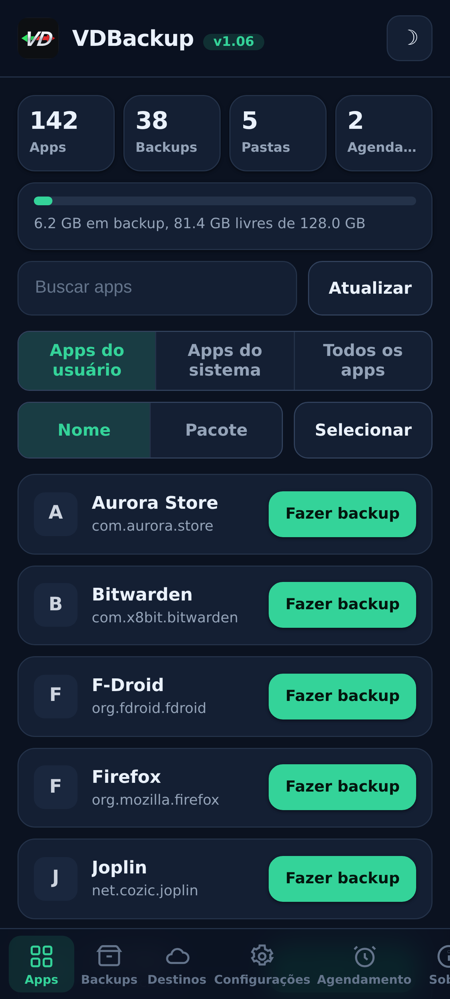
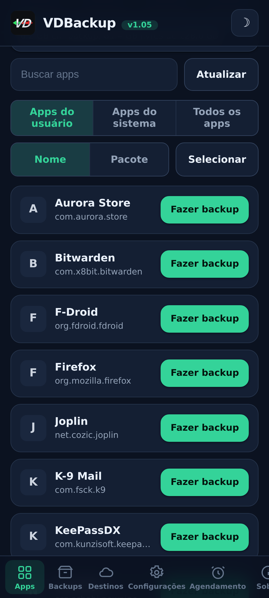
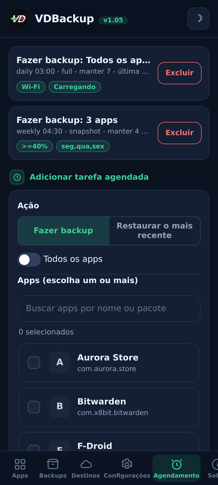
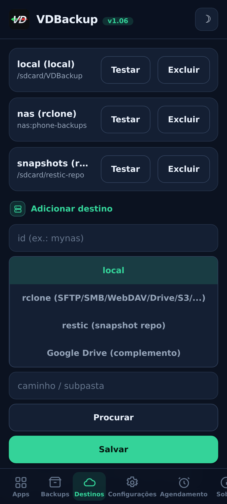
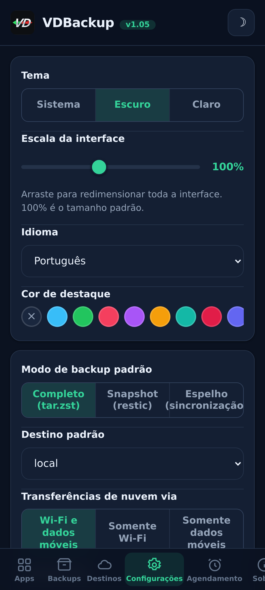
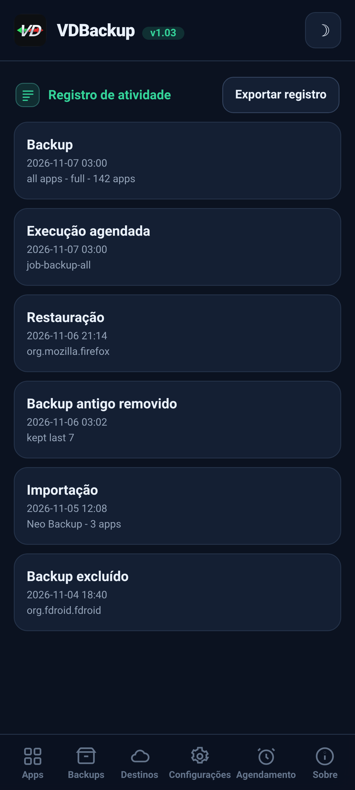

> **Languages:** [English](../USER-GUIDE.md) · [العربية](../ar/USER-GUIDE.md) · [Čeština](../cs/USER-GUIDE.md) · [Deutsch](../de/USER-GUIDE.md) · [Español](../es/USER-GUIDE.md) · [فارسی](../fa/USER-GUIDE.md) · [Français](../fr/USER-GUIDE.md) · [हिन्दी](../hi/USER-GUIDE.md) · [Bahasa Indonesia](../in/USER-GUIDE.md) · [Italiano](../it/USER-GUIDE.md) · [日本語](../ja/USER-GUIDE.md) · [한국어](../ko/USER-GUIDE.md) · [Nederlands](../nl/USER-GUIDE.md) · [Polski](../pl/USER-GUIDE.md) · Português · [Русский](../ru/USER-GUIDE.md) · [Svenska](../sv/USER-GUIDE.md) · [ไทย](../th/USER-GUIDE.md) · [Türkçe](../tr/USER-GUIDE.md) · [Tiếng Việt](../vi/USER-GUIDE.md) · [中文](../zh/USER-GUIDE.md)

---

# Guia do usuário do VDBackup

Um passo a passo completo e amigável do VDBackup, da instalação do módulo até fazer
seu primeiro backup, restaurá-lo, enviá-lo para a nuvem, agendá-lo, e abri-lo
num PC anos depois. Se você já usou o Swift Backup, Neo-Backup ou
Android-DataBackup antes, isto vai parecer familiar - só que tudo acontece num só
lugar, sem nada para "permitir".

## Sumário

- [1. O que é o VDBackup](#1-o-que-é-o-vdbackup)
- [2. Requisitos](#2-requisitos)
- [3. Instalação e primeira execução](#3-instalação-e-primeira-execução)
- [4. Tour pela WebUI](#4-tour-pela-webui)
- [5. Fazendo um backup](#5-fazendo-um-backup)
  - [5.1 Escolhendo o que fazer backup](#51-escolhendo-o-que-fazer-backup)
  - [5.2 Modos de backup: Full, Snapshot, Mirror](#52-modos-de-backup-full-snapshot-mirror)
  - [5.3 Compressão](#53-compressão)
  - [5.4 Criptografia](#54-criptografia)
  - [5.5 Verify e dry-run](#55-verify-e-dry-run)
  - [5.6 Backups especiais (mensagens, registro de chamadas, Wi-Fi, Bluetooth, agenda, papel de parede, DNS, configurações do sistema)](#56-backups-especiais-mensagens-registro-de-chamadas-wi-fi-bluetooth-agenda-papel-de-parede-dns-configurações-do-sistema)
  - [5.7 Backups avulsos de pastas e arquivos](#57-backups-avulsos-de-pastas-e-arquivos)
- [6. Restaurando um backup](#6-restaurando-um-backup)
- [7. Destinos: local e remoto](#7-destinos-local-e-remoto)
- [8. Agendamento e retenção](#8-agendamento-e-retenção)
- [9. Migrando para cá: importando Neo-Backup e Android-DataBackup](#9-migrando-para-cá-importando-neo-backup-e-android-databackup)
- [10. SSAID (ANDROID_ID do dispositivo)](#10-ssaid-android_id-do-dispositivo)
- [11. Portabilidade: abrindo backups num PC](#11-portabilidade-abrindo-backups-num-pc)
- [12. Dirigindo o VDBackup a partir de um assistente de IA](#12-dirigindo-o-vdbackup-a-partir-de-um-assistente-de-ia)
- [13. Solução de problemas e FAQ](#13-solução-de-problemas-e-faq)
- [14. Desinstalando](#14-desinstalando)

---

## 1. O que é o VDBackup

VDBackup é um módulo root com uma WebUI embutida que faz backup e restaura seus apps
e seus dados. Ele é projetado como o sucessor aberto e root-native do Swift Backup,
Neo-Backup e Android-DataBackup: ele visa fazer a união do que essas ferramentas fazem, num
único lugar, e pode até importar seus backups existentes do Neo-Backup e do
Android-DataBackup para que você possa migrar sem perder nada.

A diferença-chave para um app de backup comum: o VDBackup roda **inteiramente a partir da
WebUI do seu gerenciador de root**, e o módulo já é root. Não há app companheiro para
instalar para os recursos principais, nenhum prompt de "conceder su" para aprovar, e nada
para ligar. Você abre a WebUI, escolhe o que fazer backup, e executa.

Tudo o que o VDBackup produz usa **formatos padrão** (tar, gzip, zstd, age, zip,
restic), então seus backups nunca ficam presos ao módulo e nunca ficam atrelados ao seu
dispositivo específico. Veja a [seção 11](#seção-11).

## Capturas de tela

| Início | Apps | Agendamento |
|:---:|:---:|:---:|
|  |  |  |
| **Destinos** | **Configurações** | **Registro de atividade** |
|  |  |  |

## 2. Requisitos

- **Um dispositivo Android rooteado** gerenciado por **KernelSU**, **APatch** ou **Magisk**.
  O VDBackup é instalado como um módulo a partir desse gerenciador.
- Armazenamento livre suficiente para seus backups (backups locais vivem sob o diretório de
  estado do módulo; veja a [seção 3](#seção-3)).
- Nada mais. O módulo embarca todos os binários de que precisa (tar, zstd, lz4, rclone,
  rsync, ssh, restic), então **backup e restauração locais funcionam totalmente offline**. Só
  destinos de nuvem falam com a rede.

Alguns extras finos (AppOps, SSAID, alguns bits privilegiados de sistema) dependem do
framework do Android; o módulo lida com eles internamente, com um fallback em shell puro, e
eles degradam graciosamente quando não estão disponíveis no seu dispositivo.

## 3. Instalação e primeira execução

1. Baixe o release mais recente `VD-Backup-vX.Y.zip`.
2. No seu gerenciador KernelSU / APatch / Magisk, faça flash do zip do módulo como qualquer outro
   módulo.
3. Ele é usável imediatamente - **sem precisar de reboot**. (Um reboot só é relevante
   ao restaurar SSAID; veja a [seção 10](#seção-10).)
4. Abra a **WebUI** do módulo a partir do gerenciador. Essa é a interface inteira.

**Qual edição baixar.** Cada release vem como várias edições de zip flasheáveis, então você
baixa só o que precisa. Escolha uma:

- **`VD-Backup-<ver>-universal-full.zip`** - todas as arquiteturas de CPU e todos os
  binários embutidos, incluindo `rclone` (provedores de nuvem: Google Drive, S3 e mais de 70
  outros backends do rclone) e `restic` (snapshots deduplicados). Totalmente offline, nada é
  baixado. Funciona em qualquer aparelho. O maior download.
- **`VD-Backup-<ver>-universal-lite.zip`** - todas as arquiteturas, mas **sem** os dois
  maiores binários (`rclone` e `restic`). O menor download; ainda faz backups locais, por
  SSH/SFTP e rsync sem baixar nada, com criptografia `age` portável. Na primeira vez que você
  usa um destino de nuvem (`rclone`) ou o modo snapshot (`restic`), a WebUI oferece baixar
  aquele pequeno complemento por arquitetura uma vez (verificado por SHA-256) e o guarda em
  cache; depois disso esses recursos também funcionam.
- **`VD-Backup-<ver>-<abi>-full.zip`** (uma de `arm64-v8a`, `armeabi-v7a`, `x86`,
  `x86_64`) - uma única arquitetura com todos os binários embutidos (os mesmos recursos da
  `universal-full`, mas só para a arquitetura do seu aparelho, então menor que a
  `universal-full`).

Se você conhece a arquitetura do seu aparelho e quer tudo embutido, escolha a **`<abi>-full`**
correspondente (a maioria dos celulares é **`arm64-v8a`**). Se você quer o menor download e não
se importa com um download único, verificado por SHA-256, na primeira vez que usar provedores
de nuvem (`rclone`) ou snapshots (`restic`), escolha a **`universal-lite`**. Se você quer tudo
embutido sem downloads (offline / recuperação) e não tem certeza da arquitetura, escolha uma
edição **full**. Na instalação o módulo mantém apenas
a arquitetura do seu aparelho, independentemente da edição que você flashar.

Na primeira execução o módulo semeia uma configuração padrão (só se nenhuma existir ainda),
então suas configurações são preservadas entre atualizações do módulo.

**Onde o estado vive.** Os dados de trabalho do VDBackup - sua configuração, jobs agendados,
destinos salvos, credenciais criptografadas, logs e trilha de auditoria, e área de staging -
vivem sob:

```
/data/adb/vdbackup/
```

**Onde os backups vivem.** Os backups em si são escritos em armazenamento visível ao usuário e
criptografado por credencial (então só são legíveis depois que você desbloqueia o dispositivo, e
sobrevivem à desinstalação do módulo), uma pasta por usuário do Android:

```
/sdcard/VDBackup/            (= /data/media/<user>/VDBackup)
```

Tenha isso em mente por dois motivos: backups ocupam espaço sob `/sdcard/VDBackup`, e
`/data/adb/vdbackup/logs/` é onde você olha se algo der errado.

## 4. Tour pela WebUI

A WebUI é organizada em algumas abas:

- **Home** - um resumo inicial que mostra contagens dos seus backups (apps, backups, pastas e jobs agendados) e uma barra de armazenamento de quanto espaço seus backups usam em relação ao livre, com selos de status, copiar hashes e caminhos para a área de transferência, e uma ação **Check for updates**.
- **Apps** - a lista de apps instalados (de usuário e de sistema), cada um mostrado com seu nome
  real, seu nome de pacote, e seu ícone (os ícones carregam sob demanda e são cacheados, então a
  lista permanece responsiva). O botão numa linha faz backup do app; tocar na linha abre o
  histórico de backups daquele app, onde você pode restaurar qualquer backup anterior.
- **Backups** - os backups que você já tem, cada um mostrando o nome do app numa linha e o
  pacote na seguinte. Toque num backup para ver seus detalhes completos (versão, data, tamanho,
  itens incluídos, contagens de permissão, e o dispositivo de onde veio). Também é aqui que
  você restaura, roda um restore-test, apaga um backup, ou importa backups do Neo-Backup ou do
  Android-DataBackup.
- **Destinations** - gerencie para onde os backups vão: armazenamento local além de quaisquer
  destinos remotos que você adicionar (veja a [seção 7](#seção-7)). Você pode
  testar um destino aqui antes de depender dele.
- **Settings** - um toggle de tema claro/escuro, um seletor de cor de destaque (presets, uma cor
  personalizada, ou reset), um seletor de idioma (a interface é renderizada da direita para a
  esquerda para árabe e persa), um controle deslizante de escala da interface que você arrasta
  para redimensionar toda a interface (cabeçalho, conteúdo e navegação inferior juntos) de 85% a 120% (100% é o padrão), para
  telas de diferentes densidades de pixels, padrões para novos
  jobs (compressão padrão, verify ligado/desligado, criptografia padrão), a política de rede para
  transferências de nuvem (veja a [seção 7](#seção-7)), o backup automático e a lista de apps
  excluídos, a opção de fonte de instalação, a chave de criptografia,
  e agendamento. As configurações de ligar/desligar usam interruptores de alternância no estilo Android.
- **About** - versão, links, os projetos irmãos (See also), o manifesto de auditoria dos binários embarcados, e uma ação **Check for updates** que informa se uma versão mais nova foi publicada (com suas notas de versão). Você instala qualquer atualização pelo seu gerenciador root, do mesmo jeito que você instalou o módulo.

O app também verifica por conta própria se há uma versão mais nova toda vez que você o abre (no máximo 1 vez por hora) e mostra o aviso de atualização só quando há uma; fica silencioso se estiver atualizado ou offline.

Confirmações e mensagens usam diálogos no app (não os antigos pop-ups do sistema), e um
restore ou import pede que você reconheça que ele sobrescreve os dados atuais do app antes
de prosseguir.

Backups e restaurações rodam **destacados** como um processo root em background. Você pode fechar
a WebUI, ou até fechar o gerenciador de root, e a operação continua. Quando você volta,
a WebUI reata e mostra o progresso ao vivo com um label de fase localizado. Para um job em
andamento o card de progresso também mostra a velocidade de transferência ao vivo e o tempo
restante estimado, mais um contador de itens (por exemplo "12 de 40") com o nome do item atual. Em
ROMs que expõem notificações de shell você também recebe uma notificação do Android quando um job
começa e termina; de qualquer forma o card de progresso no app é o indicador confiável.

## 5. Fazendo um backup

O fluxo básico: abra **Apps**, escolha um app, selecione o que incluir, escolha um modo,
defina a compressão e (opcionalmente) a criptografia, depois execute. O progresso aparece ao vivo e uma
notificação te avisa quando termina.

No diálogo de backup você também pode escolher o **destino** deste backup - armazenamento local ou qualquer destino de nuvem/remoto que você adicionou - sem precisar mudar antes o destino padrão nas Configurações.

### 5.1 Escolhendo o que fazer backup

Para cada app você pode incluir qualquer combinação destes itens:

| Item | O que é |
|------|-----------|
| **APK** | O próprio app instalado (APK base + quaisquer split APKs). |
| **data** | Os dados privados do app (`/data/data`). Estes são os "dados do app" habituais. |
| **device-protected data** | Armazenamento direct-boot / device-protected (`/data/user_de`). Alguns apps guardam configurações aqui. |
| **external** | Os dados externos do app sob `Android/data`. |
| **OBB** | Os arquivos de expansão OBB do app (`Android/obb`), usados por alguns jogos. |
| **media** | A mídia do app sob `Android/media`. |

Um bom padrão para "fazer backup completo deste app" é incluir todos eles. Se você
só quer os dados (por exemplo para mover um save de jogo), você pode desmarcar o APK e os
grandes itens OBB/media.

O VDBackup também preserva as coisas que tornam uma restauração fiel: contextos SELinux,
ownership uid/gid, modos de arquivo, atributos estendidos (xattr) e capabilities.

### 5.2 Modos de backup: Full, Snapshot, Mirror

O VDBackup oferece três modos. A WebUI pré-seleciona **Full**, que é a escolha certa
para a maioria das pessoas.

- **Full** - um backup completo, autocontido e portável escrito como `tar.zst` (ou
  a compressão que você escolher). Cada execução produz um backup standalone que você pode copiar
  para qualquer lugar e abrir num PC. Melhor para: um snapshot limpo e portável de um app que você pode
  arquivar e mover por aí. Este é o padrão e a opção mais portável.
- **Snapshot** - incremental e versionado, apoiado por `restic`. Cada execução adiciona um novo
  snapshot point-in-time a um repositório, guardando só o que mudou e
  de-duplicando entre snapshots. Melhor para: manter um histórico corrente de um app
  sem pagar o tamanho cheio a cada execução.
- **Mirror** - um sync 1:1 dos dados vivos para o destino, apoiado por
  `rclone`/`rsync`. Ele mantém o destino idêntico ao que está no dispositivo agora
  (arquivos alterados são copiados, arquivos removidos são apagados no destino). Melhor
  para: uma cópia rápida e sempre atual, por exemplo para um remoto de nuvem. Note que o APK
  ainda é guardado comprimido mesmo num mirror, nunca cru.

### 5.3 Compressão

Você pode escolher a compressão para um backup Full:

- **none** - sem compressão (mais rápido, maior).
- **lz4** - compressão muito rápida e leve.
- **zstd** - o padrão, um forte equilíbrio de velocidade e razão. Você também pode escolher um
  nível (por exemplo um nível mais alto para um arquivo menor).
- **gzip** - o **"modo de compatibilidade"**. gzip abre com ferramentas embutidas em
  praticamente qualquer computador e na maioria dos gerenciadores de arquivos, sem nada extra para instalar.
  Escolha isto quando o que mais te importa é poder abrir o archive em qualquer lugar.

Se você não escolher, o VDBackup usa seu padrão configurado (zstd num nível sensato).

### 5.4 Criptografia

A criptografia é **opcional** e portável. O VDBackup criptografa com **age** usando uma
passphrase (scrypt), que foi escolhida especificamente por portabilidade: qualquer ferramenta
`age` padrão em qualquer sistema operacional pode descriptografar seu backup com apenas a passphrase.
A criptografia **nunca** fica atrelada às chaves de hardware do seu dispositivo, então um backup criptografado
restaura em outro dispositivo e abre num PC. (Um modo zip AES-256 compatível também está
disponível para archives criptografados que você quer abrir com um duplo-clique e uma senha.)

Para usar criptografia, gere a chave de criptografia uma vez (Settings), depois habilite a
criptografia para seu job e defina uma passphrase. A passphrase é o que protege o
backup, então escolha uma forte - não há chave de hardware e nenhum backdoor de recuperação.

**A regra do APK (importante):**

- O **APK é sempre guardado comprimido**, nunca cru, para economizar espaço.
- O **APK não é criptografado por padrão**, porque o APK de um app é conteúdo público.
- Criptografia de APK e criptografia de dados são **toggles independentes**. Ligar a
  criptografia de dados **não** criptografa o APK. Se você especificamente quer o APK criptografado
  também, habilite o toggle de criptografia de APK explicitamente.

### 5.5 Verify e dry-run

Duas opções de segurança te ajudam a confiar num backup antes de depender dele:

- **Verify** - depois de escrever, o VDBackup re-hasheia cada archive e o confere contra
  o manifest. Isto está **ligado por padrão para backups Full**. Se um arquivo não casar,
  o job falha com um erro claro em vez de te deixar com um backup silenciosamente corrompido.
- **Dry-run** - planeja o job e reporta os tamanhos que ele produziria **sem escrever
  nada**. Use-o para estimar espaço ou para conferir sua seleção de itens antes de rodar
  a coisa real.

Quando um backup vai para um destino de **nuvem**, o VDBackup adiciona mais duas salvaguardas.
Ele roda um passo final **verificado por checksum** que reconfere a cópia enviada contra o
original no remoto, e falha o job (em vez de deixar uma cópia corrompida na nuvem) se eles não
casarem. E antes de um upload Full ele checa o **espaço livre** do remoto e para cedo com um erro
claro de **"espaço insuficiente"** se o backup não couber, em vez de encher o remoto e falhar no
meio. (A checagem de espaço é para uploads Full; o Mirror é um delta sync e está isento.)

### 5.6 Backups especiais (mensagens, registro de chamadas, Wi-Fi, Bluetooth, agenda, papel de parede, DNS, configurações do sistema)

Abaixo das listas de apps na aba **Backups**, os **Backups especiais** cobrem dados de todo
o sistema que não estão atrelados a um único app. Escolha as categorias e faça backup delas;
elas são arquivadas com a mesma preservação de SELinux/xattr e criptografia opcional dos
backups de app. As categorias são:

| Categoria | O que é |
|-----------|---------|
| **Mensagens (SMS/MMS)** | Suas mensagens de texto. |
| **Contatos e registro de chamadas** | Seus contatos e histórico de chamadas. |
| **Redes Wi-Fi** | Suas redes Wi-Fi salvas. |
| **Bluetooth** | Seus pareamentos Bluetooth. |
| **Agenda** | O provider de calendário (app e dados). Um **`calendar.json` portátil** também é escrito, então seus eventos ficam legíveis num PC sem o módulo. |
| **Papel de parede** | Seu papel de parede da tela inicial e de bloqueio mais `wallpaper_info.xml`, guardado como a imagem crua. |
| **DNS** | Seu modo e servidor de DNS privado. |
| **Configurações do sistema** | Um dump completo das configurações system, global e secure do dispositivo. |

Para mensagens, registro de chamadas e contatos, uma **cópia portátil** (JSON abrível) também
é escrita, então você tem uma cópia multi-dispositivo que pode ler num PC sem o módulo.

**Configurações do sistema é opt-in e sobrescreve as configurações do seu dispositivo na
restauração.** Assim como o SSAID (veja a [seção 10](#seção-10)), a categoria **Configurações
do sistema** é a mais sensível: restaurá-la sobrescreve as configurações de todo o dispositivo,
então ela fica desligada a menos que você a selecione deliberadamente, pede que você reconheça
primeiro, e é escrita no log de atividade.

Restaurar um backup especial sobrescreve dados vivos do sistema e precisa de um reboot, então é
protegido por um aviso destacado e é confiável no mesmo dispositivo e ROM. As restaurações são
**idempotentes**: as categorias cruas (mensagens, contatos, Wi-Fi, Bluetooth, agenda) são
restauradas **substituindo** os dados em vez de mesclá-los, então restaurar o mesmo backup duas
vezes nunca cria duplicatas, e DNS e configurações do sistema são simplesmente reaplicados.

### 5.7 Backups avulsos de pastas e arquivos

Às vezes você quer fazer backup de uma pasta ou arquivo comum que não é um app - uma pasta de
câmera, um diretório de documentos, um único banco de dados. O VDBackup pode fazer backup de
**qualquer caminho absoluto** no armazenamento compartilhado ou sob `/data`, com o mesmo formato
portátil de um backup de app: um archive `tar.zst` mais um `manifest.json`, selado com SHA-256,
com uma nota RECOVERY quando você o criptografa. Esses backups de caminho são mantidos à parte,
sob uma pasta `.paths` no seu diretório de backups.

- **Escolha um caminho e faça backup dele.** A origem deve ser um caminho absoluto sob um dos
  locais permitidos (`/storage/emulated`, `/data/media`, `/sdcard`, `/data`). Caminhos que tentam
  escapar com `..` são recusados.
- **Restaurar escreve de volta no local original**, então, como qualquer restauração, é
  destrutivo e pede que você **confirme** antes de sobrescrever qualquer coisa.
- Como os backups de app, os backups e restaurações de caminho rodam **destacados** com progresso
  ao vivo, usam a compressão que você escolheu, e podem ser criptografados com uma passphrase.

## 6. Restaurando um backup

Abra a aba **Backups**, escolha o backup que você quer, e inicie a restauração. Como a
restauração é uma ação destrutiva, o VDBackup te pede para **confirmar** primeiro, e ela
registra a ação num log de auditoria local.

Uma restauração é **fiel**: o VDBackup apaga o estado atual do app e extrai o
backup, então o app é revertido ao **estado exato** capturado naquele backup
(incluindo ownership, modos, contextos SELinux e xattr). Não é um merge - é uma
restauração verdadeira ao ponto no tempo do backup. Como uma restauração roda como root, o
VDBackup também checa cada archive antes de extrair qualquer coisa e recusa um adulterado que
tente escrever fora do seu destino, então um backup modificado nunca pode sobrescrever o resto
do seu sistema.

Opções úteis de restauração:

- **Restore-test** - extrai o backup para uma área de staging temporária e o verifica
  **sem tocar no app vivo**. Esta é a forma segura de confirmar que um backup está
  íntegro e restaurável antes de você sobrescrever qualquer coisa. Se o teste falhar você recebe um
  erro claro e seu app instalado fica intocado.
- **Restauração parcial** - restaura só alguns dos itens que foram backupeados. Por
  exemplo, restaura só os dados do app sem reinstalar o APK, ou restaura os arquivos de
  save sem os grandes OBB/media. Escolha os itens que você quer na tela de restauração.
- Para backups **Snapshot** e **Mirror**, a restauração puxa do repositório versionado
  ou da cópia espelhada respectivamente.
- **Fonte de instalação** - por padrão um app restaurado reporta a **Play Store** como sua
  fonte de instalação (em vez de parecer sideloaded), que é o que a maioria dos apps e
  verificações de app esperam. Você pode desligar isto globalmente em Settings ou por
  restauração, e quando desligado a fonte de instalação original é mantida. Um toggle avançado
  e opt-in **"forjar a fonte iniciadora"** vai além e também faz o pacote iniciador e a
  fonte do pacote do app parecerem instalados pela Play; ele edita o banco de pacotes do
  sistema (com backup antes) e entra em vigor após um reboot.

**Restauração em lote.** A aba **Backups** tem um modo **Select**, do mesmo jeito que a aba
Apps tem para o backup em lote. Ligue o **Select**, marque os backups que você quer com suas
caixas de seleção, e restaure todos de uma vez. Um único diálogo de opções cobre a seleção
inteira - o reconhecimento de sobrescrita, o restore-test e a escolha de fonte de instalação
se aplicam a cada backup que você escolheu - e eles são restaurados um após o outro.

**Apagando um backup.** Abra os detalhes de um backup (ou o histórico de um app) e use
**Delete**; você é solicitado a confirmar, e a exclusão é registrada no log de atividade.
Você também pode limitar quantos backups manter por app (retenção) para que os antigos sejam
podados automaticamente.

**Montar um app instalado como app de sistema.** A partir do histórico de backups de um app,
**Mount as system** prepara o APK do app num sub-módulo de overlay do VDBackup para que o
gerenciador de root o sirva a partir de `/system/app` (ou `/system/priv-app`) - a partição
`/system` real nunca é tocada. Com **NoMount** no KernelSU ele se aplica ao vivo; caso
contrário ele se aplica após um reboot. Isto nunca depende de o NoMount estar instalado.

## 7. Destinos: local e remoto

Por padrão, os backups são escritos no armazenamento **local** sob o diretório de estado do
módulo. Você também pode adicionar destinos remotos na aba **Destinations**. Para um destino
local, **Browse** abre um seletor de pastas para que você possa escolher uma subpasta sob o
armazenamento compartilhado (`/sdcard`) em vez de digitar o caminho.

O transporte remoto é feito pelas ferramentas embarcadas:

- **rclone** - o hub para uma vasta gama de remotos: **SFTP, SMB, WebDAV, FTP, S3,
  Google Drive** e mais de 70 outros serviços.
- **rsync** e a suíte **ssh/scp/sftp** - para delta sync e alvos SSH simples.
- **restic** - repositórios **Snapshot** criptografados e de-duplicados (locais ou remotos).

**Criando um remoto de nuvem (sem SSH necessário).** Na aba Destinations, escolha o
tipo de destino **rclone** e use **Add cloud remote**. Você pode conectar **qualquer backend
rclone**: a lista suspensa oferece os populares (**Google Drive, Dropbox, OneDrive, Box, pCloud,
Mega, Backblaze B2, S3, SFTP, WebDAV, FTP, SMB**) mais uma opção **Custom (advanced)** onde você
digita qualquer outro tipo de backend e seus parâmetros `key=value`. Preencha os campos
(host/user/password, ou as chaves S3, por exemplo) e salve. Para provedores que fazem seu login
por um navegador (Google Drive, Dropbox, OneDrive, Box, pCloud), use o botão **Authorize in
browser**: ele faz seu login pelo próprio navegador do telefone e captura o token
automaticamente, então **nenhum PC é necessário** (colar um token à mão ainda funciona como
fallback). O remoto então aparece na lista de remotos do destino. As senhas são guardadas
obscurecidas, nunca em texto claro. Você pode listar e apagar seus remotos do mesmo lugar.

Duas regras mantêm o uso remoto seguro:

- **Credenciais são guardadas criptografadas** em repouso no diretório de estado do módulo, nunca
  em texto claro.
- **Valide antes de usar.** Use o teste de destino na aba Destinations para
  confirmar que um destino funciona antes de apontar um backup real para ele.

**Política de rede (Wi-Fi vs dados móveis).** Em Settings, "Cloud transfers over" permite que você
restrinja qual conexão as transferências de nuvem podem usar: **Wi-Fi e dados móveis** (o
padrão), **só Wi-Fi**, ou **só dados móveis**. Quando você restringe, toda transferência de nuvem
- manual ou agendada, upload ou restauração - checa a conexão ativa primeiro
e se recusa a rodar na errada, então uma política só-Wi-Fi nunca gasta dados móveis.
Backups locais nunca são afetados.

**Google Drive.** Você tem duas maneiras de chegar ao Google Drive:

1. **Via rclone** - adicione o Drive como um remoto rclone como qualquer outro destino, sem
   app extra e **sem conta Google Cloud**. Em qualquer computador rode
   `rclone authorize "drive"` uma vez, faça login na sua conta Google no navegador, e
   cole o token que ele imprime no campo de token do remoto Drive.
2. **Via o companheiro opcional** - um app companheiro minúsculo e opt-in que lida com o
   login do Google e o upload para o Drive. Ele é instalado **só quando você explicitamente escolhe
   o destino companheiro do Google Drive**, nunca por padrão, e é removido quando
   você o desabilita. A tela de consentimento Google única é o único passo que acontece
   fora da WebUI. Quando o companheiro está instalado, o VDBackup te lembra de
   **sempre ocultá-lo com o [HMA-OSS](https://github.com/frknkrc44/HMA-OSS)** para que a presença dele não revele root ou
   um bootloader desbloqueado, e ele se oferece para adicioná-lo à lista do HMA-OSS para você. O VDBackup também te lembra, quando você tem backups locais, de ocultar a pasta de backups (/sdcard/VDBackup) com o SUSFS pelo mesmo motivo.

## 8. Agendamento e retenção

O VDBackup pode rodar backups - e restaurações - automaticamente num agendamento. No
agendador você define um job com:

- um **alvo** - um único app, um conjunto de apps, ou **todos os apps** (menos a lista de
  apps excluídos) - e os itens/modo a usar,
- uma **ação** - **Back up** (o padrão) ou **Restore latest**, que restaura o backup mais
  recente de cada app-alvo,
- um destino,
- um **agendamento tipo cron** - de hora em hora, diário ou semanal, num horário que você escolhe (HH:MM),
- uma configuração de **retenção**: **manter N** backups mais recentes para aquele job, os mais antigos são
  podados automaticamente,
- **condições de execução** opcionais: só no **Wi-Fi**, só enquanto **carregando**, só com um
  **nível mínimo de bateria**, e só em **dias da semana** escolhidos.

Jobs agendados são disparados por um heartbeat de boot no módulo: quando um job está
vencido ele roda, registra seu horário da última execução para não disparar duas vezes, e aplica
retenção para podar backups antigos. Como tudo roda como root em background, os
backups agendados não precisam da WebUI aberta.

**Condições de execução (gates).** Um job agendado pode carregar condições que precisam valer
para ele rodar: só Wi-Fi, só carregando, um nível mínimo de bateria, e dias específicos da
semana. Quando um job está vencido mas uma condição não é atendida, ele é **pulado e tentado de
novo na próxima checagem** - seu agendamento não avança, então ele roda assim que a condição for
satisfeita. Uma checagem embutida de segurança térmica também pula um job agendado enquanto o
dispositivo está quente demais. Todo skip desses é registrado no log de atividade.

**A restauração agendada sobrescreve a cada execução.** Um job **Restore latest** re-restaura
o backup mais recente de cada app-alvo toda vez que dispara, e a restauração é destrutiva: a
cada execução ela **sobrescreve os dados atuais do app** com o backup mais recente. Isto é
deliberado e opt-in - escolha isto só quando você quer os alvos mantidos no seu backup mais
recente.

**Auto-backup ao instalar/atualizar.** Em Settings você pode ligar o **backup automático**: o
mesmo heartbeat em background nota apps que foram recém-instalados ou atualizados e faz backup
deles para você (com retenção keep-N). A primeira execução só registra o que está instalado,
então habilitá-lo nunca faz backup do seu dispositivo inteiro de uma vez.

**Apps excluídos (blocklist).** Também em Settings, você pode excluir apps dos quais nunca quer
backup automático ou agendado; você pode adicionar vários de uma vez (seleção múltipla), e apps
excluídos são pulados por ambos.

**Presets de backup.** Também em Ajustes, você pode salvar presets nomeados - conjuntos de itens a incluir, como só APK ou APK + OBB - e escolher um no diálogo de backup para preencher os itens de uma vez.

**Itens de backup por app.** Também em Ajustes, você pode escolher exatamente quais itens cada app faz backup em backups em massa, automáticos e agendados - por exemplo só APK, ou APK + OBB. Um backup manual individual ainda te deixa escolher na hora, partindo do conjunto do app. Apps que você não configurar aqui fazem backup de tudo.

**Tags de app.** Toque num app em Ajustes (Itens e tags por app) para dar a ele rótulos livres - por exemplo games ou work. Um seletor de tags então aparece acima da lista de apps: escolha uma tag para mostrar só os apps dela e faça backup do grupo inteiro de uma vez. Você também chega nele pela aba Apps: toque num app e depois em Itens e tags.

**Log de atividade.** A aba Schedule tem um botão **View activity log** que abre uma tela cheia
(instantaneamente) mostrando a trilha de auditoria local - backups, restaurações, exclusões,
execuções agendadas e automáticas, e podas - do mais recente para o mais antigo. Uma ação
**Export logs** salva um arquivo de log (sob a pasta de backups) que você pode anexar a um
relatório de feedback ou bug.

## 9. Migrando para cá: importando Neo-Backup e Android-DataBackup

Se você está vindo do Neo-Backup ou do Android-DataBackup, você não precisa começar
do zero. A partir da aba **Backups** você pode **importar** seus backups existentes:

1. Aponte o VDBackup para o local dos seus backups existentes do Neo-Backup ou do Android-DataBackup
   (o import-scan lista o que ele encontra lá).
2. Escolha quais backups importar.
3. Inicie o import. Como outras operações longas ele roda destacado com progresso ao vivo.

**Backups do Neo-Backup criptografados por senha são suportados.** Os backups criptografados
AES-256 do Neo-Backup podem ser importados - você é **solicitado pela senha** quando ela é
necessária, e a senha é usada só para descriptografar, nunca guardada na linha de comando.

## 10. SSAID (ANDROID_ID do dispositivo)

SSAID é o `ANDROID_ID` por-app - um identificador em nível de dispositivo que alguns apps leem.
O VDBackup pode fazer backup dele e restaurá-lo, mas esta é a coisa mais sensível que ele
toca, então é tratada com cuidado extra:

- **É OPCIONAL e DESLIGADA por padrão.** O VDBackup **nunca** vai capturar ou restaurar
  SSAID a menos que você a ligue explicitamente para aquele job. A WebUI mostra um aviso
  "Optional" claramente marcado e destacado onde quer que o SSAID apareça (backup, restore e
  import), e ela fica desligada até você fazer opt-in.
- **Aplica-se só após um reboot no restore.** O settings provider do Android cacheia
  esses valores, então um SSAID restaurado só entra em vigor depois que você reinicia o dispositivo.
- **O valor anterior é sempre backupeado primeiro.** Antes de sobrescrever qualquer SSAID,
  o VDBackup copia o `settings_ssaid.xml` vivo byte-a-byte para um backup com timestamp
  (que nunca é auto-apagado). Se essa cópia de segurança não puder ser feita, a sobrescrita
  não acontece. Para reverter, restaure aquele arquivo salvo e reinicie.

**Recomendação:** deixe o SSAID desligado a menos que você especificamente saiba que precisa dele (por
exemplo, um app específico que se atrela ao ID do dispositivo e que você está migrando
deliberadamente). Para backups comuns de app e dados você não precisa dele.

## 11. Portabilidade: abrindo backups num PC

Seus backups **não ficam presos a este módulo** e **nunca são hardware-bound**.
Tudo usa formatos padrão, então você pode abrir um backup no Windows, macOS ou Linux
sem o VDBackup instalado.

Uma pasta de backup Full contém um `manifest.json` (a fonte da verdade descrevendo cada
arquivo, a versão do app e o owner/contexto original), os APKs como `*.apk.zst`, e
os archives de dados como `<item>.tar.zst` (ou `.tar.gz` / `.tar.lz4`), opcionalmente com um
`.age` no final quando criptografado.

Para abrir um num PC, em resumo:

- **Descriptografe** (só se o arquivo terminar em `.age`) com a ferramenta `age` padrão e sua
  passphrase ou keyfile.
- **Descomprima e extraia**: `.tar.zst` com `zstd` depois `tar`; `.tar.gz` com `tar`
  diretamente; `.tar.lz4` via `zstd --format=lz4`. Um APK é apenas um APK comprimido com zstd,
  então descomprimir `base.apk.zst` te dá um `base.apk` normal e instalável.

Todo backup criptografado vem com uma nota **RECOVERY** contendo os comandos exatos
de copiar-colar para Windows, macOS e Linux. Veja
[`../module/etc/RECOVERY.md`](RECOVERY.md) para o kit completo, passo a passo.

Note que contextos SELinux, uid/gid e modos são guardados dentro do tar e só são
reaplicados corretamente quando você restaura no Android - num PC você ainda recebe todos os seus
arquivos, só sem o ownership específico do Android sendo imposto.

## 12. Dirigindo o VDBackup a partir de um assistente de IA

O VDBackup é construído para ser amigável a assistentes e agentes de IA, não só a pessoas. A
WebUI é apenas um cliente de uma pequena API JSON; um agente pode administrar **toda** ação
do módulo de forma headless através dessa mesma API (todo comando retorna um único objeto JSON,
operações longas rodam destacadas e você faz poll do progresso delas, e os mesmos trilhos de segurança
se aplicam - SSAID fica opt-in, ações mutáveis ficam confirmadas e auditadas).

Se você quer que um assistente rode seus backups e restaurações para você, aponte-o para
[`AI-AGENTS.md`](AI-AGENTS.md), que documenta toda a superfície de controle: o contrato
de comando, todo verbo com seus argumentos e valor de retorno, e as regras de segurança que um
agente deve respeitar.

## 13. Solução de problemas e FAQ

**Onde estão os logs?** Sob o diretório de estado do módulo,
`/data/adb/vdbackup/logs/`. O progresso ao vivo de uma operação em andamento está em
`progress-<opid>.json`, e a **trilha de auditoria** de ações mutáveis (restore, delete,
import, mudanças de SSAID) está em `audit.jsonl`.

**Um backup/restore parece travado ou eu fechei a WebUI.** As operações rodam destacadas, então
fechar a WebUI não as para. Reabra a WebUI e ela reata a qualquer operação em
andamento e mostra o progresso atual.

**Recebi uma mensagem `ERR_...`.** Os erros são reportados com um código claro. Alguns comuns:
- `ERR_VERIFY` - um archive escrito não casou com o hash do seu manifest (a verificação
  pegou um backup ruim). Rode o backup de novo.
- `ERR_RESTORE_TEST` - um restore-test falhou; o backup não extraiu/verificou
  de forma limpa e seu app vivo ficou intocado.
- `ERR_UNSAFE_ARCHIVE` - um archive foi recusado porque tentou escrever fora do seu diretório de
  destino (caminhos absolutos ou com `..`). Isto te protege de um backup adulterado; nada foi
  escrito.
- `ERR_QUOTA` - um remoto de nuvem não tinha espaço livre suficiente para um upload Full; o
  backup foi interrompido antes de enviar qualquer coisa.

**Meu destino remoto falha.** Use o **teste** de destino na aba Destinations para
validar credenciais e conectividade. Lembre-se de que só destinos de nuvem precisam
da rede; backup/restauração local é totalmente offline.

**Algo disto faz phone home ou baixa em runtime?** Não. Todos os binários são embarcados
no módulo no build; nada é buscado para o dispositivo em runtime. Só destinos de nuvem
(rclone/restic/ssh) falam com a rede, e só quando você os usa.

**Meu backup vai restaurar num celular diferente?** Sim - os backups são portáveis e não
atrelados ao hardware do dispositivo. (O SSAID é a única exceção específica de dispositivo, e é opt-in
e aplicado-no-reboot; veja a [seção 10](#seção-10).)

**Meu backup criptografado não abre - eu perdi a passphrase.** Não há backdoor de recuperação
por design; a passphrase é o que protege o backup. Mantenha-a segura.

## 14. Desinstalando

Desinstale o VDBackup como qualquer outro módulo do seu gerenciador KernelSU / APatch / Magisk.
Desinstalar **preserva sua configuração de usuário** e remove só o estado transiente,
então reinstalar depois recupera suas configurações. Seus backups reais vivem sob
`/data/adb/vdbackup/` - se você quiser removê-los também, apague esse diretório
manualmente depois de desinstalar; caso contrário eles permanecem disponíveis (e, sendo formatos
padrão, abríveis num PC) mesmo sem o módulo.

---

*Esta documentação foi gerada com Claude (Anthropic) e é mantida por VD171. Correções e melhorias são bem-vindas - veja [CONTRIBUTING.md](CONTRIBUTING.md).*
