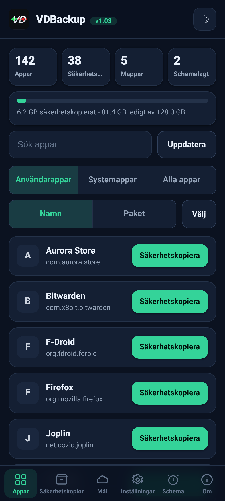
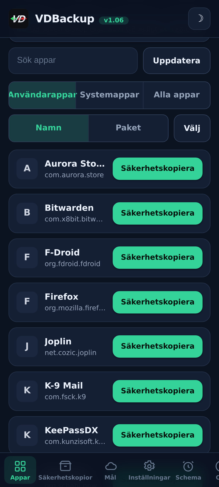
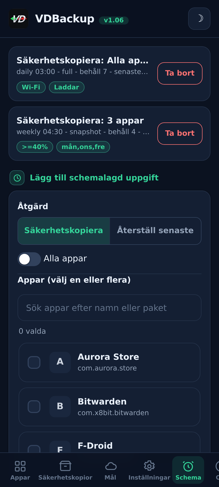
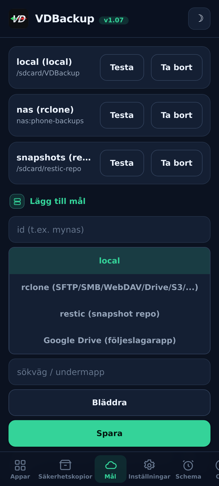
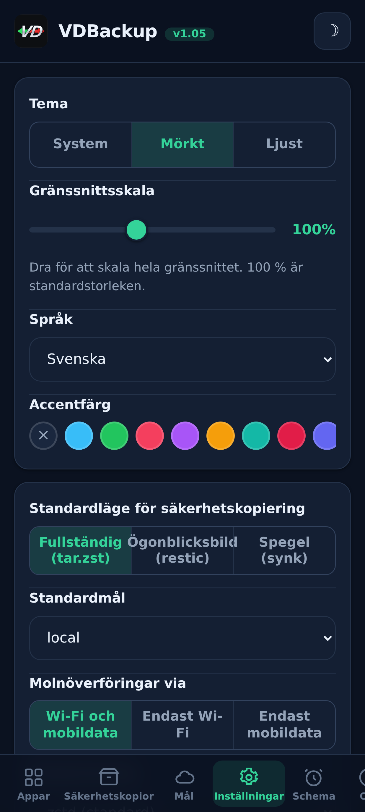
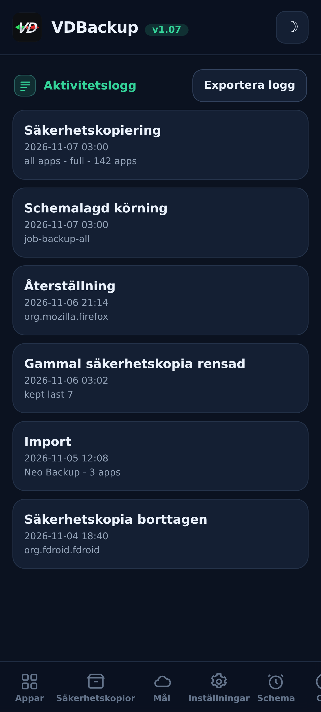

> **Languages:** [English](../USER-GUIDE.md) · [العربية](../ar/USER-GUIDE.md) · [Čeština](../cs/USER-GUIDE.md) · [Deutsch](../de/USER-GUIDE.md) · [Español](../es/USER-GUIDE.md) · [فارسی](../fa/USER-GUIDE.md) · [Français](../fr/USER-GUIDE.md) · [हिन्दी](../hi/USER-GUIDE.md) · [Bahasa Indonesia](../in/USER-GUIDE.md) · [Italiano](../it/USER-GUIDE.md) · [日本語](../ja/USER-GUIDE.md) · [한국어](../ko/USER-GUIDE.md) · [Nederlands](../nl/USER-GUIDE.md) · [Polski](../pl/USER-GUIDE.md) · [Português](../pt/USER-GUIDE.md) · [Русский](../ru/USER-GUIDE.md) · Svenska · [ไทย](../th/USER-GUIDE.md) · [Türkçe](../tr/USER-GUIDE.md) · [Tiếng Việt](../vi/USER-GUIDE.md) · [中文](../zh/USER-GUIDE.md)

---

# VDBackup användarguide

En komplett, vänlig genomgång av VDBackup, från att installera modulen till att göra
din första säkerhetskopia, återställa den, skicka den till molnet, schemalägga den och öppna
den på en PC flera år senare. Om du har använt Swift Backup, Neo-Backup eller
Android-DataBackup tidigare kommer detta att kännas bekant, bara att allt händer på ett
ställe, med inget att "tillåta".

## Innehållsförteckning

- [1. Vad VDBackup är](#1-vad-vdbackup-är)
- [2. Krav](#2-krav)
- [3. Installation och första körning](#3-installation-och-första-körning)
- [4. Rundturen i WebUI](#4-rundturen-i-webui)
- [5. Göra en säkerhetskopia](#5-göra-en-säkerhetskopia)
  - [5.1 Välja vad som ska säkerhetskopieras](#51-välja-vad-som-ska-säkerhetskopieras)
  - [5.2 Backup-lägen: Full, Snapshot, Mirror](#52-backup-lägen-full-snapshot-mirror)
  - [5.3 Komprimering](#53-komprimering)
  - [5.4 Kryptering](#54-kryptering)
  - [5.5 Verifiera och dry-run](#55-verifiera-och-dry-run)
  - [5.6 Särskilda säkerhetskopior (meddelanden, samtalslogg, Wi-Fi, Bluetooth, kalender, bakgrundsbild, DNS, systeminställningar)](#56-särskilda-säkerhetskopior-meddelanden-samtalslogg-wi-fi-bluetooth-kalender-bakgrundsbild-dns-systeminställningar)
  - [5.7 Fristående säkerhetskopior av mappar och filer](#57-fristående-säkerhetskopior-av-mappar-och-filer)
- [6. Återställa en säkerhetskopia](#6-återställa-en-säkerhetskopia)
- [7. Destinationer: lokal och fjärr](#7-destinationer-lokal-och-fjärr)
  - [7.1 Säkerhetskopiera dina inställningar](#71-säkerhetskopiera-dina-inställningar)
- [8. Schemaläggning och kvarhållning](#8-schemaläggning-och-kvarhållning)
- [9. Migrera in: importera Neo-Backup och Android-DataBackup](#9-migrera-in-importera-neo-backup-och-android-databackup)
- [10. SSAID (enhetens ANDROID_ID)](#10-ssaid-enhetens-android_id)
- [11. Portabilitet: öppna säkerhetskopior på en PC](#11-portabilitet-öppna-säkerhetskopior-på-en-pc)
- [12. Styra VDBackup från en AI-assistent](#12-styra-vdbackup-från-en-ai-assistent)
- [13. Felsökning och vanliga frågor](#13-felsökning-och-vanliga-frågor)
- [14. Avinstallera](#14-avinstallera)

---

## 1. Vad VDBackup är

VDBackup är en root-modul med ett inbyggt WebUI som säkerhetskopierar och återställer dina appar
och deras data. Det är utformat som den öppna, root-nativa efterföljaren till Swift Backup,
Neo-Backup och Android-DataBackup: det syftar till att göra unionen av vad dessa verktyg gör, på ett
enda ställe, och det kan till och med importera dina befintliga Neo-Backup- och
Android-DataBackup-säkerhetskopior så att du kan flytta över utan att förlora något.

Den avgörande skillnaden från en vanlig backup-app: VDBackup körs **helt från din
root-hanterares WebUI**, och modulen är redan root. Det finns ingen följeslagarapp att
installera för kärnfunktionerna, ingen "bevilja su"-fråga att godkänna, och inget att slå
på. Du öppnar WebUI, väljer vad som ska säkerhetskopieras, och kör det.

Allt VDBackup producerar använder **standardformat** (tar, gzip, zstd, age, zip,
restic), så dina säkerhetskopior är aldrig inlåsta i modulen och är aldrig bundna till din
specifika enhet. Se [avsnitt 11](#avsnitt-11).

## Skärmbilder

| Start | Appar | Schema |
|:---:|:---:|:---:|
|  |  |  |
| **Mål** | **Inställningar** | **Aktivitetslogg** |
|  |  |  |

## 2. Krav

- **En rootad Android-enhet** hanterad av **KernelSU**, **APatch** eller **Magisk**.
  VDBackup installeras som en modul från den hanteraren.
- Tillräckligt med fritt lagringsutrymme för dina säkerhetskopior (lokala säkerhetskopior ligger under modulens tillstånds-
  katalog; se [avsnitt 3](#avsnitt-3)).
- Inget annat. Modulen levereras med alla binärer den behöver (tar, zstd, lz4, rclone,
  rsync, ssh, restic), så **lokal backup och återställning fungerar helt offline**. Endast moln-
  destinationer kommunicerar med nätverket.

Vissa finkorniga tillägg (AppOps, SSAID, några privilegierade systembitar) förlitar sig på
Android-ramverket; modulen hanterar dessa internt, med en vanlig-skal-reserv, och de degraderar graciöst
när de inte är tillgängliga på din enhet.

## 3. Installation och första körning

1. Ladda ner den senaste `VD-Backup-vX.Y.zip`-releasen.
2. I din KernelSU / APatch / Magisk-hanterare, flasha modul-zip:en som vilken annan
   modul som helst.
3. Den är användbar omedelbart, **ingen omstart behövs**. (En omstart är endast någonsin relevant
   vid återställning av SSAID; se [avsnitt 10](#avsnitt-10).)
4. Öppna modulens **WebUI** från hanteraren. Det är hela gränssnittet.

**Vilken utgåva du laddar ner.** Varje release levereras som flera flashbara zip-utgåvor, så att du
bara laddar ner det du behöver. Välj en:

- **`VD-Backup-<ver>-universal-full.zip`**: varje CPU-arkitektur och varje binärfil inbäddad,
  inklusive `rclone` (molnleverantörer: Google Drive, S3 och 70+ andra rclone-backends) och
  `restic` (deduplicerade ögonblicksbilder). Helt offline, ingenting laddas någonsin ner.
  Fungerar på vilken enhet som helst. Största nedladdningen.
- **`VD-Backup-<ver>-universal-lite.zip`**: varje arkitektur, men **utan** de två största
  binärfilerna (`rclone` och `restic`). Minsta nedladdningen; gör fortfarande lokala,
  SSH/SFTP- och rsync-säkerhetskopior utan nedladdning, med portabel `age`-kryptering. Första
  gången du använder en molndestination (`rclone`) eller ögonblicksbildsläge (`restic`) erbjuder
  WebUI:t sig att ladda ner det lilla arkitekturspecifika tillägget en gång (verifierat med
  SHA-256) och cachar det; därefter fungerar även de funktionerna.
- **`VD-Backup-<ver>-<abi>-full.zip`** (en av `arm64-v8a`, `armeabi-v7a`, `x86`, `x86_64`), en
  enda arkitektur med varje binärfil inbäddad (samma funktioner som `universal-full` men endast
  för din enhets arkitektur, alltså mindre än `universal-full`).

Om du känner till din enhets arkitektur och vill ha allt inbäddat, välj den matchande
**`<abi>-full`** (de flesta telefoner är **`arm64-v8a`**). Om du vill ha den minsta
nedladdningen och inte har något emot en engångsnedladdning, verifierad med SHA-256, första
gången du använder molnleverantörer (`rclone`) eller ögonblicksbilder (`restic`), välj
**`universal-lite`**. Om du vill ha allt inbäddat utan några nedladdningar (offline /
återställning) och är osäker på arkitekturen, välj en **full**-utgåva. Vid installation behåller
modulen endast din enhets arkitektur oavsett vilken utgåva du flashar.

Vid första körningen sår modulen en standardkonfiguration (endast om ingen finns ännu), så att
dina inställningar bevaras över moduluppdateringar.

**Var tillståndet bor.** VDBackups arbetsdata, din konfiguration, schemalagda jobb,
sparade destinationer, krypterade inloggningsuppgifter, loggar och granskningsspår, och staging-område -
bor under:

```
/data/adb/vdbackup/
```

**Var säkerhetskopiorna bor.** Själva säkerhetskopiorna skrivs till användarsynlig, inloggnings-
krypterad lagring (så de är endast läsbara efter att du låst upp enheten, och de
överlever avinstallation av modulen), en mapp per Android-användare:

```
/sdcard/VDBackup/            (= /data/media/<user>/VDBackup)
```

Håll detta i åtanke av två skäl: säkerhetskopior tar upp utrymme under `/sdcard/VDBackup`, och
`/data/adb/vdbackup/logs/` är där du tittar om något går fel.

## 4. Rundturen i WebUI

WebUI är organiserat i några flikar:

- **Home**: en startöversikt som visar antal för dina säkerhetskopior (appar, säkerhetskopior, mappar och schemalagda jobb) och en lagringsstapel för hur mycket plats dina säkerhetskopior använder jämfört med ledigt, med statusmärken, kopiera hashar och sökvägar till urklipp, och en **Check for updates**-åtgärd.
- **Apps**: listan över installerade appar (användare och system), var och en visad med sitt verkliga
  namn, sitt paketnamn och sin ikon (ikoner laddas lat och cachas, så listan
  förblir responsiv). Knappen på en rad säkerhetskopierar appen; ett tryck på raden öppnar den
  appens backup-historik, där du kan återställa valfri tidigare säkerhetskopia.
- **Backups**: de säkerhetskopior du redan har, var och en visar appnamnet på en rad och
  paketet på nästa. Tryck på en säkerhetskopia för att se dess fullständiga detaljer (version, datum, storlek,
  inkluderade objekt, behörighetsantal, och enheten den kom från). Det är också här du
  återställer, kör en återställningstest, tar bort en säkerhetskopia, eller importerar säkerhetskopior från Neo-Backup eller
  Android-DataBackup.
- **Destinations**: hantera vart säkerhetskopior går: lokal lagring plus eventuella fjärr-
  destinationer du lägger till (se [avsnitt 7](#avsnitt-7)). Du kan
  testa en destination här innan du förlitar dig på den.
- **Settings**: en växling för ljust/mörkt tema, en accentfärgsväljare (förinställningar, en egen
  färg eller återställning), en språkväljare (gränssnittet renderas från höger till vänster för
  arabiska och persiska), ett skjutreglage för gränssnittsskala som du drar för att
  skala om hela gränssnittet (sidhuvud, innehåll och nedre navigering tillsammans) från 85 % till 120 % (100 % är standard), för skärmar med olika
  pixeltäthet, standardvärden för nya
  jobb (standardkomprimering, verify på/av, standardkryptering), nätverkspolicyn för
  molnöverföringar (se [avsnitt 7](#avsnitt-7)), automatisk säkerhetskopiering och listan över
  uteslutna appar, alternativet för installationskälla, krypterings-
  nyckeln, och schemaläggning. Av/på-inställningar använder växlingsbrytare i Android-stil.
- **About**: version, länkar, systerprojekten (See also), granskningsmanifestet för de medföljande binärfilerna, och en **Check for updates**-åtgärd som rapporterar om en nyare version har publicerats (med dess versionsanteckningar). Du installerar alla uppdateringar via din root-hanterare, på samma sätt som du flashade modulen.

Appen söker också själv efter en nyare version varje gång du öppnar den (högst en gång i timmen) och visar uppdateringsbannern bara när en finns; tyst när uppdaterad eller offline.

Bekräftelser och meddelanden använder dialoger i appen (inte de gamla systempopuperna), och en
återställning eller import ber dig bekräfta att den skriver över den aktuella appdatan innan
den fortsätter.

Säkerhetskopior och återställningar körs **frikopplat** som en bakgrunds-root-process. Du kan stänga
WebUI, eller till och med stänga root-hanteraren, och operationen fortsätter. När du kommer
tillbaka återansluter WebUI och visar live-förlopp med en lokaliserad fasetikett. För ett
pågående jobb visar förloppskortet också den live överföringshastigheten och den uppskattade
återstående tiden, plus en objekträknare (till exempel "12 av 40") med namnet på det aktuella
objektet. På
ROM:ar som ytläger skal-notiser får du också en Android-notis när ett jobb
startar och slutar; i vilket fall som helst är förloppskortet i appen den tillförlitliga indikatorn.

## 5. Göra en säkerhetskopia

Det grundläggande flödet: öppna **Apps**, välj en app, välj vad som ska inkluderas, välj ett läge,
ställ in komprimering och (valfritt) kryptering, kör sedan. Förloppet visas live och en
notis talar om när det är klart.

I säkerhetskopieringsdialogen kan du även välja **mål** för denna kopia, lokal lagring eller valfritt tillagt moln-/fjärrmål, utan att först ändra standardmålet i Inställningar.

### 5.1 Välja vad som ska säkerhetskopieras

För varje app kan du inkludera valfri kombination av dessa objekt:

| Objekt | Vad det är |
|------|-----------|
| **APK** | Själva den installerade appen (bas-APK + eventuella split-APK:er). |
| **data** | Appens privata data (`/data/data`). Detta är den vanliga "appdatan". |
| **device-protected data** | Direct-boot / enhetsskyddad lagring (`/data/user_de`). Vissa appar håller inställningar här. |
| **external** | Appens externa data under `Android/data`. |
| **OBB** | Appens OBB-expansionsfiler (`Android/obb`), använda av vissa spel. |
| **media** | Appens media under `Android/media`. |

En bra standard för "säkerhetskopiera denna app fullständigt" är att inkludera dem alla. Om du
bara vill ha datan (till exempel för att flytta en spelsparning) kan du avmarkera APK:n och de
stora OBB/media-objekten.

VDBackup bevarar också de saker som gör en återställning trogen: SELinux-kontexter,
uid/gid-ägande, fillägen, utökade attribut (xattr) och förmågor.

### 5.2 Backup-lägen: Full, Snapshot, Mirror

VDBackup erbjuder tre lägen. WebUI förväljer **Full**, vilket är det rätta valet
för de flesta.

- **Full**: en komplett, fristående, portabel säkerhetskopia skriven som `tar.zst` (eller
  din valda komprimering). Varje körning producerar en fristående säkerhetskopia som du kan kopiera
  var som helst och öppna på en PC. Bäst för: en ren, portabel ögonblicksbild av en app som du kan
  arkivera och flytta runt. Detta är standard och det mest portabla alternativet.
- **Snapshot**: inkrementell och versionerad, underbyggd av `restic`. Varje körning lägger till en ny
  tidpunktsbild till ett arkiv, lagrar endast vad som ändrats och
  av-duplicerar över ögonblicksbilder. Bäst för: att hålla en löpande historik av en app
  utan att betala full storlek vid varje körning.
- **Mirror**: en 1:1-synk av den aktiva datan till destinationen, underbyggd av
  `rclone`/`rsync`. Den håller destinationen identisk med vad som finns på enheten just
  nu (ändrade filer kopieras, borttagna filer raderas på destinationen). Bäst
  för: en snabb, alltid-aktuell kopia, till exempel till en moln-fjärrplats. Observera att APK:n
  fortfarande lagras komprimerad även i en mirror, aldrig rå.

### 5.3 Komprimering

Du kan välja komprimering för en Full-säkerhetskopia:

- **none**: ingen komprimering (snabbast, störst).
- **lz4**: mycket snabb, lätt komprimering.
- **zstd**: standarden, en stark balans mellan hastighet och förhållande. Du kan också välja en
  nivå (till exempel en högre nivå för en mindre fil).
- **gzip**: **"kompatibilitetsläget"**. gzip öppnas med inbyggda verktyg på
  praktiskt taget vilken dator som helst och i de flesta filhanterare, utan något extra att installera.
  Välj detta när du bryr dig mest om att kunna öppna arkivet var som helst.

Om du inte väljer använder VDBackup sin konfigurerade standard (zstd på en förnuftig nivå).

### 5.4 Kryptering

Kryptering är **valfri** och portabel. VDBackup krypterar med **age** med en
lösenfras (scrypt), som valdes specifikt för portabilitet: vilket standard-
`age`-verktyg som helst på vilket operativsystem som helst kan dekryptera din säkerhetskopia med bara lösenfrasen.
Kryptering är **aldrig** bunden till din enhets hårdvarunycklar, så en krypterad säkerhetskopia
återställs på en annan enhet och öppnas på en PC. (Ett kompatibelt AES-256-zip-läge är också
tillgängligt för krypterade arkiv som du vill öppna med ett dubbelklick och ett lösenord.)

För att använda kryptering, generera krypteringsnyckeln en gång (Settings), aktivera sedan
kryptering för ditt jobb och ställ in en lösenfras. Lösenfrasen är det som skyddar
säkerhetskopian, så välj en stark, det finns ingen hårdvarunyckel och ingen återställnings-bakdörr.

**APK-regeln (viktigt):**

- **APK:n lagras alltid komprimerad**, aldrig rå, för att spara utrymme.
- **APK:n krypteras inte som standard**, eftersom en apps APK är offentligt innehåll.
- APK-kryptering och datakryptering är **oberoende växlingar**. Att slå på data-
  kryptering krypterar **inte** APK:n. Om du specifikt vill ha APK:n krypterad
  också, aktivera APK-krypteringsväxlingen uttryckligen.

### 5.5 Verifiera och dry-run

Två säkerhetsalternativ hjälper dig att lita på en säkerhetskopia innan du förlitar dig på den:

- **Verify**: efter skrivning hashar VDBackup om varje arkiv och kontrollerar det mot
  manifestet. Detta är **på som standard för Full**-säkerhetskopior. Om en fil inte matchar
  misslyckas jobbet med ett tydligt fel i stället för att lämna dig med en tyst korrupt
  säkerhetskopia.
- **Dry-run**: planerar jobbet och rapporterar de storlekar det skulle producera **utan att skriva
  något**. Använd det för att uppskatta utrymme eller för att kontrollera ditt objekturval innan du kör
  det riktiga.

När en säkerhetskopia går till en **moln**-destination lägger VDBackup till två ytterligare
skyddsåtgärder. Det kör ett avslutande **checksum-verified**-steg som kontrollerar den uppladdade
kopian mot originalet på fjärren igen, och låter jobbet misslyckas (i stället för att lämna en
korrupt kopia i molnet) om de inte matchar. Och före en Full-uppladdning kontrollerar det fjärrens
**lediga utrymme** och stoppar tidigt med ett tydligt **"not enough space"**-fel om säkerhetskopian
inte skulle få plats, i stället för att fylla fjärren och misslyckas halvvägs. (Utrymmeskontrollen
gäller Full-uppladdningar; Mirror är en delta-synk och är undantaget.)

### 5.6 Särskilda säkerhetskopior (meddelanden, samtalslogg, Wi-Fi, Bluetooth, kalender, bakgrundsbild, DNS, systeminställningar)

Under applistorna på fliken **Backups** täcker **Särskilda säkerhetskopior** systemomfattande
data som inte är knutna till en enskild app. Välj kategorierna och säkerhetskopiera dem; de
arkiveras med samma bevarande av SELinux/xattr och valfria kryptering som app-säkerhetskopior.
Kategorierna är:

| Kategori | Vad det är |
|----------|-----------|
| **Meddelanden (SMS/MMS)** | Dina textmeddelanden. |
| **Kontakter och samtalslogg** | Dina kontakter och samtalshistorik. |
| **Wi-Fi-nätverk** | Dina sparade Wi-Fi-nätverk. |
| **Bluetooth** | Dina Bluetooth-parkopplingar. |
| **Kalender** | Kalender-providern (app och data). En **portabel `calendar.json`** skrivs också, så att dina händelser är läsbara på en PC utan modulen. |
| **Bakgrundsbild** | Din hem- och låsskärmsbakgrund plus `wallpaper_info.xml`, lagrad som den råa bilden. |
| **DNS** | Ditt privata DNS-läge och din server. |
| **Systeminställningar** | En fullständig dump av enhetens system-, global- och secure-inställningar. |

För meddelanden, samtalslogg och kontakter skrivs även en **portabel kopia** (öppningsbar JSON),
så att du har en kopia mellan enheter som du kan läsa på en PC utan modulen.

**Systeminställningar är opt-in och skriver över dina enhetsinställningar vid återställning.**
Precis som SSAID (se [avsnitt 10](#avsnitt-10)) är kategorin **Systeminställningar** den
känsligaste: att återställa den skriver över dina enhetsomfattande inställningar, så den är av om du
inte avsiktligt väljer den, ber dig bekräfta först, och skrivs till aktivitetsloggen.

Att återställa en särskild säkerhetskopia skriver över live-systemdata och kräver en omstart, så
den skyddas av en framträdande bekräftelse och är tillförlitlig på samma enhet och ROM.
Återställningar är **idempotenta**: de råa kategorierna (meddelanden, kontakter, Wi-Fi, Bluetooth,
kalender) återställs genom att **ersätta** datan i stället för att slå samman den, så att återställa
samma säkerhetskopia två gånger skapar aldrig dubbletter, och DNS och systeminställningar
återappliceras helt enkelt.

### 5.7 Fristående säkerhetskopior av mappar och filer

Ibland vill du säkerhetskopiera en vanlig mapp eller fil som inte är en app, en kameramapp, en
dokumentkatalog, en enskild databas. VDBackup kan säkerhetskopiera **valfri absolut sökväg** på
delad lagring eller under `/data`, med samma portabla format som en app-säkerhetskopia: ett
`tar.zst`-arkiv plus en `manifest.json`, SHA-256-förseglad, med en RECOVERY-notis när du krypterar
den. Dessa sökvägs-säkerhetskopior hålls separat, under en `.paths`-mapp i din backup-katalog.

- **Välj en sökväg och säkerhetskopiera den.** Källan måste vara en absolut sökväg under en av de
  tillåtna platserna (`/storage/emulated`, `/data/media`, `/sdcard`, `/data`). Sökvägar som försöker
  ta sig ut med `..` avvisas.
- **Återställning skriver tillbaka till den ursprungliga platsen**, så, som vilken återställning som
  helst, är den destruktiv och ber dig **bekräfta** innan den skriver över något.
- Liksom app-säkerhetskopior körs sökvägs-säkerhetskopior och -återställningar **frikopplat** med
  live-förlopp, använder din valda komprimering, och kan krypteras med en lösenfras.

## 6. Återställa en säkerhetskopia

Öppna **Backups**-fliken, välj den säkerhetskopia du vill ha, och starta återställningen. Eftersom
återställning är en destruktiv åtgärd ber VDBackup dig **bekräfta** först, och det
registrerar åtgärden i en lokal granskningslogg.

En återställning är **trogen**: VDBackup raderar appens aktuella tillstånd och extraherar
säkerhetskopian, så att appen återförs till det **exakta tillstånd** som fångats i den säkerhetskopian
(inklusive ägande, lägen, SELinux-kontexter och xattr). Det är inte en sammanslagning, det är en
sann återställning till säkerhetskopians tidpunkt. Eftersom en återställning körs som root
kontrollerar VDBackup också varje arkiv innan det extraherar något och vägrar ett manipulerat arkiv
som försöker skriva utanför sitt mål, så att en modifierad säkerhetskopia aldrig kan skriva över
resten av ditt system.

Användbara återställningsalternativ:

- **Restore-test**: extraherar säkerhetskopian till ett tillfälligt staging-område och verifierar det
  **utan att röra den aktiva appen**. Detta är det säkra sättet att bekräfta att en säkerhetskopia är
  intakt och återställningsbar innan du skriver över något. Om testet misslyckas får du ett
  tydligt fel och din installerade app lämnas orörd.
- **Partiell återställning**: återställ endast några av objekten som säkerhetskopierades. Till
  exempel, återställ bara appdatan utan att återinstallera APK:n, eller återställ
  sparfilerna utan den stora OBB/media. Välj de objekt du vill ha på återställnings-
  skärmen.
- För **Snapshot**- och **Mirror**-säkerhetskopior hämtar återställningen från det versionerade
  arkivet respektive den speglade kopian.
- **Installationskälla**: som standard anger en återställd app **Play Store** som sin
  installationskälla (i stället för att se sidladdad ut), vilket är vad de flesta appar och
  app-kontroller förväntar sig. Du kan stänga av detta globalt i Settings eller per återställning,
  och när det är av behålls den ursprungliga installationskällan. En avancerad växling som är tillval,
  **"förfalska den initierande källan"**, går längre och får även appens initierande paket och
  paketkälla att se Play-installerade ut; den redigerar systemets paketdatabas (säkerhetskopieras
  först) och träder i kraft efter en omstart.

**Batchåterställning.** Fliken **Backups** har ett **Select**-läge, på samma sätt som Apps-fliken har
det för batchsäkerhetskopiering. Slå på **Select**, kryssa för de säkerhetskopior du vill ha med deras
kryssrutor och återställ dem alla på en gång. En enda alternativdialog täcker hela urvalet -
bekräftelsen av överskrivning, återställningstestet och valet av installationskälla gäller för varje
säkerhetskopia du valt, och de återställs efter varandra.

**Radera en säkerhetskopia.** Öppna en säkerhetskopias detaljer (eller en apps historik) och använd
**Delete**; du ombeds bekräfta, och raderingen skrivs till aktivitetsloggen. Du kan också sätta ett
tak för hur många säkerhetskopior som ska behållas per app (kvarhållning) så att gamla gallras
automatiskt.

**Montera en installerad app som en systemapp.** Från en apps säkerhetskopiehistorik förbereder
**Mount as system** appens APK i en VDBackup-overlay-undermodul så att root-hanteraren serverar den
från `/system/app` (eller `/system/priv-app`), den riktiga `/system`-partitionen rörs aldrig. Med
**NoMount** på KernelSU tillämpas det live; annars tillämpas det efter en omstart. Detta beror aldrig
på att NoMount är installerat.

## 7. Destinationer: lokal och fjärr

Som standard skrivs säkerhetskopior till **lokal** lagring under modulens tillstånds-
katalog. Du kan också lägga till fjärrdestinationer i **Destinations**-fliken. För en lokal
destination öppnar **Browse** en mappväljare så att du kan välja en undermapp i den delade
lagringen (`/sdcard`) i stället för att skriva in sökvägen.

Fjärrtransport hanteras av de medföljande verktygen:

- **rclone**: navet för ett enormt urval av fjärrplatser: **SFTP, SMB, WebDAV, FTP, S3,
  Google Drive** och 70+ fler tjänster.
- **rsync** och **ssh/scp/sftp**-sviten, för deltasynk och vanliga SSH-mål.
- **restic**: krypterade, av-duplicerade **Snapshot**-arkiv (lokala eller fjärr).

**Skapa en moln-fjärrplats (ingen SSH behövs).** I Destinations-fliken, välj
**rclone**-destinationstypen och använd **Add cloud remote**. Du kan ansluta **vilken
rclone-backend som helst**: rullgardinsmenyn erbjuder de populära (**Google Drive, Dropbox,
OneDrive, Box, pCloud, Mega, Backblaze B2, S3, SFTP, WebDAV, FTP, SMB**) plus ett **Custom
(advanced)**-alternativ där du skriver in vilken annan backend-typ som helst och dess
`key=value`-parametrar. Fyll i fälten (host/user/password, eller S3-nycklarna, till exempel) och
spara. För leverantörer som loggar in dig med en webbläsare (Google Drive, Dropbox, OneDrive, Box,
pCloud), använd knappen **Authorize in browser**: den loggar in dig via telefonens egen
webbläsare och fångar token automatiskt, så **ingen PC behövs** (att klistra in ett token för
hand fungerar fortfarande som reservlösning). Fjärrplatsen visas sedan i destinationens
fjärrplatslista. Lösenord lagras dolda, aldrig i klartext. Du kan lista och ta bort dina
fjärrplatser från samma ställe.

Två regler håller fjärranvändning säker:

- **Inloggningsuppgifter lagras krypterade** i vila i modulens tillståndskatalog, aldrig
  i klartext.
- **Validera innan du använder.** Använd destinationstestet i Destinations-fliken för att
  bekräfta att en destination fungerar innan du riktar en riktig säkerhetskopia mot den.

**Nätverkspolicy (Wi-Fi vs mobildata).** I Settings låter "Cloud transfers over" dig
begränsa vilken anslutning molnöverföringar får använda: **Wi-Fi and mobile data** (
standarden), **Wi-Fi only** eller **Mobile data only**. När du begränsar det kontrollerar varje moln-
överföring, manuell eller schemalagd, uppladdning eller återställning, den aktiva anslutningen först
och vägrar köra på fel, så att en Wi-Fi-only-policy aldrig spenderar mobildata.
Lokala säkerhetskopior påverkas aldrig.

**Google Drive.** Du har två sätt att nå Google Drive:

1. **Via rclone**: lägg till Drive som en rclone-fjärrplats som vilken annan destination som helst, utan
   extra app och **inget Google Cloud-konto**. På vilken dator som helst, kör
   `rclone authorize "drive"` en gång, logga in på ditt Google-konto i webbläsaren, och
   klistra in token den skriver ut i Drive-fjärrplatsens token-fält.
2. **Via den valfria följeslagaren**: en liten, opt-in följeslagarapp som hanterar
   Google-inloggningen och Drive-uppladdningen. Den installeras **endast när du uttryckligen väljer
   Google Drive-följeslagardestinationen**, aldrig som standard, och den tas bort när
   du inaktiverar den. Den engångs Google-samtyckesskärmen är det enda steget som händer
   utanför WebUI. När följeslagaren är installerad påminner VDBackup dig om att
   **alltid dölja den med [HMA-OSS](https://github.com/frknkrc44/HMA-OSS)** så att dess närvaro inte avslöjar root eller
   en upplåst bootloader, och den erbjuder att lägga till den i [HMA-OSS](https://github.com/frknkrc44/HMA-OSS)-listan åt dig. VDBackup påminner dig också, när du har lokala säkerhetskopior, om att dölja säkerhetskopiemappen (/sdcard/VDBackup) med SUSFS av samma skäl.

### 7.1 Säkerhetskopiera dina inställningar

Din egen VDBackup-konfiguration, destinationerna, schemana, förinställningarna och sparade inloggningsuppgifter, kan skrivas till en enda fil och tas med till en annan enhet eller återställas efter en ren installation. Under **Inställningar**, i **Säkerhetskopia av inställningar**:

- **Exportera inställningar** skriver en krypterad fil till `VDBackup/.export`. Den ber alltid om en lösenordsfras, eftersom filen innehåller dina fjärrlösenord.
- **Importera inställningar** läser tillbaka en sådan fil och slår samman den med den här enheten, utan att ta bort något som redan finns.
- **Radera sparade inloggningsuppgifter** tar bort de sparade fjärrlösenorden och enhetens krypteringsnyckel i ett steg; dina destinationer, scheman och säkerhetskopior blir kvar.

## 8. Schemaläggning och kvarhållning

VDBackup kan köra säkerhetskopior, och återställningar, automatiskt enligt ett schema. I
schemaläggaren definierar du ett jobb med:

- ett **mål**: en enda app, en uppsättning appar, eller **alla appar** (minus listan över uteslutna
  appar), och objekten/läget att använda,
- en **åtgärd**: **Back up** (standard) eller **Restore latest**, som återställer varje målapps
  senaste säkerhetskopia,
- en destination,
- ett **cron-liknande schema**: varje timme, dagligen eller veckovis, vid en tid du väljer (HH:MM),
- en **kvarhållnings**-inställning: **behåll N** senaste säkerhetskopior för det jobbet, äldre
  rensas automatiskt,
- valfria **körvillkor**: endast på **Wi-Fi**, endast under **laddning**, endast vid eller över en
  **lägsta batterinivå**, och endast på valda **veckodagar**.

Schemalagda jobb utlöses av ett boot-tids-hjärtslag i modulen: när ett jobb är
förfallet körs det, registrerar sin senaste körtid så att det inte avfyras två gånger, och tillämpar
kvarhållning för att rensa gamla säkerhetskopior. Eftersom allt körs som root i bakgrunden
behöver schemalagda säkerhetskopior inte att WebUI är öppet.

**Körvillkor (grindar).** Ett schemalagt jobb kan bära villkor som måste vara uppfyllda för att det
ska köras: endast Wi-Fi, endast laddning, en lägsta batterinivå och specifika veckodagar. När ett
jobb är förfallet men ett villkor inte är uppfyllt **hoppas det över och försöks igen vid nästa
kontroll**: dess schema flyttas inte fram, så det körs så snart villkoret är uppfyllt. En inbyggd
termisk säkerhetskontroll hoppar också över ett schemalagt jobb medan enheten är för varm. Varje
sådan överhoppning registreras i aktivitetsloggen.

**Schemalagd återställning skriver över vid varje körning.** Ett **Restore latest**-jobb återställer
varje målapps senaste säkerhetskopia på nytt varje gång det avfyras, och återställning är destruktiv:
vid varje körning **skriver den över appens nuvarande data** med den senaste säkerhetskopian. Detta är
avsiktligt och ett tillval, välj det bara när du vill hålla målen vid deras senaste säkerhetskopia.

**Auto-säkerhetskopiering vid installation/uppdatering.** I Settings kan du slå på **automatisk
säkerhetskopiering**: samma bakgrundshjärtslag märker appar som nyligen installerats eller
uppdaterats och säkerhetskopierar dem åt dig (med keep-N-kvarhållning). Den första körningen
registrerar bara vad som är installerat, så att slå på det säkerhetskopierar aldrig hela din enhet på
en gång.

**Uteslutna appar (blocklist).** Även i Settings kan du utesluta appar som du aldrig vill
säkerhetskopiera automatiskt eller enligt schema; du kan lägga till flera samtidigt (flerval), och
uteslutna appar hoppas över av båda.

**Säkerhetskopieförval.** Även i Inställningar kan du spara namngivna förval, uppsättningar av poster att inkludera, som bara APK eller APK + OBB, och välja ett i säkerhetskopieringsdialogen för att fylla valen på en gång.

**Säkerhetskopieposter per app.** Även i Inställningar kan du välja exakt vilka poster varje app säkerhetskopierar i bulk-, automatiska och schemalagda säkerhetskopior, till exempel bara APK, eller APK + OBB. En enskild manuell säkerhetskopia låter dig fortfarande välja då, med appens uppsättning som utgångspunkt. Appar du inte ställer in här säkerhetskopierar allt.

**App-taggar.** Tryck på en app i Inställningar (Objekt och taggar per app) för att ge den fria etiketter, till exempel games eller work. Ovanför applistan visas då en taggväljare: välj en tagg för att visa bara dess appar och säkerhetskopiera hela gruppen på en gång. Du kan också nå det från fliken Appar: tryck på en app och sedan på Objekt och taggar.

**Aktivitetslogg.** Fliken Schedule har en knapp **View activity log** som öppnar en helskärm (direkt)
och visar den lokala revisionsloggen, säkerhetskopior, återställningar, raderingar, schemalagda och
automatiska körningar, och gallringar, nyast först. En åtgärd **Export logs** sparar en loggfil (under
säkerhetskopieringsmappen) som du kan bifoga en feedback- eller felrapport.

## 9. Migrera in: importera Neo-Backup och Android-DataBackup

Om du kommer från Neo-Backup eller Android-DataBackup behöver du inte börja
om. Från **Backups**-fliken kan du **importera** dina befintliga säkerhetskopior:

1. Rikta VDBackup mot din befintliga Neo-Backup- eller Android-DataBackup-backup-plats
   (import-scan listar vad den hittar där).
2. Välj vilka säkerhetskopior som ska importeras.
3. Starta importen. Som andra långa operationer körs den frikopplat med live-förlopp.

**Lösenordskrypterade Neo-Backup-säkerhetskopior stöds.** Neo-Backups AES-256-
krypterade säkerhetskopior kan importeras, du **ombeds om lösenordet** när det
behövs, och lösenordet används endast för att dekryptera, lagras aldrig i kommandoraden.

## 10. SSAID (enhetens ANDROID_ID)

SSAID är det per-app `ANDROID_ID`, en identifierare på enhetsnivå som vissa appar läser.
VDBackup kan säkerhetskopiera och återställa det, men detta är det känsligaste det
rör, så det hanteras med extra omsorg:

- **Det är VALFRITT och AV som standard.** VDBackup kommer **aldrig** att fånga eller återställa
  SSAID om du inte slår på det uttryckligen för det jobbet. WebUI visar en tydligt
  markerad, framhävd "Optional"-notis överallt där SSAID visas (backup, restore och
  import), och det förblir av tills du väljer in.
- **Det tillämpas endast efter en omstart vid återställning.** Android-inställningsleverantören cachar
  dessa värden, så en återställd SSAID träder i kraft först efter att du startar om enheten.
- **Det tidigare värdet säkerhetskopieras alltid först.** Innan någon SSAID skrivs över
  kopierar VDBackup den aktiva `settings_ssaid.xml` byte-för-byte till en tidsstämplad säkerhetskopia
  (som aldrig raderas automatiskt). Om den säkerhetskopian inte kan göras sker överskrivningen
  inte. För att rulla tillbaka, återställ den sparade filen och starta om.

**Rekommendation:** lämna SSAID av om du inte specifikt vet att du behöver det (till
exempel en viss app som knyter sig till enhets-ID:t och som du migrerar
avsiktligt). För vanliga app- och datasäkerhetskopior behöver du det inte.

## 11. Portabilitet: öppna säkerhetskopior på en PC

Dina säkerhetskopior är **inte inlåsta i den här modulen** och är **aldrig hårdvarubundna**.
Allt använder standardformat, så du kan öppna en säkerhetskopia på Windows, macOS eller Linux
utan VDBackup installerat.

En Full-backup-mapp innehåller en `manifest.json` (sanningskällan som beskriver varje
fil, appversionen och den ursprungliga ägaren/kontexten), APK:erna som `*.apk.zst`, och
dataarkiven som `<item>.tar.zst` (eller `.tar.gz` / `.tar.lz4`), valfritt med ett
avslutande `.age` när krypterat.

För att öppna en på en PC, i korthet:

- **Dekryptera** (endast om filen slutar på `.age`) med standard-`age`-verktyget och din
  lösenfras eller nyckelfil.
- **Dekomprimera och extrahera**: `.tar.zst` med `zstd` sedan `tar`; `.tar.gz` med `tar`
  direkt; `.tar.lz4` via `zstd --format=lz4`. En APK är bara en zstd-komprimerad APK,
  så att dekomprimera `base.apk.zst` ger dig en normal installerbar `base.apk`.

Varje krypterad säkerhetskopia levereras med en **RECOVERY**-notis som innehåller de exakta
klistra-in-kommandona för Windows, macOS och Linux. Se
[`../module/etc/RECOVERY.md`](RECOVERY.md) för det fullständiga, steg-för-steg-kitet.

Observera att SELinux-kontexter, uid/gid och lägen lagras inuti tar:en och återtillämpas
endast korrekt när du återställer på Android, på en PC får du fortfarande alla dina filer,
bara utan att det Android-specifika ägandet upprätthålls.

## 12. Styra VDBackup från en AI-assistent

VDBackup är byggt för att vara vänligt mot AI-assistenter och agenter, inte bara människor. WebUI
är endast en klient till ett litet JSON-API; en agent kan administrera **varje** åtgärd
i modulen utan gränssnitt genom samma API (varje kommando returnerar ett enda JSON-
objekt, långa operationer körs frikopplat och du pollar deras förlopp, och samma säkerhets-
räcken gäller, SSAID förblir opt-in, muterande åtgärder förblir bekräftade och granskade).

Om du vill att en assistent ska köra dina säkerhetskopior och återställningar åt dig, rikta den mot
[`AI-AGENTS.md`](AI-AGENTS.md), som dokumenterar hela kontrollytan: kommando-
kontraktet, varje verb med dess argument och returvärde, och säkerhetsreglerna en
agent måste respektera.

## 13. Felsökning och vanliga frågor

**Var är loggarna?** Under modulens tillståndskatalog,
`/data/adb/vdbackup/logs/`. Live-förlopp för en körande operation finns i
`progress-<opid>.json`, och **granskningsspåret** över muterande åtgärder (restore, delete,
import, SSAID-ändringar) finns i `audit.jsonl`.

**En backup/restore verkar fast eller jag stängde WebUI.** Operationer körs frikopplat, så
att stänga WebUI stoppar dem inte. Öppna WebUI igen och det återansluter till valfri
körande operation och visar aktuellt förlopp.

**Jag fick ett `ERR_...`-meddelande.** Fel rapporteras med en tydlig kod. Några vanliga:
- `ERR_VERIFY`, ett skrivet arkiv matchade inte sin manifest-hash (verifieringen
  fångade en dålig säkerhetskopia). Kör säkerhetskopian igen.
- `ERR_RESTORE_TEST`, ett restore-test misslyckades; säkerhetskopian extraherade/verifierade inte
  rent och din aktiva app lämnades orörd.
- `ERR_UNSAFE_ARCHIVE`, ett arkiv avvisades för att det försökte skriva utanför sin målkatalog
  (absoluta sökvägar eller `..`). Detta skyddar dig från en manipulerad säkerhetskopia; ingenting
  skrevs.
- `ERR_QUOTA`, en moln-fjärr hade inte tillräckligt med ledigt utrymme för en Full-uppladdning;
  säkerhetskopian stoppades innan något laddades upp.

**Min fjärrdestination misslyckas.** Använd destinations-**testet** i Destinations-fliken
för att validera inloggningsuppgifter och anslutning. Kom ihåg att endast molndestinationer behöver
nätverket; lokal backup/restore är helt offline.

**Ringer något av detta hem eller laddar ner vid körtid?** Nej. Alla binärer är medföljande
i modulen vid build-tid; inget hämtas till enheten vid körtid. Endast moln-
destinationer (rclone/restic/ssh) kommunicerar med nätverket, och endast när du använder dem.

**Kommer min säkerhetskopia att återställas på en annan telefon?** Ja, säkerhetskopior är portabla och inte
bundna till enhetshårdvara. (SSAID är det enda enhetsspecifika undantaget, och det är opt-in
och omstarts-tillämpat; se [avsnitt 10](#avsnitt-10).)

**Min krypterade säkerhetskopia öppnas inte, jag tappade lösenfrasen.** Det finns ingen återställnings-
bakdörr avsiktligt; lösenfrasen är det som skyddar säkerhetskopian. Håll den säker.

## 14. Avinstallera

Avinstallera VDBackup som vilken annan modul som helst från din KernelSU- / APatch- / Magisk-hanterare. Avinstallationen **bevarar din uppsättning** och tar bara bort tillfälligt tillstånd, så en senare ominstallation återupptar din konfiguration, dina destinationer och scheman. Den behåller dina säkerhetskopior under `/sdcard/VDBackup` (standardformat, öppningsbara på en PC utan modulen), din konfiguration under `/data/adb/vdbackup`, och dina sparade inloggningsuppgifter, rclone.conf och age-nyckeln under autentiseringskrypterad `/data/misc_ce/0/vdbackup` (låst till den första upplåsningen). För att ta bort något av dessa också, radera den katalogen manuellt efter avinstallationen.

<!-- doc-footer -->

---

> _Denna dokumentation genererades med Claude (Anthropic) och underhålls av VD171. Rättelser och förbättringar välkomnas; se [CONTRIBUTING.md](CONTRIBUTING.md)._
