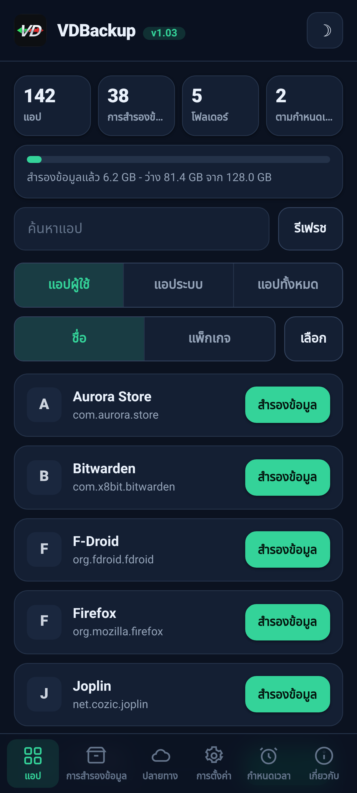
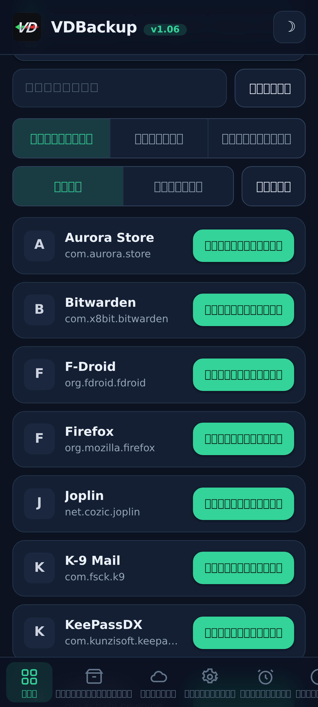
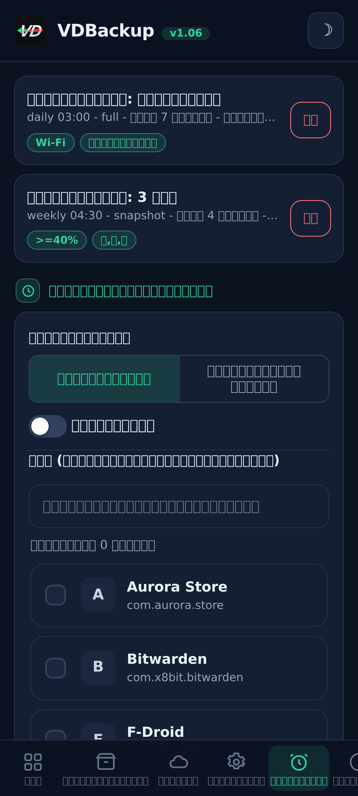
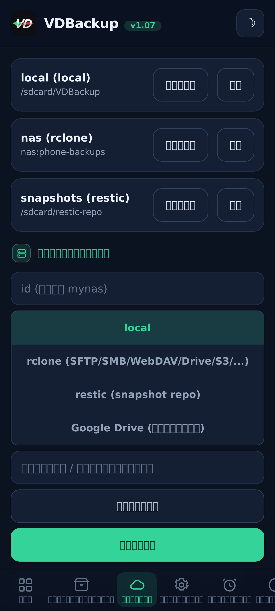
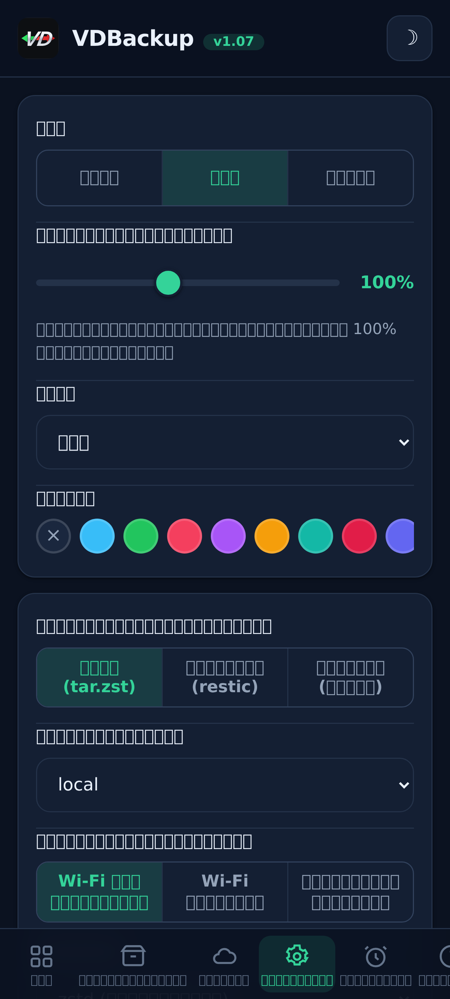
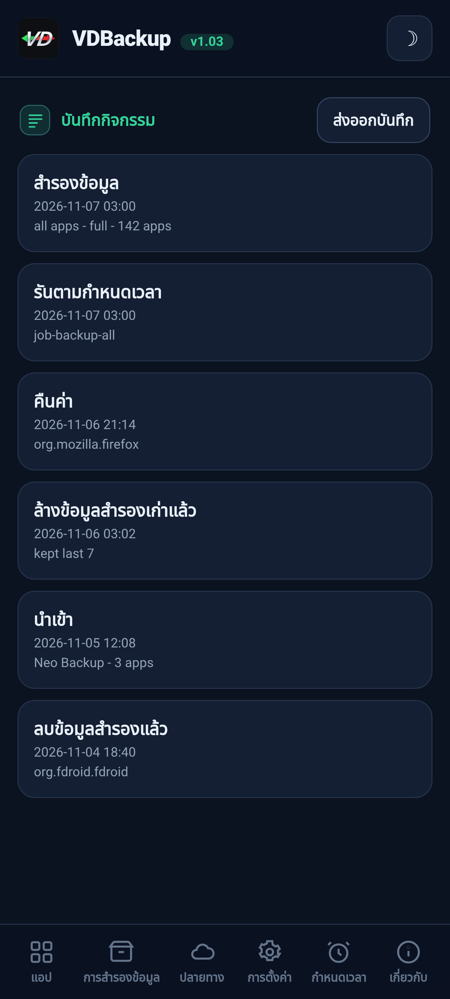

> **Languages:** [English](../USER-GUIDE.md) · [العربية](../ar/USER-GUIDE.md) · [Čeština](../cs/USER-GUIDE.md) · [Deutsch](../de/USER-GUIDE.md) · [Español](../es/USER-GUIDE.md) · [فارسی](../fa/USER-GUIDE.md) · [Français](../fr/USER-GUIDE.md) · [हिन्दी](../hi/USER-GUIDE.md) · [Bahasa Indonesia](../in/USER-GUIDE.md) · [Italiano](../it/USER-GUIDE.md) · [日本語](../ja/USER-GUIDE.md) · [한국어](../ko/USER-GUIDE.md) · [Nederlands](../nl/USER-GUIDE.md) · [Polski](../pl/USER-GUIDE.md) · [Português](../pt/USER-GUIDE.md) · [Русский](../ru/USER-GUIDE.md) · [Svenska](../sv/USER-GUIDE.md) · ไทย · [Türkçe](../tr/USER-GUIDE.md) · [Tiếng Việt](../vi/USER-GUIDE.md) · [中文](../zh/USER-GUIDE.md)

---

# คู่มือผู้ใช้ VDBackup

คำแนะนำครบถ้วนและเป็นมิตรเกี่ยวกับ VDBackup ตั้งแต่การติดตั้งโมดูลไปจนถึงการทำ backup ครั้งแรก
การกู้คืน การส่งขึ้นคลาวด์ การตั้งเวลา และการเปิดมันบน PC ในอีกหลายปีข้างหน้า หากคุณเคยใช้
Swift Backup, Neo-Backup หรือ Android-DataBackup มาก่อน สิ่งนี้จะให้ความรู้สึกคุ้นเคย -
เพียงแต่ทุกอย่างเกิดขึ้นในที่เดียว โดยไม่มีอะไรต้อง "อนุญาต"

## สารบัญ

- [1. VDBackup คืออะไร](#1-vdbackup-คออะไร)
- [2. ความต้องการของระบบ](#2-ความตองการของระบบ)
- [3. การติดตั้งและการรันครั้งแรก](#3-การตดตงและการรนครงแรก)
- [4. ทัวร์ WebUI](#4-ทวร-webui)
- [5. การทำ backup](#5-การทำ-backup)
  - [5.1 การเลือกสิ่งที่จะ backup](#51-การเลอกสงทจะ-backup)
  - [5.2 โหมด backup: Full, Snapshot, Mirror](#52-โหมด-backup-full-snapshot-mirror)
  - [5.3 การบีบอัด](#53-การบบอด)
  - [5.4 การเข้ารหัส](#54-การเขารหส)
  - [5.5 Verify และ dry-run](#55-verify-และ-dry-run)
  - [5.6 การสำรองพิเศษ (ข้อความ, บันทึกการโทร, Wi-Fi, Bluetooth, ปฏิทิน, วอลเปเปอร์, DNS, การตั้งค่าระบบ)](#56-การสำรองพเศษ-ขอความ-บนทกการโทร-wi-fi-bluetooth-ปฏทน-วอลเปเปอร-dns-การตงคาระบบ)
  - [5.7 การสำรองโฟลเดอร์และไฟล์แบบ standalone](#57-การสำรองโฟลเดอรและไฟลแบบ-standalone)
- [6. การกู้คืน backup](#6-การกคน-backup)
- [7. ปลายทาง: ในเครื่องและระยะไกล](#7-ปลายทาง-ในเครองและระยะไกล)
  - [7.1 สำรองการตั้งค่าของคุณ](#71-สำรองการตงคาของคณ)
- [8. การตั้งเวลาและการเก็บรักษา](#8-การตงเวลาและการเกบรกษา)
- [9. การย้ายเข้า: การ import Neo-Backup และ Android-DataBackup](#9-การยายเขา-การ-import-neo-backup-และ-android-databackup)
- [10. SSAID (ANDROID_ID ของอุปกรณ์)](#10-ssaid-android_id-ของอปกรณ)
- [11. ความสามารถในการพกพา: การเปิด backup บน PC](#11-ความสามารถในการพกพา-การเปด-backup-บน-pc)
- [12. การควบคุม VDBackup จากผู้ช่วย AI](#12-การควบคม-vdbackup-จากผชวย-ai)
- [13. การแก้ปัญหาและคำถามที่พบบ่อย](#13-การแกปญหาและคำถามทพบบอย)
- [14. การถอนการติดตั้ง](#14-การถอนการตดตง)

---

## 1. VDBackup คืออะไร

VDBackup เป็นโมดูล root ที่มี WebUI ในตัว ซึ่งทำ backup และกู้คืนแอปของคุณและข้อมูลของแอปเหล่านั้น
มันถูกออกแบบมาเป็นผู้สืบทอดแบบเปิดและ root-native ของ Swift Backup, Neo-Backup และ
Android-DataBackup โดยมุ่งทำสิ่งที่เป็นการรวม (union) ของสิ่งที่เครื่องมือเหล่านั้นทำ ในที่เดียว
และยังสามารถ import backup ที่มีอยู่ของ Neo-Backup และ Android-DataBackup ได้ด้วย เพื่อให้คุณ
ย้ายมาได้โดยไม่สูญเสียอะไรเลย

ความแตกต่างสำคัญจากแอป backup ทั่วไป: VDBackup รัน **ทั้งหมดจาก WebUI ของตัวจัดการ root ของคุณ**
และตัวโมดูลเป็น root อยู่แล้ว ไม่มีแอปคู่หูที่ต้องติดตั้งสำหรับฟีเจอร์หลัก ไม่มีป็อปอัป "ให้สิทธิ์ su"
ที่ต้องอนุมัติ และไม่มีอะไรต้องเปิดใช้งาน คุณเปิด WebUI เลือกสิ่งที่จะ backup แล้วรันมัน

ทุกสิ่งที่ VDBackup สร้างขึ้นใช้ **รูปแบบมาตรฐาน** (tar, gzip, zstd, age, zip, restic) ดังนั้น
backup ของคุณจึงไม่เคยถูกล็อกไว้กับโมดูลและไม่เคยผูกติดกับอุปกรณ์เฉพาะของคุณ ดู
[ส่วนที่ 11](#สวนท-11)

## ภาพหน้าจอ

| หน้าแรก | แอป | กำหนดเวลา |
|:---:|:---:|:---:|
|  |  |  |
| **ปลายทาง** | **การตั้งค่า** | **บันทึกกิจกรรม** |
|  |  |  |

## 2. ความต้องการของระบบ

- **อุปกรณ์ Android ที่ root แล้ว** ที่จัดการด้วย **KernelSU**, **APatch** หรือ **Magisk**
  VDBackup ถูกติดตั้งเป็นโมดูลจากตัวจัดการนั้น
- พื้นที่จัดเก็บว่างพอสำหรับ backup ของคุณ (backup ในเครื่องอยู่ใต้ไดเรกทอรีสถานะของโมดูล;
  ดู [ส่วนที่ 3](#สวนท-3))
- ไม่มีอะไรอื่นอีก โมดูลรวมไบนารีทั้งหมดที่ต้องการมาให้ (tar, zstd, lz4, rclone, rsync, ssh,
  restic) ดังนั้น **การ backup และกู้คืนในเครื่องทำงานได้เต็มที่แบบออฟไลน์** มีเพียงปลายทางคลาวด์
  เท่านั้นที่คุยกับเครือข่าย

ส่วนเสริมที่ละเอียดบางอย่าง (AppOps, SSAID, บิตระบบที่มีสิทธิ์พิเศษบางส่วน) พึ่งพา Android
framework; โมดูลจัดการสิ่งเหล่านี้ภายในตัวเอง พร้อม fallback แบบ shell ล้วน และมันจะลดระดับลงอย่าง
นุ่มนวลเมื่อไม่มีให้ใช้บนอุปกรณ์ของคุณ

## 3. การติดตั้งและการรันครั้งแรก

1. ดาวน์โหลด release `VD-Backup-vX.Y.zip` ล่าสุด
2. ในตัวจัดการ KernelSU / APatch / Magisk ของคุณ ให้ flash zip ของโมดูลเหมือนโมดูลอื่น ๆ
3. ใช้งานได้ทันที, **ไม่ต้องรีบูต** (การรีบูตจะเกี่ยวข้องเฉพาะเมื่อกู้คืน SSAID เท่านั้น;
   ดู [ส่วนที่ 10](#สวนท-10))
4. เปิด **WebUI** ของโมดูลจากตัวจัดการ นั่นคืออินเทอร์เฟซทั้งหมด

**จะดาวน์โหลดรุ่นย่อยไหน** แต่ละ release มาในรูปแบบ zip ที่ flash ได้หลายรุ่นย่อย คุณจึงดาวน์โหลดเฉพาะสิ่งที่
ต้องการ เลือกหนึ่งอย่าง:

- **`VD-Backup-<ver>-universal-full.zip`**: สถาปัตยกรรม CPU ทุกแบบและไบนารีทุกตัวแบบฝังมาในตัว รวมถึง
  `rclone` (ผู้ให้บริการคลาวด์: Google Drive, S3 และ rclone backend อื่น ๆ อีก 70+) และ `restic`
  (snapshot แบบ dedup) ทำงานออฟไลน์เต็มรูปแบบ ไม่มีการดาวน์โหลดใด ๆ ใช้ได้กับอุปกรณ์ใด ๆ ดาวน์โหลดใหญ่ที่สุด
- **`VD-Backup-<ver>-universal-lite.zip`**: สถาปัตยกรรมทุกแบบ แต่ **ไม่มี** ไบนารีสองตัวที่ใหญ่ที่สุด
  (`rclone` และ `restic`) ดาวน์โหลดเล็กที่สุด ยังทำ backup ในเครื่อง, SSH/SFTP และ rsync ได้โดยไม่ต้องดาวน์โหลด
  พร้อมการเข้ารหัส `age` แบบพกพา ครั้งแรกที่คุณใช้ปลายทางคลาวด์ (`rclone`) หรือโหมด snapshot (`restic`)
  WebUI จะเสนอให้ดาวน์โหลดส่วนเสริมเฉพาะสถาปัตยกรรมขนาดเล็กนั้นหนึ่งครั้ง (ตรวจสอบด้วย SHA-256) และแคชไว้
  จากนั้นฟีเจอร์เหล่านั้นก็ใช้งานได้ด้วย
- **`VD-Backup-<ver>-<abi>-full.zip`** (หนึ่งใน `arm64-v8a`, `armeabi-v7a`, `x86`, `x86_64`) -
  สถาปัตยกรรมเดียวพร้อมไบนารีทุกตัวแบบฝังมาในตัว (คุณสมบัติเหมือน `universal-full` แต่เฉพาะสถาปัตยกรรมของอุปกรณ์คุณ จึงเล็กกว่า `universal-full`)

หากคุณรู้สถาปัตยกรรมของอุปกรณ์และต้องการทุกอย่างแบบฝังมาในตัว ให้เลือก **`<abi>-full`** ที่ตรงกัน (โทรศัพท์ส่วนใหญ่เป็น
**`arm64-v8a`**) หากต้องการดาวน์โหลดเล็กที่สุดและไม่ติดขัดกับการดาวน์โหลดครั้งเดียวที่ตรวจสอบด้วย SHA-256 ในครั้งแรก
ที่ใช้ผู้ให้บริการคลาวด์ (`rclone`) หรือ snapshot (`restic`) ให้เลือก **`universal-lite`** หากต้องการทุกอย่าง
แบบฝังมาในตัวโดยไม่ต้องดาวน์โหลดเลย (ออฟไลน์ / การกู้คืน) แต่ไม่แน่ใจเรื่องสถาปัตยกรรม ให้เลือกรุ่น **full**
เมื่อติดตั้ง โมดูลจะเก็บเฉพาะสถาปัตยกรรมของอุปกรณ์คุณไว้ ไม่ว่าคุณจะ flash รุ่นย่อยใด

ในการรันครั้งแรก โมดูลจะหว่านเมล็ดการตั้งค่าเริ่มต้น (เฉพาะเมื่อยังไม่มีอยู่) ดังนั้นการตั้งค่า
ของคุณจะถูกคงไว้ข้ามการอัปเดตโมดูล

**สถานะอยู่ที่ไหน** ข้อมูลทำงานของ VDBackup, การตั้งค่าของคุณ, งานที่ตั้งเวลา, ปลายทางที่บันทึกไว้,
ข้อมูลรับรองที่เข้ารหัส, บันทึกและ audit trail, และพื้นที่ staging, อยู่ใต้:

```
/data/adb/vdbackup/
```

**backup อยู่ที่ไหน** ตัว backup เองถูกเขียนลงในที่จัดเก็บที่ผู้ใช้มองเห็นได้และเข้ารหัสด้วย
credential (จึงอ่านได้หลังจากที่คุณปลดล็อกอุปกรณ์เท่านั้น และคงอยู่แม้ถอนการติดตั้งโมดูล) หนึ่ง
โฟลเดอร์ต่อผู้ใช้ Android หนึ่งราย:

```
/sdcard/VDBackup/            (= /data/media/<user>/VDBackup)
```

จำสิ่งนี้ไว้ด้วยสองเหตุผล: backup กินพื้นที่ใต้ `/sdcard/VDBackup` และ
`/data/adb/vdbackup/logs/` คือที่ที่คุณจะดูหากมีอะไรผิดพลาด

## 4. ทัวร์ WebUI

WebUI จัดระเบียบเป็นแท็บไม่กี่แท็บ:

- **Home**: ภาพรวมหน้าแรกที่แสดงจำนวน backup ของคุณ (แอป, backup, โฟลเดอร์ และงานที่ตั้งเวลา) และแถบพื้นที่จัดเก็บว่า backup ของคุณใช้พื้นที่เท่าใดเทียบกับพื้นที่ว่าง พร้อมป้ายสถานะ, การคัดลอก hash และ path ไปยังคลิปบอร์ด และการกระทำ **Check for updates**
- **Apps**: รายการแอปที่ติดตั้ง (ของผู้ใช้และของระบบ) แต่ละแอปแสดงพร้อมชื่อจริง ชื่อ package และ
  ไอคอน (ไอคอนโหลดแบบ lazy และแคชไว้ รายการจึงตอบสนองได้ดี) ปุ่มบนแถวจะ backup แอปนั้น การแตะที่แถว
  จะเปิดประวัติ backup ของแอปนั้น ซึ่งคุณสามารถกู้คืน backup ก่อนหน้าใด ๆ ได้
- **Backups**: backup ที่คุณมีอยู่แล้ว แต่ละรายการแสดงชื่อแอปบนบรรทัดหนึ่งและ package บน
  บรรทัดถัดไป แตะ backup เพื่อดูรายละเอียดครบ (เวอร์ชัน, วันที่, ขนาด, items ที่รวมไว้, จำนวนสิทธิ์
  และอุปกรณ์ที่มันมาจาก) นี่ยังเป็นที่ที่คุณกู้คืน, รัน restore-test, ลบ backup หรือ import backup
  จาก Neo-Backup หรือ Android-DataBackup ด้วย
- **Destinations**: จัดการว่า backup จะไปที่ใด: ที่จัดเก็บในเครื่องบวกกับปลายทางระยะไกลใด ๆ ที่คุณ
  เพิ่ม (ดู [ส่วนที่ 7](#สวนท-7)) คุณสามารถทดสอบปลายทางที่นี่ก่อนจะไว้ใจ
  มันได้
- **Settings**: สวิตช์ธีมสว่าง/มืด, ตัวเลือกสีเน้น (พรีเซ็ต, สีที่กำหนดเอง, หรือรีเซ็ต), ตัวเลือกภาษา (อินเทอร์เฟซแสดงผลจากขวาไปซ้ายสำหรับภาษาอาหรับและเปอร์เซีย), แถบเลื่อนปรับขนาดอินเทอร์เฟซที่คุณลากเพื่อปรับขนาดทั้งอินเทอร์เฟซ (ส่วนหัว เนื้อหา และแถบนำทางด้านล่างพร้อมกัน) จาก 85% ถึง 120% (ค่าเริ่มต้นคือ 100%) สำหรับหน้าจอที่มีความหนาแน่นพิกเซลต่างกัน, ค่าเริ่มต้นสำหรับงานใหม่ (การบีบอัดเริ่มต้น,
  verify เปิด/ปิด, การเข้ารหัสเริ่มต้น), นโยบายเครือข่ายสำหรับการโอนย้ายไปคลาวด์ (ดู
  [ส่วนที่ 7](#สวนท-7)), การสำรองอัตโนมัติและรายการแอปที่ยกเว้น, ตัวเลือกแหล่งติดตั้ง, กุญแจเข้ารหัส และการตั้งเวลา การตั้งค่าเปิด/ปิดใช้สวิตช์สลับสไตล์ Android
- **About**: เวอร์ชัน, ลิงก์, โปรเจกต์พี่น้อง (See also), ไฟล์ manifest สำหรับตรวจสอบไบนารีที่มาพร้อมกัน และการกระทำ **Check for updates** ที่รายงานว่ามีการเผยแพร่เวอร์ชันใหม่กว่าหรือไม่ (พร้อมบันทึกการเผยแพร่) คุณติดตั้งการอัปเดตใด ๆ ผ่านตัวจัดการ root ของคุณ เช่นเดียวกับที่คุณแฟลชโมดูล

แอปยังตรวจหาเวอร์ชันใหม่ด้วยตัวเองทุกครั้งที่คุณเปิด (มากสุดชั่วโมงละครั้ง) และแสดงแบนเนอร์อัปเดตเฉพาะเมื่อมี จะเงียบเมื่อเป็นเวอร์ชันล่าสุดหรือออฟไลน์

การยืนยันและข้อความใช้ไดอะล็อกในแอป (ไม่ใช่ป็อปอัประบบแบบเก่า) และการ restore หรือ import จะขอให้
คุณรับทราบว่ามันจะเขียนทับข้อมูลแอปปัจจุบันก่อนที่จะดำเนินการต่อ

backup และ restore รันแบบ **detached** เป็นกระบวนการ root ในพื้นหลัง คุณสามารถปิด WebUI หรือแม้แต่
ปิดตัวจัดการ root ได้ และการทำงานจะดำเนินต่อไป เมื่อคุณกลับมา WebUI จะเชื่อมต่อใหม่และแสดงความคืบหน้า
สด ๆ พร้อมป้ายกำกับช่วงที่แปลภาษาแล้ว สำหรับงานที่กำลังรัน การ์ดความคืบหน้ายังแสดงความเร็วการถ่ายโอน
สด ๆ และเวลาที่เหลือโดยประมาณ พร้อมตัวนับ item (เช่น "12 of 40") ที่มีชื่อ item ปัจจุบันด้วย บน ROM ที่แสดงการแจ้งเตือนจาก shell คุณจะได้รับการแจ้งเตือน
Android เมื่องานเริ่มและเสร็จด้วย ไม่ว่าทางใด การ์ดความคืบหน้าในแอปคือตัวบ่งชี้ที่น่าเชื่อถือ

## 5. การทำ backup

ขั้นตอนพื้นฐาน: เปิด **Apps** เลือกแอป เลือกสิ่งที่จะรวม เลือกโหมด ตั้งการบีบอัดและ (ถ้าต้องการ)
การเข้ารหัส แล้วรัน ความคืบหน้าจะปรากฏสด ๆ และการแจ้งเตือนจะบอกคุณเมื่อเสร็จ

ในกล่องโต้ตอบสำรองข้อมูล คุณยังเลือก**ปลายทาง**ของการสำรองนี้ได้, ที่จัดเก็บในเครื่องหรือปลายทางคลาวด์/ระยะไกลที่คุณเพิ่มไว้, โดยไม่ต้องเปลี่ยนปลายทางเริ่มต้นในการตั้งค่าก่อน

### 5.1 การเลือกสิ่งที่จะ backup

สำหรับแต่ละแอป คุณสามารถรวมการผสมผสานใด ๆ ของ items เหล่านี้:

| Item | มันคืออะไร |
|------|-----------|
| **APK** | ตัวแอปที่ติดตั้ง (base APK + split APK ใด ๆ) |
| **data** | ข้อมูลส่วนตัวของแอป (`/data/data`) นี่คือ "ข้อมูลแอป" ตามปกติ |
| **device-protected data** | ที่จัดเก็บแบบ Direct-boot / device-protected (`/data/user_de`) บางแอปเก็บการตั้งค่าไว้ที่นี่ |
| **external** | ข้อมูล external ของแอปใต้ `Android/data` |
| **OBB** | ไฟล์ขยาย OBB ของแอป (`Android/obb`) ซึ่งบางเกมใช้ |
| **media** | สื่อของแอปใต้ `Android/media` |

ค่าเริ่มต้นที่ดีสำหรับ "backup แอปนี้ให้ครบ" คือการรวมทั้งหมด หากคุณต้องการแค่ข้อมูล (เช่นเพื่อย้าย
เซฟเกม) คุณสามารถยกเลิกการเลือก APK และ items OBB/media ขนาดใหญ่ได้

VDBackup ยังคงรักษาสิ่งที่ทำให้การกู้คืนซื่อตรง: SELinux context, ความเป็นเจ้าของ uid/gid,
file modes, extended attributes (xattr) และ capabilities

### 5.2 โหมด backup: Full, Snapshot, Mirror

VDBackup มีสามโหมด WebUI เลือก **Full** ไว้ล่วงหน้า ซึ่งเป็นตัวเลือกที่ถูกต้องสำหรับคนส่วนใหญ่

- **Full**: backup ที่ครบถ้วน พึ่งพาตัวเองได้ และพกพาได้ เขียนเป็น `tar.zst` (หรือการบีบอัดที่คุณ
  เลือก) การรันแต่ละครั้งสร้าง backup แบบ standalone ที่คุณคัดลอกไปที่ใดก็ได้และเปิดบน PC ได้
  เหมาะสำหรับ: snapshot ที่สะอาดและพกพาได้ของแอปที่คุณเก็บถาวรและย้ายไปมาได้ นี่คือค่าเริ่มต้นและเป็น
  ตัวเลือกที่พกพาได้มากที่สุด
- **Snapshot**: แบบ incremental และมีเวอร์ชัน รองรับโดย `restic` การรันแต่ละครั้งเพิ่ม snapshot
  ณ จุดเวลาใหม่ลงใน repository โดยเก็บเฉพาะสิ่งที่เปลี่ยนแปลงและ de-duplicate ข้าม snapshot เหมาะ
  สำหรับ: การเก็บประวัติต่อเนื่องของแอปโดยไม่ต้องจ่ายเต็มขนาดในทุกครั้ง
- **Mirror**: การ sync แบบ 1:1 ของข้อมูลสดไปยังปลายทาง รองรับโดย `rclone`/`rsync` มันทำให้ปลายทาง
  เหมือนกับสิ่งที่อยู่บนอุปกรณ์ตอนนี้ (ไฟล์ที่เปลี่ยนแปลงถูกคัดลอก ไฟล์ที่ถูกลบจะถูกลบที่ปลายทาง)
  เหมาะสำหรับ: สำเนาที่รวดเร็วและทันสมัยอยู่เสมอ เช่นไปยัง remote บนคลาวด์ โปรดทราบว่า APK ยังคงถูก
  เก็บแบบบีบอัดแม้ใน mirror ไม่เคยเป็นแบบ raw

### 5.3 การบีบอัด

คุณสามารถเลือกการบีบอัดสำหรับ backup แบบ Full:

- **none**: ไม่บีบอัด (เร็วที่สุด ใหญ่ที่สุด)
- **lz4**: เร็วมาก บีบอัดเบา ๆ
- **zstd**: ค่าเริ่มต้น สมดุลที่แข็งแกร่งระหว่างความเร็วและอัตราส่วน คุณยังเลือกระดับได้ (เช่น
  ระดับสูงกว่าเพื่อไฟล์ที่เล็กลง)
- **gzip**: **"โหมดเข้ากันได้"** gzip เปิดด้วยเครื่องมือในตัวบนคอมพิวเตอร์แทบทุกเครื่องและในตัว
  จัดการไฟล์ส่วนใหญ่ โดยไม่ต้องติดตั้งอะไรเพิ่ม เลือกสิ่งนี้เมื่อคุณให้ความสำคัญกับการเปิด archive
  ได้ทุกที่มากที่สุด

หากคุณไม่เลือก VDBackup จะใช้ค่าเริ่มต้นที่กำหนดไว้ (zstd ที่ระดับเหมาะสม)

### 5.4 การเข้ารหัส

การเข้ารหัสเป็น **ตัวเลือก** และพกพาได้ VDBackup เข้ารหัสด้วย **age** โดยใช้ passphrase (scrypt)
ซึ่งถูกเลือกมาเพื่อความพกพาได้โดยเฉพาะ: เครื่องมือ `age` มาตรฐานใด ๆ บนระบบปฏิบัติการใดก็ได้สามารถ
ถอดรหัส backup ของคุณได้ด้วยเพียง passphrase การเข้ารหัส **ไม่เคย** ผูกกับกุญแจฮาร์ดแวร์ของอุปกรณ์
ดังนั้น backup ที่เข้ารหัสจึงกู้คืนบนอุปกรณ์อื่นและเปิดบน PC ได้ (ยังมีโหมด zip AES-256 ที่เข้ากันได้
สำหรับ archive ที่เข้ารหัสซึ่งคุณต้องการเปิดด้วยการดับเบิลคลิกและรหัสผ่าน)

ในการใช้การเข้ารหัส ให้สร้างกุญแจเข้ารหัสหนึ่งครั้ง (Settings) จากนั้นเปิดการเข้ารหัสสำหรับงานของ
คุณและตั้ง passphrase passphrase คือสิ่งที่ปกป้อง backup ดังนั้นจงเลือกให้แข็งแกร่ง, ไม่มีกุญแจ
ฮาร์ดแวร์และไม่มีประตูหลังสำหรับการกู้คืน

**กฎของ APK (สำคัญ):**

- **APK ถูกเก็บแบบบีบอัดเสมอ** ไม่เคยเป็นแบบ raw เพื่อประหยัดพื้นที่
- **APK ไม่ถูกเข้ารหัสโดยค่าเริ่มต้น** เพราะ APK ของแอปเป็นเนื้อหาสาธารณะ
- การเข้ารหัส APK และการเข้ารหัสข้อมูลเป็น **สวิตช์อิสระต่อกัน** การเปิดการเข้ารหัสข้อมูล **ไม่ได้**
  เข้ารหัส APK หากคุณต้องการให้ APK ถูกเข้ารหัสด้วยโดยเฉพาะ ให้เปิดสวิตช์การเข้ารหัส APK อย่างชัดแจ้ง

### 5.5 Verify และ dry-run

ตัวเลือกความปลอดภัยสองอย่างช่วยให้คุณไว้ใจ backup ก่อนที่จะพึ่งพามัน:

- **Verify**: หลังเขียน VDBackup จะ re-hash แต่ละ archive และตรวจกับ manifest สิ่งนี้ **เปิดโดย
  ค่าเริ่มต้นสำหรับ** backup แบบ Full หากไฟล์ไม่ตรงกัน งานจะล้มเหลวพร้อมข้อผิดพลาดที่ชัดเจน แทนที่จะ
  ปล่อยให้คุณมี backup ที่เสียหายอย่างเงียบ ๆ
- **Dry-run**: วางแผนงานและรายงานขนาดที่มันจะสร้าง **โดยไม่เขียนอะไรเลย** ใช้มันเพื่อประเมินพื้นที่
  หรือเพื่อตรวจการเลือก items ของคุณก่อนรันของจริง

เมื่อ backup ถูกส่งไปยังปลายทาง **คลาวด์** VDBackup จะเพิ่มการป้องกันอีกสองอย่าง มันจะรันขั้นตอน
**checksum-verified** สุดท้ายที่ตรวจสำเนาที่อัปโหลดกับต้นฉบับบน remote อีกครั้ง และทำให้งานล้มเหลว
(แทนที่จะทิ้งสำเนาที่เสียหายไว้บนคลาวด์) หากทั้งสองไม่ตรงกัน และก่อนการอัปโหลดแบบ Full มันจะตรวจ
**พื้นที่ว่าง** ของ remote และหยุดแต่เนิ่น ๆ ด้วยข้อผิดพลาด **"พื้นที่ไม่พอ"** ที่ชัดเจน หาก backup
จะใส่ไม่พอ แทนที่จะเติม remote จนเต็มแล้วล้มเหลวกลางคัน (การตรวจพื้นที่ใช้กับการอัปโหลดแบบ Full;
Mirror เป็นการซิงก์แบบเดลตาจึงได้รับการยกเว้น)

### 5.6 การสำรองพิเศษ (ข้อความ, บันทึกการโทร, Wi-Fi, Bluetooth, ปฏิทิน, วอลเปเปอร์, DNS, การตั้งค่าระบบ)

ใต้รายการแอปในแท็บ **Backups** **การสำรองพิเศษ** ครอบคลุมข้อมูลระดับทั้งระบบที่ไม่ผูกกับแอปใด
แอปหนึ่ง เลือกหมวดหมู่แล้วสำรองมัน; มันถูกเก็บถาวรด้วยการคงรักษา SELinux/xattr และการเข้ารหัสที่เป็น
ตัวเลือกแบบเดียวกับการสำรองแอป หมวดหมู่มีดังนี้:

| หมวดหมู่ | มันคืออะไร |
|----------|-----------|
| **ข้อความ (SMS/MMS)** | ข้อความตัวอักษรของคุณ |
| **รายชื่อติดต่อและบันทึกการโทร** | รายชื่อติดต่อและประวัติการโทรของคุณ |
| **เครือข่าย Wi-Fi** | เครือข่าย Wi-Fi ที่คุณบันทึกไว้ |
| **Bluetooth** | การจับคู่ Bluetooth ของคุณ |
| **ปฏิทิน** | provider ปฏิทิน (แอปและข้อมูล) ยังมีการเขียน **`calendar.json` แบบพกพา** ด้วย เพื่อให้กิจกรรมของคุณอ่านได้บน PC โดยไม่ต้องมีโมดูล |
| **วอลเปเปอร์** | วอลเปเปอร์หน้าจอหลักและหน้าจอล็อกของคุณ พร้อม `wallpaper_info.xml` เก็บเป็นภาพดิบ |
| **DNS** | โหมดและเซิร์ฟเวอร์ DNS ส่วนตัวของคุณ |
| **การตั้งค่าระบบ** | ดัมป์การตั้งค่า system, global และ secure ของอุปกรณ์แบบเต็ม |

สำหรับข้อความ, บันทึกการโทร และรายชื่อติดต่อ ยังมีการเขียน **สำเนาแบบพกพา** (JSON ที่เปิดได้) ด้วย
คุณจึงมีสำเนาข้ามอุปกรณ์ที่อ่านบน PC ได้โดยไม่ต้องมีโมดูล

**การตั้งค่าระบบเป็น opt-in และเขียนทับการตั้งค่าอุปกรณ์ของคุณเมื่อกู้คืน** เช่นเดียวกับ SSAID (ดู
[ส่วนที่ 10](#สวนท-10)) หมวด **การตั้งค่าระบบ** เป็นหมวดที่ละเอียดอ่อนที่สุด: การกู้คืนมันจะเขียนทับ
การตั้งค่าระดับทั้งอุปกรณ์ของคุณ ดังนั้นมันจึงปิดอยู่เว้นแต่คุณเลือกมันโดยตั้งใจ, ขอให้คุณรับทราบก่อน, และ
ถูกบันทึกลงในบันทึกกิจกรรม

การกู้คืนการสำรองพิเศษจะเขียนทับข้อมูลระบบสดและต้องรีบูต จึงถูกกั้นไว้หลังการรับทราบที่เด่นชัดและเชื่อถือ
ได้บนอุปกรณ์และ ROM เดียวกัน การกู้คืนเป็นแบบ **idempotent**: หมวดแบบดิบ (ข้อความ, รายชื่อติดต่อ,
Wi-Fi, Bluetooth, ปฏิทิน) ถูกกู้คืนโดยการ **แทนที่** ข้อมูลแทนการผสาน ดังนั้นการกู้คืน backup เดิม
สองครั้งจึงไม่สร้างรายการซ้ำ ส่วน DNS และการตั้งค่าระบบเพียงถูกนำกลับมาใช้ใหม่

### 5.7 การสำรองโฟลเดอร์และไฟล์แบบ standalone

บางครั้งคุณต้องการสำรองโฟลเดอร์หรือไฟล์ธรรมดาที่ไม่ใช่แอป, โฟลเดอร์กล้อง, ไดเรกทอรีเอกสาร,
ฐานข้อมูลเดี่ยว VDBackup สามารถสำรอง **พาธสัมบูรณ์ใด ๆ** บนที่จัดเก็บที่แชร์หรือใต้ `/data` ด้วย
รูปแบบพกพาแบบเดียวกับการสำรองแอป: archive `tar.zst` บวก `manifest.json` ผนึกด้วย SHA-256 พร้อม
หมายเหตุ RECOVERY เมื่อคุณเข้ารหัสมัน การสำรองพาธเหล่านี้ถูกเก็บแยกไว้ ใต้โฟลเดอร์ `.paths` ใน
ไดเรกทอรี backups ของคุณ

- **เลือกพาธแล้วสำรองมัน** ต้นทางต้องเป็นพาธสัมบูรณ์ใต้ตำแหน่งที่อนุญาตอย่างใดอย่างหนึ่ง
  (`/storage/emulated`, `/data/media`, `/sdcard`, `/data`) พาธที่พยายามไต่ออกด้วย `..` จะถูกปฏิเสธ
- **การกู้คืนเขียนกลับไปยังตำแหน่งเดิม** ดังนั้นเช่นเดียวกับการกู้คืนใด ๆ มันเป็นการทำลายข้อมูลและขอให้คุณ
  **ยืนยัน** ก่อนที่จะเขียนทับอะไร
- เช่นเดียวกับการสำรองแอป การสำรองและการกู้คืนพาธรันแบบ **detached** พร้อมความคืบหน้าสด ๆ ใช้การ
  บีบอัดที่คุณเลือก และเข้ารหัสด้วย passphrase ได้

## 6. การกู้คืน backup

เปิดแท็บ **Backups** เลือก backup ที่คุณต้องการ แล้วเริ่มการกู้คืน เนื่องจากการกู้คืนเป็นการกระทำที่
ทำลายข้อมูล VDBackup จะขอให้คุณ **ยืนยัน** ก่อน และบันทึกการกระทำลงในบันทึก audit ในเครื่อง

การกู้คืนเป็นไปอย่าง **ซื่อตรง**: VDBackup ล้างสถานะปัจจุบันของแอปและแตก backup ดังนั้นแอปจะถูกย้อน
กลับไปสู่ **สถานะที่ตรงเป๊ะ** ที่บันทึกไว้ใน backup นั้น (รวมถึงความเป็นเจ้าของ, modes, SELinux
context และ xattr) มันไม่ใช่การ merge, มันเป็นการกู้คืนที่แท้จริงไปยังจุดเวลาของ backup เนื่องจาก
การ restore รันเป็น root VDBackup ยังตรวจทุก archive ก่อนที่จะแตกสิ่งใด และปฏิเสธ archive ที่ถูก
ดัดแปลงซึ่งพยายามเขียนออกนอกเป้าหมาย ดังนั้น backup ที่ถูกแก้ไขจึงไม่มีวันเขียนทับส่วนที่เหลือของระบบคุณได้

ตัวเลือกการกู้คืนที่มีประโยชน์:

- **Restore-test**: แตก backup ไปยังพื้นที่ staging ชั่วคราวและตรวจสอบมัน **โดยไม่แตะแอปที่ใช้งาน
  จริง** นี่คือวิธีที่ปลอดภัยในการยืนยันว่า backup สมบูรณ์และกู้คืนได้ก่อนที่คุณจะเขียนทับอะไร หากการ
  ทดสอบล้มเหลว คุณจะได้ข้อผิดพลาดที่ชัดเจนและแอปที่ติดตั้งของคุณจะไม่ถูกแตะต้อง
- **Partial restore**: กู้คืนเพียงบาง items ที่ถูก backup ไว้ ตัวอย่างเช่น กู้คืนแค่ข้อมูลแอปโดย
  ไม่ติดตั้ง APK ใหม่ หรือกู้คืนไฟล์เซฟโดยไม่เอา OBB/media ขนาดใหญ่ เลือก items ที่คุณต้องการบนหน้าจอ
  การกู้คืน
- สำหรับ backup แบบ **Snapshot** และ **Mirror** การกู้คืนจะดึงจาก repository ที่มีเวอร์ชันหรือสำเนา
  ที่ mirror ไว้ตามลำดับ
- **แหล่งติดตั้ง**: โดยค่าเริ่มต้น แอปที่กู้คืนจะรายงาน **Play Store** เป็นแหล่งติดตั้งของมัน
  (แทนที่จะดูเหมือนถูก sideload) ซึ่งเป็นสิ่งที่แอปและการตรวจสอบแอปส่วนใหญ่คาดหวัง คุณสามารถปิดสิ่งนี้
  แบบทั่วทั้งระบบใน Settings หรือต่อการกู้คืนได้ และเมื่อปิด แหล่งติดตั้งเดิมจะถูกคงไว้ สวิตช์ขั้นสูง
  แบบ opt-in **"ปลอมแปลง initiating source"** ไปไกลกว่านั้นและทำให้ initiating package และ
  package source ของแอปดูเหมือนถูกติดตั้งจาก Play ด้วย; มันแก้ไขฐานข้อมูล package ของระบบ (สำรองไว้
  ก่อน) และมีผลหลังรีบูต

**การกู้คืนแบบกลุ่ม** แท็บ **Backups** มีโหมด **Select** เช่นเดียวกับที่แท็บ Apps มีไว้สำหรับการ backup
แบบกลุ่ม เปิด **Select** ติ๊กเลือก backup ที่คุณต้องการด้วยช่องทำเครื่องหมายของมัน แล้วกู้คืนทั้งหมดในครั้งเดียว
กล่องโต้ตอบตัวเลือกกล่องเดียวครอบคลุมทั้งรายการที่เลือก, การยืนยันการเขียนทับ การทดสอบการกู้คืน และ
ตัวเลือกแหล่งติดตั้งจะมีผลกับทุก backup ที่คุณเลือก, และจะถูกกู้คืนทีละรายการต่อเนื่องกัน

**การลบ backup** เปิดรายละเอียดของ backup (หรือประวัติของแอป) แล้วใช้ **Delete**; คุณจะถูกขอให้
ยืนยัน และการลบจะถูกเขียนลงในบันทึกกิจกรรม คุณยังสามารถจำกัดจำนวน backup ที่จะเก็บต่อแอป (retention)
เพื่อให้รายการเก่าถูกตัดออกโดยอัตโนมัติได้

**เมานต์แอปที่ติดตั้งให้เป็นแอประบบ** จากประวัติ backup ของแอป **Mount as system** จะจัดเตรียม APK
ของแอปลงในโมดูลย่อย overlay ของ VDBackup เพื่อให้ตัวจัดการ root เสิร์ฟมันจาก `/system/app` (หรือ
`/system/priv-app`), พาร์ทิชัน `/system` จริงจะไม่ถูกแตะต้องเลย ด้วย **NoMount** บน KernelSU มันจะ
มีผลทันที; มิฉะนั้นจะมีผลหลังรีบูต สิ่งนี้ไม่เคยพึ่งพาการติดตั้ง NoMount

## 7. ปลายทาง: ในเครื่องและระยะไกล

โดยค่าเริ่มต้น backup ถูกเขียนลงที่จัดเก็บ **ในเครื่อง** ใต้ไดเรกทอรีสถานะของโมดูล คุณยังสามารถเพิ่ม
ปลายทางระยะไกลในแท็บ **Destinations** ได้ สำหรับปลายทางในเครื่อง **Browse** จะเปิดตัวเลือกโฟลเดอร์เพื่อให้คุณเลือกโฟลเดอร์ย่อยภายใต้ที่จัดเก็บที่แชร์ (`/sdcard`) แทนการพิมพ์พาธ

การขนส่งระยะไกลจัดการโดยเครื่องมือที่แนบมา:

- **rclone**: ศูนย์กลางสำหรับ remote หลากหลายมากมาย: **SFTP, SMB, WebDAV, FTP, S3,
  Google Drive** และบริการอีก 70+ รายการ
- **rsync** และชุด **ssh/scp/sftp**: สำหรับ delta sync และเป้าหมาย SSH ธรรมดา
- **restic**: repository แบบ **Snapshot** ที่เข้ารหัสและ de-duplicate (ในเครื่องหรือระยะไกล)

**การสร้าง cloud remote (ไม่ต้องใช้ SSH)** ในแท็บ Destinations ให้เลือกประเภทปลายทาง **rclone**
และใช้ **Add cloud remote** คุณสามารถเชื่อมต่อ **backend rclone ใดก็ได้**: เมนูแบบเลื่อนลงมีตัวยอดนิยม
(**Google Drive, Dropbox, OneDrive, Box, pCloud, Mega, Backblaze B2, S3, SFTP, WebDAV, FTP, SMB**)
พร้อมตัวเลือก **Custom (advanced)** ที่คุณพิมพ์ชนิด backend อื่นใดและพารามิเตอร์ `key=value` ของมัน
กรอกฟิลด์ (host/user/password, หรือ S3 keys, เป็นต้น) แล้วบันทึก สำหรับผู้ให้บริการที่ให้คุณลงชื่อเข้าใช้
ด้วยเบราว์เซอร์ (Google Drive, Dropbox, OneDrive, Box, pCloud) ให้ใช้ปุ่ม **Authorize in browser**:
มันจะลงชื่อเข้าใช้ให้คุณผ่านเบราว์เซอร์ของโทรศัพท์เองและจับ token โดยอัตโนมัติ จึง **ไม่ต้องใช้พีซี**
(การวาง token ด้วยมือยังใช้ได้เป็นทางเลือกสำรอง) remote จะปรากฏในรายการ remote ของปลายทางนั้น
รหัสผ่านถูกเก็บแบบบดบัง ไม่เคยเก็บเป็นข้อความเปล่า คุณสามารถแสดงรายการและลบ remote ของคุณได้จากที่เดียวกัน

กฎสองข้อทำให้การใช้ remote ปลอดภัย:

- **ข้อมูลรับรองถูกเก็บแบบเข้ารหัส** ขณะพักอยู่ในไดเรกทอรีสถานะของโมดูล ไม่เคยเป็นข้อความเปล่า
- **ตรวจสอบก่อนใช้** ใช้การทดสอบปลายทางในแท็บ Destinations เพื่อยืนยันว่าปลายทางทำงานได้ก่อนที่คุณจะ
  ชี้ backup จริงไปที่มัน

**นโยบายเครือข่าย (Wi-Fi vs ข้อมูลมือถือ)** ใน Settings "Cloud transfers over" ให้คุณจำกัดว่า
การโอนย้ายไปคลาวด์จะใช้การเชื่อมต่อใดได้: **Wi-Fi และข้อมูลมือถือ** (ค่าเริ่มต้น), **Wi-Fi เท่านั้น**,
หรือ **ข้อมูลมือถือเท่านั้น** เมื่อคุณจำกัดมัน การโอนย้ายไปคลาวด์ทุกครั้ง, ทำเองหรือตั้งเวลา, อัปโหลด
หรือกู้คืน, จะตรวจการเชื่อมต่อที่ใช้งานอยู่ก่อนและปฏิเสธที่จะรันบนการเชื่อมต่อที่ผิด ดังนั้นนโยบาย
Wi-Fi เท่านั้นจะไม่ใช้ข้อมูลมือถือเลย backup ในเครื่องไม่เคยได้รับผลกระทบ

**Google Drive** คุณมีสองวิธีในการเข้าถึง Google Drive:

1. **ผ่าน rclone**: เพิ่ม Drive เป็น rclone remote เหมือนปลายทางอื่น ๆ โดยไม่ต้องมีแอปเพิ่มและ
   **ไม่ต้องมีบัญชี Google Cloud** บนคอมพิวเตอร์เครื่องใดก็ได้ ให้รัน `rclone authorize "drive"`
   หนึ่งครั้ง ลงชื่อเข้าใช้บัญชี Google ของคุณในเบราว์เซอร์ แล้ววาง token ที่มันพิมพ์ออกมาลงในฟิลด์
   token ของ Drive remote
2. **ผ่านคอมพิวเตอร์คู่หูที่เป็นตัวเลือก**: แอปคู่หูขนาดเล็กแบบ opt-in ที่จัดการการลงชื่อเข้าใช้
   Google และการอัปโหลด Drive มันถูกติดตั้ง **เฉพาะเมื่อคุณเลือกปลายทางคอมพิวเตอร์คู่หู Google Drive
   อย่างชัดแจ้ง** ไม่เคยติดตั้งโดยค่าเริ่มต้น และจะถูกลบเมื่อคุณปิดใช้งาน หน้าจอขอความยินยอมจาก Google
   ครั้งเดียวคือขั้นตอนเดียวที่เกิดขึ้นนอก WebUI เมื่อติดตั้งคอมพิวเตอร์คู่หูแล้ว VDBackup จะเตือนคุณ
   ให้ **ซ่อนมันด้วย [HMA-OSS](https://github.com/frknkrc44/HMA-OSS) เสมอ** เพื่อไม่ให้การมีมันอยู่เปิดเผย root หรือ bootloader ที่ปลดล็อก
   และมันเสนอที่จะเพิ่มมันลงในรายการ HMA-OSS ให้คุณ นอกจากนี้ VDBackup ยังเตือนคุณ เมื่อมีข้อมูลสำรองในเครื่อง ให้ซ่อนโฟลเดอร์สำรองข้อมูล (/sdcard/VDBackup) ด้วย SUSFS ด้วยเหตุผลเดียวกัน

### 7.1 สำรองการตั้งค่าของคุณ

การตั้งค่า VDBackup เอง ได้แก่ ปลายทาง กำหนดการ ค่าที่ตั้งไว้ล่วงหน้า และข้อมูลรับรองที่บันทึกไว้ สามารถเขียนลงไฟล์เดียวและนำไปยังอุปกรณ์อื่นหรือกู้คืนหลังการติดตั้งใหม่ได้ ใน **การตั้งค่า** ภายใต้ **สำรองการตั้งค่า**:

- **ส่งออกการตั้งค่า** เขียนไฟล์ที่เข้ารหัสไปยัง `VDBackup/.export` และจะขอวลีรหัสผ่านเสมอ เพราะไฟล์มีรหัสผ่านระยะไกลของคุณ
- **นำเข้าการตั้งค่า** อ่านไฟล์เช่นนั้นกลับเข้ามาและผสานเข้ากับอุปกรณ์นี้ โดยไม่ลบสิ่งที่มีอยู่แล้ว
- **ล้างข้อมูลรับรองที่จัดเก็บไว้** ลบรหัสผ่านระยะไกลที่บันทึกไว้และคีย์เข้ารหัสของอุปกรณ์ในขั้นตอนเดียว ปลายทาง กำหนดการ และข้อมูลสำรองของคุณยังคงอยู่

## 8. การตั้งเวลาและการเก็บรักษา

VDBackup สามารถรัน backup, และการกู้คืน, อัตโนมัติตามตารางเวลาได้ ในตัวตั้งเวลา คุณกำหนดงานด้วย:

- **เป้าหมาย**: แอปเดียว ชุดของแอป หรือ **แอปทั้งหมด** (ลบด้วยรายการแอปที่ยกเว้น) และ items/mode ที่จะใช้
- **การกระทำ**: **Back up** (ค่าเริ่มต้น) หรือ **Restore latest** ซึ่งกู้คืน backup ล่าสุดของแต่ละแอปเป้าหมาย
- ปลายทาง
- **ตารางแบบ cron**: รายชั่วโมง รายวัน หรือรายสัปดาห์ ในเวลาที่คุณเลือก (HH:MM)
- การตั้งค่า **การเก็บรักษา (retention)**: **เก็บ N** backup ล่าสุดสำหรับงานนั้น รายการที่เก่ากว่า
  จะถูกตัดออกโดยอัตโนมัติ
- **เงื่อนไขการรัน** แบบทางเลือก: เฉพาะบน **Wi-Fi** เท่านั้น, เฉพาะขณะ **กำลังชาร์จ** เท่านั้น,
  เฉพาะเมื่ออยู่ที่ **ระดับแบตเตอรี่ขั้นต่ำ** ขึ้นไป, และเฉพาะ **วันในสัปดาห์** ที่เลือกไว้

งานที่ตั้งเวลาถูกกระตุ้นโดย heartbeat ตอนบูตในโมดูล: เมื่องานถึงกำหนด มันจะรัน บันทึกเวลารันล่าสุด
เพื่อไม่ให้ยิงสองครั้ง และใช้การเก็บรักษาเพื่อตัด backup เก่า เนื่องจากทุกอย่างรันเป็น root ในพื้นหลัง
backup ที่ตั้งเวลาจึงไม่ต้องให้ WebUI เปิดอยู่

**เงื่อนไขการรัน (เกต)** งานที่ตั้งเวลาสามารถมีเงื่อนไขที่ต้องเป็นจริงจึงจะรันได้: เฉพาะ Wi-Fi,
เฉพาะขณะชาร์จ, ระดับแบตเตอรี่ขั้นต่ำ, และวันในสัปดาห์ที่เจาะจง เมื่องานถึงกำหนดแต่เงื่อนไขไม่เป็นจริง
มันจะ **ถูกข้ามและลองใหม่ในการตรวจครั้งถัดไป**: กำหนดการของมันจะไม่เลื่อน ดังนั้นมันจะรันทันทีที่
เงื่อนไขเป็นจริง การตรวจความปลอดภัยด้านความร้อนในตัวจะข้ามงานที่ตั้งเวลาด้วยขณะที่อุปกรณ์ร้อนเกินไป
การข้ามทุกครั้งเช่นนี้จะถูกบันทึกในบันทึกกิจกรรม

**การกู้คืนแบบตั้งเวลาจะเขียนทับทุกครั้งที่รัน** งาน **Restore latest** จะกู้คืน backup ล่าสุดของแต่ละแอป
เป้าหมายใหม่ทุกครั้งที่มันถูกยิง และการกู้คืนเป็นการกระทำแบบทำลาย: ทุกครั้งที่รัน มันจะ **เขียนทับข้อมูล
ปัจจุบันของแอป** ด้วย backup ล่าสุด สิ่งนี้เป็นไปโดยเจตนาและเป็นแบบ opt-in, เลือกมันเฉพาะเมื่อคุณต้องการ
ให้เป้าหมายคงอยู่ที่ backup ล่าสุดของมัน

**การสำรองอัตโนมัติเมื่อติดตั้ง/อัปเดต** ใน Settings คุณสามารถเปิด **การสำรองอัตโนมัติ** ได้:
heartbeat ในพื้นหลังตัวเดียวกันจะสังเกตแอปที่เพิ่งติดตั้งหรืออัปเดตและสำรองมันให้คุณ (ด้วยการเก็บรักษา
แบบ keep-N) การรันครั้งแรกจะบันทึกเฉพาะสิ่งที่ติดตั้งอยู่เท่านั้น การเปิดใช้งานมันจึงไม่เคยสำรองทั้ง
อุปกรณ์ของคุณในคราวเดียว

**แอปที่ยกเว้น (บัญชีดำ)** ใน Settings เช่นกัน คุณสามารถยกเว้นแอปที่คุณไม่ต้องการให้สำรองโดยอัตโนมัติ
หรือตามตารางเวลาได้; คุณสามารถเพิ่มได้ครั้งละหลายรายการ (เลือกหลายรายการ) และแอปที่ยกเว้นจะถูกข้ามโดยทั้งสองอย่าง

**พรีเซ็ตสำรองข้อมูล.** ในการตั้งค่าเช่นกัน คุณสามารถบันทึกพรีเซ็ตที่ตั้งชื่อ, ชุดของรายการที่จะรวม เช่น APK อย่างเดียว หรือ APK + OBB, และเลือกหนึ่งในกล่องสำรองข้อมูลเพื่อเติมตัวเลือกรายการทั้งหมดในครั้งเดียว

**รายการสำรองข้อมูลต่อแอป.** ในการตั้งค่าเช่นกัน คุณสามารถเลือกได้อย่างแม่นยำว่าแต่ละแอปจะสำรองรายการใดในการสำรองแบบกลุ่ม อัตโนมัติ และตามกำหนดเวลา, เช่น APK อย่างเดียว หรือ APK + OBB การสำรองด้วยตนเองทีละรายการยังให้คุณเลือกได้ตอนนั้น โดยเริ่มจากชุดของแอป แอปที่คุณไม่ตั้งค่าที่นี่จะสำรองทุกอย่าง

**แท็กแอป.** แตะที่แอปในการตั้งค่า (รายการและแท็กต่อแอป) เพื่อกำหนดป้ายกำกับอิสระ, เช่น games หรือ work จากนั้นตัวเลือกแท็กจะปรากฏเหนือรายการแอป: เลือกแท็กเพื่อแสดงเฉพาะแอปของแท็กนั้น และสำรองทั้งกลุ่มพร้อมกัน คุณยังเปิดได้จากแท็บแอป: แตะที่แอปแล้วเลือกรายการและแท็ก

**บันทึกกิจกรรม** แท็บ Schedule มีปุ่ม **View activity log** ที่เปิดหน้าจอเต็ม (ทันที) แสดง audit trail ในเครื่อง -
การสำรอง, การกู้คืน, การลบ, การรันแบบตั้งเวลาและอัตโนมัติ, และการตัดแต่ง, ใหม่สุดก่อน การดำเนินการ **Export logs** จะบันทึกไฟล์ล็อก (ใต้โฟลเดอร์ backup) ที่คุณสามารถแนบไปกับรายงานความคิดเห็นหรือข้อบกพร่องได้

## 9. การย้ายเข้า: การ import Neo-Backup และ Android-DataBackup

หากคุณกำลังมาจาก Neo-Backup หรือ Android-DataBackup คุณไม่ต้องเริ่มใหม่ จากแท็บ **Backups** คุณ
สามารถ **import** backup ที่มีอยู่ของคุณ:

1. ชี้ VDBackup ไปยังตำแหน่ง backup ของ Neo-Backup หรือ Android-DataBackup ที่มีอยู่ของคุณ
   (import-scan แสดงรายการสิ่งที่มันพบที่นั่น)
2. เลือก backup ที่จะ import
3. เริ่มการ import เช่นเดียวกับการทำงานที่ใช้เวลานานอื่น ๆ มันรันแบบ detached พร้อมความคืบหน้าสด ๆ

**รองรับ backup ของ Neo-Backup ที่เข้ารหัสด้วยรหัสผ่าน** backup ที่เข้ารหัส AES-256 ของ
Neo-Backup สามารถ import ได้, คุณจะ **ถูกถามรหัสผ่าน** เมื่อจำเป็น และรหัสผ่านถูกใช้เพื่อถอดรหัส
เท่านั้น ไม่เคยถูกเก็บไว้ในบรรทัดคำสั่ง

## 10. SSAID (ANDROID_ID ของอุปกรณ์)

SSAID คือ `ANDROID_ID` ต่อแอป, ตัวระบุระดับอุปกรณ์ที่บางแอปอ่าน VDBackup สามารถ backup และกู้คืน
มันได้ แต่นี่เป็นสิ่งที่ละเอียดอ่อนที่สุดที่มันแตะต้อง จึงถูกจัดการด้วยความระมัดระวังเป็นพิเศษ:

- **มันเป็นตัวเลือกและปิดโดยค่าเริ่มต้น** VDBackup จะ **ไม่เคย** จับหรือกู้คืน SSAID เว้นแต่คุณจะเปิด
  มันอย่างชัดแจ้งสำหรับงานนั้น WebUI แสดงประกาศ "Optional" ที่ทำเครื่องหมายและเน้นชัดเจนทุกที่ที่
  SSAID ปรากฏ (backup, restore และ import) และมันยังคงปิดอยู่จนกว่าคุณจะเลือกเข้าร่วม
- **มันมีผลหลังรีบูตเมื่อกู้คืนเท่านั้น** Android settings provider แคชค่าเหล่านี้ ดังนั้น SSAID ที่
  กู้คืนจะมีผลหลังจากที่คุณรีบูตอุปกรณ์เท่านั้น
- **ค่าก่อนหน้าถูก backup ไว้ก่อนเสมอ** ก่อนเขียนทับ SSAID ใด ๆ VDBackup คัดลอก
  `settings_ssaid.xml` ที่ใช้งานอยู่แบบตรงไบต์ไปยัง backup ที่มี timestamp (ซึ่งไม่เคยถูกลบอัตโนมัติ)
  หากไม่สามารถทำสำเนาความปลอดภัยนั้นได้ การเขียนทับจะไม่เกิดขึ้น ในการย้อนกลับ ให้กู้คืนไฟล์ที่บันทึก
  นั้นและรีบูต

**คำแนะนำ:** ปล่อย SSAID ปิดไว้เว้นแต่คุณรู้โดยเฉพาะว่าคุณต้องการมัน (เช่น แอปบางตัวที่ผูกตัวเองกับ
device ID และที่คุณกำลังย้ายอย่างตั้งใจ) สำหรับ backup แอปและข้อมูลทั่วไป คุณไม่ต้องการมัน

## 11. ความสามารถในการพกพา: การเปิด backup บน PC

backup ของคุณ **ไม่ถูกล็อกไว้กับโมดูลนี้** และ **ไม่เคยผูกกับฮาร์ดแวร์** ทุกอย่างใช้รูปแบบมาตรฐาน
ดังนั้นคุณจึงสามารถเปิด backup บน Windows, macOS หรือ Linux ได้โดยไม่ต้องติดตั้ง VDBackup

โฟลเดอร์ backup แบบ Full ประกอบด้วย `manifest.json` (แหล่งความจริงที่อธิบายแต่ละไฟล์ เวอร์ชันแอป
และเจ้าของ/context เดิม), APK เป็น `*.apk.zst` และ archive ข้อมูลเป็น `<item>.tar.zst`
(หรือ `.tar.gz` / `.tar.lz4`) โดยอาจมี `.age` ต่อท้ายเมื่อเข้ารหัส

ในการเปิดมันบน PC โดยสรุป:

- **ถอดรหัส** (เฉพาะเมื่อไฟล์ลงท้ายด้วย `.age`) ด้วยเครื่องมือ `age` มาตรฐานและ passphrase หรือ
  keyfile ของคุณ
- **คลายการบีบอัดและแตกไฟล์**: `.tar.zst` ด้วย `zstd` แล้วตามด้วย `tar`; `.tar.gz` ด้วย `tar`
  โดยตรง; `.tar.lz4` ผ่าน `zstd --format=lz4` APK เป็นเพียง APK ที่บีบอัดด้วย zstd ดังนั้นการคลาย
  การบีบอัด `base.apk.zst` จะให้ `base.apk` ที่ติดตั้งได้ตามปกติแก่คุณ

ทุก backup ที่เข้ารหัสมาพร้อมหมายเหตุ **RECOVERY** ที่มีคำสั่งคัดลอก-วางที่แน่นอนสำหรับ Windows,
macOS และ Linux ดู
[`../module/etc/RECOVERY.md`](RECOVERY.md) สำหรับชุดเครื่องมือแบบทีละขั้นตอนฉบับเต็ม

โปรดทราบว่า SELinux context, uid/gid และ modes ถูกเก็บไว้ภายใน tar และจะถูกนำกลับมาใช้อย่าง
ถูกต้องเฉพาะเมื่อคุณกู้คืนบน Android, บน PC คุณยังคงได้ไฟล์ทั้งหมดของคุณ เพียงแต่ไม่มีการบังคับใช้
ความเป็นเจ้าของเฉพาะของ Android

## 12. การควบคุม VDBackup จากผู้ช่วย AI

VDBackup ถูกสร้างให้เป็นมิตรกับผู้ช่วยและ agent ของ AI ไม่ใช่แค่คน WebUI เป็นเพียงไคลเอนต์หนึ่งของ
JSON API ขนาดเล็ก; agent สามารถจัดการการกระทำ **ทุกอย่าง** ของโมดูลได้แบบ headless ผ่าน API เดียวกัน
นั้น (ทุกคำสั่งคืนอ็อบเจกต์ JSON หนึ่งตัว การทำงานที่ใช้เวลานานรันแบบ detached และคุณ poll ความ
คืบหน้าของมัน และราวกันภัยแบบเดียวกันก็มีผล, SSAID ยังคงเป็น opt-in การกระทำที่เปลี่ยนแปลงข้อมูลยังคง
ต้องยืนยันและถูก audit)

หากคุณต้องการให้ผู้ช่วยรัน backup และกู้คืนให้คุณ ให้ชี้มันไปที่
[`AI-AGENTS.md`](AI-AGENTS.md) ซึ่งอธิบายพื้นผิวการควบคุมทั้งหมด: สัญญาคำสั่ง, ทุก verb พร้อม
อาร์กิวเมนต์และค่าที่คืน และกฎความปลอดภัยที่ agent ต้องเคารพ

## 13. การแก้ปัญหาและคำถามที่พบบ่อย

**บันทึกอยู่ที่ไหน** ใต้ไดเรกทอรีสถานะของโมดูล `/data/adb/vdbackup/logs/` ความคืบหน้าสดสำหรับการ
ทำงานที่กำลังรันอยู่ใน `progress-<opid>.json` และ **audit trail** ของการกระทำที่เปลี่ยนแปลงข้อมูล
(restore, delete, import, การเปลี่ยนแปลง SSAID) อยู่ใน `audit.jsonl`

**backup/restore ดูเหมือนค้างหรือฉันปิด WebUI** การทำงานรันแบบ detached ดังนั้นการปิด WebUI จึงไม่
หยุดมัน เปิด WebUI ใหม่แล้วมันจะเชื่อมต่อใหม่กับการทำงานที่กำลังรันอยู่ใด ๆ และแสดงความคืบหน้าปัจจุบัน

**ฉันได้รับข้อความ `ERR_...`** ข้อผิดพลาดถูกรายงานพร้อมรหัสที่ชัดเจน ที่พบบ่อยบางตัว:
- `ERR_VERIFY`, archive ที่เขียนไม่ตรงกับ hash ใน manifest (การ verify จับ backup ที่เสียได้)
  รัน backup ใหม่
- `ERR_RESTORE_TEST`, restore-test ล้มเหลว; backup ไม่แตก/verify ได้อย่างสะอาด และแอปที่ใช้งาน
  จริงของคุณไม่ถูกแตะต้อง
- `ERR_UNSAFE_ARCHIVE`, archive ถูกปฏิเสธเพราะมันพยายามเขียนออกนอกไดเรกทอรีเป้าหมาย (พาธสัมบูรณ์
  หรือ `..`) สิ่งนี้ปกป้องคุณจาก backup ที่ถูกดัดแปลง; ไม่มีอะไรถูกเขียน
- `ERR_QUOTA`, remote คลาวด์มีพื้นที่ว่างไม่พอสำหรับการอัปโหลดแบบ Full; backup ถูกหยุดก่อนที่จะ
  อัปโหลดอะไรขึ้นไป

**ปลายทางระยะไกลของฉันล้มเหลว** ใช้ **การทดสอบ** ปลายทางในแท็บ Destinations เพื่อตรวจสอบข้อมูลรับรอง
และการเชื่อมต่อ จำไว้ว่ามีเพียงปลายทางคลาวด์เท่านั้นที่ต้องการเครือข่าย; การ backup/restore ในเครื่อง
เป็นแบบออฟไลน์เต็มรูปแบบ

**สิ่งเหล่านี้มีการ phone home หรือดาวน์โหลดขณะ runtime หรือไม่** ไม่ ไบนารีทั้งหมดถูกรวมมาในโมดูล
ตอน build; ไม่มีอะไรถูกดึงมายังอุปกรณ์ขณะ runtime มีเพียงปลายทางคลาวด์ (rclone/restic/ssh) ที่คุย
กับเครือข่าย และเฉพาะเมื่อคุณใช้มันเท่านั้น

**backup ของฉันจะกู้คืนบนโทรศัพท์เครื่องอื่นได้หรือไม่** ได้, backup พกพาได้และไม่ผูกกับฮาร์ดแวร์
อุปกรณ์ (SSAID คือข้อยกเว้นเฉพาะอุปกรณ์หนึ่งเดียว และมันเป็น opt-in และมีผลหลังรีบูต;
ดู [ส่วนที่ 10](#สวนท-10))

**backup ที่เข้ารหัสของฉันเปิดไม่ได้, ฉันทำ passphrase หาย** ไม่มีประตูหลังสำหรับการกู้คืนโดย
การออกแบบ; passphrase คือสิ่งที่ปกป้อง backup เก็บมันให้ปลอดภัย

## 14. การถอนการติดตั้ง

ถอนการติดตั้ง VDBackup เหมือนโมดูลอื่น ๆ จากตัวจัดการ KernelSU / APatch / Magisk ของคุณ การถอน
การติดตั้ง **คงการตั้งค่าผู้ใช้ของคุณไว้** และลบเฉพาะสถานะชั่วคราวเท่านั้น ดังนั้นการติดตั้งใหม่ภาย
หลังจะดึงการตั้งค่าของคุณกลับมา backup จริงของคุณอยู่ใต้ `/data/adb/vdbackup/`, หากคุณต้องการลบมัน
ด้วย ให้ลบไดเรกทอรีนั้นด้วยมือหลังถอนการติดตั้ง; มิฉะนั้นมันยังคงใช้งานได้ (และเนื่องจากเป็นรูปแบบ
มาตรฐาน จึงเปิดได้บน PC) แม้ไม่มีโมดูล

---

*เอกสารนี้สร้างขึ้นด้วย Claude (Anthropic) และดูแลโดย VD171 ยินดีรับการแก้ไขและปรับปรุง, ดู [CONTRIBUTING.md](CONTRIBUTING.md)*
