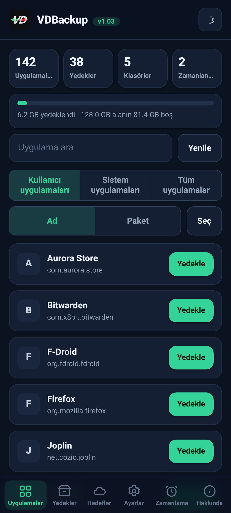
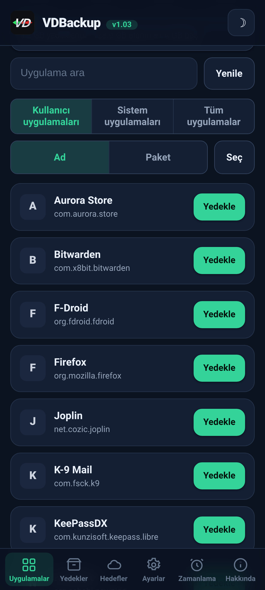
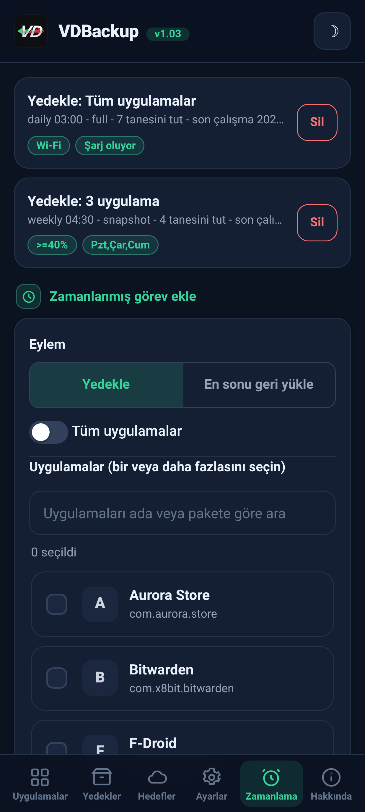
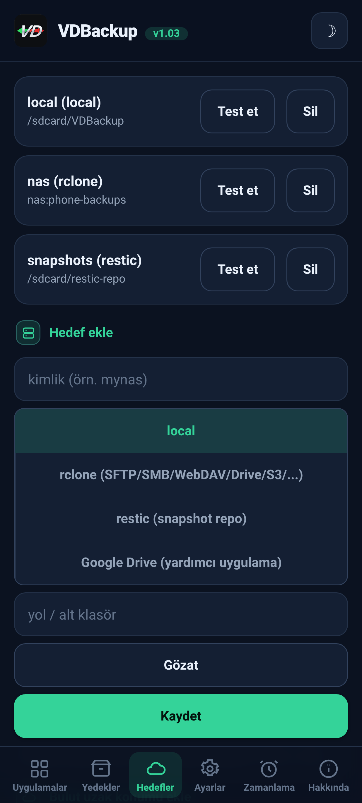
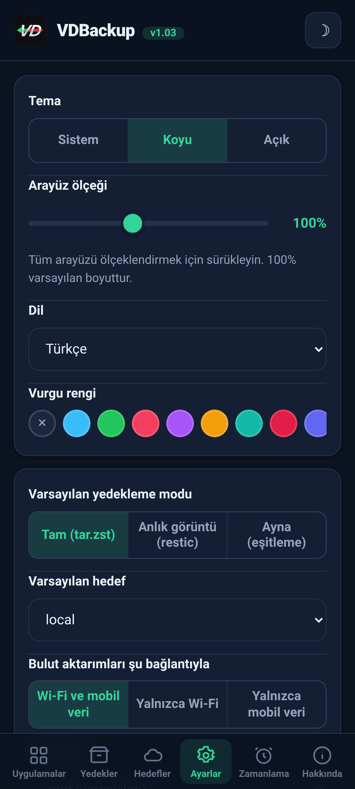
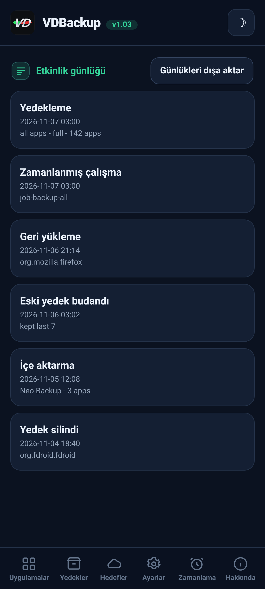

> **Languages:** [English](../USER-GUIDE.md) · [العربية](../ar/USER-GUIDE.md) · [Čeština](../cs/USER-GUIDE.md) · [Deutsch](../de/USER-GUIDE.md) · [Español](../es/USER-GUIDE.md) · [فارسی](../fa/USER-GUIDE.md) · [Français](../fr/USER-GUIDE.md) · [हिन्दी](../hi/USER-GUIDE.md) · [Bahasa Indonesia](../in/USER-GUIDE.md) · [Italiano](../it/USER-GUIDE.md) · [日本語](../ja/USER-GUIDE.md) · [한국어](../ko/USER-GUIDE.md) · [Nederlands](../nl/USER-GUIDE.md) · [Polski](../pl/USER-GUIDE.md) · [Português](../pt/USER-GUIDE.md) · [Русский](../ru/USER-GUIDE.md) · [Svenska](../sv/USER-GUIDE.md) · [ไทย](../th/USER-GUIDE.md) · Türkçe · [Tiếng Việt](../vi/USER-GUIDE.md) · [中文](../zh/USER-GUIDE.md)

---

# VDBackup kullanıcı kılavuzu

Modülü kurmaktan ilk yedeğinizi almaya, geri yüklemeye, buluta göndermeye,
zamanlamaya ve yıllar sonra bir PC'de açmaya kadar VDBackup'ın eksiksiz, dostane bir
rehberi. Daha önce Swift Backup, Neo-Backup veya Android-DataBackup kullandıysanız,
bu size tanıdık gelecek - yalnızca her şey tek bir yerde olur ve "izin vermeniz"
gereken hiçbir şey yoktur.

## İçindekiler

- [1. VDBackup nedir](#1-vdbackup-nedir)
- [2. Gereksinimler](#2-gereksinimler)
- [3. Kurulum ve ilk çalıştırma](#3-kurulum-ve-ilk-çalıştırma)
- [4. WebUI turu](#4-webui-turu)
- [5. Yedek alma](#5-yedek-alma)
  - [5.1 Neyi yedekleyeceğinizi seçme](#51-neyi-yedekleyeceğinizi-seçme)
  - [5.2 Yedekleme modları: Full, Snapshot, Mirror](#52-yedekleme-modları-full-snapshot-mirror)
  - [5.3 Sıkıştırma](#53-sıkıştırma)
  - [5.4 Şifreleme](#54-şifreleme)
  - [5.5 Doğrulama ve kuru çalıştırma](#55-doğrulama-ve-kuru-çalıştırma)
  - [5.6 Özel yedekler (mesajlar, arama günlüğü, Wi-Fi, Bluetooth, takvim, duvar kağıdı, DNS, sistem ayarları)](#56-özel-yedekler-mesajlar-arama-günlüğü-wi-fi-bluetooth-takvim-duvar-kağıdı-dns-sistem-ayarları)
  - [5.7 Bağımsız klasör ve dosya yedekleri](#57-bağımsız-klasör-ve-dosya-yedekleri)
- [6. Bir yedeği geri yükleme](#6-bir-yedeği-geri-yükleme)
- [7. Hedefler: yerel ve uzak](#7-hedefler-yerel-ve-uzak)
- [8. Zamanlama ve saklama](#8-zamanlama-ve-saklama)
- [9. İçe aktarma: Neo-Backup ve Android-DataBackup'ı içe aktarma](#9-içe-aktarma-neo-backup-ve-android-databackupı-içe-aktarma)
- [10. SSAID (cihaz ANDROID_ID)](#10-ssaid-cihaz-android_id)
- [11. Taşınabilirlik: yedekleri bir PC'de açma](#11-taşınabilirlik-yedekleri-bir-pcde-açma)
- [12. VDBackup'ı bir YZ asistanından yönetme](#12-vdbackupı-bir-yz-asistanından-yönetme)
- [13. Sorun giderme ve SSS](#13-sorun-giderme-ve-sss)
- [14. Kaldırma](#14-kaldırma)

---

## 1. VDBackup nedir

VDBackup, uygulamalarınızı ve verilerini yedekleyen ve geri yükleyen, yerleşik bir
WebUI'ye sahip bir root modülüdür. Swift Backup, Neo-Backup ve Android-DataBackup'ın
açık, root-yerel halefi olarak tasarlanmıştır: bu araçların yaptıklarının birleşimini
tek bir yerde yapmayı hedefler ve hiçbir şey kaybetmeden geçiş yapabilmeniz için mevcut
Neo-Backup ve Android-DataBackup yedeklerinizi bile içe aktarabilir.

Sıradan bir yedekleme uygulamasından temel farkı: VDBackup **tamamen root
yöneticinizin WebUI'sinden** çalışır ve modül zaten root'tur. Temel özellikler için
kurulacak eşlik eden bir uygulama, onaylanacak bir "su ver" istemi ve açılacak hiçbir
şey yoktur. WebUI'yi açar, neyi yedekleyeceğinizi seçer ve çalıştırırsınız.

VDBackup'ın ürettiği her şey **standart formatlar** kullanır (tar, gzip, zstd, age, zip,
restic), bu nedenle yedekleriniz asla modüle kilitlenmez ve asla belirli cihazınıza
bağlı değildir. Bkz. [bölüm 11](#bölüm-11).

## Ekran görüntüleri

| Ana ekran | Uygulamalar | Zamanlama |
|:---:|:---:|:---:|
|  |  |  |
| **Hedefler** | **Ayarlar** | **Etkinlik günlüğü** |
|  |  |  |

## 2. Gereksinimler

- **KernelSU**, **APatch** veya **Magisk** tarafından yönetilen **root'lanmış bir
  Android cihaz**. VDBackup, o yöneticiden bir modül olarak kurulur.
- Yedekleriniz için yeterli boş depolama (yerel yedekler modülün durum dizini altında
  yaşar; bkz. [bölüm 3](#bölüm-3)).
- Başka hiçbir şey. Modül, ihtiyaç duyduğu tüm ikili dosyaları paketler (tar, zstd, lz4,
  rclone, rsync, ssh, restic), bu nedenle **yerel yedekleme ve geri yükleme tamamen
  çevrimdışı çalışır**. Yalnızca bulut hedefleri ağla konuşur.

Bazı ince taneli ekstralar (AppOps, SSAID, birkaç ayrıcalıklı sistem biti) Android
çerçevesine dayanır; modül bunları dahili olarak, düz kabuk yedeğiyle ele alır ve
cihazınızda kullanılamadıklarında zarif bir şekilde devre dışı kalırlar.

## 3. Kurulum ve ilk çalıştırma

1. En son `VD-Backup-vX.Y.zip` sürümünü indirin.
2. KernelSU / APatch / Magisk yöneticinizde, modül zip'ini başka herhangi bir modül
   gibi flaşlayın.
3. Hemen kullanılabilir - **yeniden başlatma gerekmez**. (Yeniden başlatma yalnızca
   SSAID geri yüklenirken geçerlidir; bkz. [bölüm 10](#bölüm-10).)
4. Yöneticiden modülün **WebUI**'sini açın. Bu, tüm arayüzdür.

**Hangi sürümü indirmeli.** Her sürüm, yalnızca ihtiyacınız olanı indirmeniz için birkaç
flaşlanabilir zip sürümü halinde gelir. Birini seçin:

- **`VD-Backup-<ver>-universal-full.zip`** - her CPU mimarisi ve her ikili dosya gömülü halde;
  `rclone` (bulut sağlayıcıları: Google Drive, S3 ve 70+ diğer rclone arka ucu) ve `restic`
  (tekilleştirilmiş anlık görüntüler) dahil. Tamamen çevrimdışı, hiçbir şey asla indirilmez. Her
  cihazda çalışır. En büyük indirme.
- **`VD-Backup-<ver>-universal-lite.zip`** - her mimari, ancak en büyük iki ikili dosya
  (`rclone` ve `restic`) **olmadan**. En küçük indirme; yine de taşınabilir `age`
  şifrelemesiyle yerel, SSH/SFTP ve rsync yedeklerini indirme olmadan yapar. Bir bulut hedefini
  (`rclone`) ya da anlık görüntü modunu (`restic`) ilk kez kullandığınızda, WebUI o küçük
  mimariye özel eklentiyi bir kez indirmeyi önerir (SHA-256 ile doğrulanır) ve önbelleğe alır;
  ardından o özellikler de çalışır.
- **`VD-Backup-<ver>-<abi>-full.zip`** (`arm64-v8a`, `armeabi-v7a`, `x86`, `x86_64`
  sürümlerinden biri) - her ikili dosya gömülü halde tek bir mimari (`universal-full` ile aynı
  özellikler, ancak yalnızca cihazınızın mimarisi için, dolayısıyla `universal-full`'dan daha
  küçük).

Cihazınızın mimarisini biliyor ve her şeyi gömülü halde istiyorsanız, eşleşen **`<abi>-full`**'u
seçin (çoğu telefon **`arm64-v8a`**'dır). En küçük indirmeyi istiyor ve bulut sağlayıcılarını
(`rclone`) veya anlık görüntüleri (`restic`) ilk kez kullandığınızda tek seferlik, SHA-256 ile
doğrulanan bir indirmeye aldırmıyorsanız **`universal-lite`** seçin. Her şeyi gömülü halde ve
hiçbir indirme olmadan istiyor (çevrimdışı / kurtarma) ama mimariden emin değilseniz bir **full**
sürüm seçin. Kurulumda modül, hangi sürümü flaşlarsanız flaşlayın yalnızca cihazınızın mimarisini
tutar.

İlk çalıştırmada modül, varsayılan bir yapılandırma tohumlar (yalnızca henüz yoksa),
böylece ayarlarınız modül güncellemeleri boyunca korunur.

**Durum nerede yaşar.** VDBackup'ın çalışan verileri - yapılandırmanız, zamanlanmış
işleriniz, kaydedilmiş hedefleriniz, şifrelenmiş kimlik bilgileriniz, günlükler ve
denetim izi ve hazırlık alanı - şurada yaşar:

```
/data/adb/vdbackup/
```

**Yedekler nerede yaşar.** Yedeklerin kendisi, kullanıcıya görünür, kimlik bilgisiyle
şifrelenmiş depolamaya yazılır (böylece yalnızca cihazın kilidini açtıktan sonra
okunabilirler ve modülü kaldırmaktan sağ çıkarlar), her Android kullanıcısı için bir
klasör:

```
/sdcard/VDBackup/            (= /data/media/<user>/VDBackup)
```

Bunu iki nedenle aklınızda tutun: yedekler `/sdcard/VDBackup` altında yer kaplar ve bir
şeyler ters giderse baktığınız yer `/data/adb/vdbackup/logs/`dir.

## 4. WebUI turu

WebUI birkaç sekmeye düzenlenmiştir:

- **Home** - yedeklerinizin sayılarını (uygulamalar, yedekler, klasörler ve zamanlanmış işler) ve yedeklerinizin boşa kıyasla ne kadar yer kapladığını gösteren bir depolama çubuğunu gösteren bir başlangıç genel görünümü; durum rozetleri, karma ve yolları panoya kopyalama ve bir **Check for updates** eylemi ile birlikte.
- **Apps** - kurulu uygulamaların listesi (kullanıcı ve sistem), her biri gerçek adı,
  paket adı ve simgesiyle gösterilir (simgeler tembel yüklenir ve önbelleklenir, böylece
  liste duyarlı kalır). Bir satırdaki düğme uygulamayı yedekler; satıra dokunmak o
  uygulamanın yedek geçmişini açar, burada herhangi bir önceki yedeği geri
  yükleyebilirsiniz.
- **Backups** - zaten sahip olduğunuz yedekler, her biri uygulama adını bir satırda ve
  paketi bir sonraki satırda gösterir. Tüm ayrıntılarını (sürüm, tarih, boyut, dahil
  edilen öğeler, izin sayıları ve geldiği cihaz) görmek için bir yedeğe dokunun. Burası
  ayrıca bir yedeği geri yüklediğiniz, bir geri yükleme testi çalıştırdığınız, bir yedeği
  sildiğiniz veya Neo-Backup ya da Android-DataBackup'tan yedekleri içe aktardığınız
  yerdir.
- **Destinations** - yedeklerin nereye gittiğini yönetin: yerel depolama artı eklediğiniz
  herhangi bir uzak hedef (bkz. [bölüm 7](#bölüm-7)). Bir hedefe
  güvenmeden önce burada test edebilirsiniz.
- **Settings** - açık/koyu tema geçişi, bir vurgu rengi seçici (hazır ayarlar, özel bir
  renk veya sıfırlama) ve bir dil seçici (arayüz Arapça ve Farsça için sağdan sola görüntülenir), sürükleyerek tüm arayüzü (üstbilgi, içerik ve alt gezinme birlikte) %85 ile %120 arasında yeniden
  ölçeklendirdiğiniz bir arayüz ölçek kaydırıcısı (%100 varsayılandır), farklı piksel yoğunluklu ekranlar için,
  yeni işler için varsayılanlar
  (varsayılan sıkıştırma, doğrulama açık/kapalı, varsayılan şifreleme), bulut aktarımları
  için ağ politikası (bkz. [bölüm 7](#bölüm-7)), otomatik yedekleme ve hariç tutulan
  uygulamalar listesi, kurulum kaynağı seçeneği, şifreleme anahtarı ve zamanlama. Açık/kapalı ayarları Android tarzı aç/kapat anahtarları kullanır.
- **About** - sürüm, bağlantılar, kardeş projeler (See also), paketlenmiş ikili dosya
  denetim manifestosu ve daha yeni bir sürümün yayınlanıp yayınlanmadığını (sürüm notlarıyla
  birlikte) bildiren bir **Check for updates** eylemi. Her güncellemeyi, modülü flaşladığınız gibi
  root yöneticiniz üzerinden kurarsınız.

Onaylar ve mesajlar, uygulama içi diyalogları kullanır (eski sistem açılır pencereleri
değil) ve bir geri yükleme veya içe aktarma, ilerlemeden önce mevcut uygulama verilerinin
üzerine yazdığını kabul etmenizi ister.

Yedekler ve geri yüklemeler, arka plan root işlemi olarak **ayrık** çalışır. WebUI'yi
veya hatta root yöneticisini kapatabilirsiniz ve işlem devam eder. Geri döndüğünüzde,
WebUI yeniden eklenir ve yerelleştirilmiş bir aşama etiketiyle canlı ilerlemeyi gösterir.
Çalışan bir iş için ilerleme kartı ayrıca canlı aktarım hızını ve tahmini kalan süreyi, artı
mevcut öğenin adıyla birlikte bir öğe sayacını (örneğin "12 of 40") gösterir.
Kabuk bildirimlerini yüzeye çıkaran ROM'larda, bir iş başladığında ve bittiğinde ayrıca
bir Android bildirimi alırsınız; her durumda, uygulama içi ilerleme kartı güvenilir
göstergedir.

## 5. Yedek alma

Temel akış: **Apps**'i açın, bir uygulama seçin, neyi dahil edeceğinizi seçin, bir mod
seçin, sıkıştırmayı ve (isteğe bağlı olarak) şifrelemeyi ayarlayın, sonra çalıştırın.
İlerleme canlı olarak görünür ve bir bildirim bittiğinde size haber verir.

### 5.1 Neyi yedekleyeceğinizi seçme

Her uygulama için bu öğelerin herhangi bir kombinasyonunu dahil edebilirsiniz:

| Öğe | Ne olduğu |
|------|-----------|
| **APK** | Kurulu uygulamanın kendisi (temel APK + herhangi bir split APK). |
| **data** | Uygulamanın özel verisi (`/data/data`). Bu, olağan "uygulama verisi"dir. |
| **device-protected data** | Direct-boot / cihaz korumalı depolama (`/data/user_de`). Bazı uygulamalar ayarları burada tutar. |
| **external** | Uygulamanın `Android/data` altındaki harici verisi. |
| **OBB** | Uygulamanın OBB genişletme dosyaları (`Android/obb`), bazı oyunlar tarafından kullanılır. |
| **media** | Uygulamanın `Android/media` altındaki medyası. |

"Bu uygulamayı tamamen yedekle" için iyi bir varsayılan, hepsini dahil etmektir. Yalnızca
veriyi istiyorsanız (örneğin bir oyun kaydını taşımak için), APK'yı ve büyük OBB/media
öğelerini seçimden kaldırabilirsiniz.

VDBackup ayrıca bir geri yüklemeyi sadık kılan şeyleri de korur: SELinux bağlamları,
uid/gid sahipliği, dosya modları, genişletilmiş öznitelikler (xattr) ve yetenekler.

### 5.2 Yedekleme modları: Full, Snapshot, Mirror

VDBackup üç mod sunar. WebUI, çoğu kişi için doğru seçim olan **Full**'u önceden seçer.

- **Full** - `tar.zst` (veya seçtiğiniz sıkıştırma) olarak yazılan eksiksiz, kendi
  kendine yeten, taşınabilir bir yedek. Her çalıştırma, herhangi bir yere kopyalayıp bir
  PC'de açabileceğiniz bağımsız bir yedek üretir. En iyisi: arşivleyip etrafta
  taşıyabileceğiniz temiz, taşınabilir bir uygulama anlık görüntüsü için. Bu varsayılandır
  ve en taşınabilir seçenektir.
- **Snapshot** - `restic` ile desteklenen artımlı ve sürümlenmiş. Her çalıştırma bir
  depoya yeni bir zaman noktası anlık görüntüsü ekler, yalnızca değişeni saklar ve anlık
  görüntüler arasında yineleme giderir. En iyisi: her çalıştırmada tam boyut ödemeden bir
  uygulamanın çalışan bir geçmişini tutmak için.
- **Mirror** - `rclone`/`rsync` ile desteklenen, canlı verinin hedefe 1:1
  senkronizasyonu. Hedefi şu anda cihazda olanla aynı tutar (değişen dosyalar kopyalanır,
  kaldırılan dosyalar hedefte silinir). En iyisi: örneğin bir bulut uzak birimine hızlı,
  her zaman güncel bir kopya için. Bir mirror'da bile APK'nın hâlâ sıkıştırılmış olarak
  saklandığını, asla ham olmadığını unutmayın.

### 5.3 Sıkıştırma

Bir Full yedeği için sıkıştırmayı seçebilirsiniz:

- **none** - sıkıştırma yok (en hızlı, en büyük).
- **lz4** - çok hızlı, hafif sıkıştırma.
- **zstd** - varsayılan, hız ve oran arasında güçlü bir denge. Ayrıca bir seviye de
  seçebilirsiniz (örneğin daha küçük bir dosya için daha yüksek bir seviye).
- **gzip** - **"uyumluluk modu"**. gzip, pratikte her bilgisayarda ve çoğu dosya
  yöneticisinde yerleşik araçlarla, ekstra kurulacak bir şey olmadan açılır. Arşivi her
  yerde açabilmeyi en çok önemsediğinizde bunu seçin.

Seçmezseniz, VDBackup yapılandırılmış varsayılanını kullanır (makul bir seviyede zstd).

### 5.4 Şifreleme

Şifreleme **isteğe bağlıdır** ve taşınabilirdir. VDBackup, özellikle taşınabilirlik için
seçilen bir parola (scrypt) kullanarak **age** ile şifreler: herhangi bir işletim
sistemindeki herhangi bir standart `age` aracı, yedeğinizi yalnızca parolayla çözebilir.
Şifreleme **asla** cihazınızın donanım anahtarlarına bağlı değildir, bu nedenle
şifrelenmiş bir yedek başka bir cihazda geri yüklenir ve bir PC'de açılır. (Bir çift
tıklama ve parola ile açmak istediğiniz şifrelenmiş arşivler için uyumlu bir AES-256 zip
modu da mevcuttur.)

Şifrelemeyi kullanmak için şifreleme anahtarını bir kez oluşturun (Settings), ardından
işiniz için şifrelemeyi etkinleştirin ve bir parola belirleyin. Yedeği koruyan şey
paroladır, bu yüzden güçlü bir tane seçin - donanım anahtarı ve kurtarma arka kapısı
yoktur.

**APK kuralı (önemli):**

- **APK her zaman sıkıştırılmış olarak saklanır**, yer kazanmak için asla ham değildir.
- **APK varsayılan olarak şifrelenmez**, çünkü bir uygulamanın APK'sı herkese açık
  içeriktir.
- APK şifreleme ve veri şifreleme **bağımsız geçişlerdir**. Veri şifrelemeyi açmak APK'yı
  **şifrelemez**. APK'nın da özellikle şifrelenmesini istiyorsanız, APK şifreleme geçişini
  açıkça etkinleştirin.

### 5.5 Doğrulama ve kuru çalıştırma

İki güvenlik seçeneği, bir yedeğe güvenmeden önce ona güvenmenize yardımcı olur:

- **Verify** - yazdıktan sonra, VDBackup her arşivi yeniden hashler ve manifeste karşı
  kontrol eder. Bu, **Full** yedekler için **varsayılan olarak açıktır**. Bir dosya
  eşleşmezse, iş sessizce bozuk bir yedekle sizi bırakmak yerine açık bir hatayla
  başarısız olur.
- **Dry-run** - işi planlar ve üreteceği boyutları **hiçbir şey yazmadan** bildirir. Alan
  tahmin etmek veya gerçek işi çalıştırmadan önce öğe seçiminizi kontrol etmek için
  kullanın.

Bir yedek **bulut** hedefine gittiğinde, VDBackup iki güvence daha ekler. Yüklenen kopyayı uzak
hedefteki orijinaline karşı yeniden kontrol eden son bir **checksum-verified** adımı çalıştırır
ve eşleşmezlerse (buluta bozuk bir kopya bırakmak yerine) işi başarısız kılar. Ve bir Full
yüklemeden önce uzak hedefin **boş alanını** kontrol eder ve yedek sığmayacaksa, uzak hedefi
doldurup yarı yolda başarısız olmak yerine, açık bir **"not enough space"** hatasıyla erkenden
durur. (Alan kontrolü Full yüklemeler içindir; Mirror bir delta eşitlemesidir ve muaftır.)

### 5.6 Özel yedekler (mesajlar, arama günlüğü, Wi-Fi, Bluetooth, takvim, duvar kağıdı, DNS, sistem ayarları)

**Backups** sekmesindeki uygulama listelerinin altında, **Özel yedekler** tek bir
uygulamaya bağlı olmayan sistem genelindeki verileri kapsar. Kategorileri seçin ve
yedekleyin; uygulama yedekleriyle aynı SELinux/xattr koruması ve isteğe bağlı şifrelemeyle
arşivlenirler. Kategoriler şunlardır:

| Kategori | Ne olduğu |
|----------|-----------|
| **Mesajlar (SMS/MMS)** | Metin mesajlarınız. |
| **Kişiler ve arama günlüğü** | Kişileriniz ve arama geçmişiniz. |
| **Wi-Fi ağları** | Kaydettiğiniz Wi-Fi ağları. |
| **Bluetooth** | Bluetooth eşleştirmeleriniz. |
| **Takvim** | Takvim provider'ı (uygulama ve veri). Ayrıca **taşınabilir bir `calendar.json`** da yazılır, böylece etkinlikleriniz modül olmadan bir PC'de okunabilir. |
| **Duvar kağıdı** | Ana ekran ve kilit ekranı duvar kağıdınız artı `wallpaper_info.xml`, ham görüntü olarak saklanır. |
| **DNS** | Özel DNS modunuz ve sunucunuz. |
| **Sistem ayarları** | Cihazın system, global ve secure ayarlarının tam dökümü. |

Mesajlar, arama günlüğü ve kişiler için ayrıca bir **taşınabilir kopya** (açılabilir JSON) da
yazılır, böylece modül olmadan bir PC'de okuyabileceğiniz, cihazlar arası bir kopyanız olur.

**Sistem ayarları katılımlıdır ve geri yüklemede cihaz ayarlarınızın üzerine yazar.** Tıpkı SSAID
gibi (bkz. [bölüm 10](#bölüm-10)), **Sistem ayarları** kategorisi en hassas olanıdır: onu geri
yüklemek cihaz genelindeki ayarlarınızın üzerine yazar, bu yüzden onu kasıtlı olarak seçmediğiniz
sürece kapalıdır, önce onaylamanızı ister ve etkinlik günlüğüne yazılır.

Bir özel yedeği geri yüklemek canlı sistem verisinin üzerine yazar ve yeniden başlatma gerektirir,
bu yüzden belirgin bir onayın arkasında kapı tutulur ve aynı cihaz ile ROM'da güvenilirdir. Geri
yüklemeler **idempotenttir**: ham kategoriler (mesajlar, kişiler, Wi-Fi, Bluetooth, takvim) verileri
birleştirmek yerine **değiştirerek** geri yüklenir, bu yüzden aynı yedeği iki kez geri yüklemek asla
yinelenenler oluşturmaz, ve DNS ile sistem ayarları yalnızca yeniden uygulanır.

### 5.7 Bağımsız klasör ve dosya yedekleri

Bazen bir uygulama olmayan sade bir klasörü veya dosyayı yedeklemek istersiniz - bir kamera klasörü,
bir belgeler dizini, tek bir veritabanı. VDBackup, paylaşılan depolamada veya `/data` altında
**herhangi bir mutlak yolu**, bir uygulama yedeğiyle aynı taşınabilir formatta yedekleyebilir: bir
`tar.zst` arşivi artı bir `manifest.json`, SHA-256 ile mühürlü, onu şifrelediğinizde bir RECOVERY
notuyla. Bu yol yedekleri ayrı tutulur, yedekler dizininizdeki bir `.paths` klasörünün altında.

- **Bir yol seçin ve yedekleyin.** Kaynak, izin verilen konumlardan birinin altında mutlak bir yol
  olmalıdır (`/storage/emulated`, `/data/media`, `/sdcard`, `/data`). `..` ile dışarı çıkmaya
  çalışan yollar reddedilir.
- **Geri yükleme orijinal konuma geri yazar**, bu yüzden, herhangi bir geri yükleme gibi, yıkıcıdır
  ve bir şeyin üzerine yazmadan önce **onaylamanızı** ister.
- Uygulama yedekleri gibi, yol yedekleri ve geri yüklemeleri de canlı ilerlemeyle **ayrık** çalışır,
  seçtiğiniz sıkıştırmayı kullanır ve bir parolayla şifrelenebilir.

## 6. Bir yedeği geri yükleme

**Backups** sekmesini açın, istediğiniz yedeği seçin ve geri yüklemeyi başlatın. Geri
yükleme yıkıcı bir eylem olduğundan, VDBackup önce **onaylamanızı** ister ve eylemi yerel
bir denetim günlüğüne kaydeder.

Bir geri yükleme **sadıktır**: VDBackup uygulamanın mevcut durumunu siler ve yedeği
çıkarır, böylece uygulama o yedekte yakalanan **tam duruma** döndürülür (sahiplik,
modlar, SELinux bağlamları ve xattr dahil). Bu bir birleştirme değildir - yedeğin zaman
noktasına gerçek bir geri yüklemedir. Bir geri yükleme root olarak çalıştığından, VDBackup ayrıca
herhangi bir şey çıkarmadan önce her arşivi kontrol eder ve hedefinin dışına yazmaya çalışan
kurcalanmış bir arşivi reddeder, böylece değiştirilmiş bir yedek sisteminizin geri kalanının asla
üzerine yazamaz.

Yararlı geri yükleme seçenekleri:

- **Restore-test** - yedeği geçici bir hazırlık alanına çıkarır ve **canlı uygulamaya
  dokunmadan** doğrular. Bu, herhangi bir şeyin üzerine yazmadan önce bir yedeğin sağlam
  ve geri yüklenebilir olduğunu doğrulamanın güvenli yoludur. Test başarısız olursa açık
  bir hata alırsınız ve kurulu uygulamanız dokunulmadan bırakılır.
- **Partial restore** - yedeklenen öğelerin yalnızca bazılarını geri yükleyin. Örneğin,
  APK'yı yeniden kurmadan yalnızca uygulama verisini geri yükleyin veya büyük OBB/media
  olmadan kayıt dosyalarını geri yükleyin. Geri yükleme ekranında istediğiniz öğeleri
  seçin.
- **Snapshot** ve **Mirror** yedekleri için, geri yükleme sırasıyla sürümlenmiş depodan
  veya yansıtılmış kopyadan çeker.
- **Kurulum kaynağı** - varsayılan olarak geri yüklenen bir uygulama, kurulum kaynağı
  olarak (sideload edilmiş görünmek yerine) **Play Store**'u bildirir ki çoğu uygulama ve
  uygulama denetimi bunu bekler. Bunu Settings'te genel olarak veya geri yükleme başına
  kapatabilirsiniz ve kapalıyken orijinal kurulum kaynağı korunur. Gelişmiş, katılımlı bir
  **"başlatan kaynağı sahtele"** geçişi daha ileri gider ve ayrıca uygulamanın başlatan
  paketini ve paket kaynağını Play'den kurulmuş gibi gösterir; sistem paket veritabanını
  düzenler (önce yedeklenir) ve yeniden başlatmadan sonra geçerli olur.

**Toplu geri yükleme.** **Backups** sekmesinde, Apps sekmesinin toplu yedekleme için sahip
olduğu gibi bir **Select** modu bulunur. **Select**'i açın, istediğiniz yedekleri onay
kutularıyla işaretleyin ve hepsini tek seferde geri yükleyin. Tek bir seçenek iletişim
kutusu seçimin tamamını kapsar - üzerine yazma onayı, geri yükleme testi ve kurulum
kaynağı seçimi seçtiğiniz her yedeğe uygulanır - ve bunlar art arda geri yüklenir.

**Bir yedeği silme.** Bir yedeğin ayrıntılarını (veya bir uygulamanın geçmişini) açın ve
**Delete**'i kullanın; onaylamanız istenir ve silme işlemi etkinlik günlüğüne yazılır.
Ayrıca uygulama başına kaç yedek tutulacağını da sınırlayabilirsiniz (saklama), böylece
eskiler otomatik olarak budanır.

**Kurulu bir uygulamayı sistem uygulaması olarak bağlama.** Bir uygulamanın yedek
geçmişinden, **Mount as system**, uygulamanın APK'sını bir VDBackup overlay alt-modülüne
hazırlar, böylece root yöneticisi onu `/system/app`'ten (veya `/system/priv-app`'ten)
sunar - gerçek `/system` bölümüne asla dokunulmaz. KernelSU'da **NoMount** ile canlı
olarak uygulanır; aksi takdirde yeniden başlatmadan sonra uygulanır. Bu asla NoMount'un
kurulu olmasına bağlı değildir.

## 7. Hedefler: yerel ve uzak

Varsayılan olarak, yedekler modülün durum dizini altındaki **yerel** depolamaya yazılır.
Ayrıca **Destinations** sekmesinde uzak hedefler de ekleyebilirsiniz. Yerel bir hedef için,
**Browse** bir klasör seçici açar; böylece yolu yazmak yerine paylaşılan depolama
(`/sdcard`) altında bir alt klasör seçebilirsiniz.

Uzak taşıma, paketlenmiş araçlar tarafından ele alınır:

- **rclone** - çok çeşitli uzak birimlerin merkezi: **SFTP, SMB, WebDAV, FTP, S3,
  Google Drive** ve 70'ten fazla başka hizmet.
- **rsync** ve **ssh/scp/sftp** paketi - delta senkronizasyonu ve düz SSH hedefleri için.
- **restic** - şifrelenmiş, yineleme giderilmiş **Snapshot** depoları (yerel veya uzak).

**Bir bulut uzak birimi oluşturma (SSH gerekmez).** Destinations sekmesinde, **rclone**
hedef türünü seçin ve **Add cloud remote**'u kullanın. **Herhangi bir rclone arka ucunu**
bağlayabilirsiniz: açılır menü popüler olanları sunar (**Google Drive, Dropbox, OneDrive,
Box, pCloud, Mega, Backblaze B2, S3, SFTP, WebDAV, FTP, SMB**), ayrıca başka herhangi bir
arka uç türünü ve onun `key=value` parametrelerini yazdığınız bir **Custom (advanced)**
seçeneği vardır. Alanları doldurun (örneğin host/user/password veya S3 anahtarları) ve
kaydedin. Sizi bir tarayıcıyla oturum açtıran sağlayıcılar için (Google Drive, Dropbox,
OneDrive, Box, pCloud) **Authorize in browser** düğmesini kullanın: sizi telefonun kendi
tarayıcısı üzerinden oturum açtırır ve token'ı otomatik olarak yakalar, böylece **PC
gerekmez** (token'ı elle yapıştırmak hâlâ bir yedek olarak çalışır). Uzak birim daha sonra
hedefin uzak birim listesinde görünür. Parolalar gizlenmiş olarak saklanır, asla açık metin
olarak değil. Uzak birimlerinizi aynı yerden listeleyebilir ve silebilirsiniz.

İki kural uzak kullanımı güvende tutar:

- **Kimlik bilgileri şifrelenmiş olarak saklanır**, dinlenme halinde modülün durum
  dizininde, asla açık metin olarak değil.
- **Kullanmadan önce doğrulayın.** Gerçek bir yedeği ona yönlendirmeden önce bir hedefin
  çalıştığını doğrulamak için Destinations sekmesindeki hedef testini kullanın.

**Ağ politikası (Wi-Fi vs mobil veri).** Settings'te, "Cloud transfers over", bulut
aktarımlarının hangi bağlantıyı kullanabileceğini kısıtlamanıza izin verir: **Wi-Fi ve
mobil veri** (varsayılan), **yalnızca Wi-Fi** veya **yalnızca mobil veri**.
Kısıtladığınızda, her bulut aktarımı - manuel veya zamanlanmış, yükleme veya geri yükleme
- önce etkin bağlantıyı kontrol eder ve yanlış olanda çalışmayı reddeder, böylece yalnızca
Wi-Fi politikası asla mobil veri harcamaz. Yerel yedekler asla etkilenmez.

**Google Drive.** Google Drive'a ulaşmanın iki yolu vardır:

1. **rclone aracılığıyla** - Drive'ı başka herhangi bir hedef gibi bir rclone uzak birimi
   olarak ekleyin, ekstra bir uygulama ve **Google Cloud hesabı olmadan**. Herhangi bir
   bilgisayarda bir kez `rclone authorize "drive"` çalıştırın, tarayıcıda Google
   hesabınıza giriş yapın ve yazdırdığı token'ı Drive uzak biriminin token alanına
   yapıştırın.
2. **İsteğe bağlı eşlik eden uygulama aracılığıyla** - Google oturum açmasını ve Drive
   yüklemesini ele alan küçük, katılımlı bir eşlik eden uygulama. **Yalnızca açıkça
   Google Drive eşlik eden hedefi seçtiğinizde** kurulur, asla varsayılan olarak değil ve
   onu devre dışı bıraktığınızda kaldırılır. Tek seferlik Google onay ekranı, WebUI
   dışında gerçekleşen tek adımdır. Eşlik eden uygulama kuruluyken, VDBackup, varlığının
   root'u veya kilitsiz bir önyükleyiciyi açığa çıkarmaması için onu **her zaman HMA-OSS
   ile gizlemenizi** hatırlatır ve sizin için HMA-OSS listesine eklemeyi teklif eder.

## 8. Zamanlama ve saklama

VDBackup, yedekleri - ve geri yüklemeleri - bir zamanlamaya göre otomatik olarak
çalıştırabilir. Zamanlayıcıda şu şekilde bir iş tanımlarsınız:

- bir **hedef** - tek bir uygulama, bir uygulama kümesi veya **tüm uygulamalar** (hariç
  tutulan uygulamalar listesi çıkarılarak) - ve kullanılacak öğeler/mod,
- bir **eylem** - **Back up** (varsayılan) veya **Restore latest**; bu, her hedef
  uygulamanın en son yedeğini geri yükler,
- bir hedef,
- bir **cron benzeri zamanlama** - saatlik, günlük veya haftalık, seçtiğiniz bir saatte
  (HH:MM),
- bir **saklama** ayarı: o iş için en son **N yedeği tut**, daha eskiler otomatik olarak
  budanır,
- isteğe bağlı **çalıştırma koşulları**: yalnızca **Wi-Fi'de**, yalnızca **şarj olurken**,
  yalnızca bir **minimum pil düzeyinde** veya üzerinde ve yalnızca seçilen **hafta günlerinde**.

Zamanlanmış işler, modüldeki açılış zamanlı bir sinyalle tetiklenir: bir iş vadesi
geldiğinde çalışır, iki kez tetiklenmemesi için son çalıştırma zamanını kaydeder ve eski
yedekleri budamak için saklamayı uygular. Her şey arka planda root olarak çalıştığından,
zamanlanmış yedekler WebUI'nin açık olmasına ihtiyaç duymaz.

**Çalıştırma koşulları (kapılar).** Zamanlanmış bir iş, çalışması için sağlanması gereken
koşullar taşıyabilir: yalnızca Wi-Fi, yalnızca şarj, bir minimum pil düzeyi ve belirli hafta
günleri. Bir işin vadesi geldiğinde ama bir koşul karşılanmadığında, iş **atlanır ve sonraki
kontrolde yeniden denenir** - zamanlaması ilerlemez, böylece koşul sağlanır sağlanmaz çalışır.
Yerleşik bir termal güvenlik kontrolü de cihaz çok sıcakken zamanlanmış bir işi atlar. Böyle her
atlama etkinlik günlüğüne kaydedilir.

**Zamanlanmış geri yükleme her çalıştırmada üzerine yazar.** Bir **Restore latest** işi,
her tetiklendiğinde her hedef uygulamanın en son yedeğini yeniden geri yükler ve geri
yükleme yıkıcıdır: her çalıştırmada **uygulamanın mevcut verilerinin üzerine** en son
yedekle **yazar**. Bu, kasıtlı ve isteğe bağlıdır - yalnızca hedefleri en son yedeklerinde
tutmak istediğinizde bunu seçin.

**Kurulum/güncellemede otomatik yedekleme.** Settings'te **otomatik yedeklemeyi**
açabilirsiniz: aynı arka plan sinyali, yeni kurulan veya güncellenen uygulamaları fark
eder ve bunları sizin için yedekler (keep-N saklamayla). İlk çalıştırma yalnızca neyin
kurulu olduğunu kaydeder, böylece onu etkinleştirmek asla tüm cihazınızı bir kerede
yedeklemez.

**Hariç tutulan uygulamalar (engelleme listesi).** Yine Settings'te, otomatik olarak veya
bir zamanlamayla asla yedeklenmesini istemediğiniz uygulamaları hariç tutabilirsiniz; aynı anda
birkaçını ekleyebilirsiniz (çoklu seçim) ve hariç tutulan uygulamalar her ikisi tarafından da atlanır.

**Etkinlik günlüğü.** Schedule sekmesinde, yerel denetim izini - yedekler, geri
yüklemeler, silmeler, zamanlanmış ve otomatik çalıştırmalar ve budamalar - en yeni önce
gösteren, tam bir ekranı (anında) açan bir **View activity log** düğmesi vardır. Bir **Export logs**
eylemi, bir geri bildirim veya hata raporuna ekleyebileceğiniz bir günlük dosyasını (yedekler klasörü
altına) kaydeder.

## 9. İçe aktarma: Neo-Backup ve Android-DataBackup'ı içe aktarma

Neo-Backup veya Android-DataBackup'tan geliyorsanız, baştan başlamak zorunda değilsiniz.
**Backups** sekmesinden mevcut yedeklerinizi **içe aktarabilirsiniz**:

1. VDBackup'ı mevcut Neo-Backup veya Android-DataBackup yedek konumunuza yönlendirin
   (import-scan orada bulduğunu listeler).
2. Hangi yedekleri içe aktaracağınızı seçin.
3. İçe aktarmayı başlatın. Diğer uzun işlemler gibi, canlı ilerlemeyle ayrık çalışır.

**Parola şifreli Neo-Backup yedekleri desteklenir.** Neo-Backup'ın AES-256 şifreli
yedekleri içe aktarılabilir - gerektiğinde **parola istenir** ve parola yalnızca
şifre çözmek için kullanılır, asla komut satırında saklanmaz.

## 10. SSAID (cihaz ANDROID_ID)

SSAID, uygulama başına `ANDROID_ID`'dir - bazı uygulamaların okuduğu cihaz düzeyinde bir
tanımlayıcı. VDBackup onu yedekleyip geri yükleyebilir, ancak bu, dokunduğu en hassas
şeydir, bu yüzden ekstra özenle ele alınır:

- **İSTEĞE BAĞLIDIR ve varsayılan olarak KAPALIDIR.** VDBackup, o iş için açıkça
  açmadıkça SSAID'yi **asla** yakalamaz veya geri yüklemez. WebUI, SSAID'nin göründüğü
  her yerde (yedekleme, geri yükleme ve içe aktarma) açıkça işaretlenmiş, vurgulanmış bir
  "Optional" uyarısı gösterir ve siz katılana kadar kapalı kalır.
- **Geri yüklemede yalnızca yeniden başlatmadan sonra uygulanır.** Android ayarlar
  sağlayıcısı bu değerleri önbelleğe alır, bu nedenle geri yüklenen bir SSAID yalnızca
  cihazı yeniden başlattıktan sonra etkili olur.
- **Önceki değer her zaman önce yedeklenir.** Herhangi bir SSAID'nin üzerine yazmadan
  önce, VDBackup canlı `settings_ssaid.xml`'i bayt bayt zaman damgalı bir yedeğe kopyalar
  (bu asla otomatik silinmez). O güvenlik kopyası yapılamazsa, üzerine yazma gerçekleşmez.
  Geri almak için, o kaydedilmiş dosyayı geri yükleyin ve yeniden başlatın.

**Öneri:** özellikle ihtiyacınız olduğunu bilmiyorsanız (örneğin, kendini cihaz kimliğine
anahtarlayan ve kasıtlı olarak taşıdığınız belirli bir uygulama) SSAID'yi kapalı
bırakın. Sıradan uygulama ve veri yedekleri için ona ihtiyacınız yoktur.

## 11. Taşınabilirlik: yedekleri bir PC'de açma

Yedekleriniz **bu modüle kilitli değildir** ve **asla donanıma bağlı değildir**. Her şey
standart formatlar kullanır, bu nedenle bir yedeği VDBackup kurulu olmadan Windows, macOS
veya Linux'ta açabilirsiniz.

Bir Full yedek klasörü bir `manifest.json` (her dosyayı, uygulama sürümünü ve orijinal
sahip/bağlamı tanımlayan gerçeğin kaynağı), `*.apk.zst` olarak APK'lar ve `<item>.tar.zst`
(veya `.tar.gz` / `.tar.lz4`) olarak veri arşivleri içerir, şifrelendiğinde isteğe bağlı
olarak sonda bir `.age` ile.

Birini bir PC'de açmak için, kısaca:

- **Şifre çöz** (yalnızca dosya `.age` ile bitiyorsa) standart `age` aracı ve parolanız
  veya anahtar dosyanızla.
- **Sıkıştırmayı aç ve çıkar**: `.tar.zst`'yi `zstd` sonra `tar` ile; `.tar.gz`'yi
  doğrudan `tar` ile; `.tar.lz4`'ü `zstd --format=lz4` ile. Bir APK, yalnızca
  zstd-sıkıştırılmış bir APK'dır, bu nedenle `base.apk.zst`'yi sıkıştırmadan açmak size
  kurulabilir normal bir `base.apk` verir.

Her şifrelenmiş yedek, Windows, macOS ve Linux için tam kopyala-yapıştır komutlarını
içeren bir **RECOVERY** notuyla gelir. Tam, adım adım kit için
[`../module/etc/RECOVERY.md`](RECOVERY.md) dosyasına bakın.

SELinux bağlamları, uid/gid ve modların tar içinde saklandığını ve yalnızca Android'de
geri yüklediğinizde düzgün bir şekilde yeniden uygulandığını unutmayın - bir PC'de yine
de tüm dosyalarınızı alırsınız, yalnızca Android'e özgü sahiplik zorunlu kılınmadan.

## 12. VDBackup'ı bir YZ asistanından yönetme

VDBackup, yalnızca insanlara değil, YZ asistanlarına ve ajanlarına dostane olacak şekilde
inşa edilmiştir. WebUI, küçük bir JSON API'nin yalnızca bir istemcisidir; bir ajan,
modülün **her** eylemini aynı API üzerinden başsız olarak yönetebilir (her komut tek bir
JSON nesnesi döndürür, uzun işlemler ayrık çalışır ve ilerlemelerini yoklarsınız ve aynı
güvenlik korkulukları uygulanır - SSAID katılımlı kalır, değiştiren eylemler onaylı ve
denetlenmiş kalır).

Bir asistanın yedeklerinizi ve geri yüklemelerinizi sizin için çalıştırmasını
istiyorsanız, onu tam kontrol yüzeyini belgeleyen [`AI-AGENTS.md`](AI-AGENTS.md)'ye
yönlendirin: komut sözleşmesi, argümanları ve dönüş değeri olan her fiil ve bir ajanın
uyması gereken güvenlik kuralları.

## 13. Sorun giderme ve SSS

**Günlükler nerede?** Modül durum dizini altında, `/data/adb/vdbackup/logs/`. Çalışan bir
işlemin canlı ilerlemesi `progress-<opid>.json`'dadır ve değiştiren eylemlerin (restore,
delete, import, SSAID değişiklikleri) **denetim izi** `audit.jsonl`'dedir.

**Bir yedek/geri yükleme takılmış gibi görünüyor veya WebUI'yi kapattım.** İşlemler ayrık
çalışır, bu nedenle WebUI'yi kapatmak onları durdurmaz. WebUI'yi yeniden açın, çalışan
herhangi bir işleme yeniden eklenir ve mevcut ilerlemeyi gösterir.

**Bir `ERR_...` mesajı aldım.** Hatalar açık bir kodla bildirilir. Birkaç yaygın olanı:
- `ERR_VERIFY` - yazılan bir arşiv manifest hash'iyle eşleşmedi (doğrulama kötü bir yedeği
  yakaladı). Yedeği yeniden çalıştırın.
- `ERR_RESTORE_TEST` - bir geri yükleme testi başarısız oldu; yedek temiz bir şekilde
  çıkarılmadı/doğrulanmadı ve canlı uygulamanız dokunulmadan bırakıldı.
- `ERR_UNSAFE_ARCHIVE` - bir arşiv, hedef dizininin dışına yazmaya çalıştığı için reddedildi (mutlak
  veya `..` yolları). Bu sizi kurcalanmış bir yedekten korur; hiçbir şey yazılmadı.
- `ERR_QUOTA` - bir bulut uzak hedefinde bir Full yükleme için yeterli boş alan yoktu; yedek,
  hiçbir şey yüklenmeden önce durduruldu.

**Uzak hedefim başarısız oluyor.** Kimlik bilgilerini ve bağlantıyı doğrulamak için
Destinations sekmesindeki hedef **testini** kullanın. Yalnızca bulut hedeflerinin ağa
ihtiyaç duyduğunu unutmayın; yerel yedekleme/geri yükleme tamamen çevrimdışıdır.

**Bunlardan herhangi biri eve telefon eder mi veya çalışma zamanında indirir mi?** Hayır.
Tüm ikili dosyalar derleme zamanında modülde paketlenir; çalışma zamanında cihaza hiçbir
şey getirilmez. Yalnızca bulut hedefleri (rclone/restic/ssh) ağla konuşur ve yalnızca
onları kullandığınızda.

**Yedeğim farklı bir telefonda geri yüklenir mi?** Evet - yedekler taşınabilirdir ve
cihaz donanımına bağlı değildir. (SSAID, tek cihaza özgü istisnadır ve katılımlı ve
yeniden başlatmada uygulanır; bkz. [bölüm 10](#bölüm-10).)

**Şifrelenmiş yedeğim açılmıyor - parolayı kaybettim.** Tasarım gereği kurtarma arka
kapısı yoktur; yedeği koruyan şey paroladır. Onu güvende tutun.

## 14. Kaldırma

VDBackup'ı KernelSU / APatch / Magisk yöneticinizden başka herhangi bir modül gibi
kaldırın. Kaldırma **kullanıcı yapılandırmanızı korur** ve yalnızca geçici durumu
kaldırır, böylece daha sonra yeniden kurma ayarlarınızı alır. Gerçek yedekleriniz
`/data/adb/vdbackup/` altında yaşar - onları da kaldırmak istiyorsanız, kaldırdıktan
sonra o dizini manuel olarak silin; aksi takdirde modül olmadan bile mevcut (ve standart
formatlar olduklarından, bir PC'de açılabilir) kalırlar.

---

*Bu belge Claude (Anthropic) ile oluşturuldu ve VD171 tarafından sürdürülüyor. Düzeltmeler ve iyileştirmeler memnuniyetle karşılanır - bkz. [CONTRIBUTING.md](CONTRIBUTING.md).*
