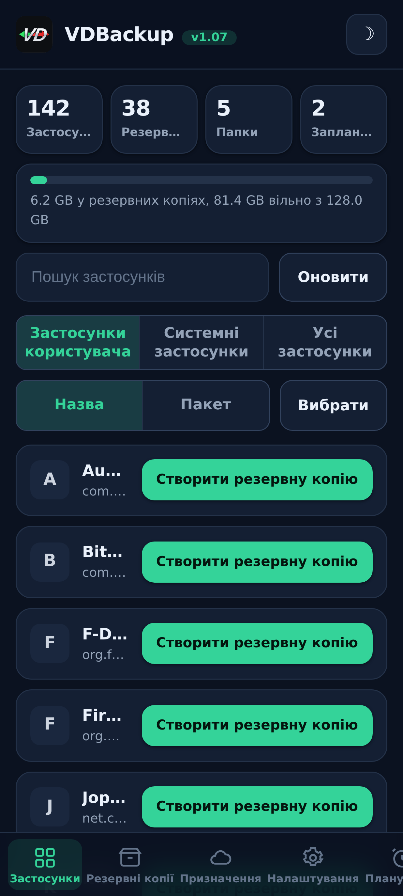
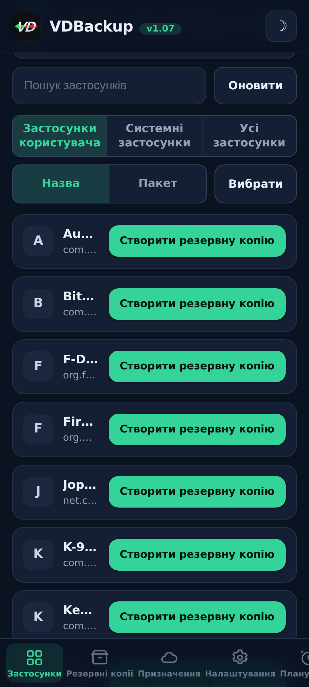
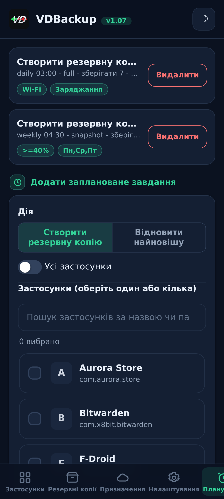
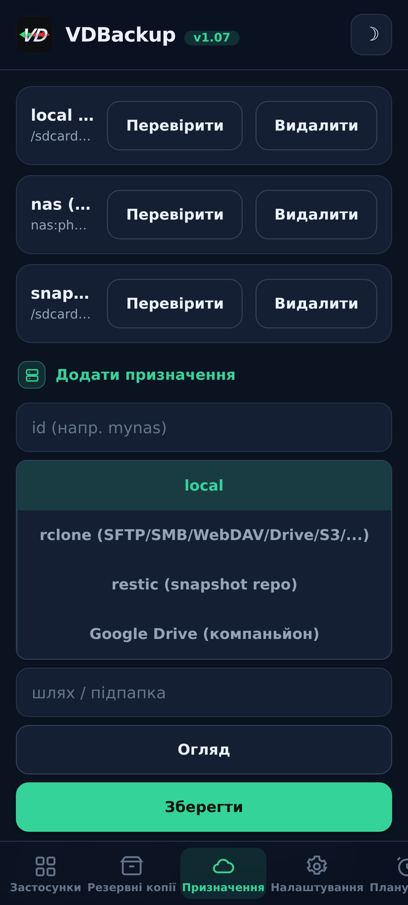
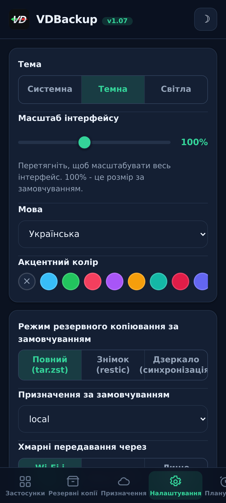
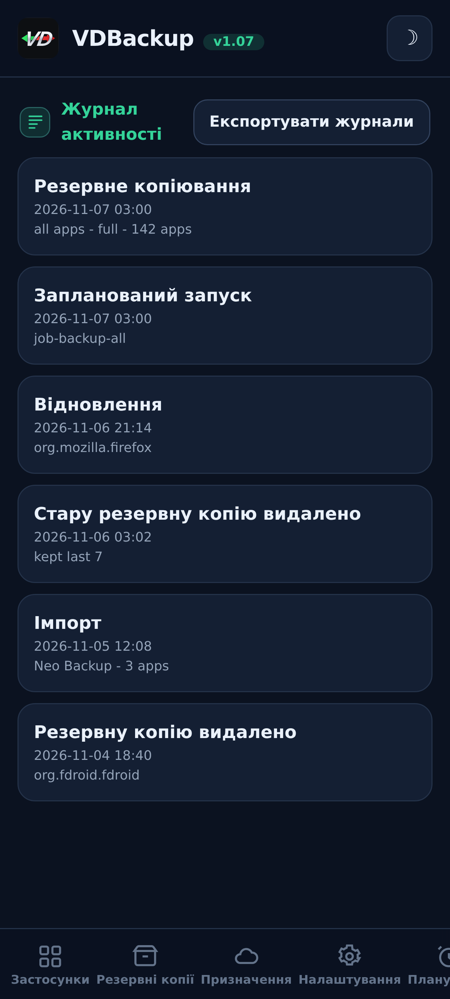

> **Languages:** [English](../USER-GUIDE.md) · [العربية](../ar/USER-GUIDE.md) · [Čeština](../cs/USER-GUIDE.md) · [Deutsch](../de/USER-GUIDE.md) · [Español](../es/USER-GUIDE.md) · [فارسی](../fa/USER-GUIDE.md) · [Français](../fr/USER-GUIDE.md) · [हिन्दी](../hi/USER-GUIDE.md) · [Bahasa Indonesia](../in/USER-GUIDE.md) · [Italiano](../it/USER-GUIDE.md) · [日本語](../ja/USER-GUIDE.md) · [한국어](../ko/USER-GUIDE.md) · [Nederlands](../nl/USER-GUIDE.md) · [Polski](../pl/USER-GUIDE.md) · [Português](../pt/USER-GUIDE.md) · [Русский](../ru/USER-GUIDE.md) · [Svenska](../sv/USER-GUIDE.md) · [ไทย](../th/USER-GUIDE.md) · [Türkçe](../tr/USER-GUIDE.md) · Українська · [Tiếng Việt](../vi/USER-GUIDE.md) · [中文](../zh/USER-GUIDE.md)

---

# Посібник користувача VDBackup

Повний, дружній огляд VDBackup, від встановлення модуля до створення
вашої першої резервної копії, її відновлення, надсилання в хмару, планування й відкриття
її на ПК роками пізніше. Якщо ви раніше користувалися Swift Backup, Neo-Backup чи
Android-DataBackup, це відчуватиметься знайомим, тільки все відбувається в одному
місці, і нема чого "дозволяти".

## Зміст

- [1. Що таке VDBackup](#1-що-таке-vdbackup)
- [2. Вимоги](#2-вимоги)
- [3. Встановлення та перший запуск](#3-встановлення-та-перший-запуск)
- [4. Огляд WebUI](#4-огляд-webui)
- [5. Створення резервної копії](#5-створення-резервної-копії)
  - [5.1 Вибір того, що копіювати](#51-вибір-того-що-копіювати)
  - [5.2 Режими резервного копіювання: Full, Snapshot, Mirror](#52-режими-резервного-копіювання-full-snapshot-mirror)
  - [5.3 Стиснення](#53-стиснення)
  - [5.4 Шифрування](#54-шифрування)
  - [5.5 Verify і dry-run](#55-verify-і-dry-run)
  - [5.6 Спеціальні резервні копії (повідомлення, журнал дзвінків, Wi-Fi, Bluetooth, календар, шпалери, DNS, системні налаштування)](#56-спеціальні-резервні-копії-повідомлення-журнал-дзвінків-wi-fi-bluetooth-календар-шпалери-dns-системні-налаштування)
  - [5.7 Окремі резервні копії теки й файлу](#57-окремі-резервні-копії-теки-й-файлу)
- [6. Відновлення резервної копії](#6-відновлення-резервної-копії)
- [7. Призначення: локальні та віддалені](#7-призначення-локальні-та-віддалені)
  - [7.1 Резервна копія ваших налаштувань](#71-резервна-копія-ваших-налаштувань)
- [8. Планування та утримання](#8-планування-та-утримання)
- [9. Міграція всередину: імпорт Neo-Backup та Android-DataBackup](#9-міграція-всередину-імпорт-neo-backup-та-android-databackup)
- [10. SSAID (пристроєвий ANDROID_ID)](#10-ssaid-пристроєвий-android_id)
- [11. Портативність: відкриття резервних копій на ПК](#11-портативність-відкриття-резервних-копій-на-пк)
- [12. Керування VDBackup з ШІ-асистента](#12-керування-vdbackup-з-ші-асистента)
- [13. Усунення несправностей і FAQ](#13-усунення-несправностей-і-faq)
- [14. Видалення](#14-видалення)

---

## 1. Що таке VDBackup

VDBackup: це root-модуль із вбудованим WebUI, який копіює й відновлює ваші застосунки
та їхні дані. Його задумано як відкритий, root-native наступник Swift Backup,
Neo-Backup та Android-DataBackup: він має на меті зробити об'єднання того, що роблять ці інструменти, у
єдиному місці, і він навіть може імпортувати ваші наявні резервні копії Neo-Backup та
Android-DataBackup, щоб ви могли перейти, нічого не втративши.

Ключова відмінність від звичайного застосунку резервного копіювання: VDBackup працює **повністю з
WebUI вашого менеджера root**, і модуль уже має права root. Немає застосунку-компаньйона для
встановлення для основних функцій, немає запиту "надати su" для схвалення й немає чого вмикати.
Ви відкриваєте WebUI, обираєте, що копіювати, і запускаєте.

Усе, що виробляє VDBackup, використовує **стандартні формати** (tar, gzip, zstd, age, zip,
restic), тож ваші резервні копії ніколи не замкнені в модулі й ніколи не прив'язані до вашого
конкретного пристрою. Див. [розділ 11](#11-портативність-відкриття-резервних-копій-на-пк).

## Знімки екрана

| Головна | Застосунки | Розклад |
|:---:|:---:|:---:|
|  |  |  |
| **Призначення** | **Налаштування** | **Журнал активності** |
|  |  |  |

## 2. Вимоги

- **Пристрій Android з root**, керований **KernelSU**, **APatch** чи **Magisk**.
  VDBackup встановлюється як модуль із цього менеджера.
- Достатньо вільного сховища для ваших резервних копій (локальні резервні копії лежать під текою стану
  модуля; див. [розділ 3](#3-встановлення-та-перший-запуск)).
- Більше нічого. Модуль вбудовує всі потрібні йому бінарники (tar, zstd, lz4, rclone,
  rsync, ssh, restic), тож **локальне резервне копіювання й відновлення працюють повністю офлайн**. Лише хмарні
  призначення спілкуються з мережею.

Деякі точні додатки (AppOps, SSAID, кілька привілейованих системних дрібниць) покладаються на
фреймворк Android; модуль обробляє їх внутрішньо, із запасним варіантом на чистому shell,
і вони граційно деградують, коли недоступні на вашому пристрої.

## 3. Встановлення та перший запуск

1. Завантажте найновіший реліз `VD-Backup-vX.Y.zip`.
2. У вашому менеджері KernelSU / APatch / Magisk прошийте zip модуля, як будь-який інший
   модуль.
3. Він придатний до використання одразу, **перезавантаження не потрібне**. (Перезавантаження взагалі доречне
   лише під час відновлення SSAID; див. [розділ 10](#10-ssaid-пристроєвий-android_id).)
4. Відкрийте **WebUI** модуля з менеджера. Це весь інтерфейс.

**Яке видання завантажити.** Кожен реліз постачається як кілька прошиваних видань zip, тож
ви завантажуєте лише те, що вам потрібно. Оберіть одне:

- **`VD-Backup-<ver>-universal-full.zip`**: кожна архітектура ЦП і кожен бінарник
  вбудовано, включно з `rclone` (хмарні провайдери: Google Drive, S3 та понад 70 інших бекендів
  rclone) та `restic` (дедупліковані знімки). Повністю офлайн, нічого ніколи не
  завантажується. Працює на будь-якому пристрої. Найбільше завантаження.
- **`VD-Backup-<ver>-universal-lite.zip`**: кожна архітектура, але **без** двох
  найбільших бінарників (`rclone` і `restic`). Найменше завантаження; все ще робить локальні, SSH/SFTP
  і rsync резервні копії без завантаження, з портативним шифруванням `age`. Під час першого разу, коли ви
  використовуєте хмарне призначення (`rclone`) чи режим знімка (`restic`), WebUI пропонує
  завантажити цей невеликий аддон для конкретної архітектури раз (перевірено за SHA-256) і кешує його;
  після цього ці функції теж працюють.
- **`VD-Backup-<ver>-<abi>-full.zip`** (один із `arm64-v8a`, `armeabi-v7a`, `x86`,
  `x86_64`), одна архітектура з кожним вбудованим бінарником (ті самі функції, що й
  `universal-full`, але лише архітектура вашого пристрою, тож менше за `universal-full`).

Оберіть відповідний **`<abi>-full`**, якщо ви знаєте архітектуру свого пристрою й хочете
все вбудованим (більшість телефонів: **`arm64-v8a`**). Оберіть **`universal-lite`**, якщо ви
хочете найменше завантаження й не проти одноразового, перевіреного за SHA-256 завантаження під час першого
разу, коли ви використовуєте хмарні провайдери (`rclone`) чи знімки (`restic`). Оберіть видання **full**, якщо
ви хочете все вбудованим із нульовими завантаженнями (офлайн / відновлення) і не впевнені в
архітектурі. Під час встановлення модуль зберігає лише архітектуру вашого пристрою незалежно від
видання, яке ви прошиваєте.

Під час першого запуску модуль засіває конфігурацію за замовчуванням (лише якщо її ще немає), тож
ваші налаштування зберігаються між оновленнями модуля.

**Де лежить стан.** Робочі дані VDBackup, ваша конфігурація, заплановані завдання,
збережені призначення, зашифровані облікові дані, журнали та слід аудиту, і проміжна зона -
лежать під:

```
/data/adb/vdbackup/
```

**Де лежать резервні копії.** Самі резервні копії записуються у видиме користувачеві, зашифроване
обліковими даними сховище (тож вони читаються лише після того, як ви розблокуєте пристрій, і вони
переживають видалення модуля), по одній теці на користувача Android:

```
/sdcard/VDBackup/            (= /data/media/<user>/VDBackup)
```

Тримайте це на увазі з двох причин: резервні копії займають місце під `/sdcard/VDBackup`, а
`/data/adb/vdbackup/logs/`: це те, куди ви дивитеся, якщо щось іде не так.

## 4. Огляд WebUI

WebUI організовано в кілька вкладок:

- **Головна**: домашній огляд, що показує лічильники ваших резервних копій (застосунки, резервні копії, теки та заплановані завдання) і смугу сховища для того, скільки місця використовують ваші резервні копії проти вільного, зі значками статусу, копіюванням у буфер обміну для хешів і шляхів та дією **Check for updates**.
- **Застосунки**: список встановлених застосунків (користувацьких і системних), кожен показаний із своєю справжньою
  назвою, своїм ім'ям пакунка та своєю піктограмою (піктограми завантажуються ліниво й кешуються, тож список
  лишається чуйним). Кнопка в рядку копіює застосунок; торкання рядка відкриває історію
  резервних копій цього застосунку, де ви можете відновити будь-яку попередню резервну копію.
- **Резервні копії**: резервні копії, які ви вже маєте, кожна показує назву застосунку в одному рядку й
  пакунок у наступному. Торкніться резервної копії, щоб побачити її повні деталі (версія, дата, розмір,
  включені елементи, лічильники дозволів і пристрій, з якого вона надійшла). Це також те, де
  ви відновлюєте, запускаєте тест відновлення, видаляєте резервну копію чи імпортуєте резервні копії з Neo-Backup або
  Android-DataBackup.
- **Призначення**: керуйте тим, куди йдуть резервні копії: локальне сховище плюс будь-які віддалені
  призначення, які ви додаєте (див. [розділ 7](#7-призначення-локальні-та-віддалені)). Ви можете
  протестувати призначення тут, перш ніж покладатися на нього.
- **Налаштування**: перемикач світлої/темної теми, засіб вибору акцентного кольору (пресети, власний
  колір чи скидання), селектор мови (інтерфейс рендериться справа наліво для арабської
  та перської), повзунок масштабу інтерфейсу, який ви перетягуєте, щоб перемасштабувати весь інтерфейс
  (заголовок, вміст і нижню навігацію разом) від 85% до 120% (100%: за
  замовчуванням), для екранів різної щільності пікселів, значення за замовчуванням для нових завдань (стиснення за замовчуванням,
  verify увімкнено/вимкнено, шифрування за замовчуванням), мережева політика для хмарних передач (див.
  [розділ 7](#7-призначення-локальні-та-віддалені)), авторезервування та список виключених застосунків,
  опція джерела встановлення, ключ шифрування та планування. Налаштування увімкнено/вимкнено використовують
  перемикачі в стилі Android.
- **Про застосунок**: версія, посилання, споріднені проєкти (Див. також), маніфест аудиту
  вбудованих бінарників і дія **Check for updates**, яка повідомляє, чи опубліковано новішу версію
  (з її нотатками до релізу). Ви встановлюєте будь-яке оновлення через ваш менеджер root,
  так само, як ви прошивали модуль.

Застосунок також сам перевіряє наявність новішої версії щоразу, коли ви його відкриваєте (щонайбільше раз на годину) і показує банер оновлення лише коли воно існує; він лишається мовчазним, коли ви актуальні чи офлайн.

Підтвердження й повідомлення використовують внутрішні діалоги застосунку (а не старі системні спливні вікна), а
відновлення чи імпорт просить вас підтвердити, що воно перезаписує поточні дані застосунку, перш ніж
продовжити.

Резервні копії й відновлення працюють **відокремлено** як фоновий root-процес. Ви можете закрити
WebUI чи навіть закрити менеджер root, і операція продовжуватиметься. Коли ви
повертаєтеся, WebUI знову приєднується й показує живий поступ із локалізованою міткою фази. Для
поточного завдання картка поступу також показує живу швидкість передачі та орієнтовний час, що
лишився, плюс лічильник елементів (наприклад, "12 з 40") з назвою поточного
елемента. На
ROM, що показують shell-сповіщення, ви також отримуєте сповіщення Android, коли завдання
починається й завершується; у будь-якому разі внутрішня картка поступу: це надійний показник.

## 5. Створення резервної копії

Базовий потік: відкрийте **Застосунки**, оберіть застосунок, виберіть, що включити, оберіть режим,
встановіть стиснення й (за бажанням) шифрування, потім запустіть. Поступ з'являється наживо, а
сповіщення повідомляє вас, коли все готово.

У діалозі резервного копіювання ви також можете обрати **призначення** для цієї резервної копії, локальне сховище чи будь-яке хмарне/віддалене призначення, яке ви додали, без попередньої зміни призначення за замовчуванням у Налаштуваннях.

### 5.1 Вибір того, що копіювати

Для кожного застосунку ви можете включити будь-яку комбінацію цих елементів:

| Елемент | Що це |
|------|-----------|
| **APK** | Сам встановлений застосунок (base APK + будь-які split APK). |
| **data** | Приватні дані застосунку (`/data/data`). Це звичайні "дані застосунку". |
| **дані під захистом пристрою** | Сховище direct-boot / під захистом пристрою (`/data/user_de`). Деякі застосунки тримають налаштування тут. |
| **external** | Зовнішні дані застосунку під `Android/data`. |
| **OBB** | Файли розширення OBB застосунку (`Android/obb`), використовувані деякими іграми. |
| **media** | Медіа застосунку під `Android/media`. |

Хороше значення за замовчуванням для "скопіювати цей застосунок повністю": включити всі з них. Якщо ви
хочете лише дані (наприклад, щоб перемістити збереження гри), ви можете зняти вибір з APK і
великих елементів OBB/media.

VDBackup також зберігає те, що робить відновлення точним: контексти SELinux,
власність uid/gid, режими файлів, розширені атрибути (xattr) та capabilities.

### 5.2 Режими резервного копіювання: Full, Snapshot, Mirror

VDBackup пропонує три режими. WebUI попередньо обирає **Full**, що є правильним вибором
для більшості людей.

- **Full**: повна, самодостатня, портативна резервна копія, записана як `tar.zst` (або
  обране вами стиснення). Кожен запуск виробляє окрему резервну копію, яку ви можете скопіювати
  будь-куди й відкрити на ПК. Найкраще для: чистого, портативного знімка застосунку, який ви можете
  заархівувати й переміщати. Це за замовчуванням і найпортативніша опція.
- **Snapshot**: інкрементний і версіонований, на основі `restic`. Кожен запуск додає новий
  знімок моменту часу до репозиторію, зберігаючи лише те, що змінилося, і
  дедуплікуючи між знімками. Найкраще для: ведення поточної історії застосунку
  без сплати повного розміру на кожному запуску.
- **Mirror**: синхронізація 1:1 живих даних до призначення, на основі
  `rclone`/`rsync`. Вона тримає призначення ідентичним тому, що на пристрої прямо
  зараз (змінені файли копіюються, видалені файли видаляються в призначенні). Найкраще
  для: швидкої, завжди актуальної копії, наприклад до хмарного віддаленого. Зауважте, що APK
  усе ще зберігається стисненим навіть у дзеркалі, ніколи сирим.

### 5.3 Стиснення

Ви можете обрати стиснення для резервної копії Full:

- **none**: без стиснення (найшвидше, найбільше).
- **lz4**: дуже швидке, легке стиснення.
- **zstd**: за замовчуванням, сильний баланс швидкості й коефіцієнта. Ви також можете обрати
  рівень (наприклад, вищий рівень для меншого файлу).
- **gzip**: **"режим сумісності"**. gzip відкривається вбудованими інструментами
  практично на будь-якому комп'ютері й у більшості файлових менеджерів, нічого додаткового встановлювати.
  Оберіть це, коли вам найбільше важливо мати змогу відкрити архів будь-де.

Якщо ви не обираєте, VDBackup використовує своє налаштоване значення за замовчуванням (zstd на розумному рівні).

### 5.4 Шифрування

Шифрування **опційне** й портативне. VDBackup шифрує за допомогою **age** з використанням
парольної фрази (scrypt), яку обрано спеціально заради портативності: будь-який стандартний
інструмент `age` на будь-якій операційній системі може розшифрувати вашу резервну копію лише парольною фразою.
Шифрування **ніколи** не прив'язане до апаратних ключів вашого пристрою, тож зашифрована резервна копія
відновлюється на іншому пристрої й відкривається на ПК. (Сумісний режим zip AES-256 також
доступний для зашифрованих архівів, які ви хочете відкрити подвійним клацанням і паролем.)

Щоб використати шифрування, згенеруйте ключ шифрування раз (Налаштування), потім увімкніть
шифрування для вашого завдання й встановіть парольну фразу. Парольна фраза: це те, що захищає
резервну копію, тож обирайте надійну, немає апаратного ключа й немає чорного ходу для відновлення.

**Правило APK (важливо):**

- **APK завжди зберігається стисненим**, ніколи не сирим, щоб заощадити місце.
- **APK не шифрується за замовчуванням**, бо APK застосунку: це публічний вміст.
- Шифрування APK і шифрування даних: це **незалежні перемикачі**. Увімкнення шифрування
  даних **не** шифрує APK. Якщо ви спеціально хочете, щоб APK теж був зашифрований,
  увімкніть перемикач шифрування APK явно.

### 5.5 Verify і dry-run

Дві опції безпеки допомагають вам довіряти резервній копії, перш ніж покладатися на неї:

- **Verify**: після запису VDBackup повторно хешує кожен архів і перевіряє його щодо
  маніфесту. Це **увімкнено за замовчуванням для резервних копій Full**. Якщо файл не збігається,
  завдання зазнає невдачі з чіткою помилкою замість того, щоб лишити вас із тихо пошкодженою
  резервною копією.
- **Dry-run**: планує завдання й повідомляє розміри, які воно виробило б, **нічого не
  записуючи**. Використовуйте це, щоб оцінити місце чи перевірити ваш вибір елементів перед запуском
  справжнього.

Коли резервна копія йде до **хмарного** призначення, VDBackup додає ще два запобіжники. Він запускає
фінальний крок **із перевіркою контрольної суми**, який повторно перевіряє вивантажену копію щодо оригіналу на
віддаленому, і провалює завдання (замість того, щоб лишити пошкоджену копію в хмарі), якщо вони не
збігаються. А перед вивантаженням Full він перевіряє **вільне місце** віддаленого й рано зупиняється з
чіткою помилкою **"недостатньо місця"**, якщо резервна копія не вмістилася б, замість того, щоб заповнити віддалене
й зазнати невдачі на півдорозі. (Перевірка місця: для вивантажень Full; Mirror: це дельта-синхронізація і
звільнений.)

### 5.6 Спеціальні резервні копії (повідомлення, журнал дзвінків, Wi-Fi, Bluetooth, календар, шпалери, DNS, системні налаштування)

Під списками застосунків на вкладці **Резервні копії** **Спеціальні резервні копії** охоплюють загальносистемні дані,
не прив'язані до одного застосунку. Оберіть категорії й скопіюйте їх; вони архівуються
з тим самим збереженням SELinux/xattr та опційним шифруванням, що й резервні копії застосунків.
Категорії такі:

| Категорія | Що це |
|----------|-----------|
| **Повідомлення (SMS/MMS)** | Ваші текстові повідомлення. |
| **Контакти та журнал дзвінків** | Ваші контакти та історія дзвінків. |
| **Мережі Wi-Fi** | Ваші збережені мережі Wi-Fi. |
| **Bluetooth** | Ваші спарування Bluetooth. |
| **Календар** | Провайдер календаря (застосунок і дані). Також записується **портативний `calendar.json`**, тож ваші події читаються на ПК без модуля. |
| **Шпалери** | Ваші домашні шпалери й шпалери екрана блокування плюс `wallpaper_info.xml`, збережені як сире зображення. |
| **DNS** | Ваш режим приватного DNS і сервер. |
| **Системні налаштування** | Повний дамп system, global і secure settings пристрою. |

Для повідомлень, журналу дзвінків і контактів також записується **портативна копія** (відкриваний JSON),
тож ви маєте міжпристроєву копію, яку можете прочитати на ПК без модуля.

**Системні налаштування за згодою й перезаписують налаштування вашого пристрою під час відновлення.** Так само, як
SSAID (див. [розділ 10](#10-ssaid-пристроєвий-android_id)), категорія **Системні налаштування** -
найчутливіша: її відновлення перезаписує ваші загальнопристрійні налаштування, тож вона
вимкнена, якщо ви навмисно її не оберете, спершу просить вас підтвердити й записується в
журнал активності.

Відновлення спеціальної резервної копії перезаписує живі системні дані й потребує перезавантаження, тож воно обмежене
помітним підтвердженням і надійне на тому самому пристрої та ROM. Відновлення
**ідемпотентні**: сирі категорії (повідомлення, контакти, Wi-Fi, Bluetooth, календар)
відновлюються **заміною** даних, а не їх злиттям, тож відновлення тієї самої резервної копії
двічі ніколи не створює дублікатів, а DNS і системні налаштування просто повторно застосовуються.

### 5.7 Окремі резервні копії теки й файлу

Іноді ви хочете скопіювати звичайну теку чи файл, що не є застосунком, теку камери,
каталог документів, одну базу даних. VDBackup може скопіювати **будь-який абсолютний
шлях** на спільному сховищі чи під `/data`, із тим самим портативним форматом, що й резервна копія
застосунку: архів `tar.zst` плюс `manifest.json`, запечатаний SHA-256, із нотаткою RECOVERY,
коли ви його шифруєте. Ці резервні копії шляхів тримаються окремо, під текою `.paths` у
вашій теці резервних копій.

- **Оберіть шлях і скопіюйте його.** Джерело має бути абсолютним шляхом під одним із
  дозволених розташувань (`/storage/emulated`, `/data/media`, `/sdcard`, `/data`). Шляхи, що
  намагаються вилізти з `..`, відхиляються.
- **Відновлення записує назад до початкового розташування**, тож, як будь-яке відновлення, воно
  руйнівне й просить вас **підтвердити**, перш ніж щось перезаписати.
- Як і резервні копії застосунків, резервні копії шляхів і відновлення працюють **відокремлено** з живим поступом, використовують
  обране вами стиснення й можуть бути зашифровані парольною фразою.

## 6. Відновлення резервної копії

Відкрийте вкладку **Резервні копії**, оберіть потрібну резервну копію й почніть відновлення. Оскільки
відновлення є руйнівною дією, VDBackup спершу просить вас **підтвердити**, і він
записує дію в локальний журнал аудиту.

Відновлення **точне**: VDBackup стирає поточний стан застосунку й видобуває
резервну копію, тож застосунок повертається до **точного стану**, захопленого в тій резервній копії
(включно з власністю, режимами, контекстами SELinux та xattr). Це не злиття, це
справжнє відновлення до моменту часу резервної копії. Оскільки відновлення працює з правами root, VDBackup
також перевіряє кожен архів, перш ніж щось видобути, і відхиляє підроблений, що
намагається записати поза своєю ціллю, тож змінена резервна копія ніколи не може перезаписати решту
вашої системи.

Корисні опції відновлення:

- **Тест відновлення**: видобуває резервну копію в тимчасову проміжну зону й перевіряє її
  **не зачіпаючи живого застосунку**. Це безпечний спосіб підтвердити, що резервна копія
  ціла й відновлювана, перш ніж ви щось перезапишете. Якщо тест зазнає невдачі, ви отримуєте
  чітку помилку, а ваш встановлений застосунок лишається незайманим.
- **Часткове відновлення**: відновіть лише деякі з елементів, які було скопійовано. Наприклад,
  відновіть лише дані застосунку без перевстановлення APK, або відновіть файли
  збереження без великих OBB/media. Оберіть потрібні елементи на екрані
  відновлення.
- Для резервних копій **Snapshot** і **Mirror** відновлення тягне з версіонованого
  репозиторію чи дзеркальної копії відповідно.
- **Джерело встановлення**: за замовчуванням відновлений застосунок повідомляє **Play Store** як своє
  джерело встановлення (замість того, щоб виглядати завантаженим збоку), чого очікують більшість застосунків і перевірок
  застосунків. Ви можете вимкнути це глобально в Налаштуваннях чи на відновлення, а коли вимкнено,
  початкове джерело встановлення зберігається. Просунутий, за згодою, перемикач **"підробити джерело-ініціатор"**
  іде далі й також робить пакет-ініціатор і джерело пакунка застосунку схожими на
  встановлені з Play; він редагує системну базу даних пакунків (спершу скопійовану) і набуває чинності
  після перезавантаження.

**Пакетне відновлення.** Вкладка **Резервні копії** має режим **Вибір**, так само, як вкладка Застосунки
має його для пакетного резервного копіювання. Увімкніть **Вибір**, позначте потрібні резервні копії їхніми
прапорцями й відновіть їх усі одразу. Один діалог опцій охоплює всю вибірку -
підтвердження перезапису, тест відновлення й вибір джерела встановлення застосовуються до
кожної обраної вами резервної копії, і вони відновлюються одна за одною.

**Видалення резервної копії.** Відкрийте деталі резервної копії (чи історію застосунку) й використайте **Видалити**;
вас просять підтвердити, а видалення записується в журнал активності. Ви також можете
обмежити, скільки резервних копій зберігати на застосунок (утримання), тож старі обрізаються автоматично.

**Монтування встановленого застосунку як системного.** З історії резервних копій застосунку **Монтувати як
системний** розміщує APK застосунку в overlay-підмодулі VDBackup, тож менеджер root
обслуговує його з `/system/app` (або `/system/priv-app`), справжній розділ `/system` ніколи не
зачіпається. З **NoMount** на KernelSU він застосовується наживо; інакше він застосовується після
перезавантаження. Це ніколи не залежить від встановленого NoMount.

## 7. Призначення: локальні та віддалені

За замовчуванням резервні копії записуються в **локальне** сховище під текою стану
модуля. Ви також можете додати віддалені призначення на вкладці **Призначення**. Для локального
призначення **Огляд** відкриває засіб вибору теки, тож ви можете обрати підтеку замість
введення шляху. Засіб вибору показує ярлик до кожного тому сховища, тож ви можете копіювати у
внутрішнє сховище або на знімну **SD-картку чи USB-накопичувач**; призначення, що не
лишалися б зашифрованими у стані спокою (системні шляхи, як-от `/data/adb`), відхиляються.

Віддалений транспорт обробляється вбудованими інструментами:

- **rclone**: хаб для величезного діапазону віддалених: **SFTP, SMB, WebDAV, FTP, S3,
  Google Drive** та понад 70 інших сервісів.
- **rsync** і набір **ssh/scp/sftp**, для дельта-синхронізації та звичайних SSH-цілей.
- **restic**: зашифровані, дедупліковані репозиторії **Snapshot** (локальні чи віддалені).

**Створення хмарного віддаленого (SSH не потрібен).** На вкладці Призначення оберіть
тип призначення **rclone** і використайте **Add cloud remote**. Ви можете під'єднати **будь-який бекенд
rclone**: випадний список пропонує популярні (**Google Drive, Dropbox, OneDrive, Box,
pCloud, Mega, Backblaze B2, S3, SFTP, WebDAV, FTP, SMB**) плюс опцію **Custom (advanced)**,
де ви вводите будь-який інший тип бекенда та його параметри `key=value`. Заповніть
поля (host/user/password або, наприклад, ключі S3) й збережіть. Для провайдерів, що входять
через браузер (Google Drive, Dropbox, OneDrive, Box, pCloud), використайте кнопку **Authorize in
browser**: вона входить через власний браузер телефона й захоплює токен
автоматично, тож **ПК не потрібен** (вставляння токена вручну все ще працює як запасний варіант).
Віддалене потім з'являється у списку віддалених призначення. Паролі зберігаються затемненими,
ніколи не відкритим текстом. Ви можете перелічувати й видаляти ваші віддалені з того самого місця.

Два правила тримають використання віддалених безпечним:

- **Облікові дані зберігаються зашифрованими** у стані спокою в теці стану модуля, ніколи не
  відкритим текстом.
- **Перевіряйте перед використанням.** Використайте тест призначення на вкладці Призначення, щоб
  підтвердити, що призначення працює, перш ніж спрямувати на нього справжню резервну копію.

**Мережева політика (Wi-Fi проти мобільних даних).** У Налаштуваннях "Хмарні передачі через" дає вам змогу
обмежити, яке з'єднання можуть використовувати хмарні передачі: **Wi-Fi і мобільні дані** (за
замовчуванням), **лише Wi-Fi** або **лише мобільні дані**. Коли ви обмежуєте це, кожна хмарна
передача, ручна чи запланована, вивантаження чи відновлення, спершу перевіряє активне з'єднання
й відмовляється працювати на неправильному, тож політика лише Wi-Fi ніколи не витрачає мобільні дані.
Локальні резервні копії ніколи не зачіпаються.

**Google Drive.** У вас є два шляхи дістатися Google Drive:

1. **Через rclone**: додайте Drive як віддалене rclone, як будь-яке інше призначення, без
   додаткового застосунку й **без облікового запису Google Cloud**. На будь-якому комп'ютері запустіть
   `rclone authorize "drive"` раз, увійдіть у ваш обліковий запис Google у браузері й
   вставте токен, який він друкує, у поле токена віддаленого Drive.
2. **Через опційний компаньйон**: крихітний застосунок-компаньйон за згодою, що обробляє
   вхід Google і вивантаження в Drive. Він встановлюється **лише коли ви явно обираєте
   призначення компаньйона Google Drive**, ніколи за замовчуванням, і він видаляється, коли
   ви його вимикаєте. Одноразовий екран згоди Google: це єдиний крок, що відбувається
   поза WebUI. Коли компаньйон встановлено, VDBackup нагадує вам
   **завжди ховати його за допомогою [HMA-OSS](https://github.com/frknkrc44/HMA-OSS)**, щоб його присутність не викривала root чи
   розблокований завантажувач, і він пропонує додати його до списку [HMA-OSS](https://github.com/frknkrc44/HMA-OSS) за вас. VDBackup також нагадує вам, коли у вас є локальні резервні копії, сховати теку резервних копій (/sdcard/VDBackup) за допомогою SUSFS з тієї ж причини.

### 7.1 Резервна копія ваших налаштувань

Саме налаштування VDBackup, призначення, розклади, пресети та збережені облікові дані,
можна зберегти в один файл і перенести на інший пристрій чи відновити після чистого
встановлення. У **Налаштуваннях**, під **Резервна копія налаштувань**:

- **Export settings** записує зашифрований файл у `VDBackup/.export`. Він завжди запитує
  парольну фразу, бо файл несе ваші віддалені паролі.
- **Import settings** читає такий файл назад і зливає його в цей пристрій, не
  видаляючи того, що вже там.
- **Wipe stored credentials** видаляє збережені віддалені паролі та ключ шифрування
  пристрою за один крок; ваші призначення, розклади й резервні копії лишаються на місці.

## 8. Планування та утримання

VDBackup може запускати резервні копії й відновлення автоматично за розкладом. У планувальнику
ви визначаєте завдання з:

- **ціллю**: один застосунок, набір застосунків чи **усі застосунки** (мінус список виключених
  застосунків), і елементи/режим для використання,
- **дією**: **Резервне копіювання** (за замовчуванням) або **Відновити найновіше**, що відновлює
  найновішу резервну копію кожного цільового застосунку,
- призначенням,
- **розкладом у стилі cron**: щогодини, щодня чи щотижня, в обраний вами час (HH:MM),
- **налаштуванням утримання**: **зберегти N** найновіших резервних копій для цього завдання, старіші
  обрізаються автоматично,
- опційними **умовами запуску**: лише на **Wi-Fi**, лише під час **заряджання**, лише на чи вище
  **мінімального рівня батареї** й лише в обрані **дні тижня**.

Заплановані завдання запускаються серцебиттям часу завантаження в модулі: коли завдання
настало, воно запускається, записує свій час останнього запуску, щоб не спрацювати двічі, і застосовує
утримання для обрізання старих резервних копій. Оскільки все працює з правами root у фоні,
заплановані резервні копії не потребують відкритого WebUI.

**Умови запуску (обмеження).** Заплановане завдання може нести умови, що мають виконуватися, щоб воно
запустилося: лише Wi-Fi, лише заряджання, мінімальний рівень батареї й конкретні дні тижня. Коли
завдання настало, але умова не виконана, воно **пропускається й пробується знову на наступній перевірці** -
його розклад не просувається, тож воно запускається, щойно умова виконується. Вбудована
перевірка теплової безпеки також пропускає заплановане завдання, поки пристрій надто гарячий. Кожен такий пропуск
записується в журнал активності.

**Заплановане відновлення перезаписує на кожному запуску.** Завдання **Відновити найновіше** повторно відновлює
найновішу резервну копію кожного цільового застосунку щоразу, коли воно спрацьовує, а відновлення руйнівне: на кожному
запуску воно **перезаписує поточні дані застосунку** найновішою резервною копією. Це навмисне й
за згодою, обирайте його лише коли ви хочете тримати цілі на їхній найновішій резервній копії.

**Автоматичне резервне копіювання під час встановлення/оновлення.** У Налаштуваннях ви можете увімкнути **автоматичне резервне копіювання**:
те саме фонове серцебиття помічає застосунки, що були щойно встановлені чи оновлені, і копіює їх
за вас (з утриманням keep-N). Перший запуск лише записує, що встановлено, тож
увімкнення його ніколи не копіює весь ваш пристрій одразу.

**Виключені застосунки (список блокування).** Також у Налаштуваннях ви можете виключити застосунки, які ніколи не хочете
копіювати автоматично чи за розкладом; ви можете додати кілька одразу (множинний вибір), і
виключені застосунки пропускаються обома.

**Пресети резервного копіювання.** Також у Налаштуваннях ви можете зберігати іменовані пресети, набори елементів для включення, як-от лише APK чи APK + OBB, і обрати один у діалозі резервного копіювання, щоб заповнити вибори елементів одразу.

**Елементи резервного копіювання на застосунок.** Також у Налаштуваннях ви можете обрати точно, які елементи кожен застосунок копіює в масових, автоматичних і запланованих резервних копіях, наприклад лише APK або APK + OBB. Одна ручна резервна копія все ще дає змогу вибрати на місці, починаючи з набору застосунку. Застосунки, яких ви тут не задаєте, копіюють усе.

**Теги застосунків.** Торкніться застосунку в Налаштуваннях (Елементи на застосунок і теги), щоб дати йому вільні мітки, наприклад games чи work. Засіб вибору тегів потім з'являється над списком застосунків: оберіть тег, щоб показати лише його застосунки, і скопіюйте цілу групу одразу. Ви також можете дістатися його з вкладки Застосунки: торкніться застосунку, потім Елементи й теги.

**Журнал активності.** Вкладка Розклад має кнопку **View activity log**, яка відкриває повний
екран (миттєво), показуючи локальний слід аудиту, резервні копії, відновлення, видалення, заплановані
й автоматичні запуски та обрізання, найновіші спершу. Дія **Export logs** зберігає файл журналу
(під текою резервних копій), який ви можете додати до відгуку чи звіту про ваду.

## 9. Міграція всередину: імпорт Neo-Backup та Android-DataBackup

Якщо ви переходите з Neo-Backup чи Android-DataBackup, вам не доведеться починати
спочатку. З вкладки **Резервні копії** ви можете **імпортувати** ваші наявні резервні копії:

1. Спрямуйте VDBackup на ваше наявне розташування резервних копій Neo-Backup чи Android-DataBackup
   (import-scan перелічує те, що він там знаходить).
2. Оберіть, які резервні копії імпортувати.
3. Почніть імпорт. Як інші довгі операції, він працює відокремлено з живим поступом.

**Зашифровані паролем резервні копії Neo-Backup підтримуються.** Зашифровані AES-256 резервні копії
Neo-Backup можна імпортувати, вас **запитують пароль**, коли він
потрібен, і пароль використовується лише для розшифрування, ніколи не зберігається в командному рядку.

## 10. SSAID (пристроєвий ANDROID_ID)

SSAID: це `ANDROID_ID` на застосунок, ідентифікатор рівня пристрою, який читають деякі застосунки.
VDBackup може скопіювати його й відновити, але це найчутливіше, що він
зачіпає, тож це обробляється з додатковою обережністю:

- **Воно ОПЦІЙНЕ й ВИМКНЕНЕ за замовчуванням.** VDBackup **ніколи** не захопить чи не відновить
  SSAID, якщо ви не увімкнете його явно для того завдання. WebUI показує чітко
  позначене, виділене сповіщення "Optional" усюди, де з'являється SSAID (резервне копіювання, відновлення та
  імпорт), і воно лишається вимкненим, доки ви не погодитеся.
- **Воно застосовується лише після перезавантаження під час відновлення.** Провайдер налаштувань Android кешує
  ці значення, тож відновлений SSAID набуває чинності лише після того, як ви перезавантажите пристрій.
- **Попереднє значення завжди копіюється спершу.** Перед перезаписом будь-якого SSAID
  VDBackup байт-за-байтом копіює живий `settings_ssaid.xml` у резервну копію з позначкою часу
  (яка ніколи не видаляється автоматично). Якщо цю безпечну копію неможливо зробити, перезапис
  не відбувається. Щоб відкотити, відновіть той збережений файл і перезавантажте.

**Рекомендація:** лишайте SSAID вимкненим, якщо ви спеціально не знаєте, що він вам потрібен (наприклад,
конкретний застосунок, що прив'язує себе до ID пристрою і який ви навмисно
мігруєте). Для звичайних резервних копій застосунків і даних він вам не потрібен.

## 11. Портативність: відкриття резервних копій на ПК

Ваші резервні копії **не замкнені в цьому модулі** й **ніколи не прив'язані до апаратного забезпечення**.
Усе використовує стандартні формати, тож ви можете відкрити резервну копію на Windows, macOS чи Linux
без встановленого VDBackup.

Тека резервної копії Full містить `manifest.json` (джерело істини, що описує кожен
файл, версію застосунку та початкового власника/контекст), APK як `*.apk.zst` і
архіви даних як `<item>.tar.zst` (або `.tar.gz` / `.tar.lz4`), за бажанням із
кінцевим `.age`, коли зашифровано.

Щоб відкрити таку на ПК, коротко:

- **Розшифруйте** (лише якщо файл закінчується на `.age`) стандартним інструментом `age` і вашою
  парольною фразою чи файлом ключа.
- **Розпакуйте й видобудьте**: `.tar.zst` за допомогою `zstd`, потім `tar`; `.tar.gz` за допомогою `tar`
  безпосередньо; `.tar.lz4` через `zstd --format=lz4`. APK: це просто стиснений zstd APK,
  тож розпакування `base.apk.zst` дає вам звичайний встановлюваний `base.apk`.

Кожна зашифрована резервна копія постачається з нотаткою **RECOVERY**, що містить точні
команди для копіювання-вставляння для Windows, macOS і Linux. Див.
[`../module/etc/RECOVERY.md`](RECOVERY.md) щодо повного, покрокового набору.

Зауважте, що контексти SELinux, uid/gid і режими зберігаються всередині tar і лише
правильно застосовуються, коли ви відновлюєте на Android, на ПК ви все ще отримуєте всі свої файли,
просто без застосованої специфічної для Android власності.

## 12. Керування VDBackup з ШІ-асистента

VDBackup зроблено дружнім до ШІ-асистентів та агентів, не лише людей. WebUI -
це лише один клієнт невеликого JSON API; агент може керувати **кожною** дією
модуля безголово через той самий API (кожна команда повертає єдиний об'єкт JSON,
довгі операції працюють відокремлено, і ви опитуєте їхній поступ, і застосовуються ті самі запобіжники,
SSAID лишається за згодою, дії, що змінюють стан, лишаються підтвердженими та зафіксованими в аудиті).

Якщо ви хочете, щоб асистент запускав ваші резервні копії й відновлення за вас, спрямуйте його на
[`AI-AGENTS.md`](AI-AGENTS.md), що документує повну поверхню керування: контракт
команд, кожне дієслово з його аргументами й значенням, що повертається, і правила безпеки, які
агент має поважати.

## 13. Усунення несправностей і FAQ

**Де журнали?** Під текою стану модуля,
`/data/adb/vdbackup/logs/`. Живий поступ поточної операції: в
`progress-<opid>.json`, а **слід аудиту** дій, що змінюють стан (restore, delete,
import, зміни SSAID): в `audit.jsonl`.

**Резервне копіювання/відновлення здається застряглим, або я закрив WebUI.** Операції працюють відокремлено, тож
закриття WebUI не зупиняє їх. Знову відкрийте WebUI, і він знову приєднується до будь-якої
поточної операції й показує поточний поступ.

**Я отримав повідомлення `ERR_...`.** Помилки повідомляються з чітким кодом. Кілька поширених:
- `ERR_VERIFY`, записаний архів не збігся з хешем свого маніфесту (перевірка
  зловила погану резервну копію). Перезапустіть резервне копіювання.
- `ERR_RESTORE_TEST`, тест відновлення зазнав невдачі; резервна копія не видобулася/перевірилася
  чисто, а ваш живий застосунок лишився незайманим.
- `ERR_UNSAFE_ARCHIVE`, архів відхилено, бо він намагався записати поза своєю
  цільовою текою (абсолютні шляхи чи `..`). Це захищає вас від підробленої резервної копії;
  нічого не було записано.
- `ERR_QUOTA`, хмарне віддалене не мало достатньо вільного місця для вивантаження Full; резервну копію
  зупинено перед вивантаженням чого-небудь.

**Моє віддалене призначення зазнає невдачі.** Використайте **тест** призначення на вкладці Призначення,
щоб перевірити облікові дані й з'єднання. Пам'ятайте, що лише хмарні призначення потребують
мережі; локальне резервне копіювання/відновлення повністю офлайн.

**Чи щось із цього телефонує додому або завантажує під час виконання?** Ні. Усі бінарники вбудовано
в модуль під час збірки; нічого не отримується на пристрій під час виконання. Лише хмарні
призначення (rclone/restic/ssh) спілкуються з мережею, і лише коли ви їх використовуєте.

**Чи відновиться моя резервна копія на іншому телефоні?** Так, резервні копії портативні й не
прив'язані до апаратного забезпечення пристрою. (SSAID: це єдиний виняток, специфічний для пристрою, і він за згодою
й застосовується після перезавантаження; див. [розділ 10](#10-ssaid-пристроєвий-android_id).)

**Моя зашифрована резервна копія не відкривається, я втратив парольну фразу.** За задумом немає чорного ходу
для відновлення; парольна фраза: це те, що захищає резервну копію. Тримайте її в безпеці.

## 14. Видалення

Видаліть VDBackup, як будь-який інший модуль, із вашого менеджера KernelSU / APatch / Magisk. Видалення **зберігає ваше налаштування** й видаляє лише перехідний стан, тож повторне встановлення пізніше підхоплює вашу конфігурацію, призначення й розклади. Воно зберігає ваші резервні копії під `/sdcard/VDBackup` (стандартні формати, відкриваються на ПК без модуля), вашу конфігурацію під `/data/adb/vdbackup` і ваші збережені облікові дані, конфігурацію rclone і ключ age під зашифрованим обліковими даними `/data/misc_ce/0/vdbackup` (заблоковано до першого розблокування). Щоб видалити й будь-що з цього, видаліть цю теку вручну після видалення.

<!-- doc-footer -->

---

> _Ця документація створена за допомогою Claude (Anthropic) і підтримується VD171. Виправлення та покращення вітаються; див. [CONTRIBUTING.md](CONTRIBUTING.md)._
