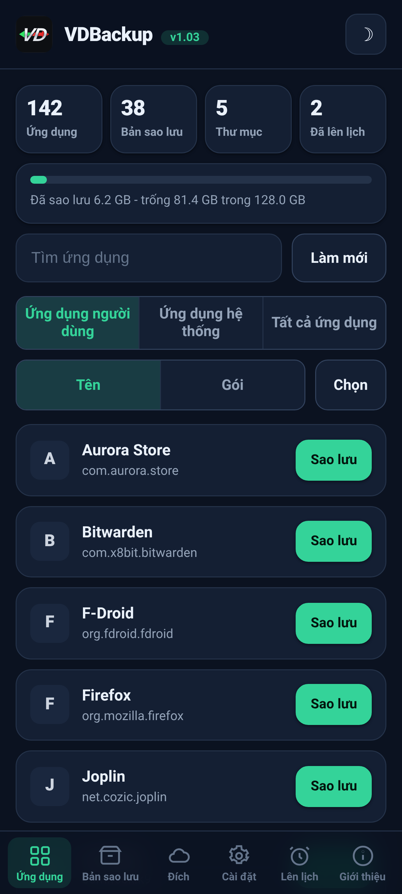
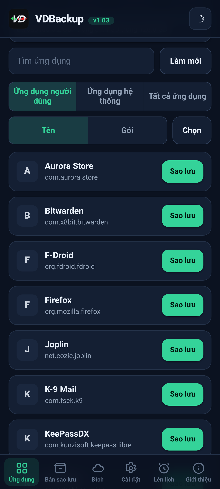
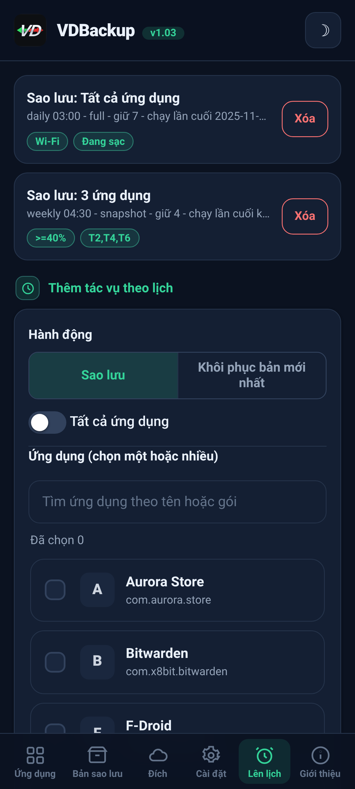
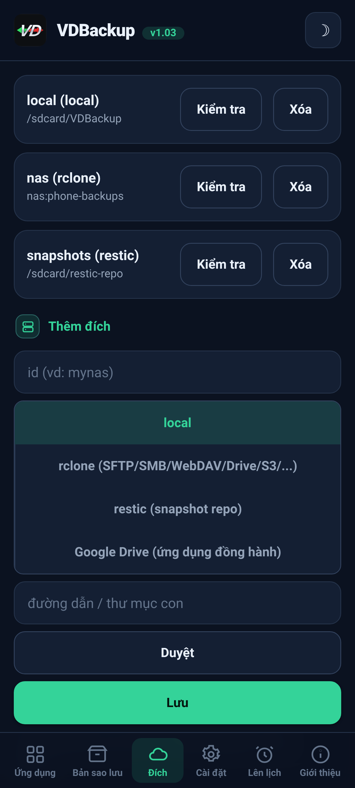
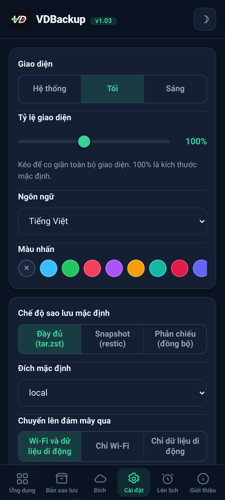
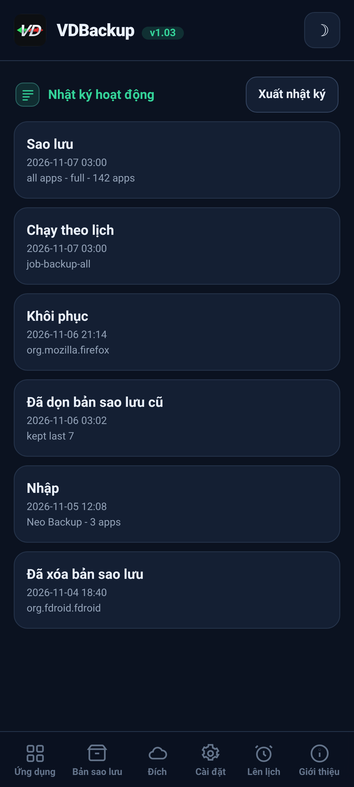

> **Languages:** [English](../USER-GUIDE.md) · [العربية](../ar/USER-GUIDE.md) · [Čeština](../cs/USER-GUIDE.md) · [Deutsch](../de/USER-GUIDE.md) · [Español](../es/USER-GUIDE.md) · [فارسی](../fa/USER-GUIDE.md) · [Français](../fr/USER-GUIDE.md) · [हिन्दी](../hi/USER-GUIDE.md) · [Bahasa Indonesia](../in/USER-GUIDE.md) · [Italiano](../it/USER-GUIDE.md) · [日本語](../ja/USER-GUIDE.md) · [한국어](../ko/USER-GUIDE.md) · [Nederlands](../nl/USER-GUIDE.md) · [Polski](../pl/USER-GUIDE.md) · [Português](../pt/USER-GUIDE.md) · [Русский](../ru/USER-GUIDE.md) · [Svenska](../sv/USER-GUIDE.md) · [ไทย](../th/USER-GUIDE.md) · [Türkçe](../tr/USER-GUIDE.md) · [Українська](../uk/USER-GUIDE.md) · Tiếng Việt · [中文](../zh/USER-GUIDE.md)

---

# Hướng dẫn người dùng VDBackup

Một hướng dẫn đầy đủ, thân thiện về VDBackup, từ cài đặt mô-đun đến tạo bản sao lưu đầu
tiên, khôi phục nó, gửi nó lên đám mây, lập lịch cho nó, và mở nó trên một PC nhiều năm
sau. Nếu bạn đã từng dùng Swift Backup, Neo-Backup hay Android-DataBackup trước đây, điều
này sẽ thấy quen thuộc, chỉ là mọi thứ diễn ra ở một nơi, không có gì phải "cho phép".

## Mục lục

- [1. VDBackup là gì](#1-vdbackup-là-gì)
- [2. Yêu cầu](#2-yêu-cầu)
- [3. Cài đặt và chạy lần đầu](#3-cài-đặt-và-chạy-lần-đầu)
- [4. Tham quan WebUI](#4-tham-quan-webui)
- [5. Tạo một bản sao lưu](#5-tạo-một-bản-sao-lưu)
  - [5.1 Chọn những gì để sao lưu](#51-chọn-những-gì-để-sao-lưu)
  - [5.2 Các chế độ sao lưu: Full, Snapshot, Mirror](#52-các-chế-độ-sao-lưu-full-snapshot-mirror)
  - [5.3 Nén](#53-nén)
  - [5.4 Mã hóa](#54-mã-hóa)
  - [5.5 Xác minh và chạy thử (dry-run)](#55-xác-minh-và-chạy-thử-dry-run)
  - [5.6 Sao lưu đặc biệt (tin nhắn, nhật ký cuộc gọi, Wi-Fi, Bluetooth, lịch, hình nền, DNS, cài đặt hệ thống)](#56-sao-lưu-đặc-biệt-tin-nhắn-nhật-ký-cuộc-gọi-wi-fi-bluetooth-lịch-hình-nền-dns-cài-đặt-hệ-thống)
  - [5.7 Sao lưu thư mục và tệp độc lập](#57-sao-lưu-thư-mục-và-tệp-độc-lập)
- [6. Khôi phục một bản sao lưu](#6-khôi-phục-một-bản-sao-lưu)
- [7. Đích: cục bộ và từ xa](#7-đích-cục-bộ-và-từ-xa)
  - [7.1 Sao lưu cài đặt của bạn](#71-sao-lưu-cài-đặt-của-bạn)
- [8. Lập lịch và lưu giữ](#8-lập-lịch-và-lưu-giữ)
- [9. Di chuyển vào: nhập Neo-Backup và Android-DataBackup](#9-di-chuyển-vào-nhập-neo-backup-và-android-databackup)
- [10. SSAID (ANDROID_ID của thiết bị)](#10-ssaid-android_id-của-thiết-bị)
- [11. Tính di động: mở các bản sao lưu trên PC](#11-tính-di-động-mở-các-bản-sao-lưu-trên-pc)
- [12. Điều khiển VDBackup từ một trợ lý AI](#12-điều-khiển-vdbackup-từ-một-trợ-lý-ai)
- [13. Khắc phục sự cố và Câu hỏi thường gặp](#13-khắc-phục-sự-cố-và-câu-hỏi-thường-gặp)
- [14. Gỡ cài đặt](#14-gỡ-cài-đặt)

---

## 1. VDBackup là gì

VDBackup là một mô-đun root với WebUI tích hợp sẵn giúp sao lưu và khôi phục các ứng dụng
của bạn cùng dữ liệu của chúng. Nó được thiết kế như kẻ kế thừa mở, root-native của Swift
Backup, Neo-Backup và Android-DataBackup: nó nhắm tới việc làm hợp của những gì các công
cụ đó làm, ở một nơi duy nhất, và nó thậm chí có thể nhập các bản sao lưu Neo-Backup và
Android-DataBackup hiện có của bạn để bạn có thể chuyển sang mà không mất gì cả.

Điểm khác biệt chính so với một ứng dụng sao lưu thông thường: VDBackup chạy **hoàn toàn
từ WebUI của trình quản lý root của bạn**, và mô-đun đã là root. Không có ứng dụng đồng
hành nào phải cài cho các tính năng cốt lõi, không có lời nhắc "cấp su" nào phải chấp
thuận, và không có gì phải bật lên. Bạn mở WebUI, chọn những gì để sao lưu, và chạy nó.

Mọi thứ VDBackup tạo ra đều dùng **các định dạng chuẩn** (tar, gzip, zstd, age, zip,
restic), nên các bản sao lưu của bạn không bao giờ bị khóa vào mô-đun và không bao giờ
gắn với thiết bị cụ thể của bạn. Xem [phần 11](#phần-11).

## Ảnh chụp màn hình

| Trang chủ | Ứng dụng | Lên lịch |
|:---:|:---:|:---:|
|  |  |  |
| **Đích** | **Cài đặt** | **Nhật ký hoạt động** |
|  |  |  |

## 2. Yêu cầu

- **Một thiết bị Android đã root** được quản lý bởi **KernelSU**, **APatch** hoặc
  **Magisk**. VDBackup được cài như một mô-đun từ trình quản lý đó.
- Đủ bộ nhớ trống cho các bản sao lưu của bạn (các bản sao lưu cục bộ nằm dưới thư mục
  trạng thái của mô-đun; xem [phần 3](#phần-3)).
- Không gì khác. Mô-đun đóng gói tất cả các tệp nhị phân nó cần (tar, zstd, lz4, rclone,
  rsync, ssh, restic), nên **sao lưu và khôi phục cục bộ hoạt động hoàn toàn ngoại tuyến**.
  Chỉ các đích đám mây mới nói chuyện với mạng.

Một vài phần bổ sung chi tiết (AppOps, SSAID, một vài bit hệ thống đặc quyền) dựa vào
khung Android; mô-đun xử lý chúng nội bộ, với một dự phòng shell thuần, và chúng suy giảm
một cách nhẹ nhàng khi chúng không khả dụng trên thiết bị của bạn.

## 3. Cài đặt và chạy lần đầu

1. Tải bản phát hành `VD-Backup-vX.Y.zip` mới nhất.
2. Trong trình quản lý KernelSU / APatch / Magisk của bạn, flash zip mô-đun như bất kỳ mô-đun
   nào khác.
3. Nó dùng được ngay lập tức, **không cần khởi động lại**. (Khởi động lại chỉ liên quan khi
   khôi phục SSAID; xem [phần 10](#phần-10).)
4. Mở **WebUI** của mô-đun từ trình quản lý. Đó là toàn bộ giao diện.

**Nên tải phiên bản nào.** Mỗi bản phát hành đi kèm nhiều phiên bản zip có thể flash, nên bạn chỉ tải
cái mình cần. Hãy chọn một:

- **`VD-Backup-<ver>-universal-full.zip`**: mọi kiến trúc CPU và mọi tệp nhị phân được nhúng sẵn,
  bao gồm `rclone` (nhà cung cấp đám mây: Google Drive, S3 và 70+ backend rclone khác) và `restic`
  (snapshot khử trùng lặp). Hoàn toàn ngoại tuyến, không bao giờ tải xuống gì. Hoạt động trên mọi
  thiết bị. Bản tải lớn nhất.
- **`VD-Backup-<ver>-universal-lite.zip`**: mọi kiến trúc, nhưng **không có** hai tệp nhị phân
  lớn nhất (`rclone` và `restic`). Bản tải nhỏ nhất; vẫn làm được sao lưu cục bộ, SSH/SFTP và
  rsync mà không cần tải xuống, với mã hóa `age` khả chuyển. Lần đầu tiên bạn dùng đích đám mây
  (`rclone`) hoặc chế độ snapshot (`restic`), WebUI sẽ đề nghị tải phần bổ trợ nhỏ theo kiến trúc
  đó một lần (được xác minh bằng SHA-256) và lưu vào bộ nhớ đệm; sau đó các tính năng ấy cũng
  hoạt động.
- **`VD-Backup-<ver>-<abi>-full.zip`** (một trong `arm64-v8a`, `armeabi-v7a`, `x86`, `x86_64`) -
  một kiến trúc duy nhất với mọi tệp nhị phân được nhúng sẵn (cùng tính năng như `universal-full`
  nhưng chỉ cho kiến trúc thiết bị của bạn, nên nhỏ hơn `universal-full`).

Nếu bạn biết kiến trúc thiết bị của mình và muốn đầy đủ mọi thứ được nhúng sẵn, hãy chọn
**`<abi>-full`** khớp (hầu hết điện thoại là **`arm64-v8a`**). Nếu bạn muốn bản tải nhỏ nhất và
không ngại một lần tải xuống được xác minh bằng SHA-256 trong lần đầu dùng nhà cung cấp đám mây
(`rclone`) hay snapshot (`restic`), hãy chọn **`universal-lite`**. Nếu bạn muốn mọi thứ được nhúng
sẵn mà không tải xuống gì (ngoại tuyến / khôi phục) nhưng không chắc về kiến trúc, hãy chọn một
phiên bản **full**. Khi cài đặt, mô-đun chỉ giữ lại kiến trúc của thiết bị bạn bất kể bạn flash
phiên bản nào.

Ở lần chạy đầu, mô-đun gieo một cấu hình mặc định (chỉ khi chưa có cái nào), nên các cài
đặt của bạn được giữ nguyên qua các lần cập nhật mô-đun.

**Trạng thái nằm ở đâu.** Dữ liệu làm việc của VDBackup, cấu hình, các công việc theo
lịch, các đích đã lưu, thông tin đăng nhập đã mã hóa, nhật ký và dấu vết kiểm toán, và khu
vực dàn dựng của bạn, nằm dưới:

```
/data/adb/vdbackup/
```

**Các bản sao lưu nằm ở đâu.** Bản thân các bản sao lưu được ghi vào bộ nhớ hiển thị cho
người dùng, được mã hóa bằng thông tin đăng nhập (nên chúng chỉ đọc được sau khi bạn mở
khóa thiết bị, và chúng sống sót khi gỡ mô-đun), một thư mục cho mỗi người dùng Android:

```
/sdcard/VDBackup/            (= /data/media/<user>/VDBackup)
```

Hãy nhớ điều này vì hai lý do: các bản sao lưu chiếm dung lượng dưới `/sdcard/VDBackup`, và
`/data/adb/vdbackup/logs/` là nơi bạn xem nếu có gì đó trục trặc.

## 4. Tham quan WebUI

WebUI được tổ chức thành một vài tab:

- **Home**: một tổng quan trang chủ hiển thị số lượng các bản sao lưu của bạn (ứng dụng, bản sao lưu, thư mục và công việc đã lập lịch) và một thanh lưu trữ cho biết các bản sao lưu của bạn dùng bao nhiêu dung lượng so với dung lượng trống, kèm huy hiệu trạng thái, sao chép hash và đường dẫn vào bảng tạm, và một hành động **Check for updates**.
- **Apps**: danh sách các ứng dụng đã cài (người dùng và hệ thống), mỗi cái hiển thị với
  tên thật, tên gói, và biểu tượng của nó (biểu tượng tải lười và được lưu đệm, nên danh
  sách vẫn phản hồi nhanh). Nút trên một hàng sao lưu ứng dụng; chạm vào hàng sẽ mở lịch sử
  sao lưu của ứng dụng đó, nơi bạn có thể khôi phục bất kỳ bản sao lưu trước nào.
- **Backups**: các bản sao lưu bạn đã có, mỗi cái hiển thị tên ứng dụng trên một dòng và
  tên gói trên dòng kế tiếp. Chạm vào một bản sao lưu để xem toàn bộ chi tiết của nó (phiên
  bản, ngày, kích thước, các mục đã bao gồm, số lượng quyền, và thiết bị mà nó đến từ đó).
  Đây cũng là nơi bạn khôi phục, chạy một bài kiểm tra khôi phục, xóa một bản sao lưu, hoặc
  nhập các bản sao lưu từ Neo-Backup hay Android-DataBackup.
- **Destinations**: quản lý nơi các bản sao lưu đi đến: bộ nhớ cục bộ cộng với bất kỳ đích
  từ xa nào bạn thêm (xem [phần 7](#phần-7)). Bạn có thể kiểm tra một đích ở
  đây trước khi dựa vào nó.
- **Settings**: một công tắc chủ đề sáng/tối, một bộ chọn màu nhấn (mẫu dựng sẵn, màu tùy chỉnh,
  hoặc đặt lại), một bộ chọn ngôn ngữ (giao diện hiển thị từ phải sang trái cho tiếng Ả Rập
  và tiếng Ba Tư), một thanh trượt tỷ lệ giao diện mà bạn kéo để co giãn toàn bộ
  giao diện (đầu trang, nội dung và thanh điều hướng dưới cùng cùng nhau) từ 85% đến 120% (100% là mặc định), cho các màn hình có mật độ điểm ảnh khác nhau, các mặc định cho công việc mới (nén mặc định, bật/tắt xác minh,
  mã hóa mặc định), chính sách mạng cho các lần truyền đám mây (xem [phần 7](#phần-7)), sao lưu tự động
  và danh sách ứng dụng loại trừ, tùy chọn nguồn cài đặt, khóa mã hóa, và lập lịch. Các thiết lập bật/tắt dùng công tắc gạt kiểu Android.
- **About**: phiên bản, liên kết, các dự án anh em (See also), tệp kê khai kiểm toán nhị phân đi kèm, và một hành động **Check for updates** báo cáo liệu một phiên bản mới hơn đã được phát hành hay chưa (cùng với ghi chú phát hành của nó). Bạn cài đặt mọi bản cập nhật thông qua trình quản lý root của mình, giống như cách bạn đã flash mô-đun.

Ứng dụng cũng tự kiểm tra phiên bản mới hơn mỗi khi bạn mở (nhiều nhất một lần mỗi giờ) và chỉ hiển thị biểu ngữ cập nhật khi có; im lặng khi đã mới nhất hoặc ngoại tuyến.

Các xác nhận và thông báo dùng hộp thoại trong ứng dụng (không phải các cửa sổ bật lên của
hệ thống kiểu cũ), và một lần khôi phục hoặc nhập sẽ yêu cầu bạn thừa nhận rằng nó ghi đè
dữ liệu ứng dụng hiện tại trước khi tiến hành.

Các lần sao lưu và khôi phục chạy **tách rời** như một tiến trình root nền. Bạn có thể đóng
WebUI, hoặc thậm chí đóng trình quản lý root, và thao tác vẫn tiếp tục. Khi bạn quay lại,
WebUI gắn lại và hiển thị tiến trình trực tiếp với nhãn pha đã bản địa hóa. Đối với một công
việc đang chạy, thẻ tiến trình cũng hiển thị tốc độ truyền trực tiếp và thời gian còn lại ước
tính, cùng một bộ đếm mục (ví dụ "12 of 40") với tên của mục hiện tại. Trên các ROM
hiển thị thông báo shell, bạn cũng nhận được một thông báo Android khi một công việc bắt
đầu và kết thúc; dù sao đi nữa, thẻ tiến trình trong ứng dụng là chỉ báo đáng tin cậy.

## 5. Tạo một bản sao lưu

Luồng cơ bản: mở **Apps**, chọn một ứng dụng, chọn những gì để bao gồm, chọn một chế độ,
đặt nén và (tùy chọn) mã hóa, rồi chạy. Tiến trình xuất hiện trực tiếp và một thông báo cho
bạn biết khi nó xong.

Trong hộp thoại sao lưu, bạn cũng có thể chọn **đích** cho bản sao lưu này, bộ nhớ cục bộ hoặc bất kỳ đích đám mây/từ xa nào bạn đã thêm, mà không cần đổi đích mặc định trong Cài đặt trước.

### 5.1 Chọn những gì để sao lưu

Đối với mỗi ứng dụng bạn có thể bao gồm bất kỳ tổ hợp nào của các mục này:

| Mục | Nó là gì |
|------|-----------|
| **APK** | Bản thân ứng dụng đã cài (APK gốc + bất kỳ split APK nào). |
| **data** | Dữ liệu riêng tư của ứng dụng (`/data/data`). Đây là "dữ liệu ứng dụng" thông thường. |
| **device-protected data** | Bộ nhớ direct-boot / được thiết bị bảo vệ (`/data/user_de`). Một số ứng dụng giữ cài đặt ở đây. |
| **external** | Dữ liệu ngoài của ứng dụng dưới `Android/data`. |
| **OBB** | Các tệp mở rộng OBB của ứng dụng (`Android/obb`), được một số trò chơi dùng. |
| **media** | Phương tiện của ứng dụng dưới `Android/media`. |

Một mặc định tốt cho "sao lưu ứng dụng này hoàn toàn" là bao gồm tất cả chúng. Nếu bạn chỉ
muốn dữ liệu (ví dụ để di chuyển một bản lưu trò chơi), bạn có thể bỏ chọn APK và các mục
OBB/media lớn.

VDBackup cũng bảo tồn những thứ làm cho một lần khôi phục trung thực: ngữ cảnh SELinux, sở
hữu uid/gid, chế độ tệp, thuộc tính mở rộng (xattr) và khả năng (capabilities).

### 5.2 Các chế độ sao lưu: Full, Snapshot, Mirror

VDBackup cung cấp ba chế độ. WebUI chọn sẵn **Full**, đó là lựa chọn đúng cho hầu hết mọi
người.

- **Full**: một bản sao lưu hoàn chỉnh, tự chứa, di động được ghi dưới dạng `tar.zst`
  (hoặc nén bạn chọn). Mỗi lần chạy tạo ra một bản sao lưu độc lập mà bạn có thể sao chép
  đi bất cứ đâu và mở trên một PC. Tốt nhất cho: một ảnh chụp sạch, di động của một ứng
  dụng mà bạn có thể lưu trữ và di chuyển quanh. Đây là mặc định và là lựa chọn di động
  nhất.
- **Snapshot**: tăng dần và có phiên bản, được hỗ trợ bởi `restic`. Mỗi lần chạy thêm một
  ảnh chụp tại một thời điểm mới vào một kho, chỉ lưu những gì đã thay đổi và khử trùng lặp
  qua các ảnh chụp. Tốt nhất cho: giữ một lịch sử đang chạy của một ứng dụng mà không phải
  trả kích thước đầy đủ ở mỗi lần chạy.
- **Mirror**: một đồng bộ 1:1 của dữ liệu đang chạy tới đích, được hỗ trợ bởi
  `rclone`/`rsync`. Nó giữ đích giống hệt những gì đang có trên thiết bị ngay lúc này (các
  tệp thay đổi được sao chép, các tệp bị xóa được xóa ở đích). Tốt nhất cho: một bản sao
  nhanh, luôn cập nhật, ví dụ tới một remote đám mây. Lưu ý rằng APK vẫn được lưu ở dạng
  nén ngay cả trong một mirror, không bao giờ ở dạng thô.

### 5.3 Nén

Bạn có thể chọn mức nén cho một bản sao lưu Full:

- **none**: không nén (nhanh nhất, lớn nhất).
- **lz4**: nén rất nhanh, nhẹ.
- **zstd**: mặc định, một cân bằng mạnh giữa tốc độ và tỷ lệ. Bạn cũng có thể chọn một mức
  (ví dụ một mức cao hơn cho một tệp nhỏ hơn).
- **gzip**: **"chế độ tương thích"**. gzip mở được bằng các công cụ tích hợp sẵn trên hầu
  như bất kỳ máy tính nào và trong hầu hết các trình quản lý tệp, không có gì thêm phải
  cài. Chọn cái này khi bạn quan tâm nhất đến việc có thể mở kho lưu trữ ở bất cứ đâu.

Nếu bạn không chọn, VDBackup dùng mặc định đã cấu hình của nó (zstd ở một mức hợp lý).

### 5.4 Mã hóa

Mã hóa là **tùy chọn** và di động. VDBackup mã hóa bằng **age** dùng một cụm mật khẩu
(scrypt), vốn được chọn cụ thể vì tính di động: bất kỳ công cụ `age` chuẩn nào trên bất kỳ
hệ điều hành nào đều có thể giải mã bản sao lưu của bạn chỉ với cụm mật khẩu. Mã hóa **không
bao giờ** gắn với các khóa phần cứng của thiết bị bạn, nên một bản sao lưu đã mã hóa khôi
phục được trên một thiết bị khác và mở được trên một PC. (Một chế độ zip AES-256 tương thích
cũng có sẵn cho các kho lưu trữ đã mã hóa mà bạn muốn mở bằng một cú nhấp đúp và một mật
khẩu.)

Để dùng mã hóa, tạo khóa mã hóa một lần (Settings), rồi bật mã hóa cho công việc của bạn và
đặt một cụm mật khẩu. Cụm mật khẩu là thứ bảo vệ bản sao lưu, vậy nên hãy chọn một cụm mạnh
- không có khóa phần cứng và không có cửa hậu khôi phục.

**Quy tắc APK (quan trọng):**

- **APK luôn được lưu ở dạng nén**, không bao giờ thô, để tiết kiệm dung lượng.
- **APK không được mã hóa theo mặc định**, vì APK của một ứng dụng là nội dung công khai.
- Mã hóa APK và mã hóa dữ liệu là **các công tắc độc lập**. Bật mã hóa dữ liệu **không** mã
  hóa APK. Nếu bạn cụ thể muốn APK cũng được mã hóa, hãy bật công tắc mã hóa APK một cách rõ
  ràng.

### 5.5 Xác minh và chạy thử (dry-run)

Hai tùy chọn an toàn giúp bạn tin tưởng một bản sao lưu trước khi dựa vào nó:

- **Verify**: sau khi ghi, VDBackup băm lại mỗi kho lưu trữ và kiểm tra nó so với
  manifest. Cái này **bật theo mặc định cho các bản sao lưu Full**. Nếu một tệp không khớp,
  công việc thất bại với một lỗi rõ ràng thay vì để bạn lại với một bản sao lưu hỏng âm
  thầm.
- **Dry-run**: lập kế hoạch cho công việc và báo cáo các kích thước nó sẽ tạo ra **mà
  không ghi gì cả**. Dùng nó để ước tính dung lượng hoặc để kiểm tra lựa chọn mục của bạn
  trước khi chạy thứ thật.

Khi một bản sao lưu đi tới một đích **đám mây**, VDBackup thêm hai lớp bảo vệ nữa. Nó chạy một
bước **checksum-verified** cuối cùng để kiểm tra lại bản sao đã tải lên so với bản gốc trên
remote, và khiến công việc thất bại (thay vì để lại một bản sao hỏng trên đám mây) nếu chúng
không khớp. Và trước một lần tải lên Full, nó kiểm tra **dung lượng trống** của remote và dừng
sớm với một lỗi rõ ràng **"not enough space"** nếu bản sao lưu sẽ không vừa, thay vì lấp đầy
remote rồi thất bại giữa chừng. (Kiểm tra dung lượng là cho các lần tải lên Full; Mirror là một
đồng bộ delta và được miễn trừ.)

### 5.6 Sao lưu đặc biệt (tin nhắn, nhật ký cuộc gọi, Wi-Fi, Bluetooth, lịch, hình nền, DNS, cài đặt hệ thống)

Bên dưới các danh sách ứng dụng trong tab **Backups**, **Sao lưu đặc biệt** bao gồm dữ liệu
toàn hệ thống không gắn với một ứng dụng đơn lẻ. Chọn các hạng mục và sao lưu chúng; chúng được
lưu trữ với cùng việc bảo toàn SELinux/xattr và mã hóa tùy chọn như các bản sao lưu ứng dụng. Các
hạng mục là:

| Hạng mục | Nó là gì |
|----------|-----------|
| **Tin nhắn (SMS/MMS)** | Các tin nhắn văn bản của bạn. |
| **Danh bạ và nhật ký cuộc gọi** | Danh bạ và lịch sử cuộc gọi của bạn. |
| **Mạng Wi-Fi** | Các mạng Wi-Fi bạn đã lưu. |
| **Bluetooth** | Các cặp ghép nối Bluetooth của bạn. |
| **Lịch** | Provider lịch (ứng dụng và dữ liệu). Một **`calendar.json` khả chuyển** cũng được ghi, nên các sự kiện của bạn đọc được trên PC mà không cần mô-đun. |
| **Hình nền** | Hình nền màn hình chính và màn hình khóa của bạn cùng `wallpaper_info.xml`, lưu ở dạng ảnh thô. |
| **DNS** | Chế độ và máy chủ DNS riêng tư của bạn. |
| **Cài đặt hệ thống** | Một bản dump đầy đủ các cài đặt system, global và secure của thiết bị. |

Đối với tin nhắn, nhật ký cuộc gọi và danh bạ, một **bản sao khả chuyển** (JSON mở được) cũng được
ghi, nên bạn có một bản sao xuyên thiết bị mà bạn có thể đọc trên PC mà không cần mô-đun.

**Cài đặt hệ thống là opt-in và ghi đè các cài đặt thiết bị của bạn khi khôi phục.** Giống hệt SSAID
(xem [phần 10](#phần-10)), hạng mục **Cài đặt hệ thống** là hạng mục nhạy cảm nhất: khôi phục nó sẽ
ghi đè các cài đặt trên toàn thiết bị của bạn, nên nó tắt trừ khi bạn chủ ý chọn nó, yêu cầu bạn thừa
nhận trước, và được ghi vào nhật ký hoạt động.

Khôi phục một bản sao lưu đặc biệt sẽ ghi đè dữ liệu hệ thống đang chạy và cần khởi động lại, nên nó
được canh gác sau một lời thừa nhận nổi bật và đáng tin cậy trên cùng thiết bị và cùng ROM. Các lần
khôi phục là **idempotent**: các hạng mục thô (tin nhắn, danh bạ, Wi-Fi, Bluetooth, lịch) được khôi
phục bằng cách **thay thế** dữ liệu thay vì hợp nhất nó, nên khôi phục cùng một bản sao lưu hai lần
không bao giờ tạo ra các bản trùng lặp, và DNS cùng cài đặt hệ thống chỉ đơn giản được áp dụng lại.

### 5.7 Sao lưu thư mục và tệp độc lập

Đôi khi bạn muốn sao lưu một thư mục hoặc tệp thông thường không phải là một ứng dụng, một thư mục
camera, một thư mục tài liệu, một cơ sở dữ liệu đơn. VDBackup có thể sao lưu **bất kỳ đường dẫn tuyệt
đối nào** trên bộ nhớ dùng chung hoặc dưới `/data`, với cùng định dạng khả chuyển như một bản sao lưu
ứng dụng: một kho lưu trữ `tar.zst` cộng một `manifest.json`, được niêm phong bằng SHA-256, kèm một
ghi chú RECOVERY khi bạn mã hóa nó. Các bản sao lưu đường dẫn này được giữ riêng, dưới một thư mục
`.paths` trong thư mục backups của bạn.

- **Chọn một đường dẫn và sao lưu nó.** Nguồn phải là một đường dẫn tuyệt đối dưới một trong các vị
  trí được phép (`/storage/emulated`, `/data/media`, `/sdcard`, `/data`). Các đường dẫn cố trèo ra
  ngoài bằng `..` sẽ bị từ chối.
- **Khôi phục ghi lại về vị trí gốc**, nên, như bất kỳ lần khôi phục nào, nó có tính phá hủy và yêu
  cầu bạn **xác nhận** trước khi nó ghi đè bất cứ thứ gì.
- Giống các bản sao lưu ứng dụng, sao lưu và khôi phục đường dẫn chạy **tách rời** với tiến trình
  trực tiếp, dùng nén bạn chọn, và có thể được mã hóa bằng một cụm mật khẩu.

## 6. Khôi phục một bản sao lưu

Mở tab **Backups**, chọn bản sao lưu bạn muốn, và bắt đầu khôi phục. Vì khôi phục là một
hành động phá hủy, VDBackup yêu cầu bạn **xác nhận** trước, và nó ghi lại hành động trong
một nhật ký kiểm toán cục bộ.

Một lần khôi phục là **trung thực**: VDBackup xóa trạng thái hiện tại của ứng dụng và giải
nén bản sao lưu, nên ứng dụng được đưa về **đúng trạng thái** được chụp trong bản sao lưu
đó (bao gồm sở hữu, chế độ, ngữ cảnh SELinux và xattr). Nó không phải là một lần hợp nhất -
nó là một lần khôi phục thật về thời điểm của bản sao lưu. Vì một lần khôi phục chạy với quyền root,
VDBackup cũng kiểm tra mọi kho lưu trữ trước khi giải nén bất cứ thứ gì và từ chối một kho bị giả mạo
cố ghi ra ngoài đích của nó, nên một bản sao lưu đã bị sửa đổi không bao giờ có thể ghi đè phần còn
lại của hệ thống bạn.

Các tùy chọn khôi phục hữu ích:

- **Restore-test**: giải nén bản sao lưu vào một khu vực dàn dựng tạm thời và xác minh nó
  **mà không chạm vào ứng dụng đang chạy**. Đây là cách an toàn để xác nhận một bản sao lưu
  còn nguyên vẹn và khôi phục được trước khi bạn ghi đè bất cứ thứ gì. Nếu bài kiểm tra thất
  bại bạn nhận được một lỗi rõ ràng và ứng dụng đã cài của bạn được để nguyên không bị chạm.
- **Partial restore**: chỉ khôi phục một số mục đã được sao lưu. Ví dụ, chỉ khôi phục dữ
  liệu ứng dụng mà không cài lại APK, hoặc khôi phục các tệp lưu mà không có OBB/media lớn.
  Chọn các mục bạn muốn trên màn hình khôi phục.
- Đối với các bản sao lưu **Snapshot** và **Mirror**, lần khôi phục kéo từ kho có phiên bản
  hoặc bản sao được phản chiếu tương ứng.
- **Install source**: theo mặc định một ứng dụng đã khôi phục báo cáo **Play Store** là
  nguồn cài đặt của nó (thay vì trông như được cài ngoài), đó là điều mà hầu hết các ứng dụng
  và các bài kiểm tra ứng dụng mong đợi. Bạn có thể tắt điều này trên toàn cục trong Settings
  hoặc theo từng lần khôi phục, và khi tắt thì nguồn cài đặt gốc được giữ lại. Một công tắc
  opt-in nâng cao **"giả mạo nguồn khởi tạo"** còn đi xa hơn và cũng làm cho gói khởi tạo và
  nguồn gói của ứng dụng trông như được cài từ Play; nó chỉnh sửa cơ sở dữ liệu gói của hệ
  thống (được sao lưu trước tiên) và có hiệu lực sau khi khởi động lại.

**Khôi phục hàng loạt.** Tab **Backups** có chế độ **Select**, giống như cách tab Apps có nó
cho sao lưu hàng loạt. Bật **Select**, đánh dấu các bản sao lưu bạn muốn bằng các ô đánh dấu
của chúng, và khôi phục tất cả cùng một lúc. Một hộp thoại tùy chọn duy nhất bao trùm toàn bộ
lựa chọn, việc xác nhận ghi đè, kiểm tra khôi phục và tùy chọn nguồn cài đặt áp dụng cho mọi
bản sao lưu bạn đã chọn, và chúng được khôi phục lần lượt nối tiếp nhau.

**Xóa một bản sao lưu.** Mở chi tiết của một bản sao lưu (hoặc lịch sử của một ứng dụng) và
dùng **Delete**; bạn được yêu cầu xác nhận, và việc xóa được ghi vào nhật ký hoạt động. Bạn
cũng có thể giới hạn số bản sao lưu giữ lại cho mỗi ứng dụng (lưu giữ) để các bản cũ được tỉa
tự động.

**Gắn một ứng dụng đã cài làm ứng dụng hệ thống.** Từ lịch sử sao lưu của một ứng dụng,
**Mount as system** dàn dựng APK của ứng dụng vào một mô-đun con overlay của VDBackup để trình
quản lý root phục vụ nó từ `/system/app` (hoặc `/system/priv-app`), phân vùng `/system` thật không bao
giờ bị chạm tới. Với **NoMount** trên KernelSU nó áp dụng trực tiếp; nếu không thì nó áp dụng
sau khi khởi động lại. Điều này không bao giờ phụ thuộc vào việc NoMount phải được cài.

## 7. Đích: cục bộ và từ xa

Theo mặc định, các bản sao lưu được ghi vào bộ nhớ **cục bộ** dưới thư mục trạng thái của
mô-đun. Bạn cũng có thể thêm các đích từ xa trong tab **Destinations**. Đối với đích cục bộ, **Browse**
mở một bộ chọn thư mục để bạn chọn một thư mục con trong bộ nhớ dùng chung (`/sdcard`) thay vì nhập đường dẫn.

Việc truyền từ xa được xử lý bởi các công cụ đóng gói sẵn:

- **rclone**: trung tâm cho một loạt rất lớn các remote: **SFTP, SMB, WebDAV, FTP, S3,
  Google Drive** và hơn 70 dịch vụ khác.
- **rsync** và bộ **ssh/scp/sftp**: cho đồng bộ delta và các đích SSH thuần.
- **restic**: các kho **Snapshot** đã mã hóa, khử trùng lặp (cục bộ hoặc từ xa).

**Tạo một remote đám mây (không cần SSH).** Trong tab Destinations, chọn loại đích
**rclone** và dùng **Add cloud remote**. Bạn có thể kết nối **bất kỳ backend rclone nào**:
menu thả xuống cung cấp những cái phổ biến (**Google Drive, Dropbox, OneDrive, Box, pCloud,
Mega, Backblaze B2, S3, SFTP, WebDAV, FTP, SMB**) cùng một tùy chọn **Custom (advanced)** nơi
bạn gõ bất kỳ loại backend nào khác và các tham số `key=value` của nó. Điền các trường
(host/user/password, hoặc các khóa S3, chẳng hạn) và lưu. Với các nhà cung cấp đăng nhập cho
bạn bằng trình duyệt (Google Drive, Dropbox, OneDrive, Box, pCloud) hãy dùng nút **Authorize
in browser**: nó đăng nhập cho bạn qua trình duyệt của chính điện thoại và tự động bắt lấy
token, nên **không cần PC** (dán token thủ công vẫn hoạt động như một phương án dự phòng).
Remote sau đó xuất hiện trong danh sách remote của đích. Mật khẩu được lưu ở dạng che giấu,
không bao giờ ở dạng văn bản rõ. Bạn có thể liệt kê và xóa các remote của mình từ cùng một chỗ.

Hai quy tắc giữ cho việc dùng từ xa an toàn:

- **Thông tin đăng nhập được lưu đã mã hóa** khi nghỉ trong thư mục trạng thái của mô-đun,
  không bao giờ ở dạng văn bản rõ.
- **Xác thực trước khi dùng.** Dùng bài kiểm tra đích trong tab Destinations để xác nhận
  một đích hoạt động trước khi bạn hướng một bản sao lưu thật vào nó.

**Chính sách mạng (Wi-Fi so với dữ liệu di động).** Trong Settings, "Cloud transfers over"
cho phép bạn hạn chế loại kết nối nào mà các lần truyền đám mây có thể dùng: **Wi-Fi và dữ
liệu di động** (mặc định), **chỉ Wi-Fi**, hoặc **chỉ dữ liệu di động**. Khi bạn hạn chế nó,
mọi lần truyền đám mây, thủ công hay theo lịch, tải lên hay khôi phục, kiểm tra kết nối
đang hoạt động trước và từ chối chạy trên kết nối sai, nên một chính sách chỉ-Wi-Fi không
bao giờ tiêu dữ liệu di động. Các bản sao lưu cục bộ không bao giờ bị ảnh hưởng.

**Google Drive.** Bạn có hai cách để tiếp cận Google Drive:

1. **Qua rclone**: thêm Drive như một remote rclone giống bất kỳ đích nào khác, không có
   ứng dụng thêm và **không có tài khoản Google Cloud**. Trên bất kỳ máy tính nào chạy
   `rclone authorize "drive"` một lần, đăng nhập vào tài khoản Google của bạn trong trình
   duyệt, và dán token nó in ra vào trường token của remote Drive.
2. **Qua ứng dụng đồng hành tùy chọn**: một ứng dụng đồng hành nhỏ, opt-in xử lý việc đăng
   nhập Google và tải lên Drive. Nó được cài **chỉ khi bạn chọn một cách rõ ràng đích đồng
   hành Google Drive**, không bao giờ theo mặc định, và nó bị gỡ khi bạn tắt nó. Màn hình
   đồng ý Google một lần là bước duy nhất diễn ra bên ngoài WebUI. Khi ứng dụng đồng hành
   được cài, VDBackup nhắc bạn **luôn ẩn nó với [HMA-OSS](https://github.com/frknkrc44/HMA-OSS)** để sự hiện diện của nó không làm
   lộ root hoặc một bootloader đã mở khóa, và nó đề nghị thêm nó vào danh sách [HMA-OSS](https://github.com/frknkrc44/HMA-OSS) giúp
   bạn. VDBackup cũng nhắc bạn, khi có bản sao lưu cục bộ, ẩn thư mục sao lưu (/sdcard/VDBackup) bằng SUSFS vì cùng lý do.

### 7.1 Sao lưu cài đặt của bạn

Bản thiết lập VDBackup của bạn, tức là các đích đến, lịch trình, cài đặt sẵn và thông tin xác thực đã lưu, có thể được ghi vào một tệp duy nhất và mang sang thiết bị khác hoặc khôi phục sau khi cài đặt lại. Trong **Cài đặt**, mục **Sao lưu cài đặt**:

- **Xuất cài đặt** ghi một tệp mã hóa vào `VDBackup/.export`. Nó luôn yêu cầu một cụm mật khẩu, vì tệp chứa mật khẩu từ xa của bạn.
- **Nhập cài đặt** đọc lại tệp đó và hợp nhất vào thiết bị này, mà không xóa bất cứ thứ gì đã có.
- **Xóa thông tin xác thực đã lưu** xóa mật khẩu từ xa đã lưu và khóa mã hóa thiết bị trong một bước; các đích đến, lịch trình và bản sao lưu của bạn vẫn ở nguyên.

## 8. Lập lịch và lưu giữ

VDBackup có thể chạy các bản sao lưu, và các bản khôi phục, tự động theo một lịch. Trong bộ
lập lịch bạn định nghĩa một công việc với:

- một **mục tiêu**: một ứng dụng duy nhất, một tập hợp ứng dụng, hoặc **tất cả ứng dụng**
  (trừ danh sách ứng dụng loại trừ), và các mục/chế độ để dùng,
- một **hành động**: **Back up** (mặc định) hoặc **Restore latest**, khôi phục bản sao lưu
  gần nhất của mỗi ứng dụng mục tiêu,
- một đích,
- một **lịch kiểu cron**: theo giờ, theo ngày hoặc theo tuần, vào một thời điểm bạn chọn
  (HH:MM),
- một cài đặt **lưu giữ**: **giữ N** bản sao lưu gần nhất cho công việc đó, các bản cũ hơn
  được tỉa tự động,
- các **điều kiện chạy** tùy chọn: chỉ trên **Wi-Fi**, chỉ khi đang **sạc**, chỉ ở mức **pin
  tối thiểu** trở lên, và chỉ vào các **ngày trong tuần** đã chọn.

Các công việc theo lịch được kích hoạt bởi một nhịp lúc khởi động trong mô-đun: khi một công
việc đến hạn nó chạy, ghi lại thời điểm chạy lần cuối để nó không kích hoạt hai lần, và áp
dụng lưu giữ để tỉa các bản sao lưu cũ. Vì mọi thứ chạy với quyền root ở nền, các bản sao
lưu theo lịch không cần WebUI phải mở.

**Điều kiện chạy (cổng).** Một công việc theo lịch có thể mang các điều kiện phải được thỏa để
nó chạy: chỉ Wi-Fi, chỉ khi sạc, một mức pin tối thiểu, và các ngày cụ thể trong tuần. Khi một
công việc đến hạn nhưng một điều kiện không được thỏa, nó bị **bỏ qua và thử lại ở lần kiểm tra
kế tiếp**: lịch của nó không đẩy tiến, nên nó chạy ngay khi điều kiện được thỏa. Một kiểm tra
an toàn nhiệt tích hợp cũng bỏ qua một công việc theo lịch khi thiết bị quá nóng. Mỗi lần bỏ qua
như vậy được ghi vào nhật ký hoạt động.

**Khôi phục theo lịch ghi đè ở mỗi lần chạy.** Một công việc **Restore latest** khôi phục lại
bản sao lưu gần nhất của mỗi ứng dụng mục tiêu mỗi khi nó kích hoạt, và khôi phục là hành động
phá hủy: ở mỗi lần chạy nó **ghi đè dữ liệu hiện tại của ứng dụng** bằng bản sao lưu gần nhất.
Điều này là có chủ đích và phải tự chọn, chỉ chọn nó khi bạn muốn giữ các mục tiêu ở bản sao
lưu gần nhất của chúng.

**Tự động sao lưu khi cài đặt/cập nhật.** Trong Settings bạn có thể bật **sao lưu tự động**:
chính nhịp nền đó nhận thấy các ứng dụng vừa được cài mới hoặc được cập nhật và sao lưu chúng
cho bạn (với lưu giữ keep-N). Lần chạy đầu tiên chỉ ghi lại những gì đã được cài, nên việc bật
nó không bao giờ sao lưu toàn bộ thiết bị của bạn cùng một lúc.

**Ứng dụng loại trừ (danh sách chặn).** Cũng trong Settings, bạn có thể loại trừ các ứng dụng
mà bạn không bao giờ muốn được sao lưu tự động hoặc theo lịch; bạn có thể thêm nhiều ứng dụng cùng
lúc (chọn nhiều), và các ứng dụng bị loại trừ được cả hai bỏ qua.

**Cấu hình sao lưu sẵn.** Cũng trong Cài đặt, bạn có thể lưu các cấu hình có tên, bộ mục cần sao lưu, như chỉ APK hoặc APK + OBB, và chọn một trong hộp thoại sao lưu để điền lựa chọn mục cùng lúc.

**Mục sao lưu theo ứng dụng.** Cũng trong Cài đặt, bạn có thể chọn chính xác những mục nào mỗi ứng dụng sao lưu trong sao lưu hàng loạt, tự động và theo lịch, ví dụ chỉ APK, hoặc APK + OBB. Một bản sao lưu thủ công đơn lẻ vẫn cho bạn chọn lúc đó, bắt đầu từ bộ của ứng dụng. Ứng dụng bạn không đặt ở đây sẽ sao lưu mọi thứ.

**Thẻ ứng dụng.** Chạm vào một ứng dụng trong Cài đặt (Mục và thẻ theo ứng dụng) để gán cho nó các nhãn tự do, ví dụ games hoặc work. Một bộ chọn thẻ sẽ xuất hiện phía trên danh sách ứng dụng: chọn một thẻ để chỉ hiện ứng dụng của nó, và sao lưu cả nhóm cùng lúc. Bạn cũng có thể mở nó từ tab Ứng dụng: chạm vào một ứng dụng, rồi chọn Mục và thẻ.

**Nhật ký hoạt động.** Tab Schedule có một nút **View activity log** mở ra một màn hình đầy đủ (ngay
lập tức) hiển thị dấu vết kiểm toán cục bộ, sao lưu, khôi phục, xóa, các lần chạy theo lịch và tự
động, và các lần tỉa, mới nhất trước. Một hành động **Export logs** lưu một tệp nhật ký (trong thư
mục sao lưu) mà bạn có thể đính kèm vào một báo cáo phản hồi hoặc báo lỗi.

## 9. Di chuyển vào: nhập Neo-Backup và Android-DataBackup

Nếu bạn đến từ Neo-Backup hoặc Android-DataBackup, bạn không phải bắt đầu lại từ đầu. Từ tab
**Backups** bạn có thể **nhập** các bản sao lưu hiện có của mình:

1. Hướng VDBackup vào vị trí sao lưu Neo-Backup hoặc Android-DataBackup hiện có của bạn
   (import-scan liệt kê những gì nó tìm thấy ở đó).
2. Chọn các bản sao lưu nào để nhập.
3. Bắt đầu nhập. Giống các thao tác dài khác nó chạy tách rời với tiến trình trực tiếp.

**Các bản sao lưu Neo-Backup được mã hóa bằng mật khẩu được hỗ trợ.** Các bản sao lưu được
mã hóa AES-256 của Neo-Backup có thể được nhập, bạn được **nhắc nhập mật khẩu** khi cần, và
mật khẩu chỉ được dùng để giải mã, không bao giờ lưu trong dòng lệnh.

## 10. SSAID (ANDROID_ID của thiết bị)

SSAID là `ANDROID_ID` theo từng ứng dụng, một định danh ở cấp thiết bị mà một số ứng dụng
đọc. VDBackup có thể sao lưu và khôi phục nó, nhưng đây là thứ nhạy cảm nhất mà nó chạm tới,
nên nó được xử lý với sự cẩn trọng đặc biệt:

- **Nó là TÙY CHỌN và TẮT theo mặc định.** VDBackup sẽ **không bao giờ** chụp hoặc khôi
  phục SSAID trừ khi bạn bật nó một cách rõ ràng cho công việc đó. WebUI hiển thị một thông
  báo "Optional" được đánh dấu rõ ràng, được tô sáng ở bất cứ đâu SSAID xuất hiện (sao lưu,
  khôi phục và nhập), và nó vẫn tắt cho đến khi bạn opt in.
- **Nó chỉ áp dụng sau khi khởi động lại khi khôi phục.** Trình cung cấp cài đặt Android lưu
  đệm các giá trị này, nên một SSAID đã khôi phục chỉ có hiệu lực sau khi bạn khởi động lại
  thiết bị.
- **Giá trị trước đó luôn được sao lưu trước tiên.** Trước khi ghi đè bất kỳ SSAID nào,
  VDBackup sao chép `settings_ssaid.xml` đang chạy nguyên từng byte vào một bản sao lưu có
  dấu thời gian (bản này không bao giờ bị tự động xóa). Nếu bản sao an toàn đó không thể
  được tạo, việc ghi đè không diễn ra. Để hoàn tác, khôi phục tệp đã lưu đó và khởi động
  lại.

**Khuyến nghị:** hãy để SSAID tắt trừ khi bạn cụ thể biết mình cần nó (ví dụ, một ứng dụng
cụ thể tự khóa mình vào ID thiết bị và mà bạn đang di chuyển một cách có chủ ý). Đối với các
bản sao lưu ứng dụng và dữ liệu thông thường bạn không cần nó.

## 11. Tính di động: mở các bản sao lưu trên PC

Các bản sao lưu của bạn **không bị khóa vào mô-đun này** và **không bao giờ gắn với phần
cứng**. Mọi thứ dùng các định dạng chuẩn, nên bạn có thể mở một bản sao lưu trên Windows,
macOS hoặc Linux mà không cần cài VDBackup.

Một thư mục sao lưu Full chứa một `manifest.json` (nguồn sự thật mô tả mỗi tệp, phiên bản
ứng dụng và chủ sở hữu/ngữ cảnh gốc), các APK dưới dạng `*.apk.zst`, và các kho dữ liệu
dưới dạng `<item>.tar.zst` (hoặc `.tar.gz` / `.tar.lz4`), tùy chọn có một `.age` ở cuối khi
được mã hóa.

Để mở một cái trên một PC, nói ngắn gọn:

- **Giải mã** (chỉ nếu tệp kết thúc bằng `.age`) với công cụ `age` chuẩn và cụm mật khẩu
  hoặc tệp khóa của bạn.
- **Giải nén và trích xuất**: `.tar.zst` với `zstd` rồi `tar`; `.tar.gz` với `tar` trực
  tiếp; `.tar.lz4` qua `zstd --format=lz4`. Một APK chỉ là một APK được nén zstd, nên giải
  nén `base.apk.zst` cho bạn một `base.apk` bình thường có thể cài được.

Mỗi bản sao lưu đã mã hóa đi kèm một ghi chú **RECOVERY** chứa các lệnh sao chép-dán chính
xác cho Windows, macOS và Linux. Xem
[`../module/etc/RECOVERY.md`](RECOVERY.md) để biết bộ công cụ đầy đủ, từng bước.

Lưu ý rằng các ngữ cảnh SELinux, uid/gid và chế độ được lưu bên trong tar và chỉ được áp
dụng lại đúng cách khi bạn khôi phục trên Android, trên một PC bạn vẫn nhận được tất cả các
tệp của mình, chỉ là không có sự sở hữu đặc thù Android được thực thi.

## 12. Điều khiển VDBackup từ một trợ lý AI

VDBackup được xây dựng để thân thiện với các trợ lý và tác nhân AI, không chỉ với con người.
WebUI chỉ là một trong các máy khách của một API JSON nhỏ; một tác nhân có thể quản trị
**mọi** hành động của mô-đun theo kiểu headless qua cùng API đó (mỗi lệnh trả về một đối
tượng JSON duy nhất, các thao tác dài chạy tách rời và bạn thăm dò tiến trình của chúng, và
cùng các lan can an toàn áp dụng, SSAID vẫn opt-in, các hành động làm thay đổi vẫn được xác
nhận và kiểm toán).

Nếu bạn muốn một trợ lý chạy các bản sao lưu và khôi phục cho bạn, hãy hướng nó tới
[`AI-AGENTS.md`](AI-AGENTS.md), tài liệu này ghi lại toàn bộ bề mặt điều khiển: giao kèo
lệnh, mỗi động từ với các đối số và giá trị trả về của nó, và các quy tắc an toàn mà một tác
nhân phải tôn trọng.

## 13. Khắc phục sự cố và Câu hỏi thường gặp

**Nhật ký ở đâu?** Dưới thư mục trạng thái mô-đun, `/data/adb/vdbackup/logs/`. Tiến trình
trực tiếp cho một thao tác đang chạy ở trong `progress-<opid>.json`, và **dấu vết kiểm toán**
của các hành động làm thay đổi (restore, delete, import, thay đổi SSAID) ở trong
`audit.jsonl`.

**Một lần sao lưu/khôi phục có vẻ bị kẹt hoặc tôi đã đóng WebUI.** Các thao tác chạy tách
rời, nên đóng WebUI không dừng chúng. Mở lại WebUI và nó gắn lại vào bất kỳ thao tác đang
chạy nào và hiển thị tiến trình hiện tại.

**Tôi nhận được một thông báo `ERR_...`.** Các lỗi được báo cáo với một mã rõ ràng. Một vài
mã phổ biến:
- `ERR_VERIFY`, một kho lưu trữ đã ghi không khớp hash manifest của nó (xác minh đã bắt
  được một bản sao lưu xấu). Chạy lại bản sao lưu.
- `ERR_RESTORE_TEST`, một bài kiểm tra khôi phục thất bại; bản sao lưu không giải nén/xác
  minh sạch sẽ và ứng dụng đang chạy của bạn được để nguyên không bị chạm.
- `ERR_UNSAFE_ARCHIVE`, một kho lưu trữ bị từ chối vì nó cố ghi ra ngoài thư mục đích của mình
  (đường dẫn tuyệt đối hoặc `..`). Điều này bảo vệ bạn khỏi một bản sao lưu bị giả mạo; không có gì
  được ghi.
- `ERR_QUOTA`, một remote đám mây không có đủ dung lượng trống cho một lần tải lên Full; bản sao
  lưu đã bị dừng trước khi tải lên bất cứ thứ gì.

**Đích từ xa của tôi thất bại.** Dùng **bài kiểm tra** đích trong tab Destinations để xác
thực thông tin đăng nhập và kết nối. Nhớ rằng chỉ các đích đám mây mới cần mạng; sao
lưu/khôi phục cục bộ hoàn toàn ngoại tuyến.

**Có bất kỳ phần nào trong số này gọi về nhà hay tải xuống lúc chạy không?** Không. Tất cả
các tệp nhị phân được đóng gói trong mô-đun lúc build; không có gì được lấy về thiết bị lúc
chạy. Chỉ các đích đám mây (rclone/restic/ssh) mới nói chuyện với mạng, và chỉ khi bạn dùng
chúng.

**Bản sao lưu của tôi có khôi phục được trên một điện thoại khác không?** Có, các bản sao
lưu di động và không gắn với phần cứng thiết bị. (SSAID là ngoại lệ đặc thù thiết bị duy
nhất, và nó là opt-in và áp dụng khi khởi động lại; xem
[phần 10](#phần-10).)

**Bản sao lưu đã mã hóa của tôi không mở được, tôi đã mất cụm mật khẩu.** Không có cửa hậu
khôi phục theo thiết kế; cụm mật khẩu là thứ bảo vệ bản sao lưu. Hãy giữ nó an toàn.

## 14. Gỡ cài đặt

Gỡ VDBackup như bất kỳ mô-đun nào khác từ trình quản lý KernelSU / APatch / Magisk của bạn. Việc gỡ **giữ nguyên thiết lập của bạn** và chỉ xóa trạng thái tạm thời, nên cài lại về sau sẽ tiếp nhận cấu hình, đích đến và lịch trình của bạn. Nó giữ các bản sao lưu của bạn tại `/sdcard/VDBackup` (định dạng chuẩn, mở được trên PC mà không cần mô-đun), cấu hình của bạn tại `/data/adb/vdbackup`, và thông tin xác thực đã lưu, rclone.conf cùng khóa age tại `/data/misc_ce/0/vdbackup` được mã hóa bằng thông tin xác thực (khóa cho đến lần mở khóa đầu tiên). Để xóa bất kỳ mục nào trong số này, hãy tự xóa thư mục đó sau khi gỡ.

<!-- doc-footer -->

---

> _Tài liệu này được tạo bằng Claude (Anthropic) và được duy trì bởi VD171. Chúng tôi hoan nghênh các chỉnh sửa và cải tiến; xem [CONTRIBUTING.md](CONTRIBUTING.md)._
