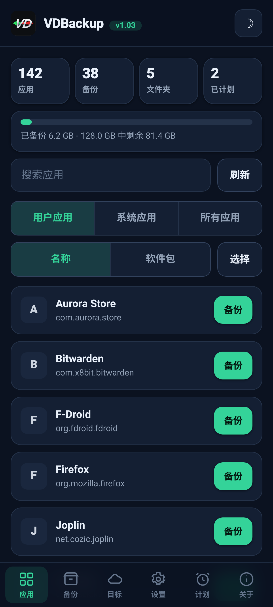
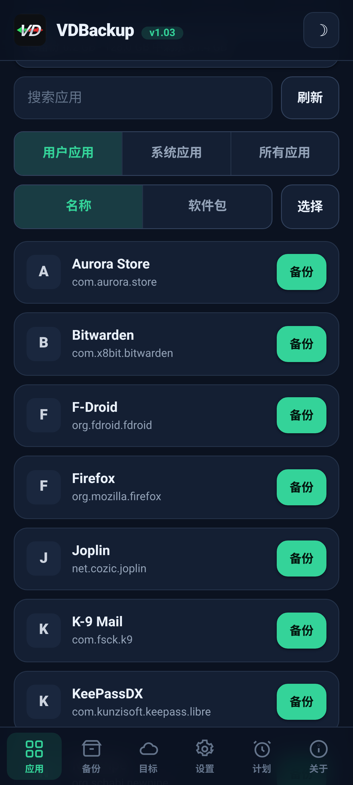
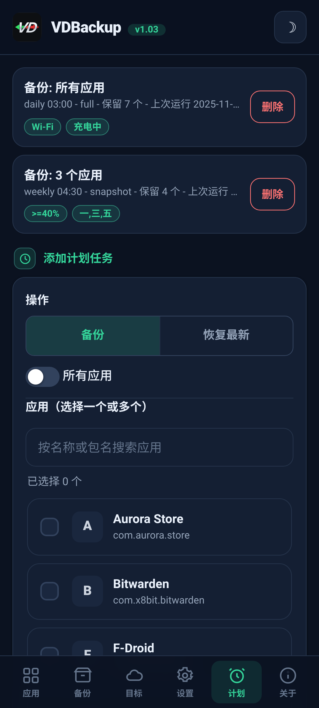
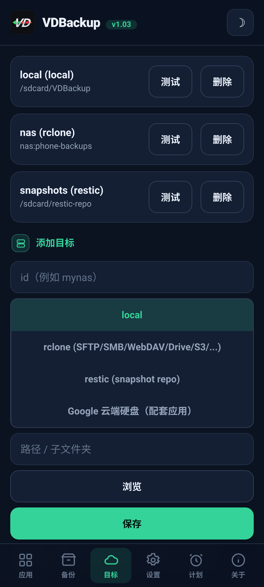
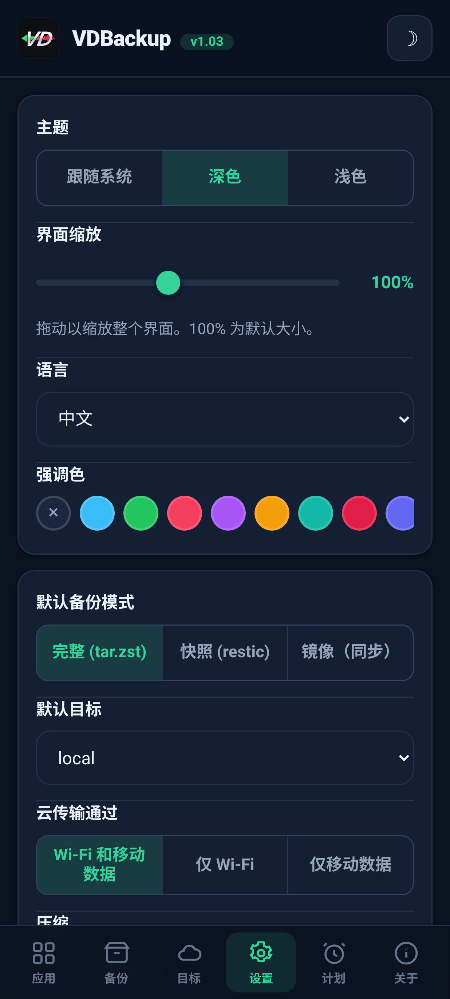
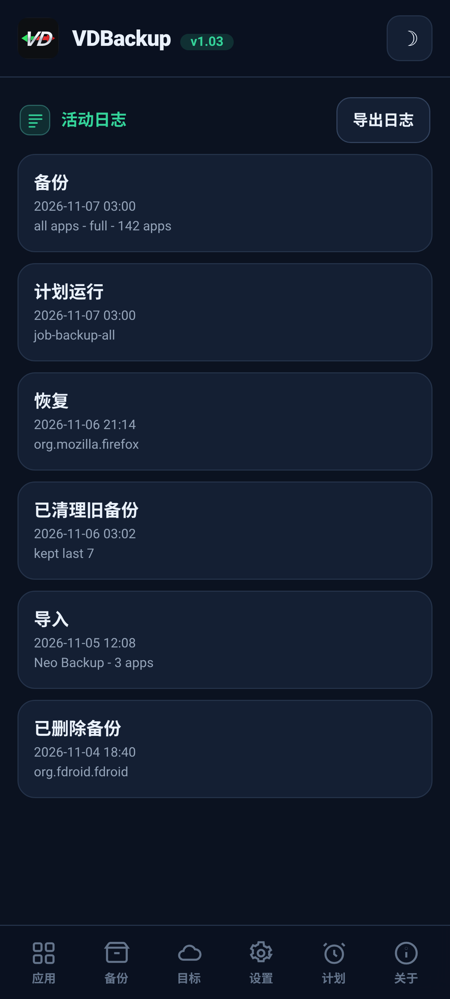

> **Languages:** [English](../USER-GUIDE.md) · [العربية](../ar/USER-GUIDE.md) · [Čeština](../cs/USER-GUIDE.md) · [Deutsch](../de/USER-GUIDE.md) · [Español](../es/USER-GUIDE.md) · [فارسی](../fa/USER-GUIDE.md) · [Français](../fr/USER-GUIDE.md) · [हिन्दी](../hi/USER-GUIDE.md) · [Bahasa Indonesia](../in/USER-GUIDE.md) · [Italiano](../it/USER-GUIDE.md) · [日本語](../ja/USER-GUIDE.md) · [한국어](../ko/USER-GUIDE.md) · [Nederlands](../nl/USER-GUIDE.md) · [Polski](../pl/USER-GUIDE.md) · [Português](../pt/USER-GUIDE.md) · [Русский](../ru/USER-GUIDE.md) · [Svenska](../sv/USER-GUIDE.md) · [ไทย](../th/USER-GUIDE.md) · [Türkçe](../tr/USER-GUIDE.md) · [Tiếng Việt](../vi/USER-GUIDE.md) · 中文

---

# VDBackup 用户指南

一份完整而友好的 VDBackup 教程，从安装模块到创建第一个备份、恢复它、将其发送到云端、为其
设定计划，以及在多年后于 PC 上打开它。如果你以前用过 Swift Backup、Neo-Backup 或
Android-DataBackup，这会让你感到熟悉 - 只不过一切都在一个地方完成，没有任何需要"允许"的东西。

## 目录

- [1. What VDBackup is](#1-what-vdbackup-is)
- [2. Requirements](#2-requirements)
- [3. Install and first run](#3-install-and-first-run)
- [4. The WebUI tour](#4-the-webui-tour)
- [5. Making a backup](#5-making-a-backup)
  - [5.1 Choosing what to back up](#51-choosing-what-to-back-up)
  - [5.2 Backup modes: Full, Snapshot, Mirror](#52-backup-modes-full-snapshot-mirror)
  - [5.3 Compression](#53-compression)
  - [5.4 Encryption](#54-encryption)
  - [5.5 Verify and dry-run](#55-verify-and-dry-run)
  - [5.6 Special backups (messages, call log, Wi-Fi, Bluetooth, calendar, wallpaper, DNS, system settings)](#56-special-backups-messages-call-log-wi-fi-bluetooth-calendar-wallpaper-dns-system-settings)
  - [5.7 Standalone folder and file backups](#57-standalone-folder-and-file-backups)
- [6. Restoring a backup](#6-restoring-a-backup)
- [7. Destinations: local and remote](#7-destinations-local-and-remote)
- [8. Scheduling and retention](#8-scheduling-and-retention)
- [9. Migrating in: importing Neo-Backup and Android-DataBackup](#9-migrating-in-importing-neo-backup-and-android-databackup)
- [10. SSAID (device ANDROID_ID)](#10-ssaid-device-android_id)
- [11. Portability: opening backups on a PC](#11-portability-opening-backups-on-a-pc)
- [12. Driving VDBackup from an AI assistant](#12-driving-vdbackup-from-an-ai-assistant)
- [13. Troubleshooting and FAQ](#13-troubleshooting-and-faq)
- [14. Uninstalling](#14-uninstalling)

---

## 1. What VDBackup is

VDBackup 是一个带内置 WebUI 的 root 模块，用于备份和恢复你的应用及其数据。它被设计为 Swift
Backup、Neo-Backup 和 Android-DataBackup 的开放、root 原生的继任者：它力求在一个地方完成这些
工具功能的并集，甚至还能导入你现有的 Neo-Backup 和 Android-DataBackup 备份，让你迁移过来时不
丢失任何东西。

与普通备份应用的关键区别：VDBackup **完全在你的 root 管理器的 WebUI 中**运行，而模块本身就
已经是 root。核心功能不需要安装任何配套应用，没有需要批准的"授予 su"提示，也没有需要打开的
开关。你打开 WebUI，选择要备份的内容，然后运行它。

VDBackup 生成的一切都使用**标准格式**（tar、gzip、zstd、age、zip、restic），因此你的备份永远
不会被锁定在模块里，也永远不会绑定到你的特定设备。参见
[第 11 节](#第-11-节)。

## 截图

| 主页 | 应用 | 计划 |
|:---:|:---:|:---:|
|  |  |  |
| **目标** | **设置** | **活动日志** |
|  |  |  |

## 2. Requirements

- **一台已 root 的 Android 设备**，由 **KernelSU**、**APatch** 或 **Magisk** 管理。VDBackup
  作为模块从该管理器安装。
- 足够的可用存储空间用于你的备份（本地备份位于模块的状态目录下；参见
  [第 3 节](#第-3-节)）。
- 别无其他。模块捆绑了它所需的全部二进制文件（tar、zstd、lz4、rclone、rsync、ssh、restic），
  因此**本地备份和恢复完全离线工作**。只有云端目标才与网络通信。

一些细粒度的额外功能（AppOps、SSAID、少量特权系统位）依赖 Android 框架；模块会在内部处理
它们，并带有纯 shell 回退，当设备上无法使用时会优雅降级。

## 3. Install and first run

1. 下载最新的 `VD-Backup-vX.Y.zip` 发行版。
2. 在你的 KernelSU / APatch / Magisk 管理器中，像刷入任何其他模块一样刷入该模块 zip。
3. 它可立即使用 - **无需重启**。（只有在恢复 SSAID 时才会涉及重启；参见
   [第 10 节](#第-10-节)。）
4. 从管理器中打开模块的 **WebUI**。那就是全部界面。

**该下载哪个版本。** 每个发行版都以多个可刷入的 zip 版本形式提供，因此你只需下载所需的那个。请选择
其一：

- **`VD-Backup-<ver>-universal-full.zip`** - 每种 CPU 架构和每个二进制文件均已内置，包含 `rclone`
  （云端提供商：Google Drive、S3 及其他 70+ rclone 后端）与 `restic`（去重快照）。完全离线，永不下载
  任何内容。可在任何设备上运行。下载体积最大。
- **`VD-Backup-<ver>-universal-lite.zip`** - 每种架构，但**不含**两个体积最大的二进制文件
  （`rclone` 与 `restic`）。下载体积最小；仍可进行本地、SSH/SFTP 和 rsync 备份而无需下载，并带可移植的
  `age` 加密。首次使用云端目标（`rclone`）或快照模式（`restic`）时，WebUI 会提示下载对应架构的小型附加
  组件一次（通过 SHA-256 校验）并缓存；之后这些功能也可使用。
- **`VD-Backup-<ver>-<abi>-full.zip`**（`arm64-v8a`、`armeabi-v7a`、`x86`、`x86_64` 之一） -
  含每个内置二进制文件的单一架构（功能与 `universal-full` 相同，但仅针对你设备的架构，因此比
  `universal-full` 小）。

如果你知道设备的架构并想要全部内置功能，请选择匹配的 **`<abi>-full`**（大多数手机是 **`arm64-v8a`**）。
如果你想要最小的下载，并且不介意在首次使用云端提供商（`rclone`）或快照（`restic`）时进行一次经 SHA-256
校验的下载，请选择 **`universal-lite`**。如果你想要全部内置且零下载（离线 / 恢复）但不确定架构，请选择
**full** 版本。安装时，无论你刷入哪个版本，模块都只保留你设备的架构。

首次运行时，模块会植入一份默认配置（仅在尚无任何配置时），因此你的设置会在模块更新之间得以
保留。

**状态存放在何处。** VDBackup 的工作数据 - 你的配置、计划任务、已保存的目标、加密的凭据、
日志与审计轨迹，以及暂存区 - 位于：

```
/data/adb/vdbackup/
```

**备份存放在何处。** 备份本身写入对用户可见、经凭据加密的存储中（因此只有在你解锁设备后才能
读取，并且在卸载模块后仍然存在），每个 Android 用户一个文件夹：

```
/sdcard/VDBackup/            (= /data/media/<user>/VDBackup)
```

出于两个原因请记住这一点：备份会占用 `/sdcard/VDBackup` 下的空间，而当出现问题时，你要查看的
地方是 `/data/adb/vdbackup/logs/`。

## 4. The WebUI tour

WebUI 分为几个标签页：

- **Home** - 一个主页概览，显示你的备份计数（应用、备份、文件夹和计划任务）以及一个存储条，展示你的备份占用的空间与剩余空间的对比，并带有状态徽章、将哈希和路径复制到剪贴板的功能，以及一个 **Check for updates** 操作。
- **Apps** - 已安装应用的列表（用户和系统），每个都显示其真实名称、包名和图标（图标延迟加载
  并带缓存，因此列表保持流畅响应）。行上的按钮会备份该应用；点按该行会打开该应用的备份历史，
  你可以在那里恢复任意以往的备份。
- **Backups** - 你已有的备份，每个在一行显示应用名称、下一行显示包名。点按某个备份可查看其
  完整详情（版本、日期、大小、包含的项目、权限计数，以及它来自的设备）。这里也是你恢复、
  运行恢复测试、删除备份，或从 Neo-Backup 或 Android-DataBackup 导入备份的地方。
- **Destinations** - 管理备份去向：本地存储，外加你添加的任何远端目标（参见
  [第 7 节](#第-7-节)）。在依赖某个目标之前，你可以在这里测试它。
- **Settings** - 明/暗主题切换、强调色选择器（预设、自定义颜色或重置）、语言选择器（界面对阿拉伯语和波斯语采用从右到左的渲染）、界面缩放滑块（拖动它可将整个界面的页眉、内容和底部导航一起从 85% 缩放到 120%，100% 为默认值，用于不同像素密度的屏幕）、新任务的默认值（默认压缩、verify 开/关、默认
  加密）、云端传输的网络策略（参见 [第 7 节](#第-7-节)）、自动备份和排除的应用列表、安装来源选项、加密密钥，
  以及计划任务。开/关设置使用 Android 风格的拨动开关。
- **About** - 版本、链接、姊妹项目（See also）、内置二进制文件审计清单，以及一个 **Check for updates** 操作，用于报告是否已发布更新版本（连同其发布说明）。任何更新都通过你的 root 管理器安装，就像你刷入模块的方式一样。

确认与消息使用应用内对话框（而非旧的系统弹窗），并且恢复或导入会在继续之前要求你确认它会
覆盖当前的应用数据。

备份和恢复以后台 root 进程**分离（detached）** 运行。你可以关闭 WebUI，甚至关闭 root 管理器，
操作仍会继续。当你返回时，WebUI 会重新挂接并显示带有本地化阶段标签的实时进度。对于运行中的任务，进度卡片还会显示实时的传输速度和预计剩余时间，以及一个带有当前 item 名称的项目计数器（例如 "12 of 40"）。在会呈现 shell
通知的 ROM 上，任务开始和完成时你还会收到 Android 通知；无论哪种方式，应用内的进度卡片都是
可靠的指示器。

## 5. Making a backup

基本流程：打开 **Apps**，选择一个应用，选定要包含的内容，挑选一种模式，设置压缩和（可选的）
加密，然后运行。进度会实时显示，完成时会有通知告知你。

### 5.1 Choosing what to back up

对每个应用，你可以包含这些项目的任意组合：

| 项目 | 它是什么 |
|------|-----------|
| **APK** | 已安装的应用本身（基础 APK + 任何分包 APK）。 |
| **data** | 应用的私有数据（`/data/data`）。这就是通常说的"应用数据"。 |
| **device-protected data** | 直接启动 / 设备保护存储（`/data/user_de`）。有些应用把设置保存在这里。 |
| **external** | `Android/data` 下的应用外部数据。 |
| **OBB** | 应用的 OBB 扩展文件（`Android/obb`），一些游戏会用到。 |
| **media** | `Android/media` 下的应用媒体。 |

"完整备份此应用"的一个好的默认做法是把它们全部包含进来。如果你只想要数据（例如为了迁移一个
游戏存档），你可以取消勾选 APK 以及体积较大的 OBB/media 项目。

VDBackup 还会保留那些让恢复保持忠实的东西：SELinux 上下文、uid/gid 所有权、文件模式、扩展
属性（xattr）和 capabilities。

### 5.2 Backup modes: Full, Snapshot, Mirror

VDBackup 提供三种模式。WebUI 会预选 **Full**，这对大多数人都是正确的选择。

- **Full** - 一个完整、自包含、可移植的备份，写为 `tar.zst`（或你选择的压缩）。每次运行都会
  产生一个独立的备份，你可以把它复制到任何地方并在 PC 上打开。最适合：一个干净、可移植的
  应用快照，可以归档并四处迁移。这是默认值，也是可移植性最强的选项。
- **Snapshot** - 增量且带版本管理，由 `restic` 支撑。每次运行都会向仓库添加一个新的时间点
  快照，只存储发生变化的部分，并在各快照之间去重。最适合：在不为每次运行付出完整体积的情况
  下保留某个应用的持续历史。
- **Mirror** - 实时数据与目标之间的 1:1 同步，由 `rclone`/`rsync` 支撑。它让目标与设备此刻的
  状态保持一致（变化的文件被复制，被删除的文件在目标端被删除）。最适合：一份快速、始终最新的
  副本，例如同步到云端远端。请注意即使在 mirror 中，APK 仍以压缩方式存储，绝不以原始形式存储。

### 5.3 Compression

你可以为 Full 备份选择压缩方式：

- **none** - 不压缩（最快，最大）。
- **lz4** - 非常快、轻量的压缩。
- **zstd** - 默认值，速度与压缩比之间的有力平衡。你也可以选择级别（例如用更高级别换取更小的
  文件）。
- **gzip** - **"兼容模式"**。gzip 几乎可以在任何计算机上用内置工具以及大多数文件管理器中打开，
  无需额外安装任何东西。当你最看重能够在任何地方打开归档时，选它。

如果你不做选择，VDBackup 会使用其配置的默认值（合理级别的 zstd）。

### 5.4 Encryption

加密是**可选的**且可移植。VDBackup 使用带口令（scrypt）的 **age** 进行加密，这正是为了
可移植性而选择的：任何操作系统上的任何标准 `age` 工具，仅凭口令就能解密你的备份。加密**绝不**
绑定到你设备的硬件密钥，因此一个加密备份可以在另一台设备上恢复，也可以在 PC 上打开。（还提供
一种兼容的 AES-256 zip 模式，用于你想通过双击加密码打开的加密归档。）

要使用加密，先生成一次加密密钥（Settings），然后为你的任务启用加密并设置一个口令。保护备份的
正是这个口令，所以请选一个强口令 - 没有硬件密钥，也没有恢复后门。

**APK 规则（重要）：**

- **APK 始终以压缩方式存储**，绝不以原始形式存储，以节省空间。
- **默认情况下 APK 不加密**，因为应用的 APK 是公开内容。
- APK 加密和数据加密是**彼此独立的开关**。开启数据加密**不会**加密 APK。如果你确实也想加密
  APK，请明确地开启 APK 加密开关。

### 5.5 Verify and dry-run

两个安全选项帮助你在依赖某个备份之前信任它：

- **Verify** - 写入后，VDBackup 会对每个归档重新计算哈希并与清单核对。对 Full 备份**默认
  开启**。如果某个文件不匹配，任务会以清晰的错误失败，而不是给你留下一个静默损坏的备份。
- **Dry-run** - 规划任务并报告它会产生的大小，但**不写入任何东西**。用它来估算空间，或在
  实际运行之前检查你的项目选择。

当备份发往**云端**目标时，VDBackup 会再增加两重保护。它会运行一个最终的 **checksum-verified** 步骤，把上传的副本与远端上的原件重新核对，若不匹配则使任务失败（而不是把一个损坏的副本留在云端）。并且在 Full 上传之前，它会检查远端的**可用空间**，若备份放不下，便以清晰的**“空间不足”**错误提前停止，而不是把远端填满再中途失败。（空间检查针对 Full 上传；Mirror 是增量同步，因此豁免。）

### 5.6 Special backups (messages, call log, Wi-Fi, Bluetooth, calendar, wallpaper, DNS, system settings)

在 **Backups** 标签页的应用列表下方，**Special backups**（特殊备份）涵盖不与单个应用绑定的
系统级数据。挑选类别并备份它们；它们以与应用备份相同的 SELinux/xattr 保留和可选加密进行归档。
类别如下：

| 类别 | 它是什么 |
|------|----------|
| **短信（SMS/MMS）** | 你的短信。 |
| **联系人和通话记录** | 你的联系人和通话历史。 |
| **Wi-Fi 网络** | 你已保存的 Wi-Fi 网络。 |
| **蓝牙** | 你的蓝牙配对。 |
| **日历** | 日历 provider（应用和数据）。还会写入一份**可移植的 `calendar.json`**，这样你的事件无需本模块即可在 PC 上读取。 |
| **壁纸** | 你的主屏和锁屏壁纸以及 `wallpaper_info.xml`，以原始图像形式存储。 |
| **DNS** | 你的私有 DNS 模式和服务器。 |
| **系统设置** | 设备 system、global 和 secure 设置的完整转储。 |

对于短信、通话记录和联系人，还会写入一份**可移植副本**（可打开的 JSON），这样你就有一份跨设备、
无需本模块即可在 PC 上读取的副本。

**系统设置是选用的，且在恢复时会覆盖你的设备设置。** 就像 SSAID 一样（参见 [第 10 节](#第-10-节)），
**系统设置**类别是最敏感的：恢复它会覆盖你的设备全局设置，因此除非你有意选择它，否则它处于关闭
状态，会先要求你确认，并写入活动日志。

还原一个特殊备份会覆盖实时的系统数据并需要重启，因此它被置于一个醒目的确认之后，并且在同一设备和
同一 ROM 上是可靠的。恢复是**幂等的**：原始类别（短信、联系人、Wi-Fi、蓝牙、日历）通过**替换**数据
而非合并来恢复，因此把同一个备份恢复两次绝不会产生重复项，而 DNS 和系统设置只是被重新应用。

### 5.7 Standalone folder and file backups

有时你想备份一个并非应用的普通文件夹或文件 - 一个相机文件夹、一个文档目录、单个数据库。VDBackup
可以备份共享存储上或 `/data` 下的**任意绝对路径**，采用与应用备份相同的可移植格式：一个 `tar.zst`
归档加一个 `manifest.json`，经 SHA-256 密封，在你加密它时附带一份 RECOVERY 说明。这些路径备份被
单独保存，位于你的 backups 目录下的 `.paths` 文件夹中。

- **选择一个路径并备份它。** 源必须是位于允许位置之一下的绝对路径（`/storage/emulated`、
  `/data/media`、`/sdcard`、`/data`）。试图用 `..` 向上逃逸的路径会被拒绝。
- **恢复会写回原始位置**，因此，与任何恢复一样，它具有破坏性，并在覆盖任何东西之前要求你**确认**。
- 与应用备份一样，路径备份和恢复以 **detached** 方式运行并带有实时进度，使用你选择的压缩，并且可以
  用口令加密。

## 6. Restoring a backup

打开 **Backups** 标签页，选择你想要的备份，然后开始恢复。由于恢复是一个破坏性操作，VDBackup
会先要求你**确认**，并把该操作记录到本地审计日志中。

恢复是**忠实的**：VDBackup 会清除应用当前的状态并提取备份，因此应用会被还原到该备份所捕获的
**确切状态**（包括所有权、模式、SELinux 上下文和 xattr）。它不是合并 - 而是真正恢复到备份的
那个时间点。由于恢复以 root 运行，VDBackup 还会在提取任何东西之前检查每个归档，并拒绝试图写到其
目标之外的被篡改归档，因此被修改的备份永远无法覆盖你系统的其余部分。

有用的恢复选项：

- **Restore-test** - 把备份提取到一个临时暂存区并验证它，而**不触碰正在运行的应用**。这是在
  覆盖任何东西之前确认备份完好且可恢复的安全方式。如果测试失败，你会得到清晰的错误，而你已
  安装的应用保持不动。
- **Partial restore** - 只恢复备份中的部分项目。例如，只恢复应用数据而不重新安装 APK，或者
  只恢复存档文件而不含体积较大的 OBB/media。在恢复界面挑选你想要的项目。
- 对于 **Snapshot** 和 **Mirror** 备份，恢复分别从带版本管理的仓库或镜像副本中拉取。
- **Install source** - 默认情况下，恢复的应用会把 **Play Store** 报告为其安装来源（而不是
  看起来像旁加载），这正是大多数应用和应用检查所期望的。你可以在 Settings 中全局关闭它，或按
  单次恢复关闭，关闭时会保留原始的安装来源。一个高级的、选择加入的**"伪造发起方来源"**开关会
  更进一步，还会让应用的发起方软件包和软件包来源看起来像是由 Play 安装的；它会编辑系统软件包
  数据库（会先备份），并在重启后生效。

**批量恢复。** **Backups** 选项卡有一个 **Select** 模式，就像 Apps 选项卡用于批量备份的那样。打开 **Select**，用复选框勾选你想要的备份，然后一次性把它们全部恢复。一个选项对话框涵盖整个所选内容 - 覆盖确认、恢复测试以及安装来源选择会应用于你所选的每个备份 - 它们会一个接一个地被恢复。

**删除备份。** 打开某个备份的详情（或某个应用的历史记录）并使用 **Delete**；系统会要求你确认，
并把该删除写入活动日志。你还可以限制每个应用保留多少个备份（保留策略），以便旧备份被自动修剪。

**把已安装的应用挂载为系统应用。** 在某个应用的备份历史中，**Mount as system** 会把该应用的
APK 暂存到一个 VDBackup 叠加子模块中，让 root 管理器从 `/system/app`（或 `/system/priv-app`）
提供它 - 真实的 `/system` 分区永远不会被触碰。在 KernelSU 上启用 **NoMount** 时它会实时生效；
否则在重启后生效。这绝不依赖于已安装 NoMount。

## 7. Destinations: local and remote

默认情况下，备份写入模块状态目录下的**本地**存储。你也可以在 **Destinations** 标签页中添加
远端目标。对于本地目标，**Browse** 会打开一个文件夹选择器，让你在共享存储（`/sdcard`）下选择一个子文件夹，而不必手动输入路径。

远端传输由捆绑的工具处理：

- **rclone** - 通往海量远端的枢纽：**SFTP、SMB、WebDAV、FTP、S3、Google Drive** 以及 70 多种
  其他服务。
- **rsync** 和 **ssh/scp/sftp** 套件 - 用于增量同步和普通 SSH 目标。
- **restic** - 加密、去重的 **Snapshot** 仓库（本地或远端）。

**创建云端远端（无需 SSH）。** 在 Destinations 标签页中，选择 **rclone** 目标类型并使用
**Add cloud remote**。你可以连接**任意 rclone 后端**：下拉菜单提供常用的那些（**Google Drive、
Dropbox、OneDrive、Box、pCloud、Mega、Backblaze B2、S3、SFTP、WebDAV、FTP、SMB**），外加一个
**Custom (advanced)** 选项，让你输入任意其他后端类型及其 `key=value` 参数。填写字段（例如
host/user/password，或 S3 密钥）并保存。对于通过浏览器为你登录的提供商（Google Drive、Dropbox、
OneDrive、Box、pCloud），请使用 **Authorize in browser** 按钮：它会通过手机自己的浏览器为你登录
并自动捕获 token，因此**无需 PC**（手动粘贴 token 仍可作为后备方式）。随后该远端会出现在该目标的
远端列表中。密码以混淆形式存储，绝不以明文保存。你可以在同一处列出并删除你的远端。

两条规则让远端使用保持安全：

- **凭据在静态时加密存储**于模块的状态目录中，绝不以明文保存。
- **使用前先验证。** 使用 Destinations 标签页中的目标测试，在把真实备份指向某个目标之前确认
  它能工作。

**网络策略（Wi-Fi 对移动数据）。** 在 Settings 中，"Cloud transfers over" 让你限制云端传输
可使用哪种连接：**Wi-Fi and mobile data**（默认）、**Wi-Fi only** 或 **Mobile data only**。
当你加以限制时，每一次云端传输 - 无论手动还是计划，无论上传还是恢复 - 都会先检查当前连接，
并拒绝在错误的连接上运行，因此仅限 Wi-Fi 的策略绝不会花费移动数据。本地备份永不受影响。

**Google Drive。** 你有两种方式使用 Google Drive：

1. **通过 rclone** - 像任何其他目标一样把 Drive 添加为 rclone 远端，无需额外应用，也**无需
   Google Cloud 账号**。在任意一台电脑上运行一次 `rclone authorize "drive"`，在浏览器中登录
   你的 Google 账号，然后把它打印出的 token 粘贴到 Drive 远端的 token 字段中。
2. **通过可选的配套应用** - 一个微小的、选用的配套应用，负责处理 Google 登录和 Drive 上传。
   它**仅在你明确选择 Google Drive 配套目标时**才安装，绝不默认安装，并在你停用它时被移除。
   那个一次性的 Google 同意界面是唯一发生在 WebUI 之外的步骤。当配套应用安装后，VDBackup 会
   提醒你**始终用 HMA-OSS 隐藏它**，以免它的存在暴露 root 或已解锁的 bootloader，并主动提出
   替你把它加入 HMA-OSS 列表。

## 8. Scheduling and retention

VDBackup 可以按计划自动运行备份 - 以及恢复。在调度器中，你用以下内容定义一个任务：

- 一个**目标** - 单个应用、一组应用，或**所有应用**（减去排除应用列表）- 以及要使用的项目/模式，
- 一个**操作** - **Back up**（默认）或 **Restore latest**，后者会恢复每个目标应用最近的备份，
- 一个目标，
- 一个**类 cron 的计划** - 每小时、每天或每周，在你选择的时间（HH:MM），
- 一个**保留**设置：为该任务**保留最近 N 个**备份，较旧的会被自动修剪，
- 可选的**运行条件**：仅在 **Wi-Fi** 下、仅在**充电**时、仅在**最低电量水平**及以上、以及仅在所选的**星期几**。

计划任务由模块中的开机心跳触发：当一个任务到期时它会运行，记录其上次运行时间以免重复触发，
并应用保留策略来修剪旧备份。由于一切都在后台以 root 运行，计划备份不需要 WebUI 处于打开状态。

**运行条件（门控）。** 一个计划任务可以携带必须被满足才会运行的条件：仅 Wi-Fi、仅充电、最低电量水平，以及特定的星期几。当一个任务到期但某个条件未被满足时，它会**被跳过并在下一次检查时再试** - 它的调度不会推进，因此一旦条件满足它就会运行。一项内置的热安全检查也会在设备过热时跳过计划任务。每一次这样的跳过都会记录到活动日志中。

**计划恢复在每次运行时都会覆盖。** 一个 **Restore latest** 任务在每次触发时都会重新恢复每个目标应用最近的备份，而恢复是破坏性操作：在每次运行时它都会用最近的备份**覆盖应用的当前数据**。这是有意为之且需主动选择的 - 只有当你希望把目标保持在其最近备份的状态时才选择它。

**安装/更新时自动备份。** 在 Settings 中你可以开启**自动备份**：同一个后台心跳会注意到新安装
或更新的应用，并替你备份它们（带 keep-N 保留策略）。首次运行只会记录已安装的内容，因此启用它
绝不会一次性备份你的整部设备。

**排除的应用（黑名单）。** 同样在 Settings 中，你可以排除那些你永远不想被自动或按计划备份的
应用；你可以一次添加多个（多选），被排除的应用会被两者跳过。

**活动日志。** Schedule 标签页有一个 **View activity log** 按钮，它会（立即）打开一个全屏页面，显示本地审计轨迹 - 备份、
还原、删除、计划运行和自动运行，以及修剪 - 最新的在前。**Export logs** 操作会保存一个日志文件（位于备份文件夹下），你可以将其附加到反馈或错误报告中。

## 9. Migrating in: importing Neo-Backup and Android-DataBackup

如果你从 Neo-Backup 或 Android-DataBackup 迁移过来，你不必从头开始。在 **Backups** 标签页中，
你可以**导入**你现有的备份：

1. 把 VDBackup 指向你现有的 Neo-Backup 或 Android-DataBackup 备份位置（import-scan 会列出它在
   那里找到的内容）。
2. 选择要导入哪些备份。
3. 开始导入。像其他长时间操作一样，它会以分离方式运行并带有实时进度。

**支持密码加密的 Neo-Backup 备份。** Neo-Backup 的 AES-256 加密备份可以被导入 - 在需要时会
**提示你输入密码**，而密码仅用于解密，绝不会存入命令行。

## 10. SSAID (device ANDROID_ID)

SSAID 是每个应用的 `ANDROID_ID` - 一个某些应用会读取的设备级标识符。VDBackup 可以备份和恢复
它，但这是它所触及的最敏感的东西，因此处理时格外谨慎：

- **它是可选的，并且默认关闭。** 除非你为该任务明确开启，否则 VDBackup **绝不**会捕获或恢复
  SSAID。WebUI 会在任何出现 SSAID 的地方（备份、恢复和导入）显示一条清晰标注、醒目突出的
  "Optional" 提示，并在你选用之前保持关闭。
- **它仅在恢复后重启时生效。** Android 的设置 provider 会缓存这些值，因此恢复的 SSAID 只有
  在你重启设备后才生效。
- **之前的值总会先被备份。** 在覆盖任何 SSAID 之前，VDBackup 会把实时的
  `settings_ssaid.xml` 逐字节复制到一个带时间戳的备份中（该备份绝不会被自动删除）。如果无法
  做出这份安全副本，覆盖就不会发生。要回滚，恢复那个已保存的文件并重启。

**建议：** 除非你确切知道自己需要它（例如某个把自身与设备 ID 绑定、而你正在有意迁移的特定
应用），否则就让 SSAID 保持关闭。对于普通的应用和数据备份，你并不需要它。

## 11. Portability: opening backups on a PC

你的备份**不会被锁定在这个模块里**，也**绝不绑定硬件**。一切都使用标准格式，因此你可以在没有
安装 VDBackup 的 Windows、macOS 或 Linux 上打开备份。

一个 Full 备份文件夹包含一个 `manifest.json`（描述每个文件、应用版本以及原始所有者/上下文的
真实来源）、作为 `*.apk.zst` 的 APK，以及作为 `<item>.tar.zst`（或 `.tar.gz` / `.tar.lz4`）的
数据归档，加密时可选地在末尾带一个 `.age`。

简而言之，在 PC 上打开一个备份：

- **解密**（仅当文件以 `.age` 结尾时）- 用标准 `age` 工具以及你的口令或密钥文件。
- **解压并提取**：`.tar.zst` 先用 `zstd` 再用 `tar`；`.tar.gz` 直接用 `tar`；`.tar.lz4` 通过
  `zstd --format=lz4`。一个 APK 只是一个 zstd 压缩的 APK，因此解压 `base.apk.zst` 会得到一个
  正常可安装的 `base.apk`。

每个加密备份都附带一份 **RECOVERY** 说明，内含适用于 Windows、macOS 和 Linux 的确切可复制
粘贴命令。完整的分步工具包请参见
[`../module/etc/RECOVERY.md`](RECOVERY.md)。

请注意 SELinux 上下文、uid/gid 和模式存储在 tar 内部，只有在你于 Android 上恢复时才会被正确
重新应用 - 在 PC 上你仍会得到你的全部文件，只是不会强制 Android 特有的所有权。

## 12. Driving VDBackup from an AI assistant

VDBackup 的构建不仅对人友好，也对 AI 助手和智能体友好。WebUI 只是一个小型 JSON API 的其中
一个客户端；智能体可以通过同一个 API 以无界面的方式管理模块的**每一项**操作（每条命令都返回
一个单一的 JSON 对象，长时间操作以分离方式运行且你轮询其进度，而同样的安全护栏依然适用 -
SSAID 保持选用，变更性操作保持需确认且被审计）。

如果你想让助手替你运行备份和恢复，把它指向
[`AI-AGENTS.md`](AI-AGENTS.md)，其中记录了完整的控制面：命令约定、每个动词及其参数和返回值，
以及智能体必须遵守的安全规则。

## 13. Troubleshooting and FAQ

**日志在哪里？** 在模块状态目录下，`/data/adb/vdbackup/logs/`。正在运行的操作的实时进度在
`progress-<opid>.json` 中，而变更性操作（恢复、删除、导入、SSAID 更改）的**审计轨迹**在
`audit.jsonl` 中。

**一个备份/恢复似乎卡住了，或者我关闭了 WebUI。** 操作以分离方式运行，因此关闭 WebUI 不会
停止它们。重新打开 WebUI，它会重新挂接到任何正在运行的操作并显示当前进度。

**我收到了一条 `ERR_...` 消息。** 错误会以清晰的代码报告。几个常见的：
- `ERR_VERIFY` - 一个写入的归档与其清单哈希不匹配（校验捕获到了一个坏备份）。请重新运行
  备份。
- `ERR_RESTORE_TEST` - 一次恢复测试失败；备份没有干净地提取/校验，而你正在运行的应用保持
  不动。
- `ERR_UNSAFE_ARCHIVE` - 一个归档因试图写到其目标目录之外（绝对路径或 `..` 路径）而被拒绝。这可以
  保护你免受被篡改的备份影响；没有写入任何东西。
- `ERR_QUOTA` - 云端远端没有足够的可用空间来进行 Full 上传；备份在上传任何东西之前就已停止。

**我的远端目标失败了。** 使用 Destinations 标签页中的目标**测试**来验证凭据和连通性。记住只有
云端目标才需要网络；本地备份/恢复完全离线。

**这其中有任何东西会回传数据或在运行时下载吗？** 不会。所有二进制文件都在构建时捆绑进模块；
运行时不会向设备获取任何东西。只有云端目标（rclone/restic/ssh）才与网络通信，而且只在你使用
它们时。

**我的备份能在另一部手机上恢复吗？** 能 - 备份是可移植的，不绑定设备硬件。（SSAID 是唯一与
设备相关的例外，它是选用的且重启后生效；参见 [第 10 节](#第-10-节)。）

**我的加密备份打不开 - 我丢失了口令。** 按设计没有恢复后门；保护备份的正是口令。请妥善保管
它。

## 14. Uninstalling

像卸载任何其他模块一样，从你的 KernelSU / APatch / Magisk 管理器中卸载 VDBackup。卸载会
**保留你的用户配置**并只移除临时状态，因此以后重新安装会沿用你的设置。你实际的备份位于
`/data/adb/vdbackup/` 下 - 如果你也想移除它们，请在卸载后手动删除该目录；否则即使没有模块，
它们仍然可用（而且由于是标准格式，也可以在 PC 上打开）。

---

*本文档由 Claude (Anthropic) 生成，并由 VD171 维护。欢迎提出修正与改进 - 参见 [CONTRIBUTING.md](CONTRIBUTING.md)。*
